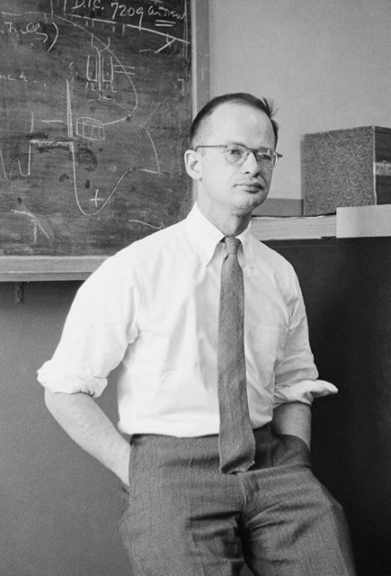
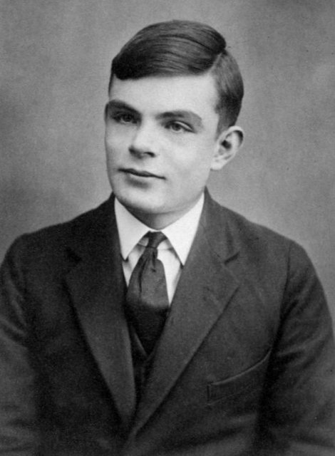
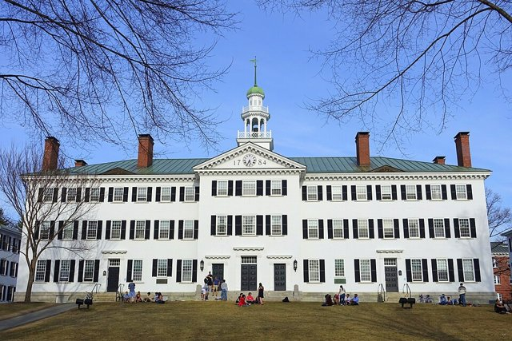
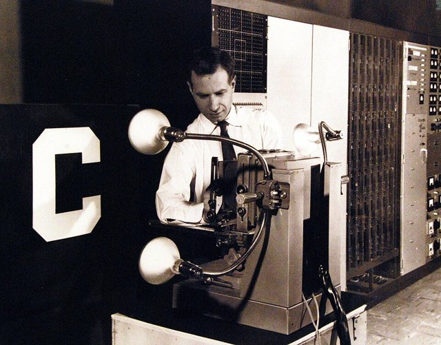
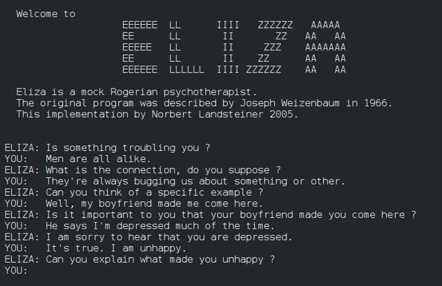

<!--
內容整理自本機筆記〈AI 發展大事記：從人工神經元到生成式 AI〉與〈AI 發展大事記2〉（圖表\ 資料夾），合併兩份年表並以台灣用語改寫。
兩份筆記的出入與處理：
- 感知器：第一份列1957年、第二份列1958年。羅森布拉特在1957年提出構想的技術報告，1958年發表論文並展示 Mark I 感知器，此處列在1958年並說明。
- 第二次 AI 寒冬：第一份寫「1987－1990年代初」，第二份寫「1987–1993」，採後者。
- 2026年的事件經網路查證（2026年10月）：
  - Project Glasswing 與 Claude Mythos Preview 於2026年4月7日發布（Anthropic 官方頁面 anthropic.com/glasswing）。
  - Claude Fable 5 與 Claude Mythos 5 於2026年6月9日發布；美國商務部工業與安全局6月12日下令暫停對外國人提供，6月30日解除管制，7月1日起恢復存取（CNBC、CNN 等報導）。
  - CERN 與 Mistral AI 於2026年10月15日簽署意向書，合作開發粒子物理基礎模型（路透社稱之為 Flare，CERN 官方公告未使用此名稱），尚無時程與預算，屬研發計畫。
- 第一份筆記中「2026年多代理系統、代理評估與安全研究、前沿模型競爭」等屬趨勢描述，只寫進時期說明。
各事件的精確日期與部分背景細節（如深藍比分、XCON、Waymo、ChatGPT 使用者成長）係依一般公認的史實補充。
圖片皆為 Wikimedia Commons 上的公有領域（含CC0）作品（封面：1951年的圖靈）。人工神經元事件配1954年的皮茲、圖靈測試配16歲的圖靈、達特茅斯會議配今日的達特茅斯學院（CC0）、ELIZA 配後人重製的對話畫面。1990年代以後的人物、產品與模型圖片多受著作權保護，因此未配圖。
-->

# Periods
- 1943 ~ 1956 | 理論奠基期 | #495057
  人工神經元、計算理論與「機器能否思考」的問題相繼提出，為人工智慧奠定概念基礎。代表人物：圖靈、麥卡洛克、皮茲。
- 1956 ~ 1974 | AI 誕生與符號推理 | #1864ab
  達特茅斯會議讓 AI 成為正式學科，研究者以邏輯、規則與搜尋讓機器解題，也出現感知器與最早的聊天程式，但成果逐漸跟不上過高的期待。
- 1974 ~ 1993 | 專家系統與兩次 AI 寒冬 | #5c3d2e
  第一次寒冬後，專家系統把專業知識寫成規則而短暫商業化，卻因維護成本高、難以擴展而退潮；反向傳播與卷積神經網路則在低潮中默默發展。
- 1993 ~ 2012 | 機器學習與資料時代 | #2b8a3e
  統計學習、支援向量機與網路上的大量資料，讓 AI 從人寫規則轉向從資料學習；深藍、Watson、Siri 讓大眾看見 AI 的能力。
- 2012 ~ 2017 | 深度學習革命 | #e8590c
  大量資料、GPU 運算與更好的訓練方法三者結合，深層神經網路在影像、語音與圍棋上接連突破。
- 2017 ~ 2022-11 | Transformer 與大型預訓練模型 | #862e9c
  注意力機制的 Transformer 架構與大規模預訓練，帶來 BERT、GPT 系列、AlphaFold 2 與擴散模型，為生成式 AI 鋪路。
- 2022-11 ~ 2025 | 生成式 AI 爆發 | #c2255c
  ChatGPT 讓一般人以自然語言使用 AI，多模態模型、開源模型與 AI 監管相繼登場，AI 研究也獲得諾貝爾獎肯定。
- 2025 ~ 2026 | 推理模型與 AI Agent | #0ca678
  AI 從生成流暢的文字，轉向重視推理品質、使用工具與完成多步驟任務；AI 程式設計代理普及，最強模型的資安與出口管制也成為國家層級的議題。

# Events

## 1943 | 人工神經元模型

神經生理學家麥卡洛克與邏輯學家皮茲發表論文，以簡單的數學模型描述神經元的「激發／不激發」，證明神經元網路可以進行邏輯運算，為神經網路研究奠定理論基礎。

## 1950 | 圖靈測試

圖靈發表〈計算機器與智慧〉，以「機器能思考嗎？」開頭，提出後來稱為「圖靈測試」的模仿遊戲：如果人無法分辨對話的另一方是人還是機器，就可以說機器展現了智慧。

## 1951 | SNARC
明斯基與埃德蒙茲用真空管建造 SNARC，模擬約40個神經元的學習行為，是最早的神經網路機器之一。

## 1956 | 達特茅斯會議：AI 誕生

麥卡錫、明斯基、香農與羅切斯特在1955年提出研究計畫，首次使用「人工智慧」（Artificial Intelligence）一詞。1956年夏天在達特茅斯學院舉行的暑期研究計畫，通常被視為 AI 正式成為一門學科的起點。紐厄爾、賽門與蕭的「邏輯理論家」（Logic Theorist）在會上受到關注，它能以搜尋與符號推理證明數學定理。

## 1958 | 感知器與 Lisp

羅森布拉特在1957年提出、1958年發表並展示「感知器」（Perceptron），這種神經網路能從資料中調整權重來學習分類。同年麥卡錫發明 Lisp 程式語言，成為往後數十年 AI 研究的主要工具。

## 1959 | 「機器學習」一詞
IBM 的塞繆爾讓電腦跳棋程式透過與自己對弈不斷進步，並使用「機器學習」來描述讓電腦不需明確寫程式就能學習的能力。

## 1961 | 工業機器人 Unimate
第一台工業機器人 Unimate 投入通用汽車的生產線，自動化與機器人開始進入工廠。

## 1966 | ELIZA；ALPAC 報告

麻省理工學院的魏森鮑姆開發聊天程式 ELIZA，以簡單的關鍵字比對模仿心理治療師，不少使用者卻對它產生情感投射，是最早的對話系統之一。同年美國的 ALPAC 報告認為機器翻譯的成果遠不如預期，相關經費大減。

## 1969 | 《感知器》一書
明斯基與派珀特出版《感知器》，證明單層感知器連「互斥或」這樣簡單的問題都無法解決，使神經網路研究轉冷了十多年。

## 1972 | 人形機器人 WABOT-1
日本早稻田大學展開 WABOT-1 計畫（1973年完成），是世界上最早的全尺寸人形機器人之一，能步行、抓取物體，並以日語簡單對話。

## 1973 | 萊特希爾報告
英國的萊特希爾報告批評 AI 研究未能兌現當初的承諾，英國政府大幅削減 AI 研究經費。

## 1974 | 第一次 AI 寒冬
研究成果追不上過高的期待，英美政府與 DARPA 削減經費，AI 進入第一次寒冬，一直持續到1980年左右。不過寒冬並不代表研究停止，機器人、模式辨識與神經網路等領域仍持續進展。

## 1976 | 專家系統 MYCIN
史丹佛大學的 MYCIN 專家系統（1970年代中期）以數百條規則協助醫師診斷血液感染並建議抗生素，準確度可比擬專科醫師，展示了把專家知識寫成規則的潛力。

## 1980 | 專家系統商業化
迪吉多公司（DEC）採用專家系統 XCON 協助設定電腦訂單，每年省下數千萬美元，專家系統在1980年代掀起商業熱潮。

## 1982 | 日本第五代電腦計畫
日本通商產業省啟動「第五代電腦」計畫，以邏輯程式設計與知識處理為核心，引發英美等國的 AI 投資競賽，但最終未能達成目標。

## 1986 | 反向傳播
魯梅爾哈特、辛頓與威廉斯在《自然》期刊發表論文，推廣「反向傳播」演算法，讓多層神經網路能有效訓練，神經網路研究重新復甦。

## 1987 | 第二次 AI 寒冬
專家系統維護成本高、難以擴展，專用的 Lisp 機器市場也在個人電腦衝擊下崩盤，產業熱潮退去，第二次 AI 寒冬一直延續到1993年左右。

## 1989 | 卷積神經網路辨識手寫數字
貝爾實驗室的楊立昆（Yann LeCun）等人以卷積神經網路辨識手寫郵遞區號，後來發展成1998年的 LeNet-5，用於銀行支票的自動辨識。

## 1995 | 支援向量機
瓦普尼克等人提出的支援向量機（SVM）理論與應用快速發展，統計式機器學習成為主流研究方向。

## 1997-05-11 | 深藍擊敗卡斯帕洛夫
IBM 的超級電腦「深藍」以3.5比2.5擊敗西洋棋世界冠軍卡斯帕洛夫，展現專用硬體、大規模搜尋與評估函數在高難度遊戲中的威力。

## 2006 | 深度信念網路：「深度學習」興起
辛頓等人提出深度信念網路，以逐層預先訓練的方法訓練多層神經網路，「深度學習」一詞開始流行，被視為神經網路復興的開端。

## 2009 | ImageNet；Google 自動駕駛車
史丹佛大學李飛飛主導建立的 ImageNet 大規模影像資料集發表，為電腦視覺提供標準化的評比基準。同年 Google 啟動自動駕駛車研究計畫（後來的 Waymo）。

## 2011 | Watson 與 Siri
2月 IBM 的 Watson 在美國益智問答節目《Jeopardy!》擊敗兩位人類冠軍，展現自然語言理解與資訊檢索的能力。10月蘋果隨 iPhone 4S 推出語音助理 Siri，AI 走進大眾的口袋。

## 2012 | AlexNet：深度學習革命
辛頓與學生克里澤夫斯基、蘇茨克維以 GPU 訓練的深度卷積神經網路 AlexNet，在 ImageNet 競賽中把錯誤率大幅降低十多個百分點，深度學習革命正式開始。

## 2013 | word2vec
Google 的米科洛夫等人發表 word2vec，把詞語表示成向量，讓電腦能計算語意關係，例如「國王－男人＋女人≈女王」。

## 2014 | GAN；Google 收購 DeepMind
1月 Google 收購英國的 DeepMind。同年古德費洛提出生成對抗網路（GAN），讓兩個神經網路互相競爭來生成逼真的影像；序列到序列（Seq2Seq）模型也推進了機器翻譯。

## 2016-03 | AlphaGo 擊敗李世乭
DeepMind 的 AlphaGo 結合深度神經網路、蒙地卡羅樹搜尋與強化學習，以4比1擊敗韓國頂尖棋士李世乭，攻克了長期被視為 AI 難題的圍棋。

## 2017 | Transformer
Google 的研究團隊發表論文〈Attention Is All You Need〉，提出完全以注意力機制為核心的 Transformer 架構。它能有效處理長距離的關聯、適合大規模平行運算，後來成為幾乎所有大型語言模型與多模態模型的基礎。

## 2018 | GPT-1 與 BERT
6月 OpenAI 發表第一代 GPT，展示「先大規模預訓練、再微調」的生成式模型潛力；10月 Google 發表 BERT，以雙向語境預訓練大幅提升多種語言理解任務的表現。

## 2019 | GPT-2
OpenAI 發表 GPT-2，能生成連貫的長篇文字。OpenAI 起初以擔心遭濫用為由分階段公開模型，引發對 AI 安全與開放的討論。

## 2020 | GPT-3 與 AlphaFold 2
OpenAI 發表擁有1750億個參數的 GPT-3，只要在提示中給幾個範例就能完成新任務（少樣本學習）。年底 DeepMind 的 AlphaFold 2 在蛋白質結構預測競賽 CASP14 中大幅勝出，大致解決了困擾生物學界五十年的難題。擴散模型的研究也在這時快速發展。

## 2021 | Anthropic 成立；GitHub Copilot；DALL·E
一群前 OpenAI 成員創立重視 AI 安全的 Anthropic。OpenAI 公布能依文字描述生成影像的 DALL·E，GitHub 推出 AI 程式設計助手 Copilot 預覽版，AI 輔助程式設計進入實際開發流程。

## 2022 | AI 繪圖熱潮
DALL·E 2、Midjourney 與開放模型的 Stable Diffusion 相繼推出，以文字生成影像進入創作與商業應用。OpenAI 也發表以人類回饋強化學習（RLHF）訓練的 InstructGPT，讓模型更能遵循指令。

## 2022-11-30 | ChatGPT 上線
OpenAI 推出 ChatGPT，兩個月內使用者突破一億，成為史上成長最快的消費性應用之一。一般人不必寫程式，就能用自然語言請 AI 寫作、解釋概念、寫程式，引爆生成式 AI 浪潮。

## 2023-03 | GPT-4 與 Claude
3月14日 OpenAI 發表能接受文字與影像輸入的 GPT-4，同一天 Anthropic 推出 Claude。Google 也推出 Bard（2024年更名為 Gemini），大型模型的競爭快速白熱化。

## 2023 | 開源模型與 AI Agent
Meta 發布開放權重的 LLaMA 系列，開源模型生態興起；LangChain 等工具讓語言模型更容易連接資料庫與外部服務。AI Agent（代理）成為新的研發方向：從單次回答走向規劃、使用工具與執行多步驟任務。

## 2024 | Sora、GPT-4o、o1 與歐盟《AI 法案》
2月 OpenAI 展示影片生成模型 Sora；5月推出整合文字、影像與語音即時互動的 GPT-4o；9月推出推理模型 o1，以更多推理運算提升數學與程式能力。歐盟《人工智慧法案》通過並於8月生效，是全球第一部全面規範 AI 的法律。同年 AlphaFold 3 發表，蘋果等公司也把 AI 助理整合進手機與作業系統。

## 2024-10 | 諾貝爾獎頒給 AI 研究
諾貝爾物理獎頒給霍普菲爾德與辛頓的類神經網路研究；化學獎頒給貝克的蛋白質設計，以及 DeepMind 的哈薩比斯與瓊珀的 AlphaFold 蛋白質結構預測。

## 2025-01 | DeepSeek-R1
中國的 DeepSeek 發布開放權重的推理模型 DeepSeek-R1，以遠低於同業的訓練成本達到頂尖推理能力，震撼業界與股市，引發對推理訓練、模型效率與開放權重的討論。

## 2025 | AI 程式設計代理與 Vibe Coding
Claude Code 等 AI 程式設計代理普及，AI 從程式碼補全走向跨檔案修改、執行測試與除錯；卡帕西提出的「Vibe Coding」（以自然語言描述需求、讓 AI 寫程式）成為新的開發模式。AI 在數學、生物等科學研究中的應用也持續擴大。

## 2025-05 | 新一代前沿模型
5月 Anthropic 推出 Claude 4，8月 OpenAI 推出 GPT-5，11月 Google 推出 Gemini 3，前沿模型在推理、程式設計與多模態能力上持續競逐。

## 2026-04-07 | Project Glasswing 與 Claude Mythos Preview
Anthropic 宣布 Project Glasswing，只把尚未公開的 Claude Mythos Preview 提供給 AWS、蘋果、Google、微軟、NVIDIA、Linux 基金會等少數關鍵產業夥伴與開源開發者，限定用於找出並修補軟體安全漏洞，因為這個模型找出與利用漏洞的能力已超越絕大多數人類專家。

## 2026-06-09 | Claude Fable 5 與 Mythos 5
Anthropic 發布新一代、等級高於 Opus 的 Claude Fable 5 與 Mythos 5：Fable 5 對大眾開放，Mythos 5 則是放寬部分防護、僅限審核過的夥伴使用的版本。6月12日美國商務部以國家安全為由，要求暫停對外國人提供這兩個模型，Anthropic 被迫全面停止存取；6月30日商務部解除管制，7月1日起逐步恢復。這是前沿 AI 模型首次受到出口管制的重大事件。

## 2026-10-15 | CERN 與 Mistral 合作粒子物理基礎模型
歐洲核子研究組織（CERN）與法國的 Mistral AI 簽署意向書，計畫以大型強子對撞機數十億次模擬碰撞資料，訓練專門用於粒子物理的基礎模型（路透社稱為 Flare），用來取代部分軌跡重建與粒子辨識演算法。這仍是研發計畫，尚未公布時程與預算，代表 AI 正從通用文字模型走向科學專用的基礎模型。
