<!--
內容整理自本機筆記《大航海時代》（D:\Books\md\歷史\世界史\大航海時代，網頁版在知識圖譜的「1-6-1.大航海時代」）。
- 48個年份檔各成一則事件，說明採用該檔的「案件摘要」（1518伊斯帕尼奧拉天花沒有案件摘要，改用「案發現場」），結尾以「→ 對外連結」連到知識圖譜上的完整案件卷宗（在新分頁開啟）；摘要中提到其他案件的連結也改為連到知識圖譜。
- 時期依筆記 README 年表的六個分段。README 各段的年代範圍之間有空檔（如1453–1479、1588–1600），最後一段只寫到1768年，但最後一案是1780年的「第四次英荷戰爭與VOC之亡」，因此色帶改為首尾相接，最後一段延至1799年VOC解散。
- 1543鐵炮傳來、1602荷蘭東印度公司、1624熱蘭遮城也出現在日本歷史、工業革命史與台灣歷史時間軸，各自保留。
圖片來源（皆為 Wikimedia Commons 公有領域作品；部分為後世繪製，年份不一定與事件相同，見括號）：
- aod-cover.jpg：1572 Typus Orbis Terrarum Ortelius.jpg（奧特柳斯〈世界全圖〉，1572）
- aod-giraffe.jpg：Tribute Giraffe with Attendant cropped.jpg（〈瑞應麒麟圖〉：鄭和船隊帶回明朝的長頸鹿，約1414）
- aod-henry.jpg：Henry the Navigator1.jpg（航海家恩里克王子像（15世紀））
- aod-constantinople.jpg：Le siège de Constantinople (1453) by Jean Le Tavernier after 1455.jpg（勒塔維尼耶繪〈君士坦丁堡之圍〉，1455年後）
- aod-columbus.jpg："Landing of Columbus" painting at Capitol, (Washington, D.C.) LCCN2016825786.jpg（范德林〈哥倫布登陸〉（美國國會大廈圓形大廳畫作的照片，裁出畫面部分））
- aod-cantino.jpg：1502 Cantino.jpg（1502年坎提諾世界地圖，畫有托德西利亞斯分界線）
- aod-gama.jpg：Gregório Lopes - Vasco da Gama (ca 1524).jpg（格雷戈里奧·洛佩斯〈達伽馬像〉，約1524）
- aod-cabral.jpg：Desembarque de Pedro Álvares Cabral em Porto Seguro.jpg（〈卡布拉爾登陸塞古魯港〉，1900）
- aod-waldseemuller.jpg：Ct000725C-wh012 5-Universalis cosmographia secundum Ptholomaei traditionem et Americi Vespucii alioru-m-que lustrationes..png（1507年瓦爾德澤米勒世界地圖）
- aod-albuquerque.jpg：Afonso de Albuquerque.jpg（阿布奎基像（16世紀））
- aod-balboa.jpg：Vasco Nunez de Balboa taking possession of the Pacific Ocean; with inset bust profile LCCN2006691881.jpg（〈巴爾博亞宣布占有太平洋〉，1726年版畫）
- aod-smallpox.jpg：FlorentineCodex BK12 F54 smallpox.jpg（《佛羅倫斯手抄本》中的天花病患，約1585）
- aod-victoria.jpg：Detail from a map of Ortelius - Magellan's ship Victoria.png（奧特柳斯地圖上的麥哲倫船隊維多利亞號，1590）
- aod-tenochtitlan.jpg：Conquista-de-México-por-Cortés-Tenochtitlan-Painting-Détail.png（〈科爾特斯征服墨西哥〉局部，17世紀後半）
- aod-atahualpa.jpg：La Captura de Atahualpa - Juan Lepiani 1920s.png（萊皮亞尼〈俘虜阿塔瓦爾帕〉，1920年代）
- aod-potosi.jpg：Capitulo-CIX.jpg（謝薩·德·萊昂《秘魯編年史》中的波托西銀山，1553）
- aod-macau.jpg：Amacao.jpg（德布里版畫中的澳門，約1598）
- aod-mercator.jpg：Mercator 1569 world map composite.jpg（1569年墨卡托世界地圖）
- aod-galleon.jpg：Reception of the Manila Galleon by the Chamorro in the Ladrones Islands, ca. 1590.jpg（《節本》中查莫洛人迎接馬尼拉大帆船，約1590）
- aod-drake.jpg：Drake’s ship with billowing sails, 1588.png（德雷克的船，1588）
- hob-armada.jpg：Elizabeth I (Armada Portrait).jpg（〈伊莉莎白一世的無敵艦隊肖像〉（與霍布斯時間軸共用））
- aod-voc.jpg：Hendrik Cornelisz. Vroom - The Return in Amsterdam of the Second Expedition to the East Indies - WGA25409.jpg（弗魯姆〈第二次東印度遠征船隊返抵阿姆斯特丹〉，1599）
- aod-quebec.jpg：Champlain Habitation de Quebec.jpg（尚普蘭繪〈魁北克居所〉，約1608）
- aod-mareliberum.jpg：001 - Mare Liberum - KW 893 G 6 - frontpage (cropped).jpg（格勞秀斯《海洋自由論》書名頁）
- aod-hirado.jpg：HiradoVOCfactory(montanus-1669).jpg（平戶的荷蘭商館（1669年蒙塔努斯書中版畫））
- aod-batavia.jpg：AMH-4599-NA Map of Batavia and environs.jpg（巴達維亞及其周邊地圖，約1628）
- aod-zeelandia.jpg：Zeelandia from Dutch.jpg（荷蘭時期的熱蘭遮城，約1635）
- aod-riebeeck.jpg：Charles Davidson Bell - Landing of Van Riebeeck at the Cape of Good Hope in 1652.jpg（查爾斯·貝爾〈范里貝克登陸好望角〉，19世紀）
- aod-brookes.jpg：Brookes slave ship, British Library.jpg（布魯克斯號奴隸船的裝載圖，1787）
- aod-anson.jpg：George Anson, 1st Baron Anson, Admiral of the Fleet, 1697-1762 RMG L8416.jpg（安森像，1748年以前）
- aod-harrison.jpg：John Harrison (Gemälde).jpg（哈里森像，1767）
- aod-endeavour.jpg：HMS Endeavour off the coast of New Holland, by Samuel Atkins c.1794.jpg（阿特金斯〈新荷蘭海岸外的奮進號〉，約1794）
-->

# Periods
- 1405 ~ 1479 | 序幕：東方的船隊與西方的動機 | #868e96
  鄭和的寶船隊七下西洋後戛然而止；葡萄牙攻下休達、恩里克王子推動大西洋探險，越過博哈多爾角；鄂圖曼攻陷君士坦丁堡，切斷東方商路，西歐更有理由另尋新航路。
- 1479 ~ 1519 | 打通印度洋 | #1971c2
  迪亞士繞過好望角、哥倫布抵達美洲、達伽馬抵達印度，西葡以條約瓜分世界；葡萄牙以要塞加艦隊建立據點帝國，奪取馬六甲，「美洲」之名首次印上地圖。
- 1519 ~ 1557 | 環球與新大陸征服 | #c92a2a
  麥哲倫船隊完成環球航行；科爾特斯與皮薩羅以少數兵力加上疾病與同盟滅亡阿茲特克與印加；波托西銀礦的白銀湧入歐洲，引發價格革命。
- 1557 ~ 1600 | 太平洋絲銀之路與私掠戰爭 | #e67700
  葡萄牙人居留澳門，馬尼拉大帆船以美洲白銀換中國絲綢；墨卡托投影改變航海圖，英國以私掠挑戰西班牙，無敵艦隊覆滅，資本由安特衛普北移阿姆斯特丹。
- 1600 ~ 1713 | 公司帝國時代 | #2f9e44
  英、荷東印度公司以股份與特許壟斷經營亞洲貿易，荷蘭據巴達維亞、平戶、熱蘭遮城建立東亞貿易網；航海法案與三角貿易成形，光榮革命讓荷蘭的制度嫁接到英國的規模上。
- 1713 ~ 1799 | 尾聲：科學探險時代 | #6741d9
  奴隸專營權被證券化，安森環球揭露壞血病之害，哈里森航海鐘解決經度問題，庫克船長的科學航行把太平洋畫上地圖；荷蘭東印度公司在第四次英荷戰爭後走向破產，1799年解散。

# Events

## 1405 | 鄭和下西洋

1405 年，明成祖朱棣命宦官鄭和率 62 艘巨艦、2 萬餘人自劉家港啟程。此後至 1433 年，七下西洋，遍及東南亞、南亞、波斯灣與東非，寶船長逾百公尺，是當時世界最大的木船艦隊。他不建殖民地，而是冊封國王、擒海盜陳祖義、帶回長頸鹿（麒麟），以厚往薄來的朝貢貿易宣示天威。然而 1433 年鄭和死於歸途後，遠洋戛然而止。這樁案件的兇手是「成本效益不對稱」：一場只賺威望、不賺財政的工程，一旦皇帝意志消失、文官接管預算，注定被裁撤。

[→ 對外連結：鄭和下西洋：世界最大艦隊為何消失](https://chad-liu.github.io/books/html/1-6-1.大航海時代/1405-鄭和下西洋.html)

## 1415 | 休達與恩里克
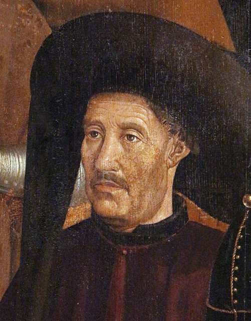
1415 年 8 月，葡萄牙國王若昂一世率軍渡海攻陷北非港市休達（Ceuta）。表面是十字軍餘緒——奪取摩爾人糧倉與黃金中轉站；真正的戰利品是情報：阿拉伯海圖、撒哈拉商路傳聞。國王第三子恩里克（1394–1460）在薩格里什系統資助造船、製圖與天文，人稱「航海者亨利」。他發明的不是單一技術，而是一套「國家主導的研發投資」：卡拉維爾帆船加三角帆，讓葡萄牙人得以逆風返航、深入大西洋。這樁案件的兇手是「邊緣創新」：地中海商路被大國壟斷，小國只能向未知的大洋要出路。

[→ 對外連結：休達與恩里克：小國如何發明國家級研發](https://chad-liu.github.io/books/html/1-6-1.大航海時代/1415-休達與恩里克.html)

## 1434 | 博哈多爾角突破
1434 年，葡萄牙航海家吉爾·埃亞內斯（Gil Eanes）在恩里克王子（[休達與恩里克](https://chad-liu.github.io/books/html/1-6-1.大航海時代/1415-休達與恩里克.html)）資助下，駕卡拉維爾帆船越過西撒哈拉的博哈多爾角（Cabo Bojador，「凸出之角」），平安返航。此前十二年，葡萄牙船隊十五次至角下而返——水手相信角外是「綠色黑暗之海」，海水沸騰、皮膚變黑。

本卷 1415 年休達之後直跳 1453 年君士坦丁堡陷落——**中間恩里克事業最關鍵的技術突破，竟無一案**。沒有博哈多爾，就沒有 1444 年幾內亞、1488 年好望角，航海學校只是空殼。

[→ 對外連結：博哈多爾角：吉爾·埃亞內斯如何越過中世紀的恐懼之角](https://chad-liu.github.io/books/html/1-6-1.大航海時代/1434-博哈多爾角突破.html)

## 1453 | 君士坦丁堡陷落

1453 年 5 月 29 日，21 歲的鄂圖曼蘇丹穆罕默德二世以巨炮轟塌狄奧多西城牆，君士坦丁堡陷落，末代皇帝君士坦丁十一世戰死。千年拜占庭終結，更重要的是：東方商路的總閘門換了主人。鄂圖曼關稅加上威尼斯—馬穆魯克層層加價，一包胡椒到威尼斯已是產地價數倍。西歐的推理很直白——與其向中間商低頭，不如直達產地。這樁案件的兇手是「加價鏈」：每一道關稅都在為哥倫布與達伽馬眾籌經費。

[→ 對外連結：君士坦丁堡陷落：中間商太貴，歐洲決定繞路](https://chad-liu.github.io/books/html/1-6-1.大航海時代/1453-君士坦丁堡陷落.html)

## 1479 | 阿爾卡索瓦斯條約
1479 年 9 月 4 日，卡斯蒂利亞與葡萄牙簽《阿爾卡索瓦斯條約》（Alcáçovas）：卡斯蒂利亞承認葡萄牙壟斷博哈多爾角以南航路、幾內亞黃金與奴隸貿易及馬德拉、亞速爾、佛得角群島；葡萄牙承認卡斯蒂利亞對加那利群島主權。教宗西克斯圖斯四世 1481 年以詔書背書。

本卷 1453 年陷落之後直跳 1488 年迪亞士——**中間三十五年葡萄牙壟斷權從何而來、1494 年托德西利亞斯抄誰的作業，全無交代**。1479 即答案：1494 只是 1479 的跨大西洋續集。

[→ 對外連結：阿爾卡索瓦斯條約：托德西利亞斯之前的那條線](https://chad-liu.github.io/books/html/1-6-1.大航海時代/1479-阿爾卡索瓦斯條約.html)

## 1488 | 迪亞士與好望角
1488 年，葡萄牙船長巴爾托洛梅烏·迪亞士（Dias）率兩艘卡拉維爾南下，被風暴吹離海岸十三天，再回頭已越過非洲南端。他登上摩塞爾灣，立石柱（padrao）宣示主權，繼續東進至大魚河口。因船員拒絕前行，被迫返航，回程中望見那座海角，葡王若昂二世將其命名為「好望角」（Cabo da Boa Esperanca），原名「風暴角」。這樁案件的兇手是「未知海域的風險決策」：季風、洋流與壞血病組成的黑箱前，船長用船員的恐懼投票決定了返航點——而僅僅返航，就足以證明印度航線存在。

[→ 對外連結：迪亞士與好望角：在譁變邊緣轉彎的船頭](https://chad-liu.github.io/books/html/1-6-1.大航海時代/1488-迪亞士與好望角.html)

## 1492 | 哥倫布與大交換

1492 年 10 月 12 日，熱那亞人哥倫布（Colombo）率三船在加勒比瓜納哈尼島登陸，堅稱抵達「印度」，稱原住民為 indios。他算錯了地球周長（採用托勒密低估值，又誤用阿拉伯里換算），卻替卡斯提爾撞見了一整塊大陸。真正的案件不在登陸，而在之後：馬鈴薯、玉米、番茄西傳，馬匹、鐵器、天花東傳——「哥倫布大交換」重寫了全球生態與人口。這樁案件的兇手是「生態帝國主義」：舊大陸的病菌比槍炮先贏得了戰爭。

[→ 對外連結：哥倫布與大交換：算錯數學，卻撞見新世界](https://chad-liu.github.io/books/html/1-6-1.大航海時代/1492-哥倫布與大交換.html)

## 1494 | 托德西利亞斯條約

1494 年 6 月 7 日，西班牙與葡萄牙在教宗亞歷山大六世調停下簽訂《托德西利亞斯條約》：以佛得角群島以西 370 里格的子午線為界，「西歸西、東歸東」瓜分尚未發現的世界。葡萄牙保住東航印度線與巴西東部，西班牙拿下美洲大部。這是人類首次用一條經線分配全球。這樁案件的兇手是「零和賽局的規則化」：與其為未知大陸開戰，不如先立國際法的雛形——哪怕分的是一張空白地圖。

[→ 對外連結：托德西利亞斯條約：教宗拿筆瓜分世界](https://chad-liu.github.io/books/html/1-6-1.大航海時代/1494-托德西利亞斯條約.html)

## 1498 | 達伽馬與香料帝國

1498 年 5 月 20 日，瓦斯科·達伽馬（Gama）率四船抵印度卡利卡特，帶回的胡椒、肉桂在里斯本售出逾數十倍利潤。曼努埃爾一世自稱「幾內亞與印度航海之主」，葡萄牙轉向「炮艦貿易」：以艦炮轟開港口、強索通行證（cartaz）、壟斷香料。這樁案件的兇手是「暴力壟斷的利潤公式」：當貨價差夠大，買大炮比講價划算。

[→ 對外連結：達伽馬與香料帝國：炮艦開出的暴利](https://chad-liu.github.io/books/html/1-6-1.大航海時代/1498-達伽馬與香料帝國.html)

## 1500 | 卡布拉爾與巴西
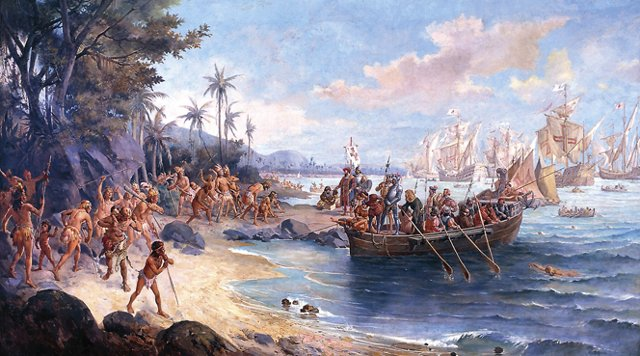
1500 年 3 月，佩德羅·阿爾瓦雷斯·卡布拉爾率十三艘船、千餘人離開里斯本，循達伽馬的航路前往印度；4 月 22 日，船隊在西大西洋偏南的位置「發現」了巴西海岸。葡萄牙官方將其定性為意外發現，同時立即以《托德西利亞斯條約》（見 [托德西利亞斯條約](https://chad-liu.github.io/books/html/1-6-1.大航海時代/1494-托德西利亞斯條約.html)）主張此地位於葡萄牙半球。謎題是：**這究竟是意外，還是秘密執行的既定計畫？**探案價值在於：巴西的「誕生」一開始就是一樁證據不足的懸案，而葡萄牙的應對——「先占名分、緩慢開發」——定下了巴西往後三百年的殖民地性格。

[→ 對外連結：卡布拉爾抵巴西：一場「意外」的帝國開張](https://chad-liu.github.io/books/html/1-6-1.大航海時代/1500-卡布拉爾與巴西.html)

## 1503 | 卡薩契約之家
1503 年 1 月 20 日，西葡雙王在塞維亞設立「印度契約之家」（Casa de la Contratación）：凡駛向新大陸之船須在此登記、驗貨、納稅（almojarifazgo），船長與領航員須持證上崗，海圖為國家機密（Padrón Real），香料、白銀回程須入庫抽成二十分之一（quinto real 上繳王室五分之一）。此案的兇手是「許可證＋密圖＋抽成」：卡斯蒂利亞以一棟衙門把大洋變成收費公路——重商主義最早的海關＋航管局＋情報局三合一。

[→ 對外連結：卡薩契約：西班牙如何用一棟房子管住半個地球](https://chad-liu.github.io/books/html/1-6-1.大航海時代/1503-卡薩契約之家.html)

## 1507 | 瓦爾德澤米勒地圖與America命名
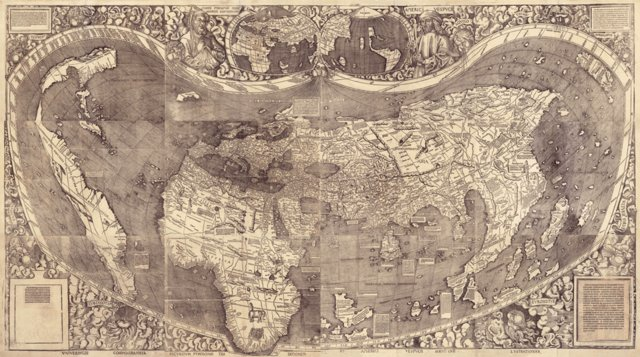
1507 年 4 月，洛林聖迪耶的學者馬丁·瓦爾德澤米勒（Waldseemüller）出版《宇宙學入門》附十二幅木刻世界地圖，在南美洲上首印「AMERICA」一名——以佛羅倫斯航海家亞美利哥·韋斯普奇（Vespucci）之名為新大陸命名，並稱其為「第四大洲」。此圖印千份，今僅存一份藏美國國會圖書館，稱「美國出生證明」。

本卷 1492 年哥倫布之後直談 1494 年分贓、1498 年達伽馬——**新大陸如何從「亞洲群島」變成「新大洲」、知識如何追認發現，全無一案**。1507 即印刷機對大發現的追認判決。

[→ 對外連結：瓦爾德澤米勒地圖：America 如何被印上紙](https://chad-liu.github.io/books/html/1-6-1.大航海時代/1507-瓦爾德澤米勒地圖與America命名.html)

## 1509 | 迪烏海戰與艦炮時代
1509 年 2 月 3 日，**迪烏海戰**（Diu！印度古吉拉特！）：葡萄牙（Francisco de Almeida！18 艘！）vs 古吉拉特—埃及馬穆魯克—威尼斯聯合艦隊（100＋船！）——**葡萄牙艦炮殲滅聯軍**——**印度洋制海權易手**；此前：1498 達伽馬（卡利卡特！）、1505 Almeida 副王（「藍水政策」！要塞鏈！）、1507 霍爾木茲（阿爾布克爾克！）、1508 喬爾（Chaul！葡敗！子戰死！Almeida 復仇！）——**復仇之戰**。此後：1510 果阿（首府！）、1511 馬六甲（[馬六甲陷落](https://chad-liu.github.io/books/html/1-6-1.大航海時代/1511-馬六甲陷落.html)！）、1515 霍爾木茲——**葡萄牙香料帝國**。這樁案件是「艦炮的降維打擊」：**舷側炮＋卡拉克 vs 接舷戰＋槳帆船**。

[→ 對外連結：迪烏海戰：葡萄牙艦炮與印度洋](https://chad-liu.github.io/books/html/1-6-1.大航海時代/1509-迪烏海戰與艦炮時代.html)

## 1511 | 馬六甲陷落
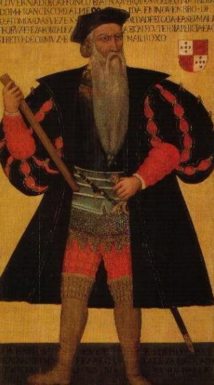
1511 年 8 月，葡萄牙總督阿方索·德·阿布奎基（Albuquerque）率 17 艘船、千餘人攻陷馬六甲——東西貿易的總樞紐：中國絲綢瓷器、印度紡織品、香料群島丁香肉豆蔻在此換手。阿布奎基築堡（A Famosa）、發行貨幣、強留工匠，把商港變成要塞。這樁案件的兇手是「咽喉點（chokepoint）」：誰控制海峽，誰就對全流域收稅。

[→ 對外連結：馬六甲陷落：掐住咽喉的世界](https://chad-liu.github.io/books/html/1-6-1.大航海時代/1511-馬六甲陷落.html)

## 1513 | 巴爾博亞望見太平洋
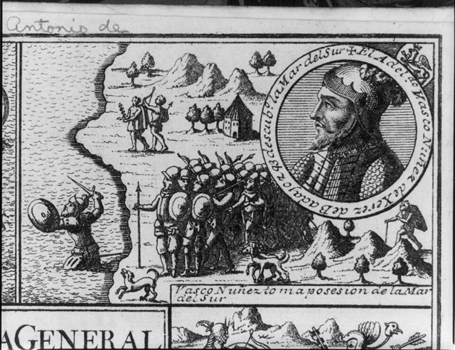
1513 年 9 月 25 日（儒略曆），西班牙殖民者瓦斯科·努涅斯·德·巴爾博亞（Balboa）率 190 名西班牙人、千名印第安嚮導翻越巴拿馬地峽，登山望見無際大洋，以聖米迦勒為之命名「南海」（Mar del Sur），涉水持旗宣稱歸卡斯蒂利亞所有。此為歐洲人首次從美洲西岸望見太平洋。

本卷 1511 年馬六甲之後直跳 1519 年麥哲倫——**麥哲倫為何堅信向西可達香料群島、美洲身後還有一洋，全無前因**。1513 即麥哲倫的情報源：美洲是可逾越的窄門，門後另有一洋。

[→ 對外連結：巴爾博亞望見太平洋：南海如何把美洲變成窄門](https://chad-liu.github.io/books/html/1-6-1.大航海時代/1513-巴爾博亞望見太平洋.html)

## 1518 | 伊斯帕尼奧拉天花

1518–19 年，天花（隨西班牙船隻）橫掃伊斯帕尼奧拉島（今海地/多明尼加）——泰諾人本已因勞役銳減（1492 年數十萬，一說，1518 年剩數萬），天花後再減九成（一說），幾近滅絕。此後：非洲奴隸輸入（1518 年西葡許可證，開始直接販奴）補充勞力。**哥倫布大交換的第一頁，為何是死亡名單？**

> **病毒比帆船快嗎？當舊大陸的病遇到新大陸的人，九成死亡率是偶然，還是數學必然？**

[→ 對外連結：伊斯帕尼奧拉天花：人口崩潰的起點](https://chad-liu.github.io/books/html/1-6-1.大航海時代/1518-伊斯帕尼奧拉天花.html)

## 1519 | 麥哲倫環球航行
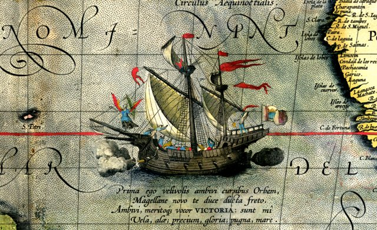
1519 年 9 月，葡萄牙人麥哲倫（Magalhaes）率 5 船 270 人自西班牙塞維亞啟程西航尋香料。1520 年穿過麥哲倫海峽，1521 年橫渡太平洋後死於菲律賓麥克坦島（被酋長拉普拉普殺死）。餘部焚毀破船，1522 年 9 月僅維多利亞號 18 人返抵西班牙，載回的丁香恰好償還全程成本。這樁案件的兇手是「補給線的極限」：人類首次用肉身丈量了地球的真實尺度——大得差點回不來。

[→ 對外連結：麥哲倫環球航行：18 個人與一船香料的歸來](https://chad-liu.github.io/books/html/1-6-1.大航海時代/1519-麥哲倫環球航行.html)

## 1521 | 特諾奇蒂特蘭陷落
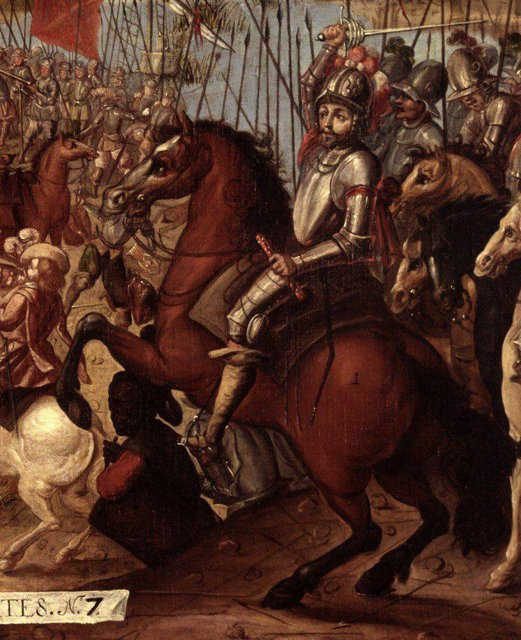
1521 年 8 月 13 日，阿茲特克首都特諾奇蒂特蘭陷落。兇手埃爾南·科爾特斯（Hernán Cortés）1519 年登陸時僅約 500 名西班牙士兵、十餘匹馬、十餘門火炮，卻在兩年內滅亡了人口約 20–30 萬的湖上巨都、統治數百萬人的阿茲特克帝國。本案的真兇不是「五百勇士」，而是三重槓桿的疊加：**鋼鐵火器與騎兵的戰術衝擊 × 天花的生物武器化 × 特拉斯卡拉等屬邦的倒戈同盟**。五百人只是引信，炸藥是帝國自身的結構。

[→ 對外連結：特諾奇蒂特蘭陷落：五百人如何滅掉一個帝國](https://chad-liu.github.io/books/html/1-6-1.大航海時代/1521-特諾奇蒂特蘭陷落.html)

## 1523 | 海事保險與共同海損
1523 年前後，安特衛普交易所出現成套印刷海事保單：商人為一船胡椒付 8–12% 保費，若沉沒、被劫，承保人按約賠付；同時「共同海損」（general average）成文法化——為救船而拋貨，全船按貨值分攤損失。此案的兇手是「保費＝機率×損失」：大航海把一次性賭博變成可定價的風險商品——保險把船東的恐懼切成碎股，賣給不暈船的人。

[→ 對外連結：海事保險與共同海損：安特衛普商人如何為沉船定價](https://chad-liu.github.io/books/html/1-6-1.大航海時代/1523-海事保險與共同海損.html)

## 1532 | 卡哈馬卡之戰
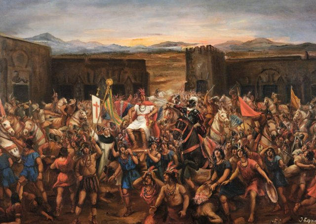
1532 年 11 月 16 日，秘魯卡哈馬卡廣場，弗朗西斯科·皮薩羅（Francisco Pizarro）以 168 名西班牙人（含 62 名騎兵、4 門火炮），伏擊俘虜了率領約 8 萬大軍的印加皇帝阿塔瓦爾帕（Atahualpa）。阿塔瓦爾帕為贖身許諾填滿一間「贖金密室」的黃金（約 6 噸黃金、12 噸白銀），贖金到手後仍被處死。本案的兇手是「斬首戰略」：**集權神王帝國的神經中樞只有一個，斬斷它，八萬人的身體即刻癱瘓**。168 人打的不是軍隊，而是一個作業系統的單點故障。

[→ 對外連結：卡哈馬卡之戰：168人俘虜一個皇帝](https://chad-liu.github.io/books/html/1-6-1.大航海時代/1532-卡哈馬卡之戰.html)

## 1543 | 鐵炮傳來
1543 年，一艘載有葡萄牙人的中國帆船漂流至日本南端的種子島（Tanegashima）。船上有兩名葡萄牙火繩槍手與一支火繩槍（arquebus）。島主種子島時堯花重金買下兩支槍，並命刀匠八板金兵衛仿製。僅數十年後，織田信長在 1575 年長篠之戰中動用約三千支鐵炮，以三段擊破武田騎兵，終結了日本的冷兵器時代。本案的兇手是「技術擴散的 S 曲線」：**漂流的偶然 × 日本刀匠的高超模仿力 × 戰國大名的軍備競賽**，一支槍在三十年內複製為數十萬支。鐵炮傳來是軍事革命在東亞最乾淨的一次實驗。

[→ 對外連結：鐵炮傳來：一支漂流的火繩槍如何改寫日本戰爭](https://chad-liu.github.io/books/html/1-6-1.大航海時代/1543-鐵炮傳來.html)

## 1545 | 波托西銀礦與價格革命

1545 年，印第安人迭戈·瓦爾帕（Diego Huallpa）在今日玻利維亞的波托西（Potosí）發現了塞羅里科（Cerro Rico，富山）銀礦——人類史上最大的單一銀礦。此後三十年，配合汞齊法（ patio process）與米塔（mita）強制勞役，波托西年產銀數百噸，連同墨西哥薩卡特卡斯銀礦，經塞維亞流入歐洲。1500–1600 年間歐洲物價上漲約三至四倍，史稱「價格革命」。本案的兇手是貨幣數量論：**白銀供給暴增 × 貨幣流通加速，而商品供給跟不上**。西班牙抱著銀山致富，卻得了「資源詛咒」——物價飛漲、工業空洞、國王六度破產。

[→ 對外連結：波托西銀礦與價格革命：白銀如何淹沒歐洲](https://chad-liu.github.io/books/html/1-6-1.大航海時代/1545-波托西銀礦與價格革命.html)

## 1557 | 澳門居留地

1557 年，葡萄牙人獲廣東官府默許在澳門半島定居，向明朝繳納地租（每年約五百兩白銀），藉口是「晾曬貢物、借地棲舶」。此後近三百年，澳門既非葡萄牙殖民地、亦非純中國縣治：中國設香山縣丞、同知、海關徵稅斷案，葡萄牙設議事會（Senado）自治、築城自衛——史稱「中葡共管」。本案的兇手是「雙贏的模糊」：**明朝要海防與關稅＋葡萄牙要中日轉口港，雙方以模糊主權換取實利**。澳門證明：居留地（leased settlement）與殖民地是兩種完全不同的物種。

[→ 對外連結：澳門居留地：租來的地方如何住三百年](https://chad-liu.github.io/books/html/1-6-1.大航海時代/1557-澳門居留地.html)

## 1564 | 西班牙珍寶船隊體制
1564 年起，西班牙王室立法固定「印度船隊」（Flota de Indias）：每年兩支護航船隊——新西班牙船隊赴韋拉克魯斯、加萊恩船隊赴南美，哈瓦那集結後返航塞維亞，全程武裝蓋倫護航、商船編隊同行。此案的兇手是「時刻表＋編隊＋護航」：西班牙以軍事物流把加勒比海盜時代終結了半個世紀——白銀變成按班次發車的國家快遞。

[→ 對外連結：西班牙珍寶船隊體制：用時刻表打敗海盜的白銀 конвей帶](https://chad-liu.github.io/books/html/1-6-1.大航海時代/1564-西班牙珍寶船隊體制.html)

## 1569 | 墨卡托投影
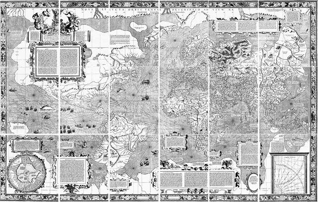
1569 年，佛蘭德製圖師格拉杜斯·墨卡托（Gerardus Mercator）在杜伊斯堡出版世界地圖《航海用新版地球平面圖》（Nova et Aucta Orbis Terrae Descriptio），18 張圖幅拼成 2×1.3 公尺大壁掛。圖上高緯地區被拉得巨大——格陵蘭看起來跟非洲一樣大，阿拉斯加腫如饅頭，水手卻愛不釋手：因為圖上任意兩點連直線，就是恆向線（loxodrome），照著羅盤方位角一路開就到。本案的兇手是**等角數學**：用一個故意扭曲面積的投影，換取角度不變，讓羅盤第一次可以直接讀地圖。

[→ 對外連結：墨卡托投影：把圓地球攤平成方格紙](https://chad-liu.github.io/books/html/1-6-1.大航海時代/1569-墨卡托投影.html)

## 1571 | 馬尼拉大帆船

1571 年，米格爾·德·雷加斯皮（Miguel López de Legazpi）在呂宋建馬尼拉城。此前 1565 年，安德烈斯·德·烏爾達內塔（Andrés de Urdaneta）發現太平洋東返航路（tornaviaje）：由菲律賓北上至北緯 38–40 度乘西風帶返抵阿卡普爾科。自此，美洲白銀東行、中國絲綢瓷器西運的馬尼拉大帆船（Galeón de Manila）貿易運轉近二百五十年（1571–1815），年均一至兩艘巨艦橫渡太平洋。本案的兇手是「洋流＋季風的導航破解」：**北赤道暖流西行、黑潮—北太平洋暖流東返，配上菲律賓與阿卡普爾科的季風窗口**，人類第一次把全球最大銀礦（波托西、薩卡特卡斯）與全球最大商品市場（明清中國）直接焊接。

[→ 對外連結：馬尼拉大帆船：第一條跨太平洋供應鏈](https://chad-liu.github.io/books/html/1-6-1.大航海時代/1571-馬尼拉大帆船.html)

## 1580 | 德雷克環球與私掠
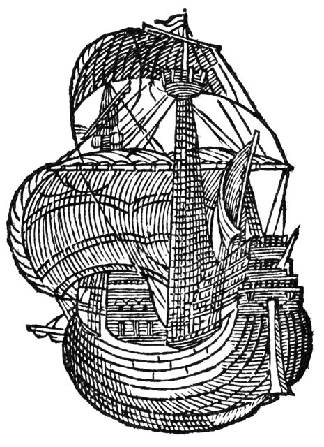
1577–1580 年，弗朗西斯·德雷克（Francis Drake）駕金鹿號（Golden Hind）環球一周，沿途洗劫西班牙在智利、秘魯的太平洋港口與寶船卡卡富戈號（Nuestra Señora de la Covadonga，實為 Cacafuego），掠得白銀黃金價值連城，1580 年 9 月返抵普利茅斯。伊莉莎白一世親登金鹿號封德雷克為爵士，並以私掠許可證（letter of marque）將海盜合法化。本案的兇手是「戰爭外包經濟學」：**英格蘭無力維持常備海軍對抗西班牙，便以分成制把戰爭承包給海盜**——女王出牌照、海盜出命、王室分贓。德雷克一航的利潤據估超過英格蘭全年王室歲入，投資回報率高達數十倍。

[→ 對外連結：德雷克環球與私掠：女王的海盜生意經](https://chad-liu.github.io/books/html/1-6-1.大航海時代/1580-德雷克環球與私掠.html)

## 1585 | 安特衛普陷落
1585 年 8 月，西班牙名將帕爾馬公爵（Parma）經長期圍城奪下安特衛普——當時北歐最大的商港與金融中心，此地承轉香料、英呢、波羅的海穀物與德意志白銀。城陷前，安特衛普向新教叛軍交涉失敗，兩年內**一半人口（逾十萬人，多為商人、工匠、資本家）北逃阿姆斯特丹**。今日讀者熟悉的阿姆斯特丹「黃金時代」、1602 年 VOC、1609 年證交所，本質上都是這批難民船隻運來的。

[→ 對外連結：安特衛普陷落：資本北遷與荷蘭黃金時代的引爆點](https://chad-liu.github.io/books/html/1-6-1.大航海時代/1585-安特衛普陷落.html)

## 1588 | 無敵艦隊覆滅

1588 年夏，西班牙腓力二世遣麥迪納·西多尼亞公爵（Duke of Medina Sidonia）率「無敵艦隊」（Armada Invencible）約 130 艘船、兩萬八千人遠征英格蘭，計畫與帕爾馬公爵在尼德蘭的陸軍會師渡海。結果在加萊遭英軍火船夜襲陣形大亂，格拉沃利訥（Gravelines）海戰遭英艦炮擊，復被強風吹入北海，被迫繞行蘇格蘭、愛爾蘭返航，損失約三分之一至一半船隻、萬餘人，登陸夢碎。本案的兇手不是一場海戰，而是「系統失配」：**高大運輸型蓋倫＋接舷戰術＋陸海協同失靈，撞上英軍低矮機動蓋倫＋舷側速射炮＋本土補給線**，再由大西洋風暴執行死刑。1588 年是海權從地中海—西班牙模式轉向大西洋—英國模式的分水嶺。

[→ 對外連結：無敵艦隊覆滅：大帝國如何在海峽溺斃](https://chad-liu.github.io/books/html/1-6-1.大航海時代/1588-無敵艦隊覆滅.html)

## 1595 | 荷蘭首航遠東
1595 年 4 月，柯內里斯·豪特曼（Cornelis de Houtman）率四艘船、249 人從阿姆斯特丹出發，直航東印度群島。航程慘烈：三年後生還僅 89 人、折損三艘船，商業收益近於零——**但這趟「賠本的遠征」證明了一件事：繞過里斯本中轉，荷蘭可以直接買到胡椒**。此後短短六年，數十支「遠程公司」競逐香料航線，惡性競價最終逼出 1602 年 VOC 的合併。本案是 1600/1602 兩家特許公司的直接前因。

[→ 對外連結：荷蘭首航遠東：從航路手冊到 VOC 的前夜](https://chad-liu.github.io/books/html/1-6-1.大航海時代/1595-荷蘭首航遠東.html)

## 1600 | 英國東印度公司
1600 年 12 月 31 日，伊莉莎白一世頒發皇家特許狀（Royal Charter），授予「倫敦商人貿易東印度公司」（Governor and Company of Merchants of London Trading into the East Indies）對好望角以東貿易的十五年壟斷權。218 名商人集資約 68,000 鎊，1601 年第一支船隊（詹姆斯·蘭開斯特率四艘船）駛向亞齊與萬丹。這樁案件的兇手是「特許壟斷＋股份集資」：女王用一紙特許狀，把高風險的遠洋貿易變成合法壟斷；商人則把分散的資本聚成一家可以鑄幣、建堡、養兵、簽約的「公司—國家」。從此，帝國擴張不再只靠國王的艦隊，而靠股東的錢包。

[→ 對外連結：英國東印度公司：特許狀如何生出一家「公司即國家」](https://chad-liu.github.io/books/html/1-6-1.大航海時代/1600-英國東印度公司.html)

## 1602 | 荷蘭東印度公司

1602 年 3 月 20 日，荷蘭聯省議會通過特許狀，將六個城市各自為戰的「前公司」（voorcompagnieën）合併為聯合東印度公司（VOC，Vereenigde Oostindische Compagnie），給予亞洲貿易壟斷權及鑄幣、建堡、養兵、締約宣戰之權。VOC 向全民募股 642 萬荷蘭盾，股權可自由轉讓，1602 年阿姆斯特丹證券交易所應運而生。這樁案件的兇手是「永久資本＋可交易股份」：VOC 把一次性探險變成永不散夥的企業，把沉船風險切成千萬小片賣給市民——人類第一家現代股份公司就此下水，而它同時是國家、軍隊與壟斷者。

[→ 對外連結：荷蘭東印度公司：世界第一家股份公司如何買下大洋](https://chad-liu.github.io/books/html/1-6-1.大航海時代/1602-荷蘭東印度公司.html)

## 1608 | 望遠鏡與天文導航
1608 年 10 月，荷蘭米德爾堡眼鏡匠漢斯·利珀希（Hans Lippershey）向總督申請「望遠鏡」專利——兩片透鏡套進筒子，遠物拉近三倍。消息傳到威尼斯，伽利略 1609 年磨出 20 倍鏡，對準月亮看到環形山、對準木星看到四顆衛星，人類第一次發現「月亮不是光滑天體、地球不是唯一中心」。水手更快學會另一課：用望遠鏡看星、看月、看木衛食表，可以定經度、定緯度、看敵艦。本案的兇手是**光學的軍事化**：一片凹透鏡＋一片凸透鏡，把天文學變成導航儀，把海戰變成先看到先開炮。

[→ 對外連結：望遠鏡與天文導航：把星星變成羅盤](https://chad-liu.github.io/books/html/1-6-1.大航海時代/1608-望遠鏡與天文導航.html)

## 1608 | 魁北克與皮毛帝國
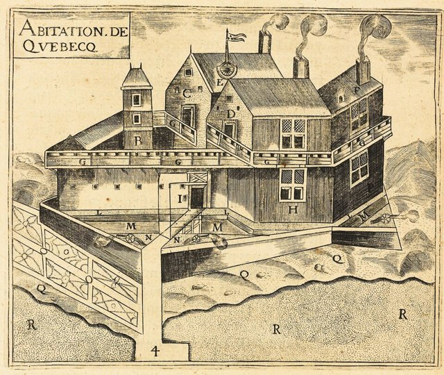
1608 年 7 月 3 日，法國探險家薩繆埃爾·德·尚普蘭（Samuel de Champlain）在聖羅倫斯河北岸的狹口（Québec，阿尔衮昆語「河道變窄處」）築起三棟木屋、立起柵欄，魁北克城誕生。這不是又一座短命的漁民季節營地——尚普蘭帶來的是完整的設計圖：**以魁北克為轉運樞紐，以皮毛特許公司為資本，以與休倫族（Huron-Wendat）的軍事同盟為貨源**，把聖羅倫斯河—五大湖變成一條「海狸皮高速公路」。這樁案件的兇手是「資源邊疆的貿易—同盟體系」：歐洲人要的是皮毛，原住民要的是鐵器與火槍，誰能組織起橫跨數千公里的信用與結盟網，誰就是北美的主人。

[→ 對外連結：魁北克與皮毛帝國：海狸皮如何建成新法國](https://chad-liu.github.io/books/html/1-6-1.大航海時代/1608-魁北克與皮毛帝國.html)

## 1609 | 海洋自由論
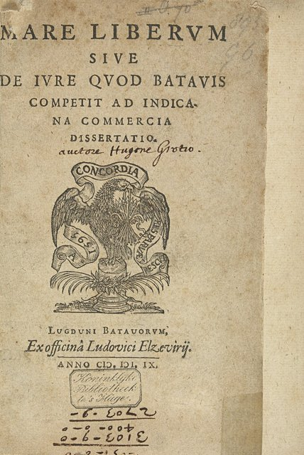
1609 年，荷蘭法學家格勞秀斯（Hugo Grotius）匿名出版《海洋自由論》（Mare Liberum）：主張公海不得為任何國家佔有，葡萄牙對印度洋的壟斷無效，荷蘭奪取葡船合法。此書實為 VOC 委託的辯護狀——1603 年荷蘭船長劫葡萄牙大帆船「聖卡塔琳娜號」，貨值三百萬盾，股東要分贓，法庭要法理。此案的兇手是「自然法＋公海自由」：荷蘭以法學把搶劫洗成貿易自由——國際法的出生證，是一張分贓許可證。

[→ 對外連結：海洋自由論：格勞秀斯如何用一本書為荷蘭搶劫辯護](https://chad-liu.github.io/books/html/1-6-1.大航海時代/1609-海洋自由論.html)

## 1616 | 荷蘭平戶商館
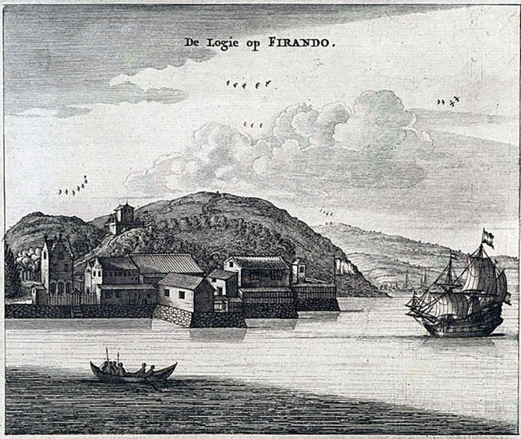
1616 年，荷蘭東印度公司（VOC，見 [荷蘭東印度公司](https://chad-liu.github.io/books/html/1-6-1.大航海時代/1602-荷蘭東印度公司.html)）在九州平戶設立正式商館。此前荷蘭船 1609 年已抵日並獲幕府通商許可；平戶商館成為荷蘭在日本的第一個常設據點，後來英國東印度公司也於 1613 年在此設館。謎題是：**為何歐洲人在日本的據點設在小小的平戶，而非更繁榮的長崎或博多？而這個據點為何在 1641 年被遷往長崎出島、成為鎖國體制的唯一歐洲窗口？**平戶商館的故事，是鎖國體制形成前的「開放實驗」——它證明幕府的對外政策是精心管理的壟斷，而非閉關。

[→ 對外連結：荷蘭平戶商館：鎖國前夜的歐亞貿易橋頭堡](https://chad-liu.github.io/books/html/1-6-1.大航海時代/1616-荷蘭平戶商館.html)

## 1619 | 巴達維亞
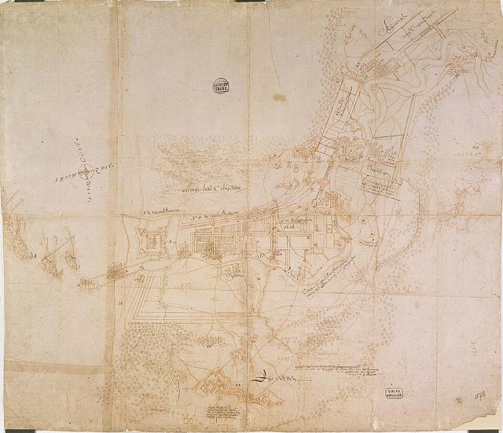
1619 年 5 月，荷蘭東印度公司（VOC）總督揚·彼得斯佐恩·科恩（Jan Pieterszoon Coen）攻下爪哇萬丹外海的雅加達，夷平舊城，在廢墟上按荷蘭運河城市規格建起新城——巴達維亞（Batavia，今雅加達）。這不是普通的殖民據點：科恩的命令是把巴達維亞建成 VOC 在亞洲的「總部＋倉庫＋造船廠＋法庭」。這樁案件的兇手是「總部經濟學」：VOC 發現，沒有中央樞紐的壟斷只是紙上特許狀；有了巴達維亞，香料、胡椒、絲綢、銀元可以在此集散調度，艦隊可以就近維修補給，總督可以對整個亞洲下令——壟斷從此有了機器，而機器的燃料是暴力。

[→ 對外連結：巴達維亞：VOC如何用一座總部鎖死香料群島](https://chad-liu.github.io/books/html/1-6-1.大航海時代/1619-巴達維亞.html)

## 1624 | 熱蘭遮城
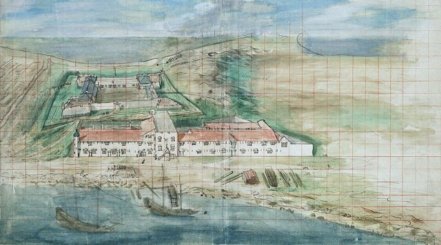
1624 年，荷蘭東印度公司（VOC）在台灣西南海岸的大員沙洲（今台南安平）築起熱蘭遮城（Fort Zeelandia），此後又在對岸本島建普羅民遮城（Provintia）。荷蘭人為何選中這片瘴癘沙洲？因為明朝海禁、荷蘭被逐出澎湖（1622–1624），急需一個既能對接中國絲綢、又能連通日本白銀與東南亞胡椒的「中立轉運點」。這樁案件的兇手是「轉口港的區位選擇」：台灣不產絲銀，卻卡在東亞貿易三角的正中央——荷蘭人把大員變成倉庫與海關，賺的不是生產利潤，而是轉手與抽稅的「位置租金」。詳見台灣史 1624 年篇。

[→ 對外連結：熱蘭遮城：大員沙洲上的轉口港算計](https://chad-liu.github.io/books/html/1-6-1.大航海時代/1624-熱蘭遮城.html)

## 1642 | 塔斯曼與南方大陸
1642 年 11 月，荷蘭東印度公司（VOC）水手亞伯·塔斯曼（Abel Tasman）奉巴達維亞總督安東尼·范迪門之命，率海恩斯凱克號與澤哈恩號南下，11 月 24 日望見一座大島（以總督為名稱范迪門地，即塔斯馬尼亞），12 月 13 日再見「西岸有高山」的另一大陸西岸（南島，即紐西蘭），與毛利人衝突後北返，1643 年掠過斐濟、湯加返抵巴達維亞。他沒有找到傳說中的「未知南方大陸」（Terra Australis），卻把兩塊新陸地畫進了世界地圖。這樁案件的兇手是「地圖空白的預期報酬」：空白越大，想像的金銀與香料越多，資助探險的期望值就越高——人類為填補想像而出海，又為真實的海岸線失望而歸。

[→ 對外連結：塔斯曼與南方大陸：地圖空白如何召喚艦隊](https://chad-liu.github.io/books/html/1-6-1.大航海時代/1642-塔斯曼與南方大陸.html)

## 1651 | 航海法案與大西洋體系
1651 年 10 月，英格蘭護國公克倫威爾推動國會通過《航海法案》（Navigation Act）：凡運往英格蘭及其殖民地的貨物，必須由英國船隻或原產地船隻運輸，實質把荷蘭「海上馬車夫」逐出英國貿易圈。這不是單純的貿易保護——它是重商主義的世界觀宣言：**財富即金銀，貿易即戰爭，殖民地是母國的種植園與市場**。法案直接點燃三次英荷戰爭（1652–1674），並與蔗糖、菸草、奴隸合流，拼出「三角貿易」的大西洋體系。這樁案件的兇手是「重商主義謬誤＋利潤鏈」：國家用法律壟斷航線，商人用奴隸榨出蔗糖，蔗糖釀出朗姆酒再買更多奴隸——大西洋變成一部自我供油的機器。

[→ 對外連結：航海法案與大西洋體系：重商主義如何綁架海洋](https://chad-liu.github.io/books/html/1-6-1.大航海時代/1651-航海法案與大西洋體系.html)

## 1652 | 好望角補給站
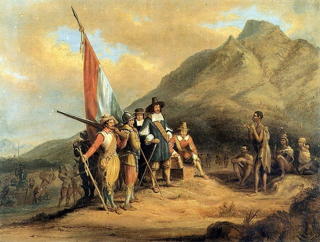
1652 年 4 月，VOC 派范里貝克（Jan van Riebeeck）率三艘船、約 90 人在桌灣（Table Bay）建補給站——任務書寫得極小：**種菜、養牲口、醫壞血病，替歐洲—巴達維亞航線的船員續命**。誰也沒預料，這個「醫院兼菜園」會長成開普殖民地，並在兩百年後成為南非黑人、白人與混血族群歷史的起點之一。本案展示殖民史的反覆律：**為航線服務的據點，最終反過來塑造大陸**。

[→ 對外連結：好望角補給站：通往東印度的中繼與殖民地意外](https://chad-liu.github.io/books/html/1-6-1.大航海時代/1652-好望角補給站.html)

## 1662 | 皇家非洲公司與中段航程

1662 年前後，英王查理二世頒發特許狀成立**皇家冒險者入非洲貿易公司**（Royal Adventurers into Africa，1672 重組為皇家非洲公司 RAC），專營西非黃金、象牙與奴隸——並把「中段航程」（Middle Passage）制度化：非洲奴隸裝船 → 跨大西洋售予加勒比與北美種植園 → 換糖菸棉回英。本案補上本卷 1651 航法案（三角貿易）與 1713 阿西恩托案（奴隸專營）之間的缺失環節：**三角貿易如何從偶發商機，變成有會計科目、有保單、有王冠特許的常態機器**。

[→ 對外連結：皇家非洲公司與中段航程：三角貿易的機器](https://chad-liu.github.io/books/html/1-6-1.大航海時代/1662-皇家非洲公司與中段航程.html)

## 1688 | 光榮革命與貿易體制
1688 年，英國議會邀請荷蘭執政奧蘭治的威廉率軍入英，詹姆斯二世流亡，威廉與瑪麗共同加冕，並接受《權利法案》。這場幾乎未流血的政變，常被記為憲政史事件，但它同時是一次**貿易體制的政變**：荷蘭的資本、金融技術與航海人才隨威廉渡海，與英國的規模與資源結合，孕育出 1694 年英格蘭銀行、國債制度與後續的航海帝國。謎題是：**為何海權與貿易霸權在 1688 年後開始從阿姆斯特丹移向倫敦？**答案是：光榮革命不是荷蘭的失敗，而是「荷蘭模式」的嫁接成功——制度被移植，規模被放大，原產地反而被超越。

[→ 對外連結：光榮革命與貿易體制：一場政變如何重寫海權的遊戲規則](https://chad-liu.github.io/books/html/1-6-1.大航海時代/1688-光榮革命與貿易體制.html)

## 1713 | 烏得勒支條約與阿西恩托
1713 年烏得勒支條約終結西班牙王位繼承戰爭：英國取得直布羅陀、紐芬蘭，更關鍵的是三十年「阿西恩托」（Asiento）——每年向西屬美洲輸入 4800 名奴隸＋一艘 500 噸許可船（navío de permiso）的壟斷權。此案的兇手是「戰爭賠款證券化」：英國把戰場勝利兌換成大西洋的人口＋白銀提款權——奴隸貿易特許即 floating 的國債，南海公司（South Sea Company）即持票人。

[→ 對外連結：烏得勒支條約與阿西恩托：英國如何用奴隸專營權買下大西洋](https://chad-liu.github.io/books/html/1-6-1.大航海時代/1713-烏得勒支條約與阿西恩托.html)

## 1744 | 安森環球與壞血病
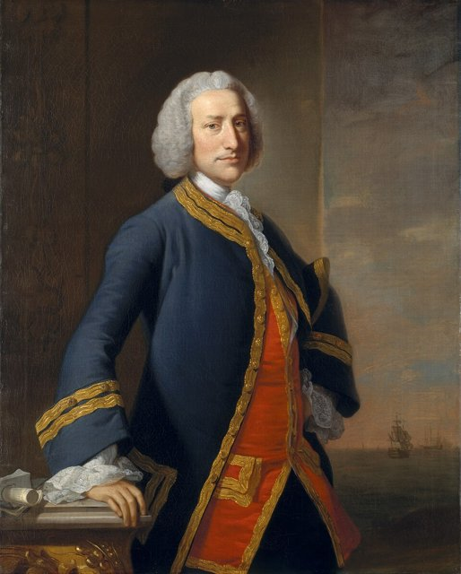
1740–1744 年，英國准將喬治·安森（George Anson）率八艦、四千人西出劫掠西班牙珍寶船，繞合恩角、焚派塔（Paita）、橫渡太平洋、俘馬尼拉大帆船「科瓦東加號」（得銀百萬兩），1744 年 6 月僅一艦、二百人返航。隨軍牧師沃爾特《安森環球航行記》（1748）暢銷歐洲，庫克人手一冊。

本卷 1713 年烏得勒支之後直跳 1761 年航海鐘、1768 年庫克——**中間四十八年，科學探險如何從私掠轉為測量、壞血病如何從天譴變課題，全無交代**。安森即轉折：最後的私掠、最初的科學遠航。

[→ 對外連結：安森環球與壞血病：四千人出海兩百人回來](https://chad-liu.github.io/books/html/1-6-1.大航海時代/1744-安森環球與壞血病.html)

## 1761 | 航海鐘與經度
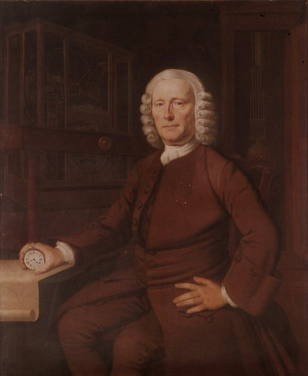
1761 年 11 月，哈里森（John Harrison）的 H4 航海鐘隨船從樸茨茅斯出發前往牙買加，81 天航程誤差僅 5 秒——相當於經度誤差不到 2 公里。1714 年英國《經度法案》懸賞 2 萬英鎊（相當於今日上億台幣）求解「海上定經度」，天文學家主張看月亮（月距法），木匠哈里森卻說「帶一塊准的錶上船就行」。皇家學會嘲笑他半世紀，國王喬治三世親自為他請命，1773 年 80 歲才拿到獎金。本案的兇手是**時間即空間**：地球 24 小時轉 360°，錶差 1 分鐘、經度差 15 角分——把經度問題變成鐘錶問題。

[→ 對外連結：航海鐘與經度：木匠打敗了天文學家](https://chad-liu.github.io/books/html/1-6-1.大航海時代/1761-航海鐘與經度.html)

## 1768 | 庫克船長首航
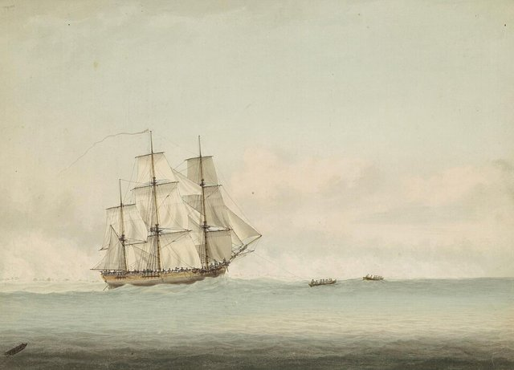
1768 年 8 月 26 日，詹姆斯·庫克（James Cook）率奮進號（Endeavour）自普利茅斯啟航，檯面任務是率皇家學會天文學家赴大溪地觀測 1769 年金星凌日，密件任務是觀測結束後南下尋找「未知南方大陸」、宣稱主權。他此行測繪了紐西蘭全岸（1769–1770）與澳洲東岸（1770），命名新南威爾斯並在植物灣登陸。這樁案件的兇手是「科學探險＋帝國製圖」：金星凌日給了出海的正當性，經度測定給了精確製圖的技術，空白地圖給了佔領的合法性——科學與帝國在同一張海圖上簽名。

[→ 對外連結：庫克船長首航：金星凌日與帝國製圖術](https://chad-liu.github.io/books/html/1-6-1.大航海時代/1768-庫克船長首航.html)

## 1780 | 第四次英荷戰爭與VOC之亡
1780 年 12 月，英國對荷蘭宣戰——第四次英荷戰爭（1780–84）。戰場上，荷蘭海軍在多格灘等役潰敗，海外商站被封鎖劫掠；財務上，VOC 已是靠阿姆斯特丹市府與國家貸款續命的僵屍公司，戰爭直接打斷了亞洲航線的收入血流。1783 年和約割讓部分據點；1799 年 12 月 31 日，VOC 特許狀到期，**政府正式接收其債務與領土——世界第一家股份公司正式死亡**。本案為本卷 1602 年「VOC 誕生」補上結案報告。

[→ 對外連結：第四次英荷戰爭與 VOC 之亡：公司帝國的破產清算](https://chad-liu.github.io/books/html/1-6-1.大航海時代/1780-第四次英荷戰爭與VOC之亡.html)
