<!--
內容整合自「美國南北戰爭大事記（1860—1877）」（D:\Books\md\歷史\西方歷史\美國南北戰爭大事記（1860—1877）.md；html 版在 D:\Books\html\1-1.西方歷史），以自己的話改寫。
時期依大事記的分期；「聯邦勝利」與「重建時代」在大事記中重疊於1865年，這裡以1865年4月李將軍投降為界。
處理方式：
- 大事記的背景從1619年非洲人被帶到維吉尼亞寫起，經1776年《獨立宣言》與1787年制憲的三項妥協；這些寫進1820年事件的內文，不另立事件，避免橫向檢視前面空出兩百年。
- 大事記提醒的幾個區別寫進內文：《解放奴隸宣言》只適用於叛亂地區，不等於全國廢奴；第十三條修正案1月國會通過、12月才批准生效；六月節不是宣言發布日也不是廢奴生效日；李將軍投降不等於所有南軍同日投降；1877年是重建的終點，不是種族平等問題的終點。
- 自由民局1865年3月3日設立，依實際日期放在1865年3月。
- 1868年彈劾案（5月）與第十四條修正案批准（7月），依日期排序。
- 譯名依大事記：蓋茨堡、格蘭特、羅伯特·李、謝爾曼、石牆傑克遜；人名用·分隔（大事記作・）。
- 傷亡與兵力數字，大事記只列約18萬名非裔士兵在聯邦陸軍服役，其餘不列。
圖片來源（皆為 Wikimedia Commons 公有領域／CC0 作品；註明「共用」者沿用其他時間軸已有的圖片）：
- acw-uncletom.jpg：Harriet Beecher Stowe, Uncle Tom's Cabin, vol. 1, 1852, title page (clean).jpg（《湯姆叔叔的小屋》1852年初版第一卷書名頁）
- acw-dredscott.jpg：Oil on Canvas Portrait of Dred Scott (cropped).jpg（德雷德·史考特油畫像，1888（密蘇里歷史學會））
- acw-johnbrown.jpg：John Brown being interrogated.jpg（〈約翰·布朗在哈珀斯渡口受審訊〉，1859年的版畫）
- acw-lincoln.jpg：Thomas Hicks - Leopold Grozelier - Presidential Candidate Abraham Lincoln 1860 - cropped to lithographic plate.jpg（希克斯繪、格羅齊利埃製版〈總統候選人亞伯拉罕·林肯〉，1860）
- acw-sumter.jpg：Bombardment of Fort Sumter, Charleston Harbor.jpg（柯里爾與艾夫斯〈砲擊查爾斯頓港的薩姆特堡〉，1861）
- acw-monitor.jpg：Battle between the Monitor and Merrimac-fought March 9th 1862 at Hampton Roads, near Norfolk, Va. LCCN91482238.jpg（〈莫尼特號與梅里麥克號（維吉尼亞號）之戰，1862年3月9日〉，石版畫（美國國會圖書館））
- acw-antietam.jpg：Kurz & Allison - Battle of Antietam.jpg（柯爾茨與艾利森〈安提坦戰役〉，1878）
- acw-emancipation.jpg：First Reading of the Emancipation Proclamation of President Lincoln by Francis Bicknell Carpenter.png（卡本特〈林肯首次宣讀解放奴隸宣言〉，1864）
- acw-gettysburg.jpg：Thure de Thulstrup - L. Prang and Co. - Battle of Gettysburg - Restoration by Adam Cuerden 0.5.jpg（圖爾斯特魯普〈蓋茨堡戰役〉（皮克特衝鋒），1887）
- acw-vicksburg.jpg：Siege of Vicksburg by Kurz & Allison.jpg（柯爾茨與艾利森〈維克斯堡圍城戰〉，1888）
- acw-draftriot.jpg：New York Draft Riots Harpers colored asylum.jpg（《哈潑週刊》插圖：暴徒焚燒紐約有色人種孤兒院，1863）
- acw-address.jpg：Lincoln's Gettysburg Address, Gettysburg.jpg（林肯發表蓋茨堡演說當天的群眾，1863年11月19日的照片）
- acw-grant.jpg：Ulysses S Grant, Cold Harbor, VA, June 1864..jpg（格蘭特在冷港，1864年6月的照片）
- acw-sherman.jpg：Sherman's march to the sea LCCN2003679761.jpg（達利〈謝爾曼向海進軍〉，版畫（美國國會圖書館））
- acw-freedmen.jpg：The Freedmen's Bureau - Drawn by A.R. Waud. LCCN92514996.jpg（沃德〈自由民局〉，《哈潑週刊》插圖，1868）
- acw-appomattox.jpg：Surrender of General Lee - at Appomattox, C.H. Va. April 9th 1865 LCCN2002695772.jpg（〈李將軍在阿波馬托克斯法院村投降，1865年4月9日〉，石版畫（美國國會圖書館））
- acw-assassination.jpg：Assassination of President Lincoln (color) - Currier and Ives.jpg（柯里爾與艾夫斯〈林肯總統遇刺〉，1865）
- acw-juneteenth.jpg：Emancipation Day celebration - 1900-06-19 (cropped).jpg（德州奧斯汀的解放日（六月節）慶祝活動，1900年6月19日）
- acw-impeachment.jpg：Andrew Johnson impeachment trial.jpg（〈參議院審理安德魯·詹森彈劾案〉，《哈潑週刊》插圖，1868）
- acw-fifteenth.jpg：15th-amendment-celebration-1870.jpg（慶祝第十五條修正案的石版畫，1870）
- acw-klan.jpg：Worse than Slavery (1874), by Thomas Nast.jpg（湯瑪斯·納斯特〈比奴隸制更糟〉，三K黨與白人聯盟的諷刺畫，1874）
-->

# Periods
- 1820 ~ 1859 | 南北矛盾加深 | #868e96
  建國時對奴隸制度的妥協，隨著領土向西擴張一再被掀開：新州該不該准許奴隸制？從密蘇里妥協、美墨戰爭、逃奴法、堪薩斯流血衝突到德雷德·史考特案，爭議從國會辯論擴大成街頭暴力。
- 1860 ~ 1861 | 脫離聯邦與開戰 | #c92a2a
  反對奴隸制擴張的林肯當選，南方十一州相繼退出聯邦、成立聯盟國；薩姆特堡的砲聲開啟戰爭，第一次牛奔河戰役打破了速戰速決的幻想。
- 1862 ~ 1863 | 戰爭轉折與解放奴隸 | #1971c2
  北方在西部節節推進，東部卻屢敗於李將軍；安提坦之後林肯宣布解放奴隸，戰爭目標從恢復聯邦擴大到終結奴隸制。1863年7月，蓋茨堡與維克斯堡讓戰局倒向北方。
- 1864 ~ 1865-04 | 北方的總體戰與勝利 | #2f9e44
  格蘭特統籌全局，以持續施壓消耗南方；謝爾曼攻下亞特蘭大、向海進軍，林肯連任；1865年4月里士滿陷落，李將軍在阿波馬托克斯投降，五天後林肯遇刺。
- 1865-04 ~ 1877 | 重建時代 | #5f3dc4
  三條憲法修正案廢除奴隸制、確立公民權與投票權，國會與總統為重建條件激烈對抗；但三K黨的暴力、經濟恐慌與政治疲勞讓重建逐漸失去支持，1877年聯邦撤手，南方走向種族隔離。

# Events

## 1820-03-06 | 密蘇里妥協
約1619年，一艘船把非洲人帶到維吉尼亞的詹姆斯敦附近，隨著菸草種植園擴張，奴隸制逐漸制度化、世襲化。1776年《獨立宣言》高舉人人生而平等，奴隸制卻原封不動；1787年的憲法沒有寫出「奴隸」一詞，卻以三項妥協保護它：五分之三條款讓蓄奴州多得眾議院席次，逃奴條款保障追捕，1808年以前不得禁止奴隸輸入。美國向西擴張後，每有新州加入，國會就要決定它准不准許奴隸制，因為這關係到參議院的勢力平衡。1820年的妥協讓密蘇里以蓄奴州、緬因以自由州加入，並在路易斯安那購地中大致以北緯36度30分為界，以北原則上禁止奴隸制。南北平衡暫時保住，問題並未解決。

## 1831-08 | 納特·特納起義
維吉尼亞的被奴役者納特·特納領導起義，遭到鎮壓後，南方各地加強管制被奴役者與自由黑人社群。它不是戰爭的直接起因，卻顯示奴隸制下的反抗與壓迫從未停止。

## 1846 ~ 1848 | 美墨戰爭
美國打贏美墨戰爭，取得今日加州、內華達、猶他、亞利桑那等大片土地。1846年眾議員威爾莫特提案禁止在這些新領土實行奴隸制，雖未成為法律，卻讓爭議變成：美國擴張時，奴隸制到底該擴大、限制，還是逐步終結？

## 1850 | 1850年妥協案
加州以自由州加入聯邦，猶他與新墨西哥的奴隸制交由當地決定，首都廢除奴隸買賣，同時通過更嚴格的《逃奴法》：聯邦官員與地方社會必須協助追捕，被指為逃奴的人幾乎無法辯護。連住在自由州的人都可能被捲入，北方廢奴人士與南方的衝突更加激烈。

## 1852 | 《湯姆叔叔的小屋》
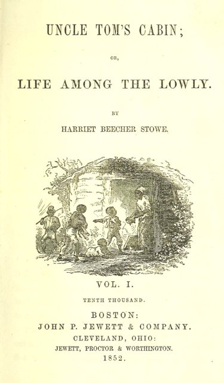
哈麗葉·比徹·斯托出版小說，描寫奴隸制下的骨肉分離與暴力，在美國與海外引起巨大迴響，讓許多北方讀者第一次直接面對奴隸制的殘酷。

## 1854-05-30 | 堪薩斯—內布拉斯加法案
法案讓堪薩斯與內布拉斯加的居民以「人民主權」自行決定是否准許奴隸制，實際上推翻了密蘇里妥協的界線。支持與反對奴隸制的移民湧入堪薩斯，反奴隸制的力量則整合成新成立的共和黨。

## 1856 | 流血的堪薩斯
1854年起，堪薩斯的蓄奴派與反奴派衝突不斷。1856年，廢奴派的約翰·布朗等人攻擊蓄奴派居民；同年，南卡羅來納的參議員布魯克斯在國會議場用手杖毆打反奴隸制的參議員薩姆納。爭議已經從辯論變成暴力。

## 1857-03-06 | 德雷德·史考特案
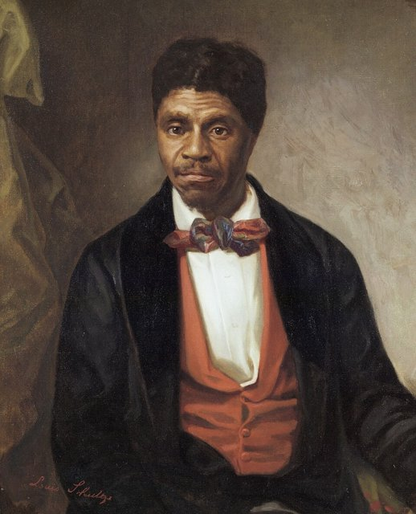
被奴役的德雷德·史考特主張自己曾住在禁止奴隸制的地區，應獲自由。最高法院判決：非洲裔美國人即使是自由人，也不能以此取得聯邦公民身分；國會也無權在聯邦領土禁止奴隸制。北方許多人因此相信，奴隸制可能藉司法向全國擴張。

## 1859-10-16 | 約翰·布朗襲擊哈珀斯渡口
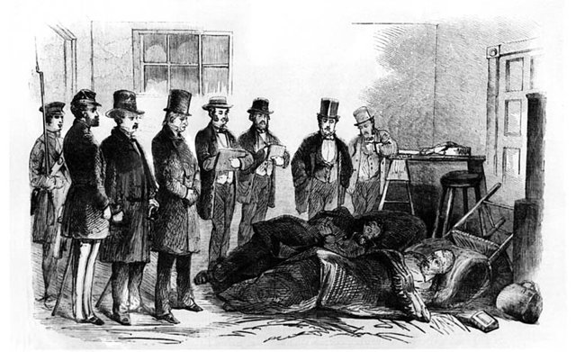
約翰·布朗率眾襲擊維吉尼亞的哈珀斯渡口聯邦軍械庫，想奪取武器、發動奴隸起義。行動失敗，他被捕並在12月2日處決。北方部分廢奴人士視他為烈士，南方則認為這證明廢奴勢力要摧毀南方社會。南北之間的互信至此崩解。

## 1860-11-06 | 林肯當選總統
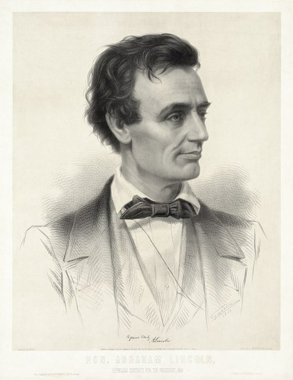
共和黨的亞伯拉罕·林肯當選第16任總統。共和黨反對奴隸制擴張到新領土，林肯當時並未主張立即廢除既有蓄奴州的奴隸制；但依賴奴隸勞動的南方擔心共和黨掌權後會逐步限制奴隸制。部分南方州的脫離宣言直接把維護奴隸制列為理由。

## 1860-12-20 | 南卡羅來納退出聯邦
南卡羅來納宣布脫離聯邦，是第一個退出的州。1861年1月，密西西比、佛羅里達、阿拉巴馬、喬治亞與路易斯安那相繼跟進，德州也隨後脫離，各州的宣言普遍以維護奴隸制為核心理由。

## 1861-02-08 | 美利堅聯盟國成立
脫離聯邦的各州代表在阿拉巴馬的蒙哥馬利集會，成立美利堅聯盟國，2月9日推選傑佛遜·戴維斯為臨時總統。北方工業、鐵路與人口占優勢，南方熟悉本土地形、在部分戰區易守難攻。美國已事實分裂，但還沒開戰。

## 1861-03-04 | 林肯就職
林肯在就職演說中表示無意干涉蓄奴州既有的奴隸制，但聯邦不容任意分裂。他此時的首要目標是阻止聯邦解體，南方領袖卻已不信任聯邦的承諾。

## 1861-04-12 | 薩姆特堡戰役
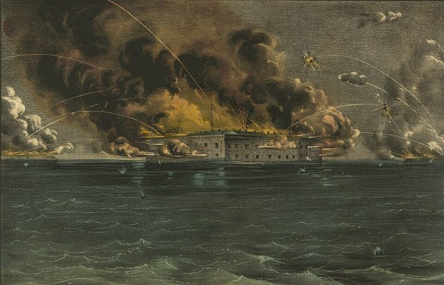
4月12日凌晨，南軍砲擊位於查爾斯頓港、仍由聯邦駐守的薩姆特堡，守軍抵抗約34小時後於13日投降。衝突從政治對峙變成武裝戰爭。4月15日林肯徵召7萬5千名民兵平亂，迫使其他南方州表態：維吉尼亞、阿肯色、北卡羅來納與田納西相繼退出，聯盟國擴大到11州；肯塔基、密蘇里、馬里蘭、德拉瓦等邊境蓄奴州則留在聯邦。

## 1861-07-21 | 第一次牛奔河戰役
北軍向維吉尼亞推進，期待一戰結束戰爭，卻被南軍擊退。南軍將領湯瑪斯·傑克遜堅守陣地，得到「石牆傑克遜」的綽號。雙方都意識到戰爭可能要打好幾年，北方開始加強訓練與組織。

## 1862-02-16 | 唐納爾森堡投降
北軍將領尤利西斯·格蘭特2月6日攻下亨利堡，16日迫使唐納爾森堡守軍投降，並因要求「無條件投降」而聲名大噪。北軍打開了深入田納西的通道。

## 1862-03-09 | 鐵甲艦之戰

3月8日至9日，南方鐵甲艦維吉尼亞號與北方鐵甲艦莫尼特號在漢普頓錨地交戰，未分勝負，卻宣告木造軍艦的時代即將結束。

## 1862-04-06 | 希洛戰役
4月6日至7日，南軍在田納西突襲北軍，北軍穩住陣腳後反攻。雙方傷亡慘重，北軍得以繼續向密西西比河流域推進，戰爭的代價遠超出所有人的預期。

## 1862-04-16 | 首都廢除奴隸制
林肯簽署法案，廢除哥倫比亞特區的奴隸制。這是針對聯邦首都的立法，和後來針對叛亂地區的《解放奴隸宣言》不同。

## 1862-04-25 | 攻占紐奧良
海軍將領法拉格特率艦隊攻下密西西比河口的紐奧良，南方最重要的商港與交通中心落入北方之手。

## 1862-06 | 半島戰役與七日戰役
北軍將領麥克萊倫率波托馬克軍團經維吉尼亞半島進逼南方首都里士滿。6月，羅伯特·李接掌北維吉尼亞軍團，在七日戰役中逼退北軍，攻占里士滿的計畫失敗。8月28日至30日，李又在第二次牛奔河戰役擊敗北軍，隨即率軍進入馬里蘭。

## 1862-09-17 | 安提坦戰役
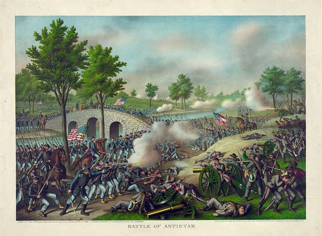
美國史上傷亡最慘重的單日戰役之一。北軍擋住李將軍深入北方的攻勢，南軍退回維吉尼亞。這不是毫無爭議的大勝，卻給了林肯宣布解放奴隸的時機，也讓英法承認南方聯盟的可能性降低。9月22日，林肯發布初步公告：凡到1863年1月1日仍在叛亂中的地區，被奴役者將獲得自由。

## 1862-12-13 | 弗雷德里克斯堡戰役
北軍強攻弗雷德里克斯堡的南軍防線，損失慘重。北方雖有人口與工業優勢，在維吉尼亞的東部戰場仍難以取勝。

## 1863-01-01 | 《解放奴隸宣言》
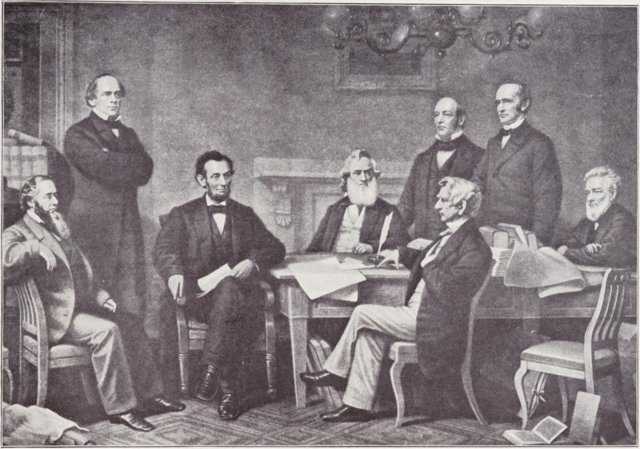
林肯正式發布宣言：仍在叛亂中的指定地區，被奴役者自即日起獲得自由，聯邦軍隊將維護他們的自由。宣言不適用於邊境蓄奴州與部分聯邦控制區，本身也沒有在全國廢除奴隸制；但它讓解放奴隸成為北方的戰爭目標，讓非裔美國人得以大量加入聯邦軍（約18萬人在陸軍服役），也讓歐洲各國更難支持一個為奴隸制而戰的南方。

## 1863-05-02 | 錢瑟勒斯維爾戰役
5月1日至4日，李將軍以較少兵力擊敗北軍，是他最著名的戰術勝利之一；但石牆傑克遜被友軍誤擊重傷，不久去世，南軍失去一位重要將領。6月20日，反對脫離聯邦的維吉尼亞西部另立為西維吉尼亞州，加入聯邦。

## 1863-07-03 | 蓋茨堡戰役
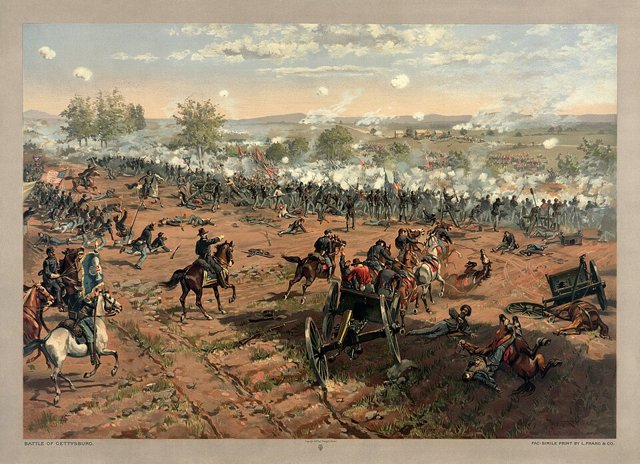
李將軍率軍進入賓夕法尼亞，想在北方土地上取得決定性勝利。7月1日至3日雙方在蓋茨堡激戰，第三天南軍發動「皮克特衝鋒」，企圖突破北軍中央，損失慘重，李將軍退回維吉尼亞。蓋茨堡通常被視為東部戰場的轉折點，但南軍並未就此崩潰，戰爭還要再打近兩年。

## 1863-07-04 | 維克斯堡投降
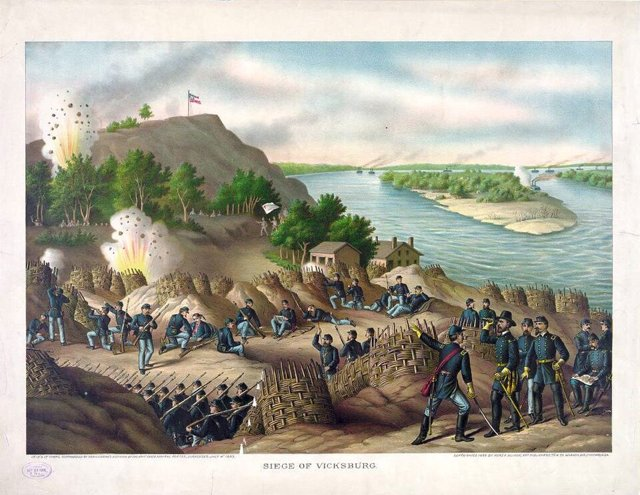
經格蘭特長期圍攻，密西西比河畔的要塞維克斯堡投降。北方掌握了密西西比河的主要航道，聯盟國的東西兩半被切斷。與蓋茨堡合起來，1863年7月的戰局明顯倒向北方。

## 1863-07-13 | 紐約徵兵暴動
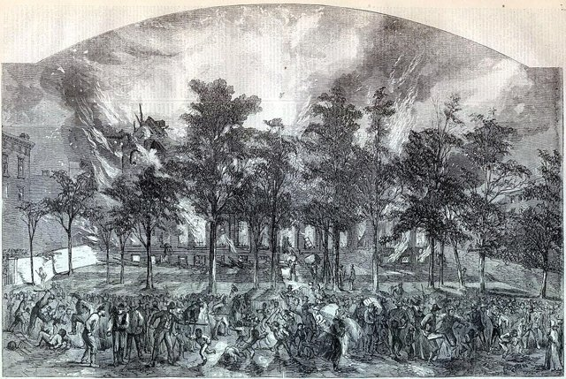
7月13日至17日，紐約市爆發反徵兵暴動：有錢人可以花錢免役或雇人代役，部分人也反對解放奴隸、擔心黑人搶工作。暴徒攻擊非裔居民與他們的財產，死傷慘重。北方支持反奴隸制，不代表所有白人都支持種族平等。

## 1863-11-19 | 《蓋茨堡演說》
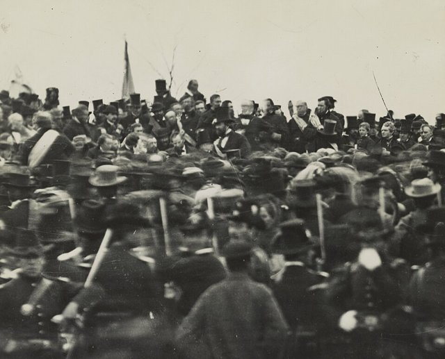
林肯在蓋茨堡國家公墓的落成典禮上發表簡短演說，以《獨立宣言》的自由與平等為根據，把戰爭說成對民主制度的考驗：這場戰爭不只是保存聯邦，更關係到一個以人民為主權來源的政府能否長存。戰爭的意義從此超越軍事勝負。

## 1864-03 | 格蘭特出任聯邦軍總司令
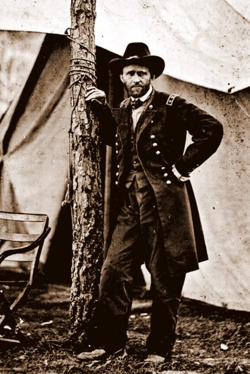
林肯任命在西部屢建戰功的格蘭特為陸軍中將、聯邦軍總司令。格蘭特不再追求單場勝利，而是讓南方各路軍隊同時承受壓力，利用北方的人力與物資優勢持續消耗南方。

## 1864-05-05 | 荒野戰役
格蘭特與李將軍在維吉尼亞的密林中激戰，雙方傷亡慘重。與先前的北軍將領不同，格蘭特戰後沒有北撤，而是繼續向南推進；接著在斯波特西瓦尼亞、冷港等地連番血戰，戰爭變成高傷亡的長期消耗。

## 1864-06 | 彼得斯堡圍城戰
格蘭特攻不下里士滿，轉而圍攻其南方的交通樞紐彼得斯堡，逐步切斷南方首都的鐵路與補給。圍城一直持續到1865年4月。

## 1864-09-02 | 攻占亞特蘭大
北軍將領威廉·謝爾曼攻下喬治亞的鐵路樞紐與工業中心亞特蘭大。在傷亡沉重、厭戰情緒升高的選舉年，這場勝利重振了北方對最後勝利的信心。

## 1864-11-08 | 林肯連任
林肯擊敗民主黨候選人麥克萊倫連任。在內戰中照常舉行的選舉，顯示北方選民支持把仗打到聯邦統一為止。

## 1864-11 ~ 1864-12 | 謝爾曼向海進軍
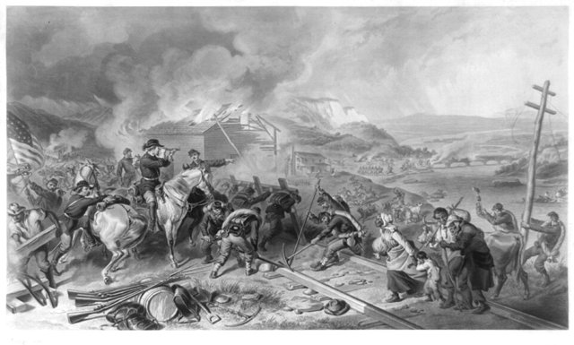
謝爾曼從亞特蘭大向東南進軍到海邊的薩凡納，沿途破壞鐵路、倉庫與軍需設施，要摧毀支撐南方作戰的交通與補給體系，南方平民也蒙受嚴重損失，這種戰略至今仍有爭議。12月中，北軍在田納西的納許維爾擊潰南軍，12月22日前後謝爾曼拿下薩凡納。

## 1865-01-31 | 國會通過第十三條修正案
南方最後的海上補給線隨1月15日費雪堡失守而斷絕。1月31日，眾議院通過憲法第十三條修正案：除依法定罪的刑罰外，奴隸制與非自願勞役不得存在於美國。《解放奴隸宣言》是戰時的軍事措施、適用範圍有限，要在全國永久廢除奴隸制，必須修憲；但修正案還要經過足夠州數批准。

## 1865-03 | 林肯第二次就職與自由民局
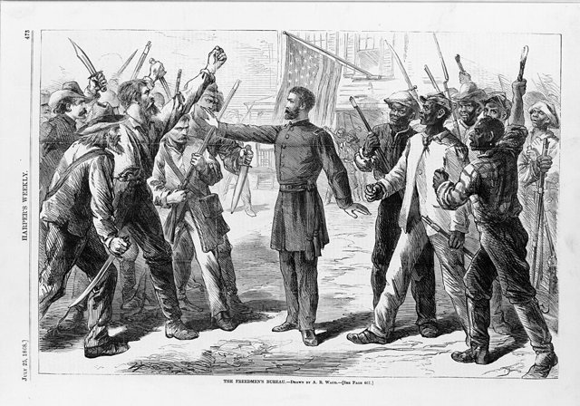
3月3日，國會設立自由民局，協助戰後南方的難民與原奴隸找工作、訂勞動契約、辦學校、尋找失散親人。3月4日，林肯第二次就職，把戰爭與奴隸制、國家的道德責任連在一起，呼籲不要無止境地報復，而要修復戰爭的創傷。

## 1865-04-09 | 李將軍在阿波馬托克斯投降
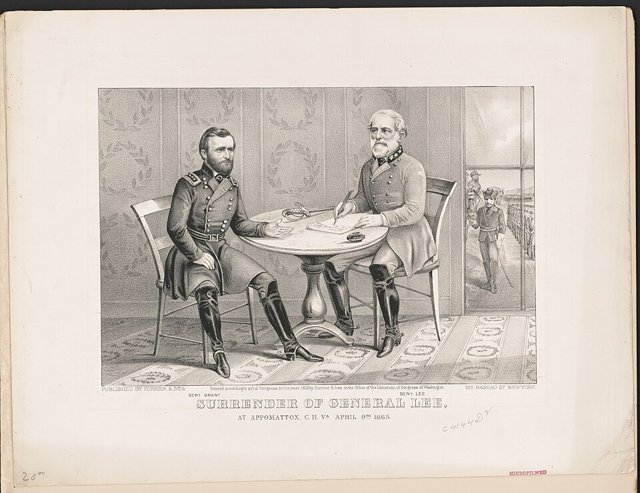
4月2日彼得斯堡防線崩潰，南方首都里士滿陷落。4月9日，李將軍在維吉尼亞的阿波馬托克斯法院村向格蘭特投降。格蘭特的條件相當寬厚：南軍士兵交出武器即可回家，可以帶走自己的馬匹。南方主力就此停止作戰，但其他南軍要到之後數週才陸續投降。

## 1865-04-14 | 林肯遇刺
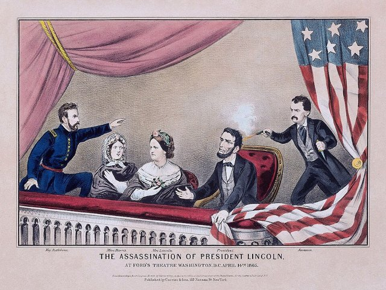
4月14日晚，林肯在華盛頓的福特劇院被支持南方的演員約翰·威爾克斯·布斯槍擊，15日去世，副總統安德魯·詹森繼任。林肯原本是戰後重建的核心人物，他的死讓重建方向大變，也加劇了總統與國會的衝突。

## 1865-05-10 | 戴維斯被捕
4月26日，南軍將領約翰斯頓在北卡羅來納向謝爾曼投降；5月10日，聯盟國總統傑佛遜·戴維斯被捕；跨密西西比戰區的南軍在6月初完成投降。戰爭的結束不是單一日期，而是一個持續兩個月的過程。

## 1865-06-19 | 六月節
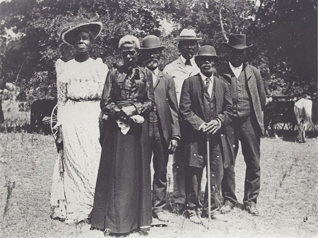
聯邦少將格蘭傑在德州加爾維斯頓發布命令，宣告當地被奴役者已經自由。這一天後來成為紀念奴隸解放的「六月節」。它既不是宣言發布日，也不是廢奴入憲的日子，而是德州的被奴役者直到這天才被告知並真正獲得解放。

## 1865-12-06 | 第十三條修正案生效
修正案獲得足夠州數批准，奴隸制在美國憲法層面正式廢除。同年，詹森總統採取寬鬆的重建政策，南方各州迅速制定「黑人法典」，以勞動契約與流浪罪等手段限制原奴隸的工作與行動自由，讓國會中的激進共和黨人認定，不能讓南方自行重建。

## 1866-04-09 | 1866年民權法案
國會通過民權法案，保障公民的基本民事權利、對抗黑人法典；詹森否決，國會推翻否決，法案生效。重建從此成為總統與國會之間的權力鬥爭。6月13日，國會提出第十四條修正案。

## 1867-03 | 重建法案
國會再次推翻詹森的否決，通過重建法案：把尚未完成重建的南方州劃為軍事區，各州必須制定新州憲法、保障非裔男性的選舉權、批准第十四條修正案，才能恢復國會代表權。

## 1868-05 | 詹森彈劾案
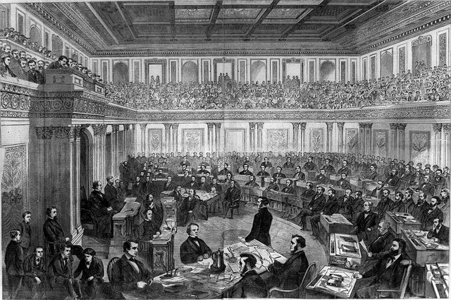
眾議院通過對詹森的彈劾，參議院5月審理，未能達到定罪所需的三分之二多數，詹森沒有被定罪，做滿任期。核心問題是：南方重建的條件由總統決定，還是由國會決定？

## 1868-07-09 | 第十四條修正案生效
在美國出生或歸化者即為美國及所居州的公民；各州不得未經正當法律程序剝奪人的生命、自由或財產，並須給予法律上的平等保護。它成了日後民權運動與憲法訴訟的重要基礎，但法律條文不代表南方立即實現平等。同年格蘭特當選總統，1869年3月就職。

## 1870-02-03 | 第十五條修正案生效
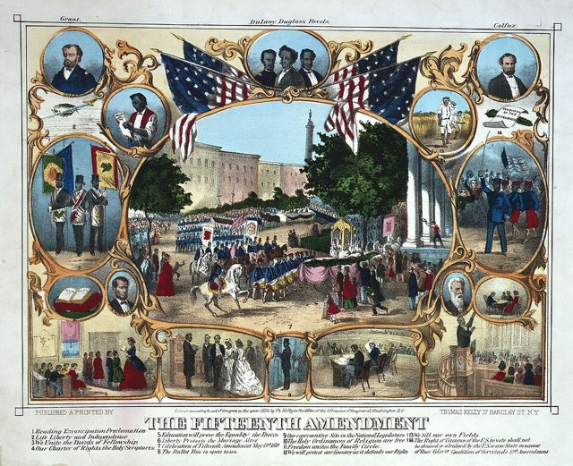
聯邦與各州不得因種族、膚色或曾被奴役而剝奪公民的投票權。它沒有保障女性投票權；日後南方各州以識字測驗、人頭稅與恐嚇等手段，照樣把非裔選民擋在投票所外。

## 1871 | 打擊三K黨
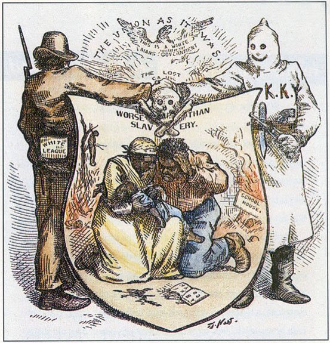
1860年代後期成立的三K黨，以恐嚇、暴力與謀殺攻擊非裔美國人與支持重建的人士。1870年至1871年，國會通過一系列執法法案，授權聯邦政府打擊這類組織，格蘭特政府也動用法律與軍隊，但未能根除南方的種族暴力。問題已不在於法律是否承認自由，而在於聯邦能否在地方真正執行。

## 1873 | 1873年經濟恐慌
嚴重的金融恐慌引發多年的經濟衰退，全國的焦點轉向失業、銀行與企業倒閉，北方選民越來越不願繼續介入南方事務。1875年國會再通過民權法案，禁止公共場所的種族歧視，1883年卻被最高法院部分推翻。

## 1877 | 重建時代結束
1876年總統大選，共和黨的海斯與民主黨的蒂爾登為數州的選舉人票爭執不下，選舉爭議與南方的政治安排交纏，1877年以政治妥協收場。海斯就任後，聯邦軍隊逐步撤出南方，白人民主黨重新掌控各州。1877年是聯邦主導的重建告一段落，不是種族平等問題的終點；此後南方逐漸建立種族隔離與排除黑人選民的制度，直到20世紀的民權運動才受到全面挑戰。
