<!--
內容整合自「美國獨立大事記（1763—1789）」（D:\Books\md\歷史\西方歷史\美國獨立大事記（1763—1789）.md；html 版在 D:\Books\html\1-1.西方歷史，另附一張核心時間軸圖），以自己的話改寫。
時期依大事記的十個階段合併為六段。
處理方式：
- 大事記的背景從1607年詹姆斯鎮寫起，這裡寫進1754年事件的內文，不另立事件，避免橫向檢視前面空出一百多年；十三個殖民地的區域差異也寫在那裡。
- 《邦聯條例》大事記放在第九階段，但它1777年11月15日通過、1781年3月1日生效，這裡依實際日期分成兩則事件。
- 大事記提醒的幾個區別都寫進內文：7月2日通過獨立決議、7月4日通過宣言正文、8月2日開始簽署；1776年宣布獨立，1783年才獲英國承認；列星頓的第一槍由誰開火並無定論；「波士頓屠殺」的名稱帶有事後宣傳色彩。
- 人名用·分隔（大事記作・），與其他時間軸一致。
- 獨立後奴隸制度、婦女與原住民族的處境，依大事記寫進宣言與1789年事件。
圖片來源（皆為 Wikimedia Commons 公有領域／CC0 作品；註明「共用」者沿用其他時間軸已有的圖片）：
- ami-wolfe.jpg：The Death of General Wolfe B.West,1770.jpg（班傑明·韋斯特〈沃爾夫將軍之死〉，1770，描繪1759年魁北克戰役）
- ami-stamp.jpg：The Stamp Act riots in Boston LCCN2006682659.jpg（〈波士頓的印花稅暴動〉，19世紀版畫（美國國會圖書館））
- ami-massacre.jpg：Paul Revere, after Henry Pelham, The Boston Massacre, 1770, NGA 11550.jpg（保羅·里維爾仿佩勒姆所作〈波士頓屠殺〉版畫，1770（美國國家美術館））
- ami-teaparty.jpg：Boston Tea Party Currier colored.jpg（柯里爾〈波士頓茶黨〉石版畫，1846）
- ami-lexington.jpg：Plate I, The Battle of Lexington, Amos Doolittle engravings of the Battle of Lexington and Concord, December 1775, reprint by Charles E. Goodspeed, Boston, 1903 - Concord Museum - Concord, MA - DSC05585.JPG（阿莫斯·杜利特爾〈列星頓戰役〉版畫，1775（1903年重印，康科德博物館））
- ami-bunker.jpg：The Death of General Warren at the Battle of Bunker's Hill.jpg（杜朗布爾〈華倫將軍在邦克山戰役中陣亡〉，1786）
- ami-commonsense.jpg：Commonsense.jpg（潘恩《常識》1776年初版書名頁）
- ami-declaration.jpg：Declaration of Independence (1819), by John Trumbull.jpg（杜朗布爾〈獨立宣言〉，1819（美國國會大廈））
- ami-delaware.jpg：Washington Crossing the Delaware by Emanuel Leutze, MMA-NYC, 1851.jpg（洛伊茨〈華盛頓橫渡德拉瓦河〉，1851（大都會藝術博物館））
- ami-saratoga.jpg：Surrender of General Burgoyne.jpg（杜朗布爾〈伯戈因將軍投降〉，1821）
- ami-valleyforge.jpg：Washington at Valley Forge G-001759-20121025.jpg（〈華盛頓在瓦利福吉〉，19世紀中葉（美國國家美術館））
- ami-yorktown.jpg：Surrender of Lord Cornwallis.jpg（杜朗布爾〈康沃利斯勳爵投降〉，1820）
- ami-paris.jpg：Treaty of Paris by Benjamin West 1783.jpg（班傑明·韋斯特〈巴黎和約〉，未完成，1783；英方代表拒絕入畫，只畫了美方代表）
- ami-resign.jpg：General George Washington Resigning his Commission.jpg（杜朗布爾〈華盛頓辭去總司令職務〉，1824）
- ami-shays.jpg：Unidentified Artist - Daniel Shays and Job Shattuck - Google Art Project.jpg（〈丹尼爾·謝司與喬布·沙圖克〉，1787年的木刻版畫）
- ami-constitution.jpg：Scene at the Signing of the Constitution of the United States.jpg（克里斯蒂〈美國憲法簽署現場〉，1940（美國國會大廈））
- ami-inauguration.jpg：Federal Hall, N.Y. 1789 ppmsca.15703.jpg（〈1789年的紐約聯邦大廳〉，華盛頓在此就職，19世紀版畫）
-->

# Periods
- 1754 ~ 1763 | 背景：七年戰爭 | #868e96
  十三個殖民地各有議會、法律與經濟利益，還沒有共同的「美國」認同；英國打贏法國與印第安人戰爭，取得北美大片領土，也背上沉重的戰債。
- 1763 ~ 1774 | 稅收與代表權之爭 | #f08c00
  英國要殖民地分擔帝國開支，接連推出糖稅、印花稅、湯森法案與茶葉法；殖民地以「無代表，不納稅」反對，衝突從經濟問題變成主權問題，波士頓成了對抗的前線。
- 1774 ~ 1776 | 從抗爭到開戰與獨立 | #c92a2a
  強制法案讓各殖民地團結起來，大陸會議成立；列星頓的槍聲開啟戰爭，和解的請願被英王拒絕，潘恩的《常識》把輿論推向獨立，1776年7月4日通過《獨立宣言》。
- 1776 ~ 1778 | 撐過危機與薩拉托加 | #1971c2
  華盛頓丟了紐約卻保住主力，以特倫頓、普林斯頓的奇襲挽回士氣；薩拉托加的勝利讓法國相信美國撐得下去，正式結盟參戰。
- 1778 ~ 1783 | 國際戰爭與勝利 | #2f9e44
  戰爭擴大為英國對法、西兩國的全球戰爭，英軍轉攻南方；1781年美法陸海軍合圍約克鎮，康沃利斯投降，1783年巴黎和約承認美國獨立。
- 1783 ~ 1789 | 從邦聯到聯邦 | #5f3dc4
  權力過弱的邦聯政府付不出債、管不了州際貿易，謝司起義更凸顯危機；費城制憲會議另訂新憲法，經過聯邦派與反聯邦派的辯論後生效，華盛頓就任首任總統。

# Events

## 1754 ~ 1763 | 法國與印第安人戰爭
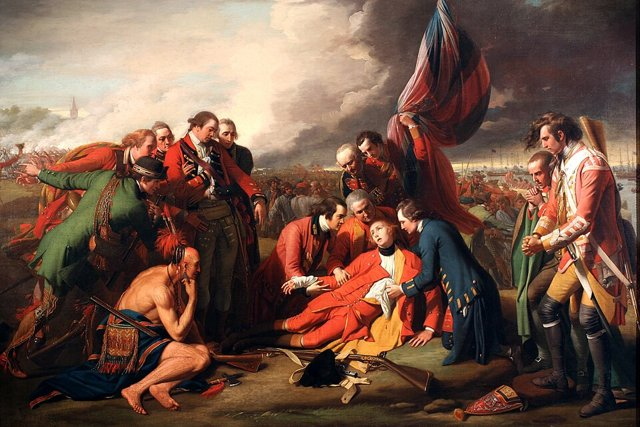
英國從1607年在維吉尼亞建立詹姆斯鎮起，陸續在大西洋沿岸建立殖民地，到18世紀中葉形成十三個：新英格蘭以港口貿易、造船與地方自治為主，中部族群與宗教多元，南部則是高度依賴奴隸勞動的種植園經濟。英法為爭奪北美土地與貿易路線開戰，這場北美戰事是七年戰爭的一部分，英國最終獲勝。

## 1763-02-10 | 巴黎條約
七年戰爭結束，法國把密西西比河以東的大部分北美領土交給英國，西班牙割讓佛羅里達。這一年不是獨立戰爭的開始，卻是英美關係轉壞的起點：英國債台高築，認為殖民地也受惠於戰果、應分擔帝國開支；法國勢力退出後，殖民地不再那麼需要英軍保護；雙方對國會能否管轄殖民地的看法也越來越不同。

## 1763-10-07 | 皇家公告
英國禁止殖民者越過阿帕拉契山脈向西移居，想減少與原住民族的衝突。渴望西部土地的投資者、農民與退伍軍人大為不滿。殖民者的西進並不只是開墾，也意味著侵占原住民族的土地與生存空間。

## 1764-04-05 | 糖稅法
英國國會加強對進口商品課稅並打擊走私，想增加收入、強化對殖民地貿易的控制。殖民地商人擔心成本上升，爭議開始從經濟問題延伸到政治權利。

## 1765-03-22 | 印花稅法
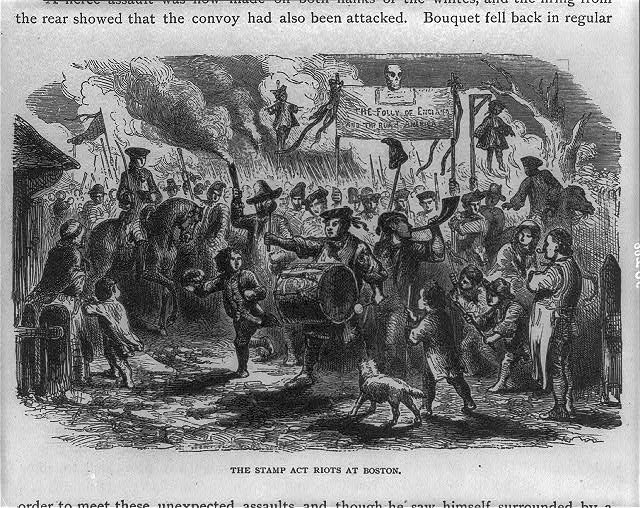
英國國會規定報紙、法律文件與許多商業文件都必須貼上課稅印花，這是對殖民地內部活動的直接課稅，激起廣泛不滿。10月，九個殖民地的代表在紐約召開印花稅會議，主張殖民地居民享有英國臣民的權利，既然在英國國會沒有代表，國會就無權對他們課徵內部稅。「無代表，不納稅」的重點不在於拒絕一切稅收，而在於課稅必須經過人民的代表同意；英國則認為國會代表整個帝國。

## 1766-03-18 | 印花稅法廢除，宣示法通過
殖民地抵制英國商品，英國商人也受到損失，國會只好廢除印花稅法；但同一天通過《宣示法》，宣稱國會有權為殖民地制定任何法律。退讓沒有解決根本問題：殖民地不承認國會擁有不受限制的立法與課稅權。

## 1767 | 湯森法案
英國國會對玻璃、紙張、油漆、鉛與茶葉等進口商品課稅，並加強海關執法。殖民地商人與政治領袖發起不進口運動，透過報紙、小冊子與集會串連，反抗開始形成跨殖民地的網絡。1768年10月，英軍進駐抗議最激烈的波士頓，反而加深了居民的敵意。

## 1770-03-05 | 波士頓屠殺
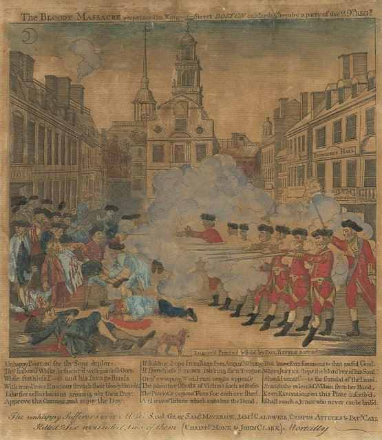
波士頓民眾與英國士兵衝突，士兵開槍打死五名居民，其中包括克里斯普斯·阿塔克斯。殖民地政治人物用報紙、版畫與演說把事件塑造成軍事壓迫的象徵；不過現場也有街頭衝突、士兵受到威脅等複雜因素，「屠殺」這個名稱有一部分是事後宣傳。駐軍問題從此成為抗爭的焦點。

## 1773-05-10 | 茶葉法
為了解救財務困難的東印度公司，國會調整殖民地的茶葉貿易安排。殖民地居民也許能買到更便宜的茶，但爭議在於國會仍藉此行使課稅與管制的權力；其他茶商也擔心東印度公司取得壟斷優勢。

## 1773-12-16 | 波士頓茶黨事件
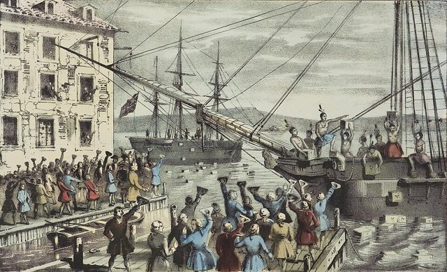
一群抗議者登上停在波士頓港的商船，把大批茶葉倒進海裡。殖民地居民不再只是拒買，而是直接毀掉與爭議政策有關的貨物；英國政府視之為對帝國權威的公開挑戰，決定強硬處置。

## 1774 | 強制法案
英國國會關閉波士頓港、改變麻薩諸塞的治理方式、擴大英國官員的權限，殖民地稱之為「不可容忍法案」。英國想懲罰麻薩諸塞，卻讓其他殖民地擔心自己的自治權也可能被剝奪，反而促成團結。

## 1774-09-05 | 第一屆大陸會議
9月5日至10月26日，喬治亞以外的十二個殖民地派代表到費城開會，協調立場、推動抵制英國商品。會議還沒有宣布獨立，而是希望以聯合抗議與經濟壓力迫使英國讓步。到這年年底，有人仍盼和解，有人已認為只有武裝抵抗才能保住權利。

## 1775-04-19 | 列星頓與康科德戰役
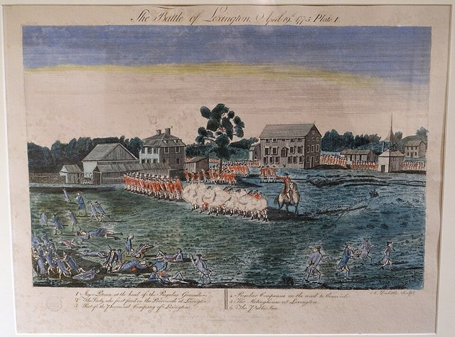
英軍前往康科德查扣民兵的軍火，在列星頓與康科德與民兵交火，第一槍是哪一方開的至今沒有定論。英軍撤回波士頓途中不斷遭到民兵襲擊，傷亡增加。衝突正式進入武裝戰爭，其他殖民地也開始積極支援麻薩諸塞。

## 1775-05-10 | 第二屆大陸會議
大陸會議在費城再度召開，一面仍尋求和解，一面組織軍事力量。6月14日至15日，會議建立大陸軍，任命維吉尼亞人喬治·華盛頓為總司令；選一位南方人領軍，讓戰爭不只是麻薩諸塞的地方衝突，而成為各殖民地的共同事業。

## 1775-06-17 | 邦克山戰役
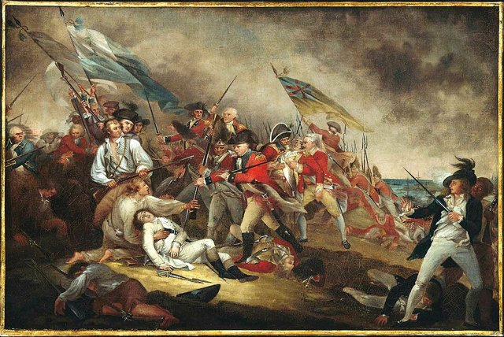
英軍最後攻下波士頓附近民兵據守的陣地，卻付出慘重傷亡。缺乏正規軍經驗的民兵證明了自己能重創英軍，殖民地更相信長期對抗並非不可能。

## 1775-07-05 | 橄欖枝請願書
大陸會議向英王喬治三世遞交請願書，希望恢復和平。英王不但不接受，還在8月宣布殖民地處於叛亂狀態，主張和解的一方越來越站不住腳。

## 1776-01 | 潘恩出版《常識》
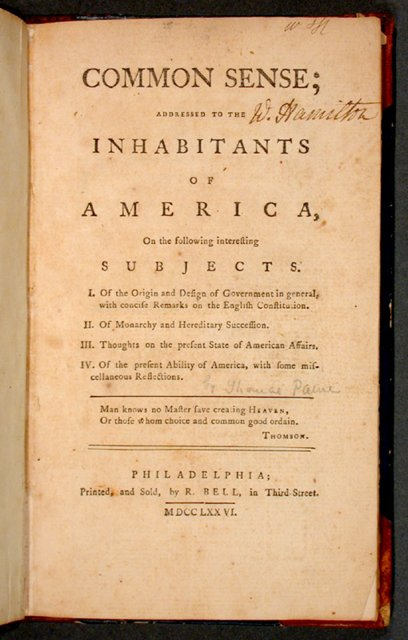
湯瑪斯·潘恩以通俗直接的文字批評世襲君主制，主張北美不應再受英國王室統治。這本小冊子把獨立的主張帶給廣大讀者，推動輿論從爭取權利、尋求和解，轉向支持建立獨立的共和國。

## 1776-07-02 | 通過獨立決議
6月7日，維吉尼亞代表理查·亨利·李提案，主張殖民地應成為自由獨立的國家；大陸會議成立由傑佛遜、約翰·亞當斯、富蘭克林、謝爾曼與李文斯頓組成的起草委員會，主要由傑佛遜執筆。7月2日，大陸會議正式通過獨立決議。

## 1776-07-04 | 《獨立宣言》
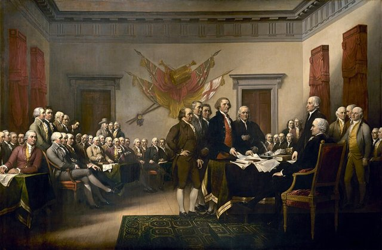
大陸會議通過《獨立宣言》正文，向世界宣布脫離英國。宣言主張人人生而平等，擁有生命、自由與追求幸福的權利；政府的正當權力來自被統治者的同意，政府若破壞這些權利，人民有權改變或廢除它；並列舉對英王的種種控訴。7月4日因此成為獨立紀念日，8月2日代表們才開始在羊皮紙正本上簽名。宣言高舉平等，當時卻仍有奴隸制，婦女沒有平等的政治權利，原住民族也不在保障之列；它後來成了批判美國自身不平等的依據。

## 1776-08 ~ 1776-11 | 紐約戰役
英軍大舉進攻紐約，大陸軍在長島等地接連失利，紐約落入英軍手中。華盛頓沒有孤注一擲，而是撤退保存主力，逐漸形成他的戰略：不必每戰都贏，只要主力不被消滅、抵抗不停止，就能拖垮英國的作戰意志。

## 1776-12-26 | 特倫頓戰役
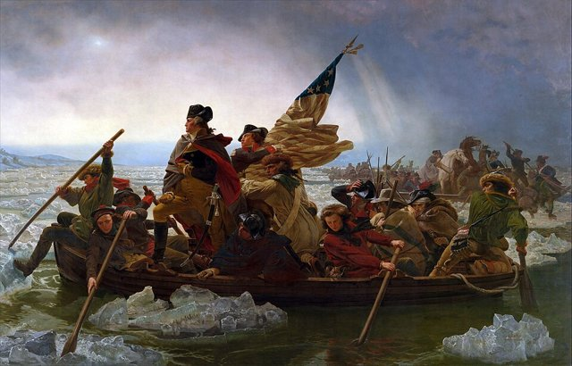
聖誕夜，華盛頓率軍渡過德拉瓦河，突襲駐紮在特倫頓、受英國僱用的德意志黑森部隊，俘虜大批敵軍。1777年1月3日又在普林斯頓擊敗英軍。兩場戰役規模不大，卻在連敗之後挽回了士氣。

## 1777-10-17 | 薩拉托加：伯戈因投降
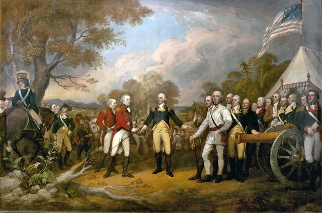
英國想控制哈德遜河谷，切斷新英格蘭與其他殖民地的聯繫，但各路英軍配合失誤、補給困難，伯戈因的部隊在薩拉托加被包圍，10月17日投降，約六千人被俘。這場勝利改變了各國的看法：美國有可能在戰場上擊敗英國的正規軍。

## 1777-11-15 | 《邦聯條例》通過
大陸會議通過《邦聯條例》作為新國家的架構：各州保有廣泛主權，中央只有一個邦聯國會，不能直接向人民課稅，也無法統一各州的商業政策，修改還需各州一致同意。剛反抗完帝國的革命者刻意提防中央集權，但權力過弱也埋下了日後的困境。

## 1778-02-06 | 美法同盟
美法簽訂同盟條約，法國正式承認美國，提供貸款、物資、陸軍與海軍。法國想削弱英國，也想報七年戰爭之仇；6月英法正式開戰，北美的戰事擴大為國際戰爭，英國必須分散兵力。美國能否獨立，也取決於國際力量平衡的變化。

## 1778-06-28 | 蒙茅斯戰役
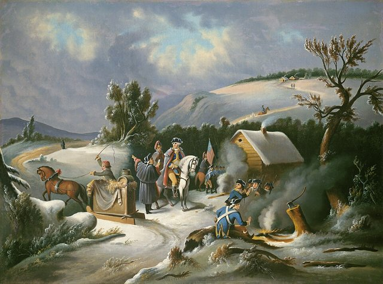
大陸軍在瓦利福吉熬過艱苦的冬天，接受普魯士軍官馮·施托伊本的操練，紀律與隊形大為改善。在紐澤西的蒙茅斯，美軍與英軍激戰未分勝負，但已展現正規軍的作戰能力。此後英國把戰略重心轉向保王派較多的南方，殖民地社會內部的分裂也更加激烈。

## 1779 | 西班牙對英宣戰
西班牙對英國宣戰，英國又多了一個戰場。西班牙的目的是削弱英國、收復或擴大領土，並不完全認同美國獨立與共和的目標。

## 1780-05-12 | 查爾斯頓陷落
英軍攻下南卡羅來納的查爾斯頓，俘虜大批美軍，是美國在南方最慘重的挫敗。但英軍佔得了城市，卻難以控制廣大的鄉村、保護漫長的補給線；法國也開始直接投入陸海軍，為約克鎮創造條件。

## 1781-03-01 | 《邦聯條例》生效
經所有州批准後，《邦聯條例》正式生效，邦聯政府取得法律基礎。同年，美軍在考彭斯等地獲勝，英軍在南方越來越難以兼顧據點、交通線與追擊。

## 1781-10-19 | 約克鎮：康沃利斯投降
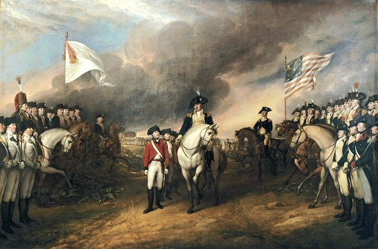
英將康沃利斯駐守維吉尼亞的約克鎮，指望海上補給與援軍。9月5日，法國艦隊在切薩皮克灣外海擋住英國艦隊；9月28日，華盛頓與法將羅尚博的陸軍合圍約克鎮。10月19日康沃利斯投降。美法陸海軍的協同讓英軍無法補給也無法撤退；英國失去一支主力，又要應付法、西兩國的全球戰事，從此放棄以武力收回殖民地。

## 1782-11-30 | 初步和平條款
約克鎮之後，英國國內對戰爭的支持下降。富蘭克林、約翰·亞當斯與約翰·傑伊代表美國談判，堅持英國不只停戰，還必須正式承認美國獨立，雙方簽署初步和平條款。

## 1783-09-03 | 巴黎和約
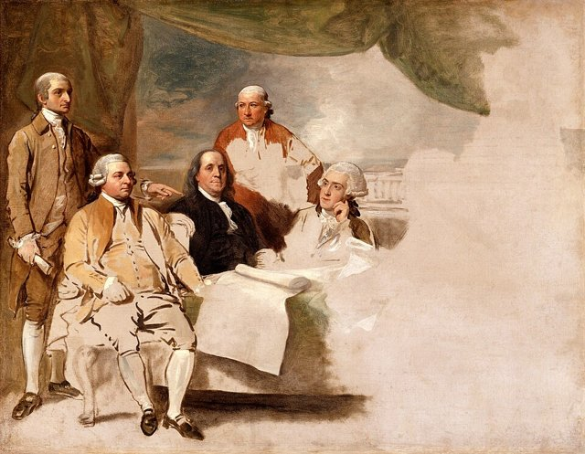
英國正式承認美國獨立，美國領土延伸到密西西比河，和約也安排了與英屬北美的邊界、漁業權，以及私人債務與保王派財產等問題（後者執行時仍爭議不斷）。1776年是宣布獨立，1783年才是獲得承認的時刻。

## 1783-12-23 | 華盛頓辭去總司令
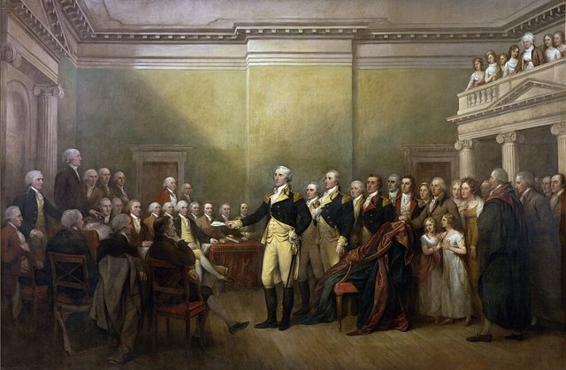
戰爭結束後，華盛頓辭去大陸軍總司令，回到私人生活。他沒有藉戰功奪取政權，而是把軍權交還文人機構，這成為美國政治文化的重要典範。

## 1786 ~ 1787 | 謝司起義
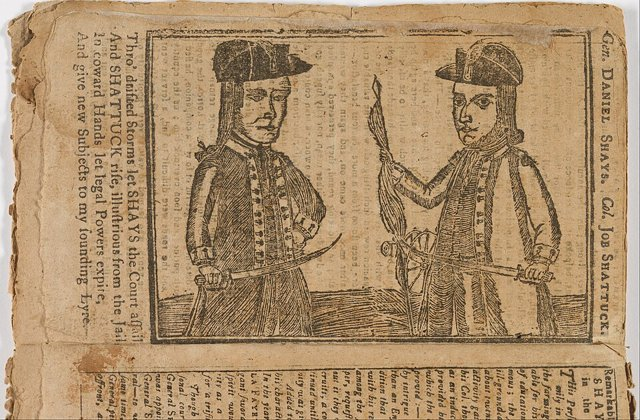
邦聯國會只能向各州要錢，無力償還戰債、維持軍隊，各州又各訂貿易規則、彼此摩擦。麻薩諸塞的農民因債務、稅收與追債判決害怕失去土地而起事。起義暴露了戰後人民的經濟困境，也讓政治人物擔心政府無力維持秩序，改革邦聯的聲音隨之增強。

## 1787-05-25 | 費城制憲會議
各州代表在費城開會，原本只是要修改《邦聯條例》，最後決定另訂新憲法。核心問題是：如何讓中央政府有能力處理全國事務，又不致變成專制？大州與小州如何分配國會席次、總統如何產生、奴隸人口如何計入席次與稅額、聯邦與州如何分權，都靠一連串妥協解決。

## 1787-09-17 | 美國憲法簽署
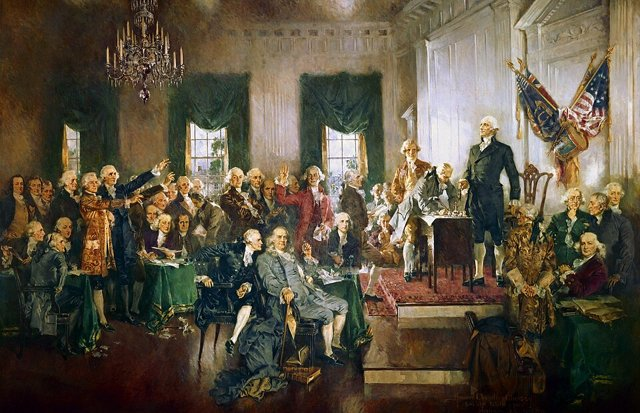
新憲法把聯邦政府分為國會（參、眾兩院）、總統與聯邦法院三個部門，以分權制衡防止權力集中，同時讓聯邦政府有能力處理州際貿易、國防、外交與財政。

## 1788-06-21 | 新罕布夏批准，憲法生效
憲法須經九州批准才能生效。聯邦派認為新制度能改善邦聯的弱點；反聯邦派擔心強大的中央會威脅各州自主與人民自由，尤其不滿憲法沒有列出個人權利清單。新罕布夏成為第九個批准的州，憲法達到生效門檻。

## 1789-04-30 | 華盛頓就任首任總統
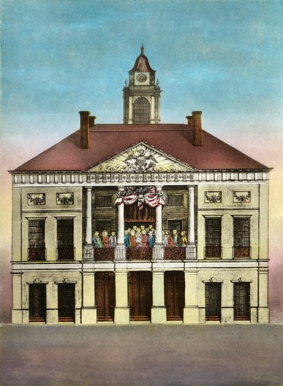
3月4日，第一屆國會在紐約召開，聯邦政府開始運作；4月30日，華盛頓在紐約就任美國第一任總統，十三個殖民地正式成為一個擁有行政、立法與司法機構的聯邦共和國。但奴隸制仍在，婦女沒有平等的政治權利，原住民族的土地與主權持續受到侵害；1789年是憲政體制開始運作，不是《獨立宣言》的平等理想已經實現。美國獨立的經驗也影響了同年爆發的法國大革命。
