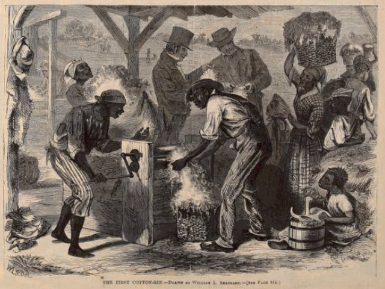
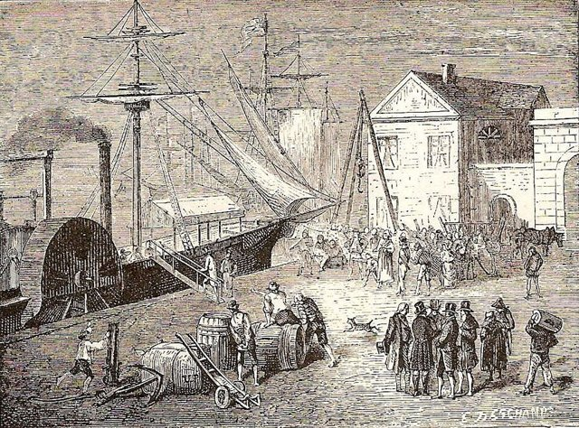
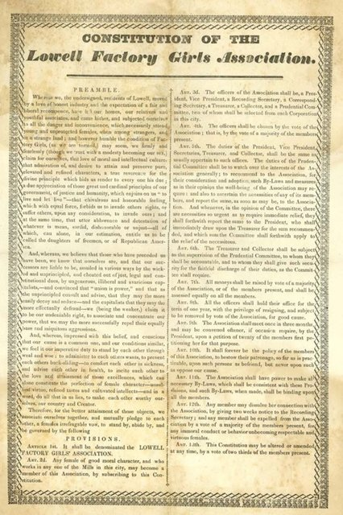
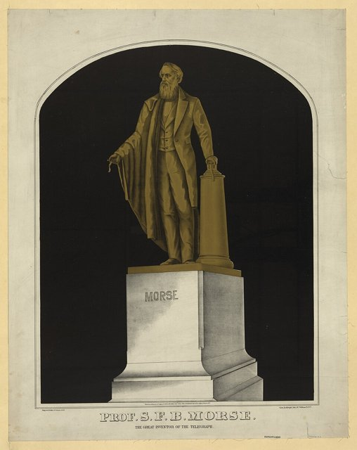
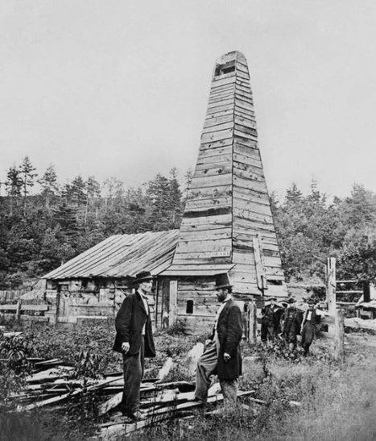

<!--
內容整合自「美國工業革命大事記（1790－1914）」（D:\Books\md\歷史\西方歷史\美國工業革命大事記（1790－1914）.md；html 版在 D:\Books\html\1-1.西方歷史），以自己的話改寫；另參考中文維基百科「鍍金時代」（1860－1900年的產業數字、1882年《排華法案》、1883年文官改革）。中文維基百科「美國工業革命」需要驗證碼，沒有讀取。
時期依大事記的五個階段，但第二、三、四階段的年代互相重疊（1820－1860、1865－1890、1870－1900），這裡改為不重疊的區間：南北戰爭（1861－1865）併入交通革命一段，第二次工業革命與鍍金時代以1886年勞工聯合會成立、乾草市場事件為界。
處理方式：
- 大事記在不同章節重複列出的事件（1825年伊利運河通航、1876年貝爾取得電話專利、1830年巴爾的摩與俄亥俄鐵路）各只列一次。
- 大事記沒有具體內容的年代條目（如「1870年鐵路網持續擴張」「1898年勞工運動持續發展」「1907年化學工業持續擴張」）寫進相鄰事件的內文，不另立事件。
- 卡內基鋼鐵公司，大事記作1889年；依維基百科，卡內基旗下各公司在1892年才合併為卡內基鋼鐵公司，這裡依後者，並補上1901年摩根收購它組成美國鋼鐵公司。
- 大事記1895年「最高法院對美國鋼鐵企業集中問題的司法處理」，實際是美國訴奈特公司案，涉及的是糖業托拉斯，這裡依判決內容改寫。
- 大事記1808年巴爾的摩聯合製造公司一則，與整體脈絡關係不大，不列。
- 南北戰爭本身的經過見「美國南北戰爭」時間軸，這裡只寫它對工業化的影響。
- 人名用·分隔（大事記作・）；洛克斐勒依大事記。
圖片來源（皆為 Wikimedia Commons 公有領域／CC0 作品，縮成最長邊 640px）：
- ain-lastrail.jpg：East and West Shaking hands at the laying of last rail Union Pacific Railroad - Restoration.jpg（1869年5月10日，橫貫大陸鐵路在普羅蒙特里峰接軌（羅素攝，修復版））
- ain-slater.jpg：Slater Mill close.jpg（羅德島州波塔基特的斯萊特紡紗廠）
- ind-gin.jpg：Cotton gin harpers.jpg（使用軋棉機的情景，1869年《哈潑週刊》（與工業革命史時間軸共用））
- ain-fulton.jpg：Robert Fulton boards his steamboat, the 'Clermont', in New York, 1807.jpg（〈富爾頓在紐約登上克勒蒙號，1807〉）
- ain-lowell.jpg：Constitution of the Lowell Factory Girls Association.jpg（洛厄爾工廠女工協會章程，1836）
- ind-morse.jpg：Prof. S.F.B. Morse. The great inventor of the telegraph LCCN2003674300.jpg（紐約中央公園摩斯雕像的石版畫，1870年代（與工業革命史時間軸共用））
- ind-drake.jpg：First U.S. oil rig with Edwin Drake, crop.jpg（德瑞克（右）與他的第一口油井（與工業革命史時間軸共用））
-->

# Periods
- 1790 ~ 1819 | 工業化的起步 | #868e96
  斯萊特帶來英國的紡紗技術，惠特尼的軋棉機與可互換零件，富爾頓的蒸汽船；美英戰爭切斷進口，逼出本土的製造業。這時的美國仍是農業國，工廠集中在新英格蘭的河邊，靠水力運轉。
- 1820 ~ 1865 | 交通革命與工廠制度 | #1971c2
  伊利運河、鐵路與電報把內陸與東岸連成一片市場；洛厄爾成為第一座規劃的工業城市，縫紉機、鋼犁與收割機讓機械化擴及農業與家庭。南北戰爭動員了北方的工業與金融，戰時的鐵路、宅地與教育立法為戰後的擴張鋪路。
- 1865 ~ 1885 | 第二次工業革命 | #e67700
  橫貫大陸鐵路完成，全國市場成形；卡內基的鋼、洛克斐勒的石油、愛迪生的電燈與貝爾的電話，催生出前所未見的大企業。表面繁榮之下，金融恐慌與鐵路大罷工暴露了新秩序的裂痕。
- 1886 ~ 1900 | 鍍金時代：資本集中與勞資衝突 | #c92a2a
  托拉斯與企業合併讓少數大亨掌握鐵路、鋼鐵、石油與金融，工會與罷工此起彼落，聯邦開始立法管制鐵路與壟斷，但早期執行有限。交流電在電流大戰中勝出，為下一階段的電氣化鋪路。
- 1901 ~ 1914 | 現代工業體系與進步時代 | #2f9e44
  德州油田、汽車與流水線開啟石油與大量生產的時代，萊特兄弟飛上天空；羅斯福以下的進步派政府拆解托拉斯、監管食品藥品、建立聯邦準備制度。到第一次世界大戰前夕，美國已是世界第一的工業國。

# Events

## 1790-12 | 斯萊特的紡紗廠

英國嚴禁紡織機械與技工出國，在使用阿克萊特紡紗機的工廠當過學徒的塞繆爾·斯萊特把機器構造記在腦中，偽裝成農場工人來到美國。他與商人摩西·布朗合作，在羅德島州波塔基特建立以水力驅動的棉紡廠，被稱為「美國工業革命之父」（英國人則稱他「叛徒斯萊特」）。此後新英格蘭各地沿河興建紡紗廠，紡紗逐漸從家庭手工轉向工廠。

## 1793 | 惠特尼發明軋棉機

伊萊·惠特尼的軋棉機能快速分離棉籽與棉纖維，讓南方內陸普遍種植的短絨棉變得有利可圖，棉花產量急遽增加，供應北方與英國的紡織廠。但它同時讓種植園對奴隸勞動的需求大增，工業化與奴隸制因此形成糾纏的關係。

## 1798 | 可互換零件
惠特尼向聯邦政府承包一萬支步槍，宣稱要用標準化的零件製造，零件可以互相替換、不必逐件手工修配。他自己並未完全做到，真正落實的是後來的春田與哈珀斯渡口兵工廠，但這個理念成為「美國製造體系」與日後大量生產的基礎。

## 1807-08-17 | 富爾頓的蒸汽船

羅伯特·富爾頓的克勒蒙號在哈德遜河上從紐約開往奧爾巴尼，展現了蒸汽動力在內河航運的潛力；此後蒸汽船在密西西比河等大河上迅速普及，讓貨物能逆流而上。

## 1812 ~ 1815 | 美英戰爭
英國的海上封鎖與貿易中斷，使美國買不到英國的工業品，資本開始從航運貿易轉向國內製造業，紡織、鐵器等產業加速發展。

## 1814 | 沃爾瑟姆紡織廠
弗朗西斯·卡伯特·洛厄爾在英國參觀紡織廠時記下動力織布機的構造，回國後與技師保羅·穆迪改良製成。他們在麻薩諸塞州沃爾瑟姆設立的工廠，把紡紗到織布的所有工序集中在同一廠房，是美國第一座整合式紡織工廠。

## 1817-07-04 | 伊利運河開工
紐約州自行籌資興建運河，要連接哈德遜河與五大湖。聯邦政府不願出資，不少人譏笑這是州長柯林頓的「水溝」。

## 1823 | 洛厄爾工業城

洛厄爾去世後，他的合夥人在梅里馬克河畔規劃了一座以他命名的工業城市，以運河引水驅動大型紡織廠，配有工廠、宿舍與完整設施。工廠大量僱用新英格蘭農村的年輕女性，稱為「洛厄爾女工」，她們住在公司宿舍、受嚴格管理，1830年代也曾為減薪發動罷工，是美國早期工業勞動力的典型。

## 1825-10-26 | 伊利運河通航
運河全長約584公里，從伊利湖通到哈德遜河。從五大湖運貨到紐約的費用降到原來的十分之一左右，中西部的農產品源源運往東岸，紐約從此超越費城與波士頓，成為美國最大的商業與金融中心。

## 1830-05-24 | 巴爾的摩與俄亥俄鐵路開始客運
巴爾的摩為了與紐約的運河競爭，1828年7月4日動工興建通往俄亥俄河的鐵路，1830年開始載客。同年彼得·庫珀造了小型蒸汽機車「湯姆拇指號」，據說還與馬車賽跑（因機械故障落敗），但證明了蒸汽機車的潛力。1830年代起，東北部與中大西洋的城市陸續以鐵路相連。

## 1831 | 麥考米克收割機
賽勒斯·麥考米克在維吉尼亞州展示機械收割機，一人一天能收割的麥田面積大增。1837年，約翰·迪爾又打造能切開中西部黏重草原土壤的鋼犁。農業機械化讓大平原的開發成為可能，也讓更多農村人口得以離開土地，成為城市的工業勞動力。

## 1844-05-24 | 摩斯的電報

畫家出身的塞繆爾·摩斯1837年展示電報，1844年以國會撥款架設華盛頓到巴爾的摩的線路，傳出第一則訊息「上帝創造了何等奇蹟」（What hath God wrought）。電報線沿著鐵路迅速延伸，用於新聞、商情與鐵路調度；1851年成立的紐約與密西西比河谷印刷電報公司，1856年改名西聯電報公司，後來壟斷全國電報。

## 1846 | 縫紉機
伊萊亞斯·豪取得縫紉機專利；1851年艾薩克·辛格改良出實用的機型，並以分期付款推銷到工廠與家庭，辛格公司成為最早的跨國企業之一。1840年代起，機械化製造從紡織擴及鞋業、農具、槍械與食品加工。

## 1858-08 | 第一條跨大西洋電報電纜
歐洲與北美首度直接通訊，英國女王與美國總統互致賀電，但電纜不到一個月就失效。1866年，大東方號鋪設的電纜才穩定運作，歐美之間的資訊傳遞從十天左右的船期縮短到幾分鐘。

## 1859-08-27 | 德瑞克油井

埃德溫·德瑞克在賓夕法尼亞州泰特斯維爾，以鑽井的方式在約21公尺深處鑽出石油，通常被視為美國現代石油工業的起點。1860年代，精煉出的煤油取代鯨油成為主要照明燃料，賓州西部湧進大批淘油客。

## 1862 | 戰時經濟立法
南北戰爭在1861年4月爆發，北方動員了工廠、鐵路、軍火與金融。南方議員退出國會後，北方主導的國會一口氣通過多項過去受阻的法案：5月的《宅地法》讓定居者以極低代價取得西部土地；7月的《太平洋鐵路法》以土地與公債資助橫貫大陸鐵路；同月的《莫里爾法案》撥地讓各州設立農業與機械學院。1863年，聯合太平洋與中央太平洋兩家鐵路公司分別從東、西兩端動工，中央太平洋鐵路大量僱用華工翻越內華達山脈。1865年4月戰爭結束，北方的工業資本與聯邦經濟政策，成為戰後工業化的基礎。

## 1869-05-10 | 橫貫大陸鐵路接通
兩條鐵路在猶他州普羅蒙特里峰會合，打下最後一根金色道釘，從東岸到太平洋岸的旅程由幾個月縮短為一週左右。鐵路成為美國第一個大型企業產業，所需的大量資本、土地、鋼鐵、煤炭與勞動力，催生了現代的企業管理與金融制度；1871年到1900年，美國新增約17萬英里鐵路，把東部工業城市、中西部農業區與西部礦區連成全國市場。依維基百科，1860年到1900年美國的鐵路里程從3萬英里增加到25萬英里。

## 1870-01-10 | 標準石油公司成立
約翰·洛克斐勒與合夥人在克里夫蘭成立標準石油，靠著規模、效率與向鐵路爭取秘密運費折扣，以價格戰與收購逐一併吞對手，到1880年左右控制了全國約九成的煉油。1882年，他以「信託」的形式把旗下數十家公司交由同一組受託人統一管理，「托拉斯」從此成為壟斷大企業的代名詞。

## 1873 | 鍍金時代與1873年恐慌
馬克·吐溫與查爾斯·華納合寫小說《鍍金時代》，諷刺表面光鮮、底下是投機、腐敗與貧富懸殊的社會，這個書名後來成為1870年代到1900年的時代名稱。同年9月，過度擴張的鐵路投資拖垮了大銀行傑伊·庫克公司，引發金融恐慌與長達數年的經濟衰退。

## 1875 | 卡內基的埃德加·湯姆森鋼鐵廠
英國人貝塞麥在1856年發明向熔鐵吹入空氣的煉鋼法，能便宜而大量地生產鋼，1860年代傳入美國。蘇格蘭移民出身的安德魯·卡內基在匹茲堡附近建立以貝塞麥法生產鐵軌的鋼鐵廠，並以鐵路經營學到的成本管理不斷壓低成本；他後來把鐵礦、焦煤、運輸都納入旗下，形成垂直整合的鋼鐵帝國。

## 1876-03-07 | 貝爾取得電話專利
三天後，亞歷山大·格拉漢姆·貝爾對助手說出「華生先生，過來，我想見你」，完成了第一通電話。1877年成立貝爾電話公司，1880年代電話網在各城市擴展，到1890年代已成為企業管理與商業往來不可或缺的工具。

## 1877-07 | 鐵路大罷工
恐慌後的鐵路公司一再減薪，西維吉尼亞的鐵路工人首先罷工，迅速蔓延到巴爾的摩、匹茲堡、芝加哥等地，多處爆發暴力衝突，各州民兵與聯邦軍隊出動鎮壓，約百人死亡。這是美國第一次全國性的大罷工。

## 1879-10 | 愛迪生的白熾燈
湯瑪斯·愛迪生在紐澤西州門洛帕克的研究所，與團隊測試了數千種材料，終於以碳化的棉線做出能持續發光十幾個小時的燈泡，1880年1月取得專利。愛迪生的目標不只是燈泡，而是包括發電、配電與計量在內的整套電力系統。

## 1882-09-04 | 珍珠街發電站
愛迪生在紐約曼哈頓珍珠街建立的發電站開始供電，最初為約85位客戶的數百盞燈供電，是早期中央發電系統的里程碑。同年5月，國會通過《排華法案》，禁止中國勞工入境，是美國第一部針對特定族群的移民禁令；鍍金時代約有一千萬新移民湧入，成為工廠與礦場的主要勞動力。

## 1883-11-18 | 鐵路標準時區
各城市原本依太陽各自定時，全國有數十種地方時間，鐵路時刻表混亂不堪。鐵路公司自行把美國劃分為四個標準時區，同日中午統一調整時鐘；國會到1918年才以法律確認。同年，國會通過《彭德爾頓法》，以考試取代政黨分贓來任用聯邦文官。

## 1886-05-04 | 乾草市場事件
5月1日，全國數十萬工人為爭取八小時工作制罷工，芝加哥是中心。5月4日，芝加哥乾草市場的集會接近尾聲時，有人向驅散群眾的警察投擲炸彈，警方隨即開槍，雙方都有死傷。八名無政府主義者在證據薄弱下被判有罪，四人被處絞刑。5月1日日後成為國際勞動節。同年12月，塞繆爾·龔帕斯等人成立美國勞工聯合會（AFL），以技術工人的行業工會為主，專注爭取工資、工時與勞動條件。

## 1887-02-04 | 《州際商業法》
農民長期不滿鐵路公司的運費歧視與壟斷，國會設立州際商業委員會監管鐵路運價，要求運費「合理且公正」並公開，這是聯邦政府第一個管制產業的獨立機構。

## 1890-07-02 | 《謝爾曼反托拉斯法》
禁止限制州際或國際貿易的契約、聯合與共謀，以及壟斷或企圖壟斷的行為，是美國第一部反壟斷法。但條文寬泛，早期執行有限：1895年的美國訴奈特公司案中，最高法院認定控制全國九成以上煉糖能力的糖業托拉斯屬於「製造」而非「商業」，不受這部法律管轄；反倒是工會罷工常被法院認定為限制貿易。依維基百科，1860年到1900年，美國的製造業產值從19億美元增加到114億美元，鋼產量從不到100萬噸增加到1,100萬噸。

## 1892-07-06 | 霍姆斯特德罷工
卡內基旗下各公司在這一年合併為卡內基鋼鐵公司。經理亨利·弗里克要壓低工資、擊垮工會，在賓州霍姆斯特德鋼鐵廠關廠停工，並僱用平克頓偵探社的武裝警衛乘船進廠，與工人槍戰，雙方都有死亡。州長派出民兵，工廠以非工會工人復工，罷工失敗，鋼鐵業的工會此後沉寂了數十年。

## 1893 | 芝加哥世界博覽會與電流大戰
愛迪生主張直流電，尼古拉·特斯拉的交流電專利則由喬治·威斯汀豪斯買下推廣，雙方在1880年代末展開「電流大戰」。交流電可以升壓後遠距離輸送，威斯汀豪斯以低價標得芝加哥世界博覽會的照明，十萬盞電燈讓交流電大出風頭；1895年，尼加拉瀑布水力發電廠以交流電開始供電，隔年送電到約40公里外的水牛城，交流電從此成為標準。同年5月，股市崩盤引發「1893年恐慌」，經濟衰退持續了四年。

## 1894-05 | 普爾曼罷工
蕭條期間，普爾曼臥車公司大幅減薪，卻不降低公司城鎮的房租。工人罷工，尤金·德布斯領導的美國鐵路工會拒絕載運掛有普爾曼車廂的列車，全國鐵路交通幾近癱瘓。克里夫蘭總統以干擾郵件運送為由派出聯邦軍隊，法院發出禁令，德布斯入獄，罷工失敗。

## 1896-06-04 | 福特的四輪車
在愛迪生照明公司底特律分公司擔任工程師的亨利·福特，利用業餘時間完成第一輛汽油動力車「四輪車」。他早期的汽車公司經營並不順利，1901年成立的亨利·福特公司在他離開後改組為凱迪拉克。

## 1901-01-10 | 斯賓德爾托普油井
德州博蒙特附近的斯賓德爾托普油井噴出高達四十多公尺的油柱，日產量超過當時全美其他油井的總和，掀起德州石油熱潮，海灣石油、德士古等公司由此興起。石油供應大增，正好趕上汽車普及，石油從照明與潤滑用途轉向交通燃料。同年，金融家約翰·皮爾龐特·摩根以約4億8千萬美元買下卡內基鋼鐵，合併其他鋼鐵公司組成美國鋼鐵公司，是史上第一家資本額超過十億美元的公司；卡內基退休後專注於捐贈圖書館與基金會。

## 1901-09-14 | 西奧多·羅斯福就任總統
麥金萊總統遇刺身亡，副總統羅斯福繼任。他區分「好的」與「壞的」托拉斯，主張政府應代表公共利益管制大企業，1902年調停賓州的無煙煤礦罷工，也是總統首度以中立者身分介入勞資爭議。

## 1903-12-17 | 萊特兄弟首次動力飛行
奧維爾與威爾伯·萊特兄弟在北卡羅來納州小鷹鎮附近，以自製的飛行者號完成首次有動力、可操控的持續飛行，第一次只飛了12秒、約37公尺。同年6月16日，福特與投資人成立福特汽車公司。

## 1904-03-14 | 北方證券公司案
摩根等人組成控股公司，要合併北太平洋與大北方兩條鐵路。羅斯福政府在1902年依《謝爾曼法》起訴，最高法院以5比4判決解散這家公司，顯示聯邦政府開始認真限制企業壟斷，羅斯福因此有「托拉斯剋星」之稱。

## 1906-06-30 | 食品與藥品管制
厄普頓·辛克萊的小說《叢林》描寫芝加哥肉品加工廠的骯髒與工人的悲慘，引起全國憤怒。羅斯福在同一天簽署《肉品檢驗法》與《純淨食品與藥品法》，由聯邦檢查屠宰場、禁止販賣摻假或標示不實的食品與藥品，後者是日後食品藥物管理局的起源。

## 1908-10-01 | T型車
福特推出T型車，構造簡單、耐用、容易維修，目標是讓一般家庭也買得起。隨著產量增加，售價從850美元一路降到1920年代的300美元以下，到1927年停產時共賣出約1,500萬輛。汽車工業把鋼鐵、橡膠、玻璃、石油、機械與道路建設等產業連結在一起。

## 1911-05-15 | 標準石油被拆分
最高法院判決標準石油違反《謝爾曼法》，命令拆分為34家獨立公司，其中包括日後的埃克森、美孚、雪佛龍等石油巨頭。同月，美國菸草公司也被判決拆分。拆分後各公司股價上漲，持有股份的洛克斐勒財富反而增加。

## 1913-12-01 | 移動式組裝線
福特在底特律的海蘭帕克工廠導入移動式組裝線：車體由輸送帶帶著走，工人固定在原位反覆做同一個動作，一輛T型車的裝配時間從約12小時縮短到約1個半小時。流水線成為20世紀大量生產的典範，但單調重複的工作也讓工人大量離職。12月23日，國會通過《聯邦準備法》，建立由聯邦準備理事會與12家地區聯邦準備銀行組成的中央銀行制度，回應1907年金融恐慌暴露的問題。

## 1914-01-05 | 福特的日薪五美元
福特宣布把工人的日薪提高到5美元，約為當時行情的兩倍，工時也縮短為8小時。這是為了降低居高不下的離職率、穩定勞動力，也讓工人買得起自己生產的汽車；但領取全額需要通過公司「社會部」對私生活的檢查。

## 1914-10-15 | 《克萊頓反托拉斯法》
補充《謝爾曼法》，明文禁止價格歧視、排他性交易與會削弱競爭的企業併購等行為，並宣告「人的勞動不是商品」，使工會不再輕易被當作限制貿易的組織起訴。同年成立的聯邦貿易委員會負責監督不公平競爭。到第一次世界大戰前夕，美國的工業產量已居世界第一，由農業國轉變為工業強國。
