<!--
內容整理自本機筆記《考古事件》（D:\Books\md\歷史\世界史\考古事件，網頁版在知識圖譜的「1-6-9.考古事件」）。
- 35個年份檔各成一則事件，日期是發現或發掘的年份，說明採用該檔的「案件摘要」，數學式轉成文字；結尾以「→ 對外連結」連到知識圖譜上的完整案件卷宗（在新分頁開啟），摘要中提到同卷其他案件的連結也改連到知識圖譜。
- 時期依 README「案件卷宗」的五段，以下一段第一個事件的年份為界首尾相接；README 第一段寫到1859年，但把1860年吳哥的「發現」也列在第一段，因此第一段延伸到1871年。
圖片來源（皆為 Wikimedia Commons 公有領域／CC0 作品）：
- ar-agamemnon.jpg：Agamemnon mask NAMA Athens Greece.jpg（雅典國家考古博物館的「阿伽門農面具」）
- ar-pompeii.jpg：Day 22 - Body from Pompeii (8011715524).jpg（龐貝遇難者的石膏像）
- ar-rosetta.jpg：Rosetta-stone-display-in-1985.jpg（大英博物館展出的羅塞塔石碑，1985）
- ar-behistun.jpg：Rock Inscription at Bisotun, Persia, a steel engraving, 1860.jpg（貝希斯敦銘文，1860年的鋼版畫）
- ar-thomsen.jpg：Ubekendt, Christian Jürgensen Thomsen, 1869, KKS12381, Statens Museum for Kunst.jpg（湯姆森像，1869）
- ar-handaxe.jpg：Pièce bifaciale Saint-Acheul La Garenne Archéologie Nationale 01042018.jpg（法國聖阿舍爾出土的手斧）
- ar-angkor.jpg：Mouhot drawing of Ongcor.jpg（穆奧筆下的吳哥窟）
- ar-sophia.jpg：Sophia Schliemann wearing Treasure A, Troy.jpg（佩戴「普里阿摩斯寶藏」首飾的蘇菲亞·謝里曼）
- ar-altamira.jpg：Altamira, bison.jpg（阿爾塔米拉洞窟的野牛壁畫）
- ar-amarna.jpg：Amarna letter- Royal Letter from Ashur-uballit, the king of Assyria, to the king of Egypt MET DP-211-142.jpg（阿馬爾奈文書：亞述王亞述烏巴利特致埃及法老的信）
- ar-oracle.jpg：Shang Ox Scapula Oracle Bones 1.jpg（商代牛肩胛骨上的甲骨文）
- ar-knossos.jpg：Column capital, Throne room Knossos Palace.jpg（克諾索斯宮殿王座廳的柱頭）
- ar-pelliot.jpg：Paul Pelliot examining manuscripts in Cave 17 at Mogao Caves in 1908.jpg（1908年伯希和在敦煌第17窟藏經洞檢視寫本）
- ar-bingham.jpg：Hiram Bingham 1912 at Machu Picchu (cropped).jpg（1912年賓厄姆在馬丘比丘）
- ar-carter.jpg：Howard Carter and Arthur Callender in Tutankhamun's tomb.jpg（卡特與卡倫德打開圖坦卡門墓室）
- ar-dingyinxu.jpg：Shang Bronze Si Mu Wu Fang Ding, Copy (30960698357).jpg（殷墟出土的司母戊鼎（複製品））
- ar-lascaux.jpg：Lascaux, Megaloceros.jpg（拉斯科洞窟壁畫中的大角鹿）
- ar-isaiah.jpg：Great Isaiah Scroll Ch53.jpg（死海古卷中的《以賽亞書》古卷）
- ar-linearb.jpg：Linear B tablet An 661.png（皮洛斯出土的線形文字B泥板）
- ar-olduvai.jpg：Olduvai ast.jpg（坦尚尼亞的奧杜威峽谷）
- ar-terracotta.jpg：Qin Shihuang Terracotta Army, Pit 1.jpg（秦始皇陵兵馬俑一號坑）
- ar-lucy.jpg：Lucy Mexico.jpg（露西骨骼的複製品）
- ar-sanxingdui.jpg：Bronze Animal Mask from Sanxingdui 8.jpg（三星堆出土的青銅面具）
- ar-otzi.jpg：Ötzi shoe (replica), bearskin with deerskin upper, internal cage of twined linden bark, padded grass insulation - Bata Shoe Museum - DSC00004.JPG（冰人奧茨所穿鞋子的複製品）
- ar-chauvet.jpg：Paintings from the Chauvet cave (museum replica).jpg（肖維岩洞壁畫（博物館複製））
- ar-flores.jpg：Homo floresiensis skull - Naturmuseum Senckenberg - DSC02091.JPG（弗洛勒斯人的頭骨（複製品））
- ar-denisova.jpg：The Denisova Cave Bracelet.png（丹尼索瓦洞出土的綠泥石手鐲）
- ar-papyri.jpg：Abbot Piaggios machine Device-to-unroll-papyri 1756 Vatican.jpg（1756年用來展開赫庫蘭尼姆炭化紙草卷的皮亞焦機器）
-->

# Periods
- 1748 ~ 1871 | 學科誕生：挖寶變科學 | #b08900
  從龐貝的挖寶到羅塞塔石碑、楔形文字的破解，再到湯姆森的三期系統、尼安德塔人的發現與人類古老性的確立，考古從收藏古董變成一門有方法的科學；吳哥的「發現」則揭開殖民考古的序幕。
- 1871 ~ 1911 | 帝國考古：殖民、民族與史詩 | #e67700
  謝里曼挖出特洛伊與邁錫尼，伊文斯重建克諾索斯，阿馬爾奈文書、哈圖沙與甲骨文接連出土；列強探險家把敦煌藏經洞的寫本帶往歐洲，考古和帝國、民族主義與史詩糾纏在一起。
- 1911 ~ 1952 | 科學考古：方法、戰爭與民族國家 | #c92a2a
  馬丘比丘、印度河文明、圖坦卡門、北京猿人與殷墟相繼現世，拉斯科洞窟與死海古卷在戰爭前後被發現；碳十四測年讓考古第一次有了絕對年代。
- 1952 ~ 2003 | 理論與技術：從過程到分子 | #1971c2
  線形文字B被破解，奧杜威峽谷把人類起源推回非洲，新考古學把理論帶進田野；兵馬俑、露西、三星堆、冰人奧茨與肖維岩洞相繼出土。
- 2003 ~ 2026 | 分子與數字：基因、雷射與 AI | #0c8599
  弗洛勒斯人與丹尼索瓦人改寫人類演化的族譜，古 DNA 帶來革命；光達從空中透視叢林中的瑪雅巨城，AI 則讀出了被火山灰燒成炭的赫庫蘭尼姆卷軸。

# Events

## 1748 | 龐貝發掘與考古學誕生
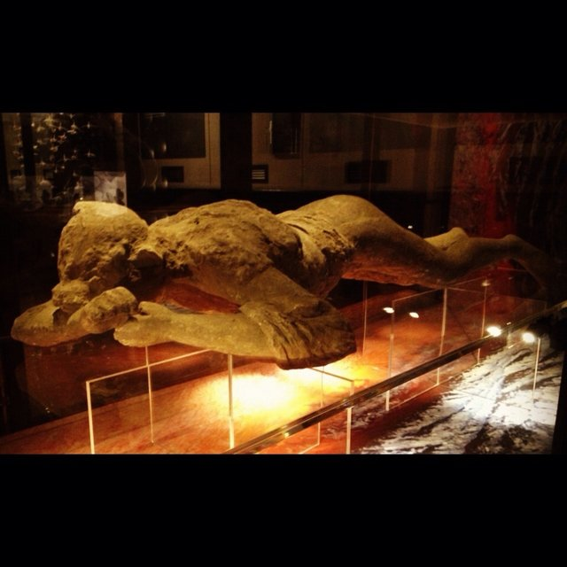
西元 79 年，維蘇威火山（Vesuvius！）爆發——龐貝（Pompeii！2 萬人！）＋赫庫蘭尼姆（！）被火山灰—泥流掩埋；1738 赫庫蘭尼姆（波旁王朝！查理三世！「挖寶」！）→ 1748 龐貝（！）→ 溫克爾曼（Winckelmann！1764《古代藝術史》！「高貴的單純」！）——**考古學誕生**；此前：文藝復興（！古董收集！「骨董」！）——**挖寶的時代**。此後：1860 菲奧雷利（石膏像！「遺體模型」！）→ 1927–61 馬伊烏里（！街區！）——**科學發掘**。這樁案件是「災難的保存」：**火山灰（！）殺死一座城，保存一座城**。

[→ 對外連結：1748-龐貝發掘：火山灰下的時間膠囊](https://chad-liu.github.io/books/html/1-6-9.考古事件/1748-龐貝發掘與考古學誕生.html)

## 1799 | 羅塞塔石碑與聖書體破解
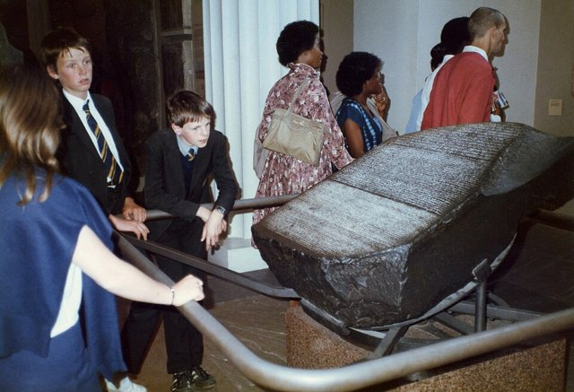
1799 年 7 月，拿破崙遠征埃及（！）士兵修築拉希德（Rosetta！）堡壘——**羅塞塔石碑**（玄武岩！112×75cm！三種文字：聖書體—世俗體—希臘文！托勒密五世詔書！前 196！）→ 1801 英軍繳獲（亞歷山大！「戰利品」！大英博物館！）→ 1822 商博良（Champollion！「拉美西斯—圖特摩斯」！ Naming！）——**聖書體破解**；此前：托馬斯·楊（1814！「托勒密」！物理學家！）——**對手**。這樁案件是「雙語的鑰匙」：**希臘文（已知！）撬開聖書體（未知！）**。

[→ 對外連結：1799-羅塞塔石碑：三種文字的鑰匙](https://chad-liu.github.io/books/html/1-6-9.考古事件/1799-羅塞塔石碑與聖書體破解.html)

## 1802 | 楔形文字的破解
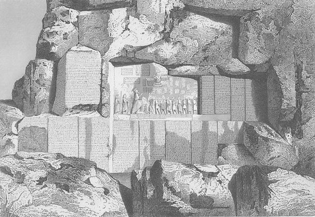
1802 年，格羅特芬德（Grotefend！中學教師！哥廷根！）猜出波斯波利斯銘文的王名（「薛西斯之子大流士」！）——**楔形文字破解開幕**；此後：1835–47 羅林森（Rawlinson！貝希斯敦峭壁！大流士紀功碑！三語：古波斯—埃蘭—巴比倫！繩梯抄碑！）→ 1857 皇家亞洲學會「審判」（四人同譯！塔爾博特密封！一致！）——**破解確認**。此前：1750s 尼布爾（丹麥考察隊！哥本哈根！唯一生還！）抄碑（！）——**材料**。這樁案件是「猜謎的勝利」：**中學教師猜出國王名，軍官吊繩抄峭壁**。

[→ 對外連結：1802-楔形文字：從猜國王到貝希斯敦峭壁](https://chad-liu.github.io/books/html/1-6-9.考古事件/1802-楔形文字的破解.html)

## 1836 | 三期系統與湯姆森
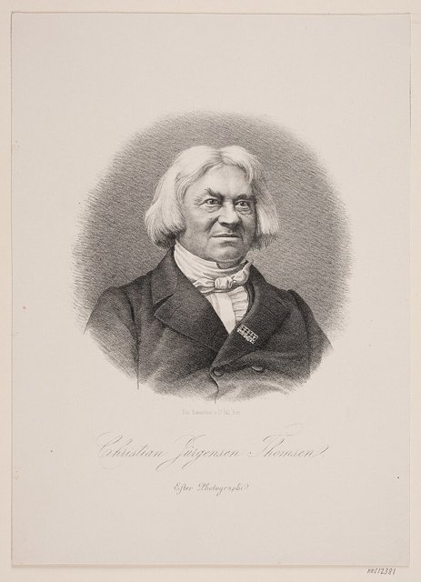
1836 年，丹麥國立博物館館長湯姆森（Thomsen！《斯堪地那維亞古代遺物指南》！）提出**三期系統**（石器—青銅—鐵器！）——**史前史的時鐘**；此前：盧克萊修（《物性論》！「石—銅—鐵」猜！）、1820s 博物館混亂（「巨人—矮人」！）——**無序**。此後：1865 魯布克（舊石器—新石器！）、沃爾索（地層！1880s！）、皮特—里弗斯（類型學！挖掘法！）——**科學化**。這樁案件是「抽屜的革命」：**按材質整理抽屜，整理出時間**。

[→ 對外連結：1836-三期系統：博物館抽屜裡的時間](https://chad-liu.github.io/books/html/1-6-9.考古事件/1836-三期系統與湯姆森.html)

## 1856 | 尼安德塔人發現
1856 年 8 月，德國尼安德塔谷（Neander Valley！）採石工人挖出**頭蓋骨—肋骨—肢骨**（！）→ 中學教師富爾羅特（！）→ 沙夫豪森（解剖學家！1857！「原始人」！）——**尼安德塔人**；此前：1829 恩吉斯兒童（施默林！比利時！「被忽視」！）、1848 直布羅陀（Forbes！「擱置」！）——**先驅的沉默**。此後：達爾文（1859！1871《人類的由來》！）、克魯泡特金？不——1868 克羅馬農（！智人！）、1911 皮爾當人（騙局！道森！1953 揭穿！）——**古人類學**。這樁案件是「頭骨的審判」：**眉脊粗壯（！）＝野蠻？還是人類？**

[→ 對外連結：1856-尼安德塔人：山谷裡的頭蓋骨](https://chad-liu.github.io/books/html/1-6-9.考古事件/1856-尼安德塔人發現.html)

## 1859 | 人類古老性確立
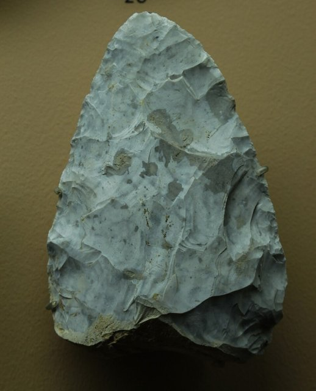
1859 年，英國地質學家普雷斯特維奇—埃文斯考察法國索姆河（聖阿舍爾！）→ 確認布歇·德·皮特（海關關員！1840s！）的**手斧與滅絕動物共存**——**人類古老性確立**；同年達爾文《物種起源》（11.24！「第一版1250冊售罄」！）——**雙重革命**。此前：1797 弗里爾（霍克斯尼！「巨人」！被忽視！）、布歇（！海關！收集！）——**業餘者的堅持**。這樁案件是「手斧的證詞」：**石器＋猛獁象骨頭＝人類老於聖經**。

[→ 對外連結：1859-人類古老性：索姆河的手斧與達爾文](https://chad-liu.github.io/books/html/1-6-9.考古事件/1859-人類古老性確立.html)

## 1860 | 吳哥發現與殖民考古
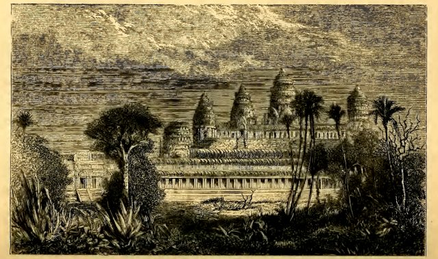
1860 年，法國博物學家亨利·穆奧（Mouhot！）遊記出版（死於寮國！1859！）——**吳哥「發現」**（歐洲！）；此前：高棉人從未遺忘（僧侶！）、葡萄牙傳教士（16 世紀！）、中國周達觀（1296《真臘風土記》！）——**「發現」的神話**。此後：1863 法國保護柬埔寨（！）、1907 遠東學院（EFEO！修復！）、1970s 紅色高棉（破壞！）——**殖民考古**。這樁案件是「發現的發明」：**當地人知道600年的地方，被歐洲人「發現」**。

[→ 對外連結：1860-吳哥「發現」：傳教士日記與殖民考古](https://chad-liu.github.io/books/html/1-6-9.考古事件/1860-吳哥發現與殖民考古.html)

## 1871 | 特洛伊發掘與荷馬之爭
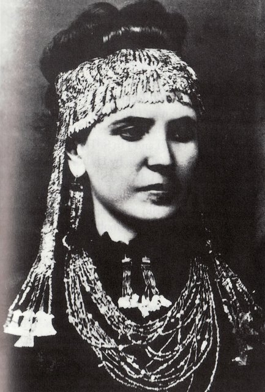
1871–1890 年，德國商人謝里曼（Schliemann！14 種語言！）在土耳其希沙利克（Hisarlik！）發掘——**特洛伊**（九層城市！Troy II「普里阿摩斯寶藏」1873！）；此前：1760s 伍德（Wood！）—1780s 勒舍瓦利埃（定位！）——**荷馬地理學**。此後：1893–94 德爾普菲爾德（Troy VI 才是荷馬時代！）、1932–38 布萊根（Troy VIIa 毀滅約前 1180！）、1988– 科夫曼（下城！「大特洛伊」！）——**層層修正**。這樁案件是「史詩的考古」：**信荷馬（《伊利亞特》！），挖出九座城**。

[→ 對外連結：1871-特洛伊：商人用荷馬當藏寶圖](https://chad-liu.github.io/books/html/1-6-9.考古事件/1871-特洛伊發掘與荷馬之爭.html)

## 1876 | 邁錫尼與阿伽門農面具
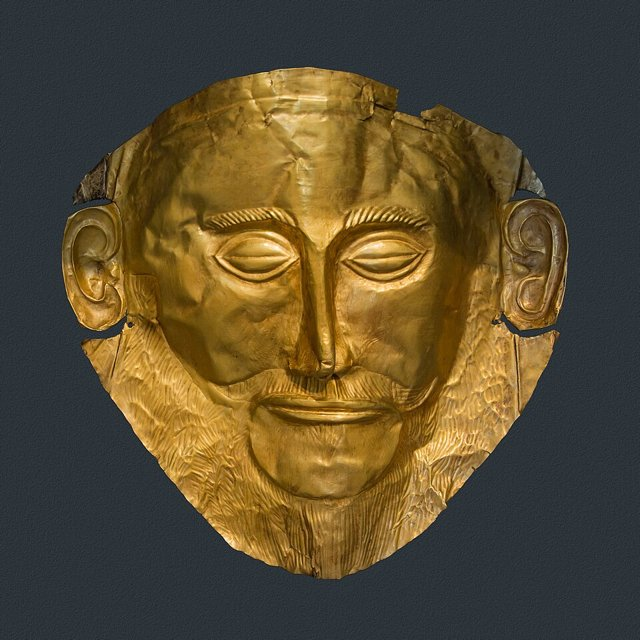
1876 年，謝里曼（特洛伊之後！）轉戰希臘**邁錫尼**（獅子門！）→ 豎井墓圈A（！）→ 黃金面具（「阿伽門農」！電報：「我凝視著阿伽門農的臉」！）——**邁錫尼文明**；此前：1841–43 韋斯（！獅子門！）——**前人**。此後：1876– 提林斯（！巨石！）→ 1900 克諾索斯（伊文思！[克諾索斯與米諾斯迷宮](https://chad-liu.github.io/books/html/1-6-9.考古事件/1900-克諾索斯與米諾斯迷宮.html)！）——**愛琴青銅時代**。這樁案件是「面具的誤認」：**金面具（前 1550！）比阿伽門農（前 1250？）早 300 年**。

[→ 對外連結：1876-邁錫尼：豎井墓裡的黃金面具](https://chad-liu.github.io/books/html/1-6-9.考古事件/1876-邁錫尼與阿伽門農面具.html)

## 1879 | 阿爾塔米拉壁畫真偽案
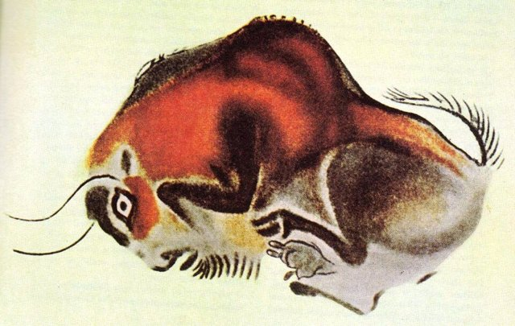
1879 年，西班牙業餘考古學家桑圖奧拉（Sautuola！）之女瑪麗亞（8 歲！抬頭！「看，牛！」！）在**阿爾塔米拉洞**發現**野牛壁畫**（赭紅—黑！1.5 萬年前！）——**舊石器藝術**；此前：1860s 拉泰特（法國！雕刻！）——**先兆**。此後：1880 里斯本大會（「偽造」！卡塔亞克！）、桑圖奧拉含冤死（1888！）、1902 卡塔亞克認錯（「我錯了」！《人類學》！）——**平反**（→拉斯科 1940！[拉斯科洞窟與舊石器美術館](https://chad-liu.github.io/books/html/1-6-9.考古事件/1940-拉斯科洞窟與舊石器美術館.html)！肖維 1994！）。這樁案件是「學術謀殺」：**真品被判偽造，發現者含冤而死**。

[→ 對外連結：1879-阿爾塔米拉：洞穴裡的野牛與學術謀殺](https://chad-liu.github.io/books/html/1-6-9.考古事件/1879-阿爾塔米拉壁畫真偽案.html)

## 1887 | 阿馬爾奈文書與外交檔案
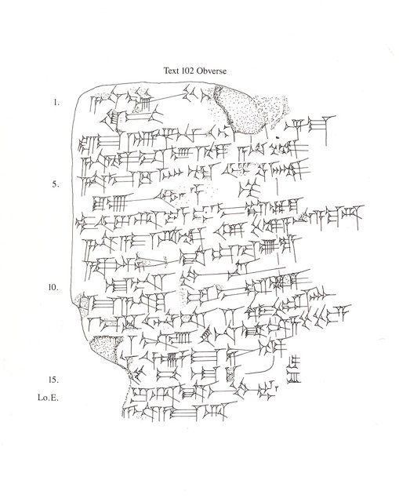
1887 年，埃及中部阿馬爾奈（Akhetaten！埃赫那吞新都！）農婦挖出**楔形文字泥板**（300＋！）——**阿馬爾奈文書**（前 14 世紀！）；此前：1891–92 佩特里（！簽名陶片！）——**考古確認**。內容：埃及法老（阿蒙霍特普三世—埃赫那吞—圖坦卡門！）與巴比倫—亞述—米坦尼—赫梯—塞浦路斯諸王書信（阿卡德語！外交語！「兄弟」！黃金—公主—聯姻！）——**青銅時代的外交檔案**。這樁案件是「泥板的外交部」：**大國俱樂部（Great Powers Club！）的書信**。

[→ 對外連結：1887-阿馬爾奈文書：泥板上的青銅外交](https://chad-liu.github.io/books/html/1-6-9.考古事件/1887-阿馬爾奈文書與外交檔案.html)

## 1899 | 甲骨文發現與王懿榮之死
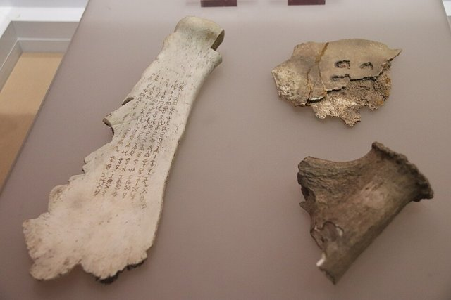
1899 年，國子監祭酒**王懿榮**（！病！）在中藥「龍骨」上發現刻文——**甲骨文**（龜甲—獸骨！商代！）；此前：小屯（安陽！農民挖「龍骨」！當藥！）、王懿榮（金石學家！「古董」！）——**藥店即遺址**。此後：1900 王懿榮自殺（八國聯軍！京師！）、劉鶚（《鐵雲藏龜》1903！「收買」！）、羅振玉（！）、王國維（1917《殷卜辭中所見先公先王考》！「二重證據法」！）、1928 殷墟發掘（董作賓！[殷墟科學發掘](https://chad-liu.github.io/books/html/1-6-9.考古事件/1928-殷墟科學發掘.html)！）——**商史重建**。這樁案件是「藥渣裡的信史」：**治瘧疾的龍骨，是商王的檔案**。

[→ 對外連結：1899-甲骨文：中藥店裡的三千年文字](https://chad-liu.github.io/books/html/1-6-9.考古事件/1899-甲骨文發現與王懿榮之死.html)

## 1900 | 克諾索斯與米諾斯迷宮
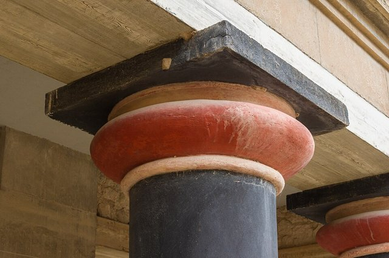
1900 年起，英國人伊文思（Evans！阿什莫林博物館館長！）發掘克里特**克諾索斯**（！）→ 宮殿（迷宮！1500 間！）→ **米諾斯文明**（以傳說王米諾斯命名！）→ 線形文字A—B（泥板！）→ 1952 文特里斯破解線B（希臘語！）——**愛琴第二極**；此前：1878 米諾斯（希臘人！）、卡洛凱里諾斯（！）——**先驅**。這樁案件是「神話的宮殿」：**牛頭怪（彌諾陶洛斯！）的迷宮，真的存在**。

[→ 對外連結：1900-克諾索斯：牛頭怪的宮殿與線形文字](https://chad-liu.github.io/books/html/1-6-9.考古事件/1900-克諾索斯與米諾斯迷宮.html)

## 1906 | 哈圖沙與赫梯帝國
1906 年起，德國人溫克勒（Winckler！）在土耳其博阿茲柯伊發掘**哈圖沙**（！）→ 王室檔案庫（1 萬＋泥板！楔形文字！赫梯語—印歐語！）——**赫梯帝國**（前 1600–1200！）；此前：1880s 塞伊斯（！哈馬斯石！）——**線索**。此後：1915 赫羅茲尼（！印歐語確認！）、1920s 卡迭石和約（埃及—赫梯！）——**超級大國**。這樁案件是「失落帝國的重現」：**聖經裡的配角（「赫人」！），是青銅大國**。

[→ 對外連結：1906-哈圖沙：聖經之外的超級大國](https://chad-liu.github.io/books/html/1-6-9.考古事件/1906-哈圖沙與赫梯帝國.html)

## 1907 | 敦煌藏經洞與探險家
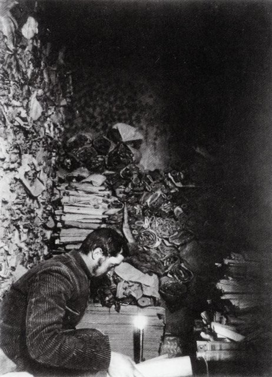
1900 年，道士王圓籙（！）清理莫高窟第16 窟淤沙——**藏經洞**（17 窟！5 萬＋卷子！4–11 世紀！）→ 1907 斯坦因（英！8000 卷！200 兩！）、1908 伯希和（法！6000 卷！精華！）→ 藏經洞空（！）→ 羅振玉—王國維（！研究！）→ 敦煌學（！）——**中亞的圖書館**；此前：1900–01 斯坦因首次（和闐！）——**探險家時代**。這樁案件是「道士的拍賣」：**守洞道士（王圓籙！）把國寶賣給外國人**。

[→ 對外連結：1907-敦煌藏經洞：道士開門與探險家](https://chad-liu.github.io/books/html/1-6-9.考古事件/1907-敦煌藏經洞與探險家.html)

## 1911 | 馬丘比丘與最後之城
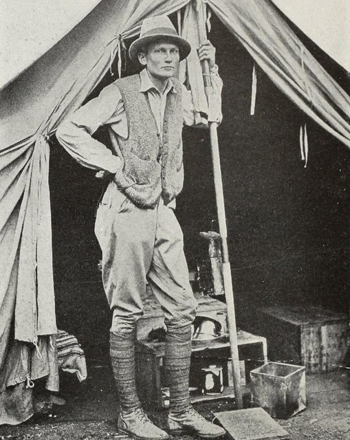
1911 年 7 月 24 日，耶魯講師賓厄姆（Bingham！）在嚮導帶領下登上安第斯山脊——**馬丘比丘**（2430 米！「古峰」！）；此前：1911 耶魯秘魯考察（！）、阿格里奇（農民！知道！）——**當地人知道**。此後：1912–15 發掘（！）、《失落的印加城市》（1948！暢銷！）、1983 申遺（！）、2007 世界新七大奇蹟（！）——**秘魯的象徵**。爭議：是否「最後之城」比爾卡班巴（！）？是否「皇家莊園」（帕查庫蒂！）？文物（耶魯！2011 歸還！）——**發現的神話與爭議**。這樁案件是「雲端的營銷」：**賓厄姆把遺址變成傳奇**。

[→ 對外連結：1911-馬丘比丘：雲端的失落之城](https://chad-liu.github.io/books/html/1-6-9.考古事件/1911-馬丘比丘與最後之城.html)

## 1921 | 印度河文明發現
1921–1922 年，印度考古局巴納吉（哈拉帕！）—薩赫尼（摩亨佐達羅！）發掘——**印度河文明**（前 2600–1900！）；此前：1826 伯恩斯（！）、1856 鐵路（枕木！「磚」！）——**破壞即線索**。此後：1924 馬歇爾宣布（《倫敦新聞畫報》！「新文明」！）→ 1931 麥凱（！）→ 1947 分治（印—巴！）→ 2000s 多拉維拉（！）——**青銅第四極**。這樁案件是「枕木的城市」：**鐵路拆古城當枕木，拆出一個文明**。

[→ 對外連結：1921-印度河文明：鐵路枕木下的城市](https://chad-liu.github.io/books/html/1-6-9.考古事件/1921-印度河文明發現.html)

## 1922 | 圖坦卡門與法老的詛咒
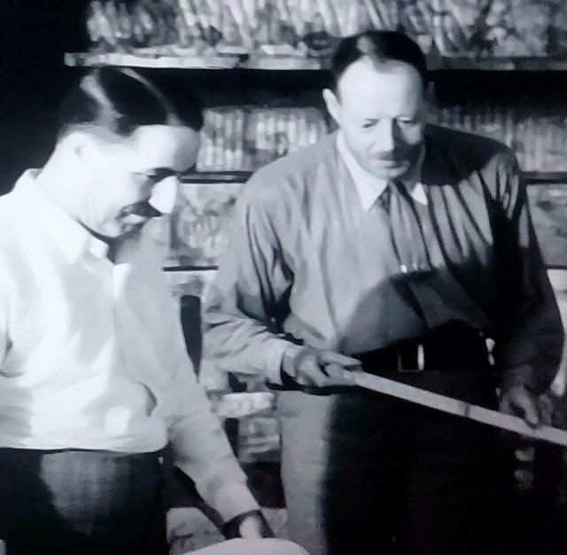
1922 年 11 月 4 日，卡特（Carter！卡那封勳爵資助！）在帝王谷（KV62！）發現台階——11.26 鑽孔窺見（「金光閃閃的東西」！）→ 1923 開棺（！）→ 金面具（11kg！）＋5000 件陪葬（！）——**圖坦卡門**（前 1341–1323！18 歲死！）；此前：1817 貝爾佐尼（！）、1907 戴維斯（「帝王谷已空」！）——**前人斷言**。此後：1923 卡那封死（蚊咬！「詛咒」！）→ 媒體狂熱（！）→ 1972–79 巡展（！）→ DNA（2010！瘧疾—鐮刀貧血—近親！）——**法老的法醫**。這樁案件是「詛咒的營銷」：**蚊子咬死的贊助人，變成法老的詛咒**。

[→ 對外連結：1922-圖坦卡門：帝王谷的金面具與詛咒](https://chad-liu.github.io/books/html/1-6-9.考古事件/1922-圖坦卡門與法老的詛咒.html)

## 1924 | 北京猿人與周口店
1924–1937 年，周口店（北京西南！）→ 安特生（瑞典！1921「北京人牙齒」！）→ 步達生（1926！兩顆牙！「北京人」命名！）→ 裴文中（1929.12.2！首個頭蓋骨！「額外獎勵」！）→ 賈蘭坡（1936！三個頭蓋骨！）——**北京猿人**（直立人！70–20 萬年前！用火！）；此前：1891 爪哇人（杜布瓦！）——**亞洲直立人**。此後：1937–41 化石失蹤（！裝箱！「北平協和」！下落不明！）→ 1949 後再挖（！山頂洞！）→ 2000s 年代重定（！）——**失蹤的國寶**。這樁案件是「頭骨的失蹤」：**5 個頭蓋骨（！），裝箱後人間蒸發**。

[→ 對外連結：1924-北京猿人：周口店的頭蓋骨與戰火](https://chad-liu.github.io/books/html/1-6-9.考古事件/1924-北京猿人與周口店.html)

## 1928 | 殷墟科學發掘
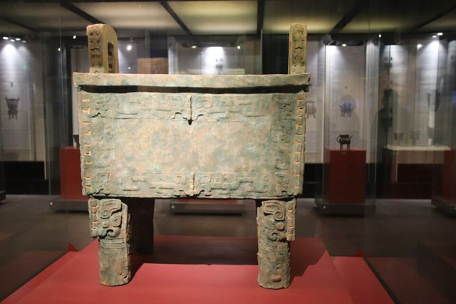
1928–1937 年，中央研究院史語所（傅斯年！）在安陽小屯發掘**殷墟**（15 次！）→ 董作賓（甲骨分期！五期！）、李濟（城牆！人類學！）、梁思永（後岡三疊層！地層學！）——**中國科學考古學誕生**；此前：1899 甲骨文（[甲骨文發現與王懿榮之死](https://chad-liu.github.io/books/html/1-6-9.考古事件/1899-甲骨文發現與王懿榮之死.html)！）、1917 二重證據（王國維！）——**紙上先行**。此後：1937 停挖（抗戰！）、1950– 再挖（！）、1959 二里頭（！夏？）、1976 婦好墓（！完整！）——**商史的三次擴大**。這樁案件是「方法論的成人禮」：**地層（梁思永！）＋分期（董作賓！）＋人類學（李濟！）**。

[→ 對外連結：1928-殷墟：中國考古學的成人禮](https://chad-liu.github.io/books/html/1-6-9.考古事件/1928-殷墟科學發掘.html)

## 1940 | 拉斯科洞窟與舊石器美術館
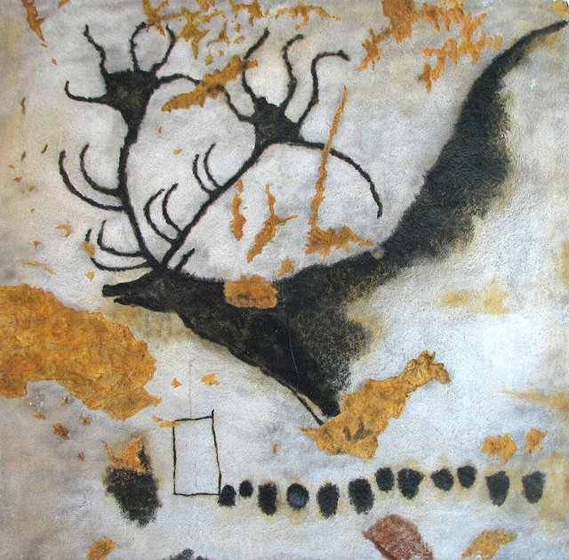
1940 年 9 月 12 日，四少年（拉維爾！）＋狗（羅伯特！）追兔子——**拉斯科洞窟**（600 米！2000＋圖像！野牛—馬—鹿！1.7 萬年前！）；此前：1879 阿爾塔米拉（[阿爾塔米拉壁畫真偽案](https://chad-liu.github.io/books/html/1-6-9.考古事件/1879-阿爾塔米拉壁畫真偽案.html)！平反1902！）——**前輩**。此後：1948 開放（！）—1963 關閉（霉菌！二氧化碳！）—1983 複製洞（拉斯科II！）—2016 國際中心（拉斯科IV！）——**保護的進化**。1994 肖維（[肖維岩洞與3萬年藝術](https://chad-liu.github.io/books/html/1-6-9.考古事件/1994-肖維岩洞與3萬年藝術.html)！3.6 萬年！）——**更老**。這樁案件是「少年的發現」：**18 歲少年＋狗，發現人類美術館**。

[→ 對外連結：1940-拉斯科：少年與狗發現的美術館](https://chad-liu.github.io/books/html/1-6-9.考古事件/1940-拉斯科洞窟與舊石器美術館.html)

## 1947 | 死海古卷與庫姆蘭
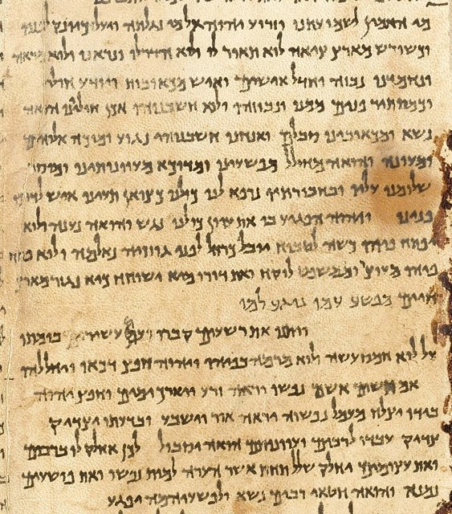
1947 年初，貝都因牧羊童（穆罕默德·迪布！追羊！扔石頭！聽見陶罐碎！）在庫姆蘭（！）發現**死海古卷**（900＋卷！希伯來—亞蘭—希臘文！前 3 世紀–公元1世紀！）；此前：11 洞（1947–56！）——**藏書洞群**。內容：《以賽亞書》全卷（！）＋社團規則（！）＋戰爭卷（光明之子！）＋銅卷（寶藏圖！）——**第二聖殿猶太教**。此後：1950s–90s 釋讀壟斷（「國際小組」！遲緩！）、1991 解放（亨廷頓圖書館！）、數字死海古卷（以色列博物館！谷歌！）——**學術政治**。爭議：艾賽尼派（！）？撒督該？早期基督教？——**歸屬之爭**。這樁案件是「石頭的迴響」：**牧羊童一扔，扔出兩千年**。

[→ 對外連結：1947-死海古卷：牧羊童扔出的兩千年文獻](https://chad-liu.github.io/books/html/1-6-9.考古事件/1947-死海古卷與庫姆蘭.html)

## 1949 | 碳十四測年與絕對年代
1949 年，芝加哥大學利比（Libby！曼哈頓計劃！）發表**碳十四測年**（¹⁴C！半衰期5730 年！）——**絕對年代**；此前：相對年代（地層—類型！）、年輪（道格拉斯！）——**無錶**。此後：1960 諾獎（化學！）、1970s 校正曲線（年輪—IntCal！）、1988 都靈裹屍布（1260–1390！中世紀！）、AMS（加速器！微量！）——**測年的革命**。這樁案件是「物理學的手錶」：**宇宙射線（¹⁴C！）＋衰變＝時鐘**。

[→ 對外連結：1949-碳十四：物理學家給考古學的手錶](https://chad-liu.github.io/books/html/1-6-9.考古事件/1949-碳十四測年與絕對年代.html)

## 1952 | 線形文字B破解與建築師
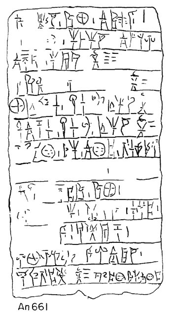
1952 年，英國建築師文特里斯（Ventris！30 歲！）宣布**線形文字B是希臘語**——**愛琴文字破解**；此前：1900 伊文思（克諾索斯！[克諾索斯與米諾斯迷宮](https://chad-liu.github.io/books/html/1-6-9.考古事件/1900-克諾索斯與米諾斯迷宮.html)！線A—線B泥板！）、1939 皮洛斯（布萊根！更多泥板！）、1940s 考埃爾（！音節網格！）——**接力**。此後：1953 《文件》S（與查德威克！《Documents》！）、1956 文特里斯死（車禍！34 歲！）——**英年早逝的天才**。線A至今未解（！）——**一半的勝利**。這樁案件是「業餘者的格子」：**建築師用 crossword 式推理破解三千年文字**。

[→ 對外連結：1952-線形文字B：建築師的格子法](https://chad-liu.github.io/books/html/1-6-9.考古事件/1952-線形文字B破解與建築師.html)

## 1959 | 奧杜威與人類非洲起源
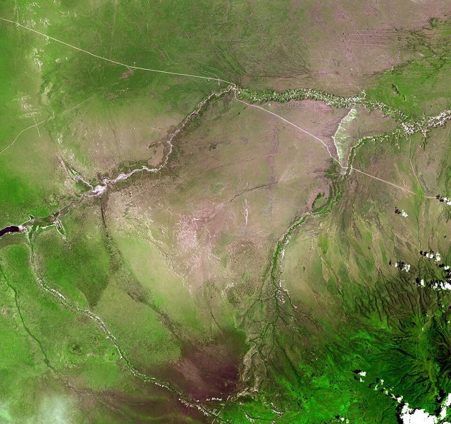
1959 年 7 月 17 日，瑪麗·利基（坦尚尼亞奧杜威峽谷！）發現**Zinj**（「胡桃夾子」！175 萬年前！粗壯傍人！）——**人類非洲起源的證據**；此前：1924 湯恩小孩（達特！南猿！）——**先驅**。此後：1964 能人（漢迪！「手」！）、1974 露西（[露西與直立行走](https://chad-liu.github.io/books/html/1-6-9.考古事件/1974-露西與直立行走.html)！）、2000s 基因（非洲！）——**出非洲**。利基家族（路易斯—瑪麗—理查—米夫！三代！）——**古人類學第一家庭**。這樁案件是「峽谷的耐心」：**利基夫婦挖28 年，一天出土改寫教科書**。

[→ 對外連結：1959-奧杜威：胡桃夾子與非洲起源](https://chad-liu.github.io/books/html/1-6-9.考古事件/1959-奧杜威與人類非洲起源.html)

## 1962 | 新考古學與濱福德革命
1962 年，濱福德（Binford！芝加哥！）發表《作為人類學的考古學》——**新考古學**（New Archaeology！過程主義！）；此前：文化歷史學派（柴爾德！「文化＝族群」！）——**描述**。此後：1968《新視角》（！文集！）、1970s 中程理論（！）、1980s 後過程（霍德！「意義」！）——**學派戰爭**。1990s 歷史生態—達爾文考古（！）——**綜合**。這樁案件是「科學的宣言」：**考古學要解釋（文化過程！），不要只描述（文化史！）**。

[→ 對外連結：1962-新考古學：濱福德的革命宣言](https://chad-liu.github.io/books/html/1-6-9.考古事件/1962-新考古學與濱福德革命.html)

## 1974 | 兵馬俑與秦始皇陵
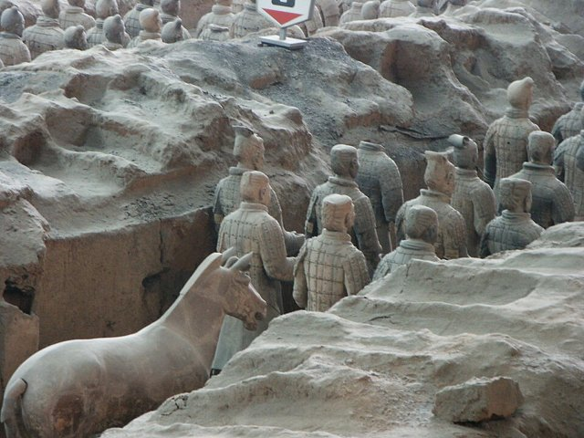
1974 年 3 月，陝西臨潼西楊村農民楊志發（！）打井——**兵馬俑**（3 坑！8000＋！）→ 1976 考古所（！）→ 1979 博物館（！）→ 1987 申遺（！）——**世界第八大奇蹟**（→希拉克！）；此前：《史記·秦始皇本紀》（「水銀為江海」！）——**文獻預告**。此後：秦陵地宮（未挖！水銀異常！）、文武百官坑（！）、青銅大立人？不——銅車馬（1980！）——**陵園全貌**。爭議：項羽燒（？）？勞役死多少（70 萬？）？——**秦制的鏡子**。這樁案件是「水井的奇蹟」：**農民找水，找到皇帝的軍隊**。

[→ 對外連結：1974-兵馬俑：打井打出地下軍團](https://chad-liu.github.io/books/html/1-6-9.考古事件/1974-兵馬俑與秦始皇陵.html)

## 1974 | 露西與直立行走
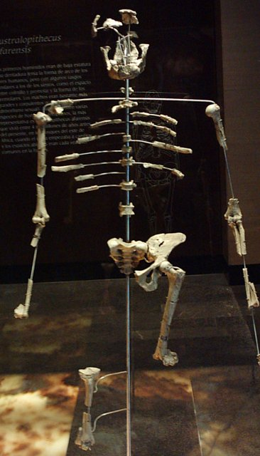
1974 年 11 月 24 日，約翰遜（Johanson！亞利桑那！）在衣索比亞阿法爾（Hadar！）發現**露西**（AL 288-1！南方古猿阿法種！320 萬年前！40% 骨架！）——**直立行走的證據**；此前：1924 湯恩（！）、1959 Zinj（[奧杜威與人類非洲起源](https://chad-liu.github.io/books/html/1-6-9.考古事件/1959-奧杜威與人類非洲起源.html)！）——**鏈條**。當晚營地放披頭四《Lucy in the Sky》——**露西得名**。此後：1978 萊托利腳印（瑪麗·利基！370 萬年！）——**直立確認**。這樁案件是「骨盆的證詞」：**膝關節—骨盆—足弓＝直立**。

[→ 對外連結：1974-露西：320萬年前的直立行走](https://chad-liu.github.io/books/html/1-6-9.考古事件/1974-露西與直立行走.html)

## 1986 | 三星堆之謎
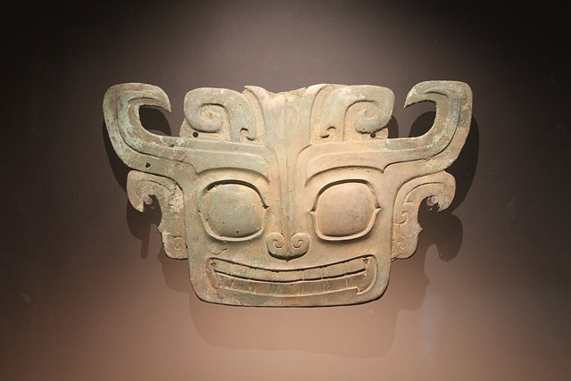
1986 年 7–8 月，四川廣漢南興鎮磚廠取土——**一號二號祭祀坑**（青銅大立人！縱目面具！神樹！金杖！象牙！）→ 1987 博物館（！）→ 2019–21 新六坑（3–8 號！絲綢！）——**三星堆**（前 1300–1100！古蜀！）；此前：1929 燕道誠（！玉石器！）、1934 葛維漢（！美國！）——**前奏**。爭議：外星人（！縱目！）？長江文明（！）？夏（？）？——**未解之蜀**。這樁案件是「磚廠的寶藏」：**燒磚取土，取出古蜀國**。

[→ 對外連結：1986-三星堆：古蜀的青銅面具與外星人傳說](https://chad-liu.github.io/books/html/1-6-9.考古事件/1986-三星堆之謎.html)

## 1991 | 冰人奧茨
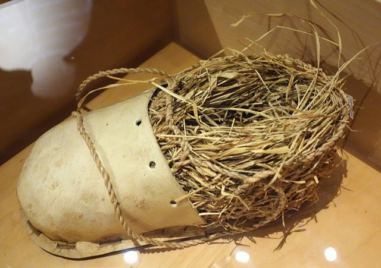
1991 年 9 月 19 日，德國登山夫婦（西蒙夫婦！）在奧茨塔爾阿爾卑斯（意奧邊境！3210 米！）發現**冰人奧茨**（5300 年前！銅石並用！）——**最古老木乃伊**；此前：冰川退縮（！暖化！）——**天氣**。此後：因斯布魯克（！解凍！）→ 胃（！最後一餐！）→ 箭傷（左肩！燧石箭頭！）→ DNA（！萊姆病！關節炎！紋身！）——**謀殺案偵破**。這樁案件是「冰川的法醫」：**5300 年前的謀殺，1991 年立案**。

[→ 對外連結：1991-冰人奧茨：冰川裡的5300歲謀殺案](https://chad-liu.github.io/books/html/1-6-9.考古事件/1991-冰人奧茨.html)

## 1994 | 肖維岩洞與3萬年藝術
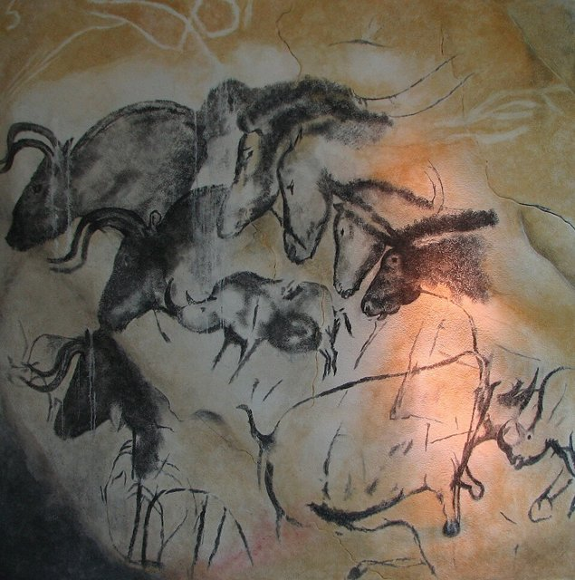
1994 年 12 月 18 日，三洞穴探險者（肖維—德尚—希萊爾！）在法國阿爾代什發現**肖維岩洞**（1000＋圖像！獅子—犀牛—貓頭鷹！3.6 萬年前！）——**最古老洞穴藝術**；此前：峽谷（！）——**偶然**。此後：1995 封閉（！保護！）→ 2015 複製洞（！）→ 2014 申遺（！）——**保護的典範**。爭議：年代（3.6 萬？2 萬？碳十四—鈾系！）——**斷代之爭**。這樁案件是「藝術的提前」：**人類會畫畫3.6萬年**。

[→ 對外連結：1994-肖維岩洞：3.6萬年前的美術館](https://chad-liu.github.io/books/html/1-6-9.考古事件/1994-肖維岩洞與3萬年藝術.html)

## 2003 | 弗洛勒斯霍比特人
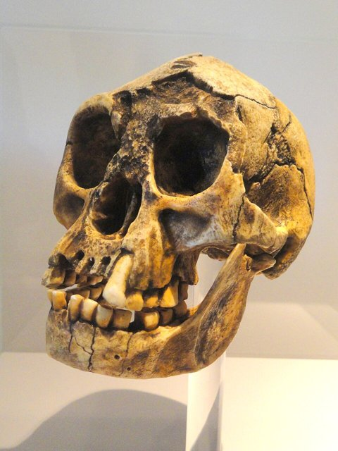
2003 年 9 月，印尼弗洛勒斯島梁布亞洞（Liang Bua！）→ 邁克·莫伍德（澳洲！）團隊發現**LB1**（成年女性！1 米06！380cc腦！1.8–5 萬年前！）——**弗洛勒斯人**（Homo floresiensis！「霍比特人」！）；此前：1965 神父（！牙齒！）——**線索**。爭議：新種（！）？病態智人（小頭症？克汀病？）？——**百年爭論的縮影**。此後：2004《自然》（！）—2016 定年（！）—石器（！）——**確認古老**。這樁案件是「島嶼侏儒化」：**直立人上島，越變越小**。

[→ 對外連結：2003-弗洛勒斯人：梁布亞洞的霍比特人](https://chad-liu.github.io/books/html/1-6-9.考古事件/2003-弗洛勒斯霍比特人.html)

## 2010 | 丹尼索瓦人與古DNA革命
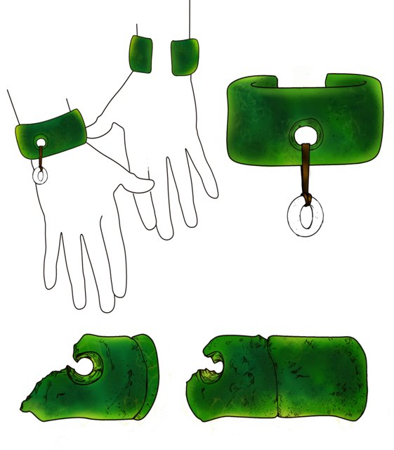
2008 年，西伯利亞丹尼索瓦洞（！）→ 指骨碎片（「丹尼索瓦4」！女童！）→ 2010 佩博團隊（萊比錫！）測序——**丹尼索瓦人**（新古人類！）→ 現代人基因（大洋洲4–6%！東亞0.2%！）——**雜交**；此前：尼人基因組（2010！）——**方法**。此後：2019 夏河下頜（青藏高原！16 萬年！蛋白質！）、2022 佩博諾獎（！）——**古DNA時代**。龍人（2021！哈爾濱！）——**東亞親戚？**（→「丹人」？！）。這樁案件是「一節指骨的重建」：**DNA（！）比重建一個人種**。

[→ 對外連結：2010-丹尼索瓦人：一節指骨與古DNA革命](https://chad-liu.github.io/books/html/1-6-9.考古事件/2010-丹尼索瓦人與古DNA革命.html)

## 2018 | 光達透視瑪雅巨城
2018 年，《科學》發表Pacunam光達（LiDAR！）調查——**瓜地馬拉北部2100km²叢林下：6 萬＋建築（！）、城牆—道路—水庫（！）**——**瑪雅低地人口超千萬**（→「巨城」！）；此前：2012 吳哥光達（埃文斯！）、2015 宏都拉斯「猴神」（！）——**技術驗證**。此後：柬埔寨—寮國—墨西哥（！）——**全球光達考古**。爭議：戰爭（！城牆！）？可持續（！水庫！）？——**瑪雅崩潰重審**。這樁案件是「激光的砍刀」：**每秒60萬個點，砍開叢林**。

[→ 對外連結：2018-光達透視：叢林下的瑪雅巨城](https://chad-liu.github.io/books/html/1-6-9.考古事件/2018-光達透視瑪雅巨城.html)

## 2023 | AI復活赫庫蘭尼姆卷軸
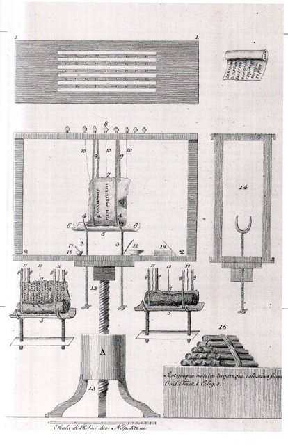
2023 年，**維蘇威挑戰賽**（Vesuvius Challenge！250 萬美元獎金！）→ 21 歲大學生法里克（肯塔基！）用AI讀出赫庫蘭尼姆卷軸首詞（「紫色」！porphyras！）→ 2024 全文（伊壁鳩魯學派！菲羅德慕斯！）——**2000年未開的卷軸開卷**；此前：79 年維蘇威（[龐貝發掘與考古學誕生](https://chad-liu.github.io/books/html/1-6-9.考古事件/1748-龐貝發掘與考古學誕生.html)！紙莎草別墅！）、1750s 開卷嘗試（碳化易碎！）、2009 X射線（！）——**打不開的書**。這樁案件是「AI的紙莎草學」：**CT掃描＋機器學習＝不開卷而讀**。

[→ 對外連結：2023-AI復活赫庫蘭尼姆卷軸：維蘇威挑戰賽](https://chad-liu.github.io/books/html/1-6-9.考古事件/2023-AI復活赫庫蘭尼姆卷軸.html)
