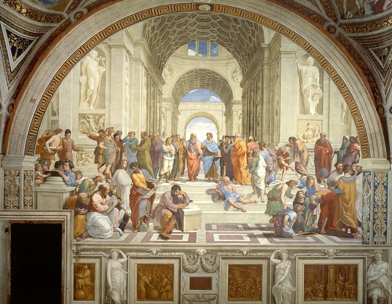
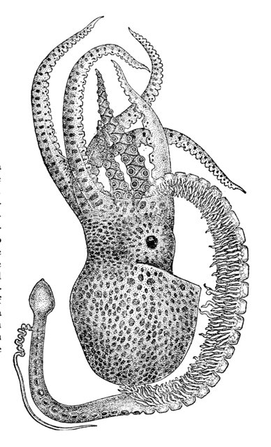
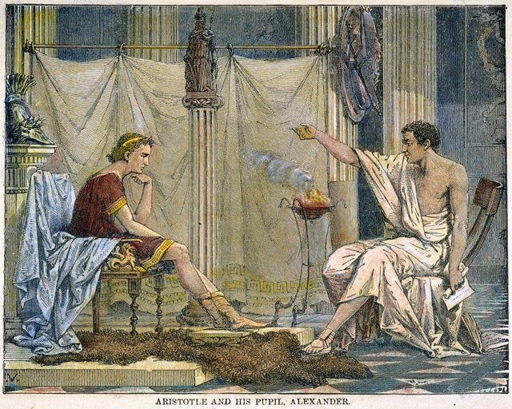
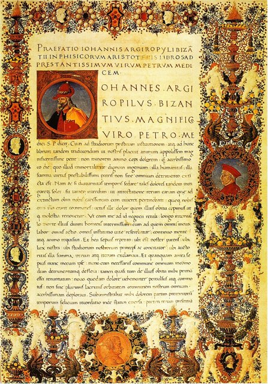
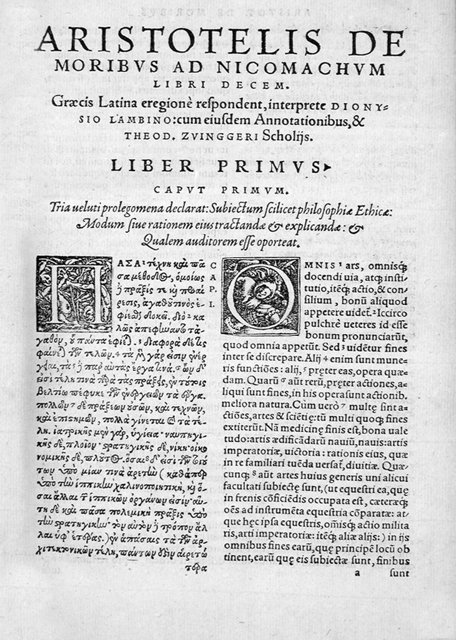
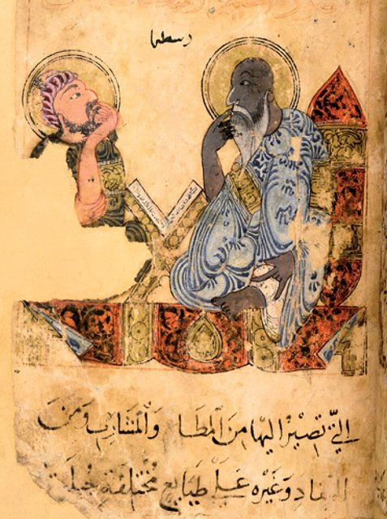

<!--
內容整理自本機筆記〈亞里士多德生平大事記（前384–前322年）〉（圖表\亞里士多德生平大事記（前 384–前 322 年）.md）與中文維基百科「亞里斯多德」條目（CC BY-SA 4.0），以台灣用語改寫摘要。
https://zh.wikipedia.org/zh-tw/亚里士多德
史料與日期說明：
- 譯名採台灣通用的「亞里斯多德」，與蘇格拉底、柏拉圖時間軸一致；筆記的「亞里士多德」是中國大陸譯法。
- 維基百科列出的確切生卒日（前384年6月19日、前322年3月7日）沒有古代史料依據，此處只用年份；去世時約62歲。
- 維基百科稱他的父親是「阿明塔斯二世」的御醫，一般說法是腓力二世之父阿明塔斯三世；又寫「前335年腓力二世去世、前336年亞歷山大即位」，腓力二世實際上死於前336年，此處依一般說法修正。
- 進入學院的年齡：維基百科寫18歲、筆記寫17歲；依年份相減為17歲。
- 筆記寫「赫米亞斯去世後前往萊斯博斯島」；一般說法是他約前345年就移居萊斯博斯，赫米亞斯約前341年才被波斯人俘虜處死（維基百科作前344年），此處依一般說法。
- 卡利斯提尼斯事件、在米埃扎教學、為亞歷山大註解《伊利亞德》、遺囑內容、158部城邦政制研究與《雅典政制》的發現、著作經安德羅尼柯編輯流傳等細節，係依普魯塔克、第歐根尼·拉爾修的記載與一般公認的史實補充；亞里斯多德下毒害死亞歷山大是無根據的傳言，未採用。
- 為避免遠期事件壓縮橫向檢視，後世的影響併入最後一則事件的說明。
圖片來源（皆為 Wikimedia Commons 公有領域／CC0 作品）：
- ari-cover.jpg：Aristotle Altemps Inv8575.jpg
- ari-academy.jpg：Sanzio 01.jpg
- ari-lesbos.jpg：Tremoctopus violaceus5.jpg
- ari-alexander.jpg：Alexander and Aristotle.jpg
- ari-physics.jpg：John Argyropoulos, Preface to Aristotle’s Physics.jpg
- ari-ethics.jpg：Aristotelis De Moribus ad Nicomachum.jpg
- ari-legacy.jpg：Ibn Bakhtīshūʿ, Kitāb naʿt al-ḥayawān probably Baghdad, c. 1225. London, British Library, Or. 2784, A student sitting with Aristotle (right).jpg
-->

# Periods
- -384 ~ -367 | 馬其頓御醫之子 | #5c940d
  生於希臘北部的斯塔基拉，父親是馬其頓國王的御醫。他從小在與馬其頓宮廷關係密切的環境中長大，很早就失去雙親，由監護人撫養。
- -367 ~ -347 | 柏拉圖學院的二十年 | #0c8599
  17歲到雅典進入柏拉圖的學院，從學生成長為獨當一面的學者，在這裡待了二十年，直到柏拉圖去世。
- -347 ~ -335 | 遊歷與亞歷山大的老師 | #e67700
  離開雅典，先後在小亞細亞的阿索斯與萊斯博斯島研究自然，再受馬其頓國王腓力二世之聘，教導王子亞歷山大。
- -335 ~ -322 | 呂克昂學園與晚年 | #2b8a3e
  回到雅典創立呂克昂學園，在散步中講學，建立橫跨邏輯、自然科學、倫理、政治與文藝的研究體系；亞歷山大死後被迫出走，次年去世。

# Events

## -384 | 出生@斯塔基拉
生於希臘北部哈爾基季基半島的斯塔基拉，因此也被稱為「斯塔基拉人」。父親尼各馬可是馬其頓國王阿明塔斯三世（腓力二世之父）的御醫，出身醫生世家的背景，或許讓他從小就接觸到解剖與觀察自然的知識。他的雙親都在他年少時去世，由姊夫普羅克森努斯撫養長大。

## -367 | 進入柏拉圖學院

17歲時被送到雅典，進入柏拉圖的學院。此後二十年他一直留在學院，從學生成為研究者與教師。他深受柏拉圖影響，始終敬重老師，但也逐漸對理念論產生懷疑——後世流傳他的一句話：「吾愛吾師，吾更愛真理。」（這句話是後人根據他的著作概括而成。）

## -355 | 學院中的研究與寫作 {label=約前360～前350年代}
在學院期間，他寫了一些仿柏拉圖的對話錄，羅馬的西塞羅稱讚他的文筆如「金河」，可惜這些作品幾乎全部失傳。他也在學院講授修辭學，並開始研究推論的形式；後世編成《工具論》的邏輯著作，有一部分可能就成形於這個時期。他提出的三段論——「所有人都會死；蘇格拉底是人；所以蘇格拉底會死」——成為往後兩千年邏輯學的基礎。

## -347 | 柏拉圖去世，前往阿索斯
柏拉圖去世，學院由柏拉圖的外甥斯珀西波斯接掌，他較偏重柏拉圖哲學中的數學傾向；加上雅典的反馬其頓情緒高漲，他便離開雅典。他應昔日學友、小亞細亞阿索斯一帶的統治者赫米亞斯之邀前往當地，與其他柏拉圖學派的學者一起研究，並娶了赫米亞斯的姪女（或養女）皮西亞絲為妻。

## -345 | 萊斯博斯島的自然研究 {label=約前345年}

移居愛琴海上的萊斯博斯島，與當地出身的學生泰奧弗拉斯托斯合作研究。他在島上的皮拉潟湖觀察魚類、章魚、海膽等海洋生物的構造、繁殖與習性，許多觀察後來寫進《動物志》等生物學著作；其中部分描述直到十九世紀才被證實是正確的。這段經歷讓他不只是哲學家，也成為西方生物學的開創者。

## -343 | 擔任王子亞歷山大的老師 {label=前343／342年}

馬其頓國王腓力二世邀請他擔任王子亞歷山大的老師，當時亞歷山大約13歲。他們在首都附近的米埃扎上課，據普魯塔克記載，他教授倫理、政治、文學與醫學等知識，還為亞歷山大註解了一部《伊利亞德》，亞歷山大日後出征時隨身攜帶。傳說他也請求腓力二世重建曾被馬其頓摧毀的故鄉斯塔基拉。不過兩人的政治理念並不相同：他心目中的理想是希臘城邦，亞歷山大後來建立的卻是大一統帝國。

## -341 | 赫米亞斯之死 {label=約前341年}
岳父輩的赫米亞斯被波斯人誘捕，遭處死。他寫了一首頌歌與一段碑文紀念這位朋友；多年後，這首頌歌竟成為雅典人指控他「不敬神」的口實之一，因為他們認為他把凡人當成神來歌頌。

## -335 | 回雅典創立呂克昂學園
腓力二世於前336年遇刺身亡，亞歷山大即位。他隨後回到雅典，在城東獻給阿波羅·呂刻俄斯的運動場一帶租地講學，建立「呂克昂學園」。他習慣一邊在柱廊與花園中散步、一邊和學生討論，因此他的學派被稱為「逍遙學派」（漫步學派）。學園收集大量書籍與標本，是西方最早有系統的圖書館與研究機構之一。

## -335 | 建立跨學科的知識體系 {label=前335～前323年間}

在呂克昂的十二年間，他幾乎研究了當時所有的學問：《物理學》討論運動與變化，提出質料因、形式因、動力因、目的因的「四因說」；《形上學》追問「存在之為存在」；《論靈魂》探討生命與思考。這些作品多半是他的講課筆記，文字比柏拉圖的對話錄艱澀得多，原本並不打算公開出版，因此有人說他是西方第一位教科書作者。

## -330 | 《尼各馬可倫理學》與《政治學》 {label=約前330年代}

在倫理學上，他主張人生的目的是「幸福」——不是短暫的快樂，而是一生依照理性與德性而活；德性是兩個極端之間的「中庸」，例如勇敢介於魯莽與懦弱之間，而且要靠習慣與實踐養成。《尼各馬可倫理學》據說由他的兒子尼各馬可編定。在《政治學》中，他提出「人是政治的動物」，並帶領學生蒐集158個城邦的政治制度加以比較；其中的《雅典政制》在1890年從埃及出土的紙草中重新被發現。《詩學》與《修辭學》也大約完成於這個時期。

## -327 | 與亞歷山大的關係轉冷
亞歷山大遠征波斯期間，隨軍的史官卡利斯提尼斯——他的姪孫兼學生——因反對亞歷山大要求希臘人行波斯式的跪拜禮，被牽連進一場陰謀案，死於獄中。師生兩人的關係從此轉冷。後世甚至流傳亞里斯多德參與毒殺亞歷山大的說法，但並沒有可靠證據。在私人生活上，妻子皮西亞絲去世後，他與斯塔基拉出身的赫庇利斯共同生活，生下兒子尼各馬可。

## -323 | 亞歷山大去世，出走卡爾基斯
亞歷山大在巴比倫病逝，雅典隨即爆發反馬其頓的浪潮。他因與馬其頓王室的密切關係而被控「不敬神」，於是把學園交給泰奧弗拉斯托斯，退居優卑亞島上母親的故居卡爾基斯。據說他離開時表示，不願讓雅典人「第二次對哲學犯下罪行」——暗指蘇格拉底之死。

## -322 | 逝世於卡爾基斯

離開雅典的隔年，因長年的胃病在卡爾基斯去世，享年約62歲。第歐根尼·拉爾修保存了他的遺囑：他要求葬在亡妻皮西亞絲身旁，妥善安頓赫庇利斯與子女，並讓多名奴隸獲得自由。他的講稿經泰奧弗拉斯托斯傳下，輾轉流傳約兩百多年後，才由羅德島的安德羅尼柯在前1世紀編成今日所見的文集。他的思想經由阿拉伯學者伊本·西那、伊本·魯世德傳回歐洲，再被多瑪斯·阿奎那融入天主教神學，在中世紀被尊稱為「那位哲學家」；他的物理學直到牛頓之後才被取代，邏輯學與倫理學至今仍在研究。
