<!--
內容整理自本機筆記《藝術史》（D:\Books\md\歷史\文化史\藝術史，網頁版在知識圖譜的「9-3.藝術史」），做法比照「音樂史」。
- 每個年份檔各成一則事件，說明採用該檔的「案件摘要」；結尾以「→ 對外連結」連到知識圖譜上的完整案件卷宗（在新分頁開啟）。
- 時期依 README 的九個段落。README 各段沒有標註年代範圍，這裡以下一段第一個事件的年代為界（最後一段到2026年）。
- -1420-布魯內萊斯基透視法是「開篇探案」，檔名帶負號，但內容是西元1420年的事，依內容放在1420年；說明採用檔案開頭的引言（沒有「案件摘要」）。
圖片來源（皆為 Wikimedia Commons 公有領域／CC0 作品；註明「共用」者沿用其他時間軸已有的圖片）：
- art-botticelli.jpg：La nascita di Venere (Botticelli).jpg（波提且利〈維納斯的誕生〉）
- art-lascaux.jpg：Lascaux painting.jpg（拉斯科洞穴壁畫中的馬）
- art-egypt.jpg：Tomb of Nebamun.jpg（底比斯內巴蒙墓室壁畫〈沼澤狩獵〉，約前1350年）
- art-minoan.jpg：Bull leaping minoan fresco archmus Heraklion (cropped).jpg（克諾索斯宮殿的〈跳牛〉濕壁畫）
- art-classical.jpg：Head of a Doryphoros, Museo Barracco.jpg（波利克萊塔斯〈持矛者〉頭像的羅馬複製品）
- art-hellenistic.jpg：Laocoon Pio-Clementino Inv1059-1064-1067.jpg（〈拉奧孔與他的兒子們〉，梵蒂岡博物館）
- art-pompeii.jpg：Fresque des mytères, Pompéi.jpg（龐貝「神祕別墅」的壁畫）
- art-sanvitale.jpg：Mosaic of Justinian I - Basilica San Vitale(6th Century).jpg（拉文納聖維塔萊教堂的查士丁尼一世馬賽克）
- art-carolingian.jpg：Evangeliarium - évangéliaire dit de Charlemagne ou de Godescalc - Jésus-Christ - BNF Gallica.jpg（查理曼委製的《戈德斯卡克福音書》中的基督像，781–783）
- art-fankuan.jpg：Fan Kuan - Travelers Among Mountains and Streams - Google Art Project.jpg（范寬〈谿山行旅圖〉，國立故宮博物院）
- art-saintdenis.jpg：Saint-Denis - Basilique Saint-Denis - Vitraux centraux du chœur.jpg（聖但尼聖殿祭壇的彩色玻璃窗）
- art-giotto.jpg：Giotto - Scrovegni - -36- - Lamentation (The Mourning of Christ) adj.jpg（喬托〈哀悼基督〉，斯克羅維尼禮拜堂）
- art-lorenzetti.jpg：Ambrogio Lorenzetti - Effects of Good Government in the city - Google Art Project.jpg（洛倫澤蒂〈好政府在城市的影響〉，錫耶納市政廳）
- art-masaccio.jpg：Masaccio, Holy Trinity, 1425-28, Santa Maria Novella, Florence.jpg（馬薩喬〈聖三位一體〉，新聖母大殿）
- art-vaneyck.jpg：Van Eyck - Arnolfini Portrait.jpg（凡艾克〈阿諾菲尼夫婦像〉，1434）
- art-alberti.jpg：Leon Battista Alberti by Matteo de Pasti.jpg（馬泰奧·德·帕斯蒂為阿爾伯蒂鑄造的肖像獎章）
- art-durer-horsemen.jpg：Albrecht Dürer, The Four Horsemen, 1498, NGA 142352.jpg（杜勒木刻〈啟示錄四騎士〉，1498）
- art-lastsupper.jpg：Leonardo da Vinci - The Last Supper high res.jpg（達文西〈最後的晚餐〉）
- art-monalisa.jpg：Mona Lisa, by Leonardo da Vinci, from C2RMF retouched.jpg（達文西〈蒙娜麗莎〉）
- art-sistine.jpg：Michelangelo - Creation of Adam (cropped).jpg（米開朗基羅〈創造亞當〉，西斯汀禮拜堂天頂）
- art-athens.jpg："The School of Athens" by Raffaello Sanzio da Urbino.jpg（拉斐爾〈雅典學院〉）
- art-durer.jpg：Albrecht Dürer - 1500 self-portrait (High resolution and detail).jpg（杜勒1500年的自畫像）
- art-holbein.jpg：Hans Holbein the Younger - The Ambassadors - Google Art Project.jpg（荷爾拜因〈使節〉，1533）
- art-lastjudgment.jpg：Last Judgement (Michelangelo).jpg（米開朗基羅〈最後的審判〉）
- art-vasari.jpg：Vasari - Le vite de’ piu eccellenti pittori, scultori, et architettori, 1-2, 1568 (page 466 crop).jpg（瓦薩里《藝苑名人傳》1568年版的畫家肖像頁（安托內洛·達·梅西納））
- art-bruegel.jpg：Pieter Bruegel the Elder - Peasant Wedding - Google Art Project 2.jpg（布勒哲爾〈農民婚禮〉）
- art-elgreco.jpg：El Greco - The Burial of the Count of Orgaz.JPG（艾爾葛雷柯〈奧爾加斯伯爵的葬禮〉）
- art-caravaggio.jpg：Caravaggio, Michelangelo Merisi da - The Calling of Saint Matthew - 1599-1600 (hi res).jpg（卡拉瓦喬〈聖馬太蒙召〉）
- art-rubens.jpg：Peter Paul Rubens - Descent from the Cross - WGA20212.jpg（魯本斯〈卸下聖體〉，安特衛普主教座堂）
- art-bernini.jpg：Bernini Ecstasy of St Teresa Terracotta Model Hermitage.jpg（貝尼尼〈聖德蘭的神魂超拔〉的赤陶模型，艾米塔吉博物館）
- art-poussin.jpg：Nicolas Poussin - Et in Arcadia ego (deuxième version).jpg（普桑〈阿卡迪亞的牧人〉）
- art-nightwatch.jpg：The Nightwatch by Rembrandt - Rijksmuseum.jpg（林布蘭〈夜巡〉）
- art-meninas.jpg：Las Meninas 01.jpg（委拉斯蓋茲〈侍女〉）
- art-vermeer.jpg：1665 Girl with a Pearl Earring.jpg（維梅爾〈戴珍珠耳環的少女〉）
- art-watteau.jpg：L'Embarquement pour Cythère, by Antoine Watteau, from C2RMF retouched.jpg（華鐸〈發航西苔島〉）
- art-boucher.jpg：François Boucher - Madame de Pompadour, 1759.jpg（布雪〈蓬帕杜夫人像〉，1759）
- art-winckelmann.jpg：Johann Joachim Winckelmann (Anton von Maron 1768).jpg（馬龍所繪溫克爾曼像，1768）
- art-david.jpg：Jacques-Louis David - Oath of the Horatii - Google Art Project.jpg（大衛〈荷拉斯兄弟之誓〉）
- art-louvre.jpg：Hubert Robert - The Grande Galerie - WGA19594.jpg（于貝爾·羅貝爾〈羅浮宮大畫廊〉）
- art-goya.jpg：El Tres de Mayo, by Francisco de Goya, from Prado (cropped).jpg（哥雅〈1808年5月3日〉）
- art-gericault.jpg：JEAN LOUIS THÉODORE GÉRICAULT - La Balsa de la Medusa (Museo del Louvre, 1818-19).jpg（傑利訶〈美杜莎之筏〉）
- art-constable.jpg：John Constable - The Hay Wain (1821).jpg（康斯塔伯〈乾草車〉，1821）
- art-delacroix.jpg：Eugène Delacroix - La liberté guidant le peuple.jpg（德拉克洛瓦〈自由領導人民〉）
- art-daguerre.jpg：Boulevard du Temple by Daguerre.jpg（達蓋爾〈聖殿大道〉，1838年的銀版照片）
- art-millais.jpg：John Everett Millais - Ophelia - Google Art Project.jpg（拉斐爾前派米萊〈奧菲莉亞〉）
- art-millet.jpg：Jean-François Millet - Gleaners - Google Art Project 2.jpg（米勒〈拾穗〉）
- art-manet.jpg：Edouard Manet - Luncheon on the Grass - Google Art Project.jpg（馬奈〈草地上的午餐〉）
- art-monet.jpg：Monet - Impression, Sunrise.jpg（莫內〈印象·日出〉，第一次印象派畫展的展品）
- art-seurat.jpg：A Sunday on La Grande Jatte, Georges Seurat, 1884.jpg（秀拉〈大傑特島的星期天下午〉）
- art-vangogh.jpg：Vincent van Gogh - The yellow house ('The street').jpg（梵谷〈黃色房屋〉，亞爾，1888）
- art-gauguin.jpg：Gauguin - Where Do We Come From? What Are We? Where Are We Going? (1897-98).jpg（高更在大溪地畫的〈我們從何處來？我們是誰？我們往何處去？〉，1897–1898）
- art-munch.jpg：Edvard Munch, 1893, The Scream, oil, tempera and pastel on cardboard, 91 x 73 cm, National Gallery of Norway.jpg（孟克〈吶喊〉，1893）
- art-secession.jpg：Poster for the first exhibition of the Viennese Secession, Gustav Klimt, 1898, lithograph on paper - California Palace of the Legion of Honor - San Francisco, CA - DSC02769.jpg（克林姆為第一屆維也納分離派展覽繪製的海報，1898）
- art-matisse.jpg：Matisse-Woman-with-a-Hat.jpg（馬諦斯〈戴帽子的女人〉，1905年秋季沙龍展品）
- art-kandinsky.jpg：Composition VII - Wassily Kandinsky, GAC.jpg（康丁斯基〈構成第七號〉，1913）
- art-duchamp.jpg：Marcel Duchamp, 1917, Fountain, photograph by Alfred Stieglitz.jpg（史蒂格利茲拍攝的杜象〈噴泉〉，1917）
- art-bauhaus.jpg：Bauhaus-Dessau main building.jpg（德紹的包浩斯校舍（1925–1926））
-->

# Periods
- -15000 ~ 1120 | 史前與上古 | #b08900
  從冰河期的洞穴壁畫、埃及墓室與米諾斯濕壁畫，到希臘的理想人體、龐貝的宅邸壁畫、拜占庭的黃金馬賽克、盛唐吳道子的線描與查理曼的抄經房：藝術先為神、死者與帝王服務。
- 1120 ~ 1434 | 中世紀與東亞古典 | #2f9e44
  宋代山水畫建立「可遊可居」的宇宙；歐洲以哥德式大教堂的光作為媒體，喬托讓繪畫重新學會呼吸，佛羅倫斯的洗禮堂青銅門競賽、布魯內萊斯基的透視實驗與馬薩喬的壁畫拉開文藝復興的序幕。
- 1434 ~ 1600 | 文藝復興與北方文藝復興 | #1971c2
  凡艾克的油彩、阿爾伯蒂的理論、印刷版畫的複製革命，加上麥迪奇家族與教廷的委託，造就達文西、米開朗基羅、拉斐爾；北方的杜勒、荷爾拜因、布勒哲爾則把目光轉向市民與農民，瓦薩里寫下第一部藝術史。
- 1600 ~ 1717 | 巴洛克 | #862e9c
  卡拉瓦喬把街頭模特兒帶進教堂，魯本斯經營國際工坊，貝尼尼把雕塑、建築與劇場合而為一；普桑為古典主義立法，林布蘭、委拉斯蓋茲與維梅爾則在民兵團、宮廷與市民市場之間各自開創新局。
- 1717 ~ 1814 | 羅可可與新古典 | #e64980
  華鐸與布雪的羅可可是宮廷與沙龍的品味；溫克爾曼的考古學推翻巴洛克，大衛以新古典主義作為政治宣言，革命政府把羅浮宮改為公共美術館。
- 1814 ~ 1863 | 浪漫主義與寫實主義 | #c92a2a
  哥雅直視暴力，傑利訶把沉船醜聞畫成歷史畫，德拉克洛瓦為七月革命舉旗；康斯塔伯走到戶外寫生，攝影術帶來繪畫的第一次危機，拉斐爾前派與米勒則從復古與農民題材反抗學院。
- 1863 ~ 1905 | 印象派與後印象派 | #0c8599
  落選者沙龍撕開國家展覽體制的裂縫，印象派自己辦展、自己定價；秀拉的光學實驗、梵谷與高更的出走、孟克的吶喊與維也納分離派，把藝術推向現代。
- 1905 ~ 1950 | 現代主義 | #5f3dc4
  野獸派解放色彩，畢卡索走向立體主義，康丁斯基讓繪畫脫離題材，杜象的小便斗顛覆藝術的定義；包浩斯合併藝術與工業，超現實主義把佛洛伊德帶進畫室，《格爾尼卡》把轟炸新聞畫成壁畫。
- 1950 ~ 2026 | 戰後與當代 | #495057
  藝術中心從巴黎移到紐約：帕洛克的滴畫、羅斯科的色域、安迪·沃荷的絹印；大地藝術離開畫廊，女性主義、塗鴉、英國青年藝術家與班克斯的街頭藝術各自挑戰體制，NFT 帶來數位時代的第二次複製革命。

# Events

## -15000 | 拉斯科洞穴壁畫
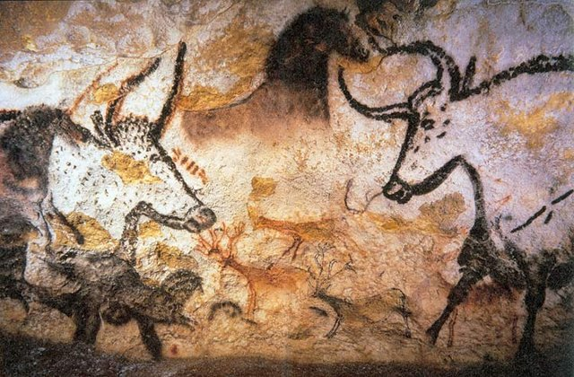
約公元前一萬七千年，法國西南部多爾多涅省（Dordogne）韋澤爾河谷（Vézère Valley）的拉斯科洞穴（Lascaux）深處，一群舊石器時代晚期的獵人用礦物顏料繪製了近六百頭公牛、馬、鹿與犀牛，加上近兩千個符號。1940 年 9 月 12 日，四名少年（Marcel Ravidat 等人）追一隻掉進洞的狗而發現它。**這不是「原始人的塗鴉」，而是一套有技術、有組織、有分工的視覺檔案系統——人類史上第一批「國家級」藝術工程。**

[→ 對外連結：-15000 - 拉斯科洞穴壁畫：冰河期獵人的視覺檔案室](https://chad-liu.github.io/books/html/9-3.藝術史/-15000-拉斯科洞穴壁畫.html)

## -3000 | 埃及墓室壁畫
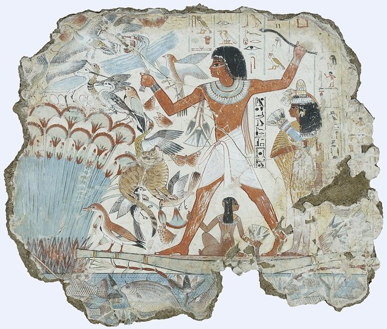
公元前第三千紀起，尼羅河谷的埃及國家動員書吏與畫師，在吉薩（Giza）金字塔群周邊王室與貴族墓室中繪製壁畫：農耕、漁獵、宴樂、運送供品，一切為了讓死者在來世持續享用。**埃及藝術不是「為美而生」，而是一家完全國營、客戶全在另一個世界的藝術公司——正面律不是技術不成熟，而是服務永生的品管標準。**

[→ 對外連結：-3000 - 埃及墓室壁畫：為死者服務的國家藝術公司](https://chad-liu.github.io/books/html/9-3.藝術史/-3000-埃及墓室壁畫.html)

## -1500 | 米諾斯濕壁畫
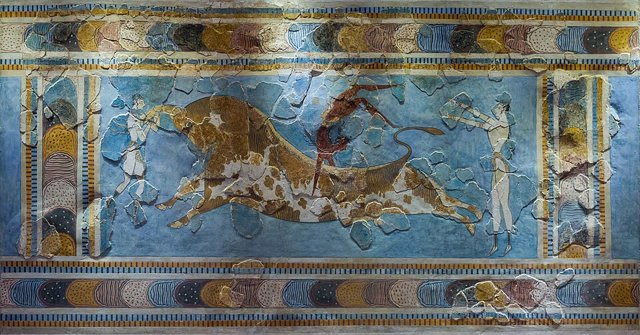
約公元前 1700–1450 年，克里特島克諾索斯（Knossos）宮殿的牆上，畫滿了跳牛者、海豚、手持百合的王子與盛裝的婦女——色彩明亮、線條流動，與同時期埃及的僵硬正面律完全不同。**米諾斯濕壁畫是海洋貿易財富買下的「快樂美學」：沒有城牆、沒有戰爭場面，只有海豚與鬥牛——這是一個靠商路而非軍隊的文明的視覺自我介紹。**

[→ 對外連結：-1500 - 米諾斯濕壁畫：愛琴海貿易網的宮殿畫廊](https://chad-liu.github.io/books/html/9-3.藝術史/-1500-米諾斯濕壁畫.html)

## -500 | 希臘古典雕塑
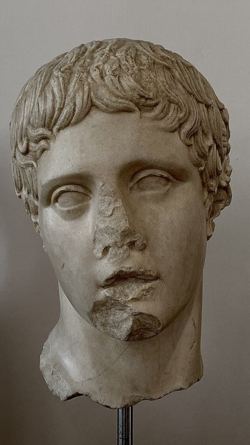
公元前 447–432 年，伯里克利（Pericles）主政的雅典動用提洛同盟（Delian League）的公款，由菲狄亞斯（Phidias）主持重建衛城（Acropolis），完成帕德嫩神廟（Parthenon）與雅典娜巨像。**希臘古典雕塑的「理想人體」不是純粹的美學發明，而是一場用同盟公款支付的民主政治宣傳工程——神廟的每一道曲線都在替雅典帝國說話。**

[→ 對外連結：-0500 - 希臘古典雕塑：民主雅典的城邦工程](https://chad-liu.github.io/books/html/9-3.藝術史/-0500-希臘古典雕塑.html)

## -300 | 希臘化雕塑
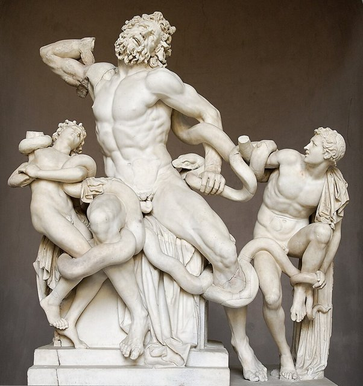
亞歷山大大帝（前 356–323）死後，部將瓜分帝國，托勒密、塞琉古、帕加馬等繼業者宮廷競相出資養藝術家，產生《薩莫色雷斯的勝利女神》（Nike of Samothrace，約前 190 年）與《拉奧孔群像》（約前 200 年–公元 1 世紀初）這類戲劇化巨作。**希臘化雕塑把古典的「冷靜理想」換成「情緒大爆發」——這不是墮落，而是宮廷競爭市場逼出來的視覺特效軍備賽。**

[→ 對外連結：-0300 - 希臘化雕塑：繼業者宮廷的戲劇工廠](https://chad-liu.github.io/books/html/9-3.藝術史/-0300-希臘化雕塑.html)

## 79 | 龐貝壁畫
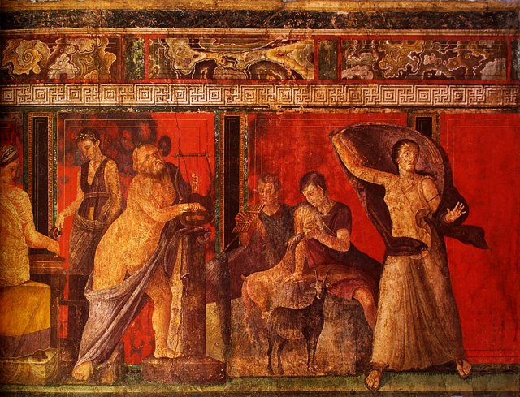
公元 79 年 8 月 24 日，維蘇威火山（Vesuvius）爆發，火山灰把坎帕尼亞（Campania）的龐貝（Pompeii）與赫庫蘭尼姆（Herculaneum）整座掩埋——卻也因此原封保存了數百棟羅馬宅邸的濕壁畫，從秘儀山莊的酒神壁畫到博斯科雷亞萊的建築幻景。**龐貝不是藝術巔峰，而是唯一一次「整座城市的審美被封存」——它讓我們看見羅馬富商如何用牆面炫耀文化資本。**

[→ 對外連結：0079 - 龐貝壁畫：維蘇威火山保存下的羅馬豪宅畫廊](https://chad-liu.github.io/books/html/9-3.藝術史/0079-龐貝壁畫.html)

## 547 | 聖維塔萊馬賽克
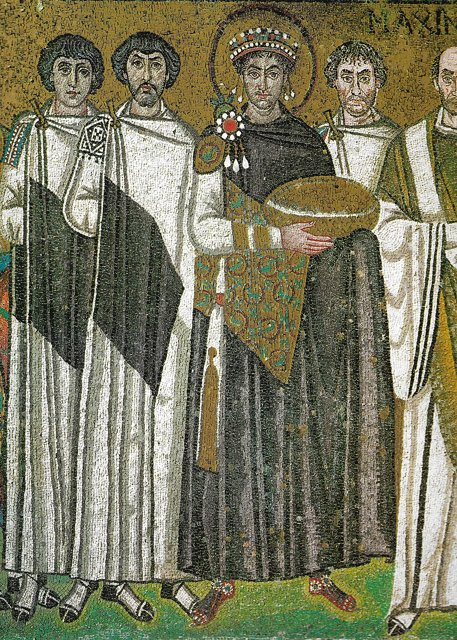
公元 547 年，東羅馬皇帝查士丁尼一世（Justinian I，約 482–565）治下，拉溫納（Ravenna）的聖維塔萊教堂（San Vitale）落成，牆上鑲嵌著兩幅史上最著名的權力影像：查士丁尼與皇后狄奧多拉（Theodora，約 500–548）帶著朝臣、軍人與神職人員列隊獻祭。**這不是「皇帝來做禮拜的紀念照」，而是用馬賽克黃金做出的政治宣傳——皇帝與皇后從未踏進這座教堂，影像替他們出席。**

[→ 對外連結：0547 - 聖維塔萊馬賽克：查士丁尼的權力宣傳影像](https://chad-liu.github.io/books/html/9-3.藝術史/0547-聖維塔萊馬賽克.html)

## 753 | 吳道子與唐代繪畫
盛唐開元、天寶年間（八世紀前半），吳道子（約 680–759）在長安與洛陽的寺院、道觀畫下三百餘堵壁畫，「吳帶當風」的衣紋線條據說飄舉如生，時人稱「吳家樣」。**唐代繪畫的第一現場幾乎全部隨會昌滅佛（845）與戰亂消失，我們只能透過張彥遠《歷代名畫記》(847) 重建這位「畫聖」——這是藝術史上最大規模的一次「證據滅失」，書籍成了唯一的卷宗。**

[→ 對外連結：0753 - 吳道子與唐代繪畫：三百堵壁畫的線描帝國](https://chad-liu.github.io/books/html/9-3.藝術史/0753-吳道子與唐代繪畫.html)

## 800 | 加洛林文藝復興
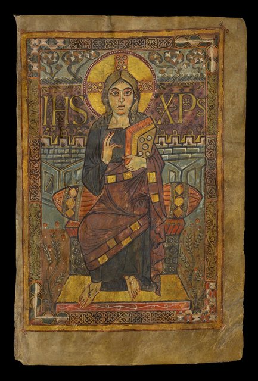
八世紀末至九世紀，查理曼（Charlemagne，742–814）在亞琛（Aachen）設宮廷學校，動員帝國各地修道院的抄經房（scriptorium）系統性抄寫、校正古典與基督教文本，並發展出加洛林小寫體（Carolingian minuscule）與金碧輝煌的手抄本裝飾。**這不是一場自發的「文藝復興」，而是帝國合法性工程：誰掌握正確的文本與字母，誰就掌握羅馬繼承者的話語權。**

[→ 對外連結：0800 - 加洛林文藝復興：查理曼的抄經房帝國工程](https://chad-liu.github.io/books/html/9-3.藝術史/0800-加洛林文藝復興.html)

## 1120 | 宋代山水畫
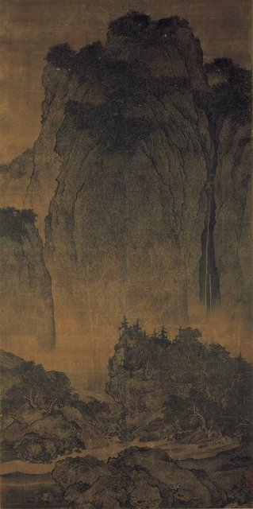
北宋初年，范寬（約 950–1030）在長安終南山中對景造意，畫出《谿山行旅圖》：一座主峰占滿絹面，山腳下商旅如蟻。同時期宮廷設立翰林圖畫院，把山水畫變成科舉式考核的職業體系。**宋代的山水不是「風景畫」，而是一套宇宙秩序的視覺工程——郭熙說山水要「可行、可望、可遊、可居」，這是替整個帝國知識分子蓋的精神住宅。**

[→ 對外連結：1120 - 宋代山水畫：翰林畫院的「可遊可居」工程](https://chad-liu.github.io/books/html/9-3.藝術史/1120-宋代山水畫.html)

## 1144 | 聖但尼哥德式
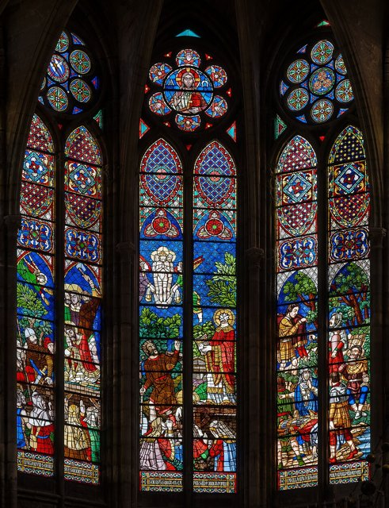
1144 年 6 月 11 日，巴黎近郊聖但尼修道院（Basilica of Saint-Denis）院長絮熱（Suger，約 1081–1151）為西面新門廊與唱詩席舉行落成典禮：尖拱、肋拱與巨幅彩繪玻璃讓光線淹沒教堂內部，來賓（含法國王后與眾主教）目瞪口呆。**哥德式建築不是「技術進步」自然長出來的，而是一位院長刻意策劃的政治神學媒體——「光」是論證，玻璃是版面，國王是股東。**

[→ 對外連結：1144 - 聖但尼哥德式：絮熱院長的光的神學媒體](https://chad-liu.github.io/books/html/9-3.藝術史/1144-聖但尼哥德式.html)

## 1305 | 喬托濕壁畫
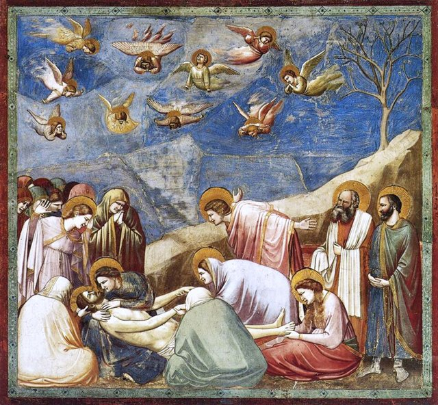
約 1303–1305 年，帕多瓦（Padua）的斯克羅維尼禮拜堂（Scrovegni Chapel）牆上，喬托（Giotto，約 1266–1337）畫下三十八幅連環濕壁畫：從約金姆與安娜的背景故事到最後審判，人物第一次有了體積、空間與真實的哭泣。**喬托的「立體感革命」不是天才憑空發明，而是由一筆放貸家族的贖罪基金支付的——恩里克·斯克羅維尼用父親的高利貸暴利，買下了自己的靈魂保險。**

[→ 對外連結：1305 - 喬托濕壁畫：放貸家族的贖罪資助](https://chad-liu.github.io/books/html/9-3.藝術史/1305-喬托濕壁畫.html)

## 1338 | 好政府寓言
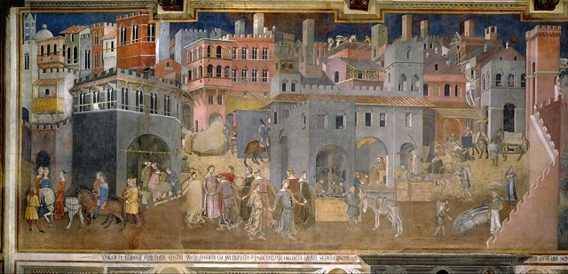
1338 年前後，錫耶納九人執政團（I Nove）委託畫家安布羅焦·洛倫采蒂（Ambrogio Lorenzetti，約 1290-1348），在市政廳（Palazzo Pubblico）和平廳（Sala della Nove）四面牆上繪製《好政府與壞政府的寓言》。這是中世紀以來第一幅大型世俗政治主題壁畫——**在教堂的聖像統治歐洲圖像世界的年代，一座城市用濕壁畫為自己畫出了統治的正當性**。

[→ 對外連結：1338 - 好政府寓言：壁畫上的市政廳治國手冊](https://chad-liu.github.io/books/html/9-3.藝術史/1338-好政府寓言.html)

## 1401 | 洗禮堂青銅門競賽
1401 年，佛羅倫斯呢絹商行會（Arte di Calimala）公開徵選聖若望洗禮堂北門青銅門設計，七位金匠出身的藝術家各繳交一幅《以撒獻祭》一尺見方青銅浮雕試作，最終吉貝爾蒂（Lorenzo Ghiberti，約 1378-1455）擊敗布魯內萊斯基（Filippo Brunelleschi，1377-1446）奪標。**一場行會公開競圖，意外成為文藝復興的發令槍——勝負的關鍵是技術分工與成本控制，不是天才。**

[→ 對外連結：1401 - 洗禮堂青銅門競賽：文藝復興的發令槍](https://chad-liu.github.io/books/html/9-3.藝術史/1401-洗禮堂青銅門競賽.html)

## 1420 | 布魯內萊斯基透視法
本案偵辦一場「眼睛的政變」——**1420 年前後，佛羅倫斯金匠布魯內萊斯基在聖喬凡尼洗禮堂門前立起一塊畫板，背面開孔、面前放鏡子：觀者從孔中看到的，是畫與實景的完美重疊。透視法（prospettiva）就此現場辦案成功。**

[→ 對外連結（開篇探案）：-1420-布魯內萊斯基透視法](https://chad-liu.github.io/books/html/9-3.藝術史/-1420-布魯內萊斯基透視法.html)

## 1425 | 馬薩喬
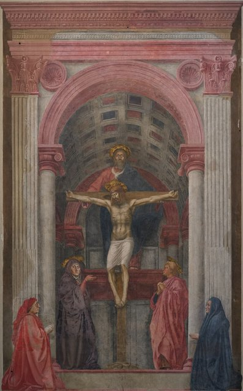
1425 年起，年僅二十四歲的馬薩喬（Masaccio，1401-1428）與馬索利諾（Masolino，約 1383-1447）在佛羅倫斯聖母聖衣堂的布蘭卡契禮拜堂繪製聖彼得生平濕壁畫。**馬薩喬用消失點、光影與分量感把聖經場景變成可以丈量的空間——繪畫從此有了幾何學的骨架。**

[→ 對外連結：1425 - 馬薩喬：把神學畫成數學的人](https://chad-liu.github.io/books/html/9-3.藝術史/1425-馬薩喬.html)

## 1434 | 凡艾克油畫革命
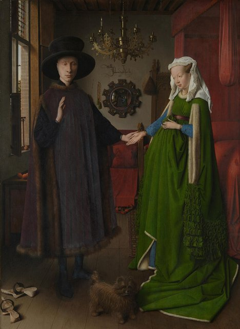
1434 年，揚·凡艾克（Jan van Eyck，約 1390-1441）在布魯日畫下《阿諾芬尼婚禮》（又稱《阿諾芬尼夫婦像》），畫中凸面鏡裡映出畫家本人在場的簽名「揚·凡艾克在此，1434」。**北方文藝復興的秘密武器不是透視，而是油——以亞麻仁油調顏料的層疊罩染，讓光從畫面深處透出來。**

[→ 對外連結：1434 - 凡艾克油畫革命：一場婚禮與一種新顏料](https://chad-liu.github.io/books/html/9-3.藝術史/1434-凡艾克油畫革命.html)

## 1436 | 阿爾伯蒂論繪畫
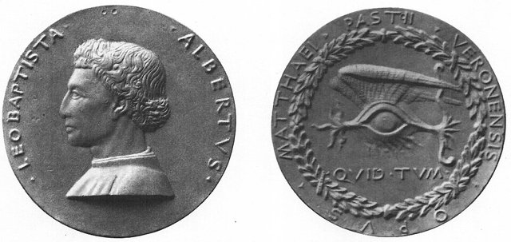
1435-1436 年，萊昂·巴蒂斯塔·阿爾伯蒂（Leon Battista Alberti，1404-1472）以拉丁文寫成《論繪畫》（De pictura），旋即自譯托斯卡尼語版獻給布魯內萊斯基。**文藝復興繪畫的奇蹟在於：先有論文，後有作品——透視法是被寫成數學規則之後，才成為畫家的日常。**

[→ 對外連結：1436 - 阿爾伯蒂論繪畫：理論先行於創作](https://chad-liu.github.io/books/html/9-3.藝術史/1436-阿爾伯蒂論繪畫.html)

## 1450 | 古騰堡版畫
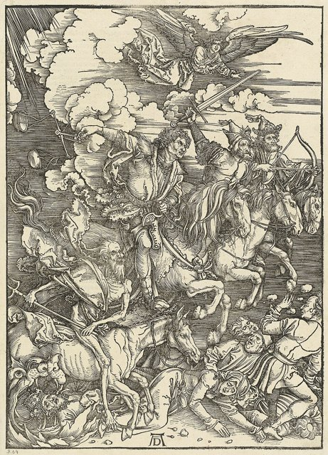
約 1450 年，美因茨金匠約翰內斯·古騰堡（Johannes Gutenberg，約 1400-1468）以活字印刷術批量印書，1455 年問世的《四十二行聖經》震動歐洲。**當文字變成可複製的商品，圖像也跟著上機——木刻與銅版畫把藝術從教堂牆面與公爵櫃子裡解放出來，變成市場上流通的大眾媒體。**

[→ 對外連結：1450 - 古騰堡版畫：圖像成為大眾媒體](https://chad-liu.github.io/books/html/9-3.藝術史/1450-古騰堡版畫.html)

## 1485 | 波提且利維納斯誕生
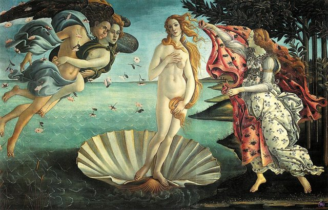
約 1484-1485 年，桑德羅·波提且利（Sandro Botticelli，1445-1510）以蛋彩畫出《維納斯的誕生》，女神立於貝殼上由西風送抵岸邊。**這是羅馬帝國滅亡後第一幅等身大的裸體異教女神——畫在私人臥室的畫板上，供美術商與收藏家密室欣賞，而非供教堂瞻仰。**

[→ 對外連結：1485 - 波提且利維納斯誕生：異教女神登陸麥迪奇臥室](https://chad-liu.github.io/books/html/9-3.藝術史/1485-波提且利維納斯誕生.html)

## 1498 | 達文西最後的晚餐

1495-1498 年，李奧納多·達文西（Leonardo da Vinci，1452-1519）在米蘭恩寵聖母堂（Santa Maria delle Grazie）食堂北牆畫下《最後的晚餐》。**消失點正落在基督的右太陽穴上，讓走進食堂的修士們每次用餐，都坐在同一幅畫延伸出來的透視空間裡——這是史上最大型的室內空間幻術之一。**

[→ 對外連結：1498 - 達文西最後的晚餐：宮廷食堂裡的透視陷阱](https://chad-liu.github.io/books/html/9-3.藝術史/1498-達文西最後的晚餐.html)

## 1503 | 蒙娜麗莎
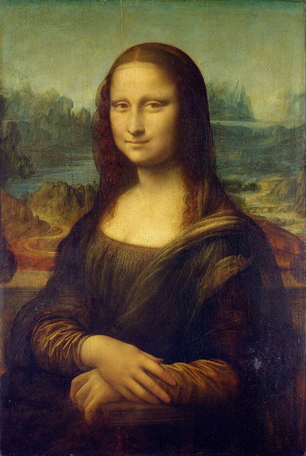
1503 年起，李奧納多·達文西在佛羅倫斯為絲綢商弗朗切斯科·喬孔多（Francesco del Giocondo，1465-1539）之妻麗莎·格拉迪尼（Lisa Gherardini，1479-1542）畫像。**這幅畫從未交付——達文西帶著它走遍米蘭、羅馬、法國，磨到 1517 年還在修，最後隨他進入法國王室，成為史上最著名的「違約品」。**

[→ 對外連結：1503 - 蒙娜麗莎：一個絲綢商妻子與一幅未交付的畫](https://chad-liu.github.io/books/html/9-3.藝術史/1503-蒙娜麗莎.html)

## 1508 | 米開朗基羅西斯汀天頂
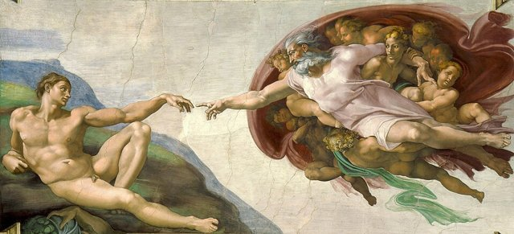
1508-1512 年，米開朗基羅（Michelangelo Buonarroti，1475-1564）在梵蒂岡西斯汀禮拜堂天頂畫下逾三百四十三個人物、五百餘平方公尺的濕壁畫。**他自稱是「被強迫的雕刻家」——教皇尤利烏斯二世（Julius II，1443-1513）硬把陵墓工程擱置，逼他改行畫天頂，結果一場政治綁架催生了繪畫史上最大的單體工程。**

[→ 對外連結：1508 - 米開朗基羅西斯汀天頂：教皇腳手架上的四年苦役](https://chad-liu.github.io/books/html/9-3.藝術史/1508-米開朗基羅西斯汀天頂.html)

## 1511 | 拉斐爾雅典學院

1509-1511 年，拉斐爾（Raphael，1483-1520）在梵蒂岡教皇私人圖書室（签字廳，Stanza della Segnatura）畫下《雅典學院》：柏拉圖與亞里士多德走在中央拱門下，五十餘位古典哲人環列。**在教皇的官方空間裡供奉異教哲學家，而且教皇拍板同意——這是基督教與古典世界最大規模的一次和解。**

[→ 對外連結：1511 - 拉斐爾雅典學院：哲人與教皇同處一室](https://chad-liu.github.io/books/html/9-3.藝術史/1511-拉斐爾雅典學院.html)

## 1514 | 杜勒北方文藝復興
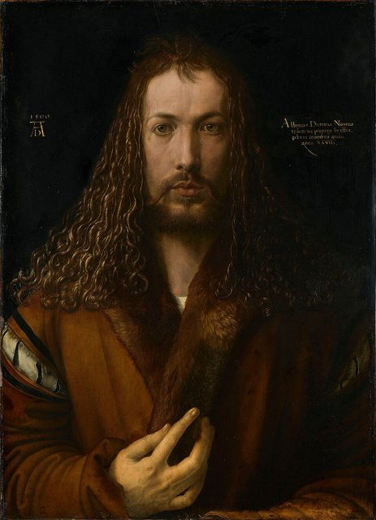
1514 年前後，紐倫堡畫家阿爾布雷希特·杜勒（Albrecht Dürer，1471-1528）完成銅版畫《憂鬱 I》（Melencolia I）與《啟示錄》木刻系列的黃金期已過頂峰，正處於南北技法交流的收成期。**杜勒是歐洲第一位把「版畫出版」經營成個人事業、把自畫像做成品牌、把畫家從工匠抬進人文主義知識階層的藝術家。**

[→ 對外連結：1514 - 杜勒北方文藝復興：把自畫像做成品牌的人](https://chad-liu.github.io/books/html/9-3.藝術史/1514-杜勒北方文藝復興.html)

## 1533 | 荷爾拜因使節
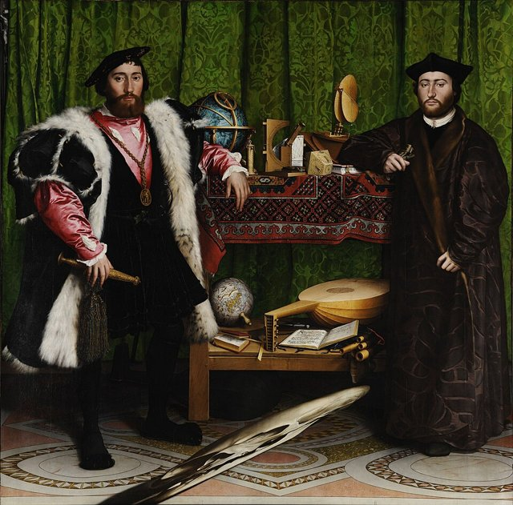
1533 年，小漢斯·荷爾拜因（Hans Holbein the Younger，約 1497-1543）在倫敦畫下《使節》（The Ambassadors）：法國使節丁特維爾（Jean de Dinteville，1504-1555）與主教波利西（Georges de Selve，1508-1541）立於雙層架前，地板上有一具以避視法（anamorphosis）扭曲的骷髅。**畫中地球儀、數學書、斷弦的魯特琴——每一件道具都是宗教改革時代裂痕的符碼，而骷髅只肯在側頭斜視時現形。**

[→ 對外連結：1533 - 荷爾拜因使節：斷弦魯特琴裡的時代裂痕](https://chad-liu.github.io/books/html/9-3.藝術史/1533-荷爾拜因使節.html)

## 1541 | 米開朗基羅最後的審判
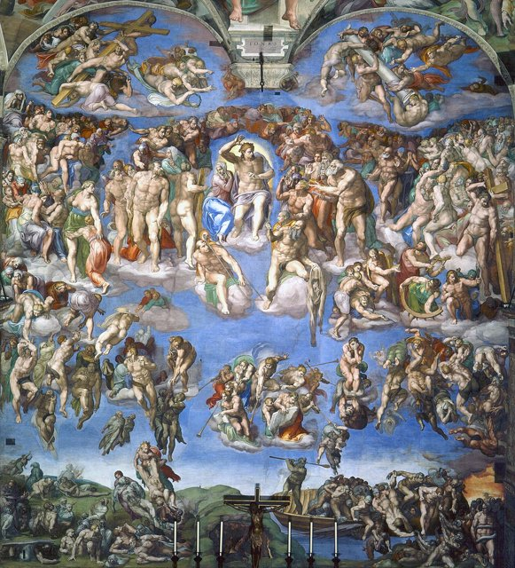
1541 年 11 月 1 日，萬聖節彌撒之日，教皇**保羅三世**（Paul III）為西斯汀禮拜堂祭壇牆上的巨型濕壁畫《**最後的審判**》（Giudizio Universale）揭幕：米開朗基羅（1475–1564）以四年工夫，在約 200 平方公尺的牆面上畫下 400 多個赤裸的人體——基督如太陽神般舉臂審判，聖人裸身持刑具，地獄判官米諾斯拉人下獄。**這幅畫不是虔誠的插圖，而是一樁藝術家的造反：在教會自查自省的前夜，把神聖敘事畫成裸體的肉搏。**

[→ 對外連結：1541 - 米開朗基羅最後的審判：裸體風暴與特倫托前夜](https://chad-liu.github.io/books/html/9-3.藝術史/1541-米開朗基羅最後的審判.html)

## 1550 | 瓦薩里名人傳
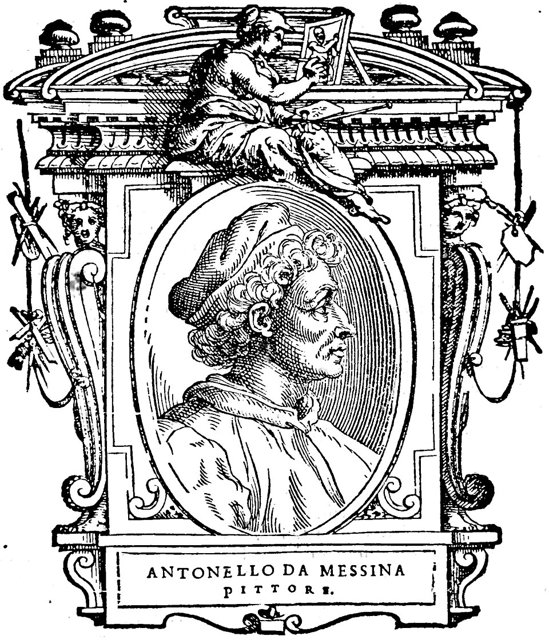
1550 年，佛羅倫斯出版家**洛倫佐·托倫蒂諾**（Lorenzo Torrentino，美迪奇家族御用印刷商）刊行喬爾喬·**瓦薩里**（Giorgio Vasari，1511–1574）的《**藝苑名人傳**》（Le Vite de' più eccellenti pittori, scultori, ed architettori）：一部從契馬布埃寫到米開朗基羅、收錄百餘位藝術家傳記的巨著。書中首次系統使用 **rinascita（重生）**一詞描述自喬托以來的藝術復興——**這不是一本傳記集，而是一份藝術史的建國文件：藝術第一次擁有了自己的歷史、自己的進步敘事、自己的正典。**

[→ 對外連結：1550 - 瓦薩里名人傳：「文藝復興」一詞的發明與藝術史的誕生](https://chad-liu.github.io/books/html/9-3.藝術史/1550-瓦薩里名人傳.html)

## 1565 | 布勒哲爾農民婚禮
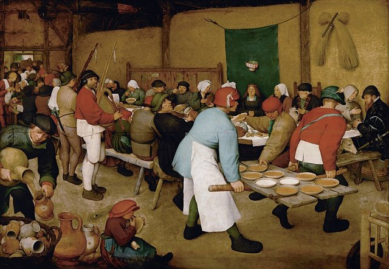
約 1567 年，安特衛普畫家**老彼得·布勒哲爾**（Pieter Bruegel de Oude，約 1525–1569）完成《**農民婚禮**》（De boerenbruiloft）：一張長桌塞滿整個畫面，農民、酒桶、麵包、風笛手層層堆疊——貴族與聖經徹底缺席。同時期他還畫了《農民之舞》與《盲人的寓言》。**這不是風俗速寫，而是一樁視覺的下鄉運動：藝術的目光第一次長期定居在農民的餐桌上——而且靠的是版畫市場，不是教堂與宮廷。**

[→ 對外連結：1565 - 布勒哲爾農民婚禮：視線下鄉與版畫市場的勝利](https://chad-liu.github.io/books/html/9-3.藝術史/1565-布勒哲爾農民婚禮.html)

## 1577 | 艾爾葛雷柯
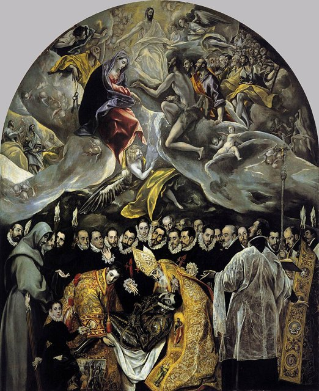
1577 年，希臘裔克里特畫家**多梅尼科斯·提奧托科普洛斯**（Domenikos Theotokopoulos，1541–1614）——人稱「**艾爾葛雷柯**」（El Greco，希臘佬）——在西班牙托雷多完成《**聖母升天**》（布爾戈斯多明我會修道院委託）與隨後的《**脫下基督的外袍**》（El Expolio，托雷多主教座堂祭衣所聖器室委託）：拉長的人體、扭曲的空間、火焰般的冷色——**這不是畫不好的矯飾主義，而是一樁有意的反古典暴動：用違反解剖學的身體，畫出反宗教改革的神秘主義。**

[→ 對外連結：1577 - 艾爾葛雷柯：托雷多的反古典長人體](https://chad-liu.github.io/books/html/9-3.藝術史/1577-艾爾葛雷柯.html)

## 1600 | 卡拉瓦喬
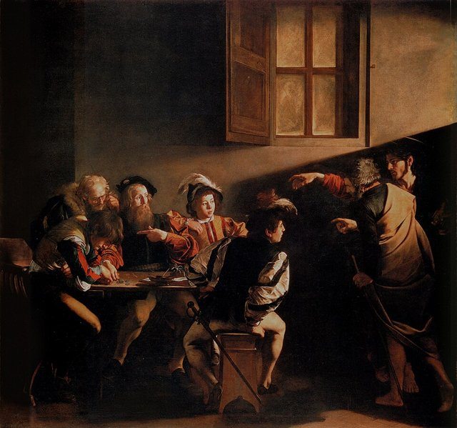
1599–1600 年，羅馬**聖王路易教堂**（San Luigi dei Francesi，法國人教堂）肯塔瑞里小堂（Contarelli Chapel）揭幕米開朗基羅·梅里西·達·**卡拉瓦喬**（Caravaggio，1571–1610）的《**聖馬太蒙召**》：一束從窗外斜射的光，劈開漆黑的酒館，稅吏馬太在賭桌旁抬頭——**這不是宗教畫的裝飾，而是一樁光影的革命：用街頭的模特、酒館的光線畫聖經，把神聖拉到泥地裡。**tenebrism（暗色主義）自此成為巴洛克的通用語言。

[→ 對外連結：1600 - 卡拉瓦喬：明暗法與街頭模特入聖畫](https://chad-liu.github.io/books/html/9-3.藝術史/1600-卡拉瓦喬.html)

## 1618 | 魯本斯
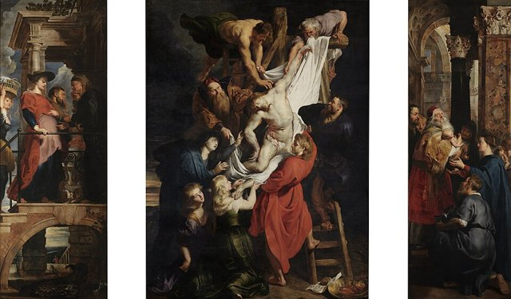
1618 年前後，安特衛普的**魯本斯**（Peter Paul Rubens，1577–1640）工坊進入全盛：他同時承接多國訂單——義大利曼圖亞公爵、英國白廳天花畫預備、法國王后組畫——以**簽約制、分工制、授權版畫**經營，人稱「畫家中的君王」。**這不是一間畫室，而是一家跨國企業：魯本斯把巴洛克繪畫做成了歐洲第一個全球化藝術品牌。**

[→ 對外連結：1618 - 魯本斯：安特衛普大工坊與國際巴洛克企業](https://chad-liu.github.io/books/html/9-3.藝術史/1618-魯本斯.html)

## 1625 | 貝尼尼
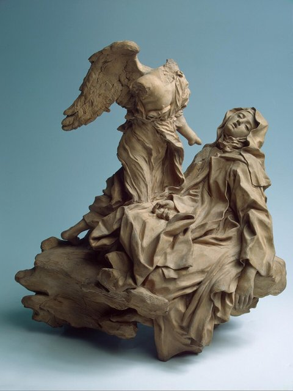
1625 年前後，羅馬的**喬凡尼·洛倫佐·貝尼尼**（Gian Lorenzo Bernini，1598–1680）已是教皇座上賓：《阿波羅與達芙妮》（1622–25，博爾蓋塞收藏）以大理石凍結追逐的瞬間。1645–52 年他再完成《**聖特雷莎的沉迷**》（Ecstasy of Saint Teresa，勝利之後聖母堂科納羅小堂）：金色光束從隱藏的天窗射下，聖女在雲上顫慄，天使執箭——**這不是一件雕像，而是一座總體劇場：雕塑、建築、光線、彩繪合為一體，巴洛克在此達到極限。**

[→ 對外連結：1625 - 貝尼尼：羅馬的雕塑建築劇場一體](https://chad-liu.github.io/books/html/9-3.藝術史/1625-貝尼尼.html)

## 1640 | 普桑
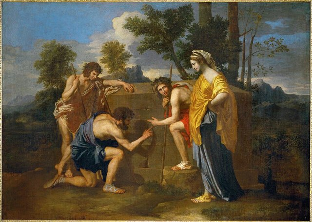
1640–42 年，**尼古拉·普桑**（Nicolas Poussin，1594–1665）被法王**路易十三**與首相**黎塞留**強力召返巴黎，出任「國王首席畫家」：主持皇家宅邸大画廊裝飾、設計宮廷慶典與書籍插圖。兩年後他逃回羅馬，終老台伯河畔。**這不是一次宮廷任職，而是一樁古典主義的立法：普桑把「素描高於色彩、理性高於感官」寫成法國藝術的憲法——豐底論爭（Querelle du coloris）自此埋下伏筆。**

[→ 對外連結：1640 - 普桑：羅馬的巴黎人與古典主義立法者](https://chad-liu.github.io/books/html/9-3.藝術史/1640-普桑.html)

## 1642 | 林布蘭夜巡
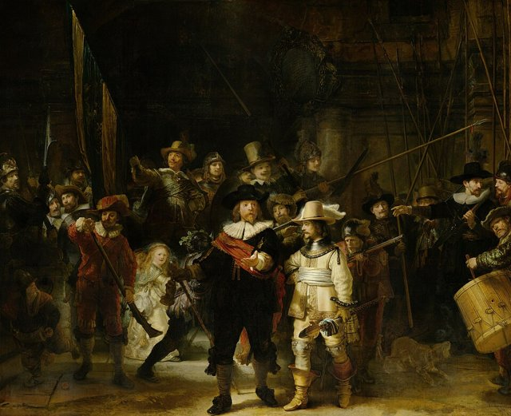
1642 年，阿姆斯特丹**火繩槍民兵團**（Kloveniers）委託**林布蘭**（Rembrandt van Rijn，1606–1669）繪製團體肖像：班寧·柯克隊長舉手發號施令，全團在光影中出動——後世稱之《**夜巡**》（De Nachtwacht）。當年並不叫夜巡、也畫在白天（清漆變暗才得此名）。傳說因「每個人付一樣的錢、卻有人被畫成配角」而引發委託糾紛——**這樁「團體照翻案」是市民市場與藝術家野心碰撞的經典案件：荷蘭黃金時代，買畫的是市民，不是教皇。**

[→ 對外連結：1642 - 林布蘭夜巡：團體照的翻案與市民市場](https://chad-liu.github.io/books/html/9-3.藝術史/1642-林布蘭夜巡.html)

## 1656 | 委拉斯蓋茲侍女
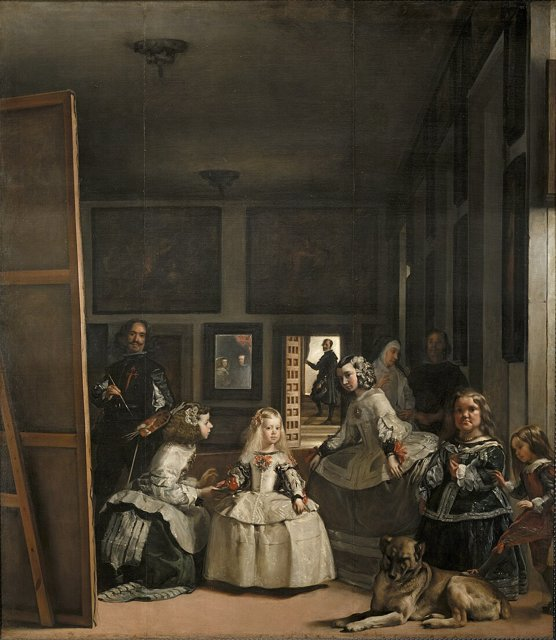
1656 年，馬德里阿爾卡薩皇宮，**委拉斯蓋茲**（Diego Velázquez，1599–1660）完成《**侍女**》（Las Meninas）：小公主瑪加麗塔被侍女簇擁，畫家本人持筆站在大畫布前，鏡中映出國王腓力四世與王后——觀者站在國王的位置。**這不是一幅宮廷寫真，而是一樁後設繪畫的先聲：畫中有畫、鏡中有鏡——「誰在看誰」的問題被畫進了畫面。**

[→ 對外連結：1656 - 委拉斯蓋茲侍女：鏡子結構與宮廷畫家勳位](https://chad-liu.github.io/books/html/9-3.藝術史/1656-委拉斯蓋茲侍女.html)

## 1665 | 維梅爾戴珍珠耳環少女
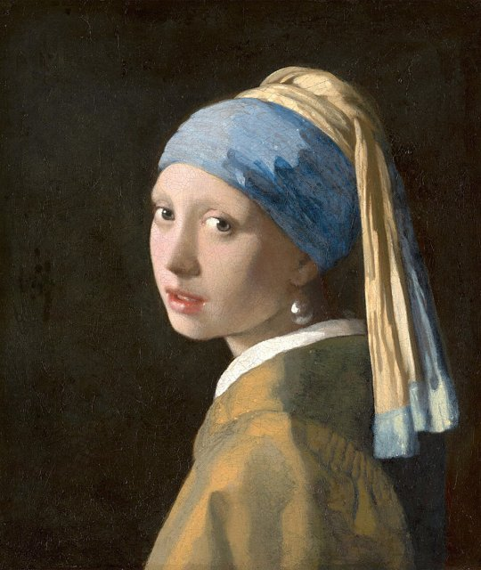
約 1665 年，代爾夫特**維梅爾**（Johannes Vermeer，1632–1675）完成《**戴珍珠耳環的少女**》：暗色的背景、藍黃頭巾、回眸的一瞥——46.5×40 公分的小畫。同年他還完成《繪畫藝術》。**這不是一張肖像，而是一樁光的偵探案：暗箱技術、超載的細節、無名的少女——荷蘭小畫派的市場經濟在此達到極致，買畫的是市民，不是教堂與王宮。**

[→ 對外連結：1665 - 維梅爾戴珍珠耳環少女：暗箱與荷蘭小畫派市場](https://chad-liu.github.io/books/html/9-3.藝術史/1665-維梅爾戴珍珠耳環少女.html)

## 1717 | 華鐸發航西苔島
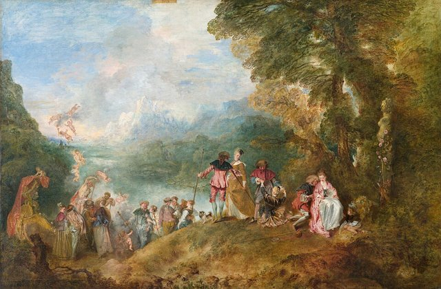
1717 年 8 月，巴黎，**安托萬·華鐸**（Antoine Watteau，1684–1721）以《**發航西苔島**》（Pèlerinage à l'île de Cythère）應試法蘭西王家繪畫雕塑學院，一舉獲錄取——但學院為這幅畫**專門創造了一個新類別**：「fête galante」（風流雅集畫）：既非歷史畫、也非風俗畫。**這不是一次入學考試，而是一樁品味的政變：攝政時期的巴黎，私人沙龍的快樂正式擊敗學院的正統。**

[→ 對外連結：1717 - 華鐸發航西苔島：fête galante 破格入學院](https://chad-liu.github.io/books/html/9-3.藝術史/1717-華鐸發航西苔島.html)

## 1748 | 布雪
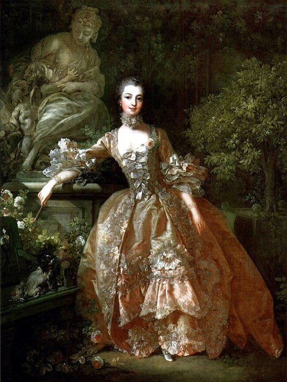
1748 年前後，巴黎的**弗朗索瓦·布雪**（François Boucher，1703–1770）攀上權力頂峰：1748 年起任**蓬帕杜夫人**（Madame de Pompadour，1721–1764，路易十五首席情婦）的御用首席畫家——同時包辦**塞夫勒王家瓷廠**（Sèvres）圖樣、**皇家歌劇院**佈景、國王掛毯工廠（Gobelins）設計。**這不是一位受寵的畫家，而是一樁國家品牌工程：羅可可的甜美曲線，由國家機器量產輸出全歐。**

[→ 對外連結：1748 - 布雪：蓬帕杜夫人與羅可可國家品牌](https://chad-liu.github.io/books/html/9-3.藝術史/1748-布雪.html)

## 1764 | 溫克爾曼與新古典
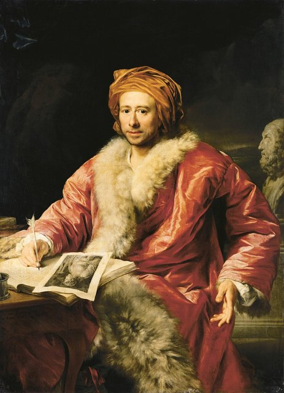
1764 年，德累斯頓出版**約翰·約阿希姆·溫克爾曼**（Johann Joachim Winckelmann，1717–1768）的《**古代藝術史**》（Geschichte der Kunst des Alterthums）：首次以「風格分期＋歷史脈絡」書寫藝術史，並為希臘藝術立下名言——「**高貴的單純、靜穆的偉大**」（edle Einfalt und stille Größe）。同時龐貝（1748 重見天日）與赫庫蘭尼姆（1738 開挖）的考古正席捲全歐。**這不是一本學術書，而是一場品味的革命宣言：用希臘的靜穆擊敗羅可可的甜美，新古典主義自此立法。**

[→ 對外連結：1764 - 溫克爾曼與新古典：高貴的單純、靜穆的偉大](https://chad-liu.github.io/books/html/9-3.藝術史/1764-溫克爾曼與新古典.html)

## 1784 | 大衛荷拉斯之誓
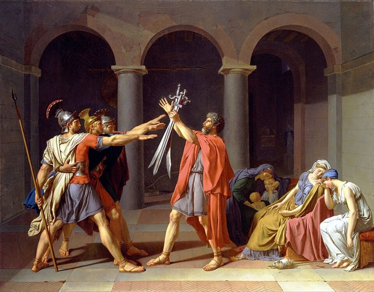
1784 年，路易十六透過皇家建造總監達安吉維勒伯爵委託宮廷畫家雅克-路易·大衛（1748-1825）繪製《荷拉斯兄弟之誓》，主題取自高乃依的悲劇：羅馬三兄弟向父親舉手宣誓、為國赴死。此畫在羅馬完成並於 1785 年巴黎沙龍展出，立刻成為全歐議論焦點。**偵探式論點：這幅「頌揚君主美德」的官方委託，實際上是一份用古典語言寫成的政治宣言——它教會巴黎人一件事：個人情感必須讓位於國家，而這個「國家」很快便不再需要國王。**

[→ 對外連結：1784 - 大衛《荷拉斯之誓》：一幅畫如何預言一場革命](https://chad-liu.github.io/books/html/9-3.藝術史/1784-大衛荷拉斯之誓.html)

## 1793 | 羅浮宮開館
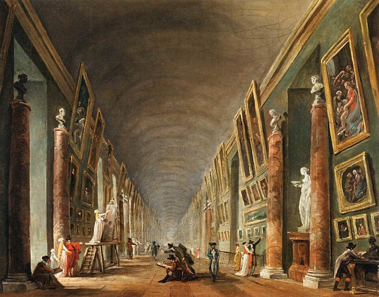
1793 年 8 月 10 日，法國大革命爆發一週年之際，「中央藝術博物館」（Muséum central des arts）在羅浮宮大畫廊正式開幕——這是世界上第一座把皇室與教會收藏國有化、向全體公民開放的美術館。**偵探式論點：羅浮宮開館不只是「藝術有新家」，而是一場精心策劃的公民教育工程：國民公會要用國王被沒收的名畫，來教育「新的人民」——美術館從此成為國家體制的一部分。**

[→ 對外連結：1793 - 羅浮宮開館：美術館如何變成革命機器](https://chad-liu.github.io/books/html/9-3.藝術史/1793-羅浮宮開館.html)

## 1814 | 哥雅五月三日
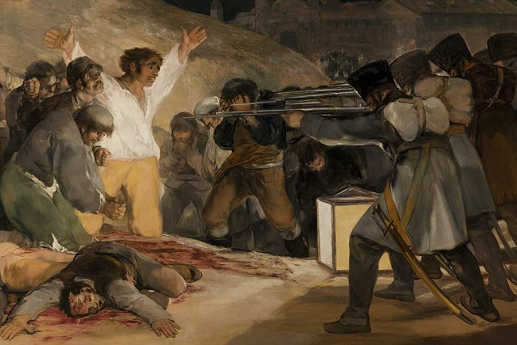
1814 年，費南多七世復辟後，66 歲的弗朗西斯科·哥雅（1746-1828）向新政府提出申請，要求「用畫筆永遠紀念我們反對歐洲暴君的光榮起義」，並自費完成《1808 年 5 月 2 日》與《五月三日：處決馬德里起義者》兩幅畫——但它們此後近四十年被塵封在王家收藏中，未曾展出。**偵探式論點：這是繪畫史上第一件不留情面的戰爭證據：哥雅拒絕英雄主義、拒絕革命光環，只畫行刑隊與白襯衫男子——證據太誠實，所以復辟政權不敢展出它。**

[→ 對外連結：1814 - 哥雅《五月三日》：一張戰爭證據的二十年延宕](https://chad-liu.github.io/books/html/9-3.藝術史/1814-哥雅五月三日.html)

## 1819 | 傑利訶美杜莎之筏
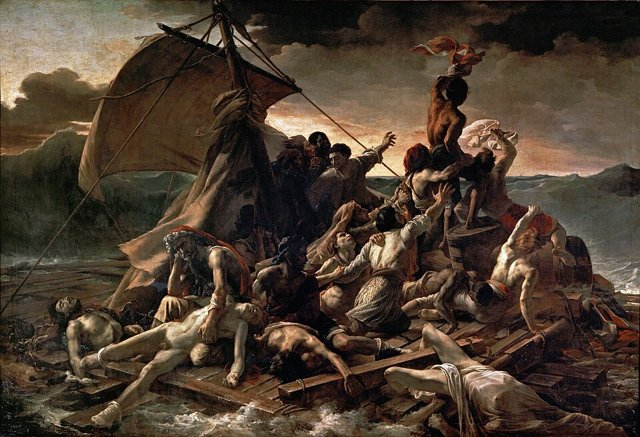
1819 年，25 歲的泰奧多爾·傑利訶（1791-1824）在巴黎沙龍展出《美杜莎之筏》——以 1816 年法國護衛艦「美杜莎號」擱淺、147 人上筏漂流、僅 15 人生還的國家醜聞為題，畫面近 4.7×7.2 公尺。**偵探式論點：這不是歷史畫，這是一份用油彩寫成的調查報告與政治控訴：傑利訶訪談生還者、研究腐屍、畫出無能船長的後果——浪漫主義用這幅畫向新古典學院正式宣戰。**

[→ 對外連結：1819 - 傑利訶《美杜莎之筏》：把新聞調查畫成 4.7 公尺的醜聞](https://chad-liu.github.io/books/html/9-3.藝術史/1819-傑利訶美杜莎之筏.html)

## 1821 | 康斯塔伯乾草車
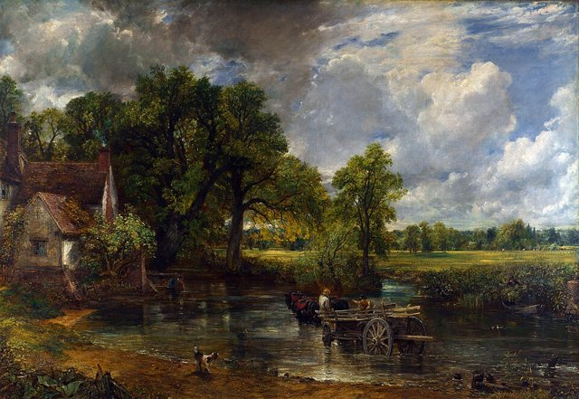
1821 年，約翰·康斯塔伯（1776-1837）在倫敦皇家學院展出《乾草車》（The Hay Wain），描繪薩福克郡斯陶爾河畔的農村日常——英國反應平淡，但 1824 年巴黎沙龍展出時獲得金牌獎，震撼法國畫壇。**偵探式論點：這是一次「光線的套利」：同一幅畫，在倫敦是鄉愁，在巴黎是革命——康斯塔伯的戶外油寫生技術，讓法國人明白風景不必是背景，可以是主角。**

[→ 對外連結：1821 - 康斯塔伯《乾草車》：英國雲朵如何讓巴黎重新看見風景](https://chad-liu.github.io/books/html/9-3.藝術史/1821-康斯塔伯乾草車.html)

## 1830 | 德拉克洛瓦自由領導人民
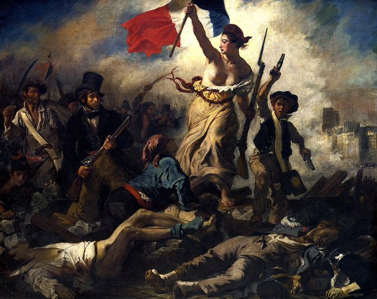
1830 年 7 月 28-29 日，巴黎爆發「光榮三日」革命，推翻查理十世；同年年底，歐仁·德拉克洛瓦（1798-1863）完成《自由領導人民》，1831 年沙龍展出——畫中一位持三色旗的裸胸女子領導持槍的市民、學生與工人越過街壘。**偵探式論點：這是第一幅把「革命」本身畫成寓言與新聞的混合體的畫：自由女神不是神話人物，是 1830 年 7 月真實走上街頭的巴黎女子——而這幅畫被新政府收購後立即塵封，證明旗幟的政治性連新政權都不敢直視。**

[→ 對外連結：1830 - 德拉克洛瓦《自由領導人民》：一面旗幟的政治身世](https://chad-liu.github.io/books/html/9-3.藝術史/1830-德拉克洛瓦自由領導人民.html)

## 1839 | 達蓋爾攝影術
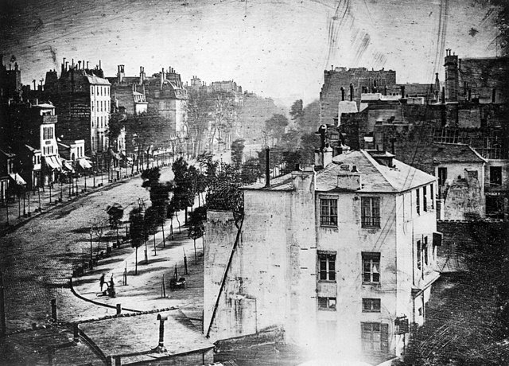
1839 年 8 月 19 日，法蘭西科學院與美術院聯席會議上，天文學家阿拉戈正式公布達蓋爾攝影術（daguerreotype）——法國政府以每年 6,000 法郎終身年金收購此發明，並宣布「免費送給全世界」。**偵探式論點：這是史上第一次國家用年金買斷一項技術再釋放為公共財——而它同時引爆了史上第一次肖像產業革命與繪畫的第一次存在危機。**

[→ 對外連結：1839 - 達蓋爾攝影術：法國政府如何買斷一項發明再「免費送給世界」](https://chad-liu.github.io/books/html/9-3.藝術史/1839-達蓋爾攝影術.html)

## 1848 | 拉斐爾前派
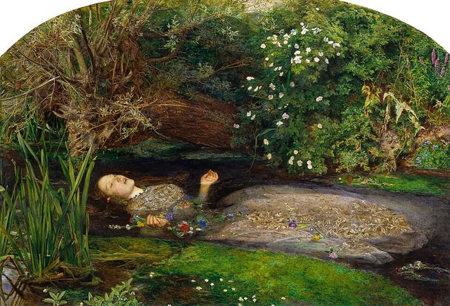
1848 年秋，倫敦，19 至 21 歲的三位皇家學院學生——亨特（William Holman Hunt，1827-1910）、米萊斯（John Everett Millais，1829-1896）、羅塞蒂（Dante Gabriel Rossetti，1828-1882）——成立「拉斐爾前派兄弟會」（Pre-Raphaelite Brotherhood, PRB），主張回到拉斐爾之前的早期義大利繪畫，拒絕學院派的程式化理想美。**偵探式論點：這不是復古，這是體制反抗的密碼戰：他們在畫布角落簽上神秘的「PRB」三字母，逼評論界追問——最後由批評家拉斯金的長文辯護，將邊緣的叛逆轉化為維多利亞主流。**

[→ 對外連結：1848 - 拉斐爾前派：三個倫敦青年如何用 PRB 密碼向學院宣戰](https://chad-liu.github.io/books/html/9-3.藝術史/1848-拉斐爾前派.html)

## 1857 | 米勒拾穗
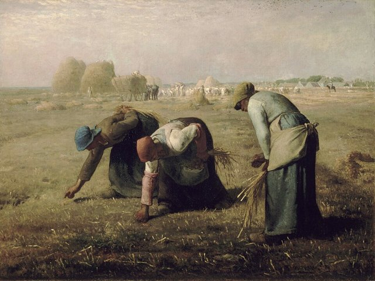
1857 年，讓-弗朗索瓦·米勒（1814-1875）在巴黎沙龍展出《拾穗》（Des glaneuses）——三個農婦在收成後的田裡彎腰撿拾殘穗，背景是堆成金山的豐收與監工騎影。**偵探式論點：這幅不到一公尺的小畫掀起了一場階級恐慌的偵探案：右派媒體在三位農婦身上看出了 1848 年革命與《共產黨宣言》的影子——而真正的推動力，是巴比松畫派把風景畫從理想化的「風景」變成了勞動的田野。**

[→ 對外連結：1857 - 米勒《拾穗》：三個彎腰農婦如何讓巴黎右派恐慌](https://chad-liu.github.io/books/html/9-3.藝術史/1857-米勒拾穗.html)

## 1863 | 馬奈草地上的午餐
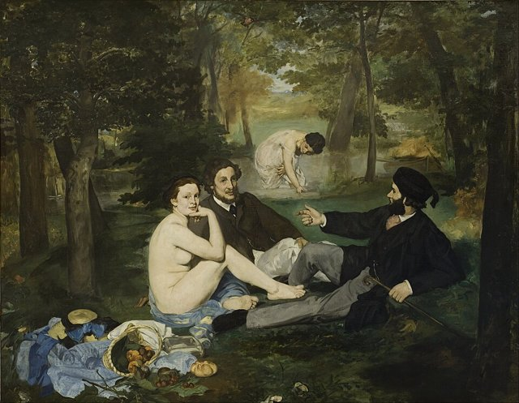
1863 年，巴黎官方沙龍評審否決了約三千件作品中的一大半（含馬奈、塞尚、畢沙羅、惠斯勒等），拿破崙三世下令舉辦「落選者沙龍」（Salon des Refusés）以平息民怨——馬奈的《草地上的午餐》（Le Déjeuner sur l'herbe）在此展出，成為全場醜聞焦點。**偵探式論點：這是藝術體制的第一次官方裂縫：皇帝為了政治公關開的窗口，反而讓「被體制拒絕」成為一種可操作的展覽策略——三十年後的印象派獨立畫展（見 `1874-第一次印象派畫展`）就是從這道裂縫走出來的。**

[→ 對外連結：1863 - 馬奈《草地上的午餐》：落選者沙龍如何變成現代藝術的犯罪現場](https://chad-liu.github.io/books/html/9-3.藝術史/1863-馬奈草地上的午餐.html)

## 1874 | 第一次印象派畫展
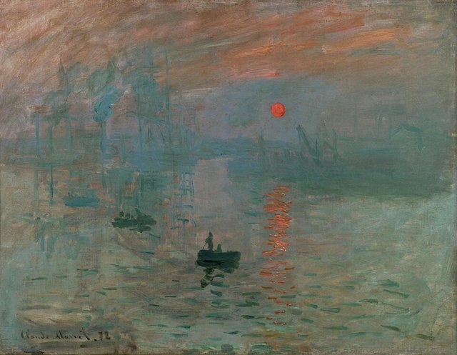
1874 年 4 月 15 日，35 位畫家在攝影師納達爾（Nadar）位於巴黎卡皮西納大道 35 號的攝影工作室，自費舉辦「畫家、雕塑家、版畫家等無名氏合作社」第一屆展覽——莫內的《印象·日出》被批評家 Louis Leroy 在《喧噪報》上以玩笑命名為「印象派」。**偵探式論點：這是一場資金鏈與組織學的偵探案：沒有沙龍、沒有官方評審、沒有皇帝恩准——一個「股份制合作社」用攝影師的工作室，撬開了學院對展覽的兩百年壟斷。**

[→ 對外連結：1874 - 第一次印象派畫展：一家攝影工作室裡的畫家合作社](https://chad-liu.github.io/books/html/9-3.藝術史/1874-第一次印象派畫展.html)

## 1884 | 秀拉大傑特島
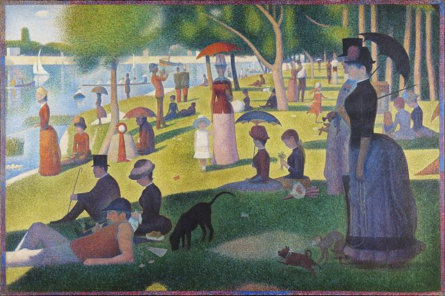
1884 年，喬治·秀拉（1859-1891）以《阿尼埃爾的浴場》參加首屆「獨立沙龍」（Salon des Indépendants，無評審制），並開始繪製《大傑特島的星期天午後》——一幅 2×3 公尺的點彩巨作，1886 年在第八屆（也是最後一屆）印象派畫展展出。**偵探式論點：這是一場色彩科學對印象派直覺的政變：秀拉用謝弗勒爾的色彩同時對比定律，把「戶外速寫的即興」改造成「實驗室的計算」——而畫面裡排隊般整齊的巴黎郊區中產階級，本身就是一份社會學調查報告。**

[→ 對外連結：1884 - 秀拉《大傑特島的星期天午後》：用色彩化學畫社會學](https://chad-liu.github.io/books/html/9-3.藝術史/1884-秀拉大傑特島.html)

## 1888 | 梵高亞爾
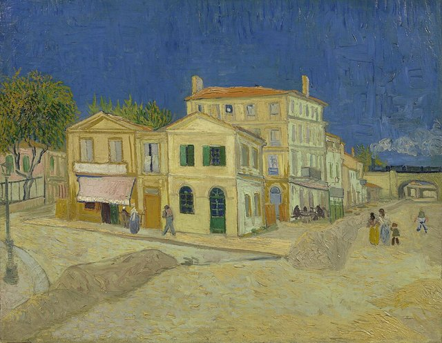
1888 年 2 月，35 歲的文生·梵高（Vincent van Gogh，1853-1890）離開巴黎，搬到普羅旺斯的亞爾，租下拉馬丁廣場 2 號的「黃屋」，計畫建立「南方畫室」——同年 10 月高更應邀同住，12 月兩人激烈衝突，梵高割下左耳。**偵探式論點：這是一起資金鏈偵探案：梵高一生只賣出一幅畫（一說兩幅），但每一管顏料都由畫商弟弟提奧支付——「北方光線的套利」（離開巴黎去南方追逐更強的太陽）最後由割耳與自殺結案，而身價的逆轉要等到死後二十年。**

[→ 對外連結：1888 - 梵高亞爾：黃屋、割耳與一條由弟弟支付的資金鏈](https://chad-liu.github.io/books/html/9-3.藝術史/1888-梵高亞爾.html)

## 1891 | 高更塔希提
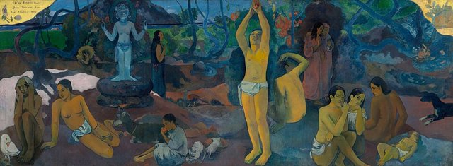
1891 年 4 月，43 歲的保羅·高更（Paul Gauguin，1848-1903）登船前往法屬塔希提，名義是「尋找原始的純真」，實際背景是歐洲的債務、婚姻破裂與市場失敗——而他出發前就打好造勢：獲得法國政府官方補助、接受《費加洛報》專訪，把逃亡包裝成文化任務。**偵探式論點：這是一場殖民體制與原始主義的合謀案：高更的「純真伊甸園」是由法國殖民政府資助、由報紙造勢、再由他自己的筆與刀精心策劃的——塔希提從來不是世外桃源，是一個被殖民的、正在被傳教士與商人改造的社會。**

[→ 對外連結：1891 - 高更塔希提：逃債、官方補助與一手打造的原始神話](https://chad-liu.github.io/books/html/9-3.藝術史/1891-高更塔希提.html)

## 1893 | 孟格吶喊
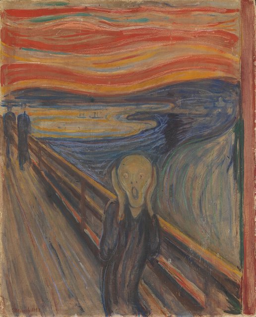
1893 年，愛德華・孟格（Edvard Munch, 1863-1944）在克里斯蒂安尼亞（今奧斯陸）郊外的艾克貝格山丘小路完成《吶喊》：血紅的天空、橋上兩個漠然的背影、一個捧臉扭曲的人形。孟格自述靈感來自一次夕陽下散步時「聽見大自然穿越一切的巨大吶喊」。**這不是描繪某個瘋子的畫，而是第一張把「焦慮」本身當成主角的畫——現代人的心理狀態第一次成為藝術的案發現場。**

[→ 對外連結：1893 - 孟格《吶喊》：橋上的一聲尖叫，畫出了現代人的焦慮](https://chad-liu.github.io/books/html/9-3.藝術史/1893-孟格吶喊.html)

## 1897 | 維也納分離派

1897 年 5 月，古斯塔夫・克林姆（Gustav Klimt, 1862-1918）率領一批畫家、建築師與工藝家，集體退出維也納保守的藝術家之家（Künstlerhaus），成立「奧地利造形藝術家協會」，人稱「維也納分離派」（Wiener Secession）。他們蓋了自己的展覽館——由約瑟夫・奧布里希（Joseph Maria Olbrich, 1867-1908）設計、頂著金色月桂葉圓頂的白色會館，並發行機關誌《聖春》（Ver Sacrum）。**這是藝術史上第一次有整個藝術家世代以「退出國家沙龍體制」為手段，要求展覽自由與藝術家自治。**

[→ 對外連結：1897 - 維也納分離派：克林姆帶著五十個畫家，從帝國的沙龍裡退黨](https://chad-liu.github.io/books/html/9-3.藝術史/1897-維也納分離派.html)

## 1905 | 野獸派

1905 年秋天，巴黎第三屆秋季沙龍（Salon d'Automne）第七展室裡，掛滿了馬諦斯（Henri Matisse, 1869-1954）、德朗（André Derain, 1880-1954）、弗拉曼克（Maurice de Vlaminck, 1876-1958）等人用純粹原色、粗野筆觸畫出的風景與人像。展室中央擺著一尊古典風格的兒童胸像，批評家路易・沃克塞勒（Louis Vauxcelles, 1870-1943）在《吉爾・布拉斯報》寫下名句：「唐那太羅在野獸中間！」（Donatello chez les fauves）。**一記嘲諷，成為二十世紀第一場前衛運動的正式名稱——批評家的毒舌，比畫家的宣言更能定案歷史。**

[→ 對外連結：1905 - 野獸派：「唐那太羅在野獸中間」——一句毒舌評語，命名了一場革命](https://chad-liu.github.io/books/html/9-3.藝術史/1905-野獸派.html)

## 1907 | 亞維農少女
1907 年春夏之交，25 歲的巴勃羅・畢卡索（Pablo Picasso, 1881-1973）在巴黎「洗濯船」畫室完成了《亞維農少女》（Les Demoiselles d'Avignon）：五位裸女面孔如非洲面具與伊比利雕刻，身體碎裂成多個視角並置的幾何切面。他自己說：「我畫的不是我看到的女人，而是我想到的女人。」**這張畫把文藝復興以來的單點透視一次處決——立體主義的案發現場，就從這裡開始偵查。**

[→ 對外連結：1907 - 亞維農少女：畢卡索把五張臉畫成面具，炸開了西方繪畫五百年的透視](https://chad-liu.github.io/books/html/9-3.藝術史/1907-亞維農少女.html)

## 1911 | 康丁斯基抽象

1911 年前後，在慕尼黑的俄裔畫家瓦西里・康丁斯基（Wassily Kandinsky, 1866-1944）畫出第一批沒有可辨識物件的畫。他自述 1896 年在莫斯科看見莫內《乾草堆》時「第一次懷疑物件是否必要」；1908 年某個黃昏回到畫室，看見自己倒放的畫「不認得任何東西，卻被色彩之美擊中」。1911 年 12 月他與法蘭茲・馬克（Franz Marc, 1880-1916）在慕尼黑坦豪瑟畫廊（Thannhauser Gallery）舉辦第一屆「藍騎士」（Der Blaue Reiter）展覽，1912 年出版《藍騎士年鑑》與《論藝術中的精神》。**抽象繪畫在此正式立案：繪畫不必描繪任何東西，色彩與形自身即內容。**

[→ 對外連結：1911 - 康丁斯基的抽象：聽完一場音樂會，他決定讓繪畫拋棄所有物件](https://chad-liu.github.io/books/html/9-3.藝術史/1911-康丁斯基抽象.html)

## 1917 | 杜象噴泉

1917 年 4 月，紐約獨立藝術家協會（Society of Independent Artists）舉辦首屆大展，標榜「無評審、無獎金、人人可展」。馬塞爾・杜象（Marcel Duchamp, 1887-1968）以化名「R. Mutt」送交一件從 J. L. Mott 鐵器行買來的標準小便斗，題為《噴泉》（Fountain）。協會理事會投票拒展，杜象憤而退會。他隨後在自辦的《盲人》（The Blind Man）雜誌上反擊：「Mutt 先生是否親手做的並不重要——他『選擇』了它。**選擇即創作，藝術的定義從此被顛覆：作品價值不在手藝，而在觀念。**」

[→ 對外連結：1917 - 杜象《噴泉》：一個小便斗署名 R. Mutt，把「什麼是藝術」送上被告席](https://chad-liu.github.io/books/html/9-3.藝術史/1917-杜象噴泉.html)

## 1919 | 包浩斯

1919 年 4 月，建築師華特・葛羅佩斯（Walter Gropius, 1883-1969）在德國威瑪把撒克遜大公美術學院與工藝學校合併，成立「國立包浩斯」（Staatliches Bauhaus）。他發表《包浩斯宣言》，封面是萊昂內爾・法寧格（Lyonel Feininger, 1871-1956）的木刻〈社會主義大教堂〉：一座尖塔發出光芒，下方是三個奔向它的人影。宣言開頭是驚人的句子：「建築師、雕塑家、畫家，我們都必須回到手工藝！」**這是藝術教育史上最大膽的改造案：把美術學院拆掉重建，讓藝術家下車間、為工業時代造物——現代設計的誕生地就在這裡立案。**

[→ 對外連結：1919 - 包浩斯：葛羅佩斯在魏瑪合併兩所學校，宣布「藝術與工匠之間沒有界線」](https://chad-liu.github.io/books/html/9-3.藝術史/1919-包浩斯.html)

## 1924 | 超現實主義宣言
1924 年秋天，29 歲的前達達詩人安德烈・布勒東（André Breton, 1896-1966）在巴黎發表《超現實主義宣言》，把這個詞正式定案：「超現實主義，純粹的心理自動性，用以口頭、書面或其他方式表達思想的真正運作。」他倡導「自動書寫」——不經理性檢查，讓潛意識直接流瀉。同年 12 月《超現實主義革命》（La Révolution surréaliste）創刊，一份辦得像科學期刊的藝術雜誌。**達達是砸場子的，超現實主義是立案的：佛洛伊德的夢境理論被正式搬進藝術的操作手冊，夢、慾望與瘋狂從此成為藝術的合法領地。**

[→ 對外連結：1924 - 超現實主義宣言：布勒東在巴黎宣布「夢比現實更真」](https://chad-liu.github.io/books/html/9-3.藝術史/1924-超現實主義宣言.html)

## 1937 | 格爾尼卡
1937 年 1 月，西班牙共和政府委託旅居巴黎的畢卡索為巴黎世界博覽會西班牙館製作壁畫。4 月 26 日，納粹禿鷹軍團應佛朗哥之請轟炸巴斯克小鎮格爾尼卡，數百平民死亡；5 月 1 日《聯合報》（L'Humanité）刊出來自格爾尼卡的電報報導。畢卡索在巴黎格蘭奧古斯丁街畫室，以三十多天完成 3.49×7.77 公尺的黑白巨作《格爾尼卡》：嘶叫的馬、斷臂的戰士、懷抱死嬰的母親、燈泡之眼。**這是史上第一次，一場轟炸的新聞稿直接成為一幅世界名畫的委託條款——藝術家與獨裁者的宣傳戰，在畫布上正面交火。**

[→ 對外連結：1937 - 《格爾尼卡》：一座小鎮被炸平六天後，畢卡索交出了二十世紀最有力的反戰壁畫](https://chad-liu.github.io/books/html/9-3.藝術史/1937-格爾尼卡.html)

## 1950 | 帕洛克滴畫
1949 年 8 月 8 日，《生活》（Life）雜誌以四頁專題介紹傑克森・帕洛克（Jackson Pollock, 1912-1956），標題是一個巨大的問句：「他是美國最偉大的在世畫家嗎？」照片裡這個牛仔褲髒兮兮的西部漢子，在長島 Springs 的穀倉畫室裡，把家用琺瑯漆潑灑在鋪在地上的巨大畫布上，身體在畫布上移動——批評家羅森伯格稱之為「行動繪畫」（action painting），格林伯格稱之為「滿幅繪畫」（all-over）。**冷戰開局之年，一個美國酒鬼畫家被媒體加冕；藝術世界的首都，從巴黎正式遷往紐約。**

[→ 對外連結：1950 - 帕洛克滴畫：Life 雜誌問「他是美國最偉大的畫家嗎？」，藝術首都從此換人](https://chad-liu.github.io/books/html/9-3.藝術史/1950-帕洛克滴畫.html)

## 1958 | 羅斯科
1958 年，馬克・羅斯科（Mark Rothko, 1903-1970）接受紐約西格拉姆大廈（Seagram Building）四季餐廳的委託，為其作畫，酬金三萬五千美元（當時天價）。他畫了約三十張深紅、深紫、近乎黑的巨幅色域畫，卻在 1959 年與妻子赴歐途中止步：他告訴友人約翰・費舍爾，他要去「故意畫一些會讓在這裡吃飯的混蛋覺得倒胃口的畫」，並宣布退出委託、退回訂金。1970 年他自殺後，這批畫捐給倫敦泰特美術館，裝置為「羅斯科室」。**在藝術徹底商品化的年代，一個畫家用退回支票的方式起訴了整個上流社會——色域繪畫的靜謐之下，藏著一場藝術與金錢的公開決裂。**

[→ 對外連結：1958 - 羅斯科：他為四季餐廳畫了壁畫又退回訂金——「我畫的畫會讓人餓不出胃口」](https://chad-liu.github.io/books/html/9-3.藝術史/1958-羅斯科.html)

## 1962 | 安迪沃荷普普
1962 年 7 月，洛杉磯的菲魯斯畫廊（Ferus Gallery）展出安迪・沃荷（Andy Warhol, 1928-1987）的《康寶濃湯罐》（Campbell's Soup Cans）：32 幀一模一樣尺寸的畫布，各畫一種口味，像超級市場貨架一樣排排陳列。同年 11 月紐約的斯泰布爾畫廊（Stable Gallery）再展，沃荷開始改用絹印（silkscreen）大量複製瑪麗蓮夢露、死車禍照片與鈔票。批評家問他為何畫湯罐，他答：「因為我每天都喝。」**波普藝術（Pop Art）在此正式立案：藝術不再對抗消費社會，而是直接把消費社會的招牌搬進美術館——鏡子第一次照見鏡子自己。**

[→ 對外連結：1962 - 安迪沃荷普普：32 罐康寶濃湯排排掛，消費社會第一次照見自己](https://chad-liu.github.io/books/html/9-3.藝術史/1962-安迪沃荷普普.html)

## 1969 | 大地藝術
1970 年 4 月，羅伯特・史密森（Robert Smithson, 1938-1973）雇用推土機與搬運工，在猶他州大鹽湖（Great Salt Lake）的黑岩岸邊，用黑色玄武岩與鹽結晶堆出一條 457 公尺長、逆時針捲入湖水的《螺旋防波堤》（Spiral Jetty）。湖水因季節性乾旱而泛紅，堤壩隨水位浮沉、時隱時現。他同時攝製了同名 16 釐米影片。**現代藝術史上最戲劇性的一次「罷工」：藝術家把作品搬到畫廊體制無法收購的荒野，用攝影、影片與地圖作為唯一可運回城市的「贖金」——藝術市場的交易對象，從此多了一種叫「檔案」的貨幣。**

[→ 對外連結：1969 - 大地藝術：羅伯特・史密森在猶他鹽湖推出一條 457 公尺的螺旋堤，宣布退出畫廊](https://chad-liu.github.io/books/html/9-3.藝術史/1969-大地藝術.html)

## 1979 | 芝加哥晚宴
1979 年 3 月，藝術家茱迪・芝加哥（Judy Chicago, 1939- ）的《晚宴》（The Dinner Party）在舊金山現代藝術博物館首展：一張 15 公尺見方的三角形餐桌，每邊 13 個席位，共 39 位傳說與歷史上的女性——從原始女神、克麗奧佩脫拉、埃莉諾女王到維吉尼亞・吳爾芙、喬治亞・歐姬芙——每人一席刺繡餐墊、手工陶瓷餐盤，盤面上是象徵性的陰門花樣。桌下「遺產地板」刻上 999 位更多女性的名字。**這是女性主義藝術史上最大規模的集體製作案：一件由數百名志工以「針線工藝」完成的巨作，直接起訴了藝術史對女性的系統性抹名。**

[→ 對外連結：1979 - 芝加哥《晚宴》：一張三角餐桌，三十九位被歷史抹名的女性，與數百名志工](https://chad-liu.github.io/books/html/9-3.藝術史/1979-芝加哥晚宴.html)

## 1984 | 巴斯奇亞
1985 年 2 月，《紐約時報雜誌》封面刊出一張照片：25 歲的讓-米歇爾・巴斯奇亞（Jean-Michel Basquiat, 1960-1988）赤腳坐在畫室，標題是〈新藝術：新錢，美國藝術市場的年輕火車頭〉。短短四年前，他還是布魯克林街頭署名「SAMO」的塗鴉少年；1984 年前後，他的畫在紐約多家畫廊輪流開展，單價飆上數萬美元，與安迪・沃荷合作聯展。**1980 年代的紐約，藝術市場的媒體引擎正式點火：塗鴉可以入庫、明星畫家可以在兩年內身價翻十倍——藝術的身價，從此由雜誌封面與拍賣槌共同定價。**

[→ 對外連結：1984 - 巴斯奇亞：從 SAMo 塗鴉到《紐約時報》封面，藝術市場的媒體引擎全速運轉](https://chad-liu.github.io/books/html/9-3.藝術史/1984-巴斯奇亞.html)

## 1997 | YBA
1997 年秋天，倫敦皇家藝術學院（Royal Academy of Arts）舉辦《感官》（Sensation）展，展出廣告大亨查爾斯・薩奇（Charles Saatchi, 1943- ）收藏的英國青年藝術家（YBA, Young British Artists）作品：達米恩・赫斯特（Damien Hirst, 1965- ）的《生者對死者無動於衷》——一條 4.3 公尺的虎鯊泡在福馬林玻璃櫃裡；翠西・艾敏（Tracey Emin, 1963- ）的《我的床》與《每個曾與我睡過的人 1963-1995》帳篷；馬庫斯・哈維的邁拉・欣德利兒童手印拼像。展覽引發抗議、媒體圍剿與觀眾大排長龍。**這是史上第一次，廣告公司的傳播技術被整套搬進藝術展覽：薩奇用煽動媒體的公式為藝術造勢，醜聞本身成為行銷素材。**

[→ 對外連結：1997 - YBA《感官》展：薩奇把鯊魚泡進福馬林，倫敦皇家學院被媒體煽動學淹沒](https://chad-liu.github.io/books/html/9-3.藝術史/1997-YBA.html)

## 2005 | 班克斯街頭藝術
2005 年前後，匿名英國藝術家班克斯（Banksy, 約 1974- ）把模版噴漆（stencil）街頭作品推向全球：倫敦、布里斯托、洛杉磯與西岸沙漠，出現反戰士兵、丟花束的抗議者、《錄音室》裡的猴子警衛、伯利恆隔離牆上的取消海報。他的作品在街頭被遊客朝聖、被屋主挖牆轉售；2018 年 10 月，倫敦蘇富比拍賣他的《氣球女孩》版畫，成交 104 萬英鎊的瞬間，畫框內藏的遙控碎紙機啟動，畫作下半部被切成紙條——他事先在 2013 年 Instagram 貼文中留下「下一次拍賣會見」的伏筆，並改名為《愛在垃圾桶》（Love is in the Bin）。**街頭藝術的偵探案在此完案：匿名藝術家用體制的交易時刻（拍賣槌落下的那一秒）完成最精準的一次襲擊——作品在成交瞬間自毀，反而成為史上最成功的藝術行銷。**

[→ 對外連結：2005 - 班克斯街頭藝術：匿名者的模版噴漆，與 2018 年拍賣會上自毀畫框的完美伏筆](https://chad-liu.github.io/books/html/9-3.藝術史/2005-班克斯街頭藝術.html)

## 2021 | BeepleNFT
2021 年 3 月 11 日，倫敦佳士得拍賣美國數位藝術家 Beeple（麥克・溫克爾曼, Mike Winkelmann, 1981- ）的《每一天：前 5000 天》（Everydays: The First 5000 Days）——他連續 13 年多每天創作一幅數位圖像、鑄成單一 NFT（非同質化代幣）的作品——以 6930 萬美元落槌，創下在世藝術家拍賣第三高價，也是純數位作品的天價紀錄。買家是加密貨幣投資人 Metakovan（化名，真名 Vignesh Sundaresan, 約 1986- ）。**數位檔案本可無限複製、沒有「原件」，NFT 用區塊鏈的帳本技術憑空造出所有權——這是攝影發明以來，藝術遭遇的第二次複製革命：這一次，複製品的時代裡，「原件」反而由一串代碼定義。**

[→ 對外連結：2021 - Beeple NFT：6930 萬美元買下一組 JPEG，藝術的第二次複製革命](https://chad-liu.github.io/books/html/9-3.藝術史/2021-BeepleNFT.html)
