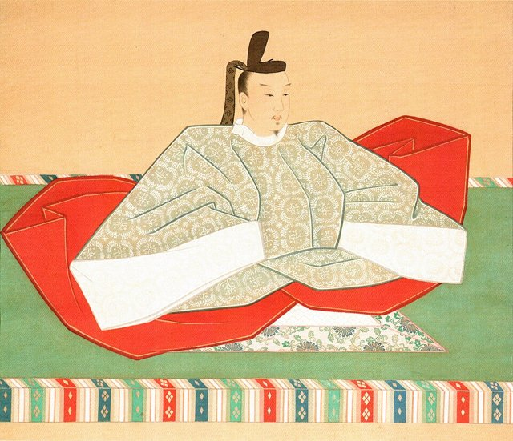
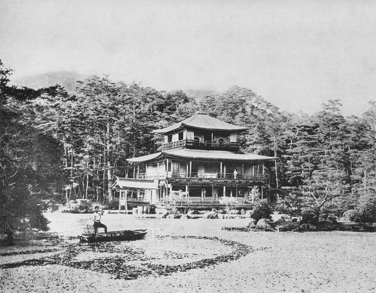
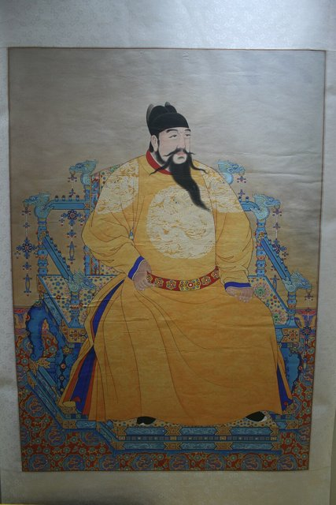

<!--
內容整理自 D:\Books\html\1-3-1.日本歷史人物\足利義滿(1358~1408).html（沒有對應的 md 筆記），並整合中文維基百科〈足利義滿〉條目，以自己的話改寫。
時期依頁面的階段歸納：出生與南北朝動亂、少年將軍、強化將軍權威與南北朝合一、退位後掌權與北山文化、對明外交與晚年。
兩份資料出入與處理方式：
- 出生：頁面寫「1358年8月22日」，那是和曆延文三年八月二十二日；維基百科換算為西曆1358年9月25日，born 採西曆。去世：應永十五年五月六日，西曆1408年5月31日，享年49歲（虛歲51），兩份一致。
- 就任將軍：頁面寫1368年（應安元年）元服並受將軍宣下，並註明紀年口徑不同；維基百科作1368年4月元服、1369年2月7日（應安元年十二月三十日，換算後跨入西曆1369年）正式就任。事件寫在1369年2月7日，元服併入同一則。
- 讓位與太政大臣：頁面寫1394年；維基百科正文作1394年12月17日讓位、12月25日任太政大臣（履歷欄作1395年1月），採正文日期。1395年6月出家，法號道有，後改道義。
- 土岐康行之亂：頁面寫1390年；維基百科沒有明確年份，只說在土岐賴康、山名時義去世後才討伐，照頁面寫1390年。明德之亂維基百科作1391年12月。
- 對明外交：頁面寫1401年遣使、1402年明朝承認其日本國王地位、1404年勘合貿易展開；維基百科說1401年以「日本國准三后源道義」名義遣使（頁面作「日本國王臣源道義」，那是明朝冊封後的上表用語），1404年遣使並展開勘合貿易，照兩份合併。
- 1388年在紀伊遭南朝楠木正勝襲擊（平尾合戰）、1406年義滿成為後小松天皇的義父，頁面沒有，取自維基百科，併入相關事件。
- 頁面的「重要政治措施與歷史成就」「人物關係」「年表總整理」「歷史地位與評價」寫進時期說明與相關事件，不另立事件。
- 人名與其他時間軸一致：足利尊氏、細川賴之、斯波義將、山名氏清、大內義弘、後小松天皇、世阿彌；明朝皇帝與永樂帝一致。
圖片來源（皆為 Wikimedia Commons 公有領域／CC0 作品；註明「共用」者沿用其他時間軸已有的圖片）：
- yo-cover.jpg：Yoshimitsu Ashikaga cropped.jpg（足利義滿像）
- yo-gokomatsu.jpg：Emperor Go-Komatsu.jpg（後小松天皇像）
- yo-kinkaku.jpg：Kinkakuji, 1893.jpg（金閣（鹿苑寺舍利殿），1893年攝）
- zh-yongle.jpg（明成祖永樂帝像（與中華史時間軸共用））
-->

# Periods
- 1358-09-25 ~ 1367 | 出生與南北朝動亂 | #868e96
  生於京都，祖父足利尊氏創建室町幕府；南北朝對立下，南朝軍一度攻入京都，年幼的義滿隨家族避難。
- 1367 ~ 1379 | 少年將軍 | #e8590c
  十歲繼承足利家，由管領細川賴之輔佐，十一歲就任將軍，遷入花之御所，與公家名門日野家聯姻。
- 1379 ~ 1394 | 強化將軍權威與南北朝合一 | #c92a2a
  康曆政變擺脫輔政者，取得朝廷高官，先後削弱土岐、山名兩大守護，1392年促成南北朝合一。
- 1394 ~ 1401 | 退位掌權與北山文化 | #b08900
  讓位給義持後任太政大臣、出家，仍掌握實權；興建北山殿與金閣，平定大內義弘，扶植禪宗與能樂。
- 1401 ~ 1408-05-31 | 對明外交與晚年 | #1971c2
  遣使明朝，受封「日本國王」，展開勘合貿易；北山殿成為接待公卿、大名與外國使節的中心，1408年去世。

# Events

## 1358-09-25 | 出生於京都
足利義滿生於京都，幼名春王。父親是室町幕府第二代將軍足利義詮，祖父是創建幕府的足利尊氏，母親紀良子。當時正值南北朝時代，京都的北朝與吉野的南朝並立，各地仍有戰事。

## 1361 | 南朝軍攻入京都
南朝勢力一度攻入京都，父親義詮撤離，年幼的義滿也被迫避難，先後受建仁寺與播磨國白旗城一帶的庇護。這反映幕府當時還無法完全控制京都與地方武士。不久幕府收復京都，義滿返回，但足利家仍須依靠細川、斯波、赤松等有力守護維持政權。

## 1367-12-07 | 父親去世，繼承足利家
足利義詮病重，將政務交給年僅十歲的義滿，並任命有力守護細川賴之為管領輔佐；12月義詮去世，義滿繼承足利家家督，實際政務由細川賴之主持。

## 1369-02-07 | 就任第三代將軍
1368年義滿元服，由細川賴之擔任烏帽子親；應安元年十二月三十日（1369年2月7日），他受征夷大將軍宣下，成為室町幕府第三代將軍，年僅十一歲。1370年代初，他逐漸參與決策，建立自己的班底，利用官職、土地分配與軍事命令強化中央控制。

## 1374 | 與日野業子結婚
義滿迎娶日野業子為正室，足利將軍家藉著與京都公家名門聯姻提升地位，此後與日野家關係密切，對他接近朝廷權力很重要。

## 1378 | 建立花之御所
義滿把居所遷到京都北小路室町，新宅邸規模宏大，後世稱「花之御所」或「室町殿」，同時是幕府的政務中心，「室町幕府」之名也由此而來，象徵足利將軍家成為京都政治秩序的核心。

## 1379 | 康曆政變
反對細川賴之的守護勢力與幕府重臣聯合施壓，義滿解除細川賴之的管領職務，改由斯波義將接任。這標誌他開始擺脫輔政者的控制，建立自己的統治權威。
1380年代，他取得內大臣、左大臣等朝廷高官，以公家官位與儀式提升將軍家的正當性，想成為公家與武家秩序之上的最高仲裁者。

## 1382 | 創建相國寺
義滿發願興建大型禪寺相國寺，1386年又整頓「五山十剎」制度，把重要禪寺納入幕府管理。禪寺不只有宗教功能，也負責外交文書、文化交流與知識傳播，成為後來北山文化的重要背景。1388年，他在紀伊遭南朝武將楠木正勝襲擊。

## 1390 | 土岐康行之亂
義滿整頓地方守護，打擊控制美濃、尾張、伊勢等地的土岐氏，削弱地方大名的自主性，避免守護勢力威脅將軍權威。

## 1391-12 | 明德之亂
山名氏是勢力龐大的守護家族，一族一度控制日本六分之一的國，被稱為「六分一殿」。山名氏清等人起兵反抗，義滿調動幕府軍與支持自己的守護擊敗山名氏清，大幅削弱山名氏，進一步集中權力，為南北朝合一創造條件。

## 1392 | 南北朝合一

自1336年以來，日本長期有京都北朝與吉野南朝兩個朝廷。義滿以軍事壓力與政治談判促成和解（明德和約），南朝後龜山天皇把象徵正統的三神器交給北朝後小松天皇，結束約五十六年的分裂。這是他政治生涯最重要的成就，也提高了他作為全國仲裁者的地位；但地方武士並未因此完全服從，各地衝突仍在持續。

## 1394-12-17 | 讓位義持，任太政大臣
義滿把將軍職讓給兒子足利義持，12月25日轉任太政大臣，進入朝廷最高官職，形式上不再是將軍，仍掌握幕府實權。

## 1395-06 | 出家
義滿辭去太政大臣，正式出家，法號道有，後改道義。出家不代表退出政治，反而讓他以退隱將軍的身分繼續控制幕府；繼任將軍義持與父親之間因此存在權力分歧。

## 1397 | 興建北山殿與金閣

義滿取得京都北山的土地，開始興建大型別墅與政治文化中心北山殿，最著名的是舍利殿，後世俗稱「金閣」：一層是寢殿造的貴族住宅風格，二層是武家住宅與書院風格，三層是禪宗佛殿風格，外部貼金箔。北山殿兼具居住、政治、外交接待與文化展示的功能。
北山文化融合公家、武家與禪宗文化：建築以金閣為代表，宗教上扶植臨濟宗，戲劇上支持觀阿彌、世阿彌的能樂，水墨畫逐漸發展，並大量引進宋元明的書畫、陶瓷與器物。

## 1399 | 應永之亂
西日本的大守護大內義弘與義滿關係惡化，在堺起兵反抗幕府；義滿出兵鎮壓，大內義弘戰敗身亡，大內氏受到重創，幕府對西日本的控制力提升。這也反映他集中權力的政策與地方守護之間的持續衝突。

## 1401 | 遣使明朝

義滿以「日本國准三后源道義」的名義，派僧侶祖阿與博多商人肥富出使明朝，恢復正式外交關係。明朝隨後冊封他為「日本國王」，頒授曆法；他上表時自稱「日本國王臣源道義」。
接受冊封讓日本取得明朝的外交承認與貿易利益，明朝則以朝貢體系處理對日外交；這種名分在日本國內引發了有關外交地位的爭議。

## 1404 | 勘合貿易展開
日本與明朝開始以「勘合符」辨識官方使節與貿易船，區分正式使節與冒充的走私商人。日本輸出刀劍、扇子、硫磺，輸入銅錢、絲織品、陶瓷與書籍。勘合貿易為幕府帶來財政收入，促進中日文化交流，日本也重新進入以明朝為中心的東亞國際秩序。

## 1406 | 成為天皇的義父
義滿持續擴建北山殿，在此接待公卿、守護大名、僧侶與外國使節，政治活動的規格已超越一般將軍。1406年，他的妻子日野康子被封為後小松天皇的准母，獲賜「北山院」院號，義滿因此成為天皇的義父。

## 1408-05-31 | 逝世
應永十五年五月六日，足利義滿在京都去世，享年49歲（虛歲51）。朝廷有意追贈「太上天皇」尊號，但足利義持與斯波義將以無先例為由辭退。
他的時代是南北朝戰亂結束、室町幕府權力達到高峰、日本重新與東亞國際秩序連結的轉折點；但他建立的集權體制高度依賴個人威望，死後幕府未能長期維持。
