<!--
轉寫自 圖表\Bach.png（1685–1717）與 圖表\Bach2.png（1717–1750）。
原圖中部分文字被截斷，以下標「待補」處請自行補全：
- 各時期的起訖年為依色帶長度推估（例如「開始自力」1702、「成為管風琴師」1707）
- 「堂弟伊萊斯借住在巴赫家」標題可能被截斷
-->

# Periods
- 1685 ~ 1695 | 幼年1685~1695@埃森納赫(Eisenach)
  德國中部圖林根州小城埃森納赫(Eisenach)
- 1695 ~ 1700 | 音樂教育@奧德魯夫(Ohrdruf)
  巴赫的母親死於1694年，他的父親也在8個月之後隨其母親而去。10歲的巴赫成為了孤兒，並住進了位於奧德魯夫的長兄約翰·克里斯多夫·巴赫（與叔叔同名，1671–1721）家裡。在這裡，他模仿、學習並演奏音樂；而他哥哥，一個職業教堂管風琴師，繼續給予他在埃森納赫便開始的音樂教育，他教導巴赫彈奏大鍵琴，以及其他樂器的基本演奏技巧，還曾帶他參觀鎮上教堂裝設新管風琴的過程，這種種對未來巴赫對器樂的造詣與熟稔有很大影響。
- 1700 ~ 1702 | 開始自力
- 1703 ~ 1707 | 成為管風琴師@阿恩施塔特(Arnstadt)
- 1708 ~ 1717 | 威瑪時期@Weimar
- 1717 ~ 1723 | 科騰時期 Köthen
- 1723 ~ 1750 | 萊比錫時期@Leipzig
- 1723 ~ 1729 | J. H. 厄內斯提校長時期
- 1730 ~ 1734 | 蓋斯納校長時期
- 1734 ~ 1742 | J. A. 厄內斯提校長時期
- 1737 ~ 1742 | 堂弟伊萊斯借住在巴赫家

# Events

## 1685-03-21 | 出生@神聖羅馬帝國埃森納赫（位於今德國圖林根邦）
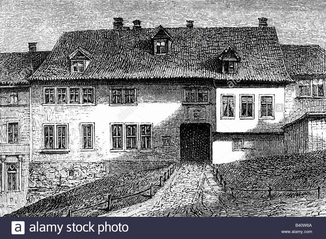
巴赫出生於神聖羅馬帝國埃森納赫（位於今德國圖林根邦）的一個音樂世家，自幼即接受音樂教育。父母亡故後，巴赫遷至奧德魯夫由長兄扶養，生活清苦，15歲時即前往呂內堡修習學業並自立更生。畢業後巴赫先後在阿恩施塔特和慕豪森擔任管風琴師（1703年－1708年），往後歷任威瑪（1708年－1717年）與柯騰（1717年－1723年）的宮廷樂長，以及萊比錫的教堂音樂總監（1723年－1750年）。

## 1700 | 呂內堡的聖馬可教堂
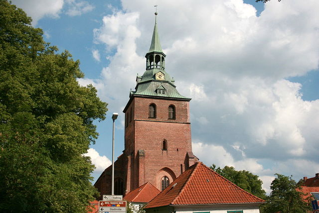
1700年3月，巴赫與他的好友厄德曼（Georg Erdmann）同行前往呂內堡。他在聖馬可教堂設立的拉丁語學校繼續學業，並參與教堂的音樂生活。學校裡同樣教授拉丁文、希臘文、邏輯、修辭學和神學。雖然唱詩班成員分到的零用金微薄，但巴赫靠著在婚喪典禮上獻唱及街頭表演的收入，還能勉強維持生活。

## 1701 | 從呂內堡步行30哩到漢堡，聆聽萊茵肯彈奏管風琴
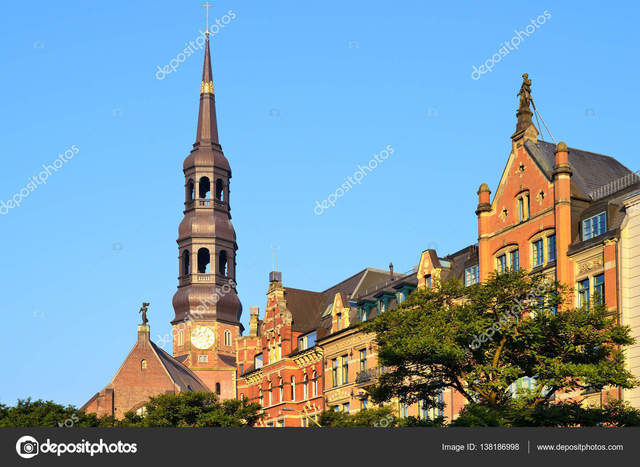
1701年的暑假，巴赫步行30哩到漢堡，聆聽聖凱薩琳教堂的琴師萊茵肯（Johann Adam Reincken，也是貝姆的老師）彈奏管風琴，還聽到北日耳曼的著名琴師呂北克（Vincenz Lübeck）的演奏，這給年輕巴赫帶來強烈震撼，此後他多次舊地重遊。

## 1701 | 雪雷(Celle)宮廷
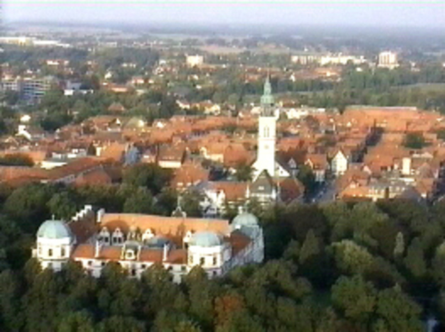
回到呂內堡後，巴赫也受到法國文化的洗禮。在聖馬可教堂一所專為貴族子弟附設的學校（Ritterakademie），充斥法國傳來的新奇想法；學校裡的學生流行以法語交談、排演法國戲劇並以法國音樂伴奏，還聘請曾受教於盧利，呂內堡伯爵的樂師湯姆沙耶（Thomas de la Salle）擔任舞蹈老師。在旁聽後，巴赫下了不少功夫接近法國文化，尤其音樂。沙耶對巴赫留下深刻的印象，甚至帶他到雪雷（Celle）欣賞管弦樂團和管風琴的演奏，並接觸了如庫普蘭等法國作曲大師的相關作品，這是巴赫音樂兼容並蓄的開端。

## 1703 | 阿恩施塔特的「巴赫教堂」
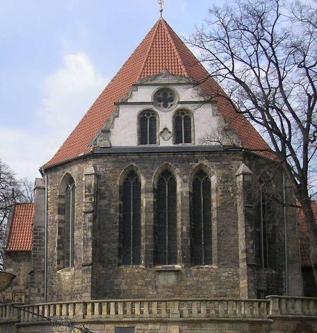
1703年8月，他接受了在該教堂的風琴師的職位，這個工作體面但並不繁重，而且能得到一份不錯的薪水；然而雖然未在合約中載明，巴赫仍需兼任拉丁學校唱詩班的領唱者。

## 1707-10-17 | 首次結婚,堂姊瑪麗亞‧芭芭拉,7個子女中3個成為音樂家
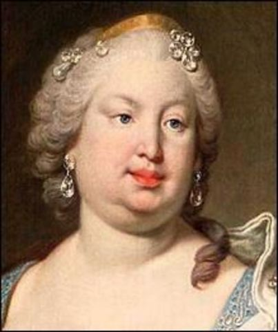
與堂姊Maria Barbara在多倫海姆教堂(Dornhein)結婚
Maria Barbara 1720病逝，7個子女中3個成為音樂家。

## 1708 | 接受威瑪公爵邀請
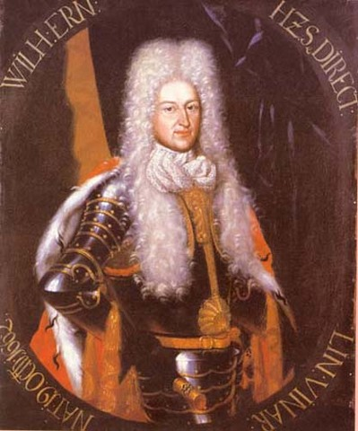
接受威瑪公爵，威廉．恩斯特邀請

## 1717 | 教導柯騰公爵，里奧波德

里奧波德王子年紀比巴赫輕，頗有音樂素養，能奏多種樂器。但他是喀爾文教派的信徒，禮拜儀式中僅使用簡單的聖詠，這意味著宮廷樂師主要負責世俗音樂，著重器樂，而非教會音樂或管風琴曲。這對巴赫的創作而言是個大轉向，不過這樣的挑戰在未來也同時是巴赫進化的動力。

## 1717-11-06 | 離開威瑪前，入獄四星期
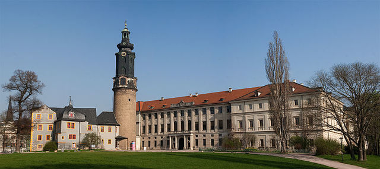
1720年已經到柯登的巴赫原本在威瑪擔任唱詩班指揮的巴赫，捲入了威瑪公爵以及姪子奧古斯特兩人之間的紛爭，導致巴赫與樂長之職擦身而過。鬱悶之際的巴赫，正巧獲得柯登的雷奧波特侯爵的賞識與邀請，1717年他決定離開要威瑪皇室投效柯登皇室。但由於雷奧波特是喀爾文新教教徒，與信奉路德教派的威瑪公爵「立場」上有所抵觸，因此威瑪公爵在放行前刻意刁難巴赫，判他入獄四週。您一定想像不到吧！受到後世景仰的音樂之父巴赫，當年竟然坐過牢。 圖片說明：威瑪城堡(圖片來源:Wiki,Maros Mraz)

## 1720 | 《平均律鍵盤曲集》第一部

## 1721 | 再婚，安娜，生下13名子女
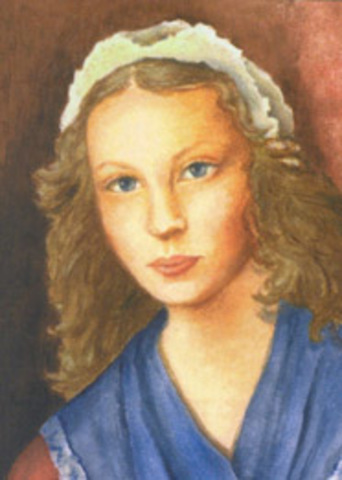
Anna Magdalena Bach

## 1723 | 擔任聖多瑪斯教堂樂長
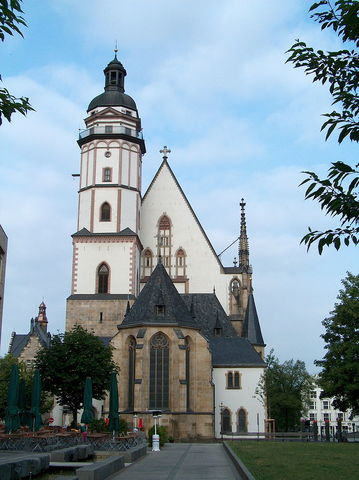
1723～1750年 1722年6月，萊比錫聖多瑪斯教堂音樂指揮庫瑙（Johann Kuhnau）在擔任了該職務21年後逝世。1723年巴赫被舉薦。
當局願意聘用巴赫，但態度較消極。他們並不看重巴赫的管風琴技藝，因為指揮不需要這項技能；而巴赫的作品大多未出版，當局不清楚他在作曲上的才華；知名度方面，巴赫在當時當地仍差了泰雷曼與格勞普納一截；且巴赫沒有正式學歷，當局對此相當看重。儘管巴赫已是音樂全才，卻難獲得學院肯定。當局擔心舊事重演，要求巴赫先得到公爵的免職書。王子雖然不捨但並沒有阻撓巴赫，為他寫了一封文情並茂的免職書。得到許可後，巴赫便申請該職務並獲選。而當選後巴赫還得簽署許多文件和通過神學測驗，確認其思想沒有問題才能上任，但耗時之長、手續繁瑣以及數名議員曾反對聘用巴赫，種種跡象都顯示巴赫過去的經歷仍被當局所質疑。 聖多瑪斯教堂唱詩班指揮（也身兼聖多瑪斯合唱學校的音樂教職，因為學校為教堂提供儀式的歌者）在萊比錫的地位非同小可，相當於全城大小教堂的音樂總監； 但這個職務也沒那麼好勝任，它的頂頭上司包括學校、市議會和教堂當局。

## 1729 | 最後一次探訪柯騰，指揮《馬太受難曲》的片段
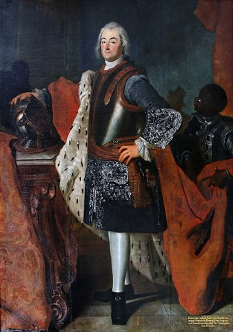
1729年3月，巴赫最後一次探訪柯騰，指揮《馬太受難曲》的片段作為里奧波德王子喪禮上的音樂。

## 1729 | 開始領導大學音樂社
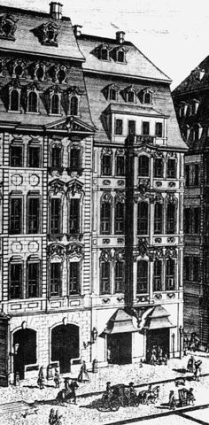

## 1731 | 德勒斯登的聖蘇菲雅教堂彈奏管風琴
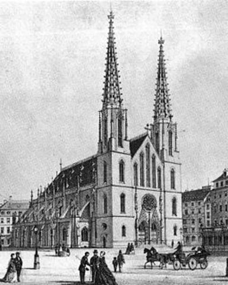
這段時期巴赫和德勒斯登也有了進一步的接觸。在1730年代早期，他曾彈奏過當地聖蘇菲雅教堂（St. Sophia Church）的管風琴。1733年6月，該堂的管風琴師出缺，巴赫推薦自己的長子W. F. 巴赫應徵。當時威廉23歲，他試演的曲目是其父的前奏與賦格曲（BWV 541），技驚四座，順利獲得這份工作，巴赫於是更有理由時常拜訪德勒斯登。

## 1733 | 譜寫《B小調彌撒》的《垂憐曲》與《光榮頌》
1733年2月，薩克森選侯奧古斯特二世去世，他的兒子繼位後，隔年加冕為波蘭國王，改宗天主教，是為奧古斯特三世。巴赫利用這個機會譜寫《垂憐曲》與《光榮頌》，前者是為先王致哀，後者則是歡慶新王登基，不過作為天主教徒的國王自然沒能聽到作品在聖尼古拉教堂的首演。而後來在巴赫去世的前一年，也就是1749年，巴赫才將這兩首作品結合過去所創作的教會清唱劇片段，並加以發展，成為著名的《B小調彌撒》，此作乃是巴赫畢生宗教與聲樂作品的精粹。

## 1736 | 與厄內斯提校長交惡
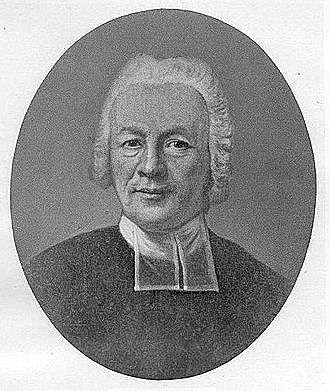
在1736年，厄內斯提和巴赫無可避免的發生了一場衝突，令兩人對峙長達兩年之久。衝突的成因源於厄內斯提侵犯巴赫的人事權，且巴赫認為厄內斯提擅自指派的學監無助於教堂音樂，於是提出異議，但被厄內斯提駁回。8月，兩人相互向市議會指控彼此，後來巴赫向萊比錫宗教會議（Consistory）申訴未果，便以其職銜向國王告狀，但衝突的結果沒有被官方所記錄。總之，兩人從此成為死敵。厄內斯提仍繼續降低學校音樂課程的比重，巴赫則越來越疏於教學。1740年，學校聘用一名新老師教授樂理，顯然巴赫未善盡職責；他的教會音樂創作也大幅萎縮，唱詩班演唱舊作品的時候越來越多。

## 1741 | 到柏林，因三子C.P.E. Bach擔任宮廷琴師
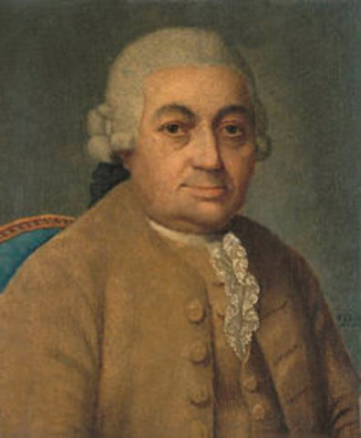

## 1741 | 哥德堡變奏曲出版

這部作品長期不受人們重視，直到20世紀前半葉。女大鍵琴家蘭多夫斯卡（Landowska）的公開演奏及錄音。之後，1955年加拿大鋼琴家格倫·古爾德將其選作自己的第一張錄音作品。而現在，哥德堡變奏被視為巴赫作品中最重要的變奏曲之一。全作品包括主題，30個變奏，主題反覆。每三個變奏為一組，每組最後一曲為卡農曲（從一度至九度卡農），如V1-V2-V3（V3是一度卡農曲），V4-V5-V6（V6 二度卡農曲），V7-V8-V9（V9 三度卡農曲），V10-V11-V12（V12 四度卡農曲）等等。

## 1742 | 出版了《平均律鍵盤曲集》的第二部
1739～1742年間，出版了《平均律鍵盤曲集》的第二部

## 1745 | 定稿馬太受難曲
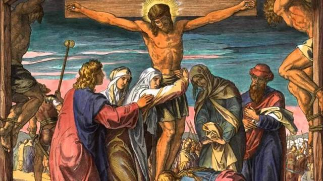

## 1747 | 再訪柏林，無憂宮(Sanssouci)

1747年，巴赫應邀前往柏林近郊的波茨坦（Potsdam）的無憂宮（Sanssouci），聆賞皇家音樂，也試奏了國王向他展示的新樂器——古鋼琴（fortepiano）。而巴赫素以即興演奏聞名，國王便給了他一段長而複雜的主題（Thema Regium），令他當場即興一首三聲部賦格；巴赫做到了，但國王又以六聲部賦格考驗他，巴赫告訴國王自己需要足夠的時間準備。有了這個動機，在巴赫回到萊比錫兩個月後，便出版了以國王的主題發展的一套器樂作品，就是著名的《音樂的奉獻》。此作包含一首三聲部賦格、一首六聲部賦格、十首卡農及一首四樂章的奏鳴曲。
圖片:無憂宮裡的室內樂。吹笛者為腓特烈大帝，彈琴者為C.P.E. 巴赫

## 1750-07-28 | 逝世@萊比錫Leipzig
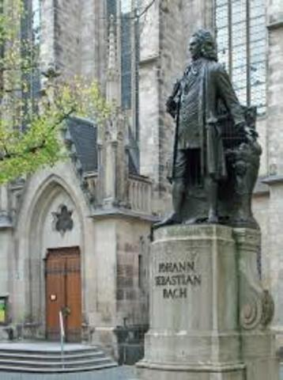
市議會至此對巴赫的死無動於衷，給予巴赫生前的評價極為普通。而巴赫卻意外地沒有留下遺囑，他死後房屋由九個在世的子女與遺孀安娜均分[14]。市議會當局似乎有意苛扣給付遺孀的救濟金，而似乎也只有C.P.E.巴赫在這段時間給予繼母安娜實質的幫助，提供J.C.巴赫（巴赫第11子）所需的教育。安娜從此在貧民救濟院度過餘生，直到1760年2月也隨巴赫而去[14]。