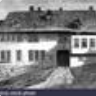
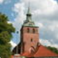
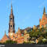
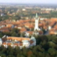
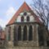
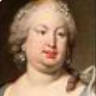
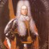

<!--
轉寫自 圖表\Bach.png。
原圖中部分文字被截斷，以下標「待補」處請自行補全：
- 「開始自力」「成為管風琴師」兩個時期的結束年為依色帶長度推估（1702、1707）
- 「威瑪時期」的結束年不在畫面內，暫填史實 1717
-->

# Periods
- 1685 ~ 1695 | 幼年1685~1695@埃森納赫(Eisenach)
- 1695 ~ 1700 | 音樂教育@奧德魯夫(Ohrdruf)
- 1700 ~ 1702 | 開始自力
- 1703 ~ 1707 | 成為管風琴師@阿恩施塔特(Arnstadt)
- 1708 ~ 1717 | 威瑪時期@Weimar

# Events

## 1685-03-21 | 出生

## 1700 | 呂內堡的聖馬可教堂

## 1701 | 從呂內堡步行30哩到漢堡，聆聽萊茵肯彈奏…

<!-- 待補：原圖標題被截斷 -->

## 1701 | 雪雷(Celle)宮廷

## 1703 | 阿恩施塔特的「巴哈教堂」

## 1707-10-17 | 首次結婚，堂姊瑪麗亞·芭芭拉，7個…

<!-- 待補：原圖標題被截斷 -->

## 1708 | 接受威瑪公爵邀請

