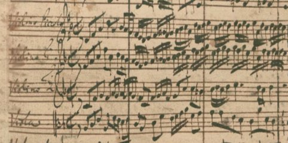
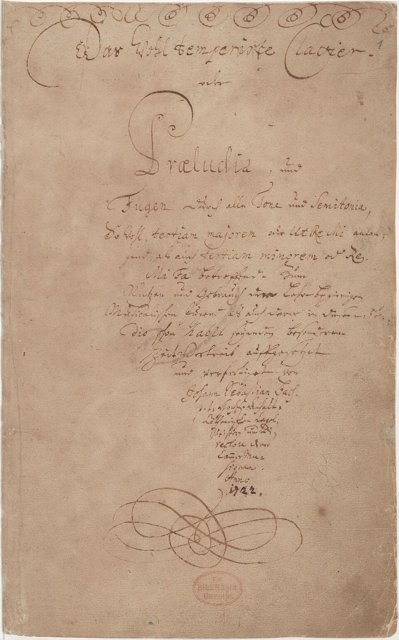
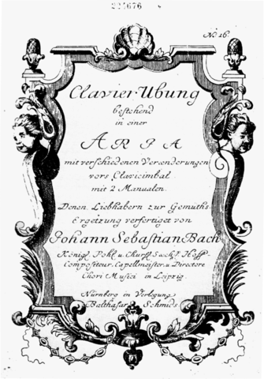
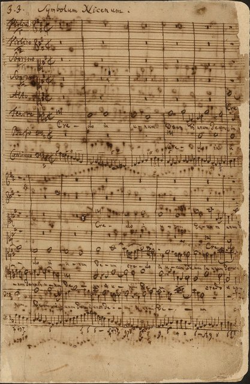
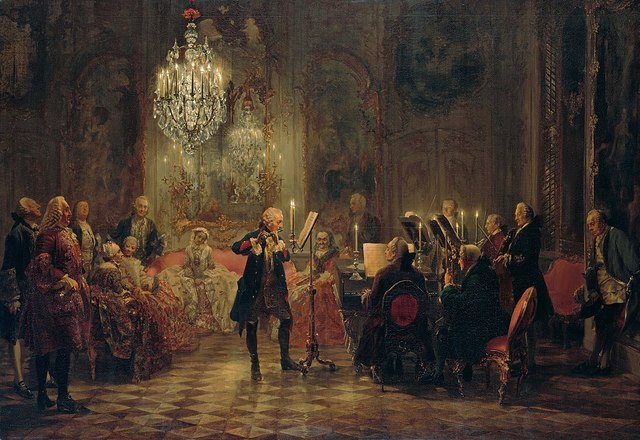

<!--
內容整理自本機筆記〈巴赫主要作品〉（D:\Books\md\音樂\巴赫主要作品.md，網頁版在知識圖譜的「5-2.音樂家作品」），做法比照「貝多芬主要作品」。
- 每首作品一則事件，日期採「創作時間」（多年創作的作品以區間呈現；「年代」以十年計、「世紀」以百年計，修訂或出版年份只寫在顯示文字裡），事件顏色依筆記的類別段落區分：管弦樂與協奏曲、管風琴作品、鍵盤音樂與大鍵琴作品、無伴奏小提琴與大提琴作品、宗教清唱劇、受難曲、神劇與彌撒曲、經典對位作品與晚期傑作、其他重要聖詠、經文歌與合唱作品。
- 「約」、「前後」、修訂、出版等不是單純年份的寫法，以原文作為顯示文字。
- 作品編號是目錄編號，不等於創作順序，時間軸依創作時間排序。
- 筆記沒有分期，時期沿用「巴赫生平」時間軸的主要時期（重疊的細分時期不列）。
- 筆記「最值得優先聆聽」清單中的作品另註明順序。
- 沒有年份、無法放上時間軸的條目未收錄：BWV 230 《讚美主，萬民哪》（年代與作者歸屬曾有討論）。
- 以 follows 排在「巴赫生平」之後；生平事件見該時間軸。
圖片來源（皆為 Wikimedia Commons 公有領域作品，多為手稿、初版樂譜與首演海報；封面為《平均律鍵盤曲集》第一冊手稿書名頁；註明「共用」者沿用生平時間軸的圖片）：
- bachw-brandenburg.jpg：Bach Brandenburg concerto 1 manuscript incipit violino piccolo.png（第一號《勃蘭登堡協奏曲》題獻手稿的開頭）
- bachw-wtc.jpg：Bach-wtc1-title-ms.jpg（《平均律鍵盤曲集》第一冊手稿書名頁，1722）
- bach-1741-goldberg.jpg（《哥德堡變奏曲》初版書名頁（與巴赫生平共用））
- bachw-mass.jpg：BWV 232 Credo in unum Deum.jpg（《B 小調彌撒曲》〈信經〉手稿，約1749）
- bach-1747-sanssouci.jpg（門采爾《腓特烈大帝在無憂宮的長笛演奏會》；《音樂的奉獻》的主題即出自腓特烈大帝（與巴赫生平共用））
-->

# Periods
- 1685 ~ 1695 | 幼年1685~1695@埃森納赫(Eisenach)
  德國中部圖林根州小城埃森納赫(Eisenach)
- 1695 ~ 1700 | 音樂教育@奧德魯夫(Ohrdruf)
  巴赫的母親死於1694年，他的父親也在8個月之後隨其母親而去。10歲的巴赫成為了孤兒，並住進了位於奧德魯夫的長兄約翰·克里斯多夫·巴赫（與叔叔同名，1671–1721）家裡。在這裡，他模仿、學習並演奏音樂；而他哥哥，一個職業教堂管風琴師，繼續給予他在埃森納赫便開始的音樂教育，他教導巴赫彈奏大鍵琴，以及其他樂器的基本演奏技巧，還曾帶他參觀鎮上教堂裝設新管風琴的過程，這種種對未來巴赫對器樂的造詣與熟稔有很大影響。
- 1700 ~ 1702 | 開始自力
  1700年3月，巴赫與他的好友厄德曼（Georg Erdmann）同行前往呂內堡。他在聖馬可教堂設立的拉丁語學校繼續學業，並參與教堂的音樂生活。學校裡同樣教授拉丁文、希臘文、邏輯、修辭學和神學。雖然唱詩班成員分到的零用金微薄，但巴赫靠著在婚喪典禮上獻唱及街頭表演的收入，還能勉強維持生活。 聖馬可教堂擁有華麗的建築與豐富的音樂資源。教堂的音樂圖書館裡典藏了自十六世紀中期以來豐富的手抄樂譜及印刷版本，曲目多達1,102首，包含175位作曲者。擁有如此可觀的樂作收藏，又有優秀的唱詩班，聖馬可發展出精緻的音樂傳統，巴赫在此既聽也唱，朝夕受教會音樂的薰陶；馬丁·路德創作的許多聖詠（chorale）後來給予巴赫創作的啟發並磨練了他和聲的技巧，而這種古老的音樂形式在巴赫未來無數的聲樂作品中得到改良與推廣。
- 1703 ~ 1707 | 成為管風琴師@阿恩施塔特(Arnstadt)
  1703年8月，他接受了在該教堂的風琴師的職位，這個工作體面但並不繁重，而且能得到一份不錯的薪水；然而雖然未在合約中載明，巴赫仍需兼任拉丁學校唱詩班的領唱者。 良好的環境和對音樂熱情的僱主並沒有緩解年輕的管風琴師和當局之間的緊張關係。巴赫顯然是對唱詩班的水平不滿，並缺乏成熟度解決相關的爭端，他甚至還與一個名叫蓋耶斯巴赫（Geyersbach）的巴松管手爆發肢體衝突，被寫在1705年8月的法庭記錄裡。更嚴重的是，1705年至1706年，他在未經允許的情況下拜訪了偉大的風琴師和作曲家迪特里克·布克斯特胡德，並參與他在北德呂貝克聖馬利亞教堂的音樂會。此次拜訪布克斯特胡德的旅行，來回需要各徒步約400公里，他請了30天的假，卻離職4個月，且未通知僱主，這成為他在1706年1月宗教法庭上被指控的「罪狀」之一。
- 1708 ~ 1717 | 威瑪時期@Weimar
  威廉·恩斯特公爵想聘巴赫擔任宮廷樂師及管風琴師，取代年老體衰的約翰·埃弗勒（Johann Effler），並為他寫作大量的禮拜音樂。巴赫在威瑪的地位不但崇高，且有充分空間發展他對「完善規範的教堂音樂」的想法。在威瑪的時日，巴赫還領導一批訓練有素的歌者和樂手，這是一個小型的巴洛克式樂團，而他自己則演奏小提琴帶領整個樂團，因此在作曲之餘還能培養指揮經驗。
- 1717 ~ 1723 | 科騰時期 Köthen
  巴赫在柯騰擔任宮廷樂長，即樂團指揮。此時期是巴赫一生中較未受干擾的時期，而從創作內容來看，巴赫已邁入他自己的成熟階段。
- 1723 ~ 1750 | 萊比錫時期@Leipzig

# Events

## 1718 ~ 1721 | BWV 1046 第一號《勃蘭登堡協奏曲》，F 大調 {color=#c92a2a label="約1718–1721"}

類別：大協奏曲（管弦樂與協奏曲）。

## 1718 ~ 1721 | BWV 1047 第二號《勃蘭登堡協奏曲》，F 大調 {color=#c92a2a label="約1718–1721"}
類別：大協奏曲（管弦樂與協奏曲）。

## 1718 ~ 1721 | BWV 1048 第三號《勃蘭登堡協奏曲》，G 大調 {color=#c92a2a label="約1718–1721"}
類別：大協奏曲（管弦樂與協奏曲）。入門推薦聆聽第 1 首。

## 1718 ~ 1721 | BWV 1049 第四號《勃蘭登堡協奏曲》，G 大調 {color=#c92a2a label="約1718–1721"}
類別：大協奏曲（管弦樂與協奏曲）。

## 1718 ~ 1721 | BWV 1050 第五號《勃蘭登堡協奏曲》，D 大調 {color=#c92a2a label="約1718–1721"}
類別：大協奏曲（管弦樂與協奏曲）。入門推薦聆聽第 6 首。

## 1718 ~ 1721 | BWV 1051 第六號《勃蘭登堡協奏曲》，降 B 大調 {color=#c92a2a label="約1718–1721"}
類別：大協奏曲（管弦樂與協奏曲）。

## 1717 ~ 1723 | BWV 1041 A 小調小提琴協奏曲 {color=#c92a2a label="約1717–1723"}
類別：小提琴協奏曲（管弦樂與協奏曲）。

## 1717 ~ 1723 | BWV 1042 E 大調小提琴協奏曲 {color=#c92a2a label="約1717–1723"}
類別：小提琴協奏曲（管弦樂與協奏曲）。

## 1717 ~ 1723 | BWV 1043 D 小調雙小提琴協奏曲 {color=#c92a2a label="約1717–1723"}
類別：雙小提琴協奏曲（管弦樂與協奏曲）。

## 1729 ~ 1740 | BWV 1044 A 小調三重協奏曲 {color=#c92a2a label="約1729–1740"}
類別：三重協奏曲（管弦樂與協奏曲）。

## 1738 ~ 1739 | BWV 1052 D 小調鍵盤協奏曲 {color=#c92a2a label="約1738–1739"}
類別：鍵盤協奏曲（管弦樂與協奏曲）。

## 1738 ~ 1739 | BWV 1053 E 大調鍵盤協奏曲 {color=#c92a2a label="約1738–1739"}
類別：鍵盤協奏曲（管弦樂與協奏曲）。

## 1738 ~ 1739 | BWV 1054 D 大調鍵盤協奏曲 {color=#c92a2a label="約1738–1739"}
類別：鍵盤協奏曲（管弦樂與協奏曲）。

## 1738 ~ 1739 | BWV 1055 A 大調鍵盤協奏曲 {color=#c92a2a label="約1738–1739"}
類別：鍵盤協奏曲（管弦樂與協奏曲）。

## 1738 ~ 1739 | BWV 1056 F 小調鍵盤協奏曲 {color=#c92a2a label="約1738–1739"}
類別：鍵盤協奏曲（管弦樂與協奏曲）。

## 1738 ~ 1739 | BWV 1058 G 小調鍵盤協奏曲 {color=#c92a2a label="約1738–1739"}
類別：鍵盤協奏曲（管弦樂與協奏曲）。

## 1724 ~ 1725 | BWV 1066 C 小調管弦樂組曲第一號 {color=#c92a2a label="約1724–1725"}
類別：管弦樂組曲（管弦樂與協奏曲）。

## 1738 ~ 1739 | BWV 1067 B 小調管弦樂組曲第二號 {color=#c92a2a label="約1738–1739"}
類別：管弦樂組曲（管弦樂與協奏曲）。

## 1730 ~ 1739 | BWV 1068 D 大調管弦樂組曲第三號 {color=#c92a2a label="約1730年代"}
類別：管弦樂組曲（管弦樂與協奏曲）。入門推薦聆聽第 9 首。

## 1725 ~ 1739 | BWV 1069 D 大調管弦樂組曲第四號 {color=#c92a2a label="約1725–1730年代"}
類別：管弦樂組曲（管弦樂與協奏曲）。

## 1730 ~ 1739 | BWV 1061 C 大調雙鍵盤協奏曲 {color=#c92a2a label="約1730年代"}
類別：雙鍵盤協奏曲（管弦樂與協奏曲）。

## 1730 ~ 1739 | BWV 1065 A 小調四鍵盤協奏曲 {color=#c92a2a label="約1730年代"}
類別：四鍵盤協奏曲（管弦樂與協奏曲）。

## 1700 ~ 1719 | BWV 565 D 小調《觸技曲與賦格》 {color=#1971c2 label="約1700年代至1710年代；年代與作者歸屬有爭議"}
類別：管風琴曲（管風琴作品）。入門推薦聆聽第 2 首。

## 1706 ~ 1713 | BWV 582 C 小調《帕薩卡利亞與賦格》 {color=#1971c2 label="約1706–1713"}
類別：管風琴曲（管風琴作品）。

## 1708 ~ 1717 | BWV 532 D 大調前奏曲與賦格 {color=#1971c2 label="約1708–1717"}
類別：管風琴曲（管風琴作品）。

## 1708 ~ 1717 | BWV 543 A 小調前奏曲與賦格 {color=#1971c2 label="約1708–1717"}
類別：管風琴曲（管風琴作品）。

## 1720 ~ 1729 | BWV 548 E 小調前奏曲與賦格 {color=#1971c2 label="約1720年代"}
類別：管風琴曲（管風琴作品）。

## 1710 ~ 1739 | BWV 541 G 大調前奏曲與賦格 {color=#1971c2 label="約1710–1730年代"}
類別：管風琴曲（管風琴作品）。

## 1708 ~ 1717 | BWV 564 C 大調觸技曲、慢板與賦格 {color=#1971c2 label="約1708–1717"}
類別：管風琴曲（管風琴作品）。

## 1710 ~ 1717 | BWV 622 《哦，人啊，為你的罪大哭吧》 {color=#1971c2 label="約1710–1717"}
類別：聖詠前奏曲（管風琴作品）。

## 1713 ~ 1716 | BWV 639 《我呼求祢，主耶穌基督》 {color=#1971c2 label="約1713–1716"}
類別：聖詠前奏曲（管風琴作品）。

## 1748 ~ 1749 | BWV 645–650 《許布勒聖詠》六首 {color=#1971c2 label="1748–1749前後出版"}
類別：聖詠改編（管風琴作品）。

## 1708 ~ 1750 | BWV 651–668 《十八首聖詠》 {color=#1971c2 label="約1708–1750，含不同時期作品"}
類別：聖詠前奏曲（管風琴作品）。

## 1722 | BWV 846–869 《平均律鍵盤曲集》第一卷 {color=#e67700 label="1722定稿"}
類別：前奏曲與賦格（鍵盤音樂與大鍵琴作品）。入門推薦聆聽第 4 首。

## 1740 ~ 1742 | BWV 870–893 《平均律鍵盤曲集》第二卷 {color=#e67700 label="約1740–1742"}
類別：前奏曲與賦格（鍵盤音樂與大鍵琴作品）。

## 1722 | BWV 846 C 大調前奏曲與賦格 {color=#e67700 label="1722前"}

類別：前奏曲與賦格（鍵盤音樂與大鍵琴作品）。入門推薦聆聽第 4 首。

## 1722 | BWV 847 C 小調前奏曲與賦格 {color=#e67700 label="1722前"}
類別：前奏曲與賦格（鍵盤音樂與大鍵琴作品）。

## 1722 | BWV 849 C 升小調前奏曲與賦格 {color=#e67700 label="1722前"}
類別：前奏曲與賦格（鍵盤音樂與大鍵琴作品）。

## 1722 | BWV 851 D 小調前奏曲與賦格 {color=#e67700 label="1722前"}
類別：前奏曲與賦格（鍵盤音樂與大鍵琴作品）。

## 1722 | BWV 859 E 小調前奏曲與賦格 {color=#e67700 label="1722前"}
類別：前奏曲與賦格（鍵盤音樂與大鍵琴作品）。

## 1722 | BWV 869 B 小調前奏曲與賦格 {color=#e67700 label="1722前"}
類別：前奏曲與賦格（鍵盤音樂與大鍵琴作品）。

## 1740 ~ 1742 | BWV 870 C 大調前奏曲與賦格 {color=#e67700 label="約1740–1742"}
類別：前奏曲與賦格（鍵盤音樂與大鍵琴作品）。

## 1740 ~ 1742 | BWV 881 F 小調前奏曲與賦格 {color=#e67700 label="約1740–1742"}
類別：前奏曲與賦格（鍵盤音樂與大鍵琴作品）。

## 1740 ~ 1742 | BWV 893 B 小調前奏曲與賦格 {color=#e67700 label="約1740–1742"}
類別：前奏曲與賦格（鍵盤音樂與大鍵琴作品）。

## 1741 ~ 1742 | BWV 988 《哥德堡變奏曲》 {color=#e67700}

類別：大鍵琴變奏曲（鍵盤音樂與大鍵琴作品）。入門推薦聆聽第 5 首。

## 1735 | BWV 971 《義大利協奏曲》F 大調 {color=#e67700}
類別：大鍵琴獨奏曲（鍵盤音樂與大鍵琴作品）。

## 1735 | BWV 831 《法國序曲》B 小調 {color=#e67700}
類別：大鍵琴組曲（鍵盤音樂與大鍵琴作品）。

## 1722 ~ 1725 | BWV 825–830 《六首法國組曲》 {color=#e67700 label="約1722–1725"}
類別：大鍵琴組曲（鍵盤音樂與大鍵琴作品）。

## 1715 ~ 1720 | BWV 806–811 《六首英國組曲》 {color=#e67700 label="約1715–1720"}
類別：大鍵琴組曲（鍵盤音樂與大鍵琴作品）。

## 1722 ~ 1725 | BWV 812–817 《六首法國組曲》 {color=#e67700 label="約1722–1725"}
類別：大鍵琴組曲（鍵盤音樂與大鍵琴作品）。

## 1741 ~ 1742 | BWV 988 《哥德堡變奏曲》中的詠嘆調與 30 段變奏 {color=#e67700}
類別：變奏曲（鍵盤音樂與大鍵琴作品）。入門推薦聆聽第 5 首。

## 1720 ~ 1729 | BWV 903 D 小調《半音階幻想曲與賦格》 {color=#e67700 label="約1720年代"}
類別：幻想曲與賦格（鍵盤音樂與大鍵琴作品）。

## 1720 ~ 1729 | BWV 904 A 小調幻想曲與賦格 {color=#e67700 label="約1720年代"}
類別：幻想曲與賦格（鍵盤音樂與大鍵琴作品）。

## 1730 ~ 1739 | BWV 1006a E 大調魯特琴／鍵盤改編組曲 {color=#e67700 label="約1730年代"}
類別：改編組曲（鍵盤音樂與大鍵琴作品）。

## 1720 | BWV 1001 G 小調小提琴奏鳴曲第一號 {color=#2f9e44 label="約1720"}
類別：無伴奏小提琴奏鳴曲（無伴奏小提琴與大提琴作品）。

## 1720 | BWV 1002 B 小調小提琴組曲／帕蒂塔第一號 {color=#2f9e44 label="約1720"}
類別：無伴奏小提琴帕蒂塔（無伴奏小提琴與大提琴作品）。

## 1720 | BWV 1003 A 小調小提琴奏鳴曲第二號 {color=#2f9e44 label="約1720"}
類別：無伴奏小提琴奏鳴曲（無伴奏小提琴與大提琴作品）。

## 1720 | BWV 1004 D 小調小提琴帕蒂塔第二號 {color=#2f9e44 label="約1720"}
類別：無伴奏小提琴帕蒂塔（無伴奏小提琴與大提琴作品）。

## 1720 | BWV 1005 C 大調小提琴奏鳴曲第三號 {color=#2f9e44 label="約1720"}
類別：無伴奏小提琴奏鳴曲（無伴奏小提琴與大提琴作品）。

## 1720 | BWV 1006 E 大調小提琴帕蒂塔第三號 {color=#2f9e44 label="約1720"}
類別：無伴奏小提琴帕蒂塔（無伴奏小提琴與大提琴作品）。

## 1717 ~ 1723 | BWV 1007 G 大調大提琴組曲第一號 {color=#2f9e44 label="約1717–1723"}
類別：無伴奏大提琴組曲（無伴奏小提琴與大提琴作品）。入門推薦聆聽第 3 首。

## 1717 ~ 1723 | BWV 1008 D 小調大提琴組曲第二號 {color=#2f9e44 label="約1717–1723"}
類別：無伴奏大提琴組曲（無伴奏小提琴與大提琴作品）。

## 1717 ~ 1723 | BWV 1009 C 大調大提琴組曲第三號 {color=#2f9e44 label="約1717–1723"}
類別：無伴奏大提琴組曲（無伴奏小提琴與大提琴作品）。

## 1717 ~ 1723 | BWV 1010 降 E 大調大提琴組曲第四號 {color=#2f9e44 label="約1717–1723"}
類別：無伴奏大提琴組曲（無伴奏小提琴與大提琴作品）。

## 1717 ~ 1723 | BWV 1011 C 小調大提琴組曲第五號 {color=#2f9e44 label="約1717–1723"}
類別：無伴奏大提琴組曲（無伴奏小提琴與大提琴作品）。

## 1717 ~ 1723 | BWV 1012 D 大調大提琴組曲第六號 {color=#2f9e44 label="約1717–1723"}
類別：無伴奏大提琴組曲（無伴奏小提琴與大提琴作品）。

## 1707 ~ 1708 | BWV 4 《基督躺在死亡的枷鎖中》 {color=#862e9c label="約1707–1708，後修訂"}
類別：復活節清唱劇（宗教清唱劇）。

## 1714 | BWV 12 《哭泣、哀嘆、憂愁、恐懼》 {color=#862e9c}
類別：教會清唱劇（宗教清唱劇）。

## 1713 ~ 1714 | BWV 21 《我心中有許多憂愁》 {color=#862e9c label="約1713–1714，後修訂"}
類別：教會清唱劇（宗教清唱劇）。

## 1731 | BWV 29 《我們感謝祢，上帝》 {color=#862e9c}
類別：市議會就職清唱劇（宗教清唱劇）。

## 1730 | BWV 51 《歡呼上帝，普世皆主》 {color=#862e9c label="約1730"}
類別：女高音清唱劇（宗教清唱劇）。

## 1714 | BWV 61 《來吧，外邦人的救主》 {color=#862e9c}
類別：降臨節清唱劇（宗教清唱劇）。

## 1724 ~ 1739 | BWV 80 《堅固保障是我們的上帝》 {color=#862e9c label="約1724–1730年代，版本有差異"}
類別：宗教清唱劇（宗教清唱劇）。

## 1727 | BWV 82 《我已足夠》 {color=#862e9c}
類別：低音獨唱清唱劇（宗教清唱劇）。

## 1707 ~ 1708 | BWV 106 《上帝的時刻是最美好的時刻》 {color=#862e9c label="約1707–1708"}
類別：葬禮清唱劇（宗教清唱劇）。

## 1731 | BWV 140 《醒來吧，有聲音在呼喚我們》 {color=#862e9c}
類別：教會清唱劇（宗教清唱劇）。

## 1723 | BWV 147 《心靈與口舌、行為與生命》 {color=#862e9c}
類別：教會清唱劇（宗教清唱劇）。入門推薦聆聽第 8 首。

## 1714 | BWV 182 《天上的王，歡迎祢》 {color=#862e9c}
類別：棕枝主日／宗教節日清唱劇（宗教清唱劇）。

## 1727 | BWV 198 《悼念女王》 {color=#862e9c}
類別：世俗葬禮頌歌（宗教清唱劇）。

## 1713 | BWV 208 《狩獵清唱劇》 {color=#862e9c}
類別：世俗清唱劇（宗教清唱劇）。

## 1734 ~ 1735 | BWV 211 《咖啡清唱劇》 {color=#862e9c label="約1734–1735"}
類別：世俗喜劇清唱劇（宗教清唱劇）。

## 1742 | BWV 212 《農民清唱劇》 {color=#862e9c}
類別：世俗清唱劇（宗教清唱劇）。

## 1727 | BWV 244 《馬太受難曲》 {color=#0c8599 label="1727，1736年前後修訂"}
類別：受難曲（受難曲、神劇與彌撒曲）。入門推薦聆聽第 7 首。

## 1724 | BWV 245 《約翰受難曲》 {color=#0c8599 label="1724，後多次修訂"}
類別：受難曲（受難曲、神劇與彌撒曲）。

## 1734 ~ 1735 | BWV 248 《聖誕神劇》 {color=#0c8599}
類別：神劇（受難曲、神劇與彌撒曲）。

## 1725 | BWV 249 《復活節神劇》 {color=#0c8599 label="1725，後修訂"}
類別：神劇（受難曲、神劇與彌撒曲）。

## 1748 ~ 1749 | BWV 232 《B 小調彌撒曲》 {color=#0c8599 label="約1748–1749完成整體版本；部分樂章源自早期作品"}

類別：彌撒曲（受難曲、神劇與彌撒曲）。入門推薦聆聽第 10 首。

## 1738 ~ 1739 | BWV 233 F 大調彌撒曲 {color=#0c8599 label="約1738–1739"}
類別：彌撒曲（受難曲、神劇與彌撒曲）。

## 1738 ~ 1739 | BWV 234 A 大調彌撒曲 {color=#0c8599 label="約1738–1739"}
類別：彌撒曲（受難曲、神劇與彌撒曲）。

## 1738 ~ 1739 | BWV 235 G 小調彌撒曲 {color=#0c8599 label="約1738–1739"}
類別：彌撒曲（受難曲、神劇與彌撒曲）。

## 1738 ~ 1739 | BWV 236 G 大調彌撒曲 {color=#0c8599 label="約1738–1739"}
類別：彌撒曲（受難曲、神劇與彌撒曲）。

## 1723 | BWV 243 《D 大調聖母頌歌》 {color=#0c8599 label="約1723，1733年修訂"}
類別：聖母頌歌（受難曲、神劇與彌撒曲）。

## 1735 | BWV 11 《升天神劇》 {color=#0c8599}
類別：神劇（受難曲、神劇與彌撒曲）。

## 1738 | BWV 30 《歡欣吧，蒙救贖的群眾》 {color=#0c8599 label="1738前後"}
類別：教會清唱劇（受難曲、神劇與彌撒曲）。

## 1747 | BWV 1079 《音樂的奉獻》 {color=#5f3dc4}

類別：對位作品集（經典對位作品與晚期傑作）。入門推薦聆聽第 11 首。

## 1740 ~ 1750 | BWV 1080 《賦格的藝術》 {color=#5f3dc4 label="約1740年代至1750，未完全完成"}
類別：賦格與卡農（經典對位作品與晚期傑作）。入門推薦聆聽第 12 首。

## 1740 ~ 1749 | BWV 769 《音樂的奉獻》以外的《聖詠變奏曲》：Vom Himmel hoch {color=#5f3dc4 label="約1740年代"}
類別：聖詠卡農變奏（經典對位作品與晚期傑作）。

## 1747 | BWV 1076 《六聲部卡農》 {color=#5f3dc4}
類別：卡農（經典對位作品與晚期傑作）。

## 1740 ~ 1750 | BWV 1087 《哥德堡變奏曲》主題低音的 14 首卡農 {color=#5f3dc4 label="1740年代至1750前後"}
類別：卡農（經典對位作品與晚期傑作）。

## 1740 ~ 1750 | BWV 1085 《啊，主耶穌基督，我們聚集在祢面前》相關聖詠作品 {color=#5f3dc4 label="18世紀中葉"}
類別：聖詠作品（經典對位作品與晚期傑作）。

## 1730 ~ 1739 | BWV 225 《來吧，耶穌，來吧》 {color=#a61e4d label="約1730年代"}
類別：經文歌（其他重要聖詠、經文歌與合唱作品）。

## 1731 | BWV 226 《聖靈降臨，充滿我們的心》 {color=#a61e4d}
類別：經文歌（其他重要聖詠、經文歌與合唱作品）。

## 1723 | BWV 227 《耶穌，我的喜悅》 {color=#a61e4d label="約1723"}
類別：經文歌（其他重要聖詠、經文歌與合唱作品）。

## 1720 ~ 1729 | BWV 228 《你不要悲傷》 {color=#a61e4d label="約1720年代"}
類別：經文歌（其他重要聖詠、經文歌與合唱作品）。

## 1720 ~ 1729 | BWV 229 《讚美主》 {color=#a61e4d label="約1720年代"}
類別：經文歌（其他重要聖詠、經文歌與合唱作品）。

## 1700 ~ 1750 | BWV 478 《耶穌是我喜樂》相關聖詠歌曲 {color=#a61e4d label="18世紀"}
類別：聖詠歌曲（其他重要聖詠、經文歌與合唱作品）。
