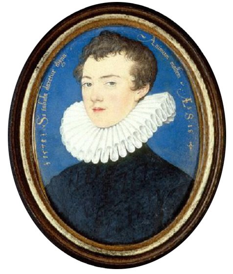
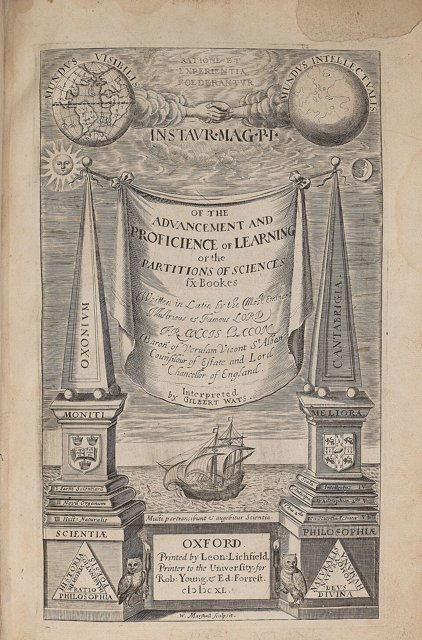
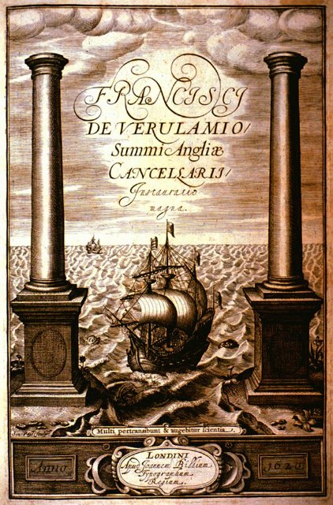
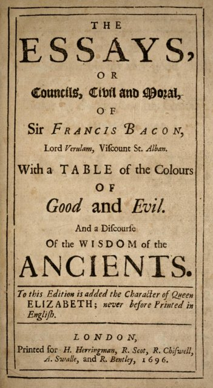
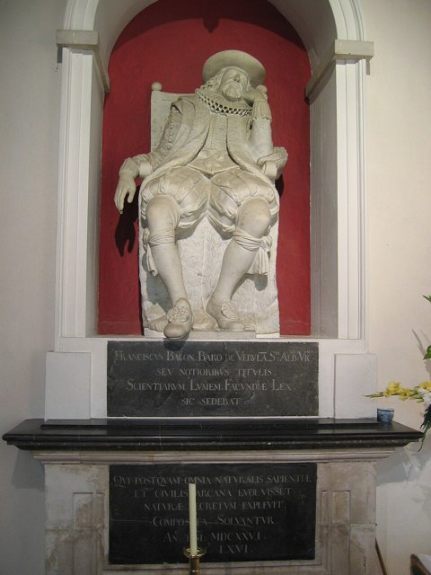

<!--
內容整理自本機筆記〈培根生平大事記（1561–1626）〉（圖表\培根生平大事記（1561–1626）.md）與中文維基百科「弗朗西斯·培根」條目（CC BY-SA 4.0），以台灣用語改寫摘要。
https://zh.wikipedia.org/zh-tw/弗朗西斯·培根
史料與日期說明：
- 你提供的網址「培根」在中文維基百科指的是醃燻豬肉（煙肉），改讀人物條目「弗朗西斯·培根」；該條目篇幅很短，生平細節主要依筆記與一般公認的史實補充。
- 宣示「以一切知識為己任」的信：筆記寫1591年，一般認為是1592年寫給姨丈伯利勳爵的信，此處採1592年。
- 維基百科寫《論說文集》於1624年出版；最後的增訂版實際上是1625年出版，此處依此。
- 1618年1月7日就任大法官時，他還沒過57歲生日，時間軸以日期計算為56歲。
- 《新亞特蘭提斯》：筆記寫1626年身後出版，一般說法是1627年由秘書羅利附在《林木集》中出版，此處併入最後一則事件說明。
- 死因：維基百科與傳統說法都採用奧布里《名人小傳》的記載——在雪中用雪填塞雞隻做冷藏實驗而受寒；這則故事的細節真實性有學者質疑，文中已註明是傳說。
- 1576年進入格雷律師學院、1601年起訴艾塞克斯伯爵、1616年進入樞密院、1621年1月封子爵、罰款四萬英鎊與短暫囚禁倫敦塔、英國皇家學會以他為精神導師等細節，係依一般公認的史實補充。
圖片來源（皆為 Wikimedia Commons 公有領域／CC0 作品）：
- bac-cover.jpg：Francis Bacon, Viscount St Alban from NPG (2).jpg
- bac-young.jpg：18-year old Francis Bacon.jpg
- bac-advance.jpg：Advancement of learning.jpg
- bac-somer.jpg：Somer Francis Bacon.jpg
- bac-ship.jpg：Bacon Great Instauration frontispiece.jpg
- bac-essays.jpg：Bacon Essays 1696.jpg
- bac-grave.jpg：20040912-001-francis-bacon.jpg
-->

# Periods
- 1561 ~ 1579 | 宮廷重臣之子 | #1c7ed6
  生於伊莉莎白一世的掌璽大臣之家，12歲進入劍橋大學，對亞里斯多德式的經院學問感到不滿；少年時隨大使出使法國，父親去世後返國。
- 1579 ~ 1603 | 律師與議員的漫長等待 | #f08c00
  在格雷律師學院成為律師，長年擔任下議院議員，立志改革人類知識；投靠艾塞克斯伯爵卻始終得不到伊莉莎白一世的重用，最後還得親自起訴這位恩主。
- 1603 ~ 1621 | 詹姆士一世朝的仕途巔峰 | #2f9e44
  新王即位後步步高升，從副檢察總長、檢察總長一路做到大法官，同時出版《學術的進展》與《新工具》。
- 1621 ~ 1626 | 失勢後的著述 | #495057
  因受賄案被國會彈劾，罷官後專心著述，完成歷史、自然史與知識論的著作，最後在一次冷凍實驗後病逝。

# Events

## 1561-01-22 | 出生@倫敦
生於倫敦河岸街的約克府，是父親尼古拉斯·培根的么子。父親是伊莉莎白一世的掌璽大臣；母親安妮·庫克精通拉丁文與希臘文，是當時少見的博學女性，她的姊夫正是女王的首席重臣伯利勳爵。他從小就出入宮廷，據說伊莉莎白一世很喜歡這個早慧的孩子，稱他為「小掌璽大臣」。

## 1573-04 | 進入劍橋大學三一學院
12歲和哥哥安東尼一起進入劍橋大學三一學院，學習拉丁文、希臘文、邏輯與修辭。當時的大學以亞里斯多德的哲學與經院式辯論為主，他後來回憶，正是在劍橋時就開始厭惡這種「只會爭辯、不會產出成果」的學問。

## 1576-09 | 隨大使出使法國

先進入倫敦的格雷律師學院註冊，隨即跟隨英國駐法大使波萊特前往巴黎，在法國待了約兩年半，見識歐洲的政治、外交與法律制度，也到過布盧瓦、圖爾、普瓦捷等地。

## 1579-02 | 父親去世
父親突然去世，他匆忙返回英國。身為么子，他只分到很少的遺產，此後一輩子都為債務所苦，必須靠自己在法律與政壇上闖出一條路。

## 1581 | 當選下議院議員
首次當選下議院議員，此後近四十年間多次代表不同選區進入國會，以辯才著稱。1593年他在國會反對女王要求的特別稅，觸怒了伊莉莎白一世，仕途因此停滯多年。

## 1582-06 | 取得律師資格
在格雷律師學院取得出庭律師資格，之後成為學院的講師與主管。法律是他謀生的本業，也是他踏入政壇的階梯。

## 1592 | 「以一切知識為己任」
在寫給姨丈伯利勳爵的信中宣示：「我已把一切知識都當作我的領域。」他希望掃除空泛的爭辯與盲目的實驗，用新的方法研究自然，帶來「有益的發明與發現」。這個改革人類知識的志向，貫穿了他往後的一生。這時他已投靠女王的寵臣艾塞克斯伯爵，希望藉其力量取得官職。

## 1597 | 《隨筆集》初版
出版第一版《隨筆集》，只有十篇簡短的文章，後來不斷增訂。在同年的拉丁文著作《沉思集》中，他寫下「知識本身就是力量」，這句話後來被濃縮成家喻戶曉的「知識就是力量」。

## 1601-02 | 起訴艾塞克斯伯爵
艾塞克斯伯爵出征愛爾蘭失敗後失寵，1601年2月率眾在倫敦起事，隨即失敗被捕。培根以女王法律顧問的身分參與起訴昔日的恩主，伯爵被判叛國罪處死。這件事讓他背上忘恩負義的罵名，他後來寫了一篇《辯白書》為自己辯護。

## 1603-07 | 詹姆士一世即位，受封爵士
伊莉莎白一世去世，蘇格蘭國王詹姆士六世繼承英格蘭王位，成為詹姆士一世。培根積極向新王示好，在加冕前後與另外三百多人一起受封為爵士，仕途終於出現轉機。

## 1605 | 《學術的進展》

出版第一部重要的哲學著作《學術的進展》，獻給詹姆士一世。他盤點人類知識的現況與缺漏，把學問分成歷史（記憶）、詩（想像）與哲學（理性）三大類，主張學術應該累積、合作，並以增進人類福祉為目的。這套知識分類後來被法國的《百科全書》所沿用。

## 1606-05 | 與愛麗絲·巴納姆結婚
45歲時與倫敦富商之女、年僅十四歲的愛麗絲·巴納姆結婚，兩人沒有子女。

## 1607 | 出任副檢察總長
出任副檢察總長，正式進入王室法律體系的核心。兩年後出版《古人的智慧》，藉由解讀希臘神話來闡述他的哲學觀點。

## 1613-10 | 升任檢察總長
升任檢察總長，1616年又進入樞密院，成為國王身邊的重要顧問；他也懂得依附國王的寵臣白金漢公爵，以確保自己的地位。

## 1617-03 | 出任掌璽大臣

出任掌璽大臣，與父親當年的職位相同。

## 1618-01-07 | 出任英格蘭大法官
升任英格蘭大法官，達到仕途的頂峰，同年7月受封維魯拉姆男爵。大法官主掌全國的衡平法院，是司法體系中地位最高的職位。

## 1620-10 | 《新工具》

出版拉丁文巨著《偉大的復興》的第一部分《新工具》，書名刻意針對亞里斯多德的邏輯著作《工具論》。他指出人類認識自然時容易陷入四種「假象」——種族假象（人類共同的偏誤）、洞穴假象（個人的偏見）、市場假象（語言的混淆）與劇場假象（盲從權威學說）——並主張透過系統的觀察、實驗，蒐集正反例證、逐步排除錯誤解釋的歸納法來發現自然規律。書的扉頁畫著一艘船駛出象徵已知世界盡頭的海克力斯之柱，象徵知識的新航程。

## 1621-05 | 受賄案與失勢
1月才受封聖奧爾本子爵，5月就被國會指控在擔任大法官期間收受訴訟當事人的禮物。當時法官收禮是普遍的陋習，國會的攻擊背後也有針對國王與寵臣的政治鬥爭，但他坦承收禮、放棄辯護，被判罰四萬英鎊、囚禁倫敦塔、永遠不得擔任公職。實際上他只在倫敦塔待了幾天，罰款也被國王豁免，但政治生涯就此結束。他說：「我是五十年來最公正的法官，但這是兩百年來國會最公正的判決。」

## 1622 | 《亨利七世史》
退居鄉間，專心寫作，出版《亨利七世史》，被視為英國近代史學的早期名著；同時陸續寫作《風的歷史》《生與死的歷史》等自然史，實踐他蒐集事實的研究計畫。

## 1623 | 《論學術的尊嚴與增進》
把《學術的進展》擴充並譯成拉丁文，出版《論學術的尊嚴與增進》，讓他的知識改革構想傳遍歐洲學界。

## 1625 | 《隨筆集》增訂版

出版最後一版《隨筆集》，篇數擴充到五十八篇，論讀書、友誼、真理、權力與死亡，文筆精煉，成為英語散文的經典。其中〈論讀書〉的名句「讀史使人明智，讀詩使人靈秀，數學使人周密……」流傳至今。

## 1626-04-09 | 逝世@海格特

據奧布里的記載，那年早春他在倫敦北郊的雪地裡突發奇想，買了一隻雞、親手把雪塞進雞的體內，想實驗低溫能否保存肉類，因此受寒，被送到附近海格特的阿倫德爾伯爵宅邸休養，幾天後死於肺炎，享年65歲（這段故事細節是否屬實仍有爭議）。他死後，秘書整理出版了未完成的烏托邦小說《新亞特蘭提斯》，描繪一座以科學研究機構「所羅門之宮」為核心的理想島嶼。1660年成立的英國皇家學會把他奉為精神導師，他倡導的實驗與合作研究，深深影響了洛克、牛頓與法國百科全書派。
