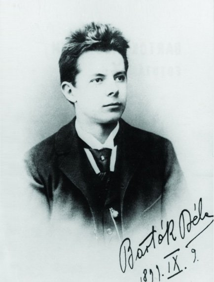
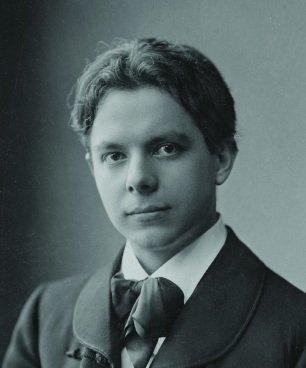
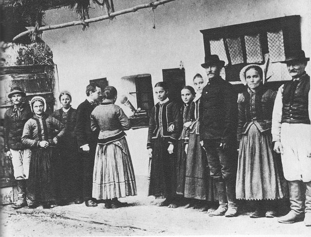
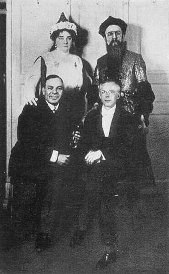
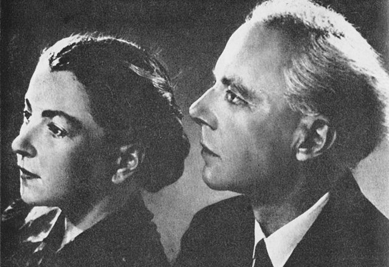

<!--
內容整理自中文維基百科「巴爾托克·貝拉」與英文維基百科「Béla Bartók」條目（CC BY-SA 4.0），並以台灣用語改寫摘要。
https://zh.wikipedia.org/zh-tw/巴托克·贝拉
https://en.wikipedia.org/wiki/Béla_Bartók
中文條目較簡略，生平細節主要參考英文條目。兩者不一致處以英文條目為準（例如父親去世時他的年紀，中文條目作8歲，英文條目作7歲）。
《科蘇特》、《藍鬍子城堡》、《木刻王子》、《奇異的滿大人》、《弦樂、打擊樂與鋼片琴的音樂》、《管弦樂協奏曲》等作品的首演日期，條目未完整記載，係依一般公認的史實補充。
圖片皆為 Wikimedia Commons 上的公有領域（含PD-US）作品（封面：1927年的肖像照）。
-->

# Periods
- 1881 ~ 1899 | 童年與少年
  生於匈牙利王國東南部的小鎮，母親是鋼琴教師，很早就發現他的音樂天分。7歲喪父，隨母親輾轉搬遷，最後在波佐尼（今布拉提斯拉瓦）第一次接觸大城市的音樂生活。
- 1899 ~ 1908 | 布達佩斯：從浪漫派到民歌
  在布達佩斯皇家音樂學院學鋼琴與作曲，結識終生摯友高大宜。早期作品受理查·史特勞斯影響，1904年偶然聽到農家保母唱民歌，從此投入民間音樂的研究，並受德布西的音樂啟發。
- 1908 ~ 1940 | 民歌採集者與現代主義者@Budapest
  在李斯特音樂學院任教近三十年，帶著留聲機走遍喀爾巴阡盆地、北非與土耳其採集民歌。歌劇《藍鬍子城堡》、芭蕾《奇異的滿大人》、六首弦樂四重奏，讓他成為20世紀最重要的作曲家之一。
- 1940 ~ 1945 | 流亡美國@New York
  強烈反對納粹，二次大戰爆發後流亡紐約。他在美國不受重視、病痛纏身，卻在罹患白血病後寫出最受歡迎的《管弦樂協奏曲》，1945年病逝紐約。

# Events

## 1881-03-25 | 出生@納吉聖米克洛什
生於匈牙利王國巴納特地區的小鎮納吉聖米克洛什（1920年後劃歸羅馬尼亞，今稱桑尼古勞馬雷）。父系是匈牙利的低階貴族，父親也叫貝拉，是農業學校校長，熱愛音樂；母親寶拉是鋼琴教師。據母親說，他在還不會說完整句子時，就能分辨她彈的各種舞曲節奏。

## 1885 | 4歲就會彈40首曲子
4歲已能在鋼琴上彈奏40首曲子，隔年母親開始正式教他鋼琴。

## 1888 | 父親猝逝
7歲時父親突然過世，母親帶著他和妹妹先搬到納吉瑟勒什（今烏克蘭維諾赫拉迪夫），後來又搬到波佐尼（今斯洛伐克首都布拉提斯拉瓦）。

## 1892 | 11歲首次公開演出
在納吉瑟勒什舉行第一場公開演奏會，樂評反應很好，曲目中還有他兩年前寫的第一首作品〈多瑙河的流程〉。不久後，作曲家埃凱爾·費倫茨的兒子埃凱爾·拉斯洛收他為學生。

## 1899 | 進入布達佩斯皇家音樂學院

跟李斯特的學生托曼學鋼琴，跟克斯勒學作曲，並結識了作曲家高大宜，兩人成為終生的摯友與夥伴。據中文條目，他鋼琴技巧出色，曾在校內演奏李斯特的鋼琴奏鳴曲。

## 1902 | 理查·史特勞斯的衝擊
在布達佩斯聽了理查·史特勞斯《查拉圖斯特拉如是說》的首演，並見到作曲家本人，史特勞斯的音樂深深影響了他的早期作品。

## 1904-01-13 | 交響詩《科蘇特》首演

他的第一部大型管弦樂作品，向1848年匈牙利革命英雄科蘇特致敬，風格仍帶有布拉姆斯與史特勞斯的影子。

## 1904 | 聽見農家保母唱歌
夏天在度假勝地，他無意間聽到來自外西凡尼亞的年輕保母莉迪·多薩唱民歌給孩子聽，從此一生投入民間音樂的研究。

## 1907 | 李斯特音樂學院鋼琴教授；德布西的啟發
成為李斯特音樂學院的鋼琴教授，不必再到歐洲各地巡演。學生包括後來的指揮家萊納、蕭提等人。高大宜從巴黎帶回德布西的作品，讓他深受啟發。

## 1908 | 與高大宜下鄉採集民歌；第一號弦樂四重奏

兩人深入鄉間採集古老的匈牙利民歌，發現這些曲調建立在與中亞、安那托利亞、西伯利亞民間音樂相近的五聲音階上，而不是過去被當成「匈牙利音樂」的吉普賽音樂（例如李斯特的《匈牙利狂想曲》）。同年寫成帶有民歌元素的第一號弦樂四重奏，也開始寫收錄80首民歌的鋼琴曲集《給孩子們》。

## 1909 | 與瑪塔結婚
28歲的他與16歲的瑪塔·齊格勒結婚，隔年兒子小貝拉出生。他從小受天主教教育，成年後成了無神論者，1916年改信一位論派；兒子說他「熱愛大自然，總是帶著敬畏談論自然奇妙的秩序」，他也收藏了大量昆蟲標本。

## 1911 | 唯一的歌劇《藍鬍子城堡》
獻給妻子瑪塔，以象徵手法描寫潛意識的動機與命運。他把它送去參加匈牙利美術委員會的比賽，卻被以「不適合上演」為由退件。失望的他此後兩三年很少作曲，專心採集與整理民歌。

## 1913 | 阿爾及利亞的民歌之旅
他用留聲機錄下大量蠟筒，民歌採集範圍從匈牙利、斯洛伐克、羅馬尼亞、保加利亞，一路擴展到摩爾達維亞、瓦拉幾亞，1913年更遠赴北非的阿爾及利亞。民俗學家稱他是「20世紀上半葉最偉大的田野採集者之一」。一次大戰爆發後，他被迫中止採集。

## 1917-05-12 | 芭蕾《木刻王子》首演
戰爭期間他回頭作曲，寫下受德布西影響的芭蕾《木刻王子》與第二號弦樂四重奏，首演頗為成功。

## 1918-05-24 | 《藍鬍子城堡》首演

修改結尾後終於首演。1919年他積極參與匈牙利革命，革命失敗後，霍爾蒂政權逼他從歌劇上拿掉劇作家巴拉日的名字，因為巴拉日是猶太人、已被列入黑名單並流亡維也納。從此他雖然熱愛匈牙利人民與文化，卻始終對政府沒什麼忠誠。

## 1923 | 離婚再娶迪塔

與瑪塔結婚近15年後離婚，兩個月後娶了19歲的鋼琴學生迪塔·帕斯托莉，從求婚到結婚只隔十天，當時他42歲。1924年兒子彼得出生。

## 1926-11-27 | 《奇異的滿大人》在科隆首演
1918年就開始寫的芭蕾，受史特拉汶斯基、荀白克與理查·史特勞斯影響，因為故事的情色內容，直到1926年才在德國科隆首演，隨即引發醜聞而遭禁演。據中文條目，它和鋼琴曲《粗野的快板》都被稱為當時最令聽眾厭惡的作品。

## 1927 | 巴塞隆納之旅
3月在巴塞隆納與卡薩爾斯管弦樂團合作演出，也對當地的薩達納舞曲與傳統樂器很感興趣。1927至1928年間寫下第三、第四號弦樂四重奏，此後進入成熟風格。

## 1933 | 拒絕在德國演出
納粹上台後，他拒絕在德國舉行音樂會，也和德國的出版商斷絕往來。他強烈的反法西斯立場，讓他與匈牙利當局的關係愈來愈緊張。

## 1936 | 土耳其的民歌採集
到土耳其與作曲家賽貢合作，主要在阿達納一帶採集研究土耳其民歌。今天安卡拉國立音樂院前，他的胸像就立在賽貢的胸像旁。

## 1937-01-21 | 《弦樂、打擊樂與鋼片琴的音樂》首演
在瑞士巴塞爾首演，是他成熟期的代表作。1939年他又寫下《弦樂嬉遊曲》與最後一首弦樂四重奏第六號。

## 1939 | 母親去世
與他感情深厚的母親寶拉去世。據中文條目，這個打擊加上後來在異鄉的孤獨，讓他晚年更加困頓。

## 1940-10 | 流亡美國
二次大戰爆發後歐洲局勢惡化，匈牙利又加入軸心國，他決定離開。10月4日他在遺囑中要求：只要匈牙利還有以墨索里尼或希特勒命名的廣場，就不准以他的名字命名任何廣場或街道。他先把手稿送出國，再與妻子迪塔從里斯本搭船，10月底抵達紐約。

## 1941 | 哥倫比亞大學的研究員
哥倫比亞大學提供每年三千美元的研究獎助，他和迪塔整理學校圖書館收藏的大批塞爾維亞與克羅埃西亞民歌。他在美國以鋼琴家、民族音樂學家與教師聞名，作曲家的身分卻不太受重視，音樂會邀約也不多。他自尊心很強，常拒絕朋友的金錢資助。

## 1942 | 病痛開始
前一年年底右肩開始僵硬，1942年症狀加重，常常發燒。醫生起初以為是他年輕時得過的肺結核復發，卻檢查不出病因。

## 1944-04 | 確診白血病
病情確診時已幾乎無法治療。身體逐漸衰弱的他卻重新湧現創作力，部分要歸功於小提琴家西格蒂和他的學生、指揮家萊納的奔走。這一年他也應曼紐因委託寫下無伴奏小提琴奏鳴曲。

## 1944-12-01 | 《管弦樂協奏曲》首演
應指揮家庫塞維茲基委託而寫，由波士頓交響樂團首演，好評如潮，很快成為他最受歡迎的作品。

## 1945 | 入籍美國；最後的作品
在去世前不久成為美國公民，卻始終沒有在美國找到歸屬感。他為妻子迪塔42歲生日偷偷準備的禮物——優雅近乎新古典風格的第三號鋼琴協奏曲，只差最後的配器就完成了；中提琴協奏曲則只留下獨奏聲部與草稿。

## 1945-09-26 | 逝世@紐約
因白血病併發症在紐約的醫院去世，享年64歲，距離迪塔的生日只差一個多月。葬禮只有十個人參加。他最初安葬在紐約州哈茨代爾的芬克里夫公墓。學生塞爾利後來補完了第三號鋼琴協奏曲與中提琴協奏曲。

## 1946-02-08 | 第三號鋼琴協奏曲首演
由他的學生、鋼琴家山多爾擔任獨奏首演。迪塔後來也演奏並錄製了這首丈夫送給她的協奏曲。

## 1988-07-07 | 遷葬布達佩斯
匈牙利政府與他的兩個兒子提出請求，將他的遺骸移回祖國，在國葬後安葬於布達佩斯的法卡什雷蒂公墓，與1982年去世的迪塔同眠。今天他與李斯特並稱匈牙利最偉大的作曲家。
