<!--
內容整理自中文維基百科「路德維希·范·貝多芬」條目（CC BY-SA 4.0），並以台灣用語改寫摘要。
https://zh.wikipedia.org/zh-tw/路德維希·范·貝多芬
時期劃分參考條目中蘭茲（1855）的早期、盛期、晚期三分法。
圖片皆為 Wikimedia Commons 上的公有領域作品（封面：約瑟夫·卡爾·施蒂勒 1820 年所繪肖像）。
-->

# Periods
- 1770 ~ 1792 | 波昂時期@Bonn
  祖父是科隆選帝侯宮廷的樂長，父親是唱詩班男高音。父親酗酒、脾氣暴躁，想把他培養成莫札特那樣的神童，教琴時動輒打罵。後來改隨內費學習，打下紮實基礎；母親過世後，年輕的貝多芬挑起養家的重擔。
- 1792 ~ 1802 | 早期：初到維也納
  隨海頓學習，又向申克、阿爾布雷希茨貝格與薩列里請益。起初生活拮据，靠在貴族沙龍演奏與教琴謀生，逐漸以鋼琴家身分打響名號。作品仍帶有海頓、莫札特的古典風格，但耳疾也在此時出現。
- 1802 ~ 1816 | 盛期：英雄時期
  以《英雄》交響曲為轉捩點，正式告別古典風格。創作力旺盛，寫出《命運》、《田園》、《皇帝》鋼琴協奏曲、小提琴協奏曲、《熱情》奏鳴曲與《拉祖莫夫斯基》四重奏等名作。
- 1815 ~ 1820 | 姪子監護權訴訟
  弟弟卡斯帕去世後，貝多芬與弟媳約翰娜為爭奪姪子卡爾的監護權纏訟多年，最後勝訴，但叔姪關係始終不好。這幾年他創作量銳減，健康與財務都不理想，是一生的低谷。
- 1816 ~ 1827 | 晚期
  聽力完全喪失，只能靠「談話冊」與人溝通。作品規模宏大、形式難以預測，情感卻更內斂深邃，包括最後三首鋼琴奏鳴曲、《莊嚴彌撒》、第九號交響曲與晚期弦樂四重奏。

# Events

## 1770-12-16 | 出生@波昂
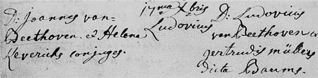
出生於科隆選侯國首府波昂，隔天（12月17日）受洗。祖籍是今日比利時的梅赫倫，姓氏中的「范」（van）只是標示家鄉，並不代表貴族身分。

## 1778 | 8歲在科隆首次登台
父親以莫札特為榜樣，嚴厲逼他練琴，常在深夜把他叫起來為朋友演奏。11歲時因家中經濟困難而輟學。

## 1781 | 師事內費
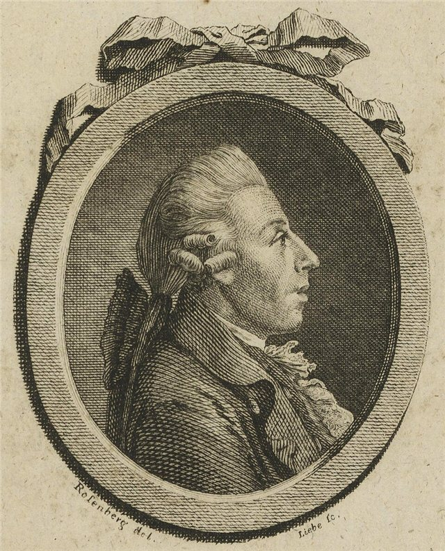
隨宮廷樂隊指揮內費學習鋼琴與作曲，並向里斯學小提琴。內費要他研讀巴赫的《平均律鍵盤曲集》與莫札特的作品，並撰文預言他將成為「莫札特第二」。

## 1782 | 第一部出版作品
在內費協助下出版《以戴斯勒先生一首進行曲為主題的變奏曲》。次年代表內費出任宮廷樂隊的鍵盤手。

## 1787-01 | 赴維也納求見莫札特；母親去世
帶著科隆大主教的推薦信前往維也納，想向莫札特學習。據傳莫札特聽了他的即興演奏後大為讚賞，但並無可靠紀錄證明兩人見過面。不久接到母親病危的消息趕回波昂，母親隨後去世，他從此負起照顧兩個弟弟的責任。

## 1790 | 《約瑟夫二世悼念清唱劇》
為悼念皇帝約瑟夫二世而寫，這是他第一部與政治有關的作品，當時並未上演。途經波昂的海頓看過後大加讚賞，並建議送他到維也納深造。

## 1792-11-10 | 抵達維也納，隨海頓學習
三週後正式到海頓處上課，直到1794年海頓再赴倫敦。師徒性格不合，他從海頓那裡究竟學到多少，後人看法不一。同年12月，父親在波昂去世。

## 1795 | 維也納首場公開音樂會
親自擔任降B大調第二號鋼琴協奏曲的獨奏，演出成功，樂評稱讚他的演奏充滿火花與深邃的情感。

## 1796 | 巡演布拉格、柏林；耳疾初現
巡迴布拉格、布達佩斯、萊比錫與柏林，事業逐漸起飛。但此時開始出現耳鳴，是日後失聰的先兆。

## 1799 | 《悲愴》奏鳴曲
c小調第八號鋼琴奏鳴曲，是他最早受到大眾歡迎的作品之一，題獻給贊助人利赫諾夫斯基侯爵。

## 1800 | 第一號交響曲；《春天》奏鳴曲
完成C大調第一號交響曲、c小調第三號鋼琴協奏曲與F大調第五號小提琴奏鳴曲《春天》（標題並非貝多芬自己取的）。

## 1801 | 《月光》奏鳴曲
升c小調第十四號鋼琴奏鳴曲，題獻給鋼琴學生尤麗葉·圭恰迪，傳聞兩人不只是師生關係。

## 1802 | 《聖城遺書》
到維也納郊區的聖城（海利根施塔特）療養耳疾，情緒陷入谷底，寫下一封給兄弟的信，透露曾有輕生的念頭，只因音樂與使命感才撐了下來。這封信直到他死後才被發現。同時期完成的第二號交響曲卻意氣風發，全無陰霾。

## 1803 | 第二號交響曲首演
同年獲聘為維也納河畔劇院的駐院作曲家，並開始創作下一部交響曲。

## 1804 | 《英雄》交響曲
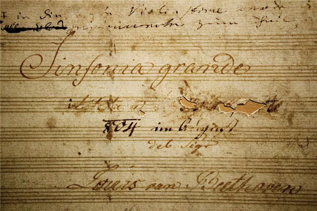
原本題名獻給拿破崙，但拿破崙稱帝後，貝多芬憤而把手稿上的題獻劃掉。這部長約45分鐘的交響曲是他創作的轉捩點，1805年首演，1806年以「為紀念一位偉人而作」的標題出版。同時期還有《華德斯坦》與《熱情》奏鳴曲。

## 1806 | 第四號交響曲、《拉祖莫夫斯基》四重奏、小提琴協奏曲
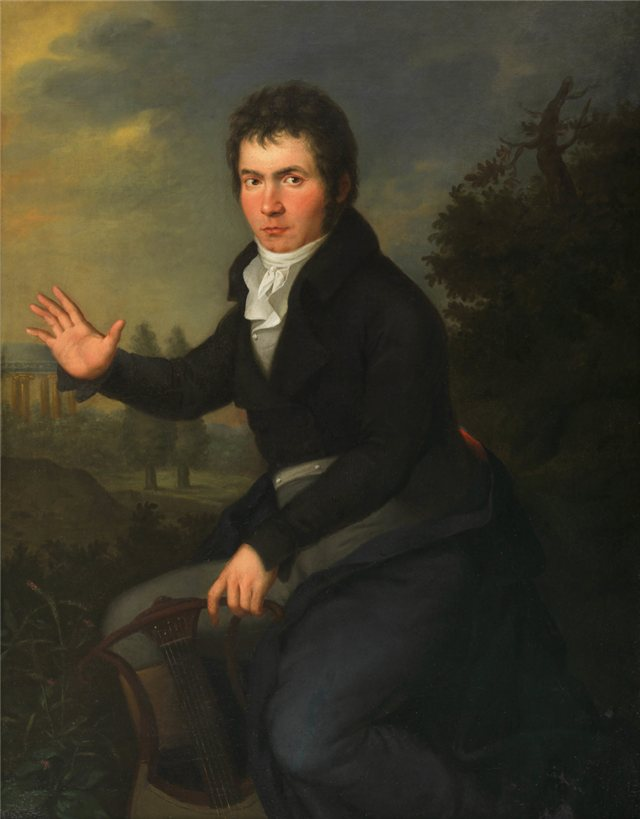
被舒曼形容為「兩位北歐巨人之間的苗條希臘少女」的第四號交響曲，以及獻給俄國大使的三首四重奏、D大調小提琴協奏曲都在這一年問世。他在四重奏草稿上寫道，不必再對藝術掩飾自己的耳聾。

## 1808-12-22 | 傳奇的馬拉松音樂會
在維也納河畔劇院長達4小時的音樂會中，同時首演第五號交響曲《命運》、第六號交響曲《田園》、第四號鋼琴協奏曲與《合唱幻想曲》。

## 1809 | 《皇帝》鋼琴協奏曲；《艾格蒙特》配樂
完成最後一首鋼琴協奏曲（降E大調第五號），並為歌德的劇作《艾格蒙特》譜寫配樂。

## 1810 | 《致愛麗絲》
這首耳熟能詳的鋼琴小品約作於1808至1810年間。同年5月，他放棄了與特蕾澤公主結合的希望。

## 1812-07 | 在特普利采會見歌德；「永恆的愛人」之信
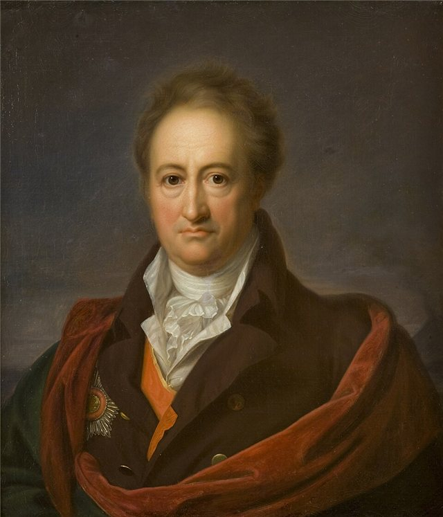
在溫泉鄉特普利采與歌德會面。也在此寫下一封以「我的天使，我的一切，我的我」開頭、寄給「永恆的愛人」的熱情信件，收信人是誰至今仍是謎。

## 1813-12-08 | 第七號交響曲與《威靈頓的勝利》首演
為慶祝威靈頓擊敗法軍而寫的《威靈頓的勝利》在慈善音樂會中大受歡迎，同場首演的第七號交響曲當時只被當成陪襯，日後卻被華格納譽為「舞蹈的神化」。

## 1815-01-25 | 最後一次以鋼琴家身分登台
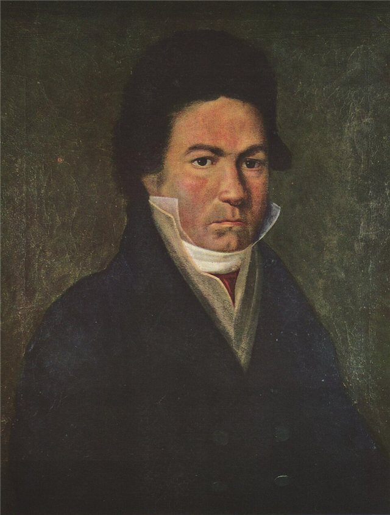
在宮廷音樂會中為自己的歌曲《阿德萊德》伴奏，此後因聽力衰退不再公開演奏。

## 1815-11-15 | 弟弟卡斯帕去世
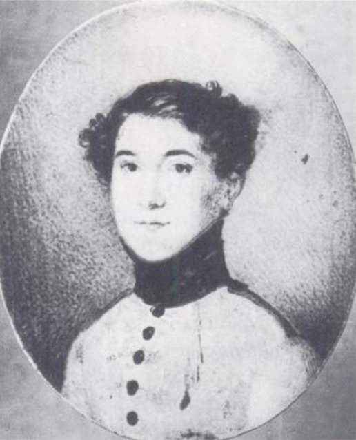
為了爭奪姪子卡爾的監護權，貝多芬與弟媳約翰娜展開漫長的訴訟，直到1820年才勝訴。

## 1818 | 《槌子鍵鋼琴奏鳴曲》；開始使用談話冊
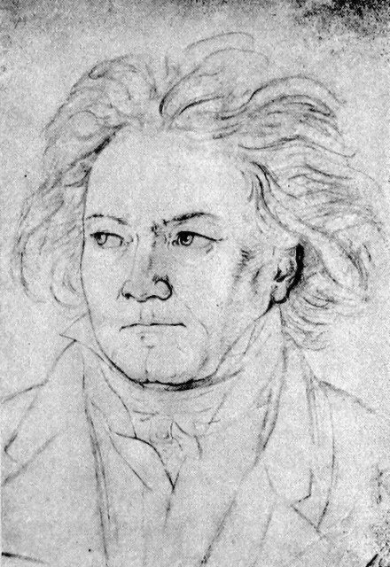
降B大調第二十九號奏鳴曲標誌著新一輪創作的開始。同年起他需要靠「談話冊」與人交談，這些筆記也成為後人研究他的重要史料。

## 1824-04-07 | 《莊嚴彌撒》聖彼得堡首演
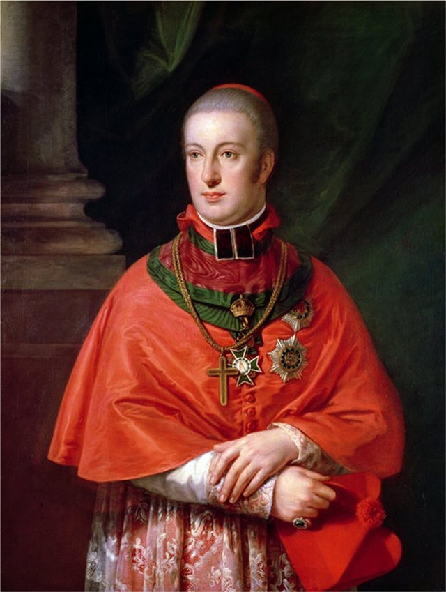
原為魯道夫大公就任大主教而寫，費時四年才完成。貝多芬多次表示這是他最偉大的作品，生前在維也納只演出過其中三段。

## 1824-05-07 | 第九號交響曲維也納首演
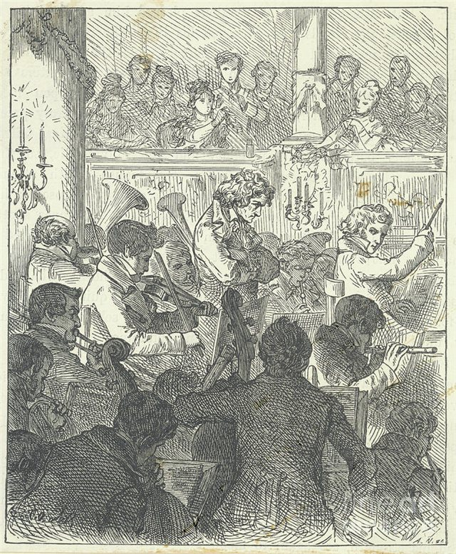
在卡特納托劇院首演，由烏姆勞夫指揮，已全聾的貝多芬坐在台上提示各樂章速度。終樂章首度在交響曲中加入人聲，唱出席勒的《歡樂頌》，演出盛況空前。

## 1826 | 最後的弦樂四重奏；姪子自殺未遂
集中精力完成最後五首弦樂四重奏與《大賦格》，第十六號四重奏是他的遺作。姪子卡爾企圖自殺未遂，之後離開叔叔去從軍，對貝多芬打擊極大。

## 1827-03-26 | 逝世@維也納
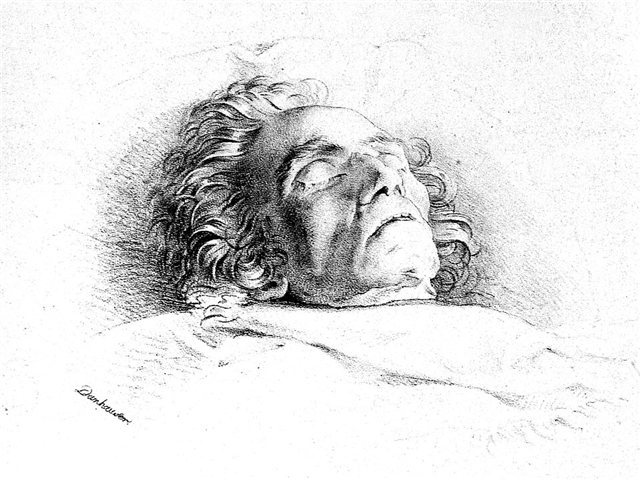
年底旅行途中感染肺炎，加上原本的肝病，健康急速惡化，於傍晚5點45分去世，享年56歲。據說臨終時雷電交加，他突然睜眼向空中舉起拳頭。

## 1827-03-29 | 葬禮
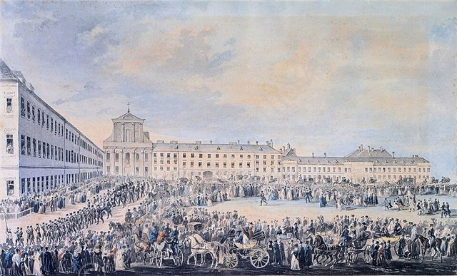
據說有上萬名維也納市民出席，當局出動軍警維持秩序，舒伯特也是抬棺人之一。他先葬於維令根墓園，1888年遷葬至維也納中央公墓舒伯特墓旁。
