<!--
內容整理自中文維基百科「埃克托·白遼士」與英文維基百科「Hector Berlioz」條目（CC BY-SA 4.0），並以台灣用語改寫摘要。
https://zh.wikipedia.org/zh-tw/埃克托·白遼士
https://en.wikipedia.org/wiki/Hector_Berlioz
中文條目較簡略，生平細節主要參考英文條目。
圖片皆為 Wikimedia Commons 上的公有領域作品（封面：皮耶·珀蒂1863年所攝）。
-->

# Periods
- 1803 ~ 1821 | 童年@拉科特聖安德烈
  父親是開明的鄉村醫生，在家親自教育他。他讀維吉爾《埃涅阿斯紀》讀到落淚，學了直笛、長笛和吉他，卻從沒學過鋼琴。12歲時愛上18歲的鄰居艾絲黛兒，這份初戀伴隨他一生。
- 1821 ~ 1826 | 醫學生@Paris
  遵從父命到巴黎讀醫，卻對解剖課深感厭惡。他把父親給的生活費花在歌劇院與音樂學院圖書館，聽了格魯克的歌劇後立志作曲，並拜勒蘇爾為師。1824年醫學院畢業後放棄行醫，父親因此縮減生活費。
- 1826 ~ 1830 | 巴黎音樂學院
  正式進入音樂學院，隨勒蘇爾學作曲、雷哈學對位與賦格。這段期間他迷上莎士比亞、貝多芬與歌德，也瘋狂追求女演員哈莉葉·史密森，四度挑戰羅馬大獎。
- 1830 ~ 1832 | 羅馬大獎@Rome
  以康塔塔贏得羅馬大獎，寫成《幻想交響曲》，隨後依規定到羅馬梅迪奇別墅進修。他不喜歡羅馬，但義大利的風景與陽光深深影響了他日後的作品。
- 1832 ~ 1842 | 巴黎：作曲家與樂評家
  與哈莉葉結婚，靠撰寫樂評維持生計。這十年寫出《哈洛德在義大利》、《安魂曲》、《羅密歐與茱麗葉》等重要作品，歌劇《班韋努托·切利尼》卻慘敗，帕格尼尼的兩萬法郎贈禮讓他得以喘息。
- 1842 ~ 1854 | 巡迴歐洲的指揮家
  在巴黎難以靠音樂會獲利，轉往國外巡演，在德國、俄國、英國都大受歡迎。婚姻破裂後與歌手瑪麗·雷奇奧同居；《浮士德的天譴》在巴黎失利，讓他負債累累。
- 1854 ~ 1863 | 《特洛伊人》與晚期作品
  哈莉葉去世後與雷奇奧結婚。《基督的童年》意外受到歡迎，之後花兩年寫成史詩歌劇《特洛伊人》，再花五年設法讓它上演。1858年當選法蘭西學會院士。
- 1863 ~ 1869 | 晚年
  《特洛伊人》只能拆半上演且被一再刪減，此後他幾乎不再作曲。妻子、姊妹與獨子相繼離世，他陷入憂鬱，健康也日漸衰退。

# Events

## 1803-12-11 | 出生@拉科特聖安德烈
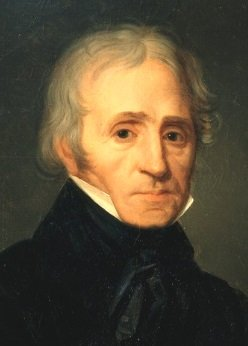
生於法國東南部伊澤爾省的拉科特聖安德烈，是醫生路易·白遼士的長子。父親思想開明，據說是第一位實際施行並撰文介紹針灸的歐洲人；母親則是虔誠嚴格的天主教徒。六個孩子中有三個夭折，兩個妹妹南希與阿德萊德一生都和他很親近。

## 1815 | 初戀艾絲黛兒
12歲的他愛上18歲的鄰居艾絲黛兒，被大人當成孩子氣的迷戀取笑，但這份感情他記了一輩子。他把無處傾訴的心意寫進早年的習作，並自己讀和聲學專書摸索作曲。

## 1821-09 | 到巴黎讀醫
3月在格勒諾勃通過中學會考，9月以17歲之齡到巴黎大學醫學院就讀。他極力克服對解剖屍體的反感，同時把父親給的豐厚生活費花在歌劇院。到巴黎三週後看了格魯克的《陶里斯的伊菲珍妮》，從此確信自己的志向是作曲。

## 1822 | 拜勒蘇爾為師
在醫學課之餘常到巴黎音樂學院圖書館抄寫格魯克的總譜，年底拜皇家禮拜堂樂長、音樂學院教授勒蘇爾為私人老師。

## 1823-08 | 第一篇樂評
投書《海盜報》為法國歌劇辯護，聲稱羅西尼的所有歌劇加起來，也比不上格魯克、斯蓬蒂尼或勒蘇爾的幾小節。這是他一生大量音樂評論的開端。

## 1824 | 放棄醫學；《莊嚴彌撒》
從醫學院畢業後放棄行醫，父母強烈反對，父親縮減甚至停止給他生活費，讓他過了幾年拮据的日子。同年寫成《莊嚴彌撒》，演出兩次後他宣稱已銷毀總譜，直到1991年才在比利時安特衛普被重新發現。

## 1826-08 | 進入巴黎音樂學院
隨勒蘇爾學作曲、雷哈學對位與賦格。同年首次挑戰羅馬大獎，第一輪就被淘汰。這一兩年也寫了第一部歌劇《祕密法官》，只有序曲流傳下來。

## 1827-09 | 莎士比亞與哈莉葉·史密森
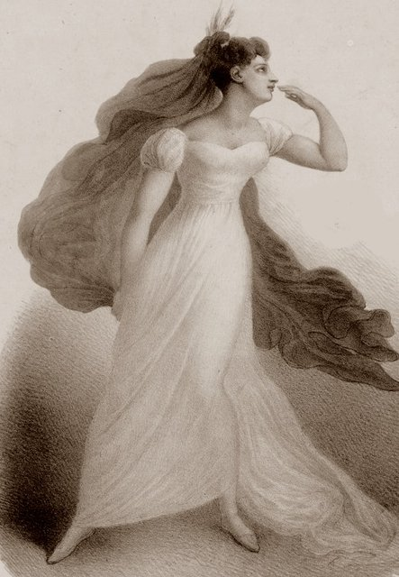
在奧德翁劇院看了英國劇團演出的《哈姆雷特》與《羅密歐與茱麗葉》，雖然幾乎不懂英文仍深受震撼，從此終身熱愛莎士比亞。他也瘋狂愛上飾演女主角的愛爾蘭女演員哈莉葉·史密森，苦苦追求多年，她卻連見面都不肯。

## 1828-05 | 第一場個人作品音樂會
朋友指揮首演他的《祕密法官》、《威弗利》序曲等作品。聽眾不多，他還賠了錢，但演奏者與在場的老師、作曲家奧柏、埃洛爾德都熱烈喝采。這一年他開始學英文以閱讀莎士比亞原文，也聽到貝多芬的交響曲、讀到歌德的《浮士德》。

## 1830-07 | 贏得羅馬大獎
七月革命爆發時他正趕寫參賽的康塔塔《薩達納帕勒之死》，據他回憶，寫完最後幾頁時流彈正打在窗外牆上。前一年的參賽作被保守的評審認為「傾向危險」，這次他刻意收斂風格，終於第四次挑戰成功。

## 1830-12-05 | 《幻想交響曲》首演
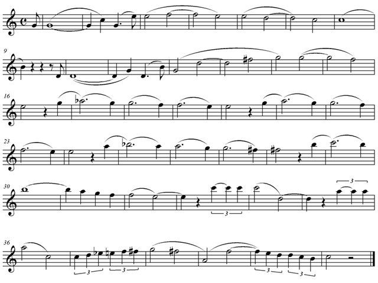
副標題是「一位藝術家生涯中的插曲」，帶有自傳色彩，以「固定樂思」貫穿全曲代表他心中理想化的哈莉葉，被視為華格納「主導動機」的先驅。首演掌聲不斷，傳記作者認為這場音樂會是現代管弦樂團發展的里程碑。李斯特也在場，兩人從此成為好友，李斯特後來還把整首交響曲改編成鋼琴曲。這時他已轉而與年輕鋼琴家瑪麗·莫克訂婚。

## 1831 | 羅馬梅迪奇別墅
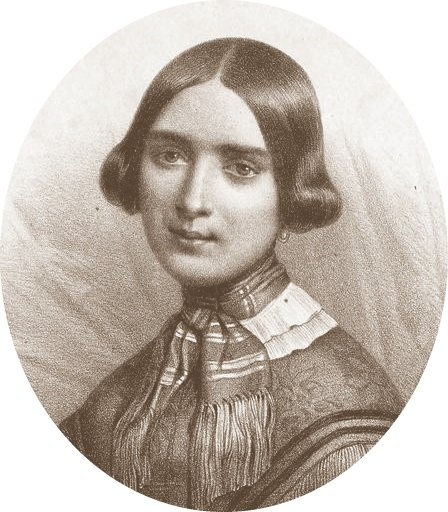
依羅馬大獎規定到羅馬進修。到達不到三週就得知未婚妻瑪麗·莫克毀婚改嫁鋼琴廠繼承人普雷耶爾，他準備了毒藥、手槍和女裝，打算回巴黎殺了他們，走到尼斯才打消念頭。他在尼斯寫了《李爾王》序曲，也在羅馬與孟德爾頌結識。

## 1832-12-09 | 音樂會後終於結識哈莉葉
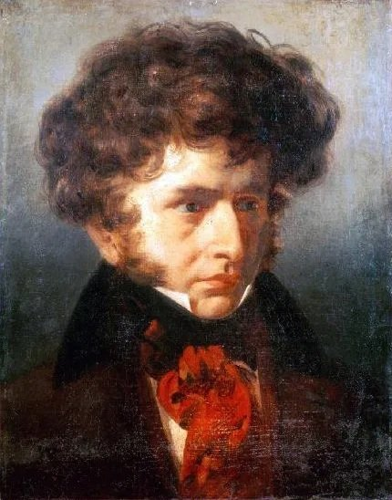
從義大利回到巴黎後舉辦音樂會，演出修訂後的《幻想交響曲》與續篇《重返生命》（後改名《萊利奧》）。李斯特、蕭邦、帕格尼尼，以及大仲馬、雨果、海涅、喬治·桑等名流都到場，他也透過第三人邀請了哈莉葉。這場音樂會讓兩人終於見面。

## 1833-10-03 | 與哈莉葉結婚
哈莉葉的演藝事業此時已走下坡，負債累累。兩人不顧雙方家庭強烈反對，在巴黎的英國大使館結婚，婚後先住巴黎，後搬到當時還是鄉村的蒙馬特。婚姻起初很幸福，但哈莉葉始終沒學好法文，演藝與社交生活都受到很大限制。

## 1834-08-14 | 獨子路易出生
這是他唯一的孩子。父子後來感情非常深厚。

## 1834-11 | 《哈洛德在義大利》首演
帕格尼尼得到一把史特拉第瓦里中提琴，看了《幻想交響曲》後請他寫一首曲子。他寫成以中提琴為主角的交響曲，靈感來自拜倫的長詩與他在義大利山區的漫遊，但帕格尼尼嫌獨奏部分「太少事可做」，首演改由別人擔任。同一年起他為《音樂報》與《辯論報》撰寫樂評，這份工作他做得出色卻非常厭惡。

## 1837-12 | 《安魂曲》首演
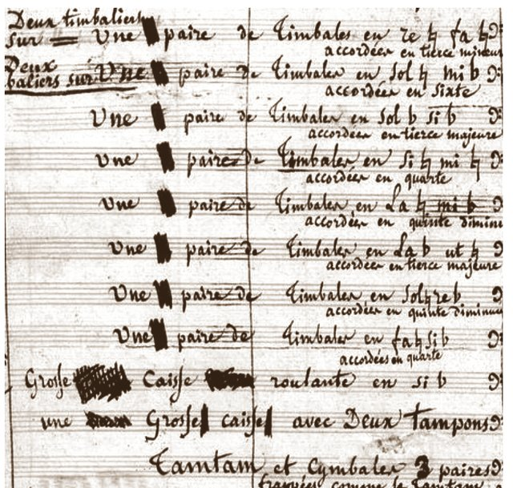
受法國政府委託，在巴黎傷兵院首演。這部作品當時沒帶給他多少收入或名聲，他卻最珍惜它：如果所有作品只能保留一部，他會為《安魂曲》求情。

## 1838-09 | 歌劇《班韋努托·切利尼》失敗
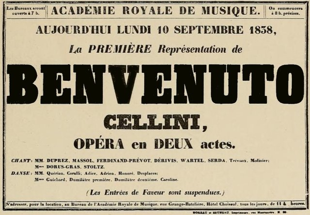
花了三年寫成的歌劇技巧艱難、歌劇本薄弱，歌手也不合作，總共只完整演出四場。他說這次失敗讓巴黎歌劇院的大門從此對他關上，事實也大致如此。

## 1838-12 | 帕格尼尼的兩萬法郎
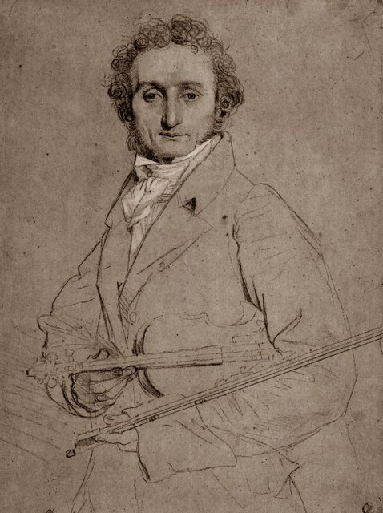
他指揮《哈洛德在義大利》大獲成功，帕格尼尼當場上台向他下跪、親吻他的手，幾天後又寄來兩萬法郎。這筆錢讓他還清夫妻倆的債務，暫時放下樂評工作專心作曲。

## 1839-11 | 《羅密歐與茱麗葉》首演
為獨唱、合唱與管弦樂團所寫的「戲劇交響曲」，反應熱烈到又連演兩場。年輕的華格納在台下聽得大受震撼，日後寫《崔斯坦與伊索德》時也受到它的啟發。這一年他也獲任命為音樂學院圖書館副館長，並獲頒榮譽軍團勳章。

## 1840-07 | 《葬禮與凱旋大交響曲》
政府為七月革命十週年委託的作品，由他親自在戶外指揮演出。

## 1841 | 《夏夜》與瑪麗·雷奇奧
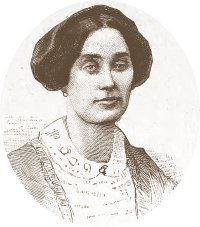
完成以好友戈蒂耶六首詩寫成的歌曲集《夏夜》，日後改編為管弦樂版。巴黎歌劇院委託他改編韋伯的《魔彈射手》。同年歌手瑪麗·雷奇奧成為他的情人，哈莉葉愈來愈猜忌，健康惡化並開始酗酒。

## 1842-09 | 開始國外巡迴演出
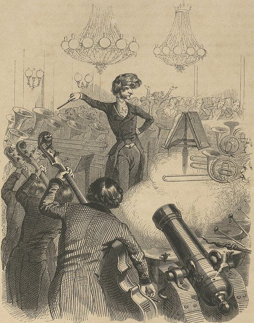
先在布魯塞爾舉辦兩場音樂會，接著1842到1843年在德國十二個城市巡演，大獲好評。他在萊比錫與孟德爾頌、舒曼見面，在德勒斯登見到華格納，在柏林見到梅耶貝爾。當時的漫畫常拿他龐大喧鬧的樂團編制開玩笑，把他畫成指揮大砲的樂隊指揮。

## 1843 | 出版《配器法》
以先前在《音樂報》連載的配器文章為基礎寫成，是這個領域第一本、也是最重要的專書，影響了19、20世紀許多作曲家。他曾說，配器之於音樂，就像色彩之於繪畫。

## 1844 | 《羅馬狂歡節》序曲；與哈莉葉分居
寫出兩首最受歡迎的短篇作品：沿用《切利尼》音樂的《羅馬狂歡節》序曲，以及《海盜》序曲。年底與哈莉葉分居，哈莉葉留在蒙馬特，他搬去和雷奇奧同住，兒子被送到盧昂的寄宿學校。

## 1846-12 | 《浮士德的天譴》在巴黎失利
根據歌德《浮士德》寫成的「戲劇傳奇」，樂評雖好，劇院卻只坐滿一半。高度浪漫的題材不合時宜，演出失敗讓他負債沉重。

## 1847 | 俄國巡演；第一次到英國
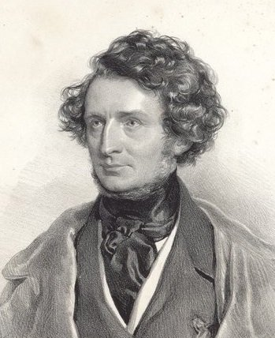
第一次到俄國巡演，收入豐厚，還清了債務。年底起在倫敦停留七個多月，觀眾反應熱烈，卻因經紀人經營不善而沒賺到錢。

## 1848 | 父親去世；哈莉葉中風
父親在這年去世。他9月回到巴黎後不久，哈莉葉多次中風幾乎癱瘓，需要專人看護，費用由他負擔，他在巴黎時常常一天去看她兩次。

## 1851 | 擔任倫敦萬國博覽會評審
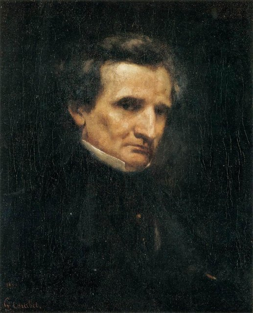
以國際評審團成員身分評選樂器。1852、1853年又回倫敦指揮，大多很成功。李斯特也在1852年於威瑪重新推出修訂版《切利尼》。

## 1854-03 | 哈莉葉去世
他和兒子路易在她去世前不久都曾去探望她。同年他與同居十多年的瑪麗·雷奇奧結婚，並撰寫回憶錄。

## 1854-12 | 《基督的童年》首演
這部「宗教三部曲」從1850年開始創作，首演受到熱烈歡迎，連他自己都很意外。

## 1856 | 開始寫《特洛伊人》
在德國巡演時，李斯特與他的伴侶卡洛琳公主鼓勵他把維吉爾的《埃涅阿斯紀》寫成歌劇，呼應他童年讀這部史詩時的感動。他自己撰寫劇本，在指揮工作之間花了兩年完成。

## 1858 | 當選法蘭西學會院士
終於得到他追求已久的榮譽，雖然他表面上淡化此事。同年完成《特洛伊人》，之後五年都在設法讓它上演。

## 1862-06 | 瑪麗·雷奇奧去世
第二任妻子48歲猝逝，她的母親從此照顧白遼士直到他過世。

## 1862-08 | 《碧雅翠斯與班尼迪克》首演
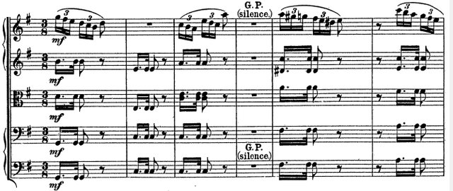
他的最後一部歌劇，改編自莎士比亞的喜劇《無事生非》，在德國巴登－巴登首演成功，卻沒能成為歌劇院的常備劇目。

## 1863-11 | 《特洛伊人》只能拆半上演
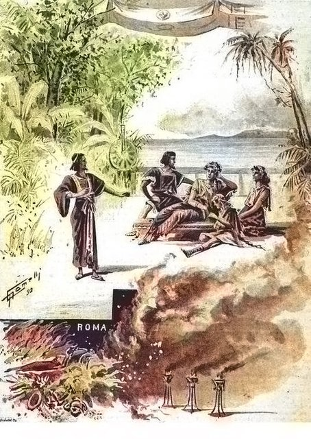
長達五幕、約五小時的《特洛伊人》規模太大，巴黎歌劇院不願演出，他只好拆成兩部分，只有後半部《特洛伊人在迦太基》在抒情劇院上演，22場演出中又被一刪再刪。這次打擊讓他幾乎從此停筆。全劇在他生前從未完整上演。

## 1864-09 | 重訪初戀艾絲黛兒
經歷一段短暫的感情後，他找到已經67歲、守寡的初戀艾絲黛兒。她親切接待他，之後他連續三個夏天去探望她，幾乎每個月寫信給她直到過世。

## 1867-06 | 獨子路易病逝
在商船隊擔任船長的兒子在哈瓦那死於黃熱病。據中文條目，悲痛的他燒毀了大部分手稿與收藏，只留下孟德爾頌送他的指揮棒與帕格尼尼送他的吉他。年底他仍前往聖彼得堡與莫斯科演出，受到俄國新一代作曲家熱烈歡迎，卻耗盡了體力。

## 1868 | 尼斯摔傷
到尼斯療養時在海邊岩石上跌倒，可能是中風所致，回巴黎休養了好幾個月。8月還到格勒諾勃擔任合唱節評審，之後身體逐漸衰弱。

## 1869-03-08 | 逝世@巴黎
在巴黎卡雷街的家中去世，享年65歲，葬於蒙馬特公墓，兩位妻子的遺骨也遷葬到他身旁。他的音樂生前在法國未獲應有的重視，今天則被譽為「標題音樂之父」與現代管弦樂法的開創者。
