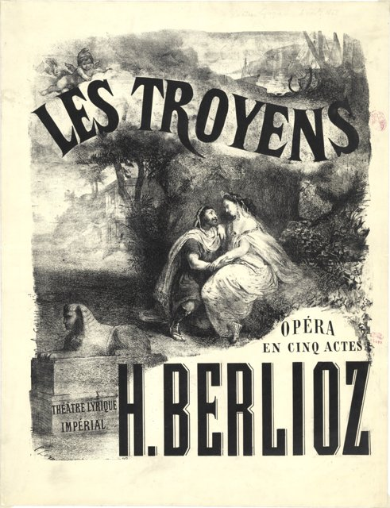

<!--
內容整理自本機筆記〈白遼士主要作品〉（D:\Books\md\音樂\白遼士主要作品.md，網頁版在知識圖譜的「9-2.音樂家作品」），做法比照「貝多芬主要作品」。
- 每首作品一則事件，日期採「創作時間」（多年創作的作品以區間呈現；「年代」以十年計、「世紀」以百年計，修訂或出版年份只寫在顯示文字裡），事件顏色依筆記的類別段落區分：交響曲與大型管弦樂作品、歌劇與舞台作品、戲劇性聲樂作品、清唱劇與神劇、管弦樂協奏性作品與其他重要管弦樂曲、藝術歌曲與聲樂套曲、其他值得認識的作品。
- 「約」、「前後」、修訂、出版等不是單純年份的寫法，以原文作為顯示文字。
- 作品編號是目錄編號，不等於創作順序，時間軸依創作時間排序。
- 時期沿用「白遼士生平」時間軸的主要時期（重疊的細分時期不列）。
- 筆記「優先聆聽」清單中的作品另註明順序。
- 沒有年份、無法放上時間軸的條目未收錄：H.?? 《聖母頌》（Tantum ergo）等宗教合唱作品（不同年份）；無 《薩拉班德與詠嘆調》等早期歌曲（不同年份）。
- 以 follows 排在「白遼士生平」之後；生平事件見該時間軸。
圖片（皆為 Wikimedia Commons 公有領域作品；未附檔名者沿用「白遼士生平」時間軸的圖片，原始檔名見該時間軸）：
- berlioz-1850-courbet.jpg（庫爾貝所繪白遼士像，1850）
- berlioz-1830-idee-fixe.jpg（《幻想交響曲》的「固定樂思」主題）
- berlioz-1837-requiem.jpg（《安魂曲》手稿中的定音鼓編制）
- berlioz-1838-cellini.jpg（1838年9月10日《本韋努托·切利尼》首演的海報）
- mw-berlioz-troyens-1863.jpg：Les Troyens de Berlioz.png（1863年抒情劇院《特洛伊人》首演的海報）
- berlioz-1862-beatrice.jpg（《貝雅特麗絲與班尼狄克》的樂譜）
-->

# Periods
- 1803 ~ 1821 | 童年@拉科特聖安德烈
  父親是開明的鄉村醫生，在家親自教育他。他讀維吉爾《埃涅阿斯紀》讀到落淚，學了直笛、長笛和吉他，卻從沒學過鋼琴。12歲時愛上18歲的鄰居艾絲黛兒，這份初戀伴隨他一生。
- 1821 ~ 1826 | 醫學生@Paris
  遵從父命到巴黎讀醫，卻對解剖課深感厭惡。他把父親給的生活費花在歌劇院與音樂學院圖書館，聽了格魯克的歌劇後立志作曲，並拜勒蘇爾為師。1824年醫學院畢業後放棄行醫，父親因此縮減生活費。
- 1826 ~ 1830 | 巴黎音樂學院
  正式進入音樂學院，隨勒蘇爾學作曲、雷哈學對位與賦格。這段期間他迷上莎士比亞、貝多芬與歌德，也瘋狂追求女演員哈莉葉·史密森，四度挑戰羅馬大獎。
- 1830 ~ 1832 | 羅馬大獎@Rome
  以康塔塔贏得羅馬大獎，寫成《幻想交響曲》，隨後依規定到羅馬梅迪奇別墅進修。他不喜歡羅馬，但義大利的風景與陽光深深影響了他日後的作品。
- 1832 ~ 1842 | 巴黎：作曲家與樂評家
  與哈莉葉結婚，靠撰寫樂評維持生計。這十年寫出《哈洛德在義大利》、《安魂曲》、《羅密歐與茱麗葉》等重要作品，歌劇《班韋努托·切利尼》卻慘敗，帕格尼尼的兩萬法郎贈禮讓他得以喘息。
- 1842 ~ 1854 | 巡迴歐洲的指揮家
  在巴黎難以靠音樂會獲利，轉往國外巡演，在德國、俄國、英國都大受歡迎。婚姻破裂後與歌手瑪麗·雷奇奧同居；《浮士德的天譴》在巴黎失利，讓他負債累累。
- 1854 ~ 1863 | 《特洛伊人》與晚期作品
  哈莉葉去世後與雷奇奧結婚。《基督的童年》意外受到歡迎，之後花兩年寫成史詩歌劇《特洛伊人》，再花五年設法讓它上演。1858年當選法蘭西學會院士。
- 1863 ~ 1869 | 晚年
  《特洛伊人》只能拆半上演且被一再刪減，此後他幾乎不再作曲。妻子、姊妹與獨子相繼離世，他陷入憂鬱，健康也日漸衰退。

# Events

## 1827 ~ 1828 | H.26／Op.1（後來改編號） 《韋弗利》序曲（Waverley） {color=#c92a2a}
類別：音樂會序曲（交響曲與大型管弦樂作品）。

## 1830 | H.48／Op.14 《幻想交響曲》（Symphonie fantastique） {color=#c92a2a label="1830，後續修訂"}

類別：標題交響曲（交響曲與大型管弦樂作品）。入門推薦聆聽第 1 首。

## 1826 ~ 1828 | H.23／Op.3 《法蘭克法官》序曲（Les Francs-juges） {color=#c92a2a label="約1826–1828"}
類別：音樂會序曲（交響曲與大型管弦樂作品）。

## 1831 | H.29／Op.4 《李爾王》序曲（Le Roi Lear） {color=#c92a2a}
類別：音樂會序曲（交響曲與大型管弦樂作品）。

## 1834 | H.68／Op.16 《哈羅德在義大利》（Harold en Italie） {color=#c92a2a}
類別：中提琴與管弦樂交響曲（交響曲與大型管弦樂作品）。入門推薦聆聽第 2 首。

## 1839 | H.79／Op.17 《羅密歐與茱麗葉》（Roméo et Juliette） {color=#c92a2a}
類別：戲劇交響曲，含獨唱、合唱與管弦樂（交響曲與大型管弦樂作品）。入門推薦聆聽第 3 首。

## 1840 | H.80／Op.15 《葬禮與凱旋大交響曲》（Grande symphonie funèbre et triomphale） {color=#c92a2a}
類別：大型管弦樂交響曲（交響曲與大型管弦樂作品）。入門推薦聆聽第 6 首。

## 1844 | H.98／Op.9 《羅馬狂歡節》序曲（Le Carnaval romain） {color=#c92a2a}
類別：音樂會序曲（交響曲與大型管弦樂作品）。入門推薦聆聽第 8 首。

## 1844 | H.??／Op.21 《海盜》序曲（Le Corsaire） {color=#c92a2a label="1844，後續修訂"}
類別：音樂會序曲（交響曲與大型管弦樂作品）。

## 1864 | H.?? 《特洛伊進行曲》（Marche troyenne） {color=#c92a2a}
類別：管弦樂進行曲（交響曲與大型管弦樂作品）。

## 1823 | H.?? 《埃斯泰爾與內莫蘭》（Estelle et Némorin） {color=#1971c2}
類別：早期歌劇，作品散佚（歌劇與舞台作品）。

## 1826 ~ 1833 | H.23A（作品未完成） 《法蘭克法官》（Les Francs-juges） {color=#1971c2 label="約1826–1833"}
類別：未完成歌劇（歌劇與舞台作品）。

## 1834 ~ 1838 | H.76a／Op.23 《本韋努托・切利尼》（Benvenuto Cellini） {color=#1971c2}

類別：三幕歌劇（歌劇與舞台作品）。入門推薦聆聽第 5 首。

## 1841 ~ 1847 | H.91（未完成） 《血腥修女》（La Nonne sanglante） {color=#1971c2}
類別：未完成歌劇（歌劇與舞台作品）。

## 1856 ~ 1858 | H.133a 《特洛伊人》（Les Troyens） {color=#1971c2 label="1856–1858，後續修訂"}

類別：五幕史詩歌劇（歌劇與舞台作品）。入門推薦聆聽第 10 首。

## 1860 ~ 1862 | H.138／Op.27 《貝雅特麗絲與班尼狄克》（Béatrice et Bénédict） {color=#1971c2}

類別：兩幕喜歌劇（歌劇與舞台作品）。

## 1837 | H.75／Op.5 《安魂曲》（Grande Messe des morts） {color=#e67700}

類別：大型安魂彌撒、合唱與管弦樂（戲劇性聲樂作品、清唱劇與神劇）。入門推薦聆聽第 4 首。

## 1831 | H.55（後以《雷利歐》出版） 《雷利歐，或生命的歸返》（Lélio, ou Le Retour à la vie） {color=#e67700 label="1831，後續修訂"}
類別：獨白、歌曲、合唱與管弦樂的戲劇性續篇（戲劇性聲樂作品、清唱劇與神劇）。

## 1839 | H.79／Op.17 《羅密歐與茱麗葉》 {color=#e67700}
類別：戲劇交響曲，含合唱及獨唱（戲劇性聲樂作品、清唱劇與神劇）。入門推薦聆聽第 3 首。

## 1849 ~ 1855 | H.111 《感恩讚歌》（Te Deum） {color=#e67700}
類別：大型合唱與管弦樂宗教作品（戲劇性聲樂作品、清唱劇與神劇）。

## 1846 | H.111／Op.24 《浮士德的天譴》（La Damnation de Faust） {color=#e67700}
類別：戲劇傳奇、獨唱、合唱與管弦樂（戲劇性聲樂作品、清唱劇與神劇）。入門推薦聆聽第 9 首。

## 1850 ~ 1854 | H.130／Op.25 《基督的童年》（L’Enfance du Christ） {color=#e67700}
類別：神劇式三部作品、合唱與管弦樂（戲劇性聲樂作品、清唱劇與神劇）。

## 1820 ~ 1829 | H.?? 《復活頌》（Resurrexit） {color=#e67700 label="1820年代末期"}
類別：合唱與管弦樂宗教作品（戲劇性聲樂作品、清唱劇與神劇）。

## 1841 | Op.8 《夢幻與隨想》（Rêverie et Caprice） {color=#2f9e44}
類別：小提琴與管弦樂浪漫曲（管弦樂協奏性作品與其他重要管弦樂曲）。

## 1844 | Op.9 《羅馬狂歡節》序曲（Le Carnaval romain） {color=#2f9e44}
類別：管弦樂序曲（管弦樂協奏性作品與其他重要管弦樂曲）。入門推薦聆聽第 8 首。

## 1844 | Op.21 《海盜》序曲（Le Corsaire） {color=#2f9e44 label="1844，後續修訂"}
類別：管弦樂序曲（管弦樂協奏性作品與其他重要管弦樂曲）。

## 1831 | 無 《羅布・羅伊》序曲（Rob Roy） {color=#2f9e44}
類別：管弦樂序曲，作曲家後來撤回（管弦樂協奏性作品與其他重要管弦樂曲）。

## 1864 | 無 《特洛伊進行曲》（Marche troyenne） {color=#2f9e44}
類別：管弦樂進行曲（管弦樂協奏性作品與其他重要管弦樂曲）。

## 1850 ~ 1859 | 無 《埃及逃亡》序曲（La Fuite en Égypte） {color=#2f9e44 label="約1850年代"}
類別：管弦樂序曲，後收入《基督的童年》相關音樂（管弦樂協奏性作品與其他重要管弦樂曲）。

## 1834 ~ 1841 | 無 《夏夜》（Les Nuits d’été） {color=#862e9c label="約1834–1841"}
類別：六首藝術歌曲套曲；原為聲樂與鋼琴，後有管弦樂版本（藝術歌曲與聲樂套曲）。入門推薦聆聽第 7 首。

## 1842 | 無 《奧菲莉亞之死》（La Mort d’Ophélie） {color=#862e9c label="約1842"}
類別：女聲、合唱與管弦樂作品（藝術歌曲與聲樂套曲）。

## 1830 | 無 《俘虜》（La Captive） {color=#862e9c label="1830，後續修訂"}
類別：藝術歌曲，多種伴奏版本（藝術歌曲與聲樂套曲）。

## 1829 | 無 《克麗奧佩脫拉之死》（La Mort de Cléopâtre） {color=#862e9c}
類別：康塔塔，女高音與管弦樂（藝術歌曲與聲樂套曲）。

## 1829 ~ 1830 | 無 《愛爾蘭歌曲集》（Irlande） {color=#862e9c}
類別：藝術歌曲集（藝術歌曲與聲樂套曲）。

## 1828 ~ 1829 | 無 《浮士德八景》（Huit scènes de Faust） {color=#0c8599}
類別：早期聲樂與管弦樂作品；後成為《浮士德的天譴》的創作前史（其他值得認識的作品）。

## 1820 ~ 1829 | 無 《彌撒曲》（早期宗教作品） {color=#0c8599 label="1820年代"}
類別：宗教聲樂作品（其他值得認識的作品）。

## 1820 ~ 1829 | 無 《創造主之歌》等早期康塔塔 {color=#0c8599 label="1820年代"}
類別：康塔塔、競賽作品（其他值得認識的作品）。

## 1820 ~ 1839 | 無 《威弗利》相關主題及其他序曲草稿 {color=#0c8599 label="1820–1830年代"}
類別：管弦樂早期作品（其他值得認識的作品）。
