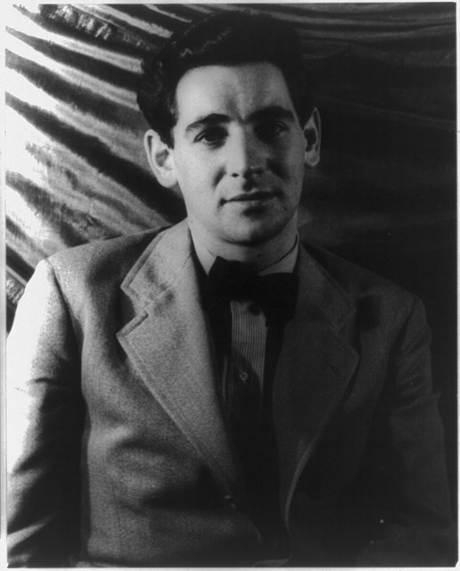
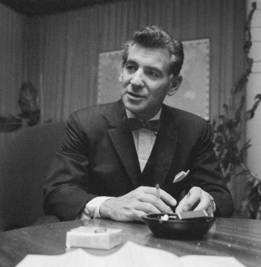

<!--
內容整理自本機筆記〈伯恩斯坦（Leonard Bernstein）生平大事記〉（D:\Books\md\音樂\表演家\伯恩斯坦（Leonard Bernstein）生平大事記.md），以自己的話改寫。
時期依筆記的六個階段。
處理方式：
- 筆記開頭有一句寫給讀者的話（「以下重新整理完整的……不再缺漏第一至第三部分」），未收錄。
- 筆記對1949年指揮「聯合國人權日音樂會」的敘述與1949–1950年的其他活動合併為一則事件；1946年指揮布列頓《彼得·格萊姆斯》的美國首演，與布列頓時間軸一致。
- 筆記對1970年代寫的是一段時期，沒有具體年份，這裡歸入1971年《彌撒》與「1970年代」兩則事件。
- 筆記的「主要作品」「與福特萬格勒、卡拉揚的比較」「歷史評價」寫進時期說明與最後一則事件，不另立事件。
- 人名用·分隔（筆記作・）；布魯諾·華爾特、庫塞維茲基、柯普蘭等譯名依筆記。
圖片（Wikimedia Commons 公有領域或 CC0）：
- bern-cover.jpg：Leonard Bernstein 1971.jpg（伯恩斯坦排練《彌撒》，1971年9月）
- bern-1944.jpg：Portrait of Leonard Bernstein LCCN2004662600.jpg（伯恩斯坦，1944，范韋克滕攝）
- bern-1959.jpg：Leonard-Bernstein-1959.jpg（伯恩斯坦訪問芬蘭，1959）
-->

# Periods
- 1918 ~ 1934 | 音樂啟蒙@勞倫斯 | #868e96
  生於麻薩諸塞州的猶太家庭，父親做生意，沒有人打算把他培養成音樂家；他卻從童年就迷上鋼琴，十三歲起接受正式的鋼琴訓練，十四歲舉行首次公開演出。
- 1935 ~ 1942 | 哈佛、柯蒂斯與庫塞維茲基 | #1971c2
  在哈佛接受人文與音樂教育，到柯蒂斯音樂學院取得指揮文憑，並在坦格伍德師從庫塞維茲基；成名之前，他已累積多年的訓練與師承。
- 1943 ~ 1956 | 一夕成名與創作起步 | #e8590c
  1943年代班指揮紐約愛樂一夕成名，同年代起寫下《耶利米》、芭蕾《Fancy Free》、音樂劇《在城裡》與《憨第德》，並開始透過電視向大眾講解古典音樂。
- 1957 ~ 1969 | 紐約愛樂與《西城故事》 | #c92a2a
  《西城故事》首演、出任紐約愛樂音樂總監、主持《青年音樂會》，把古典音樂帶給整個美國；《卡迪什》等作品也深化了他對信仰與人類處境的思考。
- 1970 ~ 1979 | 自由的指揮與《彌撒》 | #2f9e44
  卸下音樂總監後，他以客席指揮、馬勒錄音與大型舞台作品《彌撒》探索宗教與現代社會的矛盾，並持續透過演講與唱片從事音樂教育。
- 1980 ~ 1990 | 和平與最後的演出 | #5f3dc4
  創辦「和平音樂會」、錄製《西城故事》，1989年在柏林圍牆倒塌後指揮貝多芬《第九》，把「歡樂」改唱成「自由」；1990年10月在紐約去世。

# Events

## 1918-08-25 | 出生@勞倫斯
生於美國麻薩諸塞州的勞倫斯，家庭是猶太裔，後來主要在波士頓地區受教育。父親山繆·伯恩斯坦經商，家人原先並沒有把他培養成職業音樂家的計畫；然而他很早就對音樂展現濃厚的興趣，並從喜愛逐漸發展成對鋼琴、樂曲結構、作曲與指揮的全面投入。他的天賦不只在演奏技巧，也表現在理解音樂整體結構的能力。

## 1931 | 開始正式學鋼琴
開始跟新英格蘭音樂學院的蘇珊·威廉斯學鋼琴，之後也跟海倫·科茨學習。從這時起，他的音樂學習不再只是憑興趣摸索，而是有系統的訓練。

## 1932-03-30 | 首次公開演出
舉行第一次公開演出，鋼琴不再只是個人興趣，而是成為他向外界展示音樂能力的媒介。中學階段他持續接觸鋼琴與音樂理論，也建立起對不同作曲家與風格的興趣；他的發展從一開始就不侷限於鋼琴，而是朝作曲、指揮與音樂教育擴展。

## 1935 | 進入哈佛大學
從波士頓拉丁學校畢業，進入哈佛大學主修音樂，並跟鋼琴家海因里希·格布哈德學鋼琴。哈佛給了他接觸文學、哲學、戲劇與文化思想的環境，他後來的音樂教育經常把作品分析與歷史、文學、社會文化結合，與這段經驗有關。

## 1937 | 結識柯普蘭、格林與米特羅普洛斯
第一次以協奏曲鋼琴家的身分與管弦樂團合作公開演出，並認識了幾位影響日後發展的人：美國作曲家亞倫·柯普蘭、日後在音樂劇合作的阿道夫·格林，以及指揮家迪米特里·米特羅普洛斯。這些交往讓他逐漸進入專業音樂圈。

## 1939 | 哈佛畢業，進入柯蒂斯音樂學院
以優異成績從哈佛畢業，廣泛的人文素養讓他習慣把音樂視為與社會、文化、思想及人類情感相連的表達。他隨後到費城的柯蒂斯音樂學院深造，接受指揮訓練，並在1941年取得指揮文憑；他開始從鋼琴與作曲的角度，學習如何統合整個管弦樂團。

## 1940-07-07 | 坦格伍德首次指揮交響樂
在坦格伍德舉行第一次交響樂指揮演出。坦格伍德是美國重要的古典音樂活動與教育中心，他在此接受指揮訓練，並與指揮家謝爾蓋·庫塞維茲基建立重要的師徒關係。庫塞維茲基不只是他的老師，也為他打開接觸專業管弦樂團與音樂界的門。

## 1941-05-29 | 取得指揮文憑
取得柯蒂斯音樂學院的指揮文憑；7月11日第一次指揮波士頓通俗管弦樂團，開始累積實際的指揮經驗。

## 1942 | 庫塞維茲基的助理
在坦格伍德擔任庫塞維茲基的助理，更深入了解專業指揮家如何處理排練、詮釋與音樂節演出。他並非只靠魅力快速成名，成名之前已有多年的訓練與師承。

## 1943-11-14 | 代班指揮紐約愛樂，一夕成名
紐約愛樂原定由布魯諾·華爾特指揮的音樂會，華爾特臨時生病，年僅二十五歲的伯恩斯坦臨危受命，在卡內基音樂廳登台，並透過廣播傳送到全美。他在缺乏充分準備的情況下完成演出，證明了臨場指揮能力、獲得全國知名度，也打開與重要樂團合作的機會；他活力十足、舞台感染力強，與當時較傳統的指揮家形象形成鮮明對比。這並不是一夜完成所有訓練，而是多年累積的能力在一次突發事件中展現。

## 1944-01-28 | 第一交響曲《耶利米》首演

第一交響曲《耶利米》由匹茲堡交響樂團首演。作品取材於《聖經·耶利米書》，以先知的悲嘆與對民族命運的思考為核心，包含女中音獨唱，反映他對猶太文化與聖經傳統的關注，也顯示他不滿足於只當指揮，而想以自己的作品參與嚴肅音樂傳統。《耶利米》後來獲得重要音樂獎項的肯定。

## 1944-04-18 | 芭蕾舞劇《Fancy Free》
由他作曲、傑羅姆·羅賓斯編舞的芭蕾《Fancy Free》首演，描寫三名水手在紐約短暫休假的經歷，融合爵士節奏、舞蹈音樂與交響樂團，展現他對美國都市生活的敏銳觀察。12月28日，以同一個構想發展成的音樂劇《在城裡》在百老匯開演，他開始證明自己不只能寫交響曲，也能把古典訓練與美國流行文化結合；這種跨界能力成為他最鮮明的特色。

## 1945 | 紐約市交響樂團音樂總監
開始擔任紐約市交響樂團的音樂總監，任期到1947年，有機會獨立規劃音樂會、選曲、帶領排練並面對不同的聽眾。他重視音樂的公共性，認為古典音樂不該只是少數專業人士或富裕階層的文化資產，這個理念後來在青年音樂會與電視節目中更完整地實現。

## 1946-05-15 | 進軍歐洲
5月15日與捷克愛樂在布拉格之春音樂節演出，是他歐洲指揮生涯的起點；8月在坦格伍德指揮布列頓歌劇《彼得·格萊姆斯》的美國首演。他的活動不再限於美國，開始進入歐洲古典音樂的重要舞台。

## 1948 | 以色列與猶太音樂家
以色列建國與第一次中東戰爭讓猶太民族的處境成為國際焦點。這一年，他指揮由聖奧蒂利恩拘留營倖存者組成的17人猶太音樂家樂團，並在流離失所者營地演出；11月20日又在以色列獨立戰爭期間，在貝爾謝巴為以色列軍人指揮音樂會。這些活動反映他與猶太文化及戰後歷史的密切關係；他日後的《焦慮的年代》、《卡迪什》等作品，都可以放在他對信仰、民族認同與現代世界的長期思考中理解。

## 1949-04-08 | 第二交響曲《焦慮的年代》
第二交響曲《焦慮的年代》由波士頓交響樂團首演，伯恩斯坦本人擔任鋼琴獨奏。作品取材自英國詩人W. H. 奧登的同名長詩，描寫現代人在戰爭、信仰危機與社會變動中的精神處境，以鋼琴與管弦樂的互動，呈現個人意識與集體世界之間的張力。12月，他在聯合國人權日音樂會中透過電視指揮波士頓交響樂團；1950年他在米蘭與史卡拉歌劇院樂團合作，既彈又指揮莫札特的鋼琴協奏曲，並指揮馬勒第二交響曲。電視與廣播逐漸成為他傳播音樂理念的重要媒介。

## 1953-12-10 | 史卡拉歌劇院的第一位美國人
在米蘭史卡拉歌劇院指揮凱魯比尼的歌劇《美狄亞》，女主角是瑪麗亞·卡拉絲，他因此成為第一位在史卡拉歌劇院指揮歌劇的美國人。史卡拉是歐洲歌劇傳統的重要中心，這項成就象徵他獲得傳統歐洲歌劇界的認可。

## 1954-11-14 | 電視節目《Omnibus》
第一次參與電視節目《Omnibus》，以解析貝多芬第五交響曲為題，親自講解旋律、節奏、形式與創作手法，說明作曲家如何用素材發展出完整作品。他常用鋼琴示範、樂譜分析與生動的比喻，讓艱深的音樂理論變得容易懂，也預示了後來最著名的《青年音樂會》。

## 1955-08-11 | 《岸上風雲》交響組曲
《岸上風雲》交響組曲由波士頓交響樂團在坦格伍德首演，改編自他為同名電影所寫的配樂，展現他把電影敘事、戲劇情緒與交響樂語言結合的能力。同年他的兒子亞歷山大出生。

## 1956-12-01 | 音樂劇《憨第德》首演
改編自伏爾泰諷刺小說的音樂劇《憨第德》在百老匯首演，以誇張諷刺的方式探討樂觀主義、戰爭、宗教、政治與人類苦難，音樂包含華麗的詠嘆調、合唱、舞曲與諷刺性的段落。最初的演出沒有立刻取得商業上的大成功，音樂卻逐漸獲得高度評價，成為他最重要的舞台作品之一。

## 1957-09-26 | 《西城故事》首演
音樂劇《西城故事》在百老匯首演，由他作曲、史蒂芬·桑坦作詞、傑羅姆·羅賓斯編舞、亞瑟·勞倫茲編劇。它把莎士比亞《羅密歐與茱麗葉》的悲劇結構搬到二十世紀中葉的紐約，以不同族裔的青年幫派衝突為背景，描寫愛情、偏見、暴力與社會排斥。音樂結合交響樂的組織能力與爵士節奏，吸收拉丁美洲（波多黎各）音樂的色彩，歌曲推動角色與情節而不只是插曲。它成為二十世紀最重要的美國音樂劇之一，也讓他的名字走出古典音樂圈。同年11月19日，他被任命為紐約愛樂的下一任音樂總監。

## 1958-01-18 | 青年音樂會
1958年成為紐約愛樂的音樂總監，是該團第一位美國出生的音樂總監，並於1月18日開始主持《青年音樂會》系列。他擴大曲目，重視二十世紀與美國作曲家，也強調樂團與大眾的關係。《青年音樂會》面向兒童與青少年，用現場演奏、講解與樂譜分析帶人認識古典音樂：從聽眾熟悉的現象出發，用示範讓抽象概念具體，鼓勵主動聆聽，降低門檻。這些節目後來透過電視廣泛傳播，影響深遠。

## 1959 | 紐約愛樂巡演蘇聯

率領紐約愛樂展開重要的國際巡演，前往蘇聯與其他國家。在冷戰時期，音樂巡演也具有文化外交的意義，他成為美國文化外交的重要人物之一。

## 1961-01 | 甘迺迪就職前的音樂活動
參與約翰·甘迺迪就職前的音樂活動，演出自己的管弦樂號角曲，顯示他不只是音樂廳裡的指揮家，也活躍於美國的公共文化與政治象徵活動。

## 1962-09-23 | 林肯中心新音樂廳
紐約愛樂在林肯中心的新音樂廳舉行重要的開幕音樂會。林肯中心後來成為紐約重要的表演藝術中心，匯集交響樂、歌劇與芭蕾，他在這個新舞台上的活動與紐約戰後的文化建設密切相關。

## 1963-12-10 | 第三交響曲《卡迪什》
第三交響曲《卡迪什》在以色列特拉維夫由以色列愛樂首演。「卡迪什」是猶太傳統中的祈禱文，他結合管弦樂、合唱、朗誦與女高音，探討信仰、死亡、人類苦難與人和上帝的關係；作品不只是重述儀式，而帶有強烈的個人與現代性的思考：在戰爭、暴力與苦難之中，人是否仍能相信神聖的秩序？

## 1964-03-06 | 大都會歌劇院的《法斯塔夫》
在紐約大都會歌劇院指揮威爾第的《法斯塔夫》，展開在該院的重要歌劇演出。他雖以交響樂與音樂劇聞名，對歌劇的興趣同樣深厚；歌劇要求指揮同時掌握管弦樂、歌唱、戲劇節奏與舞台動作，是對綜合音樂能力的重要考驗。1965年3月24日，他在維也納國立歌劇院指揮同一部《法斯塔夫》，顯示他的國際地位已相當穩固。

## 1967-07-09 | 耶路撒冷
六日戰爭改變了中東局勢，戰後他在耶路撒冷的斯科普斯山指揮以色列愛樂演出。對他而言，以色列不只是巡演的目的地，也與他的猶太文化認同及對民族歷史的關懷相連。

## 1968-08-25 | 終身桂冠指揮
獲紐約愛樂授予終身桂冠指揮的榮譽，肯定他多年來對樂團的貢獻。1969年他結束音樂總監的任期，之後可以更自由地安排國際客席指揮、作曲、錄音與音樂教育活動。

## 1971-09-08 | 《彌撒》首演
大型舞台作品《彌撒》在華盛頓甘迺迪表演藝術中心的開幕活動中首演。它結合古典彌撒文本、流行音樂、搖滾、合唱、舞蹈與戲劇，以天主教彌撒為出發點，卻不是單純的宗教禮儀音樂，而是藉儀式與表演探索個人信仰、宗教制度、戰爭、政治權威與社會價值之間的矛盾；主角逐漸對儀式的意義產生懷疑，呈現現代人在制度、信仰與個人良知之間的衝突，也反映他對越戰、青年文化與世代衝突的關注。

## 1975 | 馬勒與客席指揮 {label=1970年代}
1970年代他持續指揮馬勒、貝多芬、布拉姆斯，並透過錄音與現場演出擴大影響力。他特別重視馬勒：作品中的人類苦難、死亡、宗教、自然與精神追尋，和他自己的思想興趣相通。他的馬勒詮釋情緒張力強烈、不迴避極端的矛盾，把交響曲看作有發展、衝突與轉折的整體，並關注作品提出的存在問題。他不再固定擔任某個樂團的音樂總監，而以客席指揮的身分，依各樂團的音色與傳統重新思考詮釋，也和維也納等歐洲樂團建立更緊密的關係。同時他透過唱片、講座、訪談與公開演出繼續向大眾說明古典音樂，相信聆聽是一種積極的智性活動。

## 1981 | 《Halil》
完成為長笛與室內樂團而寫的《Halil》，帶有挽歌的性質，與他對戰爭及人類苦難的關注相關。1980年代他持續活躍於國際樂壇，指揮大型交響曲、歌劇與宗教作品，風格並未隨年齡趨於保守，反而更重視情感深度、精神性與戲劇衝突；1980年的歌劇《平靜之地》也探討家庭關係、失落與情感創傷。

## 1983-12-31 | 「和平音樂會」
在紐約聖約翰大教堂舉行第一場「和平音樂會」，與他長期關心的戰爭、和平、人類尊嚴與宗教問題相關。他不把音樂看作政治之外的純粹娛樂，而相信音樂可以為公共生活提供反思的空間。

## 1984 | 錄製《西城故事》
為德意志留聲機錄製《西城故事》，並選擇由歌劇歌手而不是傳統百老匯歌手演唱，讓作品呈現不同的聲音風格。這也反映出他對這部作品的重視：他認為它值得以嚴肅音樂的方式重新詮釋，而不只是流行娛樂。

## 1989-12-25 | 柏林的貝多芬《第九》
柏林圍牆在11月倒塌，象徵冷戰時期歐洲分裂格局的重大變化。12月25日，他在柏林指揮貝多芬《第九交響曲》，並把第四樂章中的「Freude」（歡樂）改成「Freiheit」（自由），以音樂回應當時的歷史情境。這成為他晚年最具代表性的事件之一，也顯示他相信音樂可以成為公共歷史的一部分。

## 1990-08-19 | 最後一場音樂會
在坦格伍德舉行最後一場音樂會。坦格伍德與他早年的指揮訓練密切相關，從年輕時受庫塞維茲基指導，到成為國際知名的指揮家，他和這個音樂中心維持了長久的關係，因此最後一場演出也有回顧生涯的象徵意義。

## 1990-10-14 | 逝世@紐約
在紐約的家中去世，享年72歲，晚年患有間皮瘤。他一生不願只當出色的指揮家，同時是創作者、教育者與公共文化的參與者：作曲橫跨交響曲、歌劇、芭蕾、音樂劇、電影配樂與宗教作品，經常融合美國文化、爵士、猶太傳統與現代社會議題；他的演出帶有鮮明的情感與戲劇性，卻也重視結構、樂句與思想內容。與福特萬格勒探索音樂的內在發展、卡拉揚塑造精密統一的音響相比，他獨特之處在於把指揮、創作、教育與公共文化活動結合起來，說明音樂家可以不只詮釋作品，還能改變人們理解與聆聽音樂的方式。
