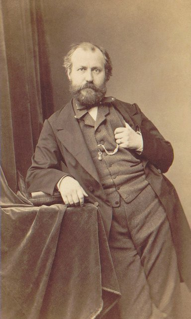
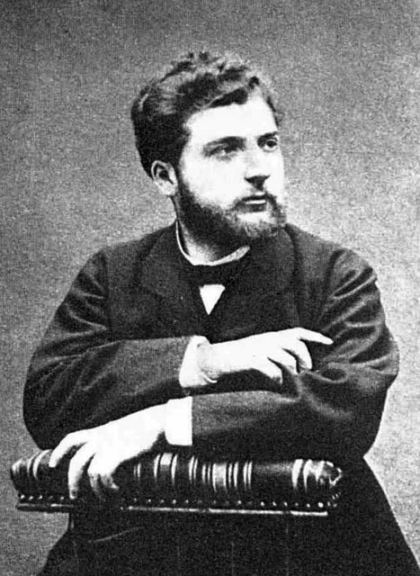
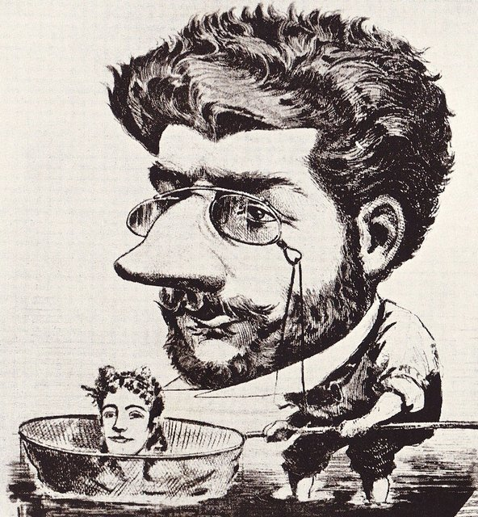
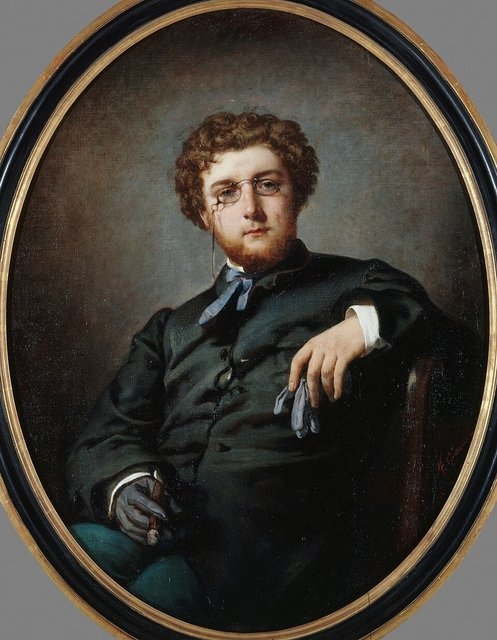
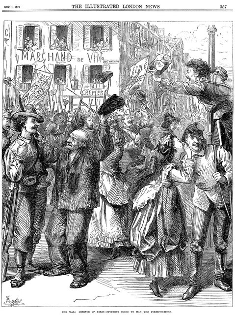
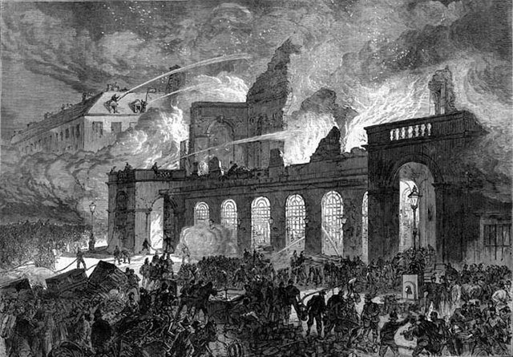
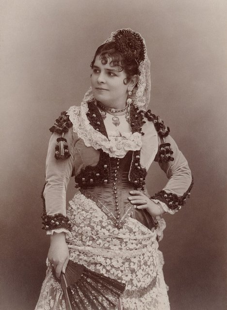
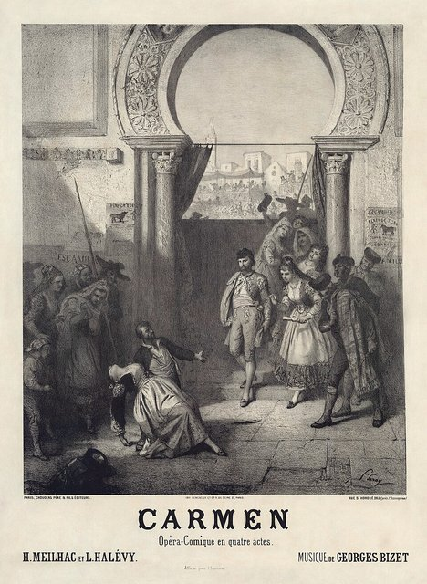
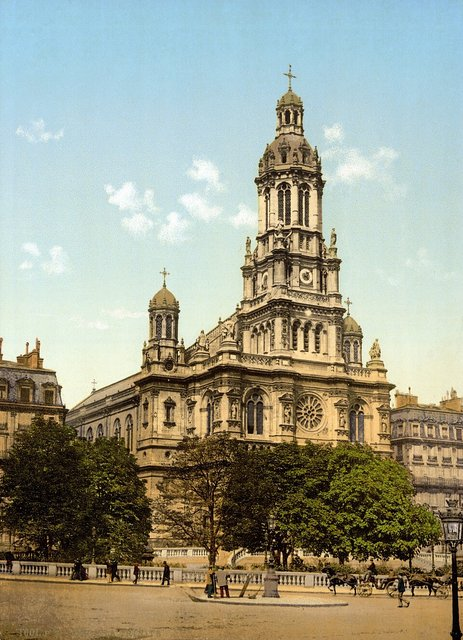
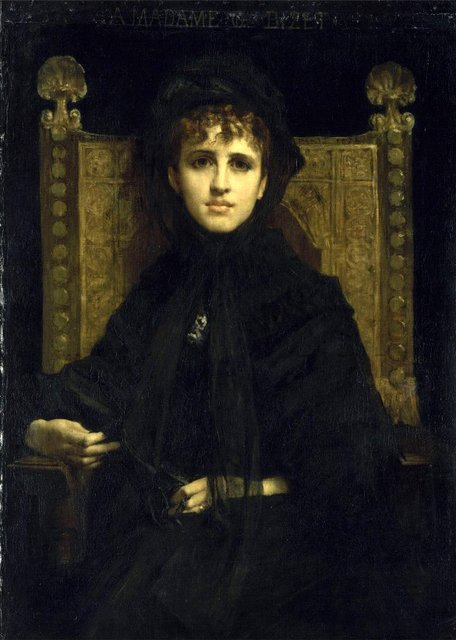

<!--
內容整理自中文維基百科「喬治·比才」與英文維基百科「Georges Bizet」條目（CC BY-SA 4.0），並以台灣用語改寫摘要。
https://zh.wikipedia.org/zh-tw/乔治·比才
https://en.wikipedia.org/wiki/Georges_Bizet
中文條目大致譯自英文條目，生平細節以英文條目為準。
圖片皆為 Wikimedia Commons 上的公有領域（含PD-US）作品（封面：卡賈1875年所攝肖像）。
-->

# Periods
- 1838 ~ 1848 | 童年@Paris
  理髮師出身的聲樂老師之子，母親是出色的鋼琴家。他躲在門外偷聽父親上課，就學會了困難的歌曲與和聲分析。
- 1848 ~ 1857 | 巴黎音樂學院
  不滿10歲就破格進入巴黎音樂學院，拿下各種獎項。結識古諾與聖桑，17歲寫出《C大調交響曲》，最後贏得羅馬大獎。
- 1858 ~ 1860 | 羅馬梅迪奇別墅@Rome
  在被他稱為「天堂」的梅迪奇別墅度過快樂時光，構思了許多計畫卻大多半途而廢，並遊歷拿坡里與龐貝。
- 1860 ~ 1871 | 掙扎的歲月
  回到巴黎後，各大歌劇院偏好傳統劇目，新人難以出頭。他靠改編別人的作品維生，《採珠人》、《伯斯美麗的姑娘》都沒能長期上演。娶了老師的女兒潔妮薇芙，經歷普法戰爭與巴黎公社。
- 1871 ~ 1875 | 晚期：從《阿萊城姑娘》到《卡門》
  《阿萊城姑娘》組曲一炮而紅，最後的歌劇《卡門》卻因題材驚世駭俗而首演失利。他在首演三個月後猝逝，年僅36歲，沒能看到《卡門》成為全世界最受歡迎的歌劇之一。

# Events

## 1838-10-25 | 出生@巴黎
登記的名字是亞歷山大·凱撒·萊奧波德，1840年受洗時取名喬治，從此一直用這個名字。他是獨子，父親阿道夫原本是理髮師兼假髮匠，後來雖然沒受過正規訓練仍當起聲樂老師；母親艾梅出身貧窮卻很有文化與音樂素養的家庭，是出色的鋼琴家，舅舅是名聲樂家。

## 1847 | 門外偷聽的天才
母親教他讀譜和彈琴。他躲在父親上課的房間門外偷聽，就能憑記憶準確唱出困難的歌曲，還能分辨分析複雜的和弦。9歲時，野心勃勃的父母帶他去音樂學院面試，法國號名家梅弗雷德驚嘆不已，破例讓未滿10歲的他一有名額就入學。

## 1848-10-09 | 進入巴黎音樂學院

在10歲生日前兩週入學，半年內就拿下視唱練耳一等獎。前鋼琴教授齊默曼私下教他對位與賦格，他也因此結識了齊默曼的女婿、作曲家古諾，古諾對他的音樂風格影響深遠；他還認識了古諾的另一位學生、13歲的聖桑，兩人成為好友。他跟馬蒙泰爾學鋼琴，1852年拿下鋼琴一等獎。

## 1853 | 拜阿萊維為師
進入作曲家弗羅蒙塔·阿萊維的作曲班，作品愈來愈成熟，1854年第一次出版歌曲。

## 1855 | 17歲寫下《C大調交響曲》
他把古諾的交響曲改編成四手聯彈，深受啟發，17歲生日後不久就寫出自己的交響曲，有些段落和古諾的作品幾乎一模一樣。他生前從未出版這首曲子，直到1933年才被重新發現，1935年在瑞士首演後成為音樂會的常備曲目。

## 1856 | 奧芬巴哈的歌劇比賽；結識羅西尼
這年的羅馬大獎從缺。他改參加奧芬巴哈為年輕作曲家舉辦的獨幕歌劇比賽，以《奇蹟醫生》與勒科克並列首獎。從此他成為奧芬巴哈週五晚宴的常客，在那裡見到年邁的羅西尼，羅西尼還送他一張簽名照。他非常崇拜羅西尼，說：「羅西尼是最偉大的，因為他像莫札特一樣，擁有一切優點。」

## 1857 | 贏得羅馬大獎

以康塔塔《克洛維與克洛蒂爾德》參賽，評審原本把獎頒給一位雙簧管手，美術學院院士投票推翻了這個結果，改由他獲獎。獎學金為期五年：前兩年在羅馬、第三年在德國、最後兩年在巴黎。12月出發前，他的得獎作品在學院演出，大受歡迎。

## 1858-01-27 | 抵達羅馬梅迪奇別墅

這座16世紀的宮殿是法蘭西學院在羅馬的所在地，他寫信說這裡是「天堂」。他盡情享受熱鬧的社交生活，頭半年只寫了一首《感恩讚》參加宗教音樂比賽，落敗後發誓不再寫宗教音樂。

## 1859 | 《唐普羅科皮奧》；遊歷龐貝
依規定第一年應該寄回一首彌撒曲，他卻交出喜歌劇《唐普羅科皮奧》，幸好學院反應不錯。他在羅馬期間構思了許多歌劇和交響曲，大多很快就放棄。夏天他遊歷拿坡里與龐貝，對拿坡里沒什麼好感，卻很喜歡龐貝：「在這裡你和古人一起生活。」他開始構思以義大利經驗為主題的《羅馬交響曲》，直到1868年才完成。

## 1860-09 | 返回巴黎
他申請延長在義大利的時間，第三年不去德國。9月在威尼斯時得知母親病危，趕回巴黎。

## 1861 | 華格納的《唐懷瑟》；令李斯特驚嘆
3月他觀賞了華格納《唐懷瑟》在巴黎的首演，觀眾在騎師俱樂部煽動下大鬧劇場，他卻改變了對華格納的看法，稱華格納「超越所有在世的作曲家」，此後常被批評為「華格納主義」。5月在一場有李斯特出席的晚宴上，他當場視譜完美彈奏了李斯特最難的一首作品，李斯特說：「我以為只有兩個人能克服這些難關……原來有三個，而最年輕的這位或許最大膽、最出色。」9月母親去世。

## 1862 | 老師阿萊維去世；私生子出生
他和家中女管家生了一個兒子，這孩子從小以為自己是比才父親的兒子，直到1913年母親臨終前才得知真相。同年老師阿萊維去世。

## 1863-09-30 | 《採珠人》首演

本來要上演的獨幕歌劇被他緊急撤下，因為新的委託規定必須是他第一部公開上演的作品。《採珠人》在抒情劇院首演，樂評大多不友善，白遼士卻稱讚它「為比才先生帶來最大的榮譽」。只演了18場，直到1886年才再度上演。

## 1864 | 靠改編維生

羅馬大獎的獎學金用完了，作曲養不活自己。他教鋼琴和作曲，在白遼士的《基督的童年》、古諾的《米蕾優》等作品的排練中擔任伴奏，主要收入來自為出版商改編上百部歌劇的鋼琴譜，有時一天工作16小時。

## 1867-12-26 | 《伯斯美麗的姑娘》首演
改編自史考特的小說，劇本被傳記作者稱為「比才所譜過最糟的」。首演得到他所有歌劇中最好的評價，但劇院經理財務困難，只演了18場。同年10月他寫信給朋友：「我遇見一個可愛的女孩，我愛她！兩年後她會成為我的妻子！」

## 1869-02-28 | 《羅馬交響曲》首演
由帕德盧指揮演出。他告訴朋友，以掌聲、噓聲和喝倒采的比例來算，這首曲子算是成功了。

## 1869-06-03 | 與潔妮薇芙結婚
老師阿萊維的小女兒潔妮薇芙的家人起初反對，覺得他是個「身無分文、左派、反宗教的波希米亞人」。婚後他補完了岳父未完成的歌劇《諾亞》。婚姻起初很幸福，但潔妮薇芙情緒不穩，岳母又常干涉。

## 1870 | 普法戰爭與巴黎圍城

戰爭爆發後他加入國民衛隊，抱怨部隊的老舊槍枝「對自己比對敵人還危險」。普軍包圍巴黎時，古諾逃到英國，他卻拒絕離開：「我不能離開巴黎！這根本是懦弱的行為。」

## 1871 | 巴黎公社；《兒童遊戲》
停戰後巴黎公社起事，他和妻子逃到郊外，在聽得到砲聲的地方躲了兩個月。這一年他完成了鋼琴四手聯彈組曲《兒童遊戲》。

## 1872 | 《賈蜜蕾》失敗；兒子雅克出生
獨幕歌劇《賈蜜蕾》在喜歌劇院演出時，主唱甚至漏唱了32小節，只演了11場就下檔。7月10日兒子雅克出生。

## 1872-10-01 | 《阿萊城姑娘》
為都德的戲劇《阿萊城姑娘》寫的配樂，樂評嫌太複雜。他在朋友鼓勵下把它改編成四個樂章的組曲，11月由帕德盧指揮演出，立刻大受歡迎。這年冬天他也幫已疏遠的老師古諾準備《羅密歐與茱麗葉》的重演，寫信給古諾說：「您是我藝術生命的起點，我源自於您。」

## 1873 | 《卡門》暫停；巴黎歌劇院大火

喜歌劇院委託他以梅里美的小說《卡門》寫歌劇，他夏天開始作曲，劇院卻擔心這個驚世駭俗的故事不適合闔家觀賞的喜歌劇院而暫停計畫。他改寫歌劇《唐羅德里格》，10月巴黎歌劇院卻被大火燒毀，這部作品因此擱置，最終沒有完成。

## 1874 | 完成《卡門》

最反對《卡門》的劇院副經理辭職後，他在夏天完成總譜，滿意地說：「我寫了一部清晰、活潑、充滿色彩與旋律的作品。」名次女高音加利－瑪利埃擔任卡門，據傳兩人有過短暫戀情，當時他和妻子關係緊張，分居了好幾個月。10月開始排練，樂團說有些段落根本拉不出來，合唱團則不習慣要在台上抽菸、打架演戲。

## 1875-03-03 | 《卡門》首演

當天早上剛好宣布他獲頒榮譽軍團騎士勳章。首演長達四個半小時，最後一幕過了午夜才開始。馬斯奈和聖桑向他道賀，古諾卻據說指控他抄襲：「喬治偷了我的東西！把西班牙曲調和我的旋律拿掉，比才就只剩下蓋住魚的醬汁了。」多數報紙批評女主角是個不道德的誘惑者，演員被形容為「罪惡的化身」。觀眾反應冷淡，他確信這部歌劇失敗了：「我預見一場徹底、無望的失敗。」

## 1875-06-03 | 逝世@布日瓦爾

他是重度菸癮者，長年喉嚨不適，《卡門》的失敗讓他意志消沉、病情反覆。5月底他到布日瓦爾的度假屋，在塞納河游泳後隔天發高燒、心臟病發，6月3日凌晨，也就是結婚六週年那天，再度發作去世，年僅36歲。當晚的《卡門》演出因女主角悲傷過度而取消。葬禮在巴黎歌劇院北邊的聖三一教堂舉行，有四千多人參加，古諾致悼詞時泣不成聲。他安葬於拉雪茲神父公墓。三個月前幾乎一致批評《卡門》的媒體，這時都稱他為大師。

## 1875-10 | 《卡門》在維也納大獲成功
巴黎首演季只演了45場，之後在維也納（1875）與倫敦（1878）演出後風靡全球，成為最受歡迎的歌劇之一，也被譽為寫實主義歌劇的先驅，後來由普契尼等義大利作曲家發揚光大。友人吉羅為維也納演出把對白改寫成宣敘調，這個版本流行了很長一段時間。

## 1886 | 潔妮薇芙再婚；《採珠人》重演

潔妮薇芙改嫁富有的律師，成為巴黎知名的沙龍女主人，和作家普魯斯特是好友。她對比才的音樂遺產不太關心，把許多手稿送人當紀念品；1926年她去世時，遺囑設立了「喬治·比才獎」，獎勵40歲以下的作曲家。同年他的父親也去世了。

## 1935 | 《C大調交響曲》首演
這首他17歲寫的交響曲在1933年被重新發現，1935年在瑞士首演後成為音樂會常備曲目。傳記作者認為拉威爾等作曲家受到他的影響，柴可夫斯基晚期交響曲（尤其是「悲愴」）也反映出對他筆下悲劇英雄的著迷。
