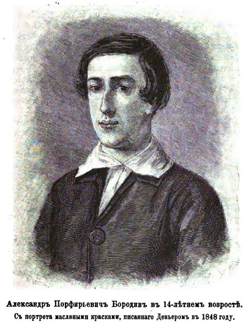
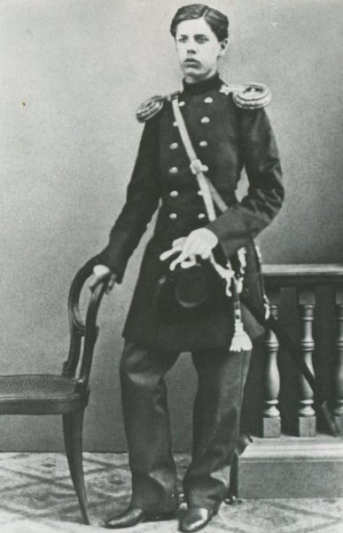
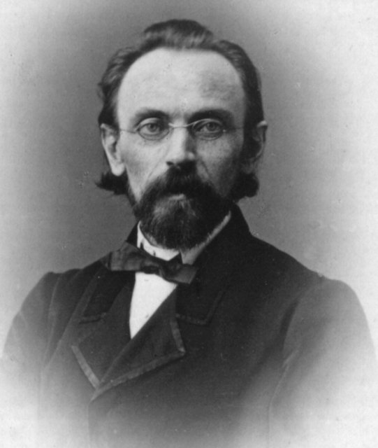
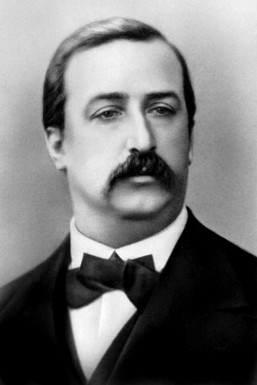
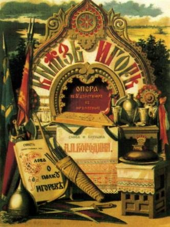
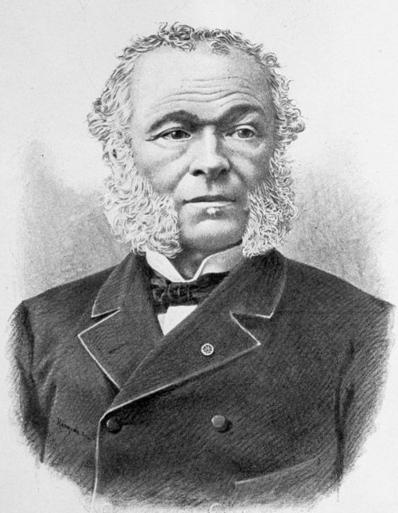
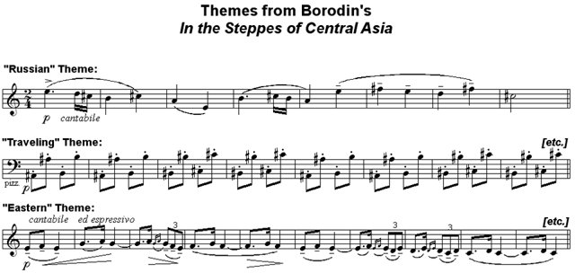
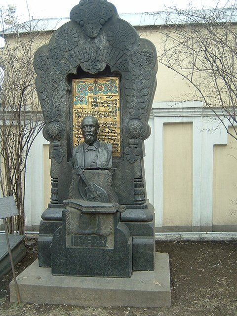
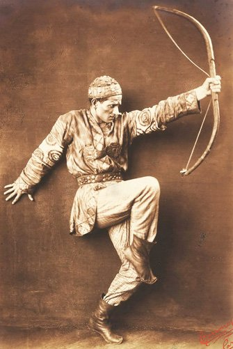
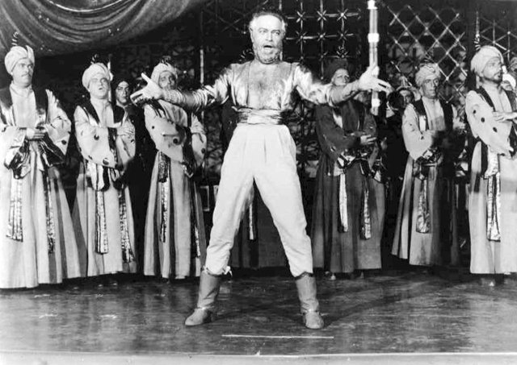

<!--
內容整理自中文維基百科「亞歷山大·鮑羅定」與英文維基百科「Alexander Borodin」條目（CC BY-SA 4.0），並以台灣用語改寫摘要。
https://zh.wikipedia.org/zh-tw/亚历山大·鲍罗丁
https://en.wikipedia.org/wiki/Alexander_Borodin
中英文條目都相當簡略，以兩者互補。
1856年畢業與結識穆索斯基、1858年取得博士、童年軼事、在海德堡結識妻子、斯塔索夫建議《伊果王子》題材、1877年拜訪李斯特、格拉祖諾夫憑記憶寫序曲、《在中亞細亞的草原上》的創作緣由、逝世時的舞會情形、《伊果王子》1890年首演等細節，係依一般公認的史實補充。
圖片皆為 Wikimedia Commons 上的公有領域作品（封面：列賓1888年所繪的追悼肖像；《伊果王子》首演事件的配圖為1909年俄羅斯芭蕾舞團巴黎演出〈韃靼人舞曲〉的舞者博爾姆）。
-->

# Periods
- 1833-11-12 ~ 1850 | 貴族的私生子@聖彼得堡
  喬治亞貴族的私生子，名義上登記為農奴之子。無法進入正規中學，在家中由家教授課，從小學長笛、鋼琴與大提琴，也熱衷化學實驗。
- 1850 ~ 1862 | 醫學院與歐洲留學
  進入聖彼得堡醫學外科學院，畢業後在軍醫院當醫生，結識穆索斯基；取得博士學位後到海德堡、比薩研究化學，並在海德堡遇見未來的妻子。
- 1862 ~ 1876 | 化學教授與「星期天作曲家」
  回國擔任醫學外科學院化學教授，同時拜巴拉基列夫學作曲，成為「強力集團」一員。完成第一號交響曲，開始寫第二號交響曲與歌劇《伊果王子》，並參與醛醇縮合反應的發現。
- 1876 ~ 1887 | 國際聲望與晚年
  在李斯特的推薦下名聲傳到西歐，寫出《在中亞細亞的草原上》與第二號弦樂四重奏。教學與行政工作繁重、健康欠佳，在一場舞會中猝逝，《伊果王子》與第三號交響曲都沒能完成。
- 1887 ~ 1954 | 身後的流傳
  林姆斯基－高沙可夫與格拉祖諾夫補完他的遺作，〈韃靼人舞曲〉成為他最著名的曲子；百老匯音樂劇《命運》改編他的旋律，讓他在死後67年獲得東尼獎。

# Events

## 1833-11-12 | 出生@聖彼得堡
生父是62歲的喬治亞貴族格傑瓦尼什維利，生母是25歲的俄國女子安東諾娃。因為是私生子，生父把他登記成自己的農奴波菲里·鮑羅定的兒子，「鮑羅定」這個姓就是這樣來的；按照登記，他和名義上的父親都是生父的農奴。他一輩子都稱生母為「阿姨」。

## 1840 | 7歲獲得自由

生父讓7歲的他脫離農奴身分，並送給他和「阿姨」一棟四層樓的大房子，供給生活費。他的身分不能進入正規中學，但在家裡由家教完整地教授各科。他從小學鋼琴、長笛和大提琴，9歲就寫了一首波卡舞曲，同時也在家裡做化學實驗，把房子弄得到處是藥瓶。

## 1850 | 進入醫學外科學院
進入聖彼得堡的醫學外科學院（後來生理學家巴夫洛夫也在這裡工作），走上化學之路。

## 1856 | 軍醫院結識穆索斯基

從學院畢業，到軍醫院擔任一年外科醫生。10月他在醫院值勤時認識了17歲、還是近衛軍軍官的穆索斯基。他後來回憶，當時的穆索斯基制服筆挺、說話夾雜法文，在鋼琴前彈著威爾第歌劇的片段，女士們圍著他喊「迷人！」

## 1858 | 取得博士學位
以化學研究取得醫學博士學位。

## 1859 | 海德堡留學

到德國海德堡大學做博士後研究，在化學家艾倫麥爾的實驗室研究苯的衍生物，也到義大利比薩研究鹵素化合物。熱愛室內樂的他在海德堡經常和朋友合奏，寫了弦樂六重奏、鋼琴五重奏等作品，風格以孟德爾頌為榜樣。

## 1861 | 海德堡結識妻子；化學上的發現
在海德堡認識了來療養肺病的莫斯科鋼琴家普羅托波波娃，她為他彈奏蕭邦與舒曼的作品，讓他眼界大開。同年他以醋酸銀合成溴甲烷，首次示範了脂肪族羧酸的鹵化脫羧反應，這個方法後來由漢斯狄克夫婦發展成通用的合成法，今天稱為「漢斯狄克－鮑羅定反應」。1862年他又發表了第一個以氟取代氯的親核取代反應。

## 1862 | 化學教授；拜巴拉基列夫為師

回到聖彼得堡，在醫學外科學院擔任化學教授，此後一生都在做研究、教書與指導學生。同年他結識巴拉基列夫，開始跟他學作曲，著手寫第一號交響曲。音樂始終是他的副業，他只在週日、假日或生病時作曲，因此被稱為「星期天作曲家」。

## 1863 | 與普羅托波波娃結婚
和鋼琴家普羅托波波娃結婚，兩人沒有親生子女，收養了幾個女兒。他們的家總是擠滿親戚、學生和客人，他常常在混亂中找不到時間作曲。

## 1867 | 「強力集團」
樂評家斯塔索夫稱巴拉基列夫一派為「強力集團」，他和巴拉基列夫、居伊、穆索斯基、林姆斯基－高沙可夫並列「俄國五人組」。

## 1869 | 第一號交響曲首演；《伊果王子》動筆

降E大調第一號交響曲由巴拉基列夫指揮首演。同年他開始寫b小調第二號交響曲，又在斯塔索夫建議下，根據12世紀的史詩《伊戈爾遠征記》自編劇本，著手寫歌劇《伊果王子》。這部歌劇一寫就是18年，直到他去世都沒完成。

## 1872 | 創辦女子醫學課程
他熱心推動俄國的教育，在聖彼得堡創辦女子醫學課程，並在這裡任教到1885年。

## 1873 | 醛醇縮合反應

他向俄國化學學會報告小分子醛類自身縮合的研究，也就是今天的「醛醇縮合反應」（羥醛縮合），這項發現與法國化學家伍茲共享。1875年他發表了最後一篇完整論文，最後一份著作是檢驗動物尿液中尿素的方法。

## 1875 | 第一號弦樂四重奏
開始寫第一號弦樂四重奏，讓敵視室內樂的穆索斯基和斯塔索夫很不高興。在巴拉基列夫圈子裡，沒有人像他這樣認同「絕對音樂」。這首四重奏展現了他對弦樂四重奏形式的掌握。

## 1877 | 第二號交響曲首演；拜訪李斯特
第二號交響曲由納普拉夫尼克指揮首演，反應不佳。同年他到德國威瑪拜訪李斯特，李斯特非常欣賞他的交響曲，鼓勵他不要聽信別人的意見去修改。

## 1879 | 第二號交響曲再演成功
稍微修改配器後，第二號交響曲由林姆斯基－高沙可夫指揮免費音樂學校的樂團演出，大獲好評。

## 1880 | 《在中亞細亞的草原上》；李斯特的推薦

為慶祝沙皇亞歷山大二世登基25週年的活畫劇而寫的交響音畫，以一段俄國旋律和一段東方旋律交織，描繪商隊穿越草原的景象，他把這首曲子獻給李斯特。同年李斯特安排他的第一號交響曲在德國演出，之後梅西－阿讓托伯爵夫人又在比利時與法國推廣他的作品，讓他的名聲傳出俄國。

## 1881 | 第二號弦樂四重奏
這首獻給妻子的四重奏充滿抒情氣息，第三樂章〈夜曲〉由大提琴唱出溫柔的主題，小提琴隨後應和，是他最受歡迎的作品之一。

## 1882 | 第三號交響曲
開始寫a小調第三號交響曲，到去世時只完成了前兩個樂章的草稿。1880年代繁重的工作和健康問題讓他幾乎沒有時間作曲；他曾經得過霍亂，也有過幾次輕微的心臟病發作。

## 1887-02-27 | 逝世@聖彼得堡

在醫學院同事舉辦的狂歡節化裝舞會上，穿著俄國民族服裝的他正與賓客談笑，突然倒地，因心臟病猝逝，享年53歲。他安葬於聖彼得堡亞歷山大·涅夫斯基修道院的季赫溫公墓，和葛令卡、穆索斯基等人為鄰。他在醫學院的化學教授職位，由女婿、化學家迪亞寧接任。

## 1887 | 林姆斯基－高沙可夫與格拉祖諾夫整理遺作
他死後，林姆斯基－高沙可夫和學生格拉祖諾夫立刻著手補完《伊果王子》。格拉祖諾夫記憶力驚人，據說憑著聽鮑羅定在鋼琴上彈過的印象，寫出了序曲。格拉祖諾夫也補完了第三號交響曲的兩個樂章。

## 1890-11-04 | 《伊果王子》首演

在聖彼得堡馬林斯基劇院首演。故事發生在12世紀，伊果王子率軍東征游牧民族波洛維茨人，第一幕的日全蝕預示了不祥的結局；伊果和兒子被俘，可汗康恰克以盛宴款待，命奴隸表演〈韃靼人舞曲〉（又稱〈波洛維茨舞曲〉），成為第二幕的高潮，也是他最著名的曲子。最後伊果逃回故國，受到人民與妻子的熱烈歡迎。

## 1913 | 拉威爾〈仿鮑羅定〉
他熱情的音樂與特殊的和聲，深深影響了法國的年輕一代作曲家德布西與拉威爾。拉威爾寫了一首鋼琴小品〈仿鮑羅定〉向他致敬。

## 1953 | 音樂劇《命運》

百老匯音樂劇《命運》大量改編他的作品，包括第二號弦樂四重奏、第二號交響曲、《在中亞細亞的草原上》與《伊果王子》，名曲〈天堂裡的陌生人〉就來自〈韃靼人舞曲〉。1954年他因此在死後獲頒東尼獎。著名的鮑羅定四重奏也以他命名，小行星6780號同樣以他為名。
