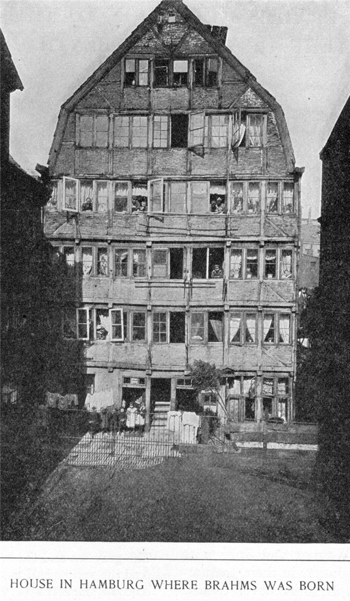
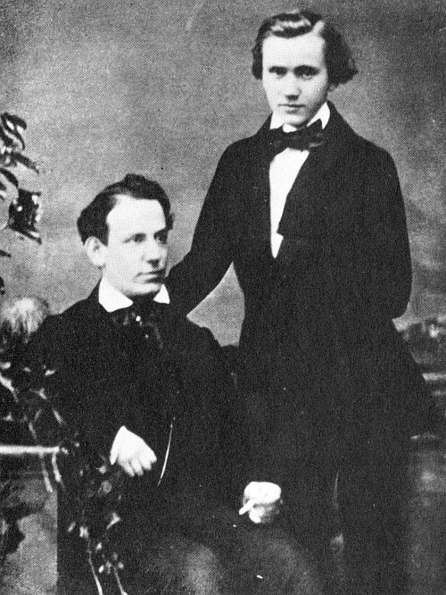
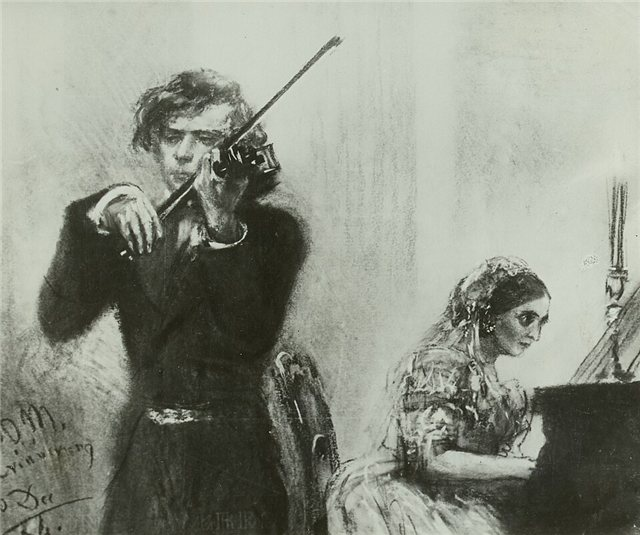
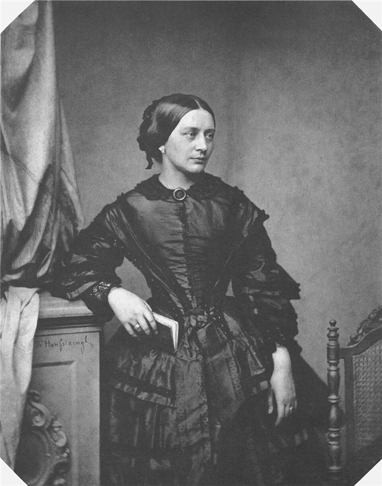
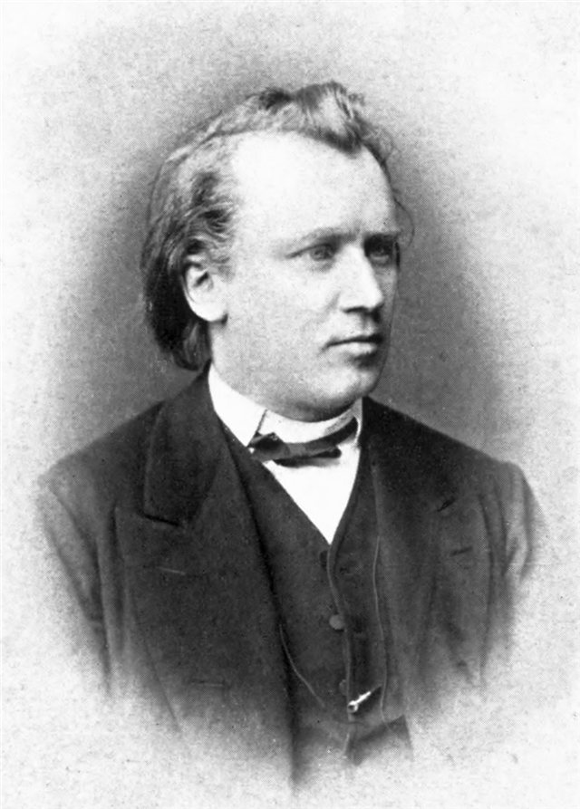
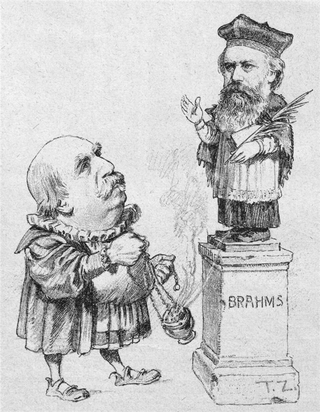
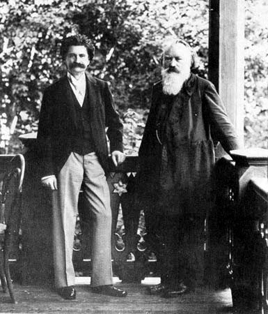
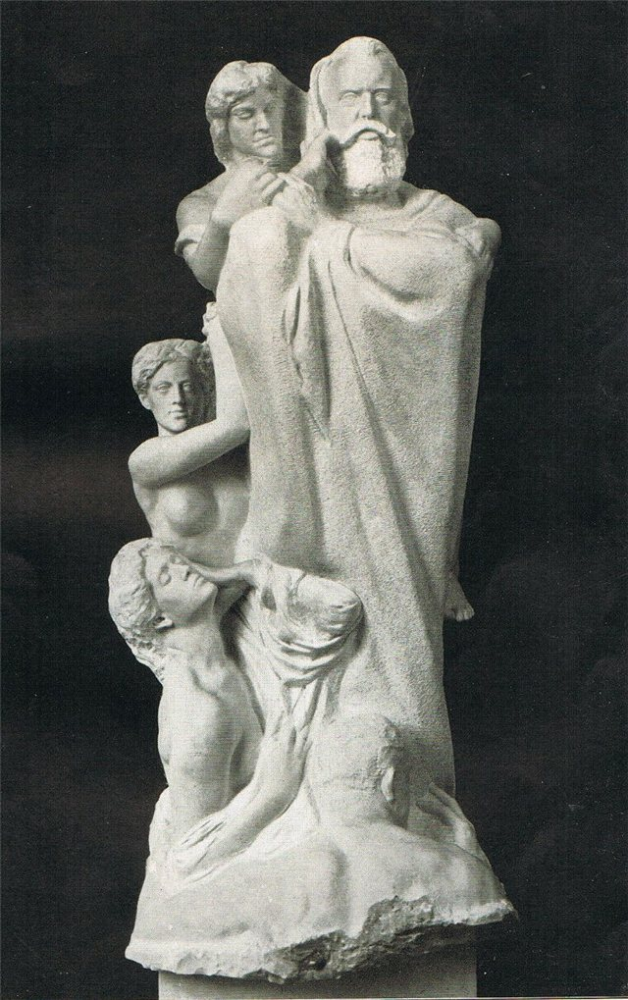

<!--
內容整理自中文維基百科「約翰尼斯·布拉姆斯」條目（CC BY-SA 4.0），並以台灣用語改寫摘要。
https://zh.wikipedia.org/zh-tw/約翰尼斯·布拉姆斯
條目中的「姚阿幸」（Joseph Joachim），為與本站其他時間軸一致，寫作「約阿希姆」。
圖片皆為 Wikimedia Commons 上的公有領域作品。
-->

# Periods
- 1833 ~ 1853 | 早年@漢堡(Hamburg)
  父親是在漢堡討生活的樂手，主要吹小號、拉低音提琴；母親是比父親年長17歲的裁縫。家境貧寒，布拉姆斯少年時就靠彈琴貼補家用。先後隨柯賽爾與馬克森學琴，很早就開始作曲，但後來把大部分早期作品都毀掉了。
- 1853 ~ 1856 | 結識舒曼夫婦@杜塞道夫
  20歲隨小提琴家巡演，結識約阿希姆與李斯特，再拿著約阿希姆的介紹信拜訪舒曼。舒曼撰文盛讚他，從此一舉成名。舒曼精神崩潰住院後，布拉姆斯留在杜塞道夫，成為克拉拉一家實際上的支柱。
- 1856 ~ 1862 | 代特莫爾德與漢堡
  舒曼去世後，往返漢堡指揮女聲合唱團，並在代特莫爾德宮廷指揮樂團、教學生。第一號鋼琴協奏曲首演反應冷淡，他也捲入與李斯特、華格納等新德意志樂派的「浪漫派之戰」。
- 1862 ~ 1890 | 維也納：名聲鼎盛
  遷居維也納，《德意志安魂曲》奠定他在歐洲音樂界的地位。他把事業重心移到維也納，在這段期間完成四首交響曲、小提琴協奏曲與第二號鋼琴協奏曲，成為維也納音樂界的領袖。
- 1890 ~ 1897 | 晚年
  57歲時打算退出樂壇，卻因為欣賞單簧管演奏家米爾費德，又寫出一系列包含單簧管的室內樂傑作。1896年克拉拉去世，他也罹患癌症，隔年在維也納去世。

# Events

## 1833-05-07 | 出生@漢堡

家中排行第二，上有一姊、下有一弟。出生後全家先住在工人階級聚居的通道區，半年後搬到內阿爾斯特湖附近。出生的房子在1943年毀於戰火。

## 1840 | 7歲隨柯賽爾學鋼琴
先隨父親學音樂，7歲起跟柯賽爾學琴，之後拜馬克森為師；馬克森的老師是莫札特的學生、舒伯特的好友。據同學回憶，他11歲就演奏過自己即興寫的鋼琴奏鳴曲。

## 1848-09 | 第一場公開演奏會
在漢堡開過幾場公開演奏會，但要等到19歲巡演之後才真正出名。他從十幾歲就開始指揮合唱團，日後也成為傑出的指揮。

## 1853-04 | 隨賴門伊巡演；結識約阿希姆與李斯特

擔任匈牙利小提琴家賴門伊的鋼琴伴奏巡演，在漢諾威結識小提琴家約阿希姆，在威瑪見到李斯特，李斯特還親自視奏了他的詼諧曲。據說李斯特彈奏自己的b小調奏鳴曲時，布拉姆斯在一旁打起瞌睡，他自己解釋是旅途太累。

## 1853-09 | 在杜塞道夫拜訪舒曼

拿著約阿希姆的介紹信拜訪舒曼。舒曼被這位20歲年輕人的才華傾倒，把他引薦給出版商布賴特科普夫與黑特爾。同年秋天，他與舒曼、迪特里希合寫了一首獻給約阿希姆的《F-A-E奏鳴曲》，主題取自約阿希姆的座右銘「自由但孤獨」。

## 1853-10-28 | 舒曼發表《新道路》
舒曼在《新音樂雜誌》發表最後一篇文章，稱布拉姆斯「必然會最完美地表達出這個時代」。舒曼的朋友圈外，這篇文章卻招來冷淡與懷疑，反而讓布拉姆斯對自己的作品更加嚴苛。

## 1853-11 | 前往萊比錫
拜會當地有影響力的音樂人士，包括孟德爾頌的好友費迪南德·大衛，並與他合作演出。

## 1854-03 | 成為克拉拉一家的支柱

舒曼投萊因河獲救後住進療養院。布拉姆斯在舒曼家附近住下，成為克拉拉與舒曼之間主要的聯絡人，一度實際上撐起這個家。他對比自己年長14歲的克拉拉懷有一生未曾消逝的感情。

## 1856-07-29 | 舒曼去世

舒曼在療養院去世。兩年後布拉姆斯離開了克拉拉，但兩人終生保持深厚情誼。他們後來毀掉了彼此的大量書信，這段關係至今仍是音樂史上的謎團。

## 1857 | 代特莫爾德宮廷樂師
往返漢堡與代特莫爾德，指揮樂團、教學生。在這裡寫下的九重奏小夜曲，後來改編成管弦樂的第一號小夜曲（作品11），刻意向海頓、莫札特時代的曲種致敬。

## 1859-01-22 | 第一號鋼琴協奏曲首演
在漢諾威宮廷劇院親自擔任獨奏首演，最初幾場演出卻差評連連，被新德意志樂派批評為「過時老套」。同年他與哥廷根一位教授的女兒訂婚又取消，終生未婚。

## 1860 | 反新德意志樂派宣言
與約阿希姆聯名發表宣言，抗議《新音樂雜誌》宣稱嚴肅音樂家都支持李斯特、華格納一派的主張。宣言倉促寫成，最後只有四人簽名，以失敗收場，此後布拉姆斯再也沒有介入公開論戰。

## 1862-09 | 前往維也納
到維也納重新建立名聲，之後在這座城市度過大部分的創作生涯。

## 1863 | 維也納歌唱學院總監
秋天出任這個歷史悠久合唱團體的冬季樂季總監，開始參與維也納最具傳統的聖樂與古樂活動，隔年辭職。

## 1868-04-10 | 《德意志安魂曲》在不萊梅首演
這部大型合唱作品鞏固了他在歐洲音樂界的地位，也讓他決定不再爭取故鄉漢堡的職位，把事業重心正式轉移到維也納。

## 1871 | 定居維也納卡爾斯街4號
年底遷入這處簡樸的住所，之後一直住到去世。

## 1872 | 維也納愛樂協會總監

秋天接任這個職位，但不久就因為繁瑣的行政工作而辭任。同年父親去世。

## 1876-11-04 | 第一號交響曲在卡爾斯魯厄首演
從1860年代初就開始構思第一樂章，前後二十年才在40多歲完成。許多人開始認為他是貝多芬的繼承者，這首交響曲甚至被稱為「貝多芬第十號」。

## 1877 | 第二號交響曲；婉拒劍橋大學榮譽博士
1877到1885年間，其後三首交響曲相繼誕生。這一年他拒絕了劍橋大學的名譽音樂博士學位。

## 1878 | D大調小提琴協奏曲

為好友約阿希姆而寫，約阿希姆也提供了修改建議。這首曲子被樂迷譽為四大小提琴協奏曲之一，與貝多芬、孟德爾頌、柴可夫斯基的作品齊名。同年起，他常在春天到義大利旅行、夏天作曲。

## 1879 | 弗羅茨瓦夫大學榮譽博士；《大學慶典序曲》
接受弗羅茨瓦夫大學的榮譽學位，並寫下《大學慶典序曲》（作品80）致謝。同時期還有G大調第一號小提琴奏鳴曲。

## 1881-11-09 | 第二號鋼琴協奏曲在布達佩斯首演
再次親自擔任獨奏。同年起，他的作品可以由漢斯·馮·畢羅指揮的邁寧根宮廷樂團試奏；畢羅原本屬於新音樂派，這時轉而成為布拉姆斯的擁護者，並把他與巴赫、貝多芬並稱為「三B」。

## 1883 | 第三號交響曲
四首交響曲中篇幅最短的一首，在維也納首演。

## 1885-10-17 | 第四號交響曲在邁寧根首演
由布拉姆斯親自指揮邁寧根樂團首演。

## 1886 | 室內樂傑作；獲普魯士功勳勳章
這一年陸續完成第二號大提琴奏鳴曲、第二號小提琴奏鳴曲與第三號鋼琴三重奏，並獲頒普魯士「傑出成就勳章」。

## 1889 | 漢堡榮譽市民；留下錄音
獲故鄉漢堡授予榮譽市民，特地寫了《祝辭與格言》誌慶。同年愛迪生的代表到維也納，為他錄下一小段他彈奏的第一號匈牙利舞曲，這是最早的知名作曲家本人錄音，只是音樂幾乎被雜音淹沒。

## 1890 | 打算退出樂壇

57歲時計畫退休，但並沒有做到，許多晚年傑作都誕生在這之後。

## 1891 | 為米爾費德寫單簧管作品

欣賞邁寧根樂團的單簧管演奏家米爾費德，為他寫下單簧管三重奏與單簧管五重奏，之後又寫了兩首單簧管奏鳴曲。

## 1896-05 | 《四首嚴肅的歌》；克拉拉去世
完成四首歌曲（作品121）後不久，克拉拉·舒曼去世，帶給他嚴重的打擊。同年他罹患癌症，寫下的十一首聖詠前奏曲中，最後一首是〈世界，我將離你而去〉。

## 1897-03-13 | 最後一次公開露面

出席小約翰·史特勞斯的輕歌劇《理性女神》演出，但因病在中場離席。他與史特勞斯、德弗札克都是好友。

## 1897-04-03 | 逝世@維也納

享年63歲，安葬於維也納中央公墓，與貝多芬、舒伯特的墓相鄰。
