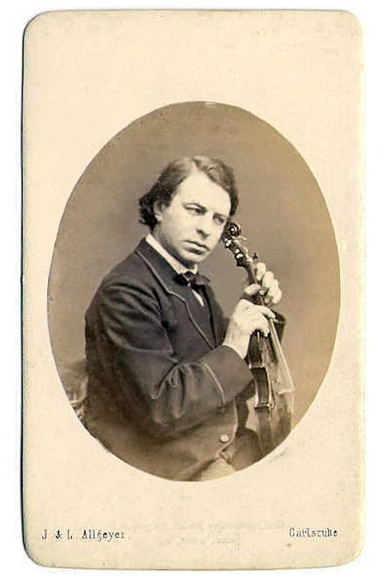
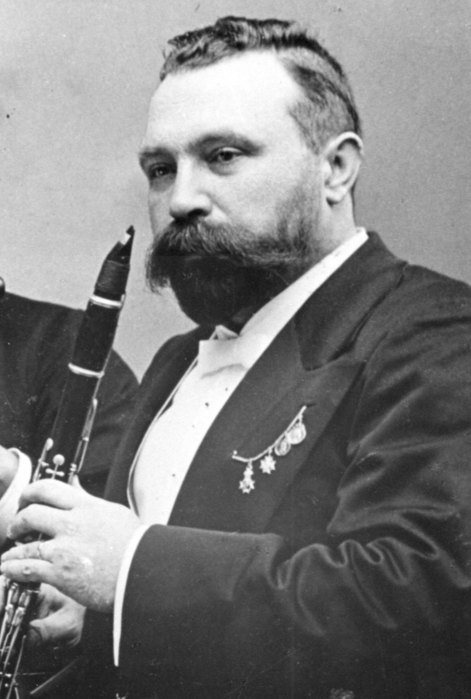
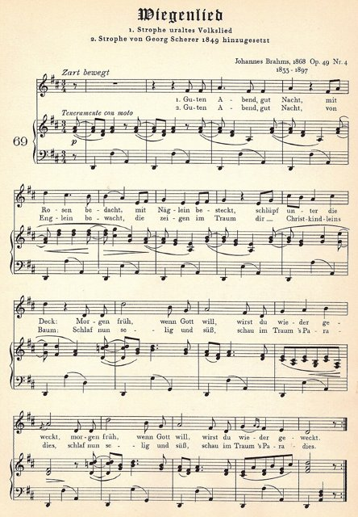

<!--
內容整理自本機筆記〈布拉姆斯主要作品〉（D:\Books\md\音樂\布拉姆斯主要作品.md，網頁版在知識圖譜的「5-2.音樂家作品」），做法比照「貝多芬主要作品」。
- 每首作品一則事件，日期採「創作時間」（多年創作的作品以區間呈現；「年代」以十年計、「世紀」以百年計，修訂或出版年份只寫在顯示文字裡），事件顏色依筆記的類別段落區分：管弦樂與交響曲、鋼琴獨奏作品、室內樂作品、聲樂與藝術歌曲、合唱、宗教與大型聲樂作品、管風琴作品與無作品編號作品。
- 「約」、「前後」、修訂、出版等不是單純年份的寫法，以原文作為顯示文字。
- 作品編號是目錄編號，不等於創作順序，時間軸依創作時間排序。
- 筆記沒有分期，時期沿用「布拉姆斯生平」時間軸的主要時期（重疊的細分時期不列）。
- 筆記「最值得優先聆聽」清單中的作品另註明順序。
- 以 follows 排在「布拉姆斯生平」之後；生平事件見該時間軸。
圖片來源（皆為 Wikimedia Commons 公有領域作品，多為手稿、初版樂譜與首演海報；封面為〈搖籃曲〉Op. 49 No. 4 樂譜；註明「共用」者沿用生平時間軸的圖片）：
- brahms-1878-joachim.jpg（小提琴家約阿希姆，協奏曲為他而寫（與布拉姆斯生平共用））
- brahms-1891-muehlfeld.jpg（單簧管家米爾費爾德，五重奏為他而寫（與布拉姆斯生平共用））
- brahmsw-wiegenlied.jpg：Guten Abend, gut Nacht (Brahms).jpg（〈搖籃曲〉Op. 49 No. 4 樂譜）
-->

# Periods
- 1833 ~ 1853 | 早年@漢堡(Hamburg)
  父親是在漢堡討生活的樂手，主要吹小號、拉低音提琴；母親是比父親年長17歲的裁縫。家境貧寒，布拉姆斯少年時就靠彈琴貼補家用。先後隨柯賽爾與馬克森學琴，很早就開始作曲，但後來把大部分早期作品都毀掉了。
- 1853 ~ 1856 | 結識舒曼夫婦@杜塞道夫
  20歲隨小提琴家巡演，結識約阿希姆與李斯特，再拿著約阿希姆的介紹信拜訪舒曼。舒曼撰文盛讚他，從此一舉成名。舒曼精神崩潰住院後，布拉姆斯留在杜塞道夫，成為克拉拉一家實際上的支柱。
- 1856 ~ 1862 | 代特莫爾德與漢堡
  舒曼去世後，往返漢堡指揮女聲合唱團，並在代特莫爾德宮廷指揮樂團、教學生。第一號鋼琴協奏曲首演反應冷淡，他也捲入與李斯特、華格納等新德意志樂派的「浪漫派之戰」。
- 1862 ~ 1890 | 維也納：名聲鼎盛
  遷居維也納，《德意志安魂曲》奠定他在歐洲音樂界的地位。他把事業重心移到維也納，在這段期間完成四首交響曲、小提琴協奏曲與第二號鋼琴協奏曲，成為維也納音樂界的領袖。
- 1890 ~ 1897 | 晚年
  57歲時打算退出樂壇，卻因為欣賞單簧管演奏家米爾費德，又寫出一系列包含單簧管的室內樂傑作。1896年克拉拉去世，他也罹患癌症，隔年在維也納去世。

# Events

## 1857 ~ 1858 | Op. 11 D 大調第一號小夜曲 {color=#c92a2a}
類別：管弦樂（管弦樂與交響曲）。

## 1854 ~ 1859 | Op. 15 d 小調第一號鋼琴協奏曲 {color=#c92a2a}
類別：鋼琴協奏曲（管弦樂與交響曲）。

## 1858 ~ 1859 | Op. 16 A 大調第二號小夜曲 {color=#c92a2a}
類別：管弦樂（管弦樂與交響曲）。

## 1861 | Op. 23 舒曼主題變奏曲（雙鋼琴版） {color=#c92a2a}
類別：雙鋼琴；原主題變奏曲另有 Op. 9（管弦樂與交響曲）。

## 1865 ~ 1868 | Op. 45 《德意志安魂曲》 {color=#c92a2a}
類別：合唱、獨唱與管弦樂（管弦樂與交響曲）。入門推薦聆聽第 5 首。

## 1863 ~ 1868 | Op. 50 《里納爾多》 {color=#c92a2a}
類別：男高音、男聲合唱與管弦樂清唱劇（管弦樂與交響曲）。

## 1869 | Op. 54 女中音狂想曲 {color=#c92a2a}
類別：女中音、男聲合唱與管弦樂（管弦樂與交響曲）。

## 1870 ~ 1871 | Op. 55 《凱旋之歌》 {color=#c92a2a}
類別：合唱與管弦樂（管弦樂與交響曲）。

## 1855 ~ 1876 | Op. 68 c 小調第一號交響曲 {color=#c92a2a}
類別：交響曲（管弦樂與交響曲）。入門推薦聆聽第 1 首。

## 1877 | Op. 73 D 大調第二號交響曲 {color=#c92a2a}
類別：交響曲（管弦樂與交響曲）。

## 1878 | Op. 77 D 大調小提琴協奏曲 {color=#c92a2a}

類別：小提琴協奏曲（管弦樂與交響曲）。入門推薦聆聽第 3 首。

## 1880 | Op. 80 《學院節慶序曲》 {color=#c92a2a}
類別：管弦樂序曲（管弦樂與交響曲）。

## 1880 | Op. 81 《悲劇序曲》 {color=#c92a2a}
類別：管弦樂序曲（管弦樂與交響曲）。

## 1878 ~ 1881 | Op. 83 降 B 大調第二號鋼琴協奏曲 {color=#c92a2a}
類別：鋼琴協奏曲（管弦樂與交響曲）。入門推薦聆聽第 4 首。

## 1883 | Op. 90 F 大調第三號交響曲 {color=#c92a2a}
類別：交響曲（管弦樂與交響曲）。

## 1884 ~ 1885 | Op. 91 兩首歌曲（中提琴、女聲與鋼琴） {color=#c92a2a}
類別：室內聲樂（管弦樂與交響曲）。

## 1884 ~ 1885 | Op. 98 e 小調第四號交響曲 {color=#c92a2a}
類別：交響曲（管弦樂與交響曲）。入門推薦聆聽第 2 首。

## 1887 | Op. 102 a 小調雙重協奏曲 {color=#c92a2a}
類別：小提琴、大提琴與管弦樂協奏曲（管弦樂與交響曲）。

## 1852 ~ 1853 | Op. 1 C 大調第一號鋼琴奏鳴曲 {color=#1971c2}
類別：鋼琴奏鳴曲（鋼琴獨奏作品）。

## 1852 | Op. 2 升 f 小調第二號鋼琴奏鳴曲 {color=#1971c2}
類別：鋼琴奏鳴曲（鋼琴獨奏作品）。

## 1851 | Op. 4 降 e 小調詼諧曲 {color=#1971c2}
類別：鋼琴獨奏（鋼琴獨奏作品）。

## 1853 | Op. 5 f 小調第三號鋼琴奏鳴曲 {color=#1971c2}
類別：鋼琴奏鳴曲（鋼琴獨奏作品）。

## 1854 | Op. 9 舒曼主題變奏曲 {color=#1971c2}
類別：鋼琴變奏曲（鋼琴獨奏作品）。

## 1854 | Op. 10 四首敘事曲 {color=#1971c2}
類別：鋼琴小品（鋼琴獨奏作品）。

## 1857 | Op. 21 No. 1 原創主題變奏曲 {color=#1971c2}
類別：鋼琴變奏曲（鋼琴獨奏作品）。

## 1853 ~ 1854 | Op. 21 No. 2 匈牙利歌曲主題變奏曲 {color=#1971c2}
類別：鋼琴變奏曲（鋼琴獨奏作品）。

## 1861 | Op. 24 韓德爾主題變奏曲與賦格 {color=#1971c2}
類別：鋼琴變奏曲（鋼琴獨奏作品）。

## 1862 ~ 1863 | Op. 35 帕格尼尼主題變奏曲 {color=#1971c2}
類別：鋼琴變奏曲（鋼琴獨奏作品）。

## 1865 | Op. 39 十六首圓舞曲 {color=#1971c2}
類別：鋼琴圓舞曲（鋼琴獨奏作品）。

## 1871 ~ 1878 | Op. 76 八首鋼琴小品 {color=#1971c2}
類別：性格小品（鋼琴獨奏作品）。

## 1879 | Op. 79 兩首狂想曲 {color=#1971c2}
類別：鋼琴小品（鋼琴獨奏作品）。

## 1892 | Op. 116 七首幻想曲 {color=#1971c2}
類別：晚期鋼琴小品（鋼琴獨奏作品）。

## 1892 | Op. 117 三首間奏曲 {color=#1971c2}
類別：晚期鋼琴小品（鋼琴獨奏作品）。

## 1893 | Op. 118 六首鋼琴小品 {color=#1971c2}
類別：晚期鋼琴小品（鋼琴獨奏作品）。

## 1893 | Op. 119 四首鋼琴小品 {color=#1971c2}
類別：晚期鋼琴小品（鋼琴獨奏作品）。

## 1853 ~ 1854 | Op. 8 B 大調第一號鋼琴三重奏 {color=#e67700 label="1853–1854；1889修訂"}
類別：鋼琴三重奏（室內樂作品）。

## 1859 ~ 1860 | Op. 18 降 B 大調第一號弦樂六重奏 {color=#e67700}
類別：弦樂六重奏（室內樂作品）。

## 1856 ~ 1861 | Op. 25 g 小調第一號鋼琴四重奏 {color=#e67700}
類別：鋼琴四重奏（室內樂作品）。

## 1861 ~ 1862 | Op. 26 A 大調第二號鋼琴四重奏 {color=#e67700}
類別：鋼琴四重奏（室內樂作品）。

## 1862 ~ 1864 | Op. 34 f 小調鋼琴五重奏 {color=#e67700}
類別：鋼琴五重奏（室內樂作品）。入門推薦聆聽第 7 首。

## 1864 ~ 1865 | Op. 36 G 大調第二號弦樂六重奏 {color=#e67700}
類別：弦樂六重奏（室內樂作品）。

## 1862 ~ 1865 | Op. 38 e 小調第一號大提琴奏鳴曲 {color=#e67700}
類別：大提琴奏鳴曲（室內樂作品）。入門推薦聆聽第 8 首。

## 1865 | Op. 40 降 E 大調圓號三重奏 {color=#e67700}
類別：圓號、小提琴與鋼琴（室內樂作品）。

## 1865 ~ 1873 | Op. 51 No. 1 c 小調第一號弦樂四重奏 {color=#e67700}
類別：弦樂四重奏（室內樂作品）。

## 1865 ~ 1873 | Op. 51 No. 2 a 小調第二號弦樂四重奏 {color=#e67700}
類別：弦樂四重奏（室內樂作品）。

## 1855 ~ 1875 | Op. 60 c 小調第三號鋼琴四重奏 {color=#e67700}
類別：鋼琴四重奏（室內樂作品）。

## 1875 ~ 1876 | Op. 67 降 B 大調第三號弦樂四重奏 {color=#e67700}
類別：弦樂四重奏（室內樂作品）。

## 1878 ~ 1879 | Op. 78 G 大調第一號小提琴奏鳴曲（雨之歌） {color=#e67700}
類別：小提琴奏鳴曲（室內樂作品）。

## 1882 | Op. 88 F 大調第一號弦樂五重奏 {color=#e67700}
類別：弦樂五重奏（室內樂作品）。

## 1886 | Op. 99 F 大調第二號大提琴奏鳴曲 {color=#e67700}
類別：大提琴奏鳴曲（室內樂作品）。

## 1886 | Op. 100 A 大調第二號小提琴奏鳴曲 {color=#e67700}
類別：小提琴奏鳴曲（室內樂作品）。

## 1886 | Op. 101 c 小調第三號鋼琴三重奏 {color=#e67700}
類別：鋼琴三重奏（室內樂作品）。

## 1886 ~ 1888 | Op. 108 d 小調第三號小提琴奏鳴曲 {color=#e67700}
類別：小提琴奏鳴曲（室內樂作品）。

## 1890 | Op. 111 G 大調第二號弦樂五重奏 {color=#e67700}
類別：弦樂五重奏（室內樂作品）。

## 1891 | Op. 114 a 小調單簧管三重奏 {color=#e67700}
類別：單簧管、大提琴與鋼琴（室內樂作品）。

## 1891 | Op. 115 b 小調單簧管五重奏 {color=#e67700}

類別：單簧管五重奏（室內樂作品）。入門推薦聆聽第 6 首。

## 1894 | Op. 120 No. 1 f 小調第一號單簧管奏鳴曲 {color=#e67700}
類別：單簧管奏鳴曲（室內樂作品）。

## 1894 | Op. 120 No. 2 降 E 大調第二號單簧管奏鳴曲 {color=#e67700}
類別：單簧管奏鳴曲（室內樂作品）。

## 1852 ~ 1853 | Op. 3 六首歌曲 {color=#2f9e44}
類別：藝術歌曲（聲樂與藝術歌曲）。

## 1852 ~ 1853 | Op. 6 六首歌曲 {color=#2f9e44}
類別：藝術歌曲（聲樂與藝術歌曲）。

## 1851 ~ 1853 | Op. 7 六首歌曲 {color=#2f9e44}
類別：藝術歌曲（聲樂與藝術歌曲）。

## 1858 | Op. 12 《聖母頌》（Ave Maria） {color=#2f9e44}
類別：女聲合唱與管弦樂（聲樂與藝術歌曲）。

## 1858 | Op. 14 八首歌曲與浪漫曲 {color=#2f9e44}
類別：藝術歌曲（聲樂與藝術歌曲）。

## 1860 | Op. 17 四首歌曲 {color=#2f9e44}
類別：女聲合唱、圓號與豎琴（聲樂與藝術歌曲）。

## 1858 ~ 1859 | Op. 19 五首歌曲 {color=#2f9e44}
類別：藝術歌曲（聲樂與藝術歌曲）。

## 1859 | Op. 27 《詩篇第十三篇》 {color=#2f9e44}
類別：合唱作品（聲樂與藝術歌曲）。

## 1860 ~ 1869 | Op. 30 《忠實的愛》相關歌曲集 {color=#2f9e44 label="1860年代"}
類別：藝術歌曲（聲樂與藝術歌曲）。

## 1864 | Op. 32 九首歌曲 {color=#2f9e44}
類別：藝術歌曲（聲樂與藝術歌曲）。

## 1860 ~ 1869 | Op. 43 No. 1 《五月之夜》 {color=#2f9e44 label="1860年代"}
類別：藝術歌曲（聲樂與藝術歌曲）。

## 1860 ~ 1869 | Op. 46 四首歌曲 {color=#2f9e44 label="1860年代"}
類別：藝術歌曲（聲樂與藝術歌曲）。

## 1868 | Op. 49 No. 4 《搖籃曲》（Wiegenlied） {color=#2f9e44}

類別：藝術歌曲（聲樂與藝術歌曲）。入門推薦聆聽第 11 首。

## 1868 ~ 1869 | Op. 52 《愛之歌圓舞曲》 {color=#2f9e44}
類別：聲樂四重唱與鋼琴四手聯彈（聲樂與藝術歌曲）。

## 1860 ~ 1869 | Op. 53 女中音狂想曲的相關作品編號不同；此編號為《女中音狂想曲》前後的作品集 {color=#2f9e44 label="1860年代"}
類別：聲樂作品（聲樂與藝術歌曲）。

## 1873 | Op. 59 八首歌曲 {color=#2f9e44}
類別：藝術歌曲（聲樂與藝術歌曲）。

## 1874 | Op. 62 七首歌曲 {color=#2f9e44}
類別：合唱歌曲（聲樂與藝術歌曲）。

## 1869 ~ 1874 | Op. 65 《新愛之歌圓舞曲》 {color=#2f9e44}
類別：聲樂四重唱與鋼琴四手聯彈（聲樂與藝術歌曲）。

## 1870 ~ 1879 | Op. 66 五首二重唱 {color=#2f9e44 label="1870年代"}
類別：聲樂二重唱（聲樂與藝術歌曲）。

## 1870 ~ 1879 | Op. 69 九首歌曲與浪漫曲 {color=#2f9e44 label="1870年代"}
類別：藝術歌曲（聲樂與藝術歌曲）。

## 1870 ~ 1879 | Op. 72 五首歌曲 {color=#2f9e44 label="1870年代"}
類別：藝術歌曲（聲樂與藝術歌曲）。

## 1880 ~ 1889 | Op. 84 五首歌曲 {color=#2f9e44 label="1880年代初"}
類別：藝術歌曲（聲樂與藝術歌曲）。

## 1884 ~ 1885 | Op. 91 兩首歌曲 {color=#2f9e44}
類別：女聲、中提琴與鋼琴（聲樂與藝術歌曲）。

## 1880 ~ 1889 | Op. 92 四首四重唱 {color=#2f9e44 label="1880年代"}
類別：聲樂四重唱（聲樂與藝術歌曲）。

## 1887 | Op. 103 《吉卜賽歌曲》 {color=#2f9e44}
類別：聲樂四重唱與鋼琴（聲樂與藝術歌曲）。

## 1888 | Op. 104 五首合唱歌曲 {color=#2f9e44}
類別：無伴奏合唱（聲樂與藝術歌曲）。

## 1891 | Op. 112 四首歌曲 {color=#2f9e44}
類別：合唱歌曲（聲樂與藝術歌曲）。

## 1896 | Op. 121 《四首嚴肅歌曲》 {color=#2f9e44}
類別：獨唱與鋼琴（聲樂與藝術歌曲）。入門推薦聆聽第 10 首。

## 1858 | Op. 13 《葬禮之歌》 {color=#862e9c}
類別：合唱與管樂（合唱、宗教與大型聲樂作品）。

## 1850 ~ 1869 | Op. 29 三首神聖合唱曲 {color=#862e9c label="1850年代末至1860年代"}
類別：合唱（合唱、宗教與大型聲樂作品）。

## 1860 ~ 1869 | Op. 30 《忠實的愛》相關作品集 {color=#862e9c label="1860年代"}
類別：聲樂（合唱、宗教與大型聲樂作品）。

## 1860 ~ 1869 | Op. 37 三首神聖合唱曲 {color=#862e9c label="1860年代"}
類別：合唱（合唱、宗教與大型聲樂作品）。

## 1869 | Op. 54 《女中音狂想曲》 {color=#862e9c}
類別：女中音、男聲合唱與管弦樂（合唱、宗教與大型聲樂作品）。

## 1877 ~ 1878 | Op. 74 兩首合唱曲 {color=#862e9c}
類別：合唱（合唱、宗教與大型聲樂作品）。

## 1868 ~ 1871 | Op. 82 《命運之歌》（Schicksalslied） {color=#862e9c}
類別：合唱與管弦樂（合唱、宗教與大型聲樂作品）。

## 1881 | Op. 89 《歌女》（Nänie） {color=#862e9c}
類別：合唱與管弦樂（合唱、宗教與大型聲樂作品）。

## 1888 | Op. 109 三首合唱歌曲 {color=#862e9c}
類別：合唱（合唱、宗教與大型聲樂作品）。

## 1889 | Op. 110 三首合唱歌曲 {color=#862e9c}
類別：合唱（合唱、宗教與大型聲樂作品）。

## 1891 | Op. 112 四首合唱歌曲 {color=#862e9c}
類別：合唱（合唱、宗教與大型聲樂作品）。

## 1858 | WoO 7 《悲傷啊，悲傷啊》（O Traurigkeit, o Herzeleid）前奏曲與賦格相關作品 {color=#0c8599 label="1858起，後續修訂"}
類別：管風琴（管風琴作品與無作品編號作品）。

## 1856 | WoO 8 降 a 小調賦格 {color=#0c8599}
類別：管風琴（管風琴作品與無作品編號作品）。

## 1856 | WoO 9 a 小調前奏曲與賦格 {color=#0c8599}
類別：管風琴（管風琴作品與無作品編號作品）。

## 1857 | WoO 10 g 小調前奏曲與賦格 {color=#0c8599}
類別：管風琴（管風琴作品與無作品編號作品）。

## 1896 | Op. 122 十一首聖詠前奏曲 {color=#0c8599}
類別：管風琴（管風琴作品與無作品編號作品）。
