<!--
內容整合自「英國立憲運動大事記（1215—1928）」（D:\Books\md\歷史\西方歷史\英國立憲運動大事記（1215—1928）.md；html 版在 D:\Books\html\1-1.西方歷史），以自己的話改寫。
時期依大事記的七個階段；第七階段大事記一處作1918—1928、一處作1900—1928，這裡以1903年婦女社會政治聯盟成立為界。
處理方式：
- 大事記強調兩條線索不能混為一談：限制王權（17世紀取得決定性進展）與擴大民主（延續到20世紀），這點寫進時期說明。
- 大事記提醒的幾個區別寫進內文：《大憲章》最初是國王與貴族的協議，不是民主憲法；人身保護原則早於1679年；「光榮革命」是後世的稱呼，並非沒有暴力；喬治一世不懂英語只是內閣制成形的因素之一；婦女取得選舉權不能只歸因於戰時工作。
- 1776年威爾克斯提出議會改革動議的日期依大事記所引英國議會資料。
- 1911年《議會法》大事記標題作「議會法案改革的前奏」，內文是《議會法》本身，這裡依內文。
圖片來源（皆為 Wikimedia Commons 公有領域／CC0 作品；註明「共用」者沿用其他時間軸已有的圖片）：
- eu-magna.jpg：Magna Carta (1215) - BL Cotton MS Augustus II 106.jpg（1215年《大憲章》（大英圖書館藏）（與歐洲史時間軸共用））
- bc-petition.jpg：Petition of Right.jpg（《權利請願書》，1628）
- bc-naseby.jpg：Batalla de Naseby. Charles Landseer. 02.jpg（查爾斯·蘭西爾〈納斯比戰役〉，19世紀）
- bc-execution.jpg：Onthoofding van Karel I, koning van Engeland, in Londen, 1649, RP-P-1988-598.jpg（〈查理一世在倫敦被斬首，1649〉，17世紀版畫（荷蘭國家博物館））
- bc-cromwell.jpg：Oliver Cromwell by Samuel Cooper.jpg（塞繆爾·庫珀所繪奧利佛·克倫威爾像，1656）
- bc-restoration.jpg：The Landing of Charles II at Dover 1660 – Edward Matthew Ward, 1864 – Parliamentary Art Collection, WOA 2609.png（愛德華·馬修·沃德〈查理二世在多佛登陸，1660〉，1864（英國議會藝術收藏））
- bc-william.jpg：Jan Wyck (1645-1700) - William III Landing at Brixham, Torbay, 5 November 1688 - BHC3095 - Royal Museums Greenwich.jpg（揚·維克〈威廉三世在托貝的布里克瑟姆登陸，1688年11月5日〉（格林威治皇家博物館））
- bc-billofrights.jpg：English Bill of Rights of 1689.jpg（1689年《權利法案》原件）
- bc-walpole.jpg：Robert-Walpole-1st-Earl-of-Orford.jpg（羅伯特·華波爾像）
- bc-wilkes.jpg：William Hogarth - John Wilkes, Esq - B1994.4.332 - Yale Center for British Art.jpg（霍加斯〈約翰·威爾克斯〉諷刺版畫，1763（耶魯英國藝術中心））
- ss-peterloo.jpg：The Massacre of Peterloo.jpg（諷刺彼得盧屠殺的版畫，1819（與社會結構史時間軸共用））
- bc-reform.jpg：Detail House of Commons.JPG（海特〈1833年的下議院〉局部，改革法案後的第一屆下議院）
- bc-chartist.jpg：Chartist meeting on Kennington Common by William Edward Kilburn 1848 - restoration1.jpg（基爾本拍攝的憲章運動肯寧頓公地集會，1848年4月10日）
- bc-pankhurst.jpg：Mrs Emmeline Pankhurst, Leader of the Women's Suffragette movement, is arrested outside Buckingham Palace while trying to present a petition to King George V in May 1914. Q81486.jpg（艾米琳·潘克斯特在白金漢宮外被捕，1914年5月（帝國戰爭博物館））
- bc-astor.jpg：Nancy Astor.jpg（南希·阿斯特）
-->

# Periods
- 1215 ~ 1484 | 限制王權的萌芽 | #868e96
  《大憲章》讓國王也受法律約束；《牛津條款》、孟福爾議會與模範議會讓郡與城鎮的代表進入國政協商，14世紀議會分成上、下兩院。這些都還不是民主，代表權掌握在特定身分的人手中。
- 1485 ~ 1641 | 王權與議會的衝突 | #f08c00
  都鐸王朝強化王權，但議會的立法與課稅功能持續發展；斯圖亞特王朝主張君權神授，查理一世為了錢與宗教政策和議會不斷衝突，十一年不開議會，終至無法收拾。
- 1642 ~ 1659 | 內戰與共和實驗 | #c92a2a
  國王與議會兵戎相見，新模範軍獲勝，查理一世被審判處決，英格蘭廢除君主制成為共和國，最後卻由克倫威爾以護國公之名依靠軍隊統治。廢除君主不等於民主。
- 1660 ~ 1713 | 光榮革命與議會主權 | #1971c2
  王政復辟後，宗教與王位繼承之爭再起；1688年光榮革命，議會把王位交給接受條件的威廉與瑪麗，《權利法案》與《王位繼承法》讓君主必須在法律與議會的框架內統治。限制王權的目標在此大致達成。
- 1714 ~ 1831 | 內閣制與責任政府 | #5f3dc4
  漢諾威王朝時期，首相與內閣逐漸成形，政府越來越需要下議院的支持；但選區嚴重失衡、選舉被權貴操控，工業城市沒有代表，改革的呼聲從威爾克斯到彼得盧不斷升高。
- 1832 ~ 1902 | 選舉改革與民主化 | #2f9e44
  三次改革法案逐步把選舉權擴大到中產階級、城市工人與農村男性，秘密投票、反賄選與重劃選區讓選舉更公正；憲章運動把工人的政治權利推上檯面。擴大民主的這條線，比限制王權走得更久。
- 1903 ~ 1928 | 婦女參政與普選 | #e64980
  婦女參政運動持續施壓，《議會法》削弱上議院；1918年大多數男性與30歲以上的部分女性取得選舉權，1928年女性終於與男性一樣在21歲取得投票權。

# Events

## 1215-06-15 | 《大憲章》

對法戰爭失利、財政吃緊的約翰王與貴族決裂，貴族起兵，迫使他在泰晤士河畔的蘭尼米德接受《大憲章》：國王的統治受既有法律與承諾限制，部分課稅須經同意，對自由人的拘禁、沒收財產與審判須依法定程序。它原本是國王與貴族的政治協議，並沒有消除封建身分差異，也不是保障所有人的民主憲法；其後多次重新頒布，後人才逐漸把它詮釋為法治與限制政府權力的源頭。

## 1258 | 《牛津條款》
亨利三世的財政與外交政策引起貴族不滿，國王為換取支持，被迫接受貴族組成的諮詢監督機制，並同意定期召開議會。貴族不再只要求國王守法，而是開始嘗試建立制度化的監督。

## 1265 | 孟福爾議會
貴族領袖西蒙·德·孟福爾召集的議會，除了貴族與教士，還請來各郡與部分城鎮的代表。議會不再只是國王召集貴族與教士的場合，代表不同地區與社會群體的參與開始成為制度的一部分。

## 1295 | 模範議會
愛德華一世召集由貴族、教士、郡騎士與城鎮代表組成的「模範議會」，成為後來議會組成的範本。國王籌錢、課稅時，越來越需要各方的合作；但代表權仍掌握在地方菁英手中。

## 14c | 上、下兩院分立
議會逐漸分成兩院：上議院由貴族與高階教士組成，下議院由郡與城鎮代表組成。下議院成為討論稅收、提出請願的重要場所，奠定了英國議會的基本形式。

## 1485 | 都鐸王朝建立
亨利七世建立都鐸王朝，王權恢復穩定，加強對地方貴族的控制；亨利八世藉宗教改革與教產重分配擴大王權，伊莉莎白一世時王權依然強大。這個時期王權強化與議會並存，議會的立法與課稅功能持續發展，成為17世紀衝突的制度背景。

## 1603 | 詹姆士一世即位
伊莉莎白一世去世，蘇格蘭的詹姆士六世繼承英格蘭王位，成為詹姆士一世；兩國同一君主，但仍是不同的政治與法律實體。他主張君權神授，與議會在財政、立法與監督上的要求逐漸衝突。

## 1605-11-05 | 火藥陰謀
一群天主教徒企圖炸毀議會、刺殺國王，事敗後政府加強監控天主教徒。事件本身不是限制王權的里程碑，卻顯示當時政治與宗教問題緊密交纏。

## 1628-06-07 | 《權利請願書》
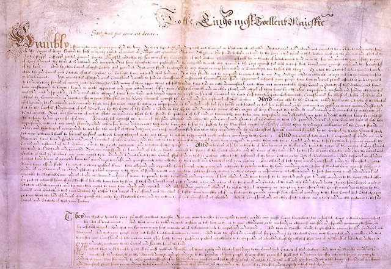
1625年即位的查理一世為了戰爭與財政需要，與議會在課稅、宗教政策與王權界線上衝突不斷。1628年議會提出《權利請願書》，反對未經議會同意課稅、任意拘禁、強迫民眾安置軍隊，以及平時以軍法審判平民，查理一世最後接受。國王不能只憑個人意志課稅或拘禁臣民，這個原則更加確立，但衝突並未就此結束。

## 1629 ~ 1640 | 查理一世的個人統治
查理一世解散議會，此後約十一年不開議會，靠船稅等爭議手段籌錢；他與坎特伯里大主教勞德推動的宗教政策也引起新教徒反感。長期排除議會，讓衝突不斷累積。

## 1640-04 | 短期議會
為了籌措對蘇格蘭作戰的經費，查理一世在4月重開議會，但議員堅持先處理多年的王權濫用，國王5月就將其解散。光是重新召開議會，已無法化解累積多年的不信任。

## 1640-11 | 長期議會
在蘇格蘭軍事壓力與財政困境下，查理一世再開議會，這次議會一開就是好幾年。1641年議會處置國王的重臣斯特拉福伯爵，立法限制國王任意解散議會，挑戰船稅，並要求監督政府決策與宗教政策。議會不再只是請願，而是要從制度上限制王權。11月，下議院通過《大抗議書》，列舉查理一世的種種爭議；但議會內部對改革要走多遠意見分歧。

## 1642-01-04 | 國王闖入下議院
查理一世親自進入下議院，要逮捕五名反對他的議員，但五人已事先離開。這次行動徹底破壞了國王與議會之間的信任，是內戰前最具象徵意義的一幕。

## 1642-08-22 | 英國內戰爆發
衝突演變成全面內戰：保王派支持查理一世，議會派要求限制王權。限制王權的問題從政治辯論變成軍事鬥爭，英國第一次面對是否保留君主制的根本問題。

## 1645-06-14 | 納斯比戰役
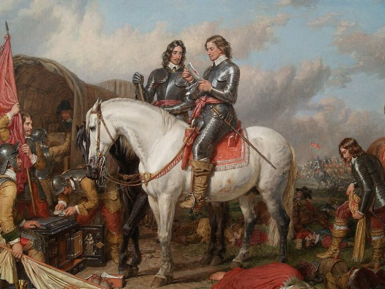
議會派以訓練、指揮與管理都較有組織的新模範軍，在納斯比擊敗保王派，查理一世的軍事地位一蹶不振。1646年他向蘇格蘭軍投降，第一次內戰大致結束，但國王的地位與未來的憲政安排仍懸而未決。

## 1647 | 普特尼辯論
新模範軍與相關人士在普特尼辯論：選舉權該擴大到什麼程度？議會究竟代表哪些人？國王、議會與軍隊如何分權？部分激進人士主張擴大男性的政治參與，雖未成為制度，卻提出了權力該由少數菁英還是更多人民掌握的問題。

## 1648-12 | 普萊德清洗
1648年保王派與蘇格蘭勢力再度起兵（第二次內戰）被擊敗，軍方更認定只要查理一世在位，內戰就會再起。12月，士兵擋住反對審判國王的議員進入下議院，願意審判國王的議員從此掌控議會。

## 1649-01-30 | 查理一世被處決
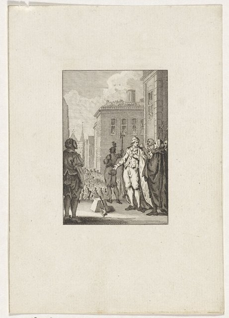
特別法庭以暴政與對人民發動戰爭的罪名審判查理一世，1月30日公開處決。國王不再被視為可以完全免於法律與政治責任，英國進入廢除君主制的政治實驗；但這並不代表已經建立穩定的民主制度。

## 1649-05-19 | 英格蘭共和國成立
英格蘭廢除君主制與上議院，宣布成立共和國，權力掌握在議會派領袖與軍隊手中。這證明英國不一定要由君主統治，也證明廢除君主本身不會自動帶來穩定的代議制度。

## 1653-12-16 | 克倫威爾成為護國公
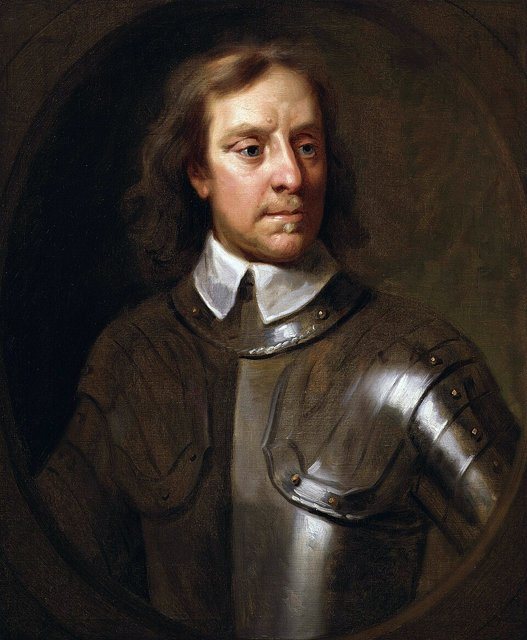
4月20日，對議會不滿的奧利佛·克倫威爾解散殘餘議會；12月，他成為護國公，名義上不是世襲君主，實際上依靠軍隊與行政權統治。議會無法穩定運作時，軍事強人就會成為權力中心。1658年9月3日克倫威爾去世，兒子理查繼任，卻得不到支持，政局陷入混亂。

## 1660-05 | 王政復辟
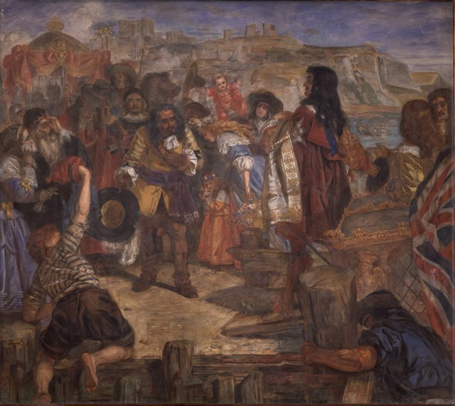
查理二世返國復位，君主制恢復。但英國回不到1642年以前：內戰、弒君與共和實驗，已經改變了政治人物對王權與議會的理解。復辟後，王室是否會恢復天主教勢力、國王是否會再繞過議會，成為新的爭議。

## 1679 | 《人身保護法》
法律強化被拘禁者要求法院審查拘禁是否合法的程序，政府必須在法律框架內說明拘禁的依據。人身保護的原則在普通法中早已存在，1679年的法律是對程序的重要強化。

## 1685 | 詹姆士二世即位
查理二世去世，信奉天主教的弟弟詹姆士二世繼位。他的宗教政策與王權觀念讓英格蘭菁英不安，爭議擴大到國教制度、宗教寬容與王位繼承。

## 1688-11 | 光榮革命
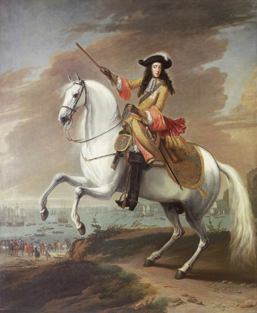
部分英格蘭政治領袖邀請荷蘭執政威廉·奧蘭治出兵，威廉率軍登陸英格蘭，詹姆士二世失去支持，出走國外。「光榮革命」是後世的稱呼；事件涉及外國出兵、國王出走與王位重新安排，並非完全沒有暴力或爭議。

## 1689-02-13 | 威廉三世與瑪麗二世接受王位
議會把王位交給威廉三世與瑪麗二世，並要求新君主接受一系列政治與法律限制。議會不再只是承認世襲的王位，而是決定君主繼位的條件。

## 1689-12-16 | 《權利法案》
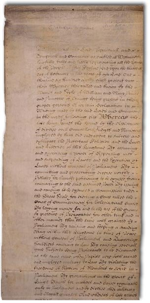
君主不得未經議會同意停止或豁免法律、課徵金錢；平時維持常備軍須經議會同意；議會選舉與議員的言論自由受到保障。光榮革命後的新秩序有了法律基礎，英國走向立憲君主制。但當時的議會仍由少數人選出，婦女與多數工人都沒有選舉權。

## 1701 | 《王位繼承法》
議會規定新教徒的王位繼承順序，並對法官任職與王室治理作出安排。王位繼承不再只是王室的家務事，也由議會的法律規範。

## 1707-05-01 | 英格蘭與蘇格蘭合併
《聯合法案》生效，英格蘭與蘇格蘭合併為大不列顛王國，設立新的大不列顛議會。

## 1714 | 漢諾威王朝開始
安妮女王去世，出身德意志的喬治一世繼位。政府事務越來越多由內閣大臣協調處理；傳統說法是因為他不懂英語才出現內閣制，但這只是其中一個因素，內閣制其實是政黨政治與議會運作長期演變的結果。

## 1721 | 華波爾與首相制度
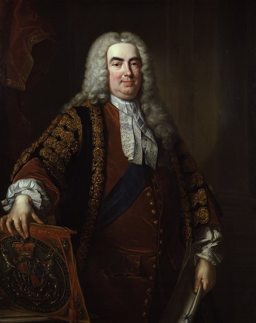
羅伯特·華波爾成為政府中最有影響力的領袖，通常被視為英國第一位事實上的首相。首相一開始並非法定職位，而是從政府領導者與內閣協調者的角色中逐漸形成；內閣走向集體決策，政府越來越依賴下議院多數。但當時的政治仍是有財產門檻的貴族政治。

## 1776 | 威爾克斯提出議會改革動議
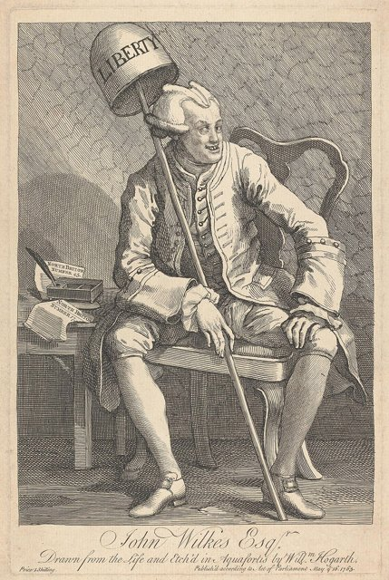
議會雖已掌握立法權，選舉卻極不平等：人口稀少的選區照樣選出議員，快速成長的工業城市卻沒有代表，部分選區被地方權貴控制。約翰·威爾克斯在1776年提出議會改革動議，要求更公平的選舉與更廣泛的參與。1780年代，美國獨立戰爭與法國大革命前夕，改革呼聲越來越高，但受益於舊制度的議員與權貴強力阻擋。

## 1801 | 大不列顛及愛爾蘭聯合王國
1800年通過的《聯合法案》生效，愛爾蘭與大不列顛合併，愛爾蘭代表進入新議會，但愛爾蘭的宗教、土地與代表權問題並未解決。

## 1807 | 廢除奴隸貿易
英國立法禁止參與跨大西洋奴隸貿易，但殖民地的奴隸制仍然存在；直到1833年通過《奴隸制度廢除法》，1834年起才逐步解放。憲政改革並不代表所有人立即取得平等權利。

## 1819-08-16 | 彼得盧屠殺
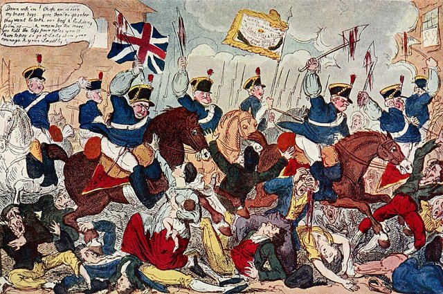
拿破崙戰爭結束後，英國陷入失業、糧價高漲與社會不平等的困境。曼徹斯特附近大批民眾集會要求議會改革，地方當局派騎兵驅散，造成死傷。立憲的問題，從國王與貴族的權力關係延伸到工人階級的政治權利。

## 1829 | 《天主教解放法》
1828年廢除部分針對非國教徒的任職限制，1829年《天主教解放法》讓天主教徒在符合條件下可以擔任議員與公職，宗教身分對政治參與的限制開始鬆動。

## 1832-06-07 | 第一次改革法案
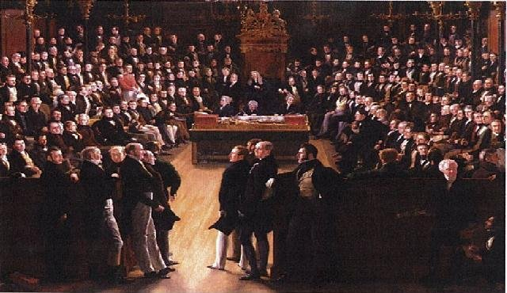
工業化讓人口與經濟重心移向曼徹斯特、伯明罕等城市，議會選區卻還是中世紀的安排。改革法案取消或削減「腐敗選區」的議席，重新分配給人口較多的城鎮，並擴大有財產男性的選舉權。工業資產階級的影響力增加，議會改革也成為可以靠立法與動員推進的議題；但大量工人與所有婦女仍然沒有投票權。

## 1838 | 《人民憲章》與憲章運動
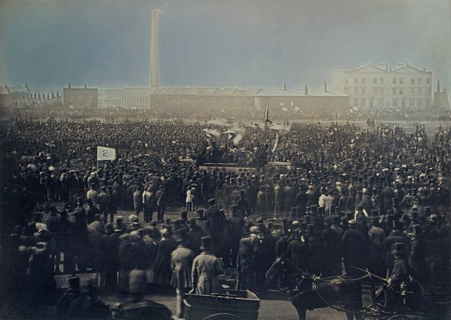
倫敦工人協會提出《人民憲章》六項要求：成年男性普選、秘密投票、取消議員財產資格、議員支薪、公平選區、每年改選。憲章運動把議會改革從中產階級的代表權問題，推向工人的政治權利；1842年與1848年又兩度發動大規模請願，議會都沒有接受，但其中多項要求日後陸續實現。

## 1867-08-15 | 第二次改革法案
選舉權擴大到符合條件的城市男性勞工，並調整部分議席，削弱舊選區制度的不平等。投票權仍有居住與財產門檻，婦女依然被排除。

## 1872 | 《秘密投票法》
以前公開投票，選民容易受地主、雇主與權貴施壓。秘密投票讓選民能自由表達選擇，減少恐嚇與賄選，也是憲章運動的要求之一。1883年的《反腐敗與非法選舉行為法》又限制選舉支出與賄選，選舉從權貴操控走向有規範的競爭。

## 1884-07-06 | 第三次改革法案
選舉權擴大到部分農村男性，縮小城鄉選民資格的差距；1885年又重劃選區，改善代表權失衡。三次改革法案合起來，逐步瓦解以財產、地方特權與不均選區為基礎的舊代表制度，但仍不是所有成年人的平等選舉權。

## 1903 | 婦女社會政治聯盟成立
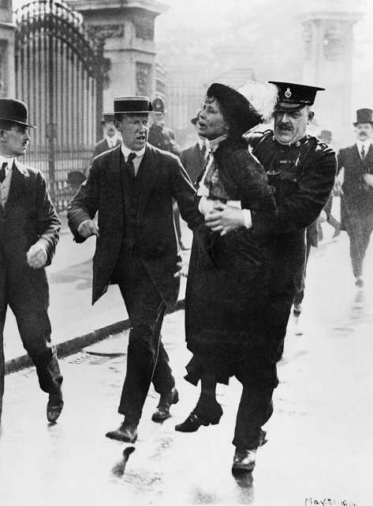
艾米琳·潘克斯特等人成立婦女社會政治聯盟，以示威與激進行動爭取婦女選舉權。在此之前，英國早已有長期的婦女參政請願；米莉森特·福西特等人則以組織、請願與倡議持續推動。1906年自由黨大勝上台，婦女參政、勞工權益與上議院權力都成為政治議題。

## 1911 | 《議會法》
法律限制上議院阻擋財政法案的權力，並取消它對一般公共法案的絕對否決權。這不是擴大選舉權，卻調整了議會內部的權力：民選的下議院地位更高，非民選的上議院受到約束。

## 1918-02-06 | 《人民代表法》
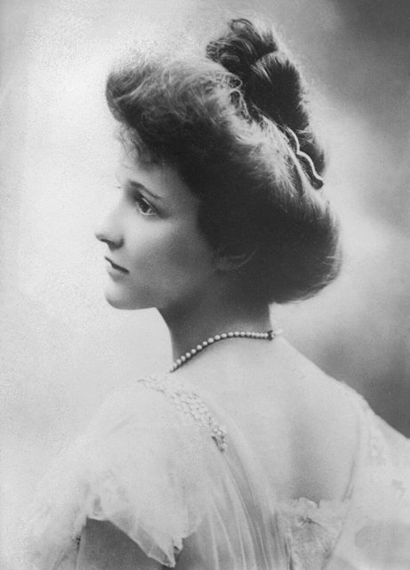
第一次世界大戰期間，大批男性從軍，許多婦女投入工業、運輸與行政工作，改變了社會對婦女公共角色的看法；但選舉權的取得，是長期運動、社會變化與戰後改革協商的共同結果，不能簡化為「做了戰時工作就得到投票權」。新法讓大多數21歲以上男性取得投票權，30歲以上、符合特定資格的女性也首次取得選舉權。12月14日的大選，是婦女第一次參加的國會選舉；當選的康斯坦斯·馬基維茲是愛爾蘭民族主義者，拒絕就任，1919年就任的南希·阿斯特因此通常被視為第一位進入下議院的女議員。

## 1928-07-02 | 男女平等選舉權
新的《人民代表法》讓女性與男性一樣在年滿21歲時取得國會選舉權。從《大憲章》到這一天，英國的路走了七百多年：國王的權力被納入法律，議會取得立法與財政權，內閣與首相制度成形，選舉權從少數有產男性擴大到所有成年人。限制王權與實現民主不是同一件事，前者在17世紀已大致完成，後者還要再走兩百多年。
