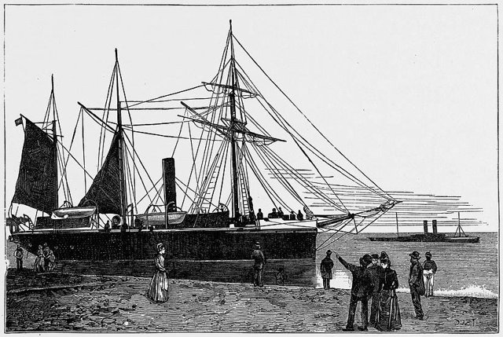
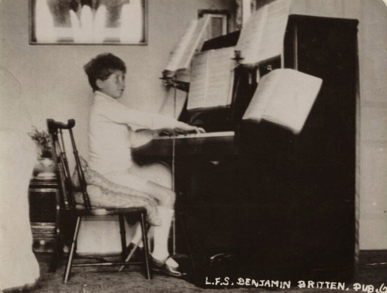
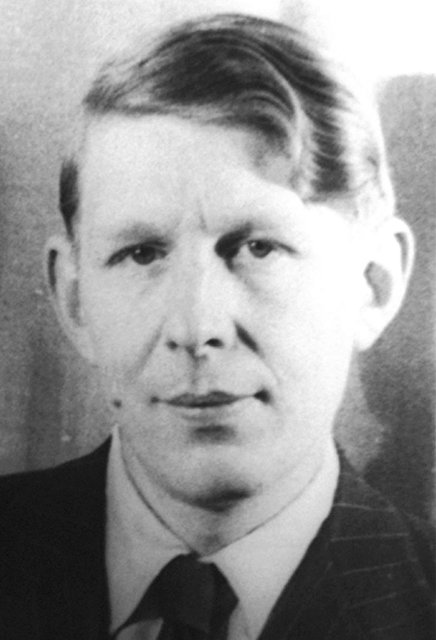
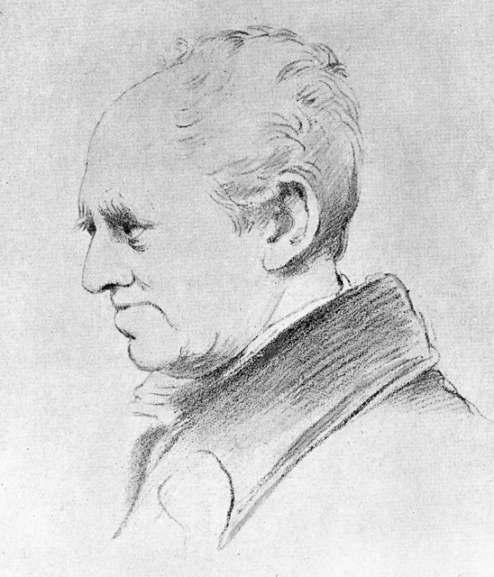
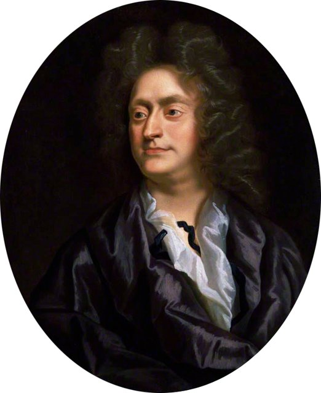
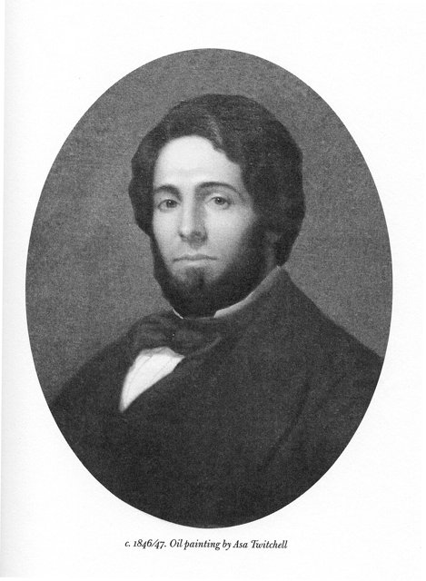
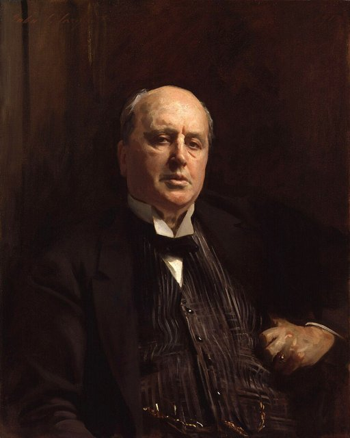
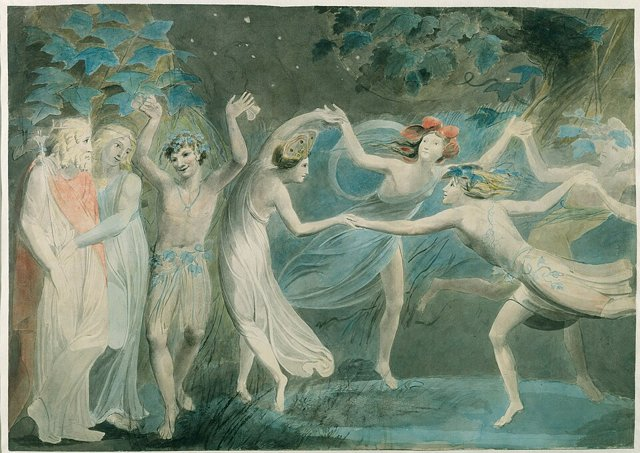
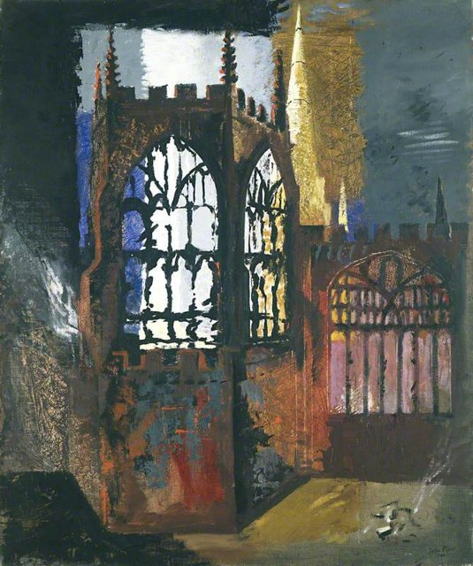

<!--
內容整理自本機筆記〈布列頓（Benjamin Britten）生平大事記〉（D:\Books\md\音樂\布列頓（Benjamin Britten）生平大事記.md），以自己的話改寫。
時期依筆記的六個階段。
處理方式：
- 筆記把 Hymn to St Cecilia, Op. 27 譯為「《光之奏鳴曲》」，這是一首無伴奏合唱曲，這裡改譯〈聖則濟利亞頌〉。
- 筆記中只寫「持續創作」「持續推動音樂節」等沒有具體事件的年份（1950、1955、1956、1959、1964），未另立事件。
- 1952年的榮譽勳位（Companion of Honour）依筆記的年份。
- 人名用·分隔；指揮家畢勤、大提琴家羅斯托波維奇等譯名與其他時間軸一致。人名索引以 notNames 排除「布列頓森林」（1944年布列頓森林會議），並以 aliases 比對另一譯名「布瑞頓」。
圖片來源（皆為 Wikimedia Commons 公有領域作品）：
- britten-cover.jpg：Benjamin Britten, London Records 1968 publicity photo for Wikipedia (restored).jpg（布列頓，1968年倫敦唱片公司的宣傳照）
- britten-lowestoft.jpg：HMS 'Watchful', Gunboat, Lowestoft Harbour - The Graphic 1889.jpg（《圖像週報》插圖：洛斯托夫特港，1889）
- britten-child.jpg：Benjamin Britten in 1921.jpg（童年的布列頓在鋼琴前，1921）
- britten-auden.jpg：AudenVanVechten1939.jpg（卡爾·范維克滕拍攝的奧登，1939）
- britten-crabbe.jpg：George Crabbe 1826.jpg（詩人喬治·克拉布像，1826）
- britten-purcell.jpg：Henry Purcell Closterman.jpg（克洛斯特曼所繪普賽爾像）
- britten-melville.jpg：Herman Melville 1846-47.jpg（赫爾曼·梅爾維爾像，1846–1847）
- britten-james.jpg：Henry James by John Singer Sargent cleaned.jpg（沙金特所繪亨利·詹姆斯像，1913）
- britten-midsummer.jpg：Oberon, Titania and Puck with Fairies Dancing. William Blake. c.1786.jpg（布萊克〈奧伯龍、泰坦妮亞與帕克和群仙共舞〉，約1786）
- britten-coventry.jpg：Coventry Cathedral, 15 November 1940 - John Piper - 1940.jpg（約翰·派珀〈考文垂大教堂，1940年11月15日〉，大轟炸次日的廢墟）
-->

# Periods
- 1913 ~ 1929 | 童年與音樂啟蒙@洛斯托夫特 | #868e96
  生在英格蘭東岸的北海邊，母親是業餘歌手，自小鼓勵他作曲；十三歲起師從作曲家法蘭克·布里奇，學到扎實的技術、專業態度與現代音樂語言。
- 1930 ~ 1936 | 皇家音樂學院與職業起步@倫敦 | #1971c2
  在皇家音樂學院師從約翰·愛爾蘭，以《小交響曲》、《一個男孩誕生了》嶄露頭角；在郵政總局電影部門為紀錄片配樂，與詩人奧登合作，練就精準經濟的戲劇手法。
- 1937 ~ 1942 | 皮爾斯、成名與赴美 | #2f9e44
  結識男高音彼得·皮爾斯，成為終身伴侶與音樂夥伴；《布里奇主題變奏曲》讓他揚名國際。大戰前後兩人旅居北美，1942年返英，以良心拒服兵役者的身分免服兵役。
- 1943 ~ 1949 | 《彼得·格萊姆斯》與英國歌劇復興@奧德堡 | #c92a2a
  《彼得·格萊姆斯》一舉成功，開啟戰後英國歌劇的新局；他成立英國歌劇團推動室內歌劇，遷居薩福克海岸的奧德堡，創辦奧德堡音樂節。
- 1950 ~ 1959 | 歌劇創作的成熟 | #5f3dc4
  《比利·巴德》、《葛羅麗安娜》、《螺絲在擰緊》相繼問世，關注人物心理、權力與社會邊緣人；也為兒童與業餘演出者寫作《諾亞方舟》。
- 1960 ~ 1976 | 《戰爭安魂曲》與晚年 | #495057
  《仲夏夜之夢》、《戰爭安魂曲》與為羅斯托波維奇寫的作品奠定國際地位；晚年心臟病纏身，仍寫出最後的歌劇《威尼斯之死》與《淮德拉》，成為第一位受封終身貴族的作曲家。

# Events

## 1913-11-22 | 出生@洛斯托夫特

愛德華·班傑明·布列頓生於英格蘭薩福克郡的海港洛斯托夫特，這天正好是音樂主保聖人聖則濟利亞的紀念日。母親是業餘歌手與鋼琴愛好者，家中音樂氣氛濃厚；北海的海岸景色日後成為他音樂想像的重要來源。

## 1919 | 開始作曲

五、六歲就開始寫曲子，展現驚人的音樂記憶力與作曲能力。1920年代初，他學習鋼琴與樂理，寫下大量少年習作，其中的旋律後來被他整理成《簡易交響曲》。

## 1924 | 聽到布里奇的《海》
十歲時聽到作曲家法蘭克·布里奇的管弦樂作品《海》，深受震撼，第一次接觸到更具現代感的管弦樂語言。

## 1927 | 師從法蘭克·布里奇
開始接受布里奇的作曲指導。布里奇重視技術、專業態度與表達上的誠實，是他最重要的老師，也帶他認識歐洲的新音樂。1928年他進入諾福克郡的格雷沙姆學校，仍持續跟著布里奇學習。

## 1930 | 進入皇家音樂學院
獲獎學金進入倫敦皇家音樂學院，跟約翰·愛爾蘭學作曲，也接受鋼琴訓練。

## 1932 | 《小交響曲》Op. 1
寫下列為作品第一號的《小交響曲》，配器精緻、帶有室內樂的質感；同年也寫了為雙簧管與弦樂三重奏的《幻想四重奏》，看得出布里奇的影響。

## 1934 | 《一個男孩誕生了》由BBC演出
1933年寫成的聖誕合唱曲《一個男孩誕生了》由BBC歌手合唱團演出，《幻想四重奏》也在佛羅倫斯上演，他開始受到專業樂界注意。

## 1935 | 郵政總局電影部門與奧登

進入英國郵政總局（GPO）電影部門，為紀錄片與短片配樂，並與詩人W. H. 奧登合作。電影配樂讓他學會以精準、經濟的手法營造氣氛，也讓他接觸到社會議題，為日後的歌劇打下基礎。

## 1936 | 《我們的狩獵祖先》
與奧登合作的聲樂與管弦樂作品《我們的狩獵祖先》，展現他對現代詩、社會批判與不安情緒的興趣。同年他把少年時的旋律整理成《簡易交響曲》，後來成為他最受歡迎的管弦樂曲之一。

## 1937 | 結識皮爾斯；《布里奇主題變奏曲》
認識男高音彼得·皮爾斯，兩人建立終身的私人與音樂夥伴關係，皮爾斯成為他許多聲樂作品的首演者。同年為弦樂團寫的《法蘭克·布里奇主題變奏曲》在薩爾斯堡音樂節演出，讓他獲得國際矚目。

## 1938 | 鋼琴協奏曲
寫下鋼琴協奏曲 Op. 13，展現他對節奏、音色與現代管弦樂效果的掌握。

## 1939 | 赴北美
第二次世界大戰爆發前後，他與皮爾斯前往北美，先後住在加拿大與美國。遠離英國，也讓他重新思考自己與英國社會的關係。

## 1940 | 《安魂交響曲》與《米開朗基羅十四行詩》
以陰暗強烈的管弦樂回應戰爭與死亡的《安魂交響曲》，是他早期最重要的大型作品；為皮爾斯寫的《七首米開朗基羅十四行詩》，則是兩人長期合作的起點之一。

## 1941 | 《保羅·班揚》
與奧登合作的歌劇《保羅·班揚》在美國上演，是他早期重要的舞台作品。1941年至1942年間，他又以奧登的詩寫了合唱曲〈聖則濟利亞頌〉，延續英國的合唱傳統。

## 1942 | 返回英國

返回英國，以良心拒服兵役者的身分獲准免服兵役，繼續作曲。1943年起，他根據詩人喬治·克拉布筆下的漁村人物，構思歌劇《彼得·格萊姆斯》。

## 1945 | 《彼得·格萊姆斯》首演

《彼得·格萊姆斯》在倫敦首演，描寫與漁村社會格格不入的漁夫，大獲成功。布列頓從此成為國際知名的歌劇作曲家，也證明英國作曲家能寫出兼具戲劇張力與心理深度的現代歌劇。同年寫的《青少年管弦樂指南》以普賽爾的主題變奏介紹管弦樂團的各種樂器，成為音樂教育的經典。

## 1946 | 《盧克麗霞受辱》與英國歌劇團
室內歌劇《盧克麗霞受辱》首演，以小編制探索歌劇的新可能；他與夥伴共同推動成立英國歌劇團，專門演出新歌劇與小型歌劇。

## 1947 | 《阿爾伯特·赫林》；遷居奧德堡
喜歌劇《阿爾伯特·赫林》首演，以幽默筆觸描寫小鎮社會與道德觀，與前一年的悲劇形成對照。同年他與皮爾斯遷居薩福克郡的奧德堡一帶，家鄉的海岸景觀重新成為他創作的核心。

## 1948 | 創辦奧德堡音樂節
與皮爾斯等人創辦奧德堡音樂節，為歌劇、合唱、室內樂與當代音樂提供演出平台，後來成為英國重要的夏季音樂節。

## 1949 | 《小煙囪清掃工》
寫下可讓兒童參與演出的音樂劇《小煙囪清掃工》，把音樂教育融入劇場實踐。

## 1951 | 《比利·巴德》首演

改編自梅爾維爾小說的歌劇《比利·巴德》首演，透過一位水手的命運，探討善惡、法律、權力與人性的衝突。

## 1952 | 獲頒榮譽勳位
獲授英國榮譽勳位（Companion of Honour），肯定他對英國音樂文化的貢獻。

## 1953 | 《葛羅麗安娜》
為伊莉莎白二世加冕而作的歌劇《葛羅麗安娜》，以伊莉莎白一世與埃塞克斯伯爵的故事，探討王權、政治與個人情感。

## 1954 | 《螺絲在擰緊》首演

改編自亨利·詹姆斯小說的室內歌劇《螺絲在擰緊》，以精密的音樂結構營造心理懸疑與不安，是他成熟期的代表作。

## 1957 | 《諾亞方舟》
以中世紀宗教劇為本的《諾亞方舟》，讓兒童演出者與職業音樂家同台。

## 1958 | 《夜曲》Op. 60
為男高音與管弦樂團而作的《夜曲》，以多位詩人的作品探索睡眠、夢境與夜晚。

## 1960 | 《仲夏夜之夢》首演

改編自莎士比亞的歌劇《仲夏夜之夢》首演，結合幻想、喜劇與細緻的音色設計。

## 1962 | 《戰爭安魂曲》首演

1961年動筆的《戰爭安魂曲》，在新建成的考文垂大教堂祝聖典禮期間首演。作品把拉丁文安魂彌撒與英國詩人威爾弗雷德·歐文的戰爭詩交錯並置，讓宗教儀式中的死亡與戰場上的苦難直接對話，成為20世紀最重要的反戰作品之一。

## 1963 | 《大提琴交響曲》
為大提琴家羅斯托波維奇寫下《大提琴交響曲》，把獨奏樂器融入交響曲的結構，突破傳統協奏曲的形式。

## 1965 | 獲頒功績勳章
獲授功績勳章（Order of Merit），肯定他在英國藝術與文化領域的卓越成就。

## 1966 | 《金色虛榮》
為少年合唱團寫作《金色虛榮》等作品，延續他對兒童音樂教育與參與式演出的重視。

## 1967 | 史納普麥爾廷斯音樂廳啟用
史納普麥爾廷斯音樂廳啟用，成為奧德堡音樂節的主場館，讓音樂節得以擴大規模與國際影響力。

## 1968 | 《浪子》
完成教會寓言劇系列中的《浪子》，以聖經故事探討悔悟、寬恕與家庭。

## 1971 | 《歐文·溫格雷》
1970年至1971年間寫成的歌劇《歐文·溫格雷》，主角是拒絕從軍的軍人世家子弟，再次觸及戰爭、家族傳統與個人良知。

## 1973 | 《威尼斯之死》；心臟手術
最後一部歌劇《威尼斯之死》改編自湯瑪斯·曼的小說，探討藝術、慾望、衰老與死亡。同年他接受心臟手術，此後健康每況愈下，演出與創作都大受影響。

## 1974 | 《曾經有一段時光》
寫下《英國民謠組曲：曾經有一段時光》，回望他長期關注的英國民謠傳統。

## 1975 | 《淮德拉》
為女高音與室內樂團而作的《淮德拉》，是他晚期重要的聲樂戲劇作品。

## 1976-06 | 受封終身貴族
獲授終身貴族爵位，成為奧德堡的布列頓男爵，是英國第一位受封終身貴族的作曲家。

## 1976-12-04 | 逝世@奧德堡
在奧德堡的住所紅屋去世。他留下大量歌劇、合唱曲、歌曲、管弦樂與室內樂作品，也透過英國歌劇團與奧德堡音樂節，影響了英國音樂演出與教育的長期發展。
