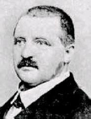
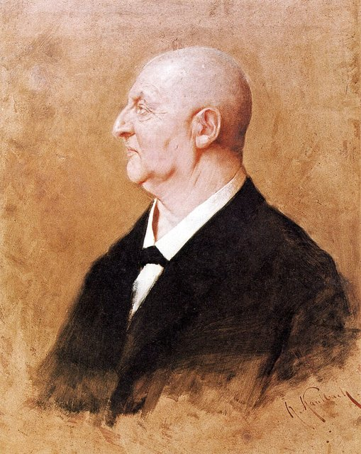
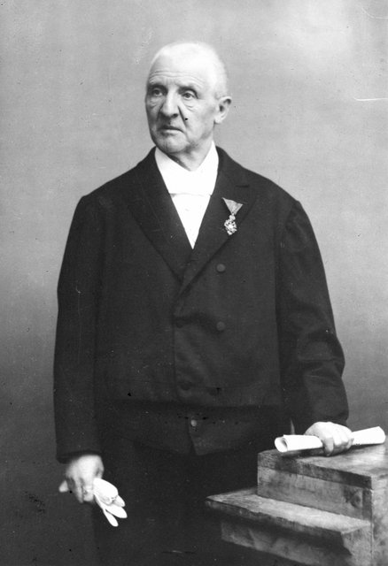
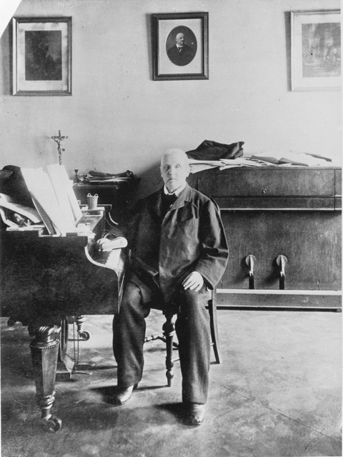

<!--
內容整理自中文維基百科「安東·布魯克納」與英文維基百科「Anton Bruckner」條目（CC BY-SA 4.0），並以台灣用語改寫摘要。
https://zh.wikipedia.org/zh-tw/安东·布鲁克纳
https://en.wikipedia.org/wiki/Anton_Bruckner
兩者不一致處以英文條目為準（例如兄弟姊妹人數，中文條目作12個，英文條目作11個）。
各交響曲的首演日期等細節，兩個條目的生平段落沒有完整記載，係依一般公認的史實補充。
圖片皆為 Wikimedia Commons 上的公有領域（含PD-US）作品（封面：1889年的肖像照）。
-->

# Periods
- 1824-09-04 ~ 1837 | 童年@安斯費爾登
  祖父與父親都是村裡的校長兼管風琴師，他從小跟父親學音樂，常一天練管風琴12小時，也幫忙父親教其他孩子。
- 1837 ~ 1845 | 聖弗洛里安唱詩班與鄉村教師
  父親去世後，13歲的他到聖弗洛里安修道院當唱詩班男孩，深深著迷於修道院的大管風琴。之後受訓成為教師，在溫德哈格受盡屈辱，轉到克朗斯多夫後才開始顯露自己的風格。
- 1845 ~ 1855 | 聖弗洛里安的管風琴師@Sankt Florian
  回到聖弗洛里安當了十年教師與管風琴師，不斷進修考取資格，寫下《安魂曲》與《莊嚴彌撒》。
- 1855 ~ 1868 | 林茲大教堂管風琴師@Linz
  擔任林茲大教堂管風琴師，同時以函授方式跟維也納的理論大師賽希特苦學對位，再隨基茨勒學配器、接觸華格納的音樂。37歲才真正開始認真作曲，寫出三首大型彌撒與第一號交響曲。
- 1868 ~ 1884 | 維也納：不被理解的交響曲作家@Vienna
  接任維也納音樂院教授，後來也在維也納大學任教。他的交響曲被批評為「狂野」、「荒謬」，加上被歸入華格納陣營，成為樂評家漢斯立克的眼中釘，第三號交響曲首演更是一場災難。
- 1884 ~ 1896 | 遲來的榮耀
  60歲時第七號交響曲在萊比錫首演大獲成功，終於揚名國際。晚年獲皇帝授勳、榮譽博士，卻仍不斷修改舊作，第九號交響曲至死未能完成。

# Events

## 1824-09-04 | 出生@安斯費爾登
生於林茲近郊的安斯費爾登村，是校長安東·布魯克納的長子。家族世代務農或從事手工藝，祖先住在一座橋邊，因此被稱為「橋邊的布魯克納」。祖父1776年起擔任村裡的校長，這個薪水微薄但受人尊敬的職位後來由父親繼承。父母生了11個孩子，只有5個長大成人。

## 1830 | 上學，學管風琴
6歲入學，是個勤奮的學生，很早就跳級，還幫父親教其他孩子。父親是他第一位音樂老師，他從小就學管風琴，常常一天練習12小時。據中文條目，他10歲起偶爾到教堂代班彈管風琴貼補家用。

## 1835 | 第一首作品
1833年受堅振禮後，被送到赫爾辛的學校，跟熱愛音樂的校長魏斯精進管風琴。大約這時寫下第一首作品，聖歌〈請讚頌〉，晚年他還親自修改過。後來父親生病，他回家幫忙父親的教學工作。

## 1837 | 父親去世，進入聖弗洛里安修道院
13歲喪父，校長的職位與宿舍都交給了繼任者，他被送到聖弗洛里安的奧斯定會修道院當唱詩班男孩，學小提琴與管風琴。修道院那架巴洛克時代建造、當年剛整修好的大管風琴令他敬畏不已，他有時也在禮拜時彈奏。

## 1840-10 | 林茲師範學校
到林茲受教師訓練，和聲與合唱老師杜倫伯格後來成為他的朋友，也是日後勸他去應徵大教堂管風琴師的人。

## 1841 | 溫德哈格的助理教師
以優異成績結業後，17歲的他被派到溫德哈格當助理教師，待遇極差，還不斷被上司羞辱。據中文條目，校長嫌他作曲太多、常在管風琴上即興而不盡本分。他從不抱怨或反抗，這種自卑感伴隨了他一生。

## 1843 | 轉往克朗斯多夫
修道院院長注意到他的處境，把他調到克朗斯多夫任教兩年，這是一段快樂得多的時光。他到恩斯跟策內提學音樂，作品明顯進步，開始顯露「布魯克納風格」。他在一首經文歌的手稿上簽下「作曲家安東·布魯克納」，被視為他藝術野心的早期跡象。

## 1845 | 回到聖弗洛里安
通過考試成為聖弗洛里安村裡學校的助理教師，之後又考取能在高等學校任教的資格，各科都拿到「非常好」。

## 1848 | 聖弗洛里安管風琴師
擔任修道院的管風琴師，1851年轉為正式職位。隔年寫下D小調《安魂曲》，這是他自己認為值得保存的最早作品，明顯受到莫札特《安魂曲》的影響。

## 1855 | 拜賽希特為師；林茲大教堂管風琴師
帶著前一年寫的《莊嚴彌撒》去見維也納的理論大師賽希特，獲收為學生，主要以函授方式學習對位，偶爾到維也納長時間上課。賽希特的教材後來也成為他自己教學的基礎。同年底，他在試奏後獲聘為林茲大教堂管風琴師，一直做到1868年。

## 1861 | 結識李斯特；隨基茨勒學習
37歲才開始認真作曲。他結識了自己崇拜的李斯特，5月首次以作曲家兼指揮的身分登台，演出七聲部的〈聖母頌〉。他又跟比他小9歲的基茨勒學配器，基茨勒帶他認識了華格納的音樂，他從1863年起深入研究《唐懷瑟》、《羅安格林》、《崔斯坦與伊索德》等作品。他一直學習到40歲。

## 1864 | D小調彌撒曲首演
結束跟賽希特與基茨勒的學業後不久寫成，在林茲首演非常成功，1867年在維也納演出也大受好評。1860年代他先後完成D小調、E小調、F小調三首大型彌撒。

## 1867 | 精神崩潰
多年苦學、拚命創作又一心想到維也納發展，讓他身心俱疲，精神崩潰，到療養院休養了好幾個月。據中文條目，他有強迫症，很愛數數字，作曲草稿下方常寫著計算樂句長度的數字。

## 1868-05 | 第一號交響曲首演
在林茲首演，連後來的死對頭漢斯立克都給了正面評價。

## 1868 | 維也納音樂院教授

賽希特去世後，他猶豫再三，才接下維也納音樂院的樂理教授職位，從此把大部分心力放在交響曲上。學生包括後來的指揮家莫特爾、夏爾克兄弟、略維，以及音樂理論家申克等人。

## 1869 | 法國管風琴巡演
到南錫與巴黎演奏管風琴，即興演奏贏得滿堂彩。

## 1871 | 倫敦皇家亞伯特音樂廳
在倫敦皇家亞伯特音樂廳的新管風琴上舉行六場獨奏會，又在水晶宮演奏了五場。他沒寫過重要的管風琴作品，但即興演奏有時會成為交響曲的靈感。

## 1873-09 | 拜訪華格納
到拜魯特拜訪他崇拜的華格納，請華格納從他的第二、第三號交響曲中挑一首接受題獻，華格納選了第三號。這首題獻給華格納的交響曲，讓他從此被歸入華格納陣營。1876年他也出席了拜魯特音樂節首演的全套《指環》。

## 1875 | 維也納大學講師
在維也納大學任教，起初是無薪講師，努力想讓音樂理論成為大學的正式課程。他在維也納過得並不快樂，當時樂壇由支持布拉姆斯的漢斯立克主導。

## 1877-12-16 | 第三號交響曲首演慘敗
他親自指揮修改後的版本，觀眾在演出中成群離席，曲終時幾乎走光。少數留下來喝采的人中，有一位17歲的學生馬勒，馬勒後來稱布魯克納是他的「先驅」。

## 1881-02-20 | 第四號交響曲「浪漫」首演
由李希特指揮維也納愛樂首演，是他第一次在維也納獲得真正的成功。這也是他唯一一首自己取了標題的交響曲。排練後，滿心歡喜的他塞給李希特一枚硬幣，說：「拿去，為我的健康喝杯啤酒吧。」李希特把那枚瑪麗亞·特蕾莎銀幣掛在錶鍊上，一直戴著。

## 1883-02 | 華格納去世
他正在寫第七號交響曲的慢板樂章，預感華格納將不久人世；華格納死訊傳來後，他為這個樂章寫下以華格納低音號演奏的哀悼尾聲。

## 1884-12-30 | 第七號交響曲在萊比錫轟動

由尼基許指揮在萊比錫首演，大獲成功，60歲的他終於揚名國際。據中文條目，他把這首交響曲題獻給巴伐利亞國王路德維希二世。

## 1886-01-10 | 《感恩讚》首演

他最著名的宗教作品之一，展現大膽創新的半音和聲。同年7月，皇帝法蘭茲·約瑟夫一世頒給他法蘭茲·約瑟夫勳章。

## 1887 | 第八號交響曲遭拒
把第八號交響曲寄給曾指揮第七號而大受歡迎的指揮家李維，李維卻表示看不懂、無法演出。他大受打擊，花了好幾年大幅改寫，也因此一度中斷了第九號交響曲的創作。

## 1891-11 | 維也納大學榮譽博士

被他視為最珍貴的榮譽。據中文條目，他終生不斷寫信向年輕女子求婚卻始終沒有結果，情書寫得像在向教授解釋論文，連唯一差點成婚的對象也因宗教因素分手。

## 1892-12-18 | 第八號交響曲首演
由李希特指揮維也納愛樂首演修訂版，大獲成功。據中文條目，這首交響曲題獻給皇帝法蘭茲·約瑟夫一世。同年他大概也從維也納大學退休，時年68歲。

## 1895 | 遷入美景宮
年老體衰，皇帝讓他住進美景宮的一間小屋，方便他不用爬樓梯。他繼續與病魔賽跑，寫作第九號交響曲。

## 1896-10-11 | 逝世@維也納

享年72歲，第九號交響曲只完成了前三個樂章，終樂章留下大量草稿。據中文條目，他把這首交響曲獻給上帝，「如果祂願意接受的話」。他一向對死亡與遺體有種奇特的著迷，還留下了防腐處理的詳細指示。遺體依他的遺願安葬於聖弗洛里安修道院教堂的地下墓室，就在他最愛的管風琴正下方。他把原始樂譜遺贈給奧地利國家圖書館。

## 1903-02-11 | 第九號交響曲首演
由學生略維在維也納指揮首演，但略維大幅改動了配器。這也牽涉到所謂的「布魯克納問題」：他的交響曲大多有多個版本，學生與出版商常以「方便演出」為由擅自修改，很難分辨哪些是他本人同意的。

## 1932 | 原典版重見天日
據中文條目，第九號交響曲前三個樂章依原稿演出的版本，在1932年的一場紀念音樂會上首次公開，之後音樂學者哈斯等人開始依手稿出版他作品的原典版。同年林茲的音樂學院以他命名，即今天的安東·布魯克納私立大學。
