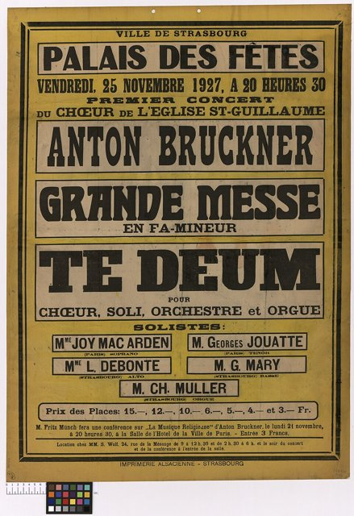

<!--
內容整理自本機筆記〈布魯克納主要作品〉（D:\Books\md\音樂\布魯克納主要作品.md，網頁版在知識圖譜的「5-2.音樂家作品」），做法比照「貝多芬主要作品」。
- 每首作品一則事件，日期採「創作時間」（多年創作的作品以區間呈現；「年代」以十年計、「世紀」以百年計，修訂或出版年份只寫在顯示文字裡），事件顏色依筆記的類別段落區分：交響曲與大型管弦樂作品、彌撒曲與大型宗教作品、著名宗教合唱曲、經文歌與聖歌、詩篇與其他宗教聲樂作品、世俗合唱與歌曲、室內樂與器樂作品。
- 「約」、「前後」、修訂、出版等不是單純年份的寫法，以原文作為顯示文字。
- 作品編號是目錄編號，不等於創作順序，時間軸依創作時間排序。
- 時期沿用「布魯克納生平」時間軸的主要時期（重疊的細分時期不列）。
- 筆記「優先聆聽」清單中的作品另註明順序。
- 沒有年份、無法放上時間軸的條目未收錄：WAB 41 《我將向主獻上感謝》（In jener letzten der Nächte 等早期宗教作品之外的禱歌）（早期作品）；管風琴作品與即興曲（不同時期）。
- 以 follows 排在「布魯克納生平」之後；生平事件見該時間軸。
圖片來源（皆為 Wikimedia Commons 公有領域作品；註明「共用」者沿用生平時間軸的圖片）：
- bruckner-1885-kaulbach.jpg（考爾巴赫所繪布魯克納像（與布魯克納生平共用））
- mw-bruckner-tedeum.jpg：Chœur de l'Eglise Saint-Guillaume, Strasbourg. Concert, Palais des fêtes, 25 novembre 1927. Premier concert - Anton Bruckner - Grande messe en fa mineur, Te deum. Solistes - Mme Joy Mac Aslen, Georges Jouatte, L.... - btv1b102252043.jpg（1927年史特拉斯堡音樂會海報，曲目為布魯克納的F小調彌撒與《感恩讚美歌》）
-->

# Periods
- 1824-09-04 ~ 1837 | 童年@安斯費爾登
  祖父與父親都是村裡的校長兼管風琴師，他從小跟父親學音樂，常一天練管風琴12小時，也幫忙父親教其他孩子。
- 1837 ~ 1845 | 聖弗洛里安唱詩班與鄉村教師
  父親去世後，13歲的他到聖弗洛里安修道院當唱詩班男孩，深深著迷於修道院的大管風琴。之後受訓成為教師，在溫德哈格受盡屈辱，轉到克朗斯多夫後才開始顯露自己的風格。
- 1845 ~ 1855 | 聖弗洛里安的管風琴師@Sankt Florian
  回到聖弗洛里安當了十年教師與管風琴師，不斷進修考取資格，寫下《安魂曲》與《莊嚴彌撒》。
- 1855 ~ 1868 | 林茲大教堂管風琴師@Linz
  擔任林茲大教堂管風琴師，同時以函授方式跟維也納的理論大師賽希特苦學對位，再隨基茨勒學配器、接觸華格納的音樂。37歲才真正開始認真作曲，寫出三首大型彌撒與第一號交響曲。
- 1868 ~ 1884 | 維也納：不被理解的交響曲作家@Vienna
  接任維也納音樂院教授，後來也在維也納大學任教。他的交響曲被批評為「狂野」、「荒謬」，加上被歸入華格納陣營，成為樂評家漢斯立克的眼中釘，第三號交響曲首演更是一場災難。
- 1884 ~ 1896 | 遲來的榮耀
  60歲時第七號交響曲在萊比錫首演大獲成功，終於揚名國際。晚年獲皇帝授勳、榮譽博士，卻仍不斷修改舊作，第九號交響曲至死未能完成。

# Events

## 1863 | WAB 99 F 小調交響曲（Study Symphony，習作交響曲） {color=#c92a2a}
類別：早期交響曲；學習與探索之作（交響曲與大型管弦樂作品）。

## 1863 ~ 1864 | WAB 100 D 小調交響曲（常稱「第 0 號」） {color=#c92a2a}
類別：未編入正式編號序列（交響曲與大型管弦樂作品）。

## 1865 ~ 1866 | WAB 101 第一號交響曲，C 小調 {color=#c92a2a label="1865–1866；後有修訂"}
類別：正式編號交響曲（交響曲與大型管弦樂作品）。

## 1871 ~ 1872 | WAB 102 第二號交響曲，C 小調 {color=#c92a2a label="1871–1872；多次修訂"}
類別：大型交響曲（交響曲與大型管弦樂作品）。

## 1872 ~ 1873 | WAB 103 第三號交響曲，D 小調 {color=#c92a2a label="1872–1873；1877、1889等修訂"}
類別：又稱「華格納交響曲」（交響曲與大型管弦樂作品）。

## 1874 | WAB 104 第四號交響曲，降 E 大調 {color=#c92a2a label="1874；1878–1880、1888等修訂"}
類別：《浪漫》交響曲（交響曲與大型管弦樂作品）。入門推薦聆聽第 1 首。

## 1875 ~ 1878 | WAB 105 第五號交響曲，降 B 大調 {color=#c92a2a label="1875–1878；後有修訂"}
類別：對位與賦格技巧突出（交響曲與大型管弦樂作品）。入門推薦聆聽第 10 首。

## 1879 ~ 1881 | WAB 106 第六號交響曲，A 大調 {color=#c92a2a}
類別：節奏鮮明，結構緊密（交響曲與大型管弦樂作品）。

## 1881 ~ 1883 | WAB 107 第七號交響曲，E 大調 {color=#c92a2a}
類別：最受歡迎的交響曲之一（交響曲與大型管弦樂作品）。入門推薦聆聽第 2 首。

## 1884 ~ 1887 | WAB 108 第八號交響曲，C 小調 {color=#c92a2a label="1884–1887；1890年修訂"}
類別：規模宏大，具有戲劇性（交響曲與大型管弦樂作品）。入門推薦聆聽第 3 首。

## 1887 ~ 1896 | WAB 109 第九號交響曲，D 小調 {color=#c92a2a}
類別：未完成；前三樂章完成，終樂章僅留下草稿與片段（交響曲與大型管弦樂作品）。入門推薦聆聽第 4 首。

## 1862 | WAB 96 D 小調進行曲 {color=#c92a2a}
類別：管弦樂進行曲（交響曲與大型管弦樂作品）。

## 1862 | WAB 97 三首管弦樂曲 {color=#c92a2a}
類別：降 E 大調、E 小調、F 大調三首短曲（交響曲與大型管弦樂作品）。

## 1862 ~ 1863 | WAB 98 G 小調序曲 {color=#c92a2a}
類別：管弦樂序曲（交響曲與大型管弦樂作品）。

## 1863 | WAB 99 F 小調交響曲 {color=#c92a2a}
類別：早期交響曲；上表已列（交響曲與大型管弦樂作品）。

## 1863 ~ 1864 | WAB 100 D 小調交響曲 {color=#c92a2a}
類別：未編號交響曲；上表已列（交響曲與大型管弦樂作品）。

## 1842 | WAB 25 C 大調彌撒曲（Windhaager Messe） {color=#1971c2}
類別：早期簡易彌撒曲（彌撒曲與大型宗教作品）。

## 1843 ~ 1844 | WAB 146 克龍斯托夫彌撒曲（Kronstorfer Messe） {color=#1971c2 label="約1843–1844"}
類別：早期彌撒曲；目錄亦有不同編號傳統（彌撒曲與大型宗教作品）。

## 1854 | WAB 29 《莊嚴彌撒曲》（Missa solemnis），降 B 小調 {color=#1971c2}
類別：獨唱、合唱與管弦樂（彌撒曲與大型宗教作品）。

## 1848 ~ 1849 | WAB 39 D 小調《安魂曲》（Requiem） {color=#1971c2 label="1848–1849；後有修訂"}
類別：獨唱、合唱與管弦樂（彌撒曲與大型宗教作品）。

## 1864 | WAB 26 第一號彌撒曲，D 小調 {color=#1971c2 label="1864；1876、1881–1882修訂"}
類別：大型管弦樂彌撒（彌撒曲與大型宗教作品）。

## 1866 | WAB 27 第二號彌撒曲，E 小調 {color=#1971c2 label="1866；後有修訂"}
類別：混聲合唱與管樂團（彌撒曲與大型宗教作品）。入門推薦聆聽第 6 首。

## 1867 ~ 1868 | WAB 28 第三號彌撒曲，F 小調 {color=#1971c2 label="1867–1868；多次修訂"}
類別：大型管弦樂彌撒（彌撒曲與大型宗教作品）。

## 1881 ~ 1884 | WAB 45 《感恩讚美歌》（Te Deum），C 大調 {color=#1971c2}

類別：合唱、獨唱與管弦樂（彌撒曲與大型宗教作品）。入門推薦聆聽第 5 首。

## 1884 | WAB 50 《來吧，創造之靈》（Veni Creator Spiritus） {color=#1971c2 label="約1884"}
類別：宗教聖歌（彌撒曲與大型宗教作品）。

## 1892 | WAB 38 第 150 篇《讚美詩》（Psalm 150） {color=#1971c2}
類別：合唱與管弦樂（彌撒曲與大型宗教作品）。

## 1884 | WAB 40 《Salvum fac populum tuum》 {color=#1971c2}
類別：宗教合唱作品（彌撒曲與大型宗教作品）。

## 1856 | WAB 5 《聖母頌》（Ave Maria），F 大調 {color=#e67700}
類別：合唱與管風琴等伴奏版本（著名宗教合唱曲、經文歌與聖歌）。

## 1861 | WAB 6 《聖母頌》（Ave Maria），F 大調 {color=#e67700}
類別：七聲部無伴奏合唱（著名宗教合唱曲、經文歌與聖歌）。

## 1882 | WAB 7 《聖母頌》（Ave Maria） {color=#e67700}
類別：女低音與鍵盤伴奏版本（著名宗教合唱曲、經文歌與聖歌）。

## 1873 | WAB 10 《基督已為我們成為順服》（Christus factus est） {color=#e67700}
類別：宗教合唱曲，早期版本（著名宗教合唱曲、經文歌與聖歌）。

## 1884 | WAB 11 《基督已為我們成為順服》（Christus factus est） {color=#e67700}
類別：無伴奏合唱經文歌（著名宗教合唱曲、經文歌與聖歌）。

## 1885 | WAB 13 《大祭司已被立》（Ecce sacerdos magnus） {color=#e67700}
類別：合唱與長號等伴奏（著名宗教合唱曲、經文歌與聖歌）。

## 1868 | WAB 18 《曙光初現》（Iam lucis orto sidere） {color=#e67700 label="1868；1886版本"}
類別：宗教聖歌（著名宗教合唱曲、經文歌與聖歌）。

## 1854 | WAB 22 《求主釋放我》（Libera me） {color=#e67700}
類別：安魂禮儀合唱曲（著名宗教合唱曲、經文歌與聖歌）。

## 1869 | WAB 23 《此處乃聖所》（Locus iste） {color=#e67700}
類別：無伴奏合唱；極具代表性（著名宗教合唱曲、經文歌與聖歌）。入門推薦聆聽第 7 首。

## 1879 | WAB 30 《義人之口》（Os justi） {color=#e67700}
類別：無伴奏合唱經文歌（著名宗教合唱曲、經文歌與聖歌）。入門推薦聆聽第 8 首。

## 1835 | WAB 31 《舉起旗幟》（Pange lingua） {color=#e67700 label="約1835；1891修訂"}
類別：聖體聖歌（著名宗教合唱曲、經文歌與聖歌）。

## 1868 | WAB 33 《舉起旗幟》（Pange lingua） {color=#e67700}
類別：宗教合唱曲（著名宗教合唱曲、經文歌與聖歌）。

## 1892 | WAB 51 《十字架的旗幟》（Vexilla regis） {color=#e67700}
類別：無伴奏合唱（著名宗教合唱曲、經文歌與聖歌）。

## 1885 | WAB 52 《耶西的枝條》（Virga Jesse） {color=#e67700}
類別：無伴奏合唱（著名宗教合唱曲、經文歌與聖歌）。

## 1878 | WAB 57 《夜之魔法》（Abendzauber） {color=#e67700}
類別：男聲合唱、獨唱與圓號（著名宗教合唱曲、經文歌與聖歌）。

## 1852 | WAB 34 詩篇第 22 篇 {color=#2f9e44 label="約1852"}
類別：詩篇改編（詩篇與其他宗教聲樂作品）。

## 1863 | WAB 35 詩篇第 112 篇 {color=#2f9e44}
類別：合唱與管弦樂（詩篇與其他宗教聲樂作品）。

## 1852 | WAB 36 詩篇第 114 篇 {color=#2f9e44}
類別：合唱與長號（詩篇與其他宗教聲樂作品）。

## 1856 | WAB 37 詩篇第 146 篇 {color=#2f9e44 label="約1856"}
類別：獨唱、合唱與管弦樂（詩篇與其他宗教聲樂作品）。

## 1854 | WAB 53 《在阿爾內特墓前》（Vor Arneths Grab） {color=#2f9e44}
類別：男聲合唱與長號（詩篇與其他宗教聲樂作品）。

## 1851 | WAB 14 《放棄》（Entsagen） {color=#862e9c label="約1851"}
類別：康塔塔式聲樂作品（世俗合唱與歌曲）。

## 1855 | WAB 15 《節慶歌》（Festgesang） {color=#862e9c}
類別：康塔塔（世俗合唱與歌曲）。

## 1862 | WAB 16 《節慶康塔塔》（Festkantate） {color=#862e9c}
類別：節慶合唱與管樂（世俗合唱與歌曲）。

## 1865 | WAB 49 《婚禮之歌》（Trauungslied） {color=#862e9c}
類別：男聲合唱與獨唱四重奏等（世俗合唱與歌曲）。

## 1878 | WAB 54 《婚禮慶典》（Zur Vermählungsfeier） {color=#862e9c}
類別：無伴奏男聲合唱（世俗合唱與歌曲）。

## 1862 | WAB 55 《夜空》（Der Abendhimmel，第一版） {color=#862e9c}
類別：男聲四重唱（世俗合唱與歌曲）。

## 1866 | WAB 56 《夜空》（Der Abendhimmel，第二版） {color=#862e9c}
類別：男聲合唱（世俗合唱與歌曲）。

## 1858 | WAB 58 《春天，你何等善良忠實》（Wie bist du, Frühling, gut und treu） {color=#862e9c label="約1858"}
類別：獨唱歌曲（世俗合唱與歌曲）。

## 1843 | WAB 59 《在節日中》（An dem Feste） {color=#862e9c label="約1843"}
類別：男聲合唱（世俗合唱與歌曲）。

## 1855 | WAB 60 《梅耶康塔塔》（Mayer Cantata） {color=#862e9c}
類別：獨唱與合唱、管樂（世俗合唱與歌曲）。

## 1850 ~ 1859 | WAB 61 《阿爾內特康塔塔》（Arneth Cantata） {color=#862e9c label="1850年代"}
類別：節慶康塔塔（世俗合唱與歌曲）。

## 1863 ~ 1864 | WAB 62 《德意志之歌》（Germanenzug） {color=#862e9c}
類別：男聲合唱與管弦樂（世俗合唱與歌曲）。

## 1893 | WAB 63 《赫爾戈蘭》（Helgoland） {color=#862e9c}
類別：男聲合唱與管弦樂；晚期大型合唱作品（世俗合唱與歌曲）。

## 1862 | WAB 111 C 小調弦樂四重奏 {color=#0c8599}
類別：弦樂四重奏（室內樂與器樂作品）。

## 1878 ~ 1879 | WAB 112 F 大調弦樂五重奏 {color=#0c8599}
類別：兩把小提琴、兩把中提琴與大提琴（室內樂與器樂作品）。入門推薦聆聽第 9 首。

## 1879 | WAB 113 間奏曲（Intermezzo） {color=#0c8599}
類別：弦樂五重奏編制；與弦樂五重奏相關（室內樂與器樂作品）。

## 1866 | WAB 114 《晚間音樂》（Abendklänge） {color=#0c8599}
類別：小提琴與鋼琴二重奏（室內樂與器樂作品）。

## 1862 | C 小調迴旋曲（Rondo） {color=#0c8599}
類別：弦樂四重奏相關作品（室內樂與器樂作品）。
