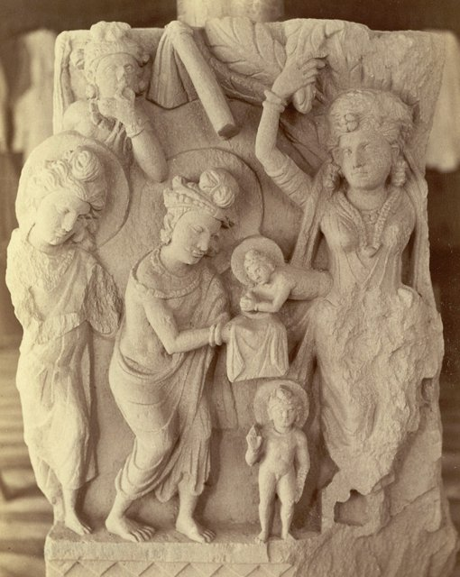
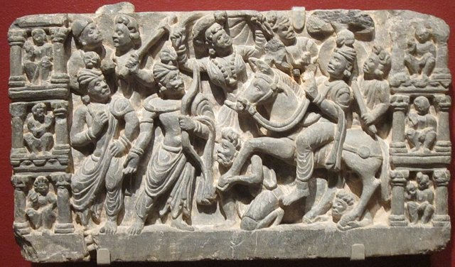
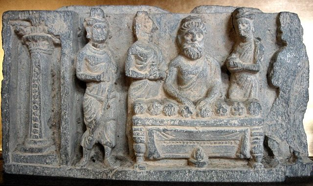
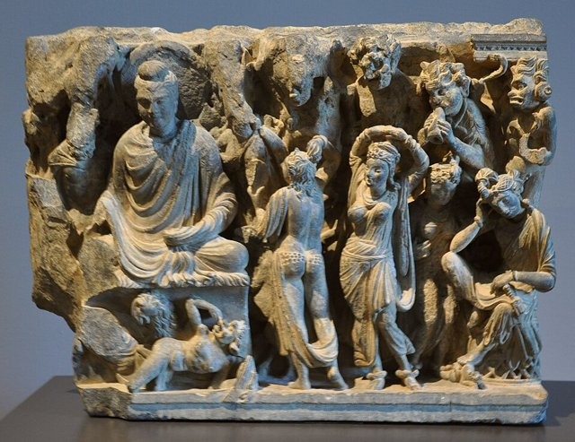
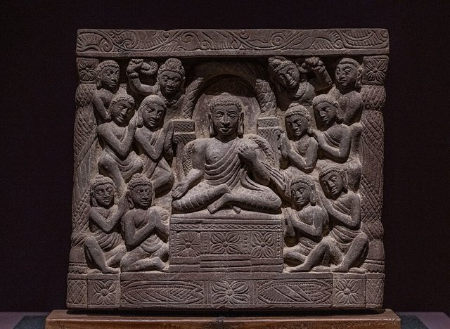
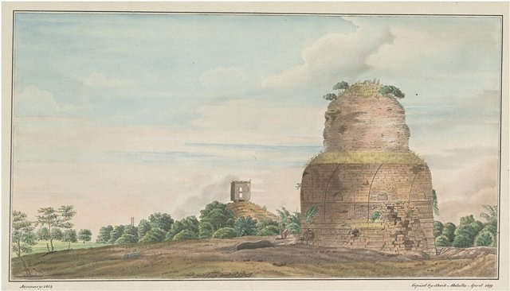
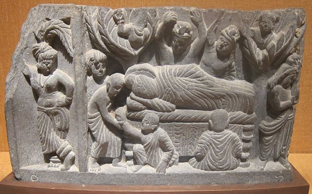
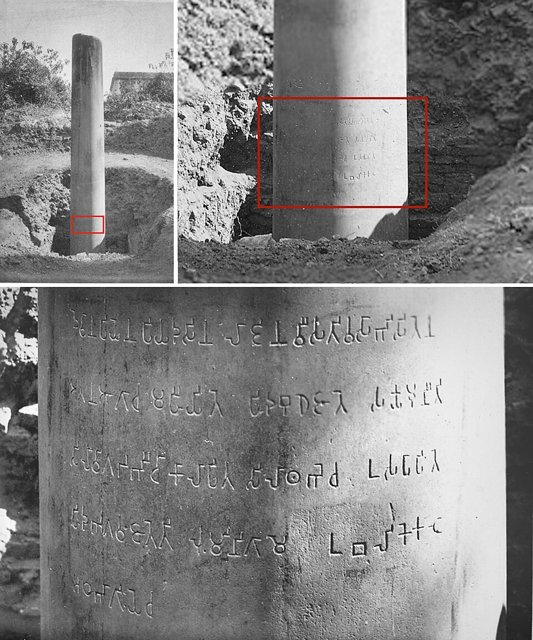

<!--
內容整理自 D:\Books\html\2-7.佛教\佛前印度\釋迦牟尼佛生平大事記.html（原稿放在 md\歷史\人物\思想家\），並整合中文維基百科〈釋迦牟尼〉條目，以自己的話改寫。
時期依筆記的章節歸納：王子時期、出家尋道、弘法（初期與中期）、晚年與入滅、入滅後。筆記的「年代總表」「四大聖地」「核心思想」與「歷史考證問題」寫進時期說明與相關事件，不另立事件。
佛陀的生平沒有同時代的史料，傳記是後世逐步形成的，筆記與維基百科都強調這一點，所以這裡以「傳統佛傳」為主軸，並在有爭議的事件標上「傳統」或「約」。事件的年份是依傳統年齡推算：二十九歲出家、三十五歲成道、八十歲入滅，並不是歷史上確認的年份。
兩份資料出入與處理方式：
- 生卒年：筆記說明南傳佛教常以前543年作為入滅年、部分傳統年表採前563–前483年、現代學術研究多把佛陀的活動置於前5世紀，常見估計約前480–前400年；維基百科列出前623／563／480年—前543／483／400年三組，並補充南傳佛教的前624–前544或前623–前543（錫蘭、緬甸傳前544，暹羅、高棉傳前543）、《菩提伽耶碑記》推出的前546、漢傳以周昭王二十四年為生年（約前1027年）、藏傳格魯派的前1041–前961，以及日本學界與印順法師依「佛滅後116年阿育王即位」推算的入滅約前387至前384年。這裡 born 採前563、died 採前483（剛好八十歲，與筆記的年代總表一致），事件上的年齡都是依這組年代推算的結果，並不代表歷史事實。
- 近年的考古：維基百科補充2013年國際考古隊在藍毗尼摩耶夫人廟下的阿育王廟底層，發現木造結構遺跡，以放射碳定年與光釋光測年推斷神廟存在於前6世紀，被《國家地理》雜誌解讀為佛陀生活的年代可能比人們認知的更早，這個說法仍有爭議，這裡寫進最後一則事件。
- 出家年齡：筆記寫二十九歲出家（傳統說法）；維基百科寫「20歲那年」月夜乘馬出家，並補充他自十六歲成婚，約十三年的婚姻（到二十九歲）；兩者相差，這裡照筆記的二十九歲，因為它與「六年苦行、三十五歲成道、八十歲入滅」的傳統年齡一致，維基百科的「20歲」另在事件內文說明。
- 早年教育：維基百科補充八歲起向毘奢婆蜜多羅學習文化、向羼提提婆學習武藝，並為他建春、夏、冬三座宮殿，《佛本行集經》等記載他有三位夫人，第一夫人是耶輸陀羅（或瞿夷），照此併入。
- 母親：筆記寫摩耶夫人在悉達多出生後第七天去世、由姨母摩訶波闍波提撫養；維基百科寫大乘佛傳說摩訶波闍波提是姨母，但也有只稱「乳母」而未具姓名的說法，照此。
- 老師：筆記寫阿羅邏迦羅摩（無所有處）與鬱陀迦羅摩子（非想非非想處）；維基百科作阿羅邏伽藍與鬱陀羅摩子，並說阿羅邏是數論派上師，他達到老師所教的一切，老師還建議他一起領導沙門團體，但他不滿足，照此併入。
- 苦行與證悟：筆記寫與五人在優樓頻螺一帶苦行約六年，接受牧羊女善生供養乳糜後在菩提伽耶的菩提樹下證悟；維基百科寫牧羊女供養羊乳，並補充南傳《南傳菩薩道》記載他在座上發願：「且讓我剩下皮，且讓我剩下腱，且讓我剩下骨頭……」，照此。
- 弟子與僧團：筆記列耶舍、舍利弗與目犍連、迦葉三兄弟、頻婆娑羅王與竹林精舍、給孤獨長者與祇園精舍、羅睺羅與難陀與阿難、摩訶波闍波提出家等，這些事件的年份並不確定，這裡按筆記「弘法初期」「弘法中期」的順序排列，並標上「約」。比丘尼僧團的成立筆記標為「弘法期間未能確定」，這裡放在弘法中期並寫明年份不詳。
- 神異的敘事：筆記明確區分「宗教傳說」與「歷史事件」，例如出生後行走七步、四門出遊的完整情節、雙神變、忉利天說法，並提醒四門出遊的完整情節是後來佛傳逐步發展出來的；維基百科引《中阿含》《長阿含》的「右脅出生」與「天上天下，唯我獨尊」之偈，這裡簡要寫成「傳說」。
- 入滅：筆記寫晚年從王舍城出發，經那爛陀、波吒利村、毘舍離，在波婆接受鐵匠之子純陀的供養（「旃檀樹耳」或 sūkaramaddava，究竟是肉、菌類或其他食物並不確定），身體不適仍前往拘尸那羅，在娑羅雙樹間「獅子臥」，度化最後的弟子須跋陀羅，並以「諸行無常，精進不放逸」為最後教誨，傳統享年八十歲，照此。
- 身後：筆記寫荼毘與舍利分配、第一次結集（大迦葉召集，阿難誦經、優波離誦律）、阿育王大力護持（前三世紀）與佛教傳向各地；維基百科補充前249年阿育王在藍毗尼立石柱，銘文記載「釋迦牟尼生於此地」，是佛陀確實存在最重要的物證之一，並補充最早的完整佛傳是馬鳴的《佛所行讚》（約公元2世紀，維基百科寫佛滅六百年後），照此。阿育王即位年，南傳寫佛滅後218年、漢傳寫116年（維基百科），這裡不寫具體年份，只寫「前三世紀」與前249年的石柱。
- 人名與其他時間軸一致：玄奘（西行取經，朝禮佛陀聖地）。老子、孔子等同時代人物不在這份時間軸裡。
圖片來源（皆為 Wikimedia Commons 公有領域／CC0 作品；浮雕與石雕多為犍陀羅等後世的作品，不代表事件當時的樣貌）：
- bu-cover.jpg：Labit - Sitting Buddha meditating - Swat Valley, Gandhara, Pakistan D. 70.1.2.jpg（犍陀羅的禪坐佛像）
- bu-birth.jpg：Birth of buddha peshawar.JPG（佛誕浮雕）
- bu-leave.jpg：Prince Siddhartha Leaves the Palace, Pakistan, Gandhara, schist, San Diego Museum of Art.JPG（悉達多太子離開王宮（犍陀羅浮雕））
- bu-ascetic.jpg：EndAscetism.JPG（結束苦行的浮雕）
- bu-mara.jpg：Versuchung des Buddha Museum Rietberg RVI 25.jpg（降魔成道浮雕）
- bu-sermon.jpg：Buddha's first sermon sculture in the Museu Oscar Niemeyer, Curitiba.jpg（初轉法輪浮雕）
- bu-dhamek.jpg：Sarnath Dhamek Stupa 1814.jpg（鹿野苑的達美克佛塔（1814年水彩））
- bu-nirvana.jpg：'Parinirvana', India, Gandhara, c. 100 CE, stone, Honolulu Academy of Arts.JPG（犍陀羅的佛涅槃浮雕）
- bu-lumbini.jpg：Lumbini pillar with inscription and its location.jpg（藍毗尼的阿育王石柱與銘文）
-->

# Periods
- -563 ~ -534 | 王子時期 | #868e96
  生於釋迦族的王室，由姨母撫養長大，接受王族教育，十六歲結婚並有一子，過著舒適的生活，卻開始思考老、病、死。
- -534 ~ -528 | 出家尋道 | #2f9e44
  二十九歲離開王宮，向阿羅邏迦羅摩與鬱陀迦羅摩子學禪定，與五位修行者苦行約六年，最後發現極端苦行不能帶來解脫。
- -528 ~ -493 | 弘法初期與中期 | #e8590c
  三十五歲在菩提樹下證悟，在鹿野苑初轉法輪，僧團逐漸成形，得到摩揭陀與憍薩羅等國王與居士的護持，建立戒律與雨季安居。
- -493 ~ -483 | 晚年與入滅 | #1971c2
  七十歲後仍在恆河流域弘法，交代弟子以法與律為依據，八十歲在拘尸那羅的娑羅雙樹間入滅。
- -483 ~ -249 | 入滅後的佛教 | #c92a2a
  荼毘、舍利分配、第一次結集，到阿育王護持佛教、在藍毗尼立下石柱。

# Events

## -563 | 出生於藍毗尼 {label="傳統約前563年"}

釋迦牟尼（Śākyamuni，「釋迦族的聖人」）本名悉達多·喬達摩（Siddhārtha Gautama，「一切義成」），生於古印度北部、今日尼泊爾南部一帶的釋迦族王室，屬剎帝利種姓，出生地是藍毗尼，父親是迦毗羅衛國的淨飯王，母親是摩耶夫人。母親在他出生後第七天去世，由姨母摩訶波闍波提撫養。佛傳說他出生時向四方行走七步、說出「天上天下，唯我獨尊」，這屬於宗教的傳說，不宜視為歷史事件。
佛陀沒有留下親筆的著作，現存的佛傳是他入滅數百年後逐步形成的，所以生卒年有很多說法：南傳佛教的傳統以前544或前543年為入滅年，漢傳的傳統年表常用前563–前483年，現代學術研究多把他的活動放在前5世紀，常見的估計約前480–前400年。這份時間軸採前563–前483年，所有年份與年齡都是依傳統推算，不是歷史的定論。

## -555 | 王族教育與阿私陀的預言 {label="約前555年起"}
悉達多在迦毗羅衛一帶成長，據說八歲起向毘奢婆蜜多羅學習文化，向羼提提婆學習武藝，學習文字、算術、騎射與王族的禮儀，並有春、夏、冬三座宮殿；仙人阿私陀看了他之後預言：若留在王宮，會成為轉輪聖王，若出家修行，則會成為覺悟真理的佛陀。淨飯王希望他繼承王位，因此盡可能讓他遠離外界的苦難。

## -547 | 結婚與羅睺羅 {label="約前547年（傳統說法）"}
悉達多與耶輸陀羅結婚（也有佛傳說他有三位夫人，第一夫人是耶輸陀羅或瞿夷），後來生下兒子羅睺羅。他擁有王族身分、妻子、兒子與舒適的生活，卻逐漸思考：財富、權力與親情是否仍不能使人免於衰老、疾病與死亡？

## -534 | 四門出遊與大出家 {label="約前534年（傳統說法）"}

傳統佛傳說悉達多出遊時，先後看見老人、病人與死人，領悟到身體會衰老、生病與死亡，財富與權勢不能阻止；第四次出遊看見出家的修行者，開始思考能否以修行與智慧尋找解脫之道。這個完整的四門出遊故事，是後來的佛傳逐步發展出來的，早期的佛典只記載他對老、病、死與出家生活的反思。
他夜間騎白馬犍陟，由侍從車匿陪同離開王宮，到了城外剪去頭髮、脫下華服，換上修行者的衣服，稱為「大出家」（維基百科寫他在二十歲時出家，這裡採二十九歲的傳統說法），進入當時印度盛行的沙門修行傳統。

## -533 | 學習禪定 {label="約前534–前532年"}
悉達多先跟隨阿羅邏迦羅摩學習，很快掌握老師所教的「無所有處」禪定，老師甚至建議他一起領導沙門團體，但他認為這仍然沒有解決生死與煩惱；接著跟隨鬱陀迦羅摩子，學到更高的「非想非非想處」，他仍認為這不是真正的解脫，於是離開，因為已經找不到可以請教的老師。

## -532 | 六年苦行 {label="約前532–前528年"}

悉達多來到優樓頻螺一帶，與憍陳如、阿說示、跋提、十力迦葉與摩訶男五位修行者同住，進行約六年的苦行：長期禁食或少食、控制呼吸、長時間靜坐、忍受身體的痛苦，希望以極端的自我約束消除欲望。他在一次苦行中昏倒，領悟到折磨身體並不能帶來智慧，反而妨礙禪定與思考，於是接受牧羊女善生供養的乳糜，恢復體力，五位同伴以為他放棄修行，便離開前往鹿野苑，這段經歷成為「中道」思想的背景。

## -528 | 菩提樹下證悟 {label="約前528年（傳統說法）"}

悉達多來到菩提伽耶，在菩提樹下鋪設吉祥草、結跏趺坐，決心深入思考生命的真相，直到找到答案。傳統記載魔王波旬以軍隊、誘惑、恐懼與懷疑動搖他，悉達多不為所動，以右手觸地為證（觸地印），象徵克服貪欲、恐懼、執著與迷惑；「夜睹明星」而覺悟，從此被稱為佛陀（Buddha，「覺悟者」），也稱為釋迦牟尼、如來與世尊。他體悟了四聖諦（苦、集、滅、道）、中道，以及緣起、無常與無我，成為佛教哲學的基礎。

## -528 | 初轉法輪 {label="約前528年"}

佛陀證悟後曾思考所體悟的真理是否太深奧、一般人能否理解，後來經大梵天王娑婆主的勸請，決定說法。他前往波羅奈附近的鹿野苑（今印度薩爾納特），向以前一起苦行的五人說法，稱為「初轉法輪」：苦行與享樂兩個極端都不是正確的道路，應走中道；人生有苦，苦有原因，也有止息的可能，透過八正道（正見、正思惟、正語、正業、正命、正精進、正念、正定）可以走向解脫。憍陳如最先理解，成為最早證悟的弟子，其餘四人也陸續證悟，稱為最初的五比丘，佛、法、僧三寶因此具備，僧團（Saṅgha）開始形成。

## -527 | 弟子增加與僧團擴大 {label="約前527年起（弘法初期）"}

富家青年耶舍聽法後出家，他的父母與妻子也接觸佛法；佛陀鼓勵弟子分赴各地，為了眾人的利益與幸福遊行說法。舍利弗（智慧第一）與目犍連（神通第一）本是修行老師刪闍耶的弟子，舍利弗遇見佛陀的弟子阿說示，聽法後告訴目犍連，兩人一起皈依；事火的優樓頻螺迦葉、那提迦葉與伽耶迦葉三兄弟，也帶領弟子皈依，使僧團規模擴大。

## -525 | 王舍城與舍衛城的護持 {label="約前525年起"}
佛陀進入摩揭陀國，受到頻婆娑羅王的接待，國王成為早期佛教的重要護持者，傳統記載他把竹林精舍布施給佛陀與僧團；舍衛城的富商給孤獨長者購置園林供養佛陀，傳說他以黃金鋪地換取土地，祇園精舍後來成為佛陀重要的弘法場所；憍薩羅國的波斯匿王也常向佛陀請教政治、道德與人生的問題。

## -520 | 返回迦毗羅衛 {label="約前520年（年份不確定）"}
佛陀回到故鄉迦毗羅衛，傳統記載父親淨飯王接觸佛法，兒子羅睺羅與異母弟難陀出家；堂弟阿難後來成為親近的侍者，以記憶力聞名，阿那律也成為重要弟子。

## -515 | 比丘尼僧團的成立 {label="年代不詳（傳統置於弘法中期）"}
姨母兼養母摩訶波闍波提與一群釋迦族的女性前來請求出家，佛陀起初沒有答應，後來阿難為女性爭取出家的機會，佛陀承認女性也有證悟的能力，允許她出家，建立比丘尼僧團，她被視為佛教史上第一位比丘尼。

## -510 | 戒律、安居與各階層的弟子 {label="約前510年起（弘法中期）"}
隨著僧團擴大，佛陀逐漸制定戒律，規範衣食住行、成員相處、犯戒的處理、定期的布薩與誦戒；古印度的雨季道路泥濘，外出也可能傷害草木與小生命，所以制定雨季安居，讓出家人在雨季固定一處修行，這個制度後來成為多種佛教傳統的重要制度。他接觸王族、貴族、商人、農民、婆羅門與受社會排斥的人，強調人的價值不由出身決定，而取決於行為、品德與修行：剃髮師優波離隨釋迦族王子出家，佛陀要王子們先向他行禮，他後來以精通戒律聞名；殺人者鴦掘摩羅在佛陀說法後放下暴力出家；毘舍離的名妓菴摩羅女邀請佛陀與僧團接受供養，後來布施園林；女居士毘舍佉也以虔誠與布施著稱。

## -505 | 提婆達多事件 {label="傳統置於弘法中期"}
堂弟提婆達多因權力與領導問題與佛陀衝突，傳統故事包括企圖取得僧團的領導權、以巨石傷佛、派醉象攻擊佛陀，這個事件反映了僧團面臨的分裂與領導問題。傳統上也記載佛陀曾在舍衛城示現「雙神變」、上忉利天為母親說法等神異的敘事，這些與早期經典的教法記載應該區分。

## -493 | 弘法晚期 {label="約前493–前483年"}
佛陀仍在恆河流域的王舍城、舍衛城、毘舍離、波羅奈與拘尸那羅等地遊行說法，與弟子討論修行、僧團生活、倫理、禪定與智慧；他告訴弟子，自己入滅後應以「法」與「律」作為修行與僧團生活的依據，表示佛教不應只依賴某一位領袖的個人權威。傳統記載他在毘舍離附近向阿難說起生命的無常，表示自己年老、身體日漸衰弱。

## -484 | 最後的旅程與純陀的供養 {label="約前484–前483年"}
佛陀與弟子從王舍城出發，經過那爛陀與波吒利村、毘舍離，沿途向居民與弟子說法；到了波婆，他接受鐵匠之子純陀供養的食物（「旃檀樹耳」或 sūkaramaddava，究竟是肉類、菌菇或其他食物，有不同的解釋），之後身體出現嚴重的不適，仍堅持前往拘尸那羅，並叮囑阿難不要讓純陀因為這次供養而自責。

## -483 | 入滅於拘尸那羅

佛陀抵達拘尸那羅（今印度北方邦境內），在娑羅雙樹之間頭朝北、面向西、右脅而臥（「獅子臥」，也是佛教藝術中臥佛像的形象）；修行者須跋陀羅前來請教，阿難擔心佛陀虛弱，佛陀仍允許他前來，須跋陀羅成為他最後親自接引的弟子。佛陀提醒弟子不要因為他離開而失去依靠，應以教法與戒律為指引，觀察世間的無常，精進不放逸（《大般涅槃經》：「諸行無常，精進不放逸」），然後進入「大般涅槃」，傳統享年八十歲。佛教所說的般涅槃，不只是一般意義上的死亡，而是指已徹底解脫生死輪迴的佛陀完成此生最後的生命歷程。

## -483 | 荼毘、舍利與第一次結集 {label="約前483年"}
拘尸那羅的末羅族人依傳統儀式荼毘，留下舍利，舍利由多個勢力共同分配，各自建塔供奉，成為早期佛教的信仰與朝聖中心；僧團推舉大迦葉召集第一次結集（地點在王舍城附近），傳統記載阿難誦出佛陀的經教，優波離誦出僧團的戒律（結集的具體細節仍有學術討論）。佛教也逐漸在印度不同地區發展，形成各自的教學與修行傳統。佛陀的一生以四個地方最為重要，稱為四大聖地：藍毗尼（誕生）、菩提伽耶（成道）、鹿野苑（初轉法輪）、拘尸那羅（入滅）。

## -268 | 阿育王護持佛教 {label="前三世紀（約前268年起）"}
孔雀王朝的阿育王皈依佛教，透過興建紀念建築、設立石柱與刻寫法敕、支持僧團與派遣使者等方式，使佛教的影響力大幅擴展，後來傳入斯里蘭卡、中亞、中國、朝鮮半島、日本、東南亞、西藏與喜馬拉雅地區，在不同語言與文化的交流中形成各自的佛教傳統。阿育王即位的年代，南傳記載在佛滅後218年，漢傳記載在佛滅後116年，因此佛陀的入滅年代也隨之有不同的推算。

## -249 | 藍毗尼的阿育王石柱

阿育王在藍毗尼立下石柱，柱上的銘文記載「釋迦牟尼生於此地」，並減免當地的稅收，這是佛陀確實存在、並且出生在藍毗尼最重要的物證之一。佛陀在世及入滅後兩百多年間，沒有任何歷史文獻記載他的事蹟，存世最早的佛經文本犍陀羅佛教寫本，書寫時間在前1世紀至公元3世紀之間。

## 100 | 最早的完整佛傳 {label="約公元2世紀"}
最早的佛陀傳記是馬鳴菩薩的《佛所行讚》，成書於佛滅後約六百年，大乘佛教的佛傳另有《佛本行集經》《普曜經》與《方廣大莊嚴經》；早期的佛典如《阿含經》、巴利《尼柯耶》保存了佛陀說法與生平的片段，《大般涅槃經》記錄了最後的旅程，《本生經》則以佛陀過去生的故事說明他累積功德的歷程。研究佛陀的生平時，可以把材料分成三個層次：較有歷史根據的事件、早期的佛典記載，以及後世佛傳與宗教傳說。

## 2013 | 藍毗尼的考古發現
由考古學家康寧漢率領的國際考古隊，在藍毗尼摩耶夫人廟內的阿育王廟底下，挖掘出一座木造結構的遺跡，研究人員以放射碳定年與光釋光測年，推斷這座古代神廟存在於前6世紀，結構中有一處開放空間，似乎曾有一棵樹從這裡向外生長；《美國國家地理》雜誌認為佛陀的生活年代在前6世紀，出生年可能比人們認知的更早。這個結論仍有爭議，佛陀的年代至今沒有定論。
