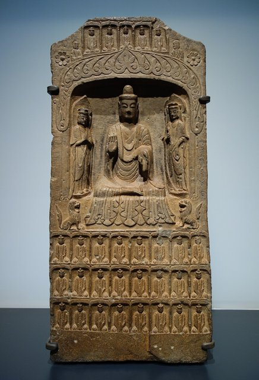
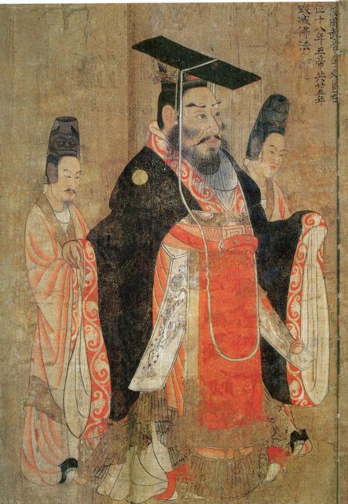
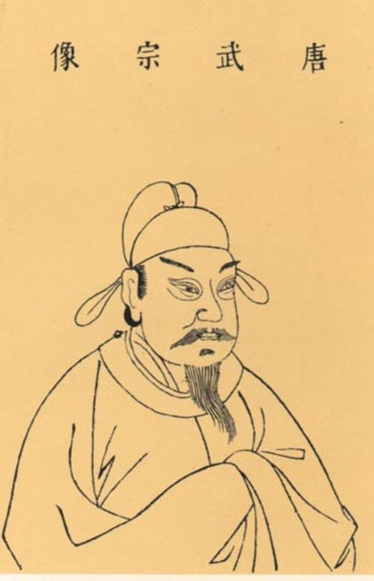
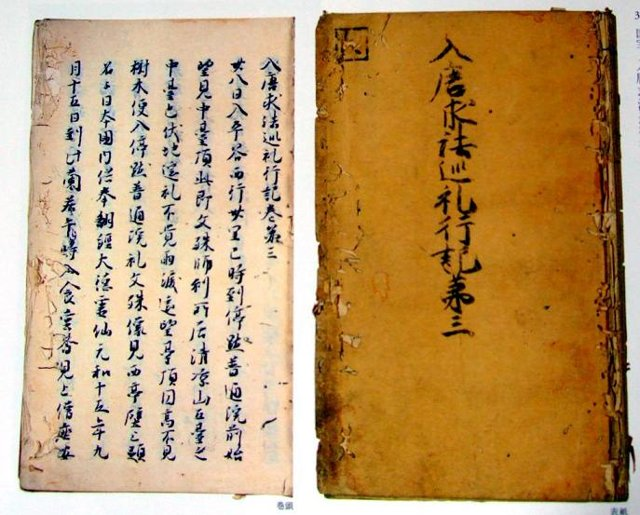
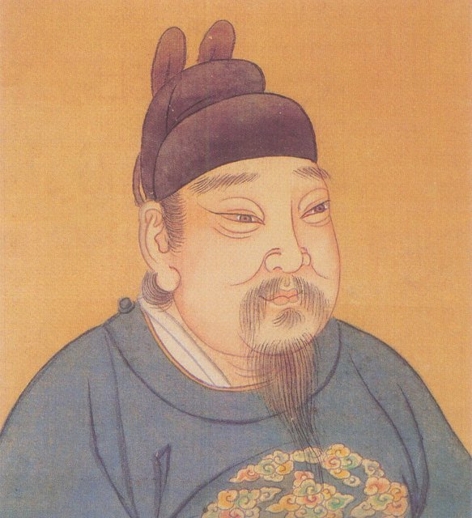
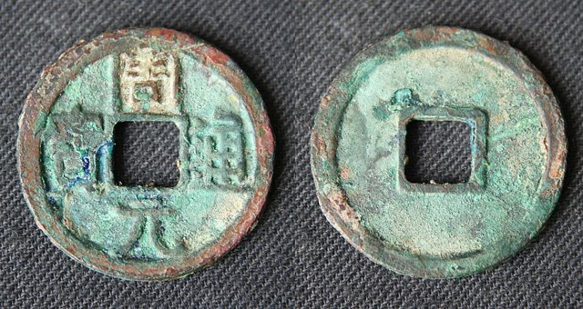

<!--
內容整理自 D:\Books\md\歷史\東方歷史\ 的〈北魏太武帝滅佛〉〈北周武帝滅佛〉〈唐武宗會昌滅佛〉〈後周世宗滅佛〉四份筆記（Books 頁面為 D:\Books\html\1-2.中國歷史\ 的同名 .html），並整合中文維基百科〈三武滅佛〉〈北魏太武帝滅佛〉〈北周武帝滅佛〉〈會昌滅佛〉〈顯德毀佛〉條目，以自己的話改寫。
四次滅佛各為一個時期；筆記中的「主要原因」「主要人物」「歷史影響」「比較表」寫進時期說明與相關事件，不另立事件。北魏的建國（386年）、遷都平城（398年）與北周的建立背景（534年東西魏分裂、557年宇文覺建北周）寫進各時期的第一則事件。
兩份資料出入與處理方式：
- 北魏，444年：筆記沒有；維基百科寫太平真君五年（444年）禁止王公、庶人私養沙門，九月殺僧領玄高、慧崇（〈三武滅佛〉說他們涉及未遂的政變），照此補一則。
- 北魏，446年：筆記把事件分為長安寺院發現兵器、崔浩建議、頒布詔令、太子拓跋晃緩行四個階段；維基百科補充三月下詔誅長安沙門、命留守平城的太子下令全國廢佛，詔書有「沙門無少長悉坑之」，太子刻意延緩，使許多僧人逃脫、經像得以藏匿，被殺的僧人不多，但寺院大多被毀，照此。
- 北魏，原因：筆記強調蓋吳起事、盧水胡與北涼遺民的佛教信仰（引劉淑芬的研究）；維基百科〈三武滅佛〉則說本質是胡漢之爭（崔浩想透過崇道崇儒推動漢化），兩種解釋並列。
- 北魏，太武帝之死：筆記寫452年3月11日被宦官宗愛殺害（換算成公曆）；維基百科寫正平二年二月，這裡寫到月份（452-03）。宗愛先立南安王拓跋余（〈太武滅佛〉作拓跋可博真）又殺之，這裡寫拓跋余。
- 北魏，復佛：筆記寫452年文成帝即位後開始恢復、453年1月正式頒詔；維基百科只寫文成帝「詔復佛法」，照筆記。
- 北周，起點：筆記寫568年武帝親講《禮記》、569年三教論辯；維基百科補充567年還俗僧衛元嵩上書請刪寺減僧，武帝在566–578年間七次召集百官、僧道辯論三教先後，照此補充。
- 北周，574年：筆記寫5月下令廢佛道；維基百科補充六月設通道觀，選佛、道名士120人為學士，照此。還俗人數：筆記沒有；維基百科引《廣弘明集》「五眾釋民減三百萬」，這是古籍的說法，照寫並註明。
- 唐，起點：筆記寫841年武宗開始重用趙歸真；維基百科寫開成五年（840年）秋召道士趙歸真等81人入宮修金籙道場、親受法籙，照維基百科寫840年。
- 唐，842年：筆記寫3月李德裕上奏、10月勒令犯戒僧尼還俗；維基百科同寫十月，並補充京城就有3,459人還俗，僧可留奴一人、尼可留婢兩人，照此。
- 唐，843年：維基百科補充查點外國僧人、禁止摩尼教流傳，照此。
- 唐，844年：筆記寫3月禁供養佛牙佛骨、7月拆京城三百餘所佛堂；維基百科寫七月敕令拆毀天下房屋不滿二百間、沒有前代御匾的寺院、蘭若與佛堂，並把長生殿內道場的經像換成天尊、老君像，照此。
- 唐，845年：筆記寫7月下令並省天下佛寺；維基百科〈會昌滅佛〉寫三月禁止寺院置莊園、四月下敕滅佛，〈三武滅佛〉引《資治通鑑》寫七月敕令、八月統計，這裡把事件放在845年（不寫月），內文依序寫三月、四月勘檢與七月敕令。統計數字筆記與維基百科同：拆寺4,600餘所、招提蘭若4萬餘所、還俗僧尼26萬500人、收奴婢為兩稅戶15萬人、良田數千萬頃（筆記註明是傳統史料的數字），照此。幽州節度使張仲武斬入境遊僧一事取自維基百科。
- 唐，846年：筆記寫3月武宗因服丹藥去世，年33歲；維基百科同，照此。
- 後周，954年：筆記寫顯德元年（954年）九月下令收繳銅器、銅佛像，五十日內送官；維基百科把收銅鑄錢與955年的整頓寫在一起，並說家藏銅像五斤以上不繳者處死，這裡依筆記把收銅放在954年，死刑規定照維基百科補上。
- 後周，955年：筆記寫保留寺院2,694所、裁撤30,336所，登記僧42,444人、尼18,756人，合計61,200人；維基百科〈顯德毀佛〉寫「還俗61200僧」，與《舊五代史》所記的是現存僧尼人數不合，這裡照筆記寫成登記的僧尼人數。出家資格（男15歲、女13歲，需背誦一定卷數的佛經）兩者相同，維基百科〈三武滅佛〉補充男需背經百卷、女七十卷，照此。
- 後周，960年：筆記寫宋太祖8月允許尚未拆毀的寺院保留；維基百科沒有，照筆記。
- 周元通寶：筆記提醒不能把所有周元通寶都當作佛像熔鑄，後周也向高麗買銅，照此。
- 人名：拓跋燾（北魏太武帝）、宇文邕（北周武帝）、李炎（唐武宗）、柴榮（後周世宗，維基百科也作郭榮）；淨影寺慧遠與東晉的廬山慧遠是不同人，寫成「淨影寺慧遠」。這些人都沒有獨立時間軸。
圖片來源（皆為 Wikimedia Commons 公有領域／CC0 作品，縮成最長邊 640px）：
- mf-cover.jpg：Yungang Grottoes 03.2025. 4.jpg（山西大同雲岡石窟的大佛，北魏復法後開鑿）
- mf-weistele.jpg：Stele of a buddha and two bodhisattvas, China, Northern Wei dynasty, 386-534 AD, limestone, Asian Art Museum SF - DSC08996.jpg（北魏一佛二菩薩石碑，舊金山亞洲藝術博物館）
- mf-zhouwu.jpg：Zhou Wu Tang.jpg（《歷代帝王圖》中的北周武帝像，唐代）
- mf-tangwuzong.jpg：Tang Wuzong.jpg（《三才圖會》中的唐武宗像，明代）
- mf-ennin.jpg：Cover and page of Ennin's Diary - The Record of a Pilgrimage to China in Search of the Law 入唐求法巡禮行記.jpg（圓仁《入唐求法巡禮行記》的封面與內頁）
- mf-chairong.jpg：Chai Rong (Zhou Shizong).jpg（後周世宗柴榮像）
- mf-coin.jpg：118 S-414 WuDai, Later Zhou, 951-960, Shizong 954-959, 24mm.jpg（後周世宗時鑄造的周元通寶）
-->

# Periods
- 440 ~ 453 | 北魏太武帝滅佛 | #c92a2a
  太武帝在崔浩與道士寇謙之的影響下改奉道教，446年因蓋吳起事時長安佛寺藏有兵器，下詔誅殺沙門、焚毀經像，452年太武帝遇害後由文成帝恢復佛法。
- 566 ~ 581 | 北周武帝滅佛 | #e8590c
  武帝多次召開三教辯論，定儒、道、佛的先後，574年同時廢除佛、道二教，577年滅北齊後推行到原北齊境內；宣帝、靜帝時逐步恢復，隋文帝大力扶持佛教。
- 840 ~ 847 | 唐武宗會昌滅佛 | #1971c2
  崇信道教的唐武宗在趙歸真、李德裕等人的支持下逐年加強限制，845年並省天下佛寺，拆寺四千六百餘所、還俗僧尼二十六萬餘人，846年武宗死後由宣宗恢復。
- 953 ~ 960 | 後周世宗滅佛 | #2f9e44
  後周世宗為了財政、兵源與鑄錢，收繳銅佛像，裁撤沒有敕額的寺院，嚴格限制出家；他不否定佛教的教化，政策偏重經濟與行政整頓。

# Events

## 440 | 寇謙之與太平真君

北魏由鮮卑拓跋氏建立（386年），398年遷都平城（今山西大同），439年太武帝拓跋燾滅北涼、統一北方，把北涼大批信佛的居民與僧人遷到平城，佛教在北魏的影響更大。北魏早期的皇帝都禮敬沙門，太武帝即位之初也常與高僧談論；後來他受到司徒崔浩與道士寇謙之的影響，改奉寇謙之的新天師道，親受符籙，440年改年號為「太平真君」。崔浩不信佛，常批評佛教虛妄、耗費民財。

## 444 | 禁止私養沙門
太武帝下詔禁止王公與百姓私下供養沙門；同年九月，殺了僧人領袖玄高與慧崇（維基百科說他們被指涉入未遂的政變）。

## 445 | 蓋吳起事
盧水胡人蓋吳在關中杏城（今陝西黃陵附近）起兵反抗北魏，聲勢迅速擴大，太武帝決定親自西征。蓋吳與部分盧水胡人、北涼遺民信仰佛教，太武帝對叛亂的疑慮因此擴及佛教社群；研究者也指出民族關係與北涼遺民的佛教信仰，是理解這次滅佛的重要線索。

## 446 | 太武帝下詔滅佛 {label="太平真君七年（446年）"}
太武帝率軍到長安，在一座佛寺裡發現弓箭、矛盾等兵器，又搜出釀酒器具與地方官、富人寄藏的大量財物，認為僧人與蓋吳通謀。隨行的崔浩趁機建議全面滅佛，太武帝三月下詔誅殺長安沙門、焚毀佛像，並命留守平城的太子拓跋晃在全國廢除佛教：佛塔、佛像與經書一律擊毀焚燒，詔書甚至要求把沙門不分老少全部坑殺。

## 446 | 太子拓跋晃緩行詔令 {label="446年"}
信佛的太子拓跋晃刻意延緩宣布詔令，讓各地僧人事先得到消息，許多人逃亡藏匿，金銀佛像與經書也被秘密收藏起來，因此被殺的僧人不多，但北魏境內的寺院大多被毀。鮮卑貴族多半信佛，以太子為首維護佛教，父子在宗教上的分歧也成為後來宮廷變亂的遠因之一。

## 450 | 崔浩被殺
崔浩因主持編修北魏國史，寫入皇室祖先不光彩的往事，觸怒鮮卑貴族，被處死並滅族，姻親也受牽連。維基百科說太武帝滅佛表面上是崇道，實際上是胡漢之爭：漢人士族崔浩想透過崇道、崇儒與修史推動漢化，鮮卑貴族對他深懷怨恨；崔浩死後，朝廷中反佛的力量大為削弱。

## 452-03 | 太武帝遇害 {label="正平二年（452年）"}
宦官宗愛殺害太武帝，先立南安王拓跋余，不久又殺了他；大臣劉尼、源賀等擁立太武帝的孫子拓跋濬即位，是為北魏文成帝。太子拓跋晃已在451年先於父親去世。

## 452-10 | 文成帝恢復佛法 {label="興安元年（452年）"}
文成帝即位後解除禁佛令，允許僧人重新活動、民眾重新出家，恢復僧官制度；453年正式頒詔恢復佛教，承認先前的滅佛政策有嚴重偏差。約460年，僧人曇曜奉命在平城西郊開鑿雲岡石窟（「曇曜五窟」），北魏佛教藝術從迫害走向新的高峰。

## 567 | 衛元嵩上書
北周由宇文泰奠定基礎：534年北魏分裂為東、西魏，557年宇文覺取代西魏建立北周，560年宇文邕即位，是為北周武帝。武帝即位之初照例禮佛，但更重視儒學；寺院與僧人日多，國家收入減少，567年還俗改奉道教的衛元嵩上書請求刪減寺院與僧人，很合武帝的心意，道士張賓也主張提高道教地位。

## 568 | 親講《禮記》與三教辯論 {label="568–573年"}
568年武帝在大德殿召集百官、僧人與道士，親自講授《禮記》，表明要以儒術治天下；569年起多次舉行三教辯論，討論儒、釋、道的優劣先後，佛教一方的甄鸞、道安等人屢次上書駁斥道教。維基百科說武帝前後七次召集這樣的辯論。當時權臣宇文護仍掌大權，篤信佛法，武帝對重大的宗教政策還很謹慎。

## 572-03 | 誅殺宇文護、親政
武帝設計殺了宇文護，正式掌握朝政，開始推動軍事、財政與行政改革，把富國強兵、消滅北齊列為國策，寺院的土地與僧尼人口問題也更受重視。

## 573-12 | 定三教先後
武帝召集群臣、僧人與道士，親自登上高座辯論，正式宣布三教的順序：儒教第一、道教第二、佛教最後。這表示武帝已經開始建立以儒家為主體的國家意識形態。

## 574-05 | 廢除佛道二教 {label="建德三年（574年）"}

武帝下詔同時禁斷佛教與道教：經書與佛像全部毀去，沙門、道士一律還俗編入戶籍，寺院、道觀的財產散給臣下，寺觀塔廟賜給王公，禮典中沒有記載的祭祀也一併廢除。與另外三次滅佛不同，這次佛、道同時受到打擊（維基百科說是因為僧人批評道士比僧人更不清淨）。《廣弘明集》說還俗的僧尼多達三百萬人，這是古籍的說法。

## 574-06 | 設立通道觀
武帝設立通道觀，挑選佛、道兩教的名士120人，穿上俗人的衣冠，擔任「通道觀學士」，研究儒家經典與各家思想，由官吏統管。武帝要削弱的是宗教組織的獨立性，並把宗教人才納入國家的控制，而不是消滅所有宗教思想。

## 577-01 | 滅北齊、禁佛擴及齊境
北周攻陷北齊都城鄴城，俘虜齊後主高緯，統一北方。北齊皇室與貴族長期崇佛，武帝把禁佛令推行到原北齊境內，召集北齊高僧宣布廢佛的理由：寺院耗費財富、出家違背孝道、僧人不服徭役。淨影寺慧遠當面反駁，說經像是百姓認識佛法的媒介，不能因少數僧人犯戒就否定整個佛教，還警告武帝將受地獄果報；武帝回答只要百姓安樂，自己受地獄之苦也不在乎。禁佛後北方的寺院與佛像幾乎全毀，許多僧人逃往江南或隱居山林。

## 578-06 | 北周武帝去世
武帝在北伐突厥的途中病重去世，年僅36歲，太子宇文贇即位，是為北周宣帝。

## 579 | 宣帝逐步恢復佛教 {label="579–580年"}
宣帝改變父親的宗教政策，允許部分佛教活動、恢復造像與儀式，但並未立刻全面開放；580年宣帝去世，年幼的靜帝即位，外戚楊堅掌握實權，逐步恢復佛教與道教。

## 581 | 隋朝建立
楊堅接受北周靜帝禪讓，建立隋朝，是為隋文帝。他大力扶持佛教，各地寺院重建，譯經與僧團制度重新發展，為隋唐佛教的繁榮奠定基礎。

## 840 | 唐武宗與趙歸真

唐代佛教極盛，天台、華嚴、禪、法相、密宗等宗派相繼興起，皇室與貴族普遍崇佛，寺院擁有大量免稅的土地與財產，許多人為逃避賦役而出家。840年唐武宗李炎即位，同年秋天召道士趙歸真等81人入宮修金籙道場，親受法籙；唐室尊老子為祖先，道教本來就有特殊地位，武宗又熱衷長生術與服食丹藥，宰相李德裕也支持整頓寺院經濟。

## 842-10 | 勒令犯戒僧尼還俗 {label="會昌二年（842年）"}

朝廷下令，凡是戒行不精、行咒術妖術、私蓄妻室的僧尼一律還俗，財產充入兩稅、徭役，僧人只准留奴一人、尼姑留婢兩人；光是京城長安就有3,459人還俗。日本天台宗僧人圓仁當時正在唐朝求法（838年入唐），他的《入唐求法巡禮行記》親身記錄了這場運動，是研究會昌滅佛最重要的第一手史料。

## 843 | 清查僧籍、禁摩尼教
朝廷清查沒有合法僧籍的人，遣送回原籍，也清點外國僧人，並禁止摩尼教流傳；佛教在宮廷中的地位進一步下降。當時河北藩鎮擁有很大的自主權，對朝廷的宗教政策未必服從。

## 844 | 禁供佛牙、拆小寺佛堂
三月禁止供養佛牙、佛骨等聖物，鳳翔法門寺等聖地受到限制；宮內長生殿道場的經像被焚毀，改供天尊、老君像。七月下令拆毀全國房屋不滿二百間、沒有前代御賜匾額的寺院、蘭若與佛堂，僧尼全部還俗，京城就拆了三百多所佛堂。

## 845 | 並省天下佛寺 {label="會昌五年（845年）"}
三月禁止寺院置莊園，並清點全國寺院、僧尼、奴婢與財產；七月下令並省天下佛寺：長安的左右兩街各留兩寺（慈恩、薦福、西明、莊嚴四寺），每寺留僧三十人，洛陽也只留少數寺院，各節度使、觀察使治所留一寺，其餘寺院限期拆毀，僧尼與景教、祆教的僧人一律還俗。寺院財產、田地沒官，寺材用來修官舍驛站，銅佛像與鐘磬熔鑄成錢，鐵器鑄成農具。據史書記載，共拆寺4,600餘所、招提蘭若4萬餘所，還俗僧尼26萬500人，收奴婢為兩稅戶15萬人，沒收良田數千萬頃（這些是傳統史料的數字，未經現代核實）。五臺山的還俗僧人多逃往幽州，幽州節度使張仲武配合朝廷，下令遊僧入境者斬；不過河北部分藩鎮也有抵制或消極執行的情形。

## 846-03 | 唐武宗去世、宣宗復佛
唐武宗因服食丹藥去世，年僅33歲；篤信佛教的皇太叔李忱即位，是為唐宣宗，立即停止滅佛，趙歸真等道士被處置。這次滅佛使寺院財產、經典大量散失，唐代古寺留存至今的極少，教義繁複、依賴大寺院的宗派由盛轉衰，較不依賴大型寺院的禪宗在晚唐興起（但不能說禪宗興盛完全是滅佛造成的），摩尼教、景教等外來宗教也從此逐漸退出中原。

## 847 | 宣宗恢復佛教 {label="大中元年（847年）"}
唐宣宗頒布恢復佛教的政策，部分被拆毀的寺院重新修建，講經、法會與寺院活動逐漸恢復。

## 953 | 郭威整頓寺院
唐亡後進入五代十國（後梁、後唐、後晉、後漢、後周），951年郭威建立後周。戰亂頻繁，許多青壯年為了逃避兵役與徭役、或因土地兼併無田可耕而出家，國家缺少兵源與勞動力。後周太祖郭威已開始整頓佛教，裁撤開封城內沒有官方敕額的寺院。

## 954-09 | 收繳銅器與銅佛像 {label="顯德元年（954年）"}

954年郭威去世，養子柴榮即位，是為後周世宗。當時銅錢短缺，世宗設立鑄錢機構，九月下令收繳民間銅器：官府法器、兵器、銅鏡與寺觀的鐘磬鈴鐸等可以保留，其餘銅器與銅佛像須在五十日內送交官府，按重量給錢，家藏銅佛五斤以上而不繳者處死。官員議論紛紛，世宗說佛以善道教化世人，只要立志行善就是奉佛，銅像哪裡就是佛呢？佛為了利益眾生連頭、目都能布施，如果他自己的身體能救濟百姓，也不會吝惜。

## 955-05 | 裁撤寺院、限制出家 {label="顯德二年（955年）"}
世宗下詔整頓佛教：沒有前代敕額的寺院一律廢除；出家須得到父母、祖父母同意，男子年滿15歲須能背誦佛經一百卷（或朗讀五百卷），女子年滿13歲須背誦七十卷（或朗讀三百卷），經地方考試、祠部發給度牒才能剃度；只有指定城市可設戒壇；各地每年造冊登記僧尼；禁止燒身、煉指、斷臂等自殘行為。結果全國保留寺院2,694所、廢除30,336所，登記在冊的僧人42,444人、尼姑18,756人，合計61,200人，約九成的寺院被裁撤。

## 956 | 強化寺院管理
朝廷繼續清查僧籍，禁止私建寺院、蘭若與私設戒壇，對違規者加重處罰，表示955年的政策不是一次性的收繳行動，而是長期的宗教管理制度。

## 958 | 鑄周元通寶、取得淮南 {label="957–958年"}

後周持續整頓幣制、鑄造「周元通寶」並整軍，958年在與南唐的戰爭中取得淮南。民間後來流傳周元通寶是佛像熔鑄、具有特殊靈驗的說法，但它的銅料來源不只一種，後周也曾向高麗購買銅料。

## 959-06 | 後周世宗病逝
世宗北伐契丹，收復瀛州、莫州等地，卻在途中患病，六月去世，年僅39歲，其子柴宗訓即位，是為後周恭帝。此後華北的佛教日益衰落，南方佛教則繼續發展。

## 960 | 北宋建立
趙匡胤發動陳橋兵變，建立北宋。同年八月，宋太祖允許顯德年間被裁撤、但尚未拆毀的寺院繼續存在，已拆寺院的佛像可以移往其他寺院保存；不過宋朝保留了官方核准寺院、僧尼登記、度牒與官方授戒等制度，後周的管理措施對宋代佛教制度仍有影響。
