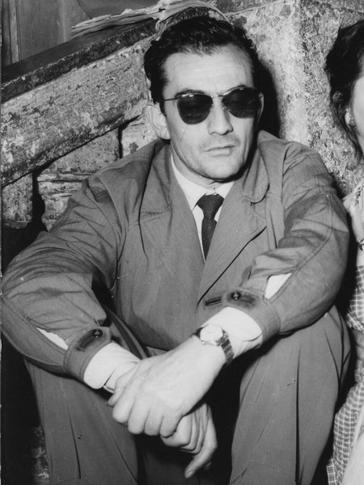
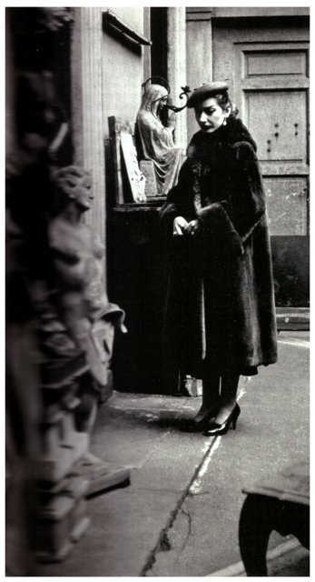
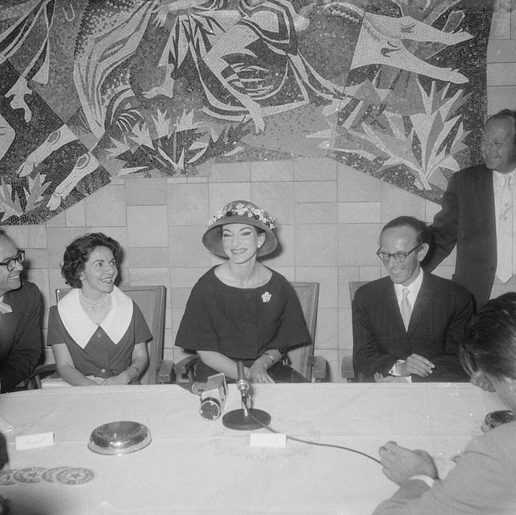

<!--
內容整理自本機筆記〈瑪麗亞·卡拉絲（Maria Callas）生平大事記〉（D:\Books\md\音樂\表演家\瑪麗亞・卡拉絲（Maria Callas）生平大事記.md），以自己的話改寫。
時期依筆記的七個階段歸納為七段。
處理方式：
- 筆記的「1931年前後」「1962–1963年」等只有概括年代的項目，照寫，不補細節。
- 筆記說明她的死因通常記載為心臟病發作，但對健康與用藥情形仍有不同說法，不宜將未證實的推測當成事實，這裡只寫「通常記載為心臟病發作」。
- 筆記的「六項藝術成就」「十大代表角色」「如何理解她的一生」寫進時期說明與最後一則事件，不另立事件；「延伸閱讀」四項為空白，未收錄。
- 人名用·分隔（筆記作・）。普契尼、威爾第、多尼采蒂、迪·史蒂法諾與其他時間軸一致（帕華洛帝時間軸也有提到迪·史蒂法諾）。
圖片（Wikimedia Commons 公有領域或 CC0）：
- cal-cover.jpg：Maria Callas 1958.jpg（卡拉絲在電視節目《Small World》，1958）
- cal-visconti.jpg：Luchino Visconti 1953.jpg（維斯康蒂，1953）
- cal-1955.jpg：Maria Callas Milano 1955.jpg（卡拉絲在米蘭，1955，馬里奧·東德羅攝）
- cal-1959.jpg：Aankomst van de zangeres Maria Meneghini Callas op Schiphol Maria Callas tijden, Bestanddeelnr 910-5058.jpg（卡拉絲在史基浦機場的記者會，1959年7月9日）
-->

# Periods
- 1923 ~ 1940 | 童年與音樂啟蒙 | #868e96
  生於紐約的希臘移民家庭；1937年隨母親回雅典，在希臘國立音樂學院學習，並師從伊達爾戈學美聲唱法。
- 1941 ~ 1946 | 戰爭年代與職業起步 | #1971c2
  在雅典的歌劇院累積大量舞台經驗，1945年回美國謀求發展但受阻。
- 1947 ~ 1950 | 進軍義大利與國際成名 | #2f9e44
  1947年在維洛納演出《歌女喬康達》，1949年臨時接演《清教徒》而成為轉捩點，並與梅內吉尼結婚。
- 1951 ~ 1958 | 史卡拉歌劇院與藝術巔峰 | #e8590c
  進入史卡拉歌劇院核心，與EMI簽約、與維斯康蒂合作，成為國際巨星。
- 1959 ~ 1965 | 感情轉折與退出舞台 | #c92a2a
  與歐納西斯戀愛，聲音狀況漸不穩定，1965年演出《托斯卡》後告別歌劇舞台。
- 1966 ~ 1974 | 電影、教學與告別巡演 | #5f3dc4
  拍電影《美狄亞》、在茱莉亞開設大師班，1973至1974年與迪·史蒂法諾巡演，最後一場在札幌。
- 1975 ~ 1977 | 晚年 | #495057
  歐納西斯去世，她長居巴黎、遠離公眾，1977年去世。

# Events

## 1923-12-02 | 出生@紐約
出生於美國紐約，父母是希臘移民，本名 Maria Anna Cecilia Sofia Kalogeropoulou，日後成為享譽世界的希臘裔美國歌劇女高音。

## 1931 | 開始音樂教育 {label=約1931年}
約八歲開始接受音樂教育，學習鋼琴，並參加兒童歌唱活動，展現音樂天賦，逐漸培養出舞台表演能力。

## 1937 | 隨母親回到雅典
父母婚姻破裂後，隨母親與姊姊返回希臘雅典，開始在希臘接受系統性的聲樂訓練。1937至1939年間在希臘國立音樂學院受瑪麗亞·特里維拉的指導，聲樂技巧逐漸成熟，開始發展自己的演唱風格。

## 1939 | 在《鄉村騎士》中飾演桑圖扎
十五歲時，在學校演出中飾演馬斯卡尼歌劇《鄉村騎士》的桑圖扎，獲得肯定，初步展現歌唱與戲劇表演兼備的潛力。同年起至1943年，她師從西班牙女高音艾爾維拉·德·伊達爾戈，深入學習美聲唱法。這套傳統強調氣息控制、聲音靈活性、音樂線條與裝飾音技巧，成為她日後演唱貝里尼、多尼采蒂作品的重要基礎。

## 1941 | 進入職業演出@雅典
開始在希臘國家歌劇院的相關製作中演出，參與輕歌劇《薄伽丘》，正式進入職業歌劇演出的領域。

## 1942 | 擔任《托斯卡》主角
在普契尼歌劇《托斯卡》中擔任主角，開始展現詮釋重要歌劇角色的能力。1942至1944年間她在雅典演出《低地》、《鄉村騎士》與貝多芬《費黛里奧》等作品，累積不同音樂風格與戲劇角色的經驗。

## 1944 | 希臘語版《費黛里奧》
演出希臘語版《費黛里奧》，飾演女主角萊奧諾拉，顯示她不只能唱義大利歌劇，也能處理德語歌劇。二戰期間在雅典累積的大量舞台經驗，讓她學會處理複雜的角色，也逐步建立她最鮮明的藝術特質：不只唱出音符，更要讓觀眾理解角色的情感與命運。

## 1945 | 返回美國
離開希臘返回美國，尋找更寬廣的職業發展機會，嘗試進軍美國歌劇市場，但未立即獲得重大突破。1945至1946年間事業發展一度受阻，成為她轉往歐洲發展的重要背景。

## 1947-08 | 維洛納競技場《歌女喬康達》@維洛納
在義大利維洛納競技場演出彭基耶利的《歌女喬康達》，由指揮家圖利奧·塞拉芬指揮。義大利首演獲得關注，是國際歌劇生涯的關鍵起點。1947至1948年間，她在義大利演出《杜蘭朵公主》與《崔斯坦與伊索德》等作品，展現兼具戲劇性聲音、音域與角色塑造能力的特色。

## 1948 | 首次演唱《諾瑪》
首次演唱貝里尼《諾瑪》，逐漸建立與這個角色的密切關係，日後《諾瑪》成為她最具代表性的角色之一。

## 1949 | 臨時接演《清教徒》@威尼斯
在威尼斯鳳凰劇院臨時接替生病的女高音，演出貝里尼《清教徒》的愛爾薇拉。這個角色要求高度靈活的花腔技巧、精準的音準與細膩的音樂表現，她在短時間內準備好並成功演出，震撼了當時的歌劇界。她的藝術潛力因此得到更廣泛的認識，也為日後重新推廣義大利美聲歌劇奠定基礎。

## 1949-04-21 | 與梅內吉尼結婚
與義大利商人喬瓦尼·巴蒂斯塔·梅內吉尼結婚。婚姻與丈夫的支持，是她在義大利發展的重要背景。1949至1950年間，她在義大利與南美洲等地演出，逐步擴大國際知名度，從具潛力的年輕歌手漸漸成為國際歌劇舞台的重要人物。

## 1951-12-07 | 史卡拉歌劇院《西西里的晚禱》@米蘭
在米蘭史卡拉歌劇院演出威爾第《西西里的晚禱》，揭開重要的演出季，正式進入義大利最重要歌劇舞台的核心。

## 1952 | 柯芬園首演、與EMI簽約
首次登上倫敦皇家歌劇院柯芬園的舞台，開始征服英國的重要歌劇觀眾。同年與唱片公司 EMI 簽約，展開重要的錄音合作，使她的藝術成就透過唱片傳到全世界。

## 1953 | 錄製《托斯卡》，演唱《米蒂亞》
錄製普契尼《托斯卡》等重要作品，留下日後廣受推崇的錄音，讓後世能反覆研究她的演唱。同年演唱凱魯碧尼《米蒂亞》，逐漸將這個角色發展成代表作之一，展現她在強烈戲劇性角色中的獨特魅力。

## 1954 | 外形改變、芝加哥與維斯康蒂

這一年大幅減重，外形與舞台形象顯著改變，公眾形象受到廣泛關注，成為兼具藝術與時尚影響力的歌劇明星。她在芝加哥演出《諾瑪》、《茶花女》等作品，擴大在美國歌劇市場的影響力，也首次與導演盧奇諾·維斯康蒂合作，導入更精細的戲劇調度與人物塑造。

## 1955 | 維斯康蒂執導的《茶花女》

在維斯康蒂執導的《茶花女》中飾演薇奧列塔，以人物心理、戲劇動作與音樂詮釋相互配合，成為她的經典演出之一。

## 1956 | 大都會歌劇院首演《諾瑪》@紐約
首次在紐約大都會歌劇院演出《諾瑪》，完成另一個重要國際舞台的亮相。

## 1957 | 歐洲演出與雅典音樂節
持續在歐洲演出，並在雅典音樂節演出。她的藝術地位已達國際巨星的層級，也逐漸面臨公眾輿論與演出爭議。

## 1958 | 巴黎歌劇院與羅馬《諾瑪》風波
在巴黎歌劇院舉行重要演出，受到歐洲觀眾關注，進一步鞏固國際歌劇女高音的地位。同年在羅馬演出《諾瑪》時，因身體不適中途離場，引發爭議，顯示她在職業生涯高峰期已承受巨大的身心壓力。

## 1959 | 與歐納西斯戀愛

與希臘船王亞里士多德·歐納西斯發展戀情，逐漸離開丈夫梅內吉尼，私人生活開始受到國際媒體高度關注。

## 1960 | 埃皮達魯斯古劇場演出《諾瑪》@埃皮達魯斯
在希臘埃皮達魯斯古劇場演出《諾瑪》，證明她仍具有強大的舞台感染力。1961年她再度在埃皮達魯斯演出凱魯碧尼《米蒂亞》，以高度戲劇性的詮釋獲得熱烈迴響。

## 1962 | 舞台演出減少 {label=1962—1963年}
舞台演出逐漸減少，聲音狀態與職業發展受到關注，她開始面對藝術巔峰之後的衰退與重新定位。1960年代初期，她的聲音已不如1950年代巔峰時期穩定；但她過去的錄音與演出，逐漸成為歌劇界研究聲樂技巧、音樂詮釋與戲劇表演的重要材料。

## 1964 | 柯芬園《托斯卡》，澤菲雷里執導
重返倫敦柯芬園，在法蘭科·澤菲雷里執導的《托斯卡》中演出，再次證明她在戲劇詮釋上的非凡能力。

## 1965-07-05 | 最後一次歌劇演出《托斯卡》@倫敦
1965年1月在巴黎歌劇院演出《諾瑪》，同年7月5日在倫敦柯芬園演出《托斯卡》，成為她最後一次歌劇舞台演出。

## 1966 | 放棄美國公民身分
放棄美國公民身分，與梅內吉尼的婚姻關係在法律層面正式結束，她與過去婚姻生活的關係告一段落。

## 1968 | 歐納西斯與賈桂琳·甘迺迪結婚
歐納西斯與美國前第一夫人賈桂琳·甘迺迪結婚，卡拉絲與歐納西斯的感情受到重大打擊。

## 1969 | 電影《美狄亞》
在導演皮耶·保羅·帕索里尼的電影《美狄亞》中擔任主角，這是她唯一的重要電影演出，展現她在歌劇舞台以外的戲劇表演能力。

## 1971 | 茱莉亞音樂學院大師班@紐約 {label=1971—1972年}
在紐約茱莉亞音樂學院開設大師班，把多年舞台經驗傳授給年輕歌唱家，留下重要的教學紀錄。她不只指導學生處理聲音技巧，也反覆強調樂譜、歌詞、作曲家意圖與人物心理的重要性；對她而言，歌唱不是單純追求漂亮的聲音，必須理解作品的每個細節。

## 1973 | 與迪·史蒂法諾告別巡演
與男高音朱塞佩·迪·史蒂法諾展開告別巡演，嘗試重返公開演出舞台。

## 1974-11 | 最後一場公開音樂會@札幌
巡演足跡遍及多個國家，11月在日本札幌舉行最後一場公開音樂會，正式告別公開演唱生涯。

## 1975-03-15 | 歐納西斯去世
歐納西斯去世，這段重要的感情關係隨對方離世而結束，卡拉絲的晚年生活更趨低調。

## 1976 | 長居巴黎
長期居住於巴黎，逐漸遠離公開演出活動，生活重心轉向私人生活與過往的藝術成就。

## 1977-09-16 | 逝世@巴黎
在巴黎的住所去世，享年53歲。死因通常記載為心臟病發作，但圍繞她健康與用藥情形的討論仍有不同說法，不宜把未經充分證實的推測當成事實。依她的遺願，骨灰後來撒入愛琴海，她與希臘文化的連結成為身後紀念的一部分。她最重要的貢獻有六項：復興貝里尼、多尼采蒂、羅西尼的19世紀義大利美聲歌劇，讓人重新認識這些作品的難度與藝術價值；重新定義角色的詮釋，如《茶花女》中薇奧列塔從享樂、戀愛、犧牲到死亡的心理轉變；以戲劇性的聲音表現，依人物情緒調整音色；跨越花腔、抒情與戲劇女高音，以及部分德語與法語歌劇；留下《托斯卡》、《諾瑪》、《茶花女》、《拉美莫爾的露琪亞》、《美狄亞》等經典錄音；以及把歌唱、語言、人物心理、音樂結構與舞台行動整合成完整的戲劇藝術。她的聲音並非沒有缺點，職業生涯也不是一路順遂，但她對作品的理解、對角色的投入，以及把音樂轉化為戲劇的能力，使她超越了單純的歌唱技巧競賽。想了解她的聲樂技巧，可先聽《諾瑪》、《清教徒》與《拉美莫爾的露琪亞》；想體會戲劇表現力，則從《茶花女》、《托斯卡》與《米蒂亞》開始。
