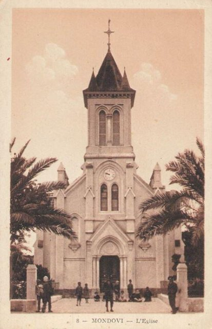
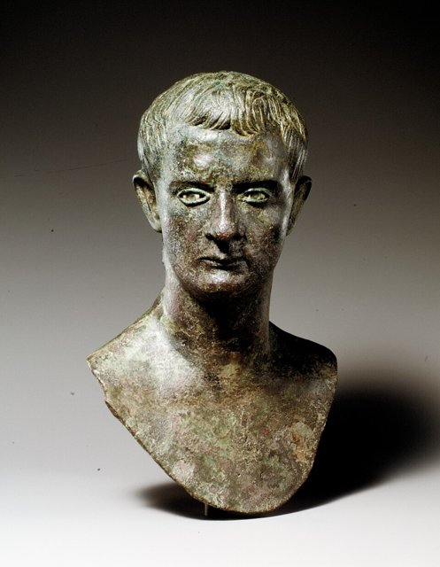
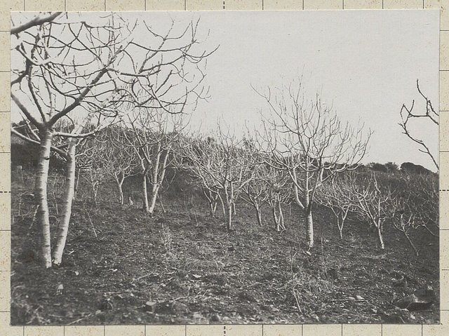
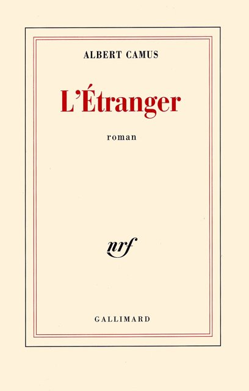
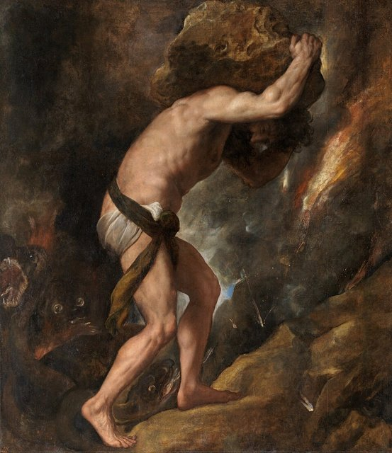
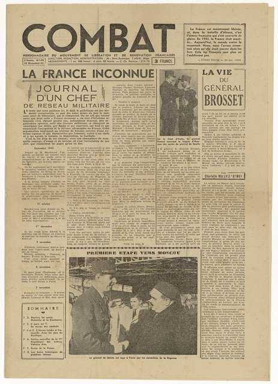
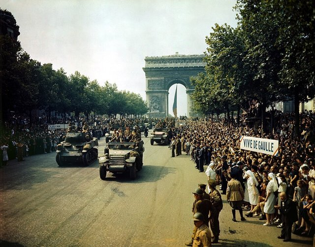
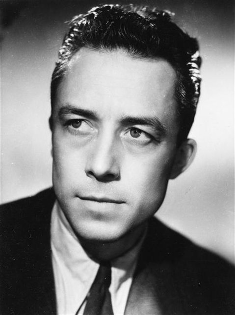
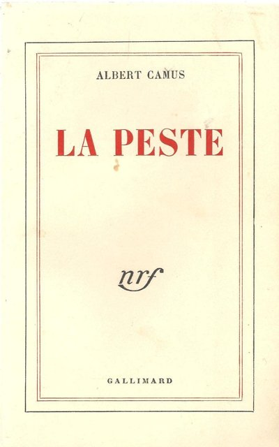
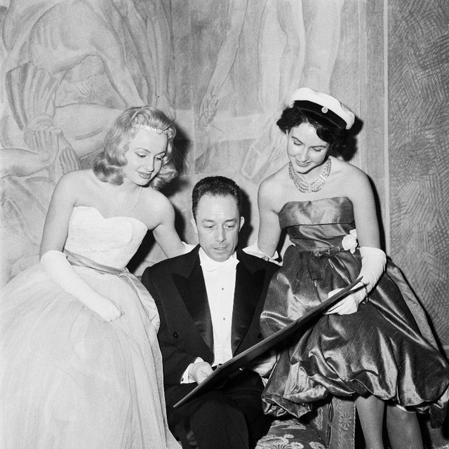

<!--
內容整理自本機筆記〈卡繆生平大事記〉（圖表\卡缪生平大事記.md）與中文維基百科「阿爾貝·卡繆」條目（CC BY-SA 4.0），以台灣用語改寫摘要。
https://zh.wikipedia.org/zh-tw/阿尔贝·加缪
兩份資料的出入與處理：
- 書名：維基百科多用《局外人》《西西弗神話》，此處依台灣常見譯名作《異鄉人》《薛西弗斯的神話》；人名作沙特、伽利瑪。
- 出生地：筆記寫蒙多維；維基百科寫距蒙多維8公里、舍拜塔穆赫塔爾的一座酒莊，此處寫「蒙多維附近的酒莊」。
- 父親之死：筆記寫他在馬恩河戰役相關戰事中受傷去世；維基百科寫他在第一次馬恩河戰役受傷，1914年10月死於布列塔尼聖布里厄的軍醫院，採維基百科。
- 諾貝爾獎：筆記寫10月16日，維基百科寫10月17日；瑞典學院在1957年10月17日宣布，採17日。維基百科說他是「最年輕的獲獎者」，但1907年得獎的吉卜林當時更年輕，此處寫「僅次於吉卜林的年輕得主」。
- 《卡里古拉》：1938年完成初稿，1945年首演，分開交代。
- 維基百科提到有史學家推測車禍是蘇聯國安會的暗殺，這個說法沒有可靠證據，此處只提一句並註明未獲證實。
- 1937年遭共產黨開除、1940年12月在里昂與法蘭欣結婚、1943年結識沙特、1944年結識演員瑪麗亞·卡薩雷斯、雙胞胎1945年9月5日出生、1946年訪美、1957年寫信感謝小學老師日爾曼、1959年改編《群魔》、米歇爾·伽利瑪在車禍數日後去世等細節，係依筆記與一般公認的史實補充。
圖片來源（皆為 Wikimedia Commons 公有領域／CC0 作品；封面：諾貝爾獎得主時期的半身照（1957，美國國會圖書館））：
- cam-cover.jpg：Albert Camus, gagnant de prix Nobel, portrait en buste, posé au bureau, faisant face à gauche, cigarette de tabagisme.jpg
- cam-mondovi.jpg：Algerie.Mondovi.Eglise.jpg
- cam-marne.jpg：Bataille de la Marne - Pont de Meaux - 1914.jpg
- cam-caligula.jpg：Bronze portrait bust of the emperor Gaius (Caligula) MET GR736.jpg
- cam-kabylie.jpg：Aspect hivernal d'une figueraie dans les montagnes de Kabylie (Algérie) (début du XXème siècle) - btv1b10120679r (2 of 2).jpg（20世紀初的卡比利亞山區）
- cam-etranger.jpg：L'Étranger (Albert Camus).jpg
- cam-sisyphus.jpg：Titian - Sisyphus - Madrid - Prado.jpg
- cam-combat.jpg：Journal Combat du 10 décembre 1944, 2012.3.4(2).jpg（1944年12月10日的一期）
- cam-liberation.jpg：Crowds of French patriots line the Champs Elysees.jpg
- cam-harcourt.jpg：Camus Harcourt 1945.jpg
- cam-peste.jpg：La Peste book cover.jpg
- cam-stockholm.jpg：Camus stockholm.jpg
-->

# Periods
- 1913 ~ 1936 | 阿爾及利亞的貧困童年與求學 | #f08c00
  在阿爾及爾的工人社區長大，靠老師的提拔與獎學金讀完中學、大學，十七歲罹患肺結核，對陽光、大海與貧窮有深刻的感受。
- 1936 ~ 1942 | 文學起步與荒謬思想 | #1c7ed6
  從劇團、散文與新聞工作起步，報導殖民地的貧困，戰時移居巴黎，寫成《異鄉人》與《薛西弗斯的神話》。
- 1943 ~ 1951 | 抵抗運動與團結的倫理 | #495057
  投入地下抵抗運動、主編《戰鬥報》，以《鼠疫》《正義者》把個人的荒謬擴展為共同承擔苦難的責任。
- 1951 ~ 1957 | 《反抗者》論戰與道德危機 | #862e9c
  《反抗者》批判革命暴力，與沙特決裂；阿爾及利亞戰爭爆發，他在兩方陣營之間孤立無援，寫出《墮落》。
- 1957 ~ 1960 | 諾貝爾獎與未竟之作 | #e8590c
  獲諾貝爾文學獎，在普羅旺斯的盧爾馬蘭寫作自傳體小說《第一人》，卻在車禍中驟逝。

# Events

## 1913-11-07 | 出生@法屬阿爾及利亞

生於法屬阿爾及利亞東部蒙多維（今德雷安）附近的一座酒莊，家族是在當地住了好幾代的歐洲裔移民，也就是後來所說的「黑腳」。父親呂西安是酒莊的工人，母親卡特琳娜有西班牙梅諾卡島的血統。殖民地的歐洲裔窮人與阿拉伯、柏柏爾原住民處境並不相同，這個身分日後也讓他在阿爾及利亞問題上陷入兩難。

## 1914-10 | 父親死於大戰

第一次世界大戰爆發，父親應徵入伍，在第一次馬恩河戰役中受重傷，10月死在布列塔尼的軍醫院，卡繆還不到一歲。母親帶著他和哥哥搬到阿爾及爾貝爾庫爾區的外婆家，一家人擠在沒有自來水的小公寓裡。母親幾乎聽不見、也不識字，在工廠做工、替人打掃維生，家裡由嚴厲的外婆當家。這位沉默的母親，後來是他作品裡反覆出現的身影。

## 1924-10 | 獎學金進入中學
小學老師路易·日爾曼看出他的天分，說服反對他繼續讀書的外婆，又在課後替他補習，讓他考取獎學金，進入阿爾及爾的中學就讀。他熱愛足球，在青年隊擔任守門員，後來說：「我對道德與人的責任所知道的一切，都要歸功於足球。」

## 1930-12 | 罹患肺結核
十七歲時咳血，診斷出肺結核，被迫中斷學業與足球。死亡從此不再是書本上的概念，而是隨時可能降臨的事實。同一年，中學哲學老師讓·格勒尼耶開始指導他閱讀，成為他一生的思想引路人。

## 1933-10 | 阿爾及爾大學
進入阿爾及爾大學半工半讀攻讀哲學，做過家教、汽車零件店員、氣象站職員等各種工作。他開始接近左派思想，關注工人與殖民地社會的不平等。

## 1934-06 | 第一次婚姻
與西蒙娜·伊耶結婚。西蒙娜染上毒癮，婚姻很快出現裂痕，兩人在1936年分居。

## 1935 | 加入共產黨與劇團 {age=21}
加入法國共產黨的阿爾及利亞支部，並創辦「勞工劇團」，自編自導、親自上台演出，把戲劇帶給工人觀眾。

## 1936-05 | 大學畢業
以論文〈新柏拉圖主義與基督教思想〉取得哲學學位，但因為肺結核，無法參加教師資格考試，走學術路線的希望落空。這段時間他寫了小說《快樂的死》，生前沒有出版，可以看作《異鄉人》的前身。

## 1937-05 | 《反與正》
出版第一本書，散文集《反與正》，寫貧窮的家庭、沉默的母親、孤獨與死亡，書名指生命同時有美好與痛苦的兩面。同年他因為不同意共產黨對阿拉伯民族主義運動的路線，被黨開除。

## 1938-10 | 《阿爾及爾共和報》記者

進入新創刊的左派報紙《阿爾及爾共和報》當記者，報導法庭審判與社會新聞。這一年他也完成了劇本《卡里古拉》的初稿：羅馬皇帝在妹妹死後意識到人生的荒謬，於是用絕對的權力逼迫世界服從自己，結果走向暴政。

## 1939-06 | 卡比利亞的貧困

發表散文集《婚禮集》，以詩意的筆調讚頌地中海的陽光、大海與身體的喜悅。同時，他走訪阿爾及利亞的卡比利亞山區，寫出一系列報導，揭露當地原住民的飢餓、失業與殖民統治下的困境，引起殖民當局不滿。9月第二次世界大戰爆發，報紙不久遭到停刊。

## 1940-03 | 移居巴黎
在阿爾及利亞找不到工作，轉往巴黎擔任《巴黎晚報》的編輯部秘書。6月德軍攻入法國，報社一路南撤，他隨著遷到克萊蒙費朗與里昂。他在這段流離中完成了《異鄉人》。

## 1940-12-03 | 與法蘭欣結婚
與第一任妻子正式離婚後，在里昂與來自奧蘭的鋼琴兼數學教師法蘭欣·福爾結婚。隔年他回到阿爾及利亞，在奧蘭教書，繼續寫作。這段婚姻維持到他去世，但他的感情生活並不單純。

## 1942-05 | 《異鄉人》

小說《異鄉人》由伽利瑪出版社出版，使他一舉成名。主角默爾索在母親的葬禮上沒有掉淚，之後在阿爾及爾的海灘上開槍打死一名阿拉伯人。法庭上，檢察官反覆追問的不是殺人本身，而是他在葬禮上的冷漠，最後判他死刑。小說用冷靜平淡的第一人稱，揭示社會如何審判一個不肯照規矩表演情感的人；但理解默爾索，並不等於替他的殺人行為開脫。

## 1942-10 | 《薛西弗斯的神話》

出版哲學隨筆《薛西弗斯的神話》，開頭寫道：「真正嚴肅的哲學問題只有一個，那就是自殺。」人渴望意義，世界卻沉默不語，這就是「荒謬」。他主張既不逃向宗教與希望，也不以自殺了結，而是清醒地活下去。被罰永遠推巨石上山的薛西弗斯，正是在明知徒勞之後繼續推石頭，因此「我們必須想像薛西弗斯是快樂的」。

## 1943 | 加入《戰鬥報》 {age=29}

移居巴黎，擔任伽利瑪出版社的審稿人，同時加入地下抵抗組織，參與祕密發行的《戰鬥報》。在沙特劇作《蒼蠅》的首演場合，他結識了沙特與西蒙·波娃，兩人一度成為好友與思想上的盟友。

## 1944-06 | 《誤會》首演
劇作《誤會》首演：離家多年的兒子隱瞞身分回到母親與妹妹經營的旅店，結果被為錢殺害旅客的兩人謀害。主演之一是西班牙裔演員瑪麗亞·卡薩雷斯，兩人從此展開維持到他去世的戀情。

## 1944-08 | 巴黎解放

巴黎解放，《戰鬥報》第一次公開發行，他擔任總編輯，社論廣受推崇，成為戰後法國最有影響力的公共知識分子之一。但他也警告，勝利之後的審判不能淪為復仇，並在投下原子彈後撰文批評，是當時少數這樣表態的人。

## 1945-09-05 | 雙胞胎出生

法蘭欣生下雙胞胎凱瑟琳與尚。同月，《卡里古拉》在巴黎首演，由年輕的傑哈·菲利普主演，大獲成功。

## 1946-03 | 訪問美國
前往美國巡迴演講，在哥倫比亞大學發表〈人的危機〉。這時他已是國際知名的法國作家。

## 1947-06 | 《鼠疫》

出版小說《鼠疫》，是他生前最暢銷的作品。阿爾及利亞的奧蘭城爆發鼠疫，全城封鎖，醫生里厄不問能否戰勝瘟疫，只是日復一日地救治病人，因為「與鼠疫搏鬥的唯一方法就是正直」。小說常被讀作納粹佔領與抵抗運動的寓言，也標誌他的思想從個人面對荒謬，走向人與人之間的團結與責任。同年他逐漸退出《戰鬥報》的工作。

## 1948-10 | 《戒嚴》
劇作《戒嚴》上演，把瘟疫化身為一個以恐懼和規章統治城市的獨裁者，描寫權力如何利用死亡的威脅讓人服從。

## 1949-12 | 《正義者》
劇作《正義者》首演，取材自1905年俄國革命者暗殺大公的真實事件：刺客原本要投擲炸彈，卻因為大公的馬車上坐著兩個孩子而放棄。劇中追問：為了正義的未來，可以犧牲眼前無辜的人嗎？同年他的肺結核復發，被迫長期休養。

## 1951-10 | 《反抗者》
出版長篇論著《反抗者》。他認為反抗源於說「不」，同時也肯定了人人共有的尊嚴；但革命一旦以歷史與未來的名義，合理化無限制的殺戮，就會變成新的壓迫。書中對共產主義與蘇聯的批判，在當時親共的法國左派知識界引起軒然大波。

## 1952-08 | 與沙特決裂
沙特主編的《現代》雜誌刊出尚松對《反抗者》的嚴厲書評，卡繆回信反駁，沙特隨即公開發表長文回應，兩人的友誼就此結束。這場論戰關乎革命、歷史與暴力的正當性，是戰後法國思想史上的重要事件。

## 1954-11-01 | 阿爾及利亞戰爭爆發
阿爾及利亞民族解放陣線發動武裝起義，獨立戰爭開始。他反對殖民制度的不公，也反對針對平民的恐怖攻擊，希望各族群能和平共存，結果兩邊陣營都不滿意他，成為他一生最痛苦、至今仍有爭議的課題。

## 1956-01-22 | 阿爾及爾的停火呼籲
在阿爾及爾發表演說，呼籲交戰雙方停止傷害平民。會場外擠滿高喊「處死卡繆」的歐洲裔極端分子，他的倡議最終沒有結果。此後他在這個問題上大多保持沉默。

## 1956-05 | 《墮落》
出版小說《墮落》。曾是巴黎名律師的克拉芒斯，在阿姆斯特丹的酒吧裡向陌生人獨白，自稱「懺悔的法官」：他多年前目睹一名女子跳河卻沒有出手相救，從此看穿自己道德形象背後的虛榮。小說把審判的矛頭轉向自以為清白、有資格審判別人的人，也被認為帶有他對巴黎知識圈與自身的反省。

## 1957-03 | 《流放與王國》
出版短篇小說集《流放與王國》，收錄〈不貞的女人〉〈來客〉等六篇，寫人與家鄉、群體之間的疏離，以及尋找歸屬的渴望。同年也與匈牙利作家柯斯勒合著反對死刑的《思考死刑》，他撰寫的〈思考斷頭台〉從父親目睹行刑後嘔吐的往事寫起。

## 1957-10-17 | 諾貝爾文學獎
瑞典學院宣布他獲得諾貝爾文學獎，理由是他「以明察而認真的態度，闡明了我們時代人類良知的問題」。他當時43歲，是僅次於吉卜林的年輕得主。他寫信給小學老師日爾曼：「沒有您，沒有您對當年那個貧窮孩子伸出的溫暖的手……這一切都不會發生。」

## 1957-12-10 | 諾貝爾獎演說

在斯德哥爾摩領獎並發表演說，主張作家不能站在時代之外，而應為無法發聲的人說話，但藝術也不能淪為宣傳。幾天後在學生集會上，被問及阿爾及利亞問題時，他說了一句後來常被引用（但常被斷章取義）的話：他相信正義，但若恐怖攻擊會傷害他在阿爾及爾的母親，他會先保護母親。

## 1958 | 盧爾馬蘭的家 {age=44}
用獎金在普羅旺斯的山村盧爾馬蘭買下一棟房子，那裡的陽光與景色讓他想起阿爾及利亞。同年出版《阿爾及利亞紀事》，收錄他1939年以來關於阿爾及利亞的文章。

## 1959-01 | 改編《群魔》
把杜斯妥也夫斯基的小說《群魔》改編成劇本並親自執導，在巴黎上演，再次處理理想主義如何走向虛無與暴力的主題。他在盧爾馬蘭專心寫作自傳體小說《第一人》，描寫主角追尋從未謀面的父親與自己的童年。

## 1960-01-04 | 車禍逝世
與家人在盧爾馬蘭度過新年後，他放棄已買好的火車票，搭朋友米歇爾·伽利瑪的車返回巴黎。車子在約訥省的維勒布勒萬撞上路旁的懸鈴木，他當場身亡，享年46歲；米歇爾·伽利瑪也在幾天後去世。車上的公事包裡找到144頁《第一人》的手稿。他安葬在盧爾馬蘭的墓園，沙特寫了悼文，稱讚他「固執的人文主義」。後來有人推測車禍是蘇聯國安會所為，但這個說法並未獲得證實。

## 1971 | 《快樂的死》出版
早年寫成、生前沒有出版的小說《快樂的死》問世，讓讀者得以看到《異鄉人》誕生前的摸索。

## 1994 | 《第一人》出版
女兒凱瑟琳整理父親的手稿，出版未完成的《第一人》。小說回到阿爾及爾的貧困童年、沉默的母親與早逝的父親，被視為他回到生命起點的最後嘗試。

## 2009-11 | 先賢祠之議
卡繆逝世50週年前夕，法國總統沙柯吉提議把他的遺骸遷入巴黎的先賢祠。兒子尚表示反對，認為父親一生厭惡虛名與官方的崇拜，遷葬最後沒有實現，他至今仍長眠於盧爾馬蘭。
