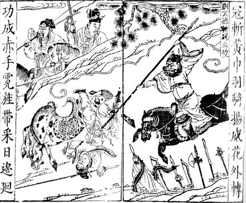
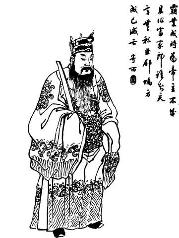
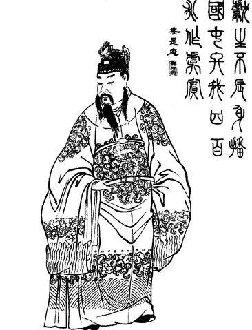
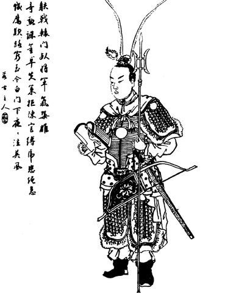
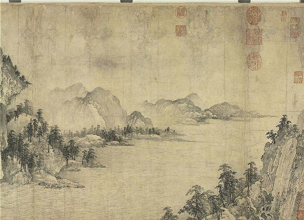
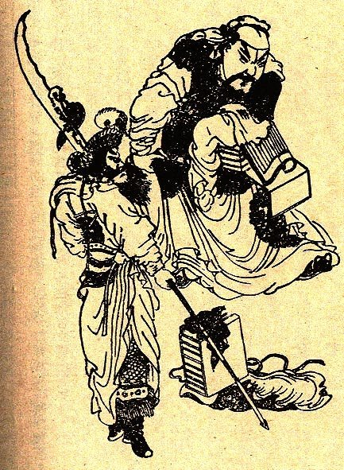
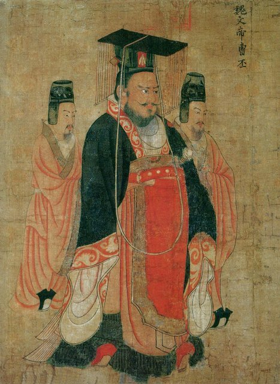

<!--
內容整理自 D:\Books\html\1-2-1.中國歷史人物\曹操(155~220).html（沒有對應的 md 筆記），並整合中文維基百科〈曹操〉條目，以自己的話改寫。
時期依頁面的階段歸納並拆細：早年仕途、黃巾與董卓、討董與經營兗州、迎獻帝與統一北方、赤壁之後到魏公、魏王與晚年。
兩份資料出入與處理方式：
- 出生年號：頁面寫「東漢桓帝永興元年」，但155年是永壽元年（永興年號只用到154年），維基百科亦作永壽元年，採永壽元年。維基百科另給出月日，各來源換算不一，born 只寫155年，事件的年齡因此是大約值。
- 去世：頁面寫「享年約65歲」，維基百科正文作66歲、信息框作65歲；以虛歲計為66，實歲約65。日期採維基百科的建安二十五年正月庚子（220年3月15日），二月丁卯（4月11日）葬於鄴城西郊高陵。
- 早年任官：頁面寫174年左右入仕、177年左右任洛陽北部尉；維基百科作174年舉孝廉、任郎，不久任洛陽北部尉，177年任頓丘令、次年因堂妹夫宋奇案免官。洛陽北部尉採174年，177年另記頓丘令。
- 頁面寫184年起「曾任濟南相等職務」、188年「參與西園八校尉相關軍事體系」；維基百科補充是任騎都尉平黃巾後任濟南相，188年任典軍校尉，189年12月回陳留募兵。
- 兗州：頁面寫192年取得兗州控制權；維基百科補充195年才正式受任兗州牧。193年攻打陶謙的起因，頁面沒有說明，維基百科記為曹操之父曹嵩在徐州一帶遇害，這裡補上；徐州屠殺的規模，頁面提醒史料與文學敘事要區分，照此謹慎寫法。
- 196年迎獻帝：頁面與維基百科一致；頁面在「經濟成就」提到屯田，但沒有年份，常見記載為196年在許下屯田，併入196年的事件。
- 官渡之戰：頁面只寫200年，維基百科補充2月開戰、10月烏巢之役，以「200-02 ~ 200-10」的區間表示。下邳之戰維基百科作198年12月。
- 208年：頁面只寫赤壁之戰；維基百科補充六月恢復丞相制度、曹操自任丞相，另立一則事件。
- 魏公、魏王：頁面只寫213、216年；維基百科給出建安十八年五月丙申（213年6月16日）封魏公、建安二十一年四月甲午（216年5月29日）封魏王，並於同年立曹丕為世子（一般也作217年立為太子），採維基百科。
- 頁面的219年把漢中之戰、關羽北伐併為一則；維基百科補充定軍山之役夏侯淵陣亡，這裡寫進同一則事件。
- 2009年河南安陽高陵的發現與2016–2017年遺骸鑑定，頁面沒有，取自維基百科；仍有學者質疑，照實說明。
- 頁面的「生平大事記總表」「政治、軍事與文化成就」「歷史上的曹操與《三國演義》中的曹操」「歷史定位」寫進時期說明與相關事件，不另立事件。三曹與文學作品（《短歌行》《觀滄海》《龜雖壽》《蒿里行》）併入210年的事件。
- 人名與事件和漢末三國大事記（ThreeKingdoms）一致：漢獻帝、袁紹、袁譚、袁尚、呂布、陶謙、張繡、典韋、孫權、劉備、關羽等。
圖片來源（皆為 Wikimedia Commons 公有領域／CC0 作品；註明「共用」者沿用其他時間軸已有的圖片）：
- sanguo-caocao.jpg（《三才圖會》中的魏太祖曹操像（與漢末三國大事記時間軸共用））
- sanguo-yellow.jpg（《三國演義》版畫插圖：劉備、關羽、張飛與黃巾軍作戰（與漢末三國大事記時間軸共用））
- sanguo-dongzhuo.jpg（清代插圖中的董卓（與漢末三國大事記時間軸共用））
- cc-xiandi.jpg：Emperor Xian Qing illustration.jpg（清代插圖中的漢獻帝）
- cc-lubu.jpg：Lu Bu Qing dynasty portrait.jpg（清代插圖中的呂布）
- sanguo-redcliff.jpg（金代武元直《赤壁圖》局部，借赤壁的山水意象（與漢末三國大事記時間軸共用））
- sanguo-guanyu.jpg（關羽像版畫（與漢末三國大事記時間軸共用））
- sanguo-caopi.jpg（唐代帝王圖卷中的魏文帝曹丕像（與漢末三國大事記時間軸共用））
-->

# Periods
- 155 ~ 184 | 家世與早年仕途 | #868e96
  出身宦官曹騰一系的家族，舉孝廉入仕，任洛陽北部尉、頓丘令，以嚴格執法聞名；家世讓他在重門第的士人社會裡未必被高看，也使他日後更重視實際才能。
- 184 ~ 190 | 黃巾之亂與董卓入京 | #f08c00
  以騎都尉鎮壓潁川黃巾，任濟南相、典軍校尉，逐漸接近權力核心；董卓入京廢立皇帝後，他離開洛陽，回陳留募兵。
- 190 ~ 196 | 討董與經營兗州 | #e8590c
  參加關東討董聯軍，在滎陽受挫後轉而經營自己的根據地，收編青州兵、攻打陶謙，又險些被呂布奪走兗州。
- 196 ~ 208 | 迎獻帝與統一北方 | #c92a2a
  迎漢獻帝到許縣、推行屯田，掌握朝廷的名義；擊敗呂布，官渡之戰擊敗袁紹，攻下鄴城、北征烏桓，基本統一北方。
- 208 ~ 216 | 赤壁之後：丞相與魏公 | #1971c2
  自任丞相後南下，赤壁之戰受挫，三分的格局逐漸成形；回頭整頓北方，發布求賢令，潼關擊破關中聯軍，受封魏公、加九錫，又取得漢中。
- 216 ~ 220-03-15 | 魏王與晚年 | #7048e8
  進封魏王，立曹丕為世子，魏國的架構為代漢做好準備；漢中失守、關羽圍襄樊，最終在洛陽去世，同年曹丕稱帝。

# Events

## 155 | 出生於沛國譙縣
曹操生於東漢桓帝永壽元年，沛國譙縣人（今安徽亳州），字孟德，小字阿瞞。父親曹嵩是宦官曹騰的養子，曾在朝中擔任高官，曹操因此得以進入政治與官僚體系。
不過曹氏與宦官集團的關係，使他在重視儒學門第的士人階層中，未必能和傳統高門士族平起平坐。這個背景有助於理解他後來為何特別看重實際才能，又常和部分士族起衝突。

## 174 | 舉孝廉，任洛陽北部尉
曹操以察舉孝廉入仕，任郎官，不久出任洛陽北部尉，負責京城北部的治安。據史書記載，他設五色棒整頓秩序，違反禁令的人即使有權貴背景也不寬貸。
這顯示他早年就有強烈的紀律觀念，重視法令的執行，也為他後來強調軍紀、賞罰分明的統治方式提供了早期例證。後世小說與戲曲對他早年的描寫多有戲劇化情節，不宜全當成史實。

## 177 | 頓丘令與免官
曹操轉任頓丘令；次年因堂妹夫宋奇受牽連而被免官。179年，他娶卞氏（後來的武宣卞皇后），她生下曹丕、曹彰、曹植、曹熊。

## 184 | 黃巾之亂與騎都尉

以張角為首的太平道發動大規模起事，參與者頭戴黃巾，史稱黃巾之亂。曹操獲任騎都尉，參與討伐潁川一帶的黃巾軍，這是他軍事生涯的起點。
黃巾雖被鎮壓，卻使地方軍事力量迅速擴張、中央對地方的控制削弱。曹操因平亂之功出任濟南相，以強硬作風整頓地方，後來稱病辭官回鄉。

## 188 | 典軍校尉
東漢朝廷為加強京城防衛，設西園八校尉，曹操任其中的典軍校尉，進一步接近權力核心。當時朝中外戚、宦官與士人激烈衝突，漢朝的政治秩序已陷入深刻危機。

## 189 | 董卓入京，回陳留募兵

漢靈帝去世後，董卓率軍進入洛陽，廢少帝劉辯，改立陳留王劉協，即漢獻帝。董卓專權使中央政權失去公信力。
曹操不願依附董卓，離開洛陽，12月在陳留募兵起事，開始建立自己的軍事力量。

## 190 | 討董聯軍與滎陽之敗
關東各地的諸侯與軍事領袖組成聯盟討伐董卓，袁紹、袁術、曹操都在其中，曹操任奮武將軍。聯盟各懷目的，沒有穩定的共同指揮，未能迅速消滅董卓。
曹操率軍追擊董卓部隊，在滎陽汴水一帶被徐榮擊敗。這次失利說明他早期兵力有限，此後轉向經營自己的根據地，不再單純依靠聯盟。

## 192 | 收編青州兵，取得兗州
曹操擊敗黃巾軍後收編大量降卒，組成「青州兵」，成為早期擴張的重要基礎；他不只消滅敵人，也把擊敗的對手轉化為自己的資源。
同年他取得兗州的控制權，建立較穩固的根據地（195年才正式受任兗州牧）。當時北方由袁紹、袁術、陶謙、公孫瓚等人分據，曹操必須在軍事、治理與聯盟之間取得平衡。

## 193 | 攻打陶謙
曹操的父親曹嵩在徐州一帶遇害，曹操因此出兵攻打徐州牧陶謙，戰事對當地造成嚴重破壞。關於屠殺的規模與細節，後世文獻記載不一，史料記述與文學敘事需要分開看待。
這場戰爭顯示曹操為了擴張能採取非常強硬的手段，也加深了他與徐州地方勢力的矛盾。

## 194 | 呂布奪兗州
曹操出兵徐州期間，兗州部分勢力倒向呂布，呂布乘機進入兗州，曹操的根據地一度陷入危機，雙方在濮陽激戰，互有勝負。如果失去兗州，他先前建立的基礎可能就此瓦解。
195年，曹操在鉅野大敗呂布，逐漸收復兗州主要地區，同年受任兗州牧。

## 196 | 迎奉漢獻帝，遷都許縣

曹操迎漢獻帝到許縣（今河南許昌一帶），掌握朝廷的實際運作，這是他一生最重要的政治轉折之一：他可以朝廷名義發布詔令、號令各地勢力，也吸引了許多希望重建秩序的官員與士人投效，從地方軍閥變成控制中央政權的實際領袖。後世以「挾天子以令諸侯」概括這項政策。
同年他在許下推行屯田，利用軍隊、流民恢復荒廢的農地，增加糧食供應，讓政權取得較穩定的經濟資源。

## 197 | 宛城之戰
曹操進攻張繡據守的宛城，張繡先投降、後又突然反叛，曹操損失慘重，長子曹昂、侄子曹安民與部將典韋都在這次事件中喪生。即使已掌握朝廷，他仍須面對地方軍閥的激烈抵抗。

## 198-12 | 下邳之戰，擒殺呂布

曹操圍攻下邳，呂布部下離心，城破後呂布與陳宮被俘處死，曹操據有徐州。呂布覆滅，消除了中原的重要競爭者，也鞏固了兗州與豫州一帶的控制權。

## 200-02 ~ 200-10 | 官渡之戰 {label="200年"}
控制冀、青、幽、并州大片地區的袁紹率大軍南下，想擊敗曹操、控制中原。雙方從2月開始交戰，10月曹操襲擊袁軍的糧食據點烏巢，袁軍糧草受到重創、士氣動搖，曹操趁勢反攻，擊敗袁紹。
官渡之戰改變了南北力量的對比，顯示曹操善於以有限資源取得戰略優勢：他靠的不只是兵力，還有對補給、情報、時機與士氣的掌握。此役為統一北方奠定基礎，確立了他作為北方最重要政治軍事領袖的地位。
201年，雙方又在倉亭交戰，袁軍再次受挫。

## 202 | 袁紹去世，袁氏內鬥
袁紹去世，兒子袁譚與袁尚爭奪繼承權。袁氏集團資源雄厚，卻缺乏穩定的權力交接，曹操利用兄弟間的矛盾，以軍事打擊與政治分化逐步削弱袁氏。政治組織能否維持團結，和軍事力量一樣重要。

## 204 | 攻下鄴城
曹操攻破袁氏在河北的政治中心鄴城，自領冀州牧，對河北的控制取得重大進展，北方更多的人口、土地與行政資源納入他的統治。205年，他擊敗袁譚，消滅袁氏在青州等地的主要勢力。

## 207 | 白狼山之戰，北征烏桓
曹操北征烏桓，在白狼山與張遼等人擊敗烏桓，斬殺首領蹋頓，削弱了袁氏殘餘勢力與北方部族互相依靠的局面，鞏固了北方邊境。
至此，曹操基本統一北方。但中國還沒統一：長江流域有孫權，劉備也正在尋找新的根據地。

## 208-07-09 | 自任丞相
曹操廢除三公制度、恢復丞相，自任丞相，以漢朝丞相的身分掌握最高實權，這個地位他一直保持到去世。

## 208 | 赤壁之戰

取得北方優勢後，曹操南下，想控制荊州與長江流域。劉備與孫權結盟抵抗，雙方在長江中游交戰，曹軍遭到重大挫敗。
《三國演義》強調周瑜、諸葛亮與火攻的作用，具體戰事過程與正史記載並不完全相同。赤壁之戰使曹操無法迅速統一全國，孫權鞏固了江東，劉備則得到發展空間；三國鼎立在208年還沒有完全定型，但這是政治版圖走向三分的重要轉折點。

## 210 | 求賢令與建安文學
赤壁之後，曹操回到北方整頓軍事與行政，戰略轉向鞏固既有領土。210年，他發布求賢令，強調選拔人才不應只看道德名聲，而要重視實際能力，這與漢代察舉制度及士族社會的用人觀念形成對比。這並不表示他完全不重視道德與家世，而是在特定情勢下把才能放在較優先的位置。
曹操也是建安文學的代表人物，與曹丕、曹植合稱「三曹」。他的詩雄健慷慨，寫戰爭、人生短暫與統一天下的抱負，著名作品有《短歌行》《觀滄海》《龜雖壽》《蒿里行》，另有文章《讓縣自明本志令》。

## 211 | 潼關之戰
曹操向西擴張，馬超、韓遂等關中勢力起兵抵抗。雙方在潼關一帶交戰，曹操以軍事部署配合政治分化，削弱聯軍，擴大了對關中的影響力，改善北方西部的戰略安全。
212年，漢獻帝准許他「贊拜不名、入朝不趨、劍履上殿」，他已是皇帝之下最有實權的人物，與漢室的關係也越來越微妙。

## 213-06-16 | 受封魏公，加九錫
漢獻帝封曹操為魏公，加九錫，這是他政治地位提升的重要標誌。「魏」逐漸成為曹氏政權的名號，封國與權力基礎為日後曹丕建立魏朝創造了條件。
214年，伏皇后事件爆發。曹操政權持續透過屯田、軍事組織與行政措施，恢復北方的生產秩序。

## 215 | 攻取漢中，張魯投降
漢中連接關中與益州，是控制西南的門戶。曹操進攻漢中，張魯投降，擴大了他在西部的影響力；但劉備隨即也積極爭奪漢中，衝突並未就此結束。

## 216-05-29 | 進封魏王
曹操進封魏王，同年立曹丕為世子，地位更接近皇帝。他雖然沒有正式稱帝，但已建立具有高度自主性的政治體系，不再只是掌握軍政大權的漢朝丞相。
魏王國與220年曹丕建立的魏朝仍有區別，不應混為一談。217年起，他在旌旗、冠冕等禮儀上已比照天子。

## 219 | 漢中失守與關羽圍襄樊

劉備與曹操爭奪漢中，定軍山之役夏侯淵陣亡，經過長期戰事後劉備取得漢中，曹操在西部的地位受到削弱。
同年，關羽從荊州北上進攻襄陽、樊城的曹軍，一度對曹操政權構成重大威脅；孫權隨後襲取荊州，關羽敗亡。曹操仍是北方最強大的領袖，但已無法輕易消滅劉備與孫權。

## 220-03-15 | 病逝於洛陽
建安二十五年正月庚子，曹操病逝於洛陽，享年約65歲（虛歲66）。他沒有完成統一全國的目標，但已建立強大的北方政權。二月丁卯（4月11日），他葬於鄴城西郊的高陵。
曹操的歷史形象不能簡化為英雄或奸臣：他既有卓越的政治判斷、軍事才能與制度建設能力，也曾在戰爭中採取嚴酷手段。《三國演義》把他塑造成多疑奸詐的代表性反派，但不能因此否定他在政治、軍事、經濟與文學上的成就。

## 220-12-11 | 曹丕代漢，追尊魏武帝

曹丕繼承魏王與丞相之位，同年接受漢獻帝禪讓，正式稱帝建立魏朝，東漢結束。曹操被追尊為太祖武皇帝，即魏武帝。
他最重要的成就，不是完成統一，而是在東漢末年最混亂的時代，建立起足以支撐新王朝的北方政權。

## 2009 | 安陽高陵的發現
2009年，河南安陽出土被認為是曹操高陵的墓葬；2016至2017年間，考古人員在墓室發現三具遺骸，專家鑑定其中一具約60歲的男性為曹操。這項認定仍有學者質疑。
