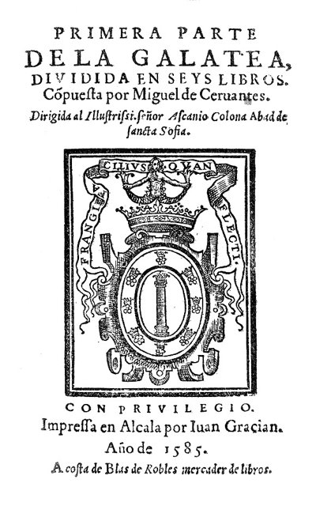
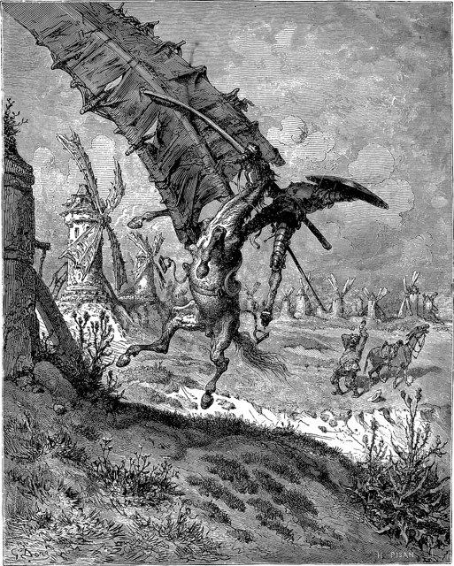
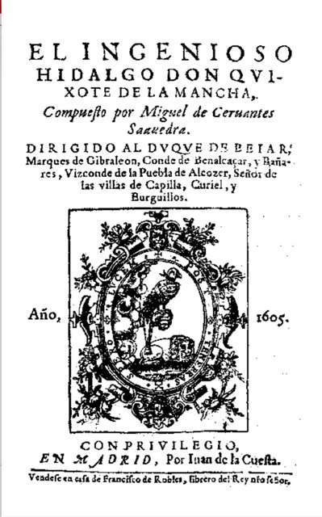
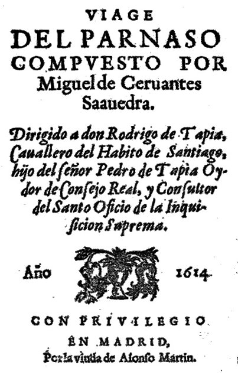
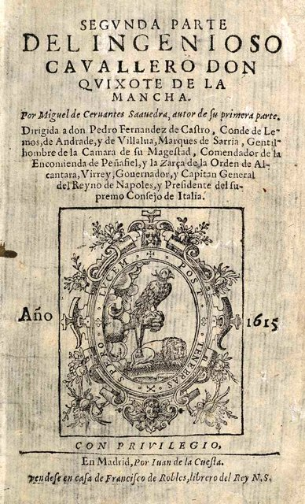
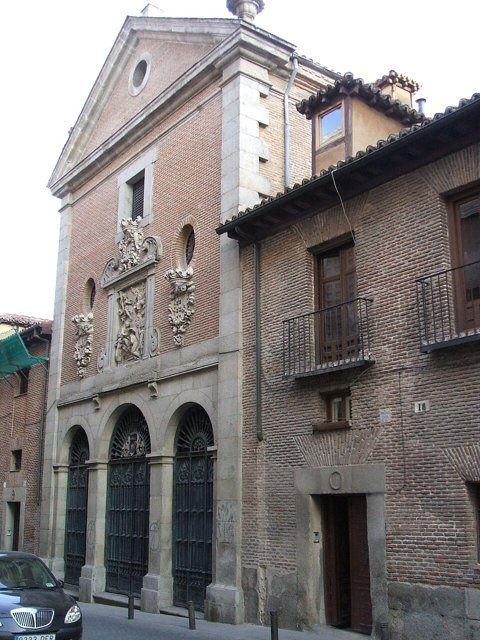

<!--
內容整理自本機筆記〈賽萬提斯生平大事記〉（圖表\賽萬提斯生平大事記.md）與中文維基百科「米格爾·德·塞萬提斯」條目（CC BY-SA 4.0），以台灣用語改寫摘要。
https://zh.wikipedia.org/zh-tw/米格尔·德·塞万提斯
史料與日期說明：
- 譯名：人名依筆記用「賽萬提斯」（維基百科台灣正體作「塞凡提斯」）；書名採台灣通行的《唐吉訶德》（筆記作《堂吉訶德》）。
- 生日沒有直接紀錄，傳統上依聖名推定為9月29日（聖米迦勒節），可確認的是10月9日受洗；時間軸以9月29日計算年齡，出生事件標示受洗日。
- 忌日：維基百科寫1616年4月23日；一般認為他4月22日去世、23日下葬，舊時登記的是下葬日，此處依筆記採4月22日。他與莎士比亞常被說成「同日去世」，但西班牙當時已用新曆、英國仍用舊曆，莎士比亞實際上晚了約十天。
- 《佩爾西萊斯與西希斯蒙達歷險記》：維基百科寫「逝世前一年出版」，實際上是他死後的1617年出版，此處依筆記。
- 1569年因決鬥傷人被通緝而逃往義大利：維基百科指出要看文件中的「米格爾·德·賽萬提斯」是否就是他本人，此處標明為可能的原因。
- 阿爾及爾四次逃亡、1584年私生女伊莎貝爾出生、1587年徵糧時因扣押教會穀物被逐出教會、1590年申請美洲職位被拒、1612年第一部英譯本、晚年加入方濟各第三會、2015年在馬德里三一修女院找到遺骸等細節，係依維基百科與一般公認的史實補充。
- 勒班陀海戰只寫他負傷的經過，不描寫戰鬥場面。
圖片來源（皆為 Wikimedia Commons 公有領域／CC0 作品）：
- cer-cover.jpg：Cervantes Jáuregui.jpg（傳統上認為是畫家豪雷吉所繪，但真偽有爭議，賽萬提斯並沒有可靠的當代肖像）
- cer-galatea.jpg：La Galatea First Edition Title Page.jpg
- cer-windmills.jpg：Adventure with the Windmills.jpg
- cer-quijote.jpg：Title page first edition Don Quijote.jpg
- cer-parnaso.jpg：Viaje del Parnaso.jpg
- cer-segunda.jpg：Segunda parte del ingenioso caballero don Quijote de la Mancha.jpg
- cer-trinitarias.jpg：Trinitmad.jpg
-->

# Periods
- 1547 ~ 1569 | 漂泊的童年與馬德里求學 | #f08c00
  生於埃納雷斯堡的外科醫生家庭，父親債務纏身，全家輾轉於瓦拉多利德、哥多華、塞維亞與馬德里；他沒有上過大學，在馬德里的學校發表了第一批詩作。
- 1569 ~ 1575 | 義大利與勒班陀的軍人 | #1c7ed6
  逃往義大利，先為紅衣主教當侍從，後從軍，在勒班陀海戰中左手負傷而終生殘廢，此後轉戰地中海各地。
- 1575 ~ 1580 | 阿爾及爾的俘虜 | #495057
  返鄉途中被巴巴里海盜俘虜，在阿爾及爾當了五年奴隸，四度策畫逃亡都失敗，最後由三一會修士贖回。
- 1580 ~ 1604 | 徵糧官與稅吏的困頓歲月 | #2f9e44
  回國後謀職不順，結婚、出版《伽拉泰亞》，為無敵艦隊徵集糧食、擔任稅吏，因帳目問題兩度入獄，在獄中構思了《唐吉訶德》。
- 1604 ~ 1616 | 《唐吉訶德》與晚年的豐收 | #c2255c
  57歲出版《唐吉訶德》第一部一舉成名，晚年在馬德里接連出版短篇小說、長詩、劇作與《唐吉訶德》第二部，直到去世。

# Events

## 1547-09-29 | 出生@埃納雷斯堡 {label=1547年10月9日受洗}
生於馬德里東北方的大學城埃納雷斯堡（阿爾卡拉·德·埃納雷斯），10月9日在聖瑪麗亞教堂受洗。他是七個孩子中的老四。父親羅德里戈是外科醫生——當時的外科醫生地位不高，兼做理髮、放血，比較接近今天的護理人員；而且父親耳朵不好，生意始終不順。

## 1551 | 隨父親四處漂泊 {label=約1551年起}
全家搬到當時的王都瓦拉多利德，父親因欠債被捕入獄，財產遭查封。此後一家人為了生計輾轉於哥多華、塞維亞等地。他的求學經歷沒有確切紀錄，可以確定的是他沒有上過大學；他從小就熱愛閱讀，自稱連「街上的紙屑」都會撿起來讀。

## 1566 | 馬德里求學
全家移居新的王都馬德里，他進入人文學者羅培茲·德·奧約斯主持的學校就讀，也常去看名演員兼劇作家羅培·德·魯埃達的演出，對戲劇產生興趣。

## 1569 | 第一批詩作，逃往義大利
老師羅培茲出版悼念伊莉莎白·德·瓦盧瓦王后的紀念文集，收錄了他的幾首詩，老師稱他為「我們親愛的學生」，這是他最早發表的作品。同年，一份王室文件下令逮捕一名在決鬥中刺傷他人的「米格爾·德·賽萬提斯」，這很可能就是他離開西班牙的原因。12月他抵達羅馬。

## 1570 | 紅衣主教侍從與從軍
擔任紅衣主教阿夸維瓦的侍從，隨主教走訪義大利各地，大量閱讀阿里奧斯托的騎士史詩與文藝復興文學，這些都成為他日後創作的養分。不久他離開主教，加入駐紮在義大利的西班牙步兵團。

## 1571-10-07 | 勒班陀海戰負傷
參加西班牙、威尼斯與教廷的「神聖同盟」艦隊對抗鄂圖曼帝國的勒班陀海戰。據戰友的證詞，他當時發著高燒，長官要他留在船艙休息，他卻堅持上陣，說寧願為上帝與國王而死。他胸口中了兩彈，另一彈打傷左手，傷到神經，左手從此不能活動，因而得到「勒班陀的獨臂人」的稱號。他一生以參加這場戰役為榮，稱之為「過去、現在與未來的世紀都不曾見過的最崇高的場合」。

## 1572 | 地中海的軍旅生涯
在墨西拿的醫院療養半年後重回軍營，參加了往納瓦里諾、突尼斯等地的遠征，此後在西西里、薩丁尼亞與那不勒斯等地駐防，在那不勒斯待了約兩年。

## 1575-09-26 | 被巴巴里海盜俘虜
帶著勒班陀艦隊統帥唐胡安等人的推薦信，與哥哥羅德里戈搭乘「太陽號」從那不勒斯返回西班牙，在加泰隆尼亞外海遭到北非海盜襲擊，兩兄弟被俘虜到阿爾及爾為奴。海盜從推薦信判斷他是重要人物，開出高額贖金，反而讓他遲遲無法獲釋。

## 1577 | 四度策畫逃亡 {label=1576～1579年}
在阿爾及爾的五年間，他四度策畫逃亡：第一次被嚮導拋棄；1577年家人籌到的贖金只夠贖一個人，他讓哥哥先回國，再安排船隻接應十多名藏在山洞中的俘虜，卻因內奸告密失敗；第三次派人送信給奧蘭的西班牙將軍求援，信差被截；最後一次準備用買來的船帶數十名俘虜逃走，又被一名同胞出賣。每次失敗他都主動承擔策畫者的罪責，雖被判重刑卻奇蹟似地未被處決，連阿爾及爾的總督都對他另眼相看。

## 1580-09-19 | 獲贖返國
三一會修士胡安·希爾來到阿爾及爾贖俘，總督開價五百金幣，修士四處向商人籌款，終於在他戴著腳鐐、即將被押往君士坦丁堡之前把他贖回。10月他回到西班牙。五年的俘虜生活日後出現在《唐吉訶德》的〈俘虜的故事〉與劇作《阿爾及爾的交易》中。

## 1581-05 | 前往葡萄牙謀職
前往國王腓力二世當時所在的葡萄牙里斯本求職，因熟悉北非的情況，奉命前往奧蘭執行一項短期秘密任務。此後他在馬德里寫劇本、作詩，但始終找不到穩定的工作。

## 1584-12-12 | 結婚
與未滿二十歲的卡塔莉娜·德·薩拉薩爾結婚，定居在她的家鄉、拉曼查附近的埃斯基維亞斯。幾週前，他與一名酒館老闆娘的私生女伊莎貝爾剛出生，這是他唯一的孩子。婚後他經常長期外出工作，夫妻聚少離多，但始終沒有離婚。

## 1585 | 《伽拉泰亞》

出版第一部小說、田園牧歌體的《伽拉泰亞》，描寫牧羊人的愛情，書名頁寫著「第一部」，他一生都說要寫續集，最後沒有完成。這段時期他也寫了二三十部劇本，例如描寫古代西班牙人抵抗羅馬的悲劇《努曼西亞》。同年父親去世。

## 1587 | 為無敵艦隊徵集糧食

到塞維亞擔任王室的徵糧專員，為準備進攻英格蘭的無敵艦隊向安達魯西亞各地徵收小麥與橄欖油。他因為扣押了教會的穀物，一度被逐出教會。這份差事讓他走遍了安達魯西亞與拉曼查的道路與客棧，見識了形形色色的人物，日後都成為《唐吉訶德》與短篇小說的素材。

## 1590-05 | 申請美洲職位被拒
向西印度事務院申請到美洲殖民地任職，列舉了自己的軍功與俘虜經歷，得到的批示卻只是一句：「請在國內另謀職位。」

## 1594 | 擔任稅吏
受任為格拉納達一帶的稅吏，負責追收拖欠的稅款，經手大量現金，帳目卻屢屢出問題。

## 1597-09 | 塞維亞入獄
他把收來的稅款存在一家銀行，銀行老闆卻捲款潛逃，他因此被控短缺公款，關進塞維亞的監獄好幾個月。他在《唐吉訶德》的序言中說，這部作品是在「一切不便都有、一切悲慘的聲音都在此安居」的監獄中孕育的，一般認為就是指這次入獄。

## 1605-01 | 《唐吉訶德》第一部

57歲時在馬德里出版《奇情異想的紳士唐吉訶德·德·拉曼查》。拉曼查一位沉迷騎士小說的鄉紳，自稱遊俠騎士唐吉訶德，騎著瘦馬駑騂難得、帶著樸實的農夫侍從桑丘·潘薩出門行俠仗義，把風車當成巨人、把客棧當成城堡，鬧出一連串笑話。這部諷刺騎士小說的作品一出版就大受歡迎，當年就再版多次，很快傳到葡萄牙、義大利與美洲，1612年出現第一部英譯本，但他賣斷了版權，並沒有因此致富。

## 1613 | 《模範小說集》
出版《模範小說集》，收錄十二篇短篇小說，題材從愛情、冒險到塞維亞的盜賊集團、會說話的狗，他自豪地說自己是「第一個用卡斯提亞語寫小說的人」，意指此前西班牙的短篇小說都是從義大利翻譯或模仿而來。這幾年他也先後加入宗教團體，晚年過著虔誠的生活。

## 1614 | 《帕爾納索斯之旅》與冒名續集

出版長詩《帕爾納索斯之旅》，以詩神阿波羅召集詩人的故事評點當代的西班牙詩人。同年，一名化名「阿維亞內達」的作者搶先出版了《唐吉訶德》的續集，序言還嘲笑他年老、殘廢、沒有朋友。至今沒有人能確定這位作者的真實身分。

## 1615 | 《唐吉訶德》第二部

出版《唐吉訶德》第二部，並同時出版《八部喜劇與八部幕間短劇》。第二部中的人物已經讀過第一部、甚至讀過冒名的續集，唐吉訶德還特地改變行程去證明那本續集是假的——這種小說談論自身的手法，被視為現代小說的開端。故事最後，唐吉訶德恢復理智，以本名阿隆索·吉哈諾安詳死去，讓任何人都無法再寫續集。

## 1616-04-22 | 逝世@馬德里

因水腫（一般認為是糖尿病或肝硬化）在馬德里的家中去世，享年68歲，隔天以方濟各第三會會士的身分下葬於三一修女院——當年贖回他的正是三一會。去世前三天，他寫下《佩爾西萊斯與西希斯蒙達歷險記》的獻詞：「腳已踏上馬鐙……」他的墓地後來湮沒，直到2015年考古學家才在修女院地下找到可能屬於他的遺骸。他與莎士比亞常被說成同日去世，聯合國教科文組織也因此把4月23日定為「世界書香日」。

## 1617 | 《佩爾西萊斯與西希斯蒙達歷險記》
遺孀出版了他最後的長篇小說《佩爾西萊斯與西希斯蒙達歷險記》，一對戀人從北方海域歷經冒險前往羅馬的故事，他生前認為這會是他最好的作品。今天，「賽萬提斯的語言」已成為西班牙語的代稱，西班牙語世界最高的文學獎就叫賽萬提斯獎。
