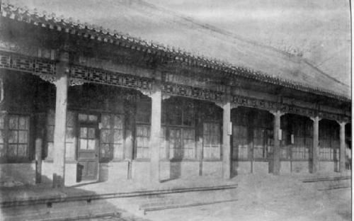
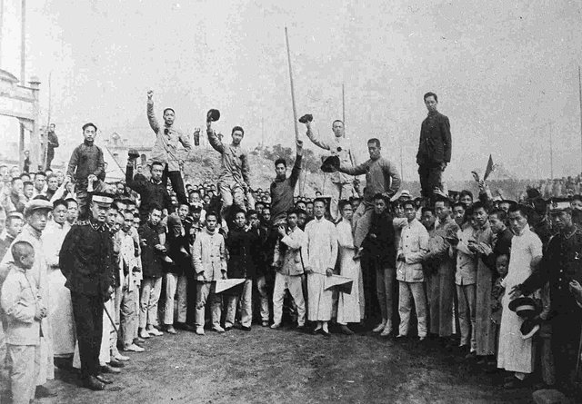
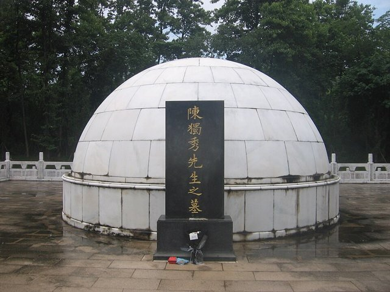

<!--
內容整理自 D:\Books\html\1-2-1.中國歷史人物\陳獨秀(1879~1942).html（沒有對應的 md 筆記），並整合中文維基百科〈陳獨秀〉條目，以自己的話改寫。
時期依頁面「思想發展：四個階段」，並把早年與晚年拆開：童年與科舉、反清革命與留日、新文化運動、創建中國共產黨、失勢與托派、入獄與晚年。
兩份資料出入與處理方式：
- 生卒：兩份一致，1879年10月9日生於安徽安慶（時屬懷寧縣），1942年5月27日卒於四川江津。享年頁面寫62歲，維基百科正文作63歲、資訊框推算為62歲，這裡寫62歲。
- 頁面多以年份敘述，維基百科補上日期：1901年10月首次留日、1903年3月剪辮事件被遣送回國與5月17日安慶拒俄集會、1904年3月31日創辦《安徽俗話報》、1915年9月15日創辦《青年雜誌》、1917年1月任北大文科學長、1918年11月27日創辦《每週評論》、1919年6月11日被捕、9月16日保釋、1920年8月上海共產主義小組、1927年8月7日八七會議被罷免、1929年11月15日被開除黨籍、1932年10月15日被捕、1937年8月23日出獄，採維基百科。
- 杭州求是書院：頁面寫1897–1898年；維基百科寫1897年考入並同年赴江寧鄉試落第，兩者相容，併入1897年的事件。
- 再赴日本：頁面寫1907年入早稻田大學，維基百科寫1907年春第三次留日，一致；頁面寫1909年在浙江陸軍學堂任教，維基百科寫1908年任杭州浙江陸軍小學教習，採維基百科。1914年協助章士釗辦《甲寅》、首次使用筆名「獨秀」，取自維基百科。
- 中共領導職稱：頁面寫1921年一大選為中央局書記、1922年二大「繼續擔任重要領導職務」；維基百科補充二大、三大時的職稱為中央執行委員會委員長，這裡照維基百科。1921年10月與1922年8月在上海兩度被捕，頁面沒有，取自維基百科。
- 1927年：頁面寫7月離開領導崗位；維基百科補充4月12日四一二政變、長子陳延年7月4日遇害、7月中旬辭職、8月7日八七會議被罷免，分成兩則。次子陳喬年1928年6月6日遇害，取自維基百科。
- 托派：頁面寫1929年12月與彭述之等發表政治主張、1931年參與托派組織；維基百科補充1929年9月創「無產者社」、1931年5月托派「統一大會」推選他為總書記，採維基百科。
- 入獄：頁面寫1933年被判刑；維基百科補充1933年4月江寧地方法院審判、判刑十三年，囚於南京。
- 死因：頁面沒有；維基百科寫1942年5月誤飲發霉的蠶豆花茶中毒，於5月27日去世，照維基百科。1938年被中共指為「漢奸」的指控，取自維基百科。
- 頁面的「重要著作與文章」「思想發展：四個階段」「與胡適、李大釗、魯迅的比較」「歷史地位與評價」寫進時期說明與相關事件，不另立事件。
- 人名與其他時間軸一致：蔡元培、李大釗、胡適、魯迅、錢玄同、章士釗、蔣中正、彭述之、托洛斯基、史達林。
圖片來源（皆為 Wikimedia Commons 公有領域／CC0 作品；註明「共用」者沿用其他時間軸已有的圖片）：
- cd-cover.jpg：Chen Duxiu4.jpg（陳獨秀）
- cd-peking.jpg：Peking University Library, 1918.jpg（北京大學圖書館，1918）
- cd-may4.jpg：May Fourth Movement students (cropped).jpg（五四運動中示威的學生，1919）
- cd-tomb.jpg：Tomb of Chen Duxiu.jpg（安徽安慶的陳獨秀墓）
-->

# Periods
- 1879-10-09 ~ 1898 | 童年與科舉 | #868e96
  生於安徽懷寧的士紳家庭，自幼讀經，十七歲考中秀才，鄉試落第後對科舉失去信心，進杭州求是書院接觸新式教育。
- 1898 ~ 1915 | 反清革命與留日 | #e8590c
  三度留學日本，剪辮被遣返，以《安徽俗話報》宣傳白話與新思想，組織岳王會；辛亥後任安徽都督府秘書長，參加二次革命失敗，到日本協助《甲寅》。
- 1915 ~ 1920 | 新文化運動 | #1971c2
  創辦《青年雜誌》（後改名《新青年》），提倡民主與科學、白話文與文學革命，任北大文科學長，支持五四運動而被捕。
- 1920 ~ 1927-08-07 | 創建中國共產黨 | #c92a2a
  轉向馬克思主義，建立上海共產主義小組，在中共一大被選為中央局書記，領導早期黨務與國共合作，1927年國共分裂後被罷免。
- 1927-08-07 ~ 1932-10-15 | 失勢與托派 | #7048e8
  反思革命失敗、與中共領導層決裂，1929年被開除黨籍，轉向托洛斯基主義並成為中國托派的領袖。
- 1932-10-15 ~ 1942-05-27 | 入獄與晚年 | #495057
  在上海被捕、判刑十三年，抗戰爆發後出獄，晚年在四川江津從事文字與學術工作，反思民主與政治制度。

# Events

## 1879-10-09 | 出生於安徽懷寧
陳獨秀生於安徽安慶府城（時屬懷寧縣），字仲甫，出身傳統士紳家庭，五歲左右開始在家學習儒家經典。他成長於清朝末年的傳統社會。

## 1896 | 考中秀才
十七歲的陳獨秀通過院試，成為秀才，取得傳統士人的身分。

## 1897 | 鄉試落第，入求是書院
陳獨秀考入杭州求是書院，接觸新式教育；同年赴江寧參加鄉試未中，逐漸對科舉失去信心。甲午戰爭、戊戌變法與清朝的政治危機，讓他認識到單靠科舉與經學無法解決中國的危機，這是晚清知識分子從傳統教育轉向新思想的典型歷程。

## 1901-10 | 首次留學日本
陳獨秀因反清活動受清政府注意，自費到日本，入東京弘文學院師範科，進入海外革命知識分子的網絡。1902年他一度回國組織青年勵志社，同年再赴日本入成城學校。

## 1903 | 剪辮被遣返，拒俄集會
1903年3月，陳獨秀與張繼、鄒容剪掉湖北陸軍學生監督姚昱的辮子，事後被日本遣送回國。5月17日，他在安慶藏書樓組織拒俄集會，清廷下令通緝，他轉到上海從事革命宣傳。

## 1904-03-31 | 創辦《安徽俗話報》
陳獨秀與房秩五等人創辦白話文的《安徽俗話報》，用通俗的文字傳播新思想。他開始把報刊當成政治改革的工具，讓更多普通民眾接觸新知識。

## 1905 | 組織岳王會
陳獨秀在蕪湖發起反清秘密組織「岳王會」並任總會長，從思想宣傳進一步投入革命組織。他逐漸認為中國的問題不只是某個皇帝或政府，還涉及政治制度、社會風俗與思想觀念。
1907年春，他第三度赴日，入早稻田大學；1908年回國，在杭州浙江陸軍小學任教。

## 1911 | 辛亥革命，任安徽都督府秘書長
辛亥革命爆發，清朝統治瓦解，陳獨秀應安徽都督孫毓筠之邀，任安徽都督府秘書長，從反清革命者進入共和政權的實務。

## 1913 | 二次革命
陳獨秀參與反對袁世凱的二次革命，失敗後遭到追捕，親身體驗了民初共和政治的挫折。1914年春，他再度赴日，協助章士釗辦《甲寅》雜誌，首次使用「獨秀」這個筆名。

## 1915-09-15 | 創辦《青年雜誌》
陳獨秀在上海創辦《青年雜誌》，發表〈敬告青年〉，要青年自主、進步、進取、面向世界、講求實利與科學。這是新文化運動的重要起點：他把重心從直接的政治革命轉向思想與文化改革，認為必須先改變觀念，才能為新的社會制度奠定基礎。
1916年，雜誌改名《新青年》，他發表〈憲法與孔教〉，檢討傳統倫理與共和制度的關係。

## 1917-01 | 北京大學文科學長與文學革命

蔡元培就任北大校長，聘陳獨秀為文科學長，《新青年》隨之遷到北京，新文化運動與大學教育結合。胡適發表〈文學改良芻議〉後，他發表〈文學革命論〉響應，推動白話文與新文學。
《新青年》聚集了李大釗、胡適、魯迅、錢玄同等人，主張民主、科學、白話文、思想解放與青年自主。他以 Democracy 與 Science 的音譯稱為「德先生」與「賽先生」：中國需要的不只是政治制度的改變，也需要思想方式的改變。新文化運動不是他一人完成，而是許多知識分子共同參與的。

## 1918-11-27 | 創辦《每週評論》
陳獨秀與李大釗合辦政治性較強的《每週評論》，把思想改革延伸到現實政治與社會議題。1919年4月，北大改制，他卸下文科學長，改任教授。

## 1919-06-11 | 五四運動後被捕

巴黎和會把德國在山東的權益轉給日本，5月4日北京學生示威，擴大為學生、工人與商人參與的群眾運動。陳獨秀以文章支持，6月8日發表〈研究室與監獄〉，6月11日因散發《北京市民宣言》被北洋政府逮捕，9月16日保釋出獄。
五四前後的政局，讓他對只靠知識分子推動改革感到失望，開始重視工人與勞動群眾、階級與經濟結構、俄國革命的道路，以及以政黨組織推動變革的可能。

## 1920-08 | 上海共產主義小組
陳獨秀1920年初移居上海，8月與李漢俊、李達、陳望道、俞秀松等人建立上海共產主義小組，社會主義青年團也在他家中成立，他並推動各地建立相關組織。《新青年》逐漸轉為宣傳馬克思主義的刊物，他從新文化運動的領袖，轉變為共產主義政治組織的創建者。年底，他應陳炯明之邀，到廣州任廣東省教育委員會委員長。

## 1921-07 | 中共一大，選為中央局書記
中國共產黨第一次全國代表大會在上海召開，陳獨秀雖沒有出席，仍被選為中央局書記，成為中共早期的最高領導人。同年10月，他在上海法租界被捕，不久獲釋。
1922年7月的中共二大，他當選中央執行委員會委員長；8月再度被捕。

## 1923-06-12 | 中共三大與國共合作
陳獨秀在廣州主持中共三大，再度當選委員長，會議決定與孫中山的國民黨合作。1925年五卅運動擴大了群眾反帝運動，1926年國民革命軍北伐，國共合作進入新階段。

## 1927-08-07 | 八七會議被罷免
1927年4月12日，蔣中正發動四一二政變，國民黨大規模清共，國共分裂；7月4日，陳獨秀的長子陳延年遇害。他的領導受到黨內與共產國際的嚴厲批評，7月中旬辭職，8月7日中共召開八七會議，正式罷免他，並不讓他出席。
他對國共合作與革命策略的判斷，成為中共早期歷史持續討論的議題；評價他的責任，也必須考慮當時的國際局勢、國共關係與共產國際的影響。1928年6月6日，次子陳喬年也被處決。

## 1929-11-15 | 被開除黨籍，轉向托派
陳獨秀拒絕出席在莫斯科召開的中共六大，1929年就中東路事件致信中共中央，反對「武裝保衛蘇聯」的口號，9月與彭述之等人成立托派組織「無產者社」，11月15日被中共開除黨籍。
托洛斯基主義源於與史達林路線對立的俄國革命家托洛斯基。陳獨秀接受其部分觀點，重新思考中國革命、工人階級與民主問題，從此不只與國民黨對立，也與自己創建的政黨決裂。1931年5月，他被托派統一大會推為「中國共產黨左派反對派」的總書記。

## 1932-10-15 | 在上海被捕
陳獨秀在上海公共租界被捕，移交南京國民政府。1933年4月，江寧地方法院審判，判處有期徒刑十三年，囚於南京。他在獄中繼續思考政治、歷史與思想問題，1936年發表〈無產階級與民主主義〉。

## 1937-08-23 | 抗戰爆發後出獄
抗日戰爭全面爆發後，陳獨秀提前獲釋。1938年他遭中共批判，被指為「漢奸」，此後輾轉入川，在四川江津生活，逐漸遠離政治組織，繼續從事文字學研究與寫作；晚年的政論與書信，反映他對民主、政治制度與革命經驗的反思。

## 1942-05-27 | 逝世於四川江津

1942年5月，陳獨秀誤飲發霉的蠶豆花泡的茶而中毒，5月27日在江津石牆院去世，享年62歲。
他的一生經歷四次轉變：反清革命、新文化運動、創建中國共產黨、晚年的政治反思。他把近代中國的思想改革、文學革命與政治革命連結起來，始終在追問：中國該如何擺脫舊秩序的束縛，建立新的社會與政治制度？他既有思想創新的成就，也有政治判斷的失誤與爭議，研究他不能只停留在創辦《新青年》或創建中共的階段。
