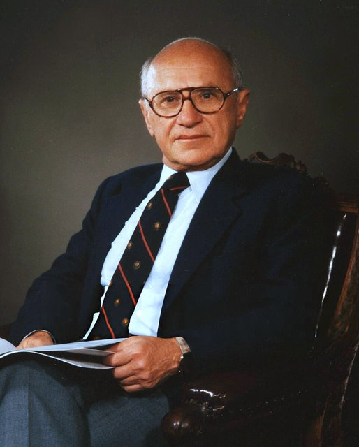
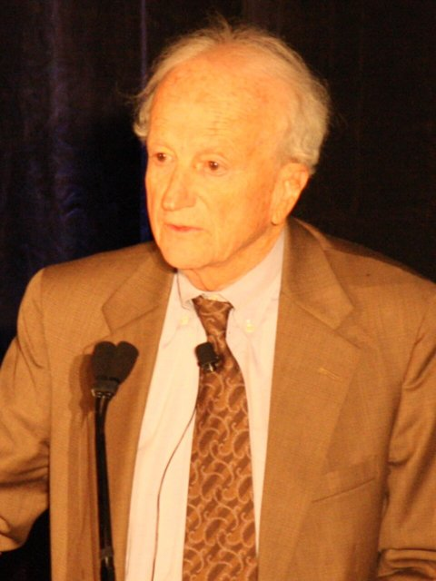

<!--
內容整理自本機筆記〈芝加哥學派（Chicago School）〉（D:\Books\md\歷史\術語\經濟學\芝加哥學派（Chicago School）.md；html 版在 D:\Books\html\4-1-1.經濟學派），並參考中文維基百科〈芝加哥經濟學派〉條目，以自己的話改寫。
原稿同時涵蓋芝加哥社會學派（帕克、伯吉斯的城市研究、《身處歐美的波蘭農民》等），這條時間軸只收經濟學派；社會學派的發展寫進1892年那則的內文。
時期依原稿的發展階段：大學創立與早期、第一代芝加哥學派（奈特、西蒙斯、維納）、傅利曼時代、法律經濟學與理性預期、當代。
兩份資料出入與處理方式：
- 盧卡斯獲諾貝爾獎：原稿總表寫2003年；盧卡斯是1995年獲獎（2003年得主是恩格爾與格蘭傑），這裡依此。
- 管制俘虜理論：原稿寫1968年；史蒂格勒的〈經濟管制理論〉發表於1971年，這裡依此。
- 「芝加哥男孩」與智利：原稿未列，依維基百科補充1956年芝加哥大學與智利天主教大學的合作計畫，以及1975年以後智利的市場改革。
- 1971年布列敦森林瓦解、1973年石油危機、1979年伏克爾等宏觀事件，詳見「貨幣學派」時間軸，這裡只簡述。
- 人名依 Books 原稿與台灣慣用譯名：傅利曼、史蒂格勒、貝克、寇斯、法瑪、盧卡斯、塞勒、海耶克；人名用·分隔。
圖片來源（皆為 Wikimedia Commons 公有領域／CC0 作品，縮成最長邊 640px）：
- cs-harper.jpg：Along The Midway West Of Harper Memorial Library, Chicago (NBY 417351).jpg（芝加哥大學哈珀紀念圖書館以西的中途大道，20世紀初明信片（紐伯瑞圖書館））
- mo-friedman.jpg：Portrait of Milton Friedman (4x5 cropped).jpg（米爾頓·傅利曼（與貨幣學派時間軸共用））
- cs-becker.jpg：GaryBecker-May24-2008.jpg（蓋瑞·貝克，2008）
-->

# Periods
- 1892 ~ 1919 | 大學創立與早期 | #868e96
  洛克斐勒出資創辦的芝加哥大學設立政治經濟學系，學派風格尚未成形，凡勃倫的制度學派與社會學系的城市研究都在這裡萌芽。
- 1920 ~ 1945 | 第一代芝加哥學派 | #862e9c
  奈特研究風險與不確定性，西蒙斯提出以規則穩定貨幣的方案，維納主講價格理論；他們質疑凱因斯革命，奠定了重視價格理論與自由市場的學風。
- 1946 ~ 1969 | 傅利曼時代 | #e67700
  傅利曼、史蒂格勒回到芝加哥，貨幣學派、實證經濟學方法論與《資本主義與自由》使芝加哥成為反凱因斯的重鎮；貝克把經濟學延伸到教育、歧視與家庭。
- 1970 ~ 1999 | 擴張與影響力的高峰 | #1971c2
  管制俘虜、法律經濟學、效率市場與理性預期在芝加哥發展，「芝加哥男孩」在智利推動改革，傅利曼、史蒂格勒、寇斯、貝克、盧卡斯接連獲得諾貝爾獎。
- 2000 ~ 2026 | 當代 | #5f3dc4
  金融海嘯使效率市場與自由市場理論受到質疑；法瑪與塞勒在同一所大學代表效率市場與行為經濟學兩端，芝加哥仍是重要的研究重鎮。

# Events

## 1892 | 芝加哥大學與政治經濟學系
石油大亨洛克斐勒出資創辦的芝加哥大學在1892年開始上課，設立政治經濟學系，由勞克林主持，並創辦《政治經濟學期刊》，凡勃倫也在初期加入。芝加哥大學同時設立了美國最早的社會學系，帕克、伯吉斯等人在1910至1930年代以芝加哥為實驗室研究移民、貧民窟與城市結構（如1925年的同心圓模型），形成社會學上的「芝加哥學派」，與後來的經濟學派是不同的學術傳統。

## 1921 | 奈特《風險、不確定性與利潤》
法蘭克·奈特出版《風險、不確定性與利潤》，區分可以用機率計算、能夠保險的「風險」，與無法預測的「不確定性」，並指出企業家的利潤正是承擔不確定性的報酬。奈特1927年到芝加哥任教，與維納主講的價格理論課程，訓練出傅利曼、史蒂格勒等下一代學者；他對市場的倫理問題頗多懷疑，並不是單純的自由放任者。

## 1936 | 西蒙斯的「自由放任的積極計畫」
凱因斯《通論》出版這年，芝加哥的亨利·西蒙斯發表〈貨幣政策中的規則與權衡〉，主張以明確的規則而非官員的裁量管理貨幣；他在1934年的〈自由放任的積極計畫〉中，主張打破壟斷、維持競爭、改革稅制。1933年芝加哥學者還提出「芝加哥計畫」，主張銀行存款須有百分之百的準備，防止銀行體系放大危機。這些想法日後由傅利曼繼承。

## 1946 | 傅利曼回到芝加哥

米爾頓·傅利曼回到母校任教（同年西蒙斯去世），1958年喬治·史蒂格勒也回到芝加哥。兩人與經濟學系、商學院、法學院的同事形成緊密的學術網絡，以嚴格的價格理論分析各種問題，對政府干預普遍抱持懷疑，「芝加哥學派」從此成為鮮明的學派標籤。1947年傅利曼、史蒂格勒與海耶克等人在瑞士成立倡議自由市場的朝聖山學社；海耶克在1950年至1962年也任教於芝加哥大學。

## 1953 | 〈實證經濟學方法論〉
傅利曼發表〈實證經濟學方法論〉，主張評價一個理論，不在於它的假設是否符合現實，而在於它的預測是否準確，例如撞球高手未必懂物理，但「彷彿」會計算物理定律。這篇文章成為芝加哥學派的方法論宣言，影響深遠也爭議不斷。

## 1956 | 「芝加哥男孩」與智利
芝加哥大學與智利天主教大學簽訂合作計畫，資助智利學生到芝加哥攻讀經濟學。這批「芝加哥男孩」在1973年皮諾契特政變後進入軍政府，從1975年起推行私有化、貿易自由化與退休金私有化等市場改革，成為芝加哥學派在政策上最具爭議的實驗：智利經濟後來成長迅速，卻是在獨裁與人權迫害下進行。同年傅利曼重新表述貨幣數量論，1957年提出恆常所得假說。

## 1962 | 《資本主義與自由》
傅利曼出版《資本主義與自由》，主張經濟自由是政治自由的前提，提出教育券、負所得稅、廢除職業執照與徵兵制、浮動匯率等政策構想，許多主張日後成為現實。1963年他與史瓦茲出版《美國貨幣史》，詳見「貨幣學派」時間軸。

## 1964 | 貝克《人力資本》

蓋瑞·貝克出版《人力資本》，把教育與職業訓練視為一種投資，以報酬率分析個人與社會的教育決策。他早在1957年的《歧視經濟學》中就分析雇主的種族歧視會讓自己付出代價，此後又把經濟學方法延伸到犯罪、婚姻、家庭與生育，被稱為「經濟學帝國主義」。

## 1971 | 史蒂格勒的管制俘虜理論
史蒂格勒發表〈經濟管制理論〉，指出政府管制往往不是為了保護大眾，而是被受管制的產業「俘虜」，成為業者排除競爭、維持高價的工具。這個理論推動了1970年代末以後美國航空、運輸、金融等產業的管制鬆綁。他早在1961年的〈資訊經濟學〉中就分析了搜尋價格的成本。

## 1973 | 法律經濟學與效率市場
法學院的波斯納出版《法律的經濟分析》，以經濟效率解釋與評價法律規則，延續寇斯1960年的〈社會成本問題〉與迪雷克特的反托拉斯研究，使法律經濟學成為法學院的重要學科；反托拉斯政策也轉向以消費者福利為標準。商學院的法瑪在1970年整理「效率市場假說」：股價已反映所有可得的資訊，投資人難以長期打敗市場，指數型基金因此興起。

## 1976 | 傅利曼獲諾貝爾獎
傅利曼獲得諾貝爾經濟學獎，此後芝加哥大學的學者接連獲獎：1979年舒爾茨（農業與開發經濟學）、1982年史蒂格勒、1986年布坎南（曾在芝加哥求學）、1990年米勒（公司財務）、1991年寇斯、1992年貝克、1993年福格爾、1995年盧卡斯，芝加哥大學成為獲獎最多的經濟學重鎮。

## 1979 | 芝加哥思想進入政策主流
英國柴契爾政府上台、美國聯準會主席伏克爾緊縮貨幣，1981年雷根推行減稅與鬆綁管制，傅利曼擔任雷根的經濟顧問，芝加哥學派的貨幣、管制與自由市場主張進入英美的政策主流，此後的私有化、自由化浪潮也擴及世界各地。

## 1995 | 盧卡斯獲諾貝爾獎
盧卡斯以理性預期假說的發展與應用獲得諾貝爾經濟學獎。他在1970年代提出理性預期與「盧卡斯批判」，與薩金特、巴羅等人形成新興古典學派，芝加哥在總體經濟學也成為重鎮。詳見「新興古典學派」時間軸。

## 2006 | 傅利曼逝世
傅利曼在11月去世，享年九十四歲。2008年芝加哥大學成立「米爾頓·傅利曼經濟研究所」（後改名貝克－傅利曼研究所），引發部分教授抗議學校為特定意識形態背書。

## 2008 | 金融海嘯的衝擊
金融海嘯使「市場能自我修正」「金融市場有效率」的觀點受到嚴厲質疑，波斯納在2009年出版《資本主義的失敗》，承認放鬆金融管制的錯誤。芝加哥學派內部也開始重新檢討金融管制與市場失靈的問題。

## 2013 | 法瑪獲諾貝爾獎
法瑪以效率市場與資產價格的實證研究，與漢森、席勒同獲諾貝爾經濟學獎；席勒的研究卻強調市場的非理性波動，三人同年獲獎被視為學界承認問題仍無定論。2014年貝克去世。2017年，芝加哥大學的塞勒以行為經濟學獲獎，指出人的決策常受心理偏誤影響，與傳統芝加哥學派的理性假設形成鮮明對比。

## 2023 | 盧卡斯逝世
盧卡斯在5月去世。芝加哥學派的影響力已不像1970至1990年代那樣獨大，但價格理論、實證方法、貨幣規則、法律經濟學與人力資本等研究傳統，至今仍深深影響全球的經濟學與公共政策。
