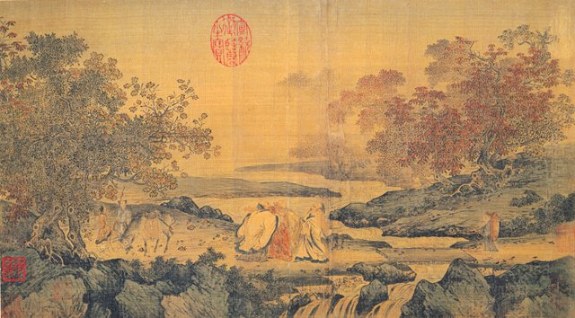
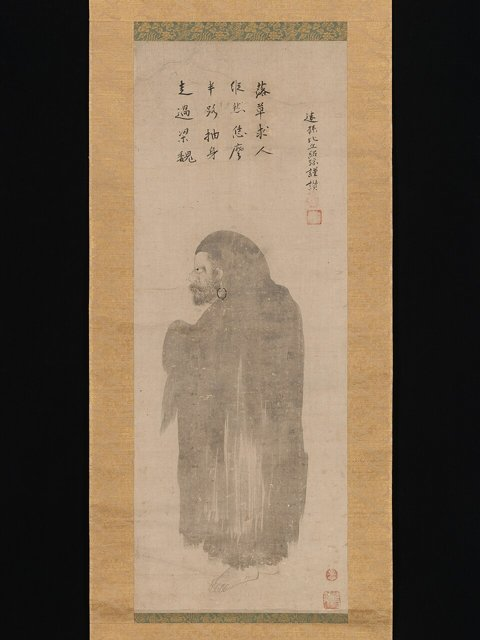
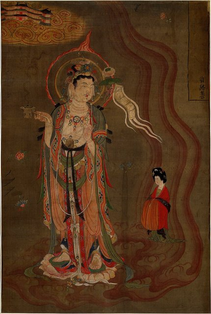
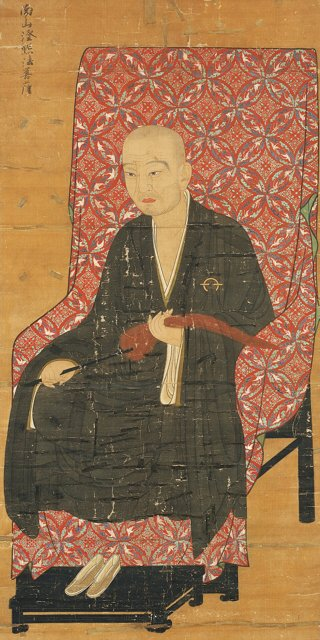

<!--
內容整理自 D:\Books\md\歷史\東方歷史\漢傳佛教八宗.md（Books 頁面為 D:\Books\html\1-2.中國歷史\漢傳佛教八宗.html），並整合中文維基百科〈漢傳佛教〉〈善導〉〈佛陀跋陀羅〉〈不空〉條目，以自己的話改寫。
筆記依宗派分章（三論、法相、天台、華嚴、禪、淨土、律、密），這裡依時間合成一條時間軸，每則事件標題前面不另標宗派，宗派寫在內文；時期依歷史階段歸納：南北朝的思想準備、隋代宗派初成、唐代鼎盛、晚唐至宋的禪淨獨盛、明末的融合、近現代。筆記的「核心思想」「主要經典」「八宗之間的關係」寫進相關事件與時期說明。
很早的背景（東漢佛教傳入與譯經、2–3世紀龍樹與提婆的中觀、4–5世紀無著與世親的唯識）寫進第一則事件的內文，不另立事件。
「八宗」是後世的分類：筆記提醒隋唐另有成實、俱舍、地論、攝論、涅槃等學派；維基百科說一般稱「十宗」（八個大乘宗派加上部派佛教的俱舍宗、成實宗），日本《八宗綱要》的八宗又是另一種列法，這裡照筆記的八宗。
兩份資料出入與處理方式：
- 華嚴經：筆記寫420年佛陀跋陀羅譯出六十華嚴；維基百科寫418年起三年譯出，這裡用418年（與佛教譯經時間軸一致）。
- 善導：筆記標題寫617年出生、內文寫613–681年（生年另有異說）；維基百科寫613–681年，641年從道綽學淨土，645年道綽圓寂後到長安，這裡把事件放在645年，生年用613年。
- 智顗：筆記寫594年講述《法華玄義》；佛教判教時間軸依同一位作者的判教筆記寫593年講《法華玄義》、594年講《法華文句》，這裡不另立講經事件，寫進575年與597年兩則。
- 善無畏與金剛智：筆記把724年《大日經》放在720年金剛智之前，這裡依年份排序。
- 禪宗：筆記寫「8世紀：神會弘揚南宗禪」；神會在732年於滑台舉行無遮大會，公開批評北宗、宣揚慧能為六祖，這裡用732年。維基百科補充晚唐到北宋初分出五家，後來只剩臨濟、曹洞，南宋有大慧宗杲的看話禪與宏智正覺的默照禪，照此補一則。
- 晚唐以後：維基百科說晚唐之後三論、唯識、成實、俱舍、密宗等被禪、淨土、華嚴、天台、律宗融攝，十宗名存實亡，照此寫進會昌法難一則與時期說明。
- 楊仁山：筆記只寫1837–1911年、佛典刻印與唯識學復興；他在1866年創立金陵刻經處，這裡用1866年。
- 人名與其他時間軸一致：玄奘（Xuanzang）；慧遠（廬山慧遠，與北周的淨影寺慧遠不同人）、智顗、法藏、慧能、空海等沒有獨立時間軸。
圖片來源（皆為 Wikimedia Commons 公有領域／CC0 作品，縮成最長邊 640px）：
- bz-cover.jpg：Sixth Patriarch Huineng, Nanhai Guanyin Temple, Foshan, Guangdong, China, picture2.jpg（廣東佛山南海觀音寺的六祖慧能像）
- bz-huxi.jpg：Huxisanxiaotu.jpg（〈虎溪三笑圖〉，宋代，畫中有廬山慧遠）
- bz-damo.jpg：達磨図-Bodhidharma MET DP-12232-057.jpg（日本〈達磨圖〉，大都會藝術博物館藏）
- bz-shandao.jpg：Anonymous-Bodhisattva Leading the Way.jpg（敦煌藏經洞出土的〈引路菩薩圖〉，約9世紀，引導亡者往生淨土）
- bz-daoxuan.jpg：Daoxuan (Nara National Museum).jpg（道宣像，鎌倉時代，奈良國立博物館藏）
-->

# Periods
- 402 ~ 580 | 南北朝：義學與思想準備 | #868e96
  鳩摩羅什譯出三論，佛陀跋陀羅譯出華嚴，曇鸞弘揚淨土，達摩傳入禪法，慧思弘揚法華，各地形成不同的經論學派，為宗派的出現做準備。
- 581 ~ 617 | 隋：宗派初成 | #e8590c
  智顗在天台山建立教觀並重的天台宗，吉藏集三論學之大成，杜順開始弘揚華嚴。
- 618 ~ 845 | 唐：八宗鼎盛 | #1971c2
  玄奘與窺基創法相宗，道宣立南山律宗，善導集淨土之成，法藏完成華嚴宗的教義，慧能的南宗禪興起，開元三大士建立唐密，鑑真與空海把律、密傳到日本。
- 846 ~ 1279 | 晚唐至宋：禪淨獨盛 | #2f9e44
  會昌法難後，依賴大寺院與經論的宗派衰微，禪宗分出五家，宋代提倡禪淨雙修，其他宗派逐漸被融攝。
- 1535 ~ 1655 | 明末：宗派融合 | #7048e8
  袾宏、真可、德清、智旭四大師兼修禪、教、律、淨，宗派之間的界限更加模糊。
- 1866 ~ 1990 | 近現代：人間佛教 | #495057
  楊仁山刻經、復興唯識，太虛、印順提倡人間佛教，聖嚴、星雲推動佛教教育與國際化。

# Events

## 402 | 鳩摩羅什譯三論 {label="402年前後"}
佛教在東漢傳入中國，安世高、支婁迦讖等人譯經，但經典有限，還談不上中國的宗派。八宗的思想多半源自印度：約2至3世紀，龍樹著《中論》奠定中觀思想，弟子提婆著《百論》；4至5世紀，無著與世親建立瑜伽行派的唯識學。鳩摩羅什在長安譯出《中論》《百論》《十二門論》，合稱「三論」，中國僧人從此深入研究中觀思想，成為三論宗（性宗）的經典依據，主張緣起性空、八不中道與破邪顯正。

## 402 | 慧遠結白蓮社 {label="402年"}

廬山東林寺的慧遠（334–416）與僧俗信眾在阿彌陀佛像前立誓、共同念佛求生西方，史稱白蓮社或蓮社，是中國早期淨土信仰的象徵；後世淨土宗尊他為初祖，但當時還沒有制度化的淨土宗。

## 410 | 僧肇與《肇論》 {label="5世紀初（僧肇384–414）"}
鳩摩羅什的弟子僧肇以《不真空論》《物不遷論》《般若無知論》等篇闡釋般若空性，後人編為《肇論》，對中國的三論學與般若思想影響深遠。

## 412 | 《四分律》譯出 {label="412年前後"}
佛陀耶舍與竺佛念在長安譯出法藏部的《四分律》，後來成為中國律宗的根本依據；南北朝的律學僧人陸續研究不同律典，受戒與戒律制度逐漸完備。

## 418 | 六十華嚴 {label="418–421年"}
佛陀跋陀羅譯出《大方廣佛華嚴經》，即「六十華嚴」。這部經強調佛的智慧、菩薩修行與法界的圓融，成為華嚴宗（賢首宗）的經典基礎。

## 520 | 菩提達摩傳入禪法 {label="6世紀初（傳統說法）"}

傳統記載印度（一說西域）的菩提達摩來到中國弘揚禪法，禪宗尊為初祖；他的生平有不少傳說色彩，史料並不一致。二祖慧可（487–593）承接禪法，禪門有「立雪斷臂」求法的故事，強調安心與心性的修行。

## 530 | 曇鸞弘揚淨土 {label="6世紀（曇鸞476–542）"}
北魏的曇鸞著《往生論註》，弘揚阿彌陀佛的本願，強調依靠佛的願力往生淨土，影響了後來的道綽與善導；淨土宗奉他為二祖。

## 560 | 慧文與慧思 {label="6世紀"}
慧文重視龍樹《中論》的中道思想，是天台宗傳統的早期祖師；他的弟子慧思（515–577）弘揚《法華經》與禪觀，強調理論與修行並重，後來成為智顗的老師。

## 575 | 智顗入天台山
智顗（538–597）到浙江天台山弘法，後來在金陵、荊州講學，以《法華經》為核心，建立五時八教的判教與教觀並重的修行體系，主張一念三千、空假中三諦圓融與止觀雙修；天台宗（台宗）因此得名，也稱法華宗。

## 597 | 智顗圓寂
智顗圓寂，弟子灌頂整理他的講述，成為《法華玄義》《法華文句》《摩訶止觀》「天台三大部」，天台宗的思想體系逐漸完整。

## 600 | 吉藏集三論之大成 {label="隋代（吉藏549–623）"}
吉藏在隋代講授三論，著《三論玄義》《中觀論疏》《十二門論疏》等，整理龍樹、提婆與鳩摩羅什的思想，建立完整的三論宗教義。唐初三論宗仍有影響，後來逐漸被其他宗派吸收。

## 620 | 杜順與智儼 {label="隋唐之際（杜順557–640）"}
杜順弘揚華嚴，傳統上歸於他名下的《華嚴法界觀門》強調法界緣起與觀照修行，後世尊為華嚴宗初祖；弟子智儼（602–668）整理《華嚴經》的思想，發展六相圓融、十玄門等理論，使華嚴思想形成完整的學術體系。

## 645 | 玄奘回國與法相宗
玄奘從印度帶回大量梵本，在唐太宗的支持下主持譯場，659年譯出糅合印度十家註釋、以世親《唯識三十頌》為本的《成唯識論》，奠定法相宗（相宗，又稱唯識宗、慈恩宗）的基礎。法相宗以《解深密經》《瑜伽師地論》《成唯識論》為依據，主張萬法唯識，分析眼、耳、鼻、舌、身、意、末那、阿賴耶八識，遍計所執、依他起、圓成實三性，以及五位百法，並透過修行轉識成智。

## 645 | 善導到長安弘揚淨土

善導（613–681）在641年拜道綽（562–645，著《安樂集》，提倡末法時代以念佛為主要修行）為師，645年道綽圓寂後轉往長安，在大慈恩寺等地弘揚淨土法門三十年，著《觀無量壽佛經疏》，強調稱念阿彌陀佛名號、信願往生，是淨土宗的實際集大成者。淨土宗以《無量壽經》《觀無量壽佛經》《阿彌陀經》為依據，主張信、願、行。

## 650 | 道宣立南山律宗 {label="7世紀（道宣596–667）"}

道宣深入研究《四分律》，著《四分律刪繁補闕行事鈔》等，建立南山律學的理論與修行體系，強調戒律是僧團生活與修行的基礎，以戒為師，後世尊為南山律宗的開祖；唐代律宗另有相部、東塔兩家。

## 661 | 慧能在黃梅得法 {label="約660年代"}
慧能（638–713）到黃梅東山參訪五祖弘忍（601–674，在道信之後發展禪修與僧團生活）。禪宗傳統記載，他以偈語表達對佛性的領悟，得到弘忍的法脈，後世以他代表頓悟的思想，尊為六祖。

## 670 | 窺基與法相宗的注疏 {label="7世紀後半（窺基632–682）"}
玄奘的弟子窺基（慈恩大師）整理玄奘所傳的唯識思想，著《成唯識論述記》等，建立法相唯識學的注疏與教學傳統，後世視為法相宗的開宗祖師。法相宗義理精細、門檻很高，8世紀以後在中國逐漸衰微，但在日本奈良佛教與東亞佛教學術中仍很重要。

## 690 | 法藏完成華嚴宗教義 {label="7世紀後半"}
華嚴宗三祖法藏（643–712，賢首大師）著《華嚴經探玄記》《華嚴一乘教義分齊章》，建立五教十宗的判教，系統說明法界緣起、六相圓融與十玄門。華嚴宗以事、理、理事無礙、事事無礙「四法界」說明萬物相互依存、圓融無礙。

## 695 | 八十華嚴 {label="695–699年"}
武則天支持譯經，于闐僧人實叉難陀主持譯出八十卷《華嚴經》，通稱「八十華嚴」，成為華嚴宗最重要的依據之一。

## 713 | 慧能逝世與南北宗
慧能在曹溪逝世，他的思想透過弟子與《六祖壇經》傳播。以慧能為代表的南宗強調頓悟，以神秀為代表的北宗強調漸修，「南頓北漸」成為後來敘述禪宗歷史的框架，但實際的禪法交流比這種二分複雜。禪宗主張明心見性、頓悟成佛、不立文字、教外別傳，以《楞伽經》《金剛經》《六祖壇經》為依據。

## 716 | 善無畏到長安
印度僧人善無畏（637–735）來到長安翻譯密教經典；724年與弟子一行（683–727）合譯《大毘盧遮那成佛神變加持經》（《大日經》），以大日如來為核心闡述密教的修行與成佛，成為唐密的根本經典之一。

## 720 | 金剛智到長安
金剛智（671–741）從印度經南海來到長安，弘揚金剛乘密教，為唐代的金剛界傳承奠定基礎。善無畏、金剛智與不空並稱「開元三大士」，密宗（唐密）主張三密相應、即身成佛，重視曼荼羅、灌頂與真言。

## 732 | 神會的滑台大會
慧能的弟子神會（668–760）在滑台舉行無遮大會，公開批評北宗、宣揚慧能為禪宗正統，使南宗禪的頓悟特色與慧能的六祖地位逐漸確立。

## 746 | 不空回長安
不空（705–774）從獅子國帶回密教經典，在玄宗、肅宗、代宗三朝的支持下譯出《金剛頂經》系的大量經典與儀軌，金剛界曼荼羅與密教修法形成完整體系，唐密進入鼎盛。

## 753 | 鑑真抵達日本
742年日本僧人榮叡、普照來唐尋求傳戒大師，揚州的鑑真（688–763）答應東渡，經過五次失敗、雙目失明，終於在753年抵達日本，傳入戒律與受戒制度，759年在奈良建立唐招提寺，成為日本律宗的道場。

## 760 | 湛然復興天台 {label="8世紀中後期（湛然711–782）"}
湛然重新整理智顗的教觀思想，著《止觀輔行傳弘決》等，主張一切眾生乃至無情之物都具有佛性（無情有性），使天台宗在唐代中期重新振興。

## 780 | 澄觀與宗密 {label="8至9世紀"}
華嚴宗的澄觀（738–839）著《華嚴經疏》，整理華嚴的教理與傳承；他的弟子宗密（780–841）兼通華嚴與禪宗，著《禪源諸詮集都序》，強調禪與教理互相印證，促進華嚴與禪宗的交流。

## 804 | 空海入唐
日本的空海（774–835）隨遣唐使到長安，向不空的弟子惠果學習密教，806年帶著經典與儀軌回國，創立真言宗；唐密在日本延續下來，形成真言宗的傳統。

## 845 | 會昌法難
唐武宗大規模毀佛，寺院與僧團受到重大打擊，依賴宮廷與大寺院的密宗在中國的傳承尤其受到影響。維基百科說晚唐以後，三論、唯識、成實、俱舍、密宗等都被禪宗、淨土宗、華嚴宗、天台宗、律宗所融攝，十宗名存實亡。

## 870 | 禪宗五家 {label="晚唐至五代"}
禪宗在晚唐到五代分出溈仰、臨濟、曹洞、雲門、法眼五家，後來臨濟又分出楊岐、黃龍兩派，合稱「五家七宗」；到後來只剩臨濟與曹洞兩派盛行。

## 960 | 永明延壽提倡禪淨雙修 {label="10世紀（延壽904–975）"}
吳越國的永明延壽重視禪宗與淨土的結合，提倡禪淨雙修，促進禪與淨土信仰的融合；宋代念佛法門廣泛流行，天台、華嚴與律學仍然延續，佛教走向宗派互相交流的局面。

## 1135 | 看話禪與默照禪 {label="南宋"}
南宋臨濟宗大慧宗杲的看話禪（參究公案話頭）與曹洞宗宏智正覺的默照禪，是當時最主要的兩種禪法，其中看話禪的影響最大。元代藏傳佛教受到皇室重視，漢地的禪宗與淨土仍持續發展。

## 1600 | 明末四大高僧 {label="明末"}
雲棲袾宏（1535–1615）提倡念佛與持戒，紫柏真可（1543–1603）重視禪修與經典整理（推動刊刻《嘉興藏》），憨山德清（1546–1623）融通禪、教與淨土，蕅益智旭（1599–1655）兼通天台、律、禪、淨，著《阿彌陀經要解》，強調信願持名。高僧多半兼修多種法門，不只專精一宗；清代禪宗與淨土仍是漢地最普遍的修行傳統。

## 1866 | 楊仁山創金陵刻經處
楊仁山（1837–1911）在南京創立金陵刻經處，刻印佛典，並從日本找回失傳的唐代唯識注疏，帶動近代唯識學的復興。

## 1930 | 人間佛教 {label="20世紀"}
太虛（1890–1947）推動佛教改革，提出人生佛教；印順（1906–2005）從佛教思想史的角度研究並提倡人間佛教；聖嚴（1930–2009）弘揚禪法與佛教教育，星雲（1927–2023）推動人間佛教與佛教國際化。近現代的漢傳佛教不再只是各宗各自傳承，也發展出教育、文化、慈善、學術研究與國際弘法等新方向。
