<!--
內容整理自本機筆記 D:\Books\md\歷史\東方歷史\中華史.md，它合併了同資料夾的〈中華史(民國前)〉〈中華史(民國後)〉兩份年代列表；兩份的原始資料是 Snapask 學習專欄〈高中歷史圖表一次看 中華五千年（民國前）〉與〈中華五千年（民國後）〉（IvyShen，2021-04-01）的圖表。
https://academy.snapask.com/zh-tw/post/高中歷史圖表一次看%20中華五千年（民國前）-5b86c2fa1eb5
https://academy.snapask.com/zh-tw/post/高中歷史圖表一次看%20中華五千年（民國後）-1319bd496bc6
- 筆記表格的每一列成為一則事件，標題取粗體文字，內文取說明，表格第二欄（時期、年號或民國紀年）寫在內文最後一行。
- 1911年在民國前、民國後兩段各有一列，合併成一則，把「12月各省代表推舉孫中山為臨時大總統」併入。
- 「約1萬8千年前」「約4500年前」以西元前16000年、前2500年定位，用 label 保留原寫法；夏、商、周的年代（約前2183、前1751、前1111年）是臺灣舊教科書的傳統說法，夏商周斷代工程作約前2070、前1600、前1046年，照筆記保留並以「約」顯示。
- 時期依筆記的十段分段，以下一段第一個事件的年代為界首尾相接；筆記的「隋唐五代（581—960年）」與「宋遼金元（916—1368年）」和前一段有重疊，這裡改以589年隋滅陳、960年宋朝建立為界。民國後的「中華人民共和國的政治運動與改革開放」與「兩岸關係」兩段原是並行敘述，這裡以1989年為界首尾相接。
- 筆記沿用了 Snapask 原表的校訂（以 ※ 標註，已在這裡移除符號），主要有：日本遣唐使「來台」改為來華；阿美士德是英國使節；進士科始於隋，武則天開創殿試與武舉；劉秀22年起兵、25年稱帝；311年被俘的是晉懷帝、晉愍帝在316年；廢科舉在1905年；劉銘傳1884年來臺、1885年臺灣建省；一戰爆發與日本攻占青島在1914年、《二十一條》在1915年；中央銀行成立於1928年；中共一大時陳獨秀的職稱是中央局書記。
- 1206年成吉思汗、1898年梁啟超、1915年陳獨秀、1917年胡適等事件，也見於各人物的時間軸，各自保留。
圖片來源（皆為 Wikimedia Commons 公有領域／CC0 作品；註明「共用」者沿用其他時間軸已有的圖片）：
- jingkang-qingming.jpg（北宋張擇端《清明上河圖》局部（與北宋靖康之變大事記時間軸共用））
- wd-qin.jpg（秦始皇像（19世紀）（與世界發展史時間軸共用））
- cs-zhangqian.jpg（敦煌莫高窟壁畫中的張騫出使西域圖（與商業貿易史時間軸共用））
- wangmang-guangwu.jpg（唐代帝王圖卷中的漢光武帝劉秀像（與王莽興亡大事記時間軸共用））
- sanguo-yellow.jpg（《三國演義》版畫插圖：劉備、關羽、張飛與黃巾軍作戰（與漢末三國大事記時間軸共用））
- sanguo-simayan.jpg（晉武帝司馬炎像（與漢末三國大事記時間軸共用））
- keju-sui.jpg（唐代帝王圖卷中的隋煬帝像局部（與中國科舉制度大事記時間軸共用））
- zh-taizong.jpg：Tang Taizong (cropped).jpg（唐太宗像，國立故宮博物院藏）
- keju-wu.jpg（武則天像（與中國科舉制度大事記時間軸共用））
- keju-taizu.jpg（宋太祖像（與中國科舉制度大事記時間軸共用））
- fe-jiaozi.jpg（宋代交子的拓印（與金融經濟史時間軸共用））
- dangzheng-huizong.jpg（宋徽宗像（與北宋新舊黨爭大事記時間軸共用））
- gk-kurultai.jpg（拉施德丁《史集》抄本插圖：1206年鐵木真被推舉為成吉思汗（與成吉思汗生平時間軸共用））
- zh-kublai.jpg：YuanEmperorAlbumKhubilaiPortrait.jpg（元代帝后像冊中的元世祖忽必烈像）
- keju-hongwu.jpg（明太祖朱元璋像，曲阜孔廟舊藏（與中國科舉制度大事記時間軸共用））
- zh-yongle.jpg：Portrait of Emperor Yongle (9863884305).jpg（明成祖永樂帝像）
- aod-giraffe.jpg（〈瑞應麒麟圖〉：鄭和船隊帶回明朝的長頸鹿，約1414（與大航海時代時間軸共用））
- zh-ricci.jpg：Matteo Ricci and Xu Guangqi from Athanasius Kircher (3756759) (cropped).jpg（基歇爾《中國圖說》中的利瑪竇與徐光啟，1667）
- cs-canton.jpg（廣州十三行的外國商館（與商業貿易史時間軸共用））
- wb-macartney.jpg（吉爾雷諷刺馬戛爾尼使團覲見乾隆的漫畫，1792（與世界簡史時間軸共用））
- zh-linzexu.jpg：Portrait of Lin Zexu (cropped).jpeg（林則徐像）
- cs-nemesis.jpg（鄧肯〈復仇女神號摧毀中國戰船〉，1843（與商業貿易史時間軸共用））
- zg-taiping.jpg（清代戰圖：太平軍自朔橫突圍（與曾國藩生平時間軸共用））
- zh-yuanmingyuan.jpg：Thomas Child - Ruins of Yuanming Yuan, Summer Palace, Peking NA01-76.jpg（圓明園西洋樓遺跡，湯瑪斯·查爾德攝，1870年代）
- zg-cem.jpg（第一批留美幼童抵達加州時的合影，1872（與曾國藩生平時間軸共用））
- lhz-yellowsea.jpg（日本浮世繪：黃海海戰（與李鴻章生平時間軸共用））
- keju-kang.jpg（康有為，1905年攝（與中國科舉制度大事記時間軸共用））
- lhz-boxer.jpg（1901年9月7日簽訂《辛丑條約》（與李鴻章生平時間軸共用））
- zh-wuchang.jpg：Hubei Military Government.jpg（武昌起義後成立的湖北軍政府）
- zh-sun1912.jpg：1912年1月1日，孙中山就职中华民国临时大总统后与总统府职员合影.jpg（1912年1月1日孫中山就任臨時大總統後與總統府職員合影）
- lq-caie.jpg（蔡鍔，護國戰爭的發起人之一（與梁啟超生平時間軸共用））
- hs-four.jpg（蔣夢麟、蔡元培、胡適與李大釗（與胡適生平時間軸共用））
- cd-may4.jpg（五四運動中示威的學生，1919（與陳獨秀生平時間軸共用））
- zh-whampoa.jpg：Sun Yat-sen in Whampoa Military Academy open ceremony.jpg（1924年黃埔軍校開學典禮上的孫中山）
- zh-marcopolo.jpg：Marco Polo Bridge air view.PNG（盧溝橋與宛平城的空照）
- zh-cairo.jpg：Franklin D. Roosevelt, Chiang Kai-shek, and Winston Churchill at the Cairo Conference, 1943.jpg（1943年開羅會議：蔣中正、羅斯福、邱吉爾）
- eu-yalta.jpg（1945年2月雅爾達會議：邱吉爾、羅斯福、史達林（與歐洲史時間軸共用））
- taiwan-1949-martial-law.jpg（臺灣省政府與警備總司令部的戒嚴布告「戒字第一號」，1949年5月20日（與台灣歷史時間軸共用））
- cs-deng.jpg（1979年1月鄧小平訪美，卡特總統在白宮舉行歡迎儀式（與商業貿易史時間軸共用））
-->

# Periods
- -16000 ~ -2183 | 史前與傳說時代 | #868e96
  北京山頂洞人代表華北舊石器時代晚期；傳說中的五帝時期，堯、舜「禪讓」，首領還不是世襲的。
- -2183 ~ -221 | 夏商周三代 | #8d6e63
  禹傳子啟，進入王朝時代；商湯伐桀、武王伐紂，周朝實施封建；平王東遷後王室衰微，春秋爭霸、三家分晉，進入戰國。
- -221 ~ 220 | 秦漢 | #c92a2a
  秦始皇統一天下，楚漢相爭後劉邦建漢；張騫通西域，劉秀中興東漢；黨錮之禍與黃巾之亂使東漢瓦解。
- 220 ~ 589 | 魏晉南北朝 | #7048e8
  西晉短暫統一，永嘉之亂後五胡十六國林立、晉室南渡；南朝宋齊梁陳與北朝對峙，隋文帝滅陳，結束近三百年的分裂。
- 589 ~ 960 | 隋唐五代 | #e8590c
  李淵建唐，太宗被尊為天可汗，武則天稱帝；怛羅斯之戰、安史之亂後由盛轉衰，黃巢之亂、朱全忠篡唐，進入五代十國。
- 960 ~ 1368 | 宋遼金元 | #1971c2
  宋太祖重文輕武，宋遼澶淵之盟；交子、活字印刷問世；金滅遼、靖康之難後南宋偏安；成吉思汗崛起，忽必烈建元、滅南宋。
- 1368 ~ 1644 | 明 | #2f9e44
  朱元璋建明，靖難之役後成祖即位，鄭和七下西洋；利瑪竇與徐光啟合譯《幾何原本》；李自成攻陷北京，清兵入關。
- 1644 ~ 1912 | 清 | #0c8599
  廣州一口通商，鴉片戰爭、英法聯軍與不平等條約；太平天國、自強運動、中法與甲午戰爭；戊戌變法、義和團、清末新政，辛亥革命終結帝制。
- 1912 ~ 1928 | 民國建立與北洋時期 | #e64980
  中華民國成立，袁世凱稱帝失敗，軍閥割據；新文化運動與五四運動，中共成立，國民黨聯俄容共、黃埔建軍，北伐完成統一。
- 1928 ~ 1945 | 國民政府與抗日戰爭 | #f08c00
  中原大戰、剿共，九一八事變、西安事變，七七事變後全面抗戰；太平洋戰爭爆發，中華民國加入同盟國，簽訂平等新約。
- 1945 ~ 1950 | 國共內戰與兩岸分治 | #495057
  重慶會談與馬歇爾調停失敗，國共內戰全面展開；1949年中華人民共和國成立，中華民國政府遷臺；韓戰爆發，第七艦隊巡防臺海。
- 1950 ~ 1989 | 中華人民共和國的政治運動與改革開放 | #862e9c
  反右、大躍進與文化大革命；中華人民共和國取代中華民國的聯合國席次，尼克森訪華、中美建交；鄧小平改革開放，1989年六四天安門事件。
- 1989 ~ 2008 | 兩岸關係 | #1c7ed6
  陸委會成立、辜汪會談，江八點與臺海飛彈危機，第一次總統直選；兩國論、四不一沒有、反分裂國家法，2008年兩岸關係趨於緩和。

# Events

## -16000 | 北京山頂洞人 {label="約1萬8千年前"}
已會使用骨針縫製衣物、埋葬死者，是華北舊石器時代晚期的代表。
*舊石器時代晚期*

## -2500 | 五帝 {label="約4500年前"}
依司馬遷《史記》，五帝指黃帝、顓頊、帝嚳、堯、舜。傳說黃帝發明指南車、醫學、養蠶與文字；堯、舜的「禪讓」反映國家形成以前，部落首領還不是世襲的。
*傳說「五帝」時期*

## -2183 | 夏朝 {label="約前2183年"}
禹死後由兒子啟即位，「傳子不傳賢」，被視為中國第一個王朝，進入國家階段。
*夏朝開始*

## -1751 | 商湯伐桀 {label="約前1751年"}
夏亡，商朝建立。夏、商、周並稱「三代」。
*商朝*

## -1111 | 周武王伐紂 {label="約前1111年"}
商亡，周朝建立，進一步實施封建制度，分封宗室與功臣到各地。
*西周*

## -770 | 平王東遷雒邑
西周結束，王室衰微，諸侯以「尊王攘夷」為號召爭霸，進入春秋時代。
*東周（春秋）開始*

## -403 | 三家分晉
周天子正式承認趙、魏、韓為諸侯，晉國被瓜分，之後形成戰國七雄的局面。
*春秋結束，戰國開始*

## -221 | 秦統一天下
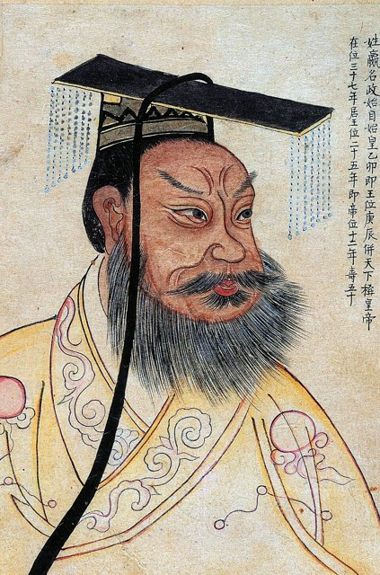
秦王嬴政滅六國，自稱「始皇帝」。
*秦王政26年*

## -206 | 秦亡
劉邦入咸陽，秦亡；隨後項羽、劉邦楚漢相爭，直到前202年（漢高祖五年）劉邦擊敗項羽，即皇帝位。
*漢高祖元年*

## -139 | 張騫通西域 {label="約前139年"}
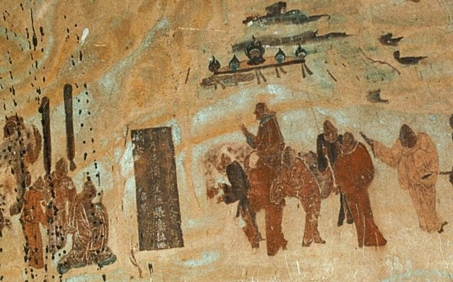
當時匈奴控制西域，漢武帝派張騫出使，想聯合大月氏夾擊匈奴，開啟了漢朝與西域的交通。
*西漢初年（漢武帝）*

## 25 | 東漢建立
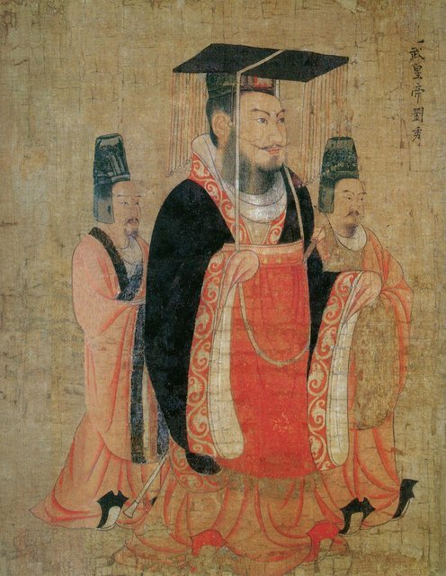
西漢宗室劉秀在王莽新朝末年起兵（22年），25年稱帝，即漢光武帝，定都洛陽。
*東漢開始*

## 166 | 黨錮之禍
宦官干政，士人與太學生抨擊宦官，遭禁錮終身。同年，大秦（羅馬帝國）使者經海路來華朝貢。
*東漢末年（漢桓帝）*

## 184 | 黃巾之亂
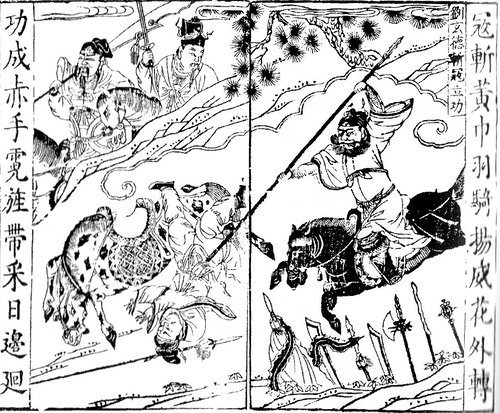
張角以太平道號召信眾起事，東漢中央權威瓦解，中國陷入長期分裂。
*東漢末年（漢靈帝）*

## 265 | 司馬炎篡魏建晉
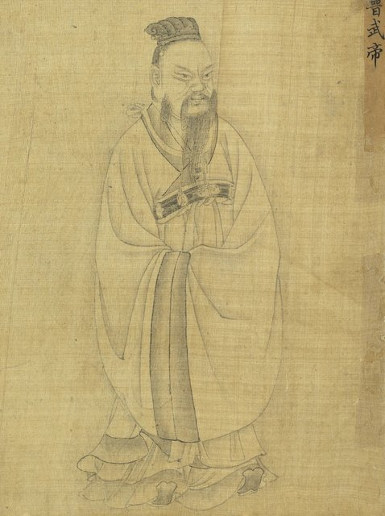
司馬懿之孫司馬炎篡魏，建立西晉；280年晉滅吳，西晉短暫統一天下。
*西晉*

## 311 | 永嘉之亂
漢末以來大量胡人移居華北，匈奴攻陷洛陽，俘虜晉懷帝（316年長安陷落，晉愍帝也被俘），史稱「五胡亂華」「永嘉之亂」。此後華北百餘年間政權林立，史稱「五胡十六國」。
*晉懷帝永嘉5年*

## 318 | 晉室南渡
司馬睿在建康（今南京）即帝位，建立東晉。
*東晉*

## 420 | 劉裕篡晉
劉裕篡東晉，建立劉宋，南朝開始。南朝歷經宋、齊、梁、陳。
*東晉末年，南朝開始*

## 439 | 北魏統一北方
北魏統一華北，北朝開始。北朝歷經北魏、東魏與西魏、北齊與北周。
*北朝開始*

## 577 | 北周滅北齊
北方再度統一。
*北周*

## 581 | 楊堅篡北周
建立隋朝，是為隋文帝。
*隋朝*

## 589 | 隋滅陳
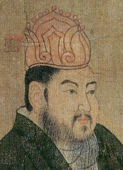
全國統一，結束近三百年的分裂。
*隋朝*

## 618 | 唐朝建立
隋末天下大亂，李淵起兵，建立唐朝。
*唐朝*

## 629 | 玄奘西行求經
玄奘往天竺取經，十餘年後帶回大量佛經並主持翻譯。
*唐太宗貞觀3年*

## 630 | 平定東突厥
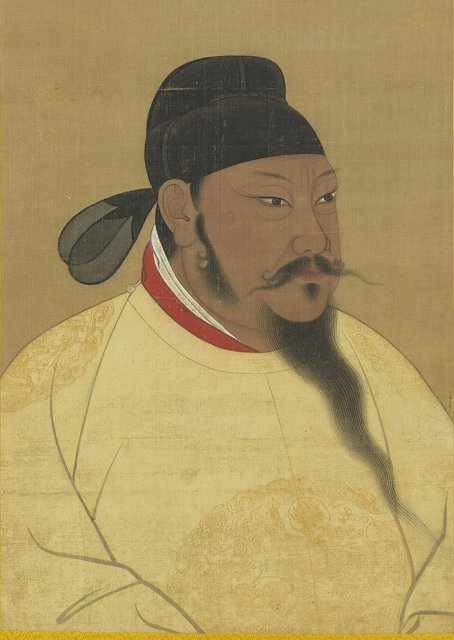
唐太宗被西北各族尊稱為「天可汗」；同年日本第一次派遣唐使來華。
*唐太宗貞觀4年*

## 690 | 武后稱帝
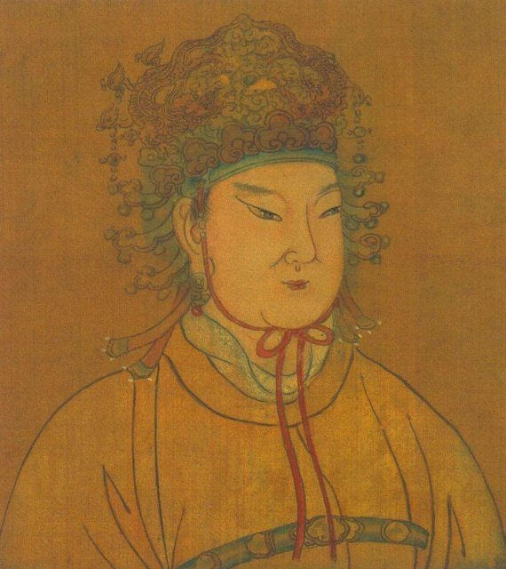
武則天改國號為周，是中國歷史上唯一的女皇帝；她重用科舉出身的官員，並開創殿試與武舉。
*武周*

## 694 | 摩尼教傳入中國
。
*武周延載元年*

## 751 | 怛羅斯之戰
大食（阿拉伯阿拔斯王朝）擊敗唐軍，唐朝勢力退出中亞；被俘的唐軍工匠讓造紙術西傳。
*唐玄宗天寶10年*

## 755 | 安史之亂
安祿山、史思明叛亂，前後八年，是唐朝由盛轉衰的分水嶺；亂後藩鎮割據、外患林立。
*唐玄宗天寶14年*

## 875 | 黃巢之亂
王仙芝、黃巢起兵，動搖唐朝統治的根基。
*唐僖宗乾符2年*

## 907 | 朱全忠篡唐
建立後梁，進入五代十國時期。
*唐亡，五代開始*

## 916 | 耶律阿保機稱帝
契丹建國（後改國號為遼）。
*遼*

## 936 | 割讓燕雲十六州
石敬瑭以燕雲十六州換取契丹支持，建立後晉，中原從此失去北方屏障。
*五代後晉*

## 960 | 陳橋兵變
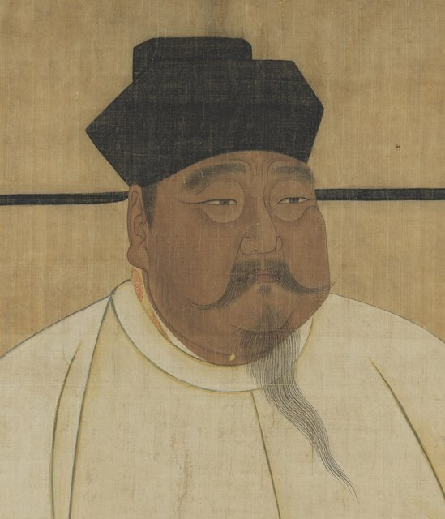
趙匡胤黃袍加身，建立宋朝。宋太祖採取「強幹弱枝」「重文輕武」，以解決唐末以來的藩鎮問題。
*北宋太祖*

## 997 | 交子出現 {label="約997年"}
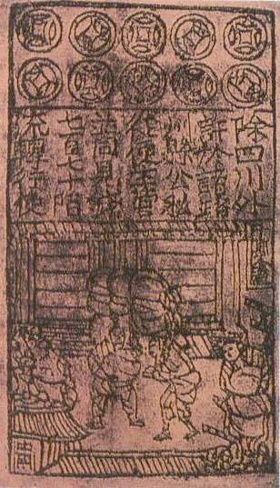
四川商人發行「交子」，是世界上最早的紙幣之一（1023年改由官方發行）。
*北宋*

## 1004 | 澶淵之盟
宋、遼約為兄弟之邦，宋每年給遼歲幣，雙方維持百餘年的和平。
*宋真宗景德元年*

## 1041 | 畢昇發明活字印刷
以膠泥製作活字，見於沈括《夢溪筆談》的記載。
*北宋仁宗慶曆年間*

## 1043 | 慶曆新政
范仲淹提出整頓吏治等改革，一年多後失敗。
*宋仁宗慶曆3年*

## 1125 | 金滅遼
宋聯金攻遼，遼亡。
*北宋徽宗宣和年間*

## 1127 | 靖康之難
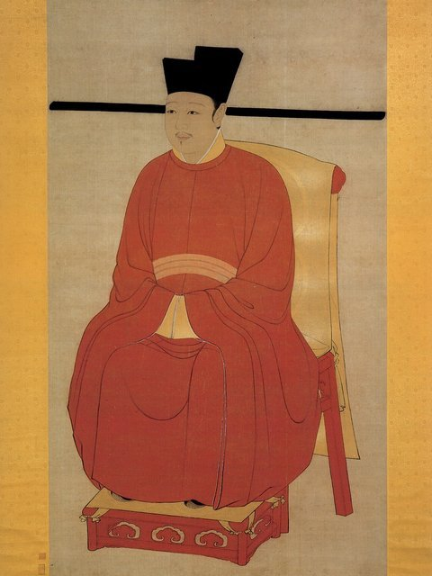
金人擄走徽宗、欽宗二帝，北宋亡；高宗即位，南宋開始。
*宋欽宗靖康2年*

## 1206 | 鐵木真統一蒙古
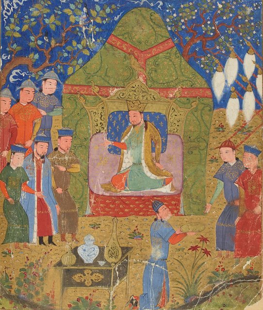
稱成吉思汗，建立大蒙古國。
*南宋*

## 1219 | 蒙古第一次西征
成吉思汗率軍征伐花剌子模，前鋒遠達黑海北岸，建立橫跨歐亞的帝國。
*南宋*

## 1271 | 忽必烈改國號為元
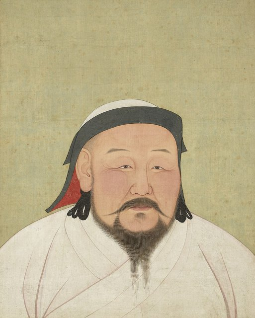
。
*元世祖至元8年*

## 1279 | 南宋亡
崖山之戰後，元朝統一中國。
*元世祖至元16年*

## 1368 | 明朝建立
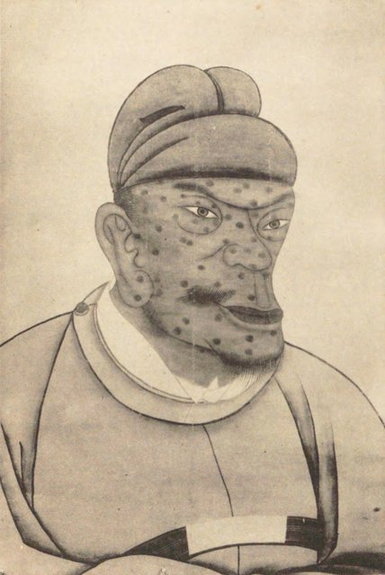
朱元璋在南京稱帝，明軍北伐攻下大都（北京），元朝結束在中國的統治。
*明太祖洪武元年*

## 1399 | 靖難之役
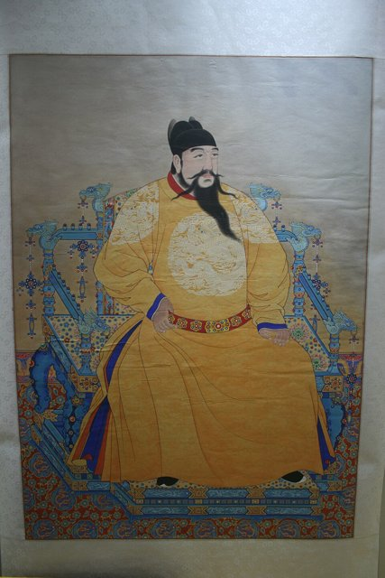
惠帝削藩，引發燕王朱棣不滿，起兵南下，1402年攻下南京，即位為明成祖。
*明惠帝建文元年*

## 1405 | 鄭和下西洋
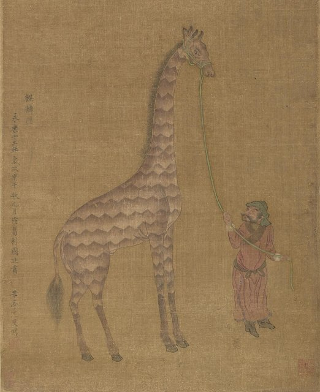
鄭和首次出使，前後共七次，船隊帶回許多香料、珠寶，促進明朝與亞非各國的交流。
*明成祖永樂3年*

## 1607 | 《幾何原本》中譯
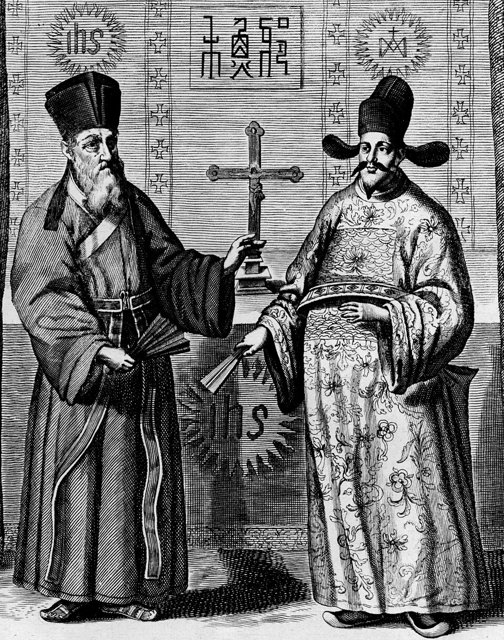
利瑪竇與徐光啟合譯歐幾里得《幾何原本》前六卷。
*明神宗萬曆35年*

## 1644 | 明亡
李自成攻陷北京，崇禎帝自縊；吳三桂引清兵入關，清朝入主中原。
*明思宗崇禎17年*

## 1757 | 廣州一口通商
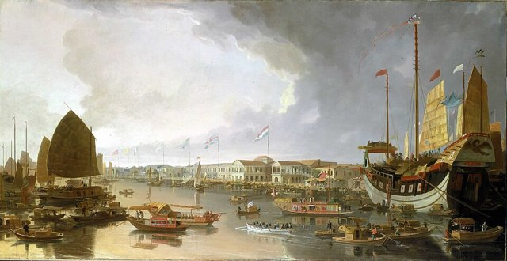
清廷只開放廣州一處與西洋通商。
*清高宗乾隆22年*

## 1793 | 馬戛爾尼使團
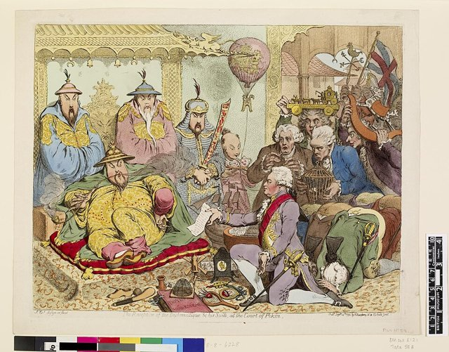
英國使節馬戛爾尼來華，要求擴大通商，遭到拒絕。
*乾隆58年*

## 1816 | 阿美士德使團
英國再派阿美士德來華，因禮儀爭議未獲接見。
*清仁宗嘉慶21年*

## 1839 | 林則徐虎門銷煙
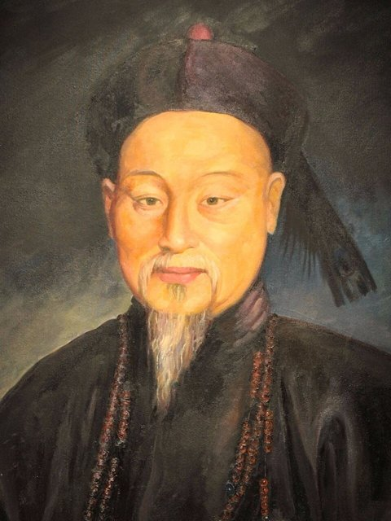
白銀外流嚴重，道光帝派林則徐到廣州禁煙，銷毀鴉片。
*清宣宗道光19年*

## 1840 | 鴉片戰爭
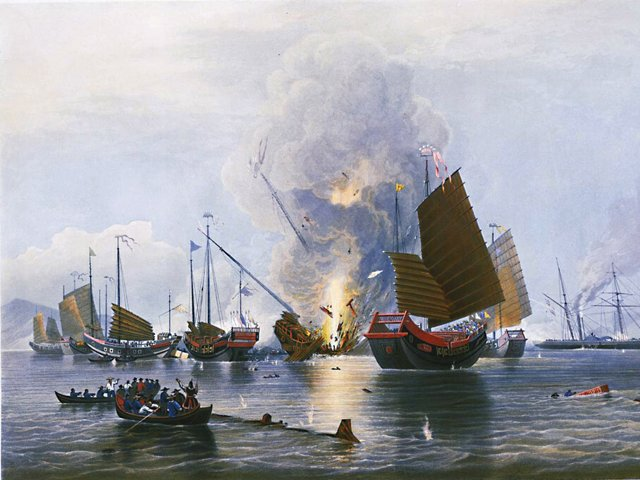
英軍北上。
*道光20年*

## 1842 | 南京條約
英軍再次出兵，中英簽訂《南京條約》，中國開港通商、割讓香港，從此喪失關稅自主權，並給予英國片面最惠國待遇。
*道光22年*

## 1850 | 太平天國
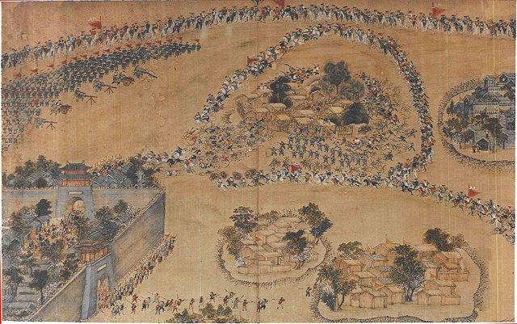
洪秀全以改造的基督教教義號召，在廣西起事（1851年金田起義），號太平天國，1853年攻占南京，此亂歷經十四年，到1864年才平定。
*道光30年*

## 1857 | 第二次鴉片戰爭（英法聯軍）
英法聯軍攻陷廣州，隔年中國與英、法等國簽訂《天津條約》。
*清文宗咸豐7年*

## 1860 | 北京條約
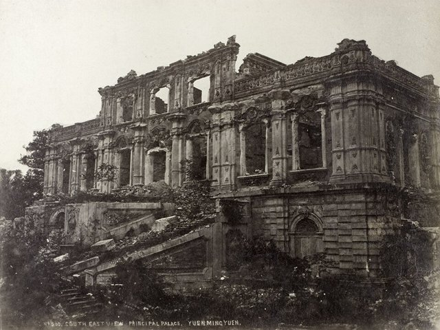
英法聯軍攻陷北京、焚毀圓明園，清廷簽訂《北京條約》；隔年（1861）在京師設立總理各國事務衙門。
*咸豐10年*

## 1862 | 京師同文館
在北京設立，培養外語與外交人才，自強運動展開。
*清穆宗同治元年*

## 1865 | 江南製造局
在上海設立江南機器製造總局。
*同治4年*

## 1872 | 幼童留美
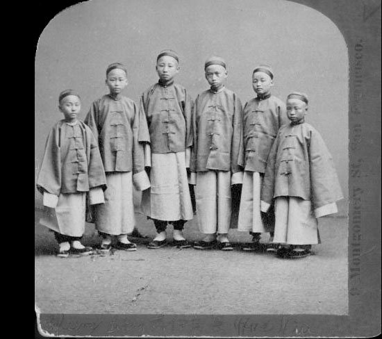
第一批官費留學幼童赴美。
*同治11年*

## 1884 | 中法戰爭
清朝失去對越南的宗主權。劉銘傳同年來臺督辦防務，1885年臺灣建省。
*清德宗光緒10年*

## 1894 | 甲午戰爭
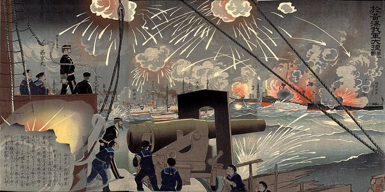
隔年簽訂《馬關條約》，割讓臺灣、澎湖。此後中國面臨被列強瓜分的危機，列強紛紛租借港灣、劃分勢力範圍。
*光緒20年*

## 1898 | 戊戌變法（百日維新）
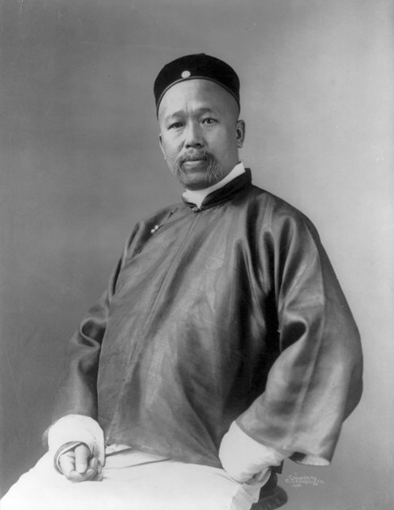
光緒帝下詔變法，由康有為、梁啟超等人籌劃，遭守舊派反對而失敗。
*光緒24年*

## 1899 | 門戶開放政策
美國提出門戶開放，主張各國在華機會均等，中國因此免於被瓜分。
*光緒25年*

## 1900 | 義和團與八國聯軍
慈禧太后縱容義和團，引發八國聯軍出兵。同年孫中山策動惠州起義，在臺北新起町設立指揮中心。
*光緒26年*

## 1901 | 辛丑條約與清末新政
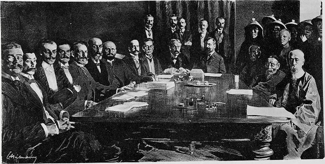
簽訂《辛丑條約》後，清廷推動「新政」，內容大致與戊戌變法相同。
*光緒27年*

## 1905 | 中國同盟會
孫中山號召興中會、華興會、光復會與其他留學生，在東京成立同盟會。同年清廷廢除科舉。
*光緒31年*

## 1906 | 預備立憲
清廷宣布預備立憲。
*光緒32年*

## 1911 | 辛亥革命
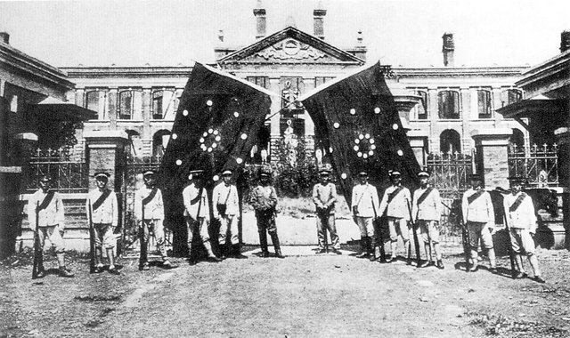
3月29日（農曆）廣州起義（黃花崗之役）雖未成功，革命呼聲漸高；四川保路運動之際，革命黨人趁湖北守備空虛，10月10日武昌起義成功，各省紛紛響應，12月各省代表推舉孫中山為臨時大總統。1912年清帝下詔退位，結束君主專制統治。
*清宣統3年*

## 1912 | 中華民國成立
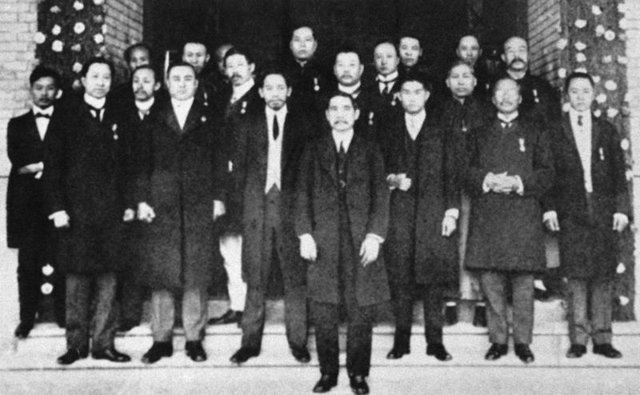
1月1日南京臨時政府成立，孫中山就任臨時大總統；2月清帝下詔退位，袁世凱被選為第二任臨時大總統；3月臨時參議院公布《臨時約法》，採內閣制。
*民國元年*

## 1913 | 二次革命
國民黨領袖宋教仁遇刺（刺宋案），袁世凱又未經國會同意簽訂善後大借款，孫中山發動二次革命討袁，失敗。
*民國2年*

## 1914 | 中華革命黨
孫中山在日本將國民黨改組為中華革命黨，繼續反袁。同年第一次世界大戰爆發，日本趁機出兵攻占德國在山東的租借地青島。
*民國3年*

## 1915 | 二十一條與新文化運動
日本向袁世凱政府提出《二十一條要求》。同年陳獨秀創辦《青年雜誌》，檢討傳統文化，提倡德先生（民主）與賽先生（科學），新文化運動展開。
*民國4年*

## 1916 | 洪憲帝制
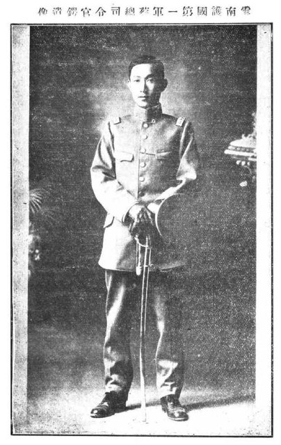
袁世凱稱帝（1915年底宣布、1916年改元洪憲），在護國戰爭的壓力下三個月後取消帝制，6月病逝。《青年雜誌》改名《新青年》；年底蔡元培受命出任北京大學校長，學風自由開明。
*民國5年*

## 1917 | 張勳復辟與護法運動
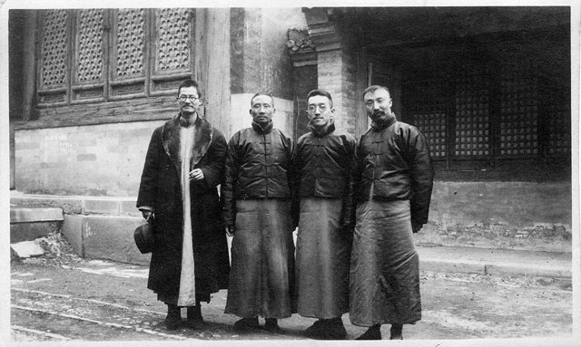
總統黎元洪與總理段祺瑞不和（府院之爭），引發張勳擁溥儀復辟；北京政局混亂，孫中山在廣州成立中華民國軍政府，展開護法運動。同年胡適發表〈文學改良芻議〉，推動白話文運動。
*民國6年*

## 1919 | 五四運動
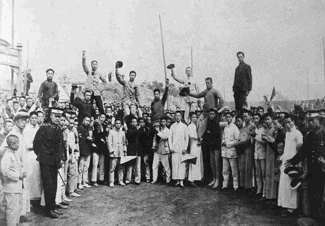
一戰結束後，巴黎和會上英、美等國同意由日本繼承德國在山東的權益，群情激憤，學生於5月4日在北京示威抗議，中國代表最後拒絕在和約上簽字。
*民國8年*

## 1921 | 中國共產黨成立
在共產國際協助下於上海成立，陳獨秀任中央局書記。
*民國10年*

## 1923 | 聯俄容共
孫中山接受蘇俄援助，採聯俄容共政策（1924年國民黨第一次全國代表大會正式確立）。
*民國12年*

## 1924 | 黃埔建軍
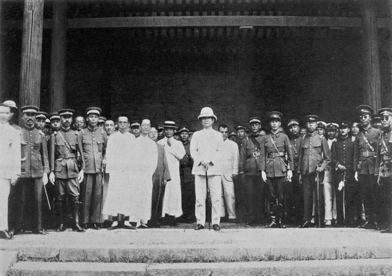
在廣州設立陸軍軍官學校（黃埔軍校），蔣中正任校長。
*民國13年*

## 1925 | 孫中山逝世
3月孫中山在北京病逝；7月，廣州政府改組為中華民國國民政府。
*民國14年*

## 1926 | 北伐
蔣中正率國民革命軍北伐。
*民國15年*

## 1927 | 清黨與寧漢分裂
蔣中正在上海宣布清黨，清除黨內中共勢力，隨後定都南京，與武漢政府形成對立，史稱「寧漢分裂」。
*民國16年*

## 1928 | 北伐完成
東北的張作霖被日軍炸死後，其子張學良宣布東北易幟、服從中央，北伐完成，國家進入訓政時期。同年中央銀行在上海成立。
*民國17年*

## 1930 | 中原大戰
中央與反蔣勢力（閻錫山、馮玉祥等）展開中原大戰；國民政府開始剿共；對外完成關稅自主的談判。
*民國19年*

## 1931 | 九一八事變
日軍攻占瀋陽，進而占領東北；隔年（1932）扶植溥儀成立「滿洲國」。
*民國20年*

## 1933 | 廢兩改元
統一以銀元計價，廢除銀兩。
*民國22年*

## 1935 | 發行法幣
統一國家貨幣。
*民國24年*

## 1936 | 西安事變
12月張學良、楊虎城扣留蔣中正，要求停止剿共、一致抗日，蔣中正因此停止剿共。
*民國25年*

## 1937 | 七七事變（盧溝橋事變）
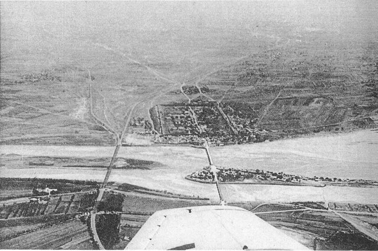
中日戰爭全面爆發；同年底日軍攻陷南京，發生南京大屠殺。
*民國26年*

## 1939 | 第二次世界大戰爆發
。
*民國28年*

## 1940 | 汪精衛政權
日本扶植汪兆銘在南京成立政權。
*民國29年*

## 1941 | 太平洋戰爭
年初發生新四軍事件，象徵國共合作破裂；12月日本偷襲珍珠港，中、美、英、蘇等國形成同盟國，中華民國正式對日宣戰。
*民國30年*

## 1943 | 新約與開羅宣言
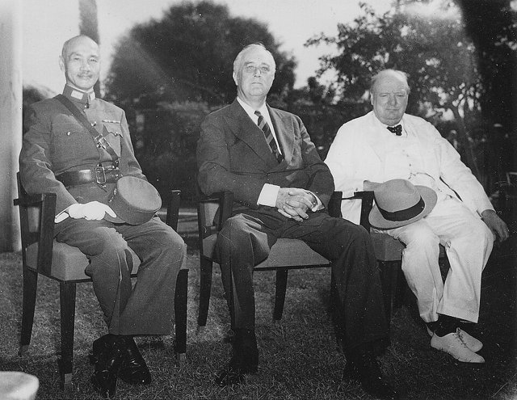
中華民國與美、英簽訂平等新約，廢除不平等條約；中、美、英三國領袖在開羅會議後發表《開羅宣言》。
*民國32年*

## 1945 | 抗戰勝利與國共談判
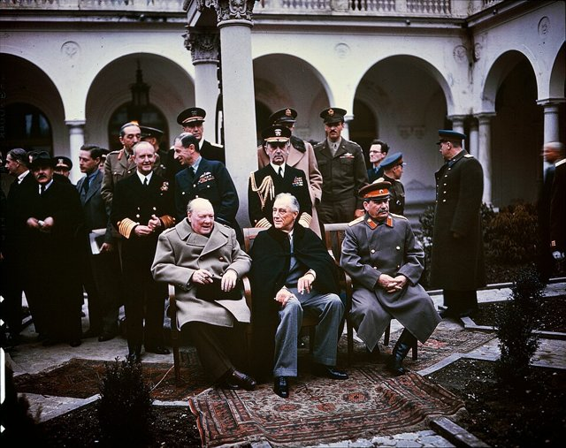
美、英、蘇簽訂雅爾達密約，日本投降後蘇聯在東北扶植中共軍隊；8月日本投降，蔣中正與毛澤東舉行重慶會談；美國派馬歇爾來華調停國共，最終失敗。
*民國34年*

## 1946 | 制定憲法
制憲國民大會制定《中華民國憲法》（1947年施行）；國共內戰全面展開。
*民國35年*

## 1949 | 政府遷臺
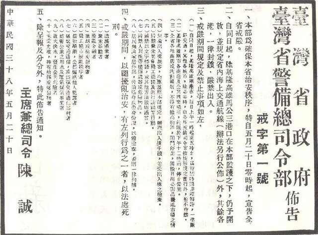
臺灣省實施戒嚴（5月）；10月1日中華人民共和國在北京成立；10月金門古寧頭戰役；12月中華民國政府遷臺。
*民國38年*

## 1950 | 韓戰與臺海中立
中共與蘇聯簽訂《中蘇友好同盟互助條約》；6月韓戰爆發，美國派第七艦隊巡防臺灣海峽，保持臺海中立。
*民國39年*

## 1957 | 反右運動
大批知識分子被打成右派，毛澤東的統治趨於獨裁。
*民國46年*

## 1958 | 大躍進
毛澤東提出「十五年超英趕美」，推行大躍進與人民公社，各地虛報產量，造成大饑荒。
*民國47年*

## 1966 ~ 1976 | 文化大革命
中共高層權力鬥爭，紅衛兵標榜「革命無罪、造反有理」，造成文化、經濟等方面的十年浩劫。
*民國55年*

## 1971 | 聯合國代表權
聯合國大會第2758號決議，由北京的中華人民共和國政府取代臺北的中華民國政府在聯合國的席次。
*民國60年*

## 1972 | 尼克森訪問中國
美國總統尼克森訪問北京，簽訂《上海公報》；中共的外交政策轉為「聯美制蘇」。
*民國61年*

## 1978 | 改革開放
鄧小平重新掌權，中共十一屆三中全會決定改革開放。
*民國67年*

## 1979 | 中美建交
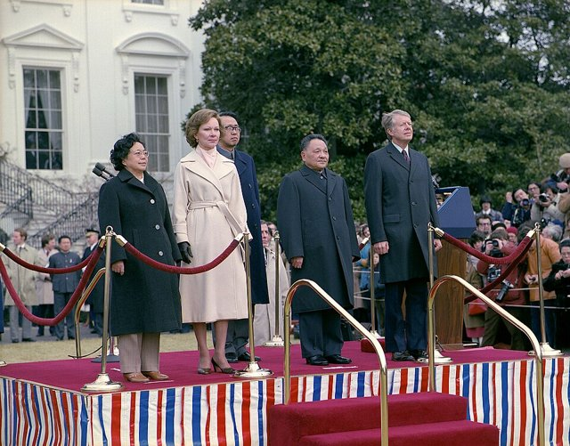
中共與美國正式建交，美國與中華民國斷交。
*民國68年*

## 1980 | 經濟特區
開放深圳、珠海、汕頭、廈門為經濟特區。
*民國69年*

## 1989 | 六四天安門事件
民間要求民主自由的呼聲漸高，學生聚集天安門廣場，中共派軍隊武力鎮壓。
*民國78年*

## 1991 | 陸委會與 APEC
中華民國行政院設立大陸委員會；中共加入亞太經濟合作會議（APEC）。
*民國80年*

## 1993 | 辜汪會談
海基會董事長辜振甫與海協會會長汪道涵在新加坡會談，簽署四項協議。
*民國82年*

## 1995 | 江八點
江澤民發表對臺政策「江八點」。
*民國84年*

## 1996 | 第一次總統直選
中華民國舉行第一次總統直選；中共在選前於臺灣海峽試射飛彈（臺海飛彈危機，1995—1996年）。
*民國85年*

## 1999 | 兩國論
李登輝提出兩岸是「特殊的國與國關係」。
*民國88年*

## 2000 | 四不一沒有
陳水扁在就職演說中提出「四不一沒有」。
*民國89年*

## 2005 | 反分裂國家法
中共制定《反分裂國家法》。
*民國94年*

## 2008 | 馬英九就任總統
兩岸關係趨於緩和。
*民國97年*
