<!--
內容整理自中文維基百科「弗雷德里克·蕭邦」條目（CC BY-SA 4.0），並以台灣用語改寫摘要。
https://zh.wikipedia.org/zh-tw/弗雷德里克·蕭邦
圖片皆為 Wikimedia Commons 上的公有領域作品（封面：約1849年銀版照片）。
-->

# Periods
- 1810 ~ 1830 | 波蘭時期@華沙(Warsaw)
  父親是從法國洛林移居波蘭的法語教師，在華沙經營男生寄宿公寓，家中堅持說波蘭語。蕭邦從小體弱多病，卻是公認的音樂神童，7歲就公開演出。在華沙音樂學院完成學業，結業評語寫著「天賦異稟，音樂天才」。
- 1830 ~ 1831 | 維也納
  原本打算遊歷義大利，抵達維也納不久，華沙就爆發十一月起義。他獨自留在維也納，思鄉又憂心祖國，在信中寫道「我詛咒自己離開的那一刻」。
- 1831 ~ 1838 | 巴黎沙龍時期
  定居巴黎後此生再未回到波蘭。他極少公開演出，偏愛沙龍的私密氛圍，靠出版作品與教授富家子弟鋼琴維生，很快躋身巴黎音樂界上層，與李斯特、白遼士、海涅、德拉克羅瓦等人往來。
- 1838 ~ 1847 | 與喬治·桑共度的歲月
  與比他年長六歲的作家喬治·桑相戀，一同度過馬略卡島的慘澹冬天，此後多數夏天在桑位於諾昂的莊園度過，寫下許多重要作品。1842年起健康明顯惡化，創作量逐年減少，1847年兩人決裂。
- 1848 ~ 1849 | 英國巡演與晚年
  在學生簡·史特靈的安排與資助下前往英國與蘇格蘭巡演，病情卻持續惡化，體重不到45公斤。回到巴黎後在病痛中度過最後一年。

# Events

## 1810-03-01 | 出生@熱拉佐瓦沃拉
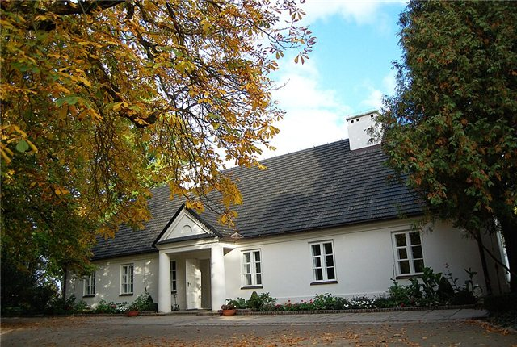
出生於華沙以西46公里的小村莊。教區洗禮紀錄寫的生日是2月22日，但蕭邦本人和家人一向以3月1日為生日。他是家中唯一的兒子，有一個姊姊和兩個妹妹。

## 1810-10 | 舉家遷往華沙
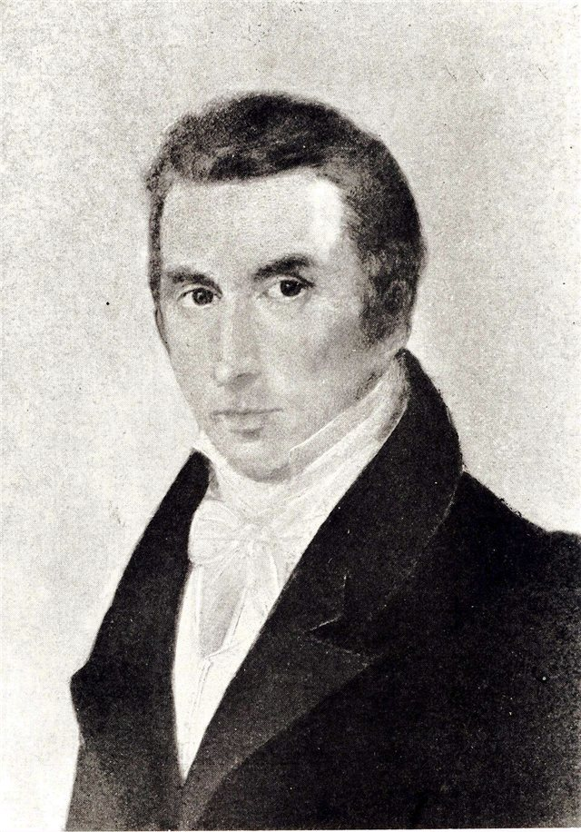
父親到華沙文理中學教法語，全家住在學校所在的薩克森宮內。父親會吹長笛、拉小提琴，母親則彈鋼琴。

## 1816 | 師事日夫內
第一位正式的老師是捷克鋼琴家沃伊切赫·日夫內，教到1821年。姊姊盧德維卡也一起上課，有時與他合奏。

## 1817 | 7歲公開演出；寫下兩首波蘭舞曲
寫出g小調與降B大調兩首波蘭舞曲。他也曾受邀為俄屬波蘭統治者康斯坦丁大公演奏，並為他寫了一首進行曲。

## 1825-06-10 | 作品1《迴旋曲》；獲沙皇贈鑽戒
在新樂器「風簧旋律琴」上的即興演出大獲成功，受邀為到訪華沙的沙皇亞歷山大一世演奏，獲贈一枚鑽戒。同年出版第一部作品《迴旋曲》（作品1），萊比錫的音樂報刊稱讚他「音樂思想頗豐」。

## 1826 | 進入華沙音樂學院
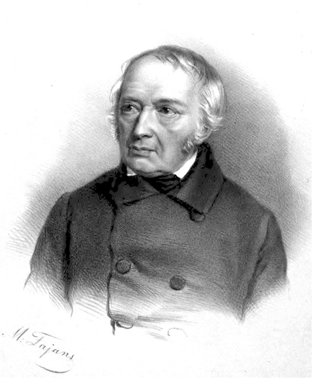
秋天起師從作曲家約瑟夫·埃爾斯納，學習樂理、數字低音與作曲。假期常到鄉間度過，在那裡第一次近距離接觸波蘭民間音樂。

## 1828-09 | 柏林之旅
隨世交前往柏林，欣賞斯邦蒂尼指揮的歌劇，並聆聽策爾特與孟德爾頌等名家的音樂會。

## 1829 | 維也納首演；開始寫練習曲
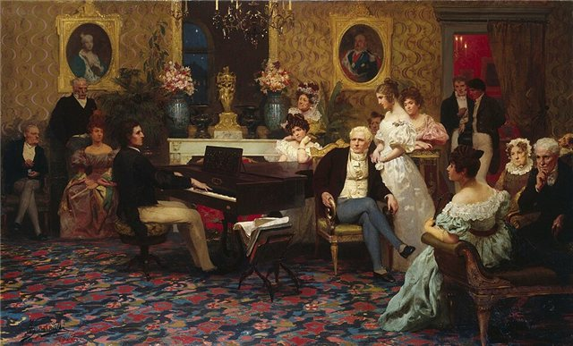
聽了帕格尼尼的演奏後寫下《紀念帕格尼尼》，或許也因此開始創作第一套練習曲。完成音樂學院學業後在維也納首次登台，首演《唐·喬凡尼變奏曲》（作品2）。同年他暗戀上歌唱家康斯坦齊婭·格瓦特科夫斯卡，說她啟發了協奏曲的慢板樂章。

## 1830-03-17 | f小調第二號鋼琴協奏曲首演
在華沙首演，作品編號雖是第二號，其實是他先寫成的協奏曲。

## 1830-10 | 華沙告別音樂會
親自演奏協奏曲，格瓦特科夫斯卡演唱羅西尼的詠嘆調。兩人互贈戒指，之後再也沒有見面。

## 1830-11-02 | 離開波蘭；十一月起義
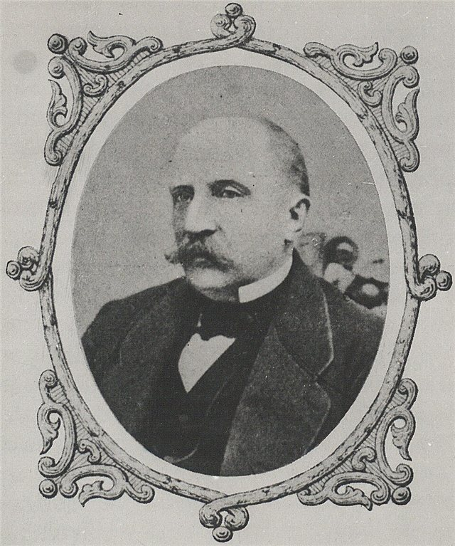
與好友沃伊切霍夫斯基前往奧地利，同月華沙爆發反抗俄國的十一月起義。好友返國從軍，蕭邦獨自留在維也納。

## 1831-09 | 得知起義失敗
在前往巴黎途中得知起義失敗，在日記中寫下悲憤的文字。這本日記現藏於波蘭國家圖書館。有學者認為這些事件讓他成為「富有靈感的民族詩人」。

## 1831-10-05 | 抵達巴黎
因為難以取得俄國簽證，拿的是法國的過境許可，護照上註記「經巴黎前往倫敦」。他常開玩笑說自己「只是路過巴黎」，結果在巴黎度過餘生。1835年取得法國國籍，但始終認為自己是波蘭人。

## 1831-12-07 | 舒曼：「諸位先生，請脫帽，一位天才在此！」
舒曼在《音樂廣訊報》評論他的作品2，這是舒曼發表的第一篇音樂評論，也是蕭邦首次獲得同時代大師的重大肯定。

## 1832-02-26 | 巴黎首場音樂會
在普萊耶爾音樂廳舉行，贏得一致讚譽，李斯特也在台下。他也發現自己細膩的演奏風格不適合大音樂廳，此後一生公開演出不過三十場左右。同年經羅斯柴爾德家族引薦進入上流沙龍，開始靠出版與教學獲得可觀收入。

## 1833-04-02 | 與李斯特首次同台
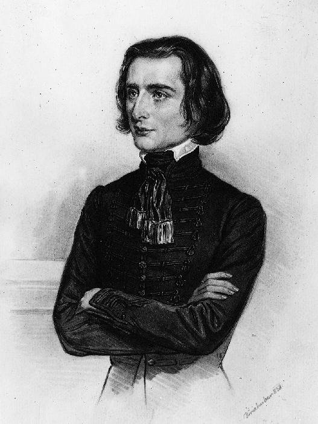
在白遼士為妻子籌辦的慈善音樂會上合奏雙鋼琴奏鳴曲。兩人1833到1841年間共同台七次，蕭邦還把作品10練習曲題獻給李斯特。

## 1834 | 結識孟德爾頌
與希勒一同參加亞琛的下萊茵音樂節，結識孟德爾頌，隨後同遊杜塞道夫，在鋼琴旁度過「極為愉快的一天」。

## 1835 | 最後一次見到父母；拜訪舒曼
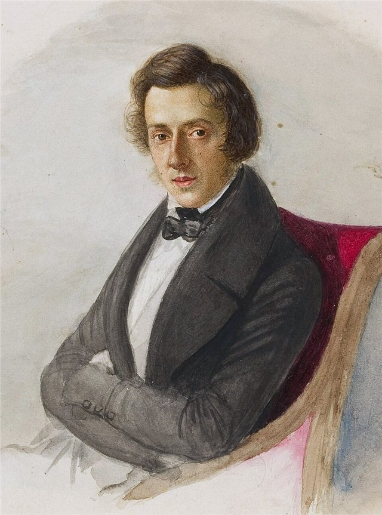
在卡爾斯巴德與父母相聚，這是他最後一次見到他們。返程時與沃津斯卡一家重逢，16歲的瑪麗亞為他畫了肖像。10月在萊比錫拜訪舒曼、克拉拉與孟德爾頌，孟德爾頌稱他為「完美的音樂家」。

## 1836 | 結識喬治·桑
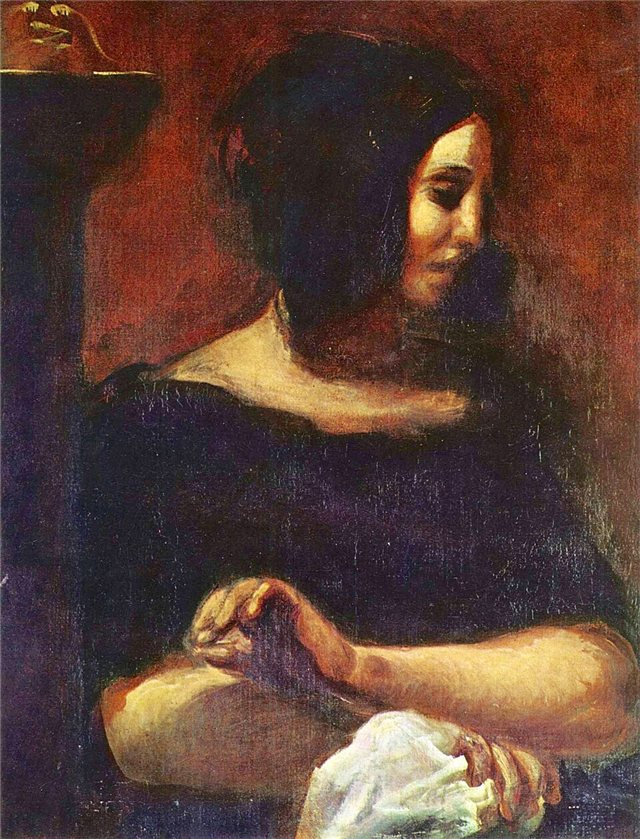
在達古爾特伯爵夫人主持的聚會上結識作家喬治·桑。初見時他對她並無好感，還說：「這位桑夫人多麼沒有吸引力，她真的是個女人嗎？」

## 1836-09 | 向瑪麗亞·沃津斯卡求婚
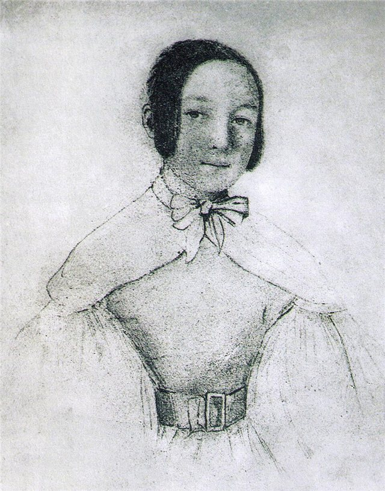
在德勒斯登求婚，瑪麗亞的母親原則上同意。同月他到萊比錫為舒曼彈奏剛寫好的g小調敘事曲。

## 1837 | 婚約告吹：「我的憂傷」
沃津斯卡伯爵夫人來信表示婚事難成，原因可能是他的健康狀況與一些流言。他把瑪麗亞母女的來信封進信封，寫上「我的憂傷」，一直收在書桌抽屜裡直到過世。同年6月化名前往倫敦。

## 1838-07 | 與喬治·桑相戀
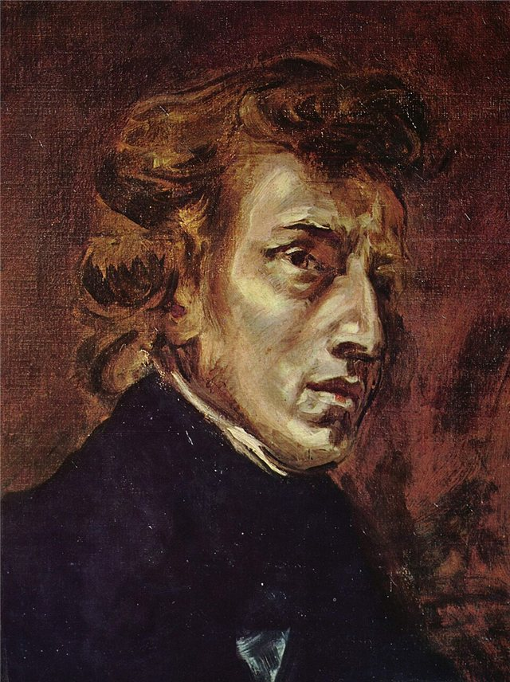
回到巴黎後兩人的關係正式展開。同年德拉克羅瓦為兩人畫了雙人肖像，後來被分割成兩幅畫。

## 1838-11-08 ~ 1839-02-13 | 馬略卡島之冬
與桑及她的兩個孩子到馬略卡島過冬，希望改善健康，卻因兩人未婚遭當地人冷落，只能住進寒冷的廢棄修道院。他說三位醫生分別說他「已經死了」、「正在死去」、「將要死」。在這段艱苦日子裡完成了24首前奏曲（作品28）。

## 1839-05 | 第一次在諾昂度夏
此後到1846年，他們大多數夏天都在桑位於諾昂的莊園度過。這裡寧靜的環境讓他寫出許多作品，德拉克羅瓦、歌唱家維亞爾多等人也常來作客。

## 1841-04-25 | 與李斯特最後一次同台
為籌建波昂貝多芬紀念碑舉行的慈善音樂會。兩人雖彼此欣賞，友誼卻帶著緊張；1843年蕭邦因李斯特在他的夜曲裡加入大量裝飾音而動怒，此後往來漸稀。

## 1842 | 健康惡化；降A大調「英雄」波蘭舞曲
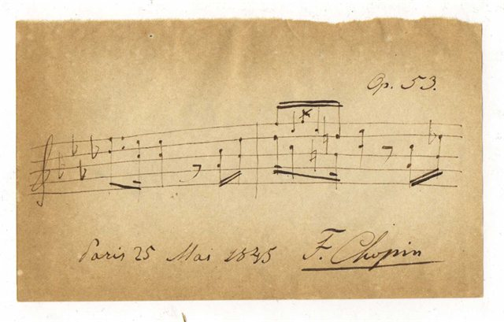
年初音樂會後就臥病在床，此後健康持續惡化。這年在諾昂完成降A大調波蘭舞曲（作品53），但整體創作量開始逐年下降。

## 1844 | b小調第三號鋼琴奏鳴曲
這一年他只完成了這部四樂章的奏鳴曲（作品58），結構比第二號奏鳴曲更接近德奧傳統。

## 1847 | 與喬治·桑決裂
兩人的關係因桑的女兒索朗熱的婚事而惡化，蕭邦在母女爭執中常站在索朗熱一邊，也對桑的激進政治活動很冷淡。一連串憤怒的通信之後，桑稱之為「我們九年互斥友情的弔詭終章」。

## 1848-02 | 巴黎最後一場音樂會
與大提琴家法蘭肖姆合奏他的大提琴奏鳴曲（作品65）。不久巴黎爆發二月革命。

## 1848-05-15 | 在維多利亞女王面前演奏
在倫敦斯塔福德府演奏，阿爾伯特親王還特地走到鋼琴旁觀察他的技巧。他在倫敦教課的時薪高達一畿尼。

## 1848-10-04 | 愛丁堡音樂會；立下遺囑
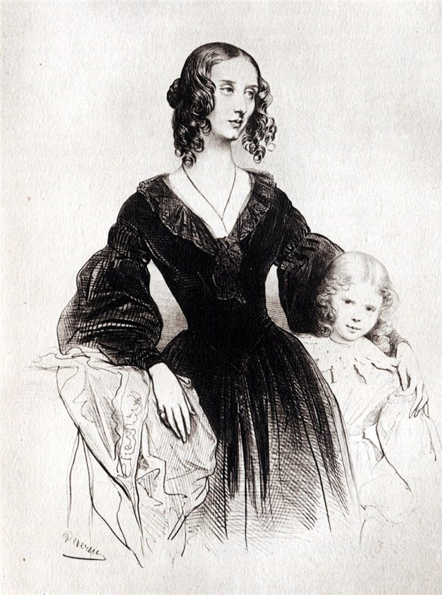
夏末應史特靈之邀到蘇格蘭作客，先後在格拉斯哥與愛丁堡舉行音樂會。月底在愛丁堡寫下遺囑。對於他與史特靈的緋聞，他說自己「離墳墓比離婚床還要近」。

## 1848-11-16 | 最後一次公開演出
在倫敦市政廳為波蘭難民舉行慈善音樂會，但多數與會者只關心舞會與酒宴，讓他心力交瘁。月底返回巴黎。

## 1849-10-17 | 逝世@巴黎
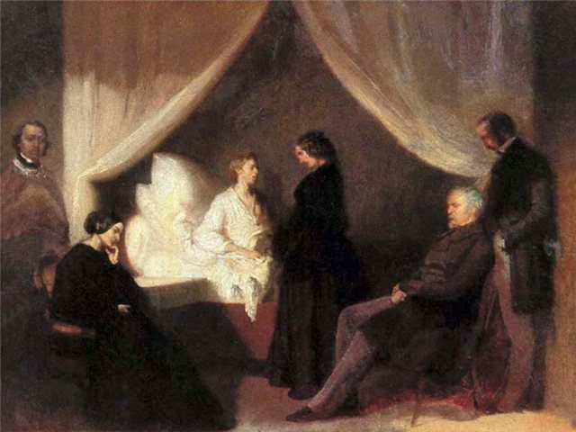
姊姊盧德維卡從華沙趕來陪伴。他在凌晨兩點前去世，年僅39歲。死亡證明記載為結核病，2017年發表的研究認為很可能死於結核病併發的心包炎。

## 1849-10-30 | 葬禮
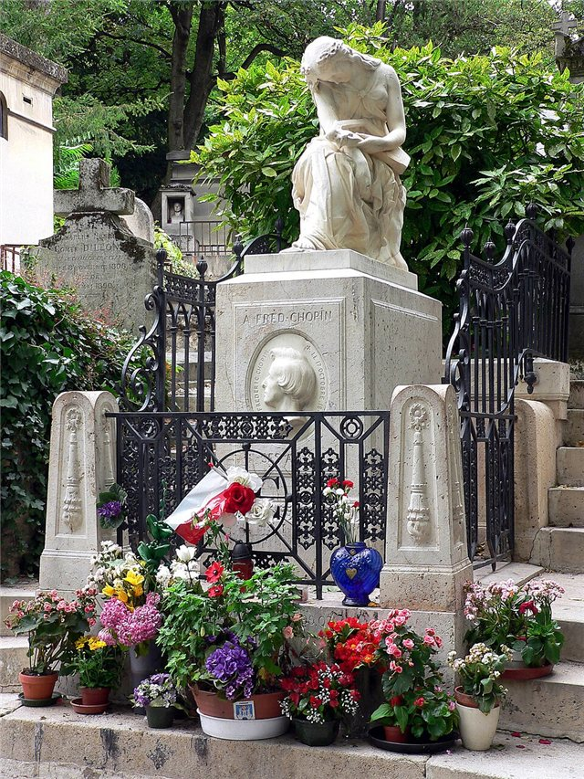
在巴黎瑪達肋納堂舉行，演唱莫札特的《安魂曲》，管風琴師演奏他的兩首前奏曲。安葬於拉雪茲神父公墓，墓前奏響他第二號鋼琴奏鳴曲中的〈葬禮進行曲〉。

## 1850 | 心臟運回華沙
依他的遺願，姊姊盧德維卡把他浸泡在酒精中的心臟帶回波蘭，如今安放在華沙聖十字聖殿的柱子裡。同年，克萊桑熱設計的墓碑在他逝世一週年揭幕。
