<!--
內容整合自「美國民權運動大事記（1863－1968）」（D:\Books\md\歷史\西方歷史\美國民權運動大事記（1863－1968）.md；html 版在 D:\Books\html\1-1.西方歷史），以自己的話改寫；另參考中文維基百科「非裔美國人民權運動」核對日期。
時期依大事記的六個階段，但大事記各階段的年代互相重疊（例如第二階段寫到1941年，第三階段從1945年起，1941－1948年的事件卻列在第二階段；第四、五、六階段分別是1960－1964、1964－1965、1965－1968），這裡改為不重疊的區間：以1954年布朗案、1960年格林斯伯勒靜坐、1964年民權法、1966年「黑色力量」口號為界。
處理方式：
- 南北戰爭與重建時期的細節已在「美國南北戰爭」時間軸，這裡只保留與民權直接相關的法律；1861年開戰寫進第一則事件的內文。
- 大事記在同一天或相近日期列的幾則事件合併：帕克斯被捕與公車抵制開始；1956年地方法院與最高法院的判決併入抵制結束；伯明罕運動的各階段；華盛頓大遊行與〈我有一個夢想〉；塞爾瑪的三次遊行。
- 大事記把1957年9月24日艾森豪派兵列在9月9日《1957年民權法》之前，這裡依日期排序。梅德加·埃弗斯遇刺（6月12日）與甘迺迪民權演說（6月11日）也依日期排序。
- 大事記的「1959年：學生運動持續發展」與「1965年：聯邦選民登記監督開始」沒有具體事件，寫進相鄰事件的內文。
- 洛文案（1967年6月12日）依日期放在底特律暴動之前。
- 1968年以後的發展（1971年斯旺案、1990年《美國身心障礙者法》、2008年歐巴馬當選、2013年「黑人的命也是命」）寫進最後一則事件的內文。
- 人名用·分隔（大事記作・）；Martin Luther King Jr. 依大事記譯作馬丁·路德·金恩，簡稱金恩，以免與宗教改革的馬丁·路德混淆。
圖片來源（皆為 Wikimedia Commons 公有領域／CC0 作品，縮成最長邊 640px）：
- crm-march.jpg：Civil Rights March on Washington, D.C. (Crowd of marchers at the Lincoln Memorial.) - NARA - 542055.tif（1963年8月28日華盛頓大遊行，林肯紀念堂前的人群（美國國家檔案館））
- acw-emancipation.jpg：First Reading of the Emancipation Proclamation of President Lincoln by Francis Bicknell Carpenter.png（卡本特〈林肯首次宣讀解放奴隸宣言〉，1864（與美國南北戰爭時間軸共用））
- crm-jimcrow.jpg：JimCrowInDurhamNC.jpg（北卡羅來納州達勒姆巴士站的「有色人種」候車室，1940（傑克·德拉諾攝））
- crm-marshall.jpg：Thurgood Marshall 1957-09-17.jpg（瑟古德·馬歇爾，1957）
- crm-parks.jpg：Rosa Parks being fingerprinted by Deputy Sheriff D.H. Lackey after being arrested on February 22, 1956, during the Montgomery bus boycott.jpg（1956年2月22日，帕克斯因參與公車抵制再度被捕，由副警長按指紋）
- crm-littlerock.jpg：Operation Arkansas, Little Rock Nine.jpg（1957年9月，第101空降師士兵護送黑人學生進入小石城中央高中）
- crm-sitin.jpg：Civil Rights protesters and Woolworth's Sit-In, Durham, NC, 10 February 1960. From the N&O Negative Collection, State Archives of North Carolina, Raleigh, NC. Photos taken by The News & (24495308926).jpg（1960年2月10日，北卡羅來納州達勒姆伍爾沃斯百貨的靜坐抗議）
- crm-birmingham.jpg：Firemen spraying protestors in Downtown Birmingham 01.jpg（1963年5月，伯明罕消防隊以水柱驅散示威者）
- crm-malcolm.jpg：Malcolm X NYWTS 2a.jpg（麥爾坎·X，1964）
- crm-selma.jpg：Selma to Montgomery Marches protesters.jpg（1965年從塞爾瑪走向蒙哥馬利的遊行者）
- crm-vra.jpg：Lyndon Johnson and Martin Luther King, Jr. - Voting Rights Act.jpg（1965年8月6日，詹森與金恩在投票權法簽署儀式上）
- crm-king.jpg：Martin Luther King Jr NYWTS 2.jpg（馬丁·路德·金恩，1964）
-->

# Periods
- 1863 ~ 1876 | 廢奴與重建 | #868e96
  戰爭與重建帶來廢奴、公民權與男性投票權的憲法保障，聯邦也立法打擊三K黨。但法律上的平等並未立即成為社會現實，南方白人勢力持續抵抗。
- 1877 ~ 1953 | 種族隔離與法律抗爭 | #495057
  重建結束後，南方以吉姆·克勞法全面隔離、以人頭稅與識字測驗剝奪黑人投票權，最高法院的「隔離但平等」更為隔離背書。黑人透過NAACP的訴訟、北遷與文化運動抵抗，二戰前後聯邦開始以行政命令鬆動歧視。
- 1954 ~ 1959 | 現代民權運動興起 | #1971c2
  布朗案判決學校隔離違憲，但南方「大規模抵抗」。提爾之死與帕克斯被捕點燃抗爭，蒙哥馬利公車抵制讓金恩成為領袖，小石城危機則迫使聯邦派兵。
- 1960 ~ 1963 | 民權運動的高潮 | #e8590c
  學生的靜坐、跨州的自由乘車、伯明罕的遊行與監獄書簡，把地方抗爭推成全國議題；華盛頓大遊行上，金恩說出「我有一個夢想」。
- 1964 ~ 1965 | 民權法與投票權法 | #2f9e44
  甘迺迪遇刺後，詹森推動國會通過《1964年民權法》；自由之夏與塞爾瑪的「血腥星期日」又促成《1965年投票權法》。法律上的隔離與投票歧視至此終結。
- 1966 ~ 1968 | 運動的轉型 | #c92a2a
  「黑色力量」與黑豹黨主張自主與自衛，城市暴動暴露北方的貧困與隔離；金恩轉向反越戰與反貧窮，1968年在孟菲斯遇刺。運動的重心從法律平等轉向實質平等。

# Events

## 1863-01-01 | 《解放奴隸宣言》生效
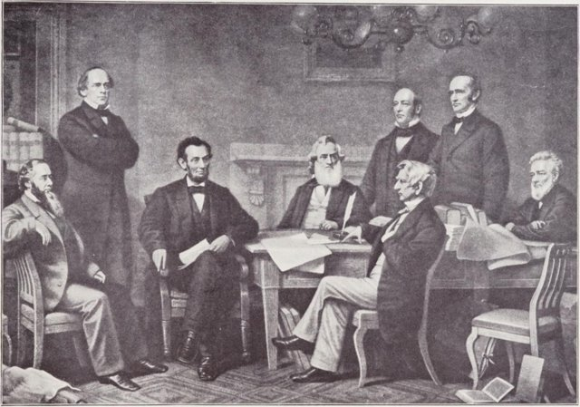
1861年4月南北戰爭爆發，北方的戰爭目標逐漸從維護聯邦擴大到廢除奴隸制。林肯宣布叛亂地區的奴隸獲得自由；宣言並未立即解放全國的奴隸，留在聯邦內的蓄奴州不受影響，但廢奴從此成為聯邦的戰爭目標，也讓非裔美國人得以加入聯邦軍隊。

## 1865-12-06 | 第十三條修正案
南軍主力在4月9日投降，同年3月國會設立自由民局，為獲得自由的黑人與難民提供教育、就業、法律協助與基本生活支援。12月，第十三條修正案批准，在全國廢除奴隸制，但保留「作為犯罪懲罰」的強迫勞役例外；南方日後以罪犯租賃制度，讓大量黑人在獄中重新陷入強迫勞動。

## 1866-04-09 | 《1866年民權法》
國會推翻詹森總統的否決，確立凡在美國出生者都是公民，享有訂約、訴訟、取得財產與受法律平等保護的權利，回應南方各州限制黑人自由的「黑人法典」。

## 1868-07-09 | 第十四條修正案
把出生公民權、正當法律程序與平等保護寫進憲法，避免《1866年民權法》日後被廢除。一個世紀後的布朗案與多數民權訴訟，都以這條修正案為依據。

## 1870-02-03 | 第十五條修正案
禁止聯邦與各州因種族、膚色或曾為奴隸而剝奪男性公民的投票權。1870年至1871年，國會又通過三部《執行法》，讓聯邦可以起訴三K黨的恐怖暴力、保護黑人的政治權利。重建時期，南方首度出現黑人州議員與聯邦國會議員。

## 1875-03-01 | 《1875年民權法》
規定旅館、公共交通與劇院等公共娛樂場所必須平等對待不同種族的人，是重建時期最後一部重要民權法。

## 1877 | 重建時期結束
1876年總統選舉爭議以妥協收場，海斯就任後聯邦軍隊撤出南方，聯邦政府不再積極保護黑人權利。南方民主黨重新掌權，種族隔離與政治排斥隨之加強。

## 1883-10-15 | 民權案件
最高法院判決《1875年民權法》禁止私人旅館、劇院等場所歧視的部分違憲，理由是第十四條修正案只約束州政府，不約束私人。聯邦保障公共場所平等的能力因此大受限制，要到1964年才以州際商業權重新立法。

## 1890 | 密西西比州修憲剝奪黑人投票權
密西西比州召開制憲會議，以人頭稅、識字測驗與「解釋憲法」測驗限制投票。表面上不提種族，實際上由白人官員認定誰能登記，黑人選民幾乎全被排除；其他南方州隨後仿效，加上祖父條款與只限白人參加的民主黨初選，南方黑人的投票權在幾十年間名存實亡。

## 1896-05-18 | 普萊西訴弗格森案
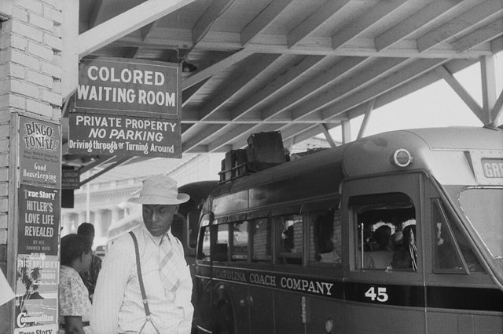
最高法院以「隔離但平等」原則維持路易斯安那州的火車隔離車廂，等於為種族隔離背書。20世紀初，南方各州的吉姆·克勞法把隔離擴大到學校、交通、餐廳、醫院、飲水機與墓地，實際上的設施從來談不上平等；私刑與經濟排斥更讓黑人時時處在暴力威脅之下。

## 1905-07 | 尼亞加拉運動
杜波依斯等黑人知識分子在尼亞加拉瀑布的加拿大一側集會（美方旅館拒絕接待），要求立即享有完整的公民權，反對布克·華盛頓主張先求經濟自立、暫時接受隔離的妥協路線。

## 1909-02-12 | 全國有色人種協進會成立
在1908年伊利諾州春田市種族暴動的刺激下，黑人與白人改革人士在林肯百歲冥誕這天發起組織，簡稱NAACP，以訴訟、公共倡議與遊說反對種族歧視。1910年創辦《危機》雜誌，由杜波依斯主編，以新聞、文學與評論揭露種族不平等。1930年代起，NAACP把訴訟集中在教育、司法與投票權，逐步累積推翻學校隔離的判例。

## 1916 ~ 1930 | 大遷徙
數以百萬計的非裔美國人離開南方農村，遷往北方與中西部的工業城市，尋找工作並躲避吉姆·克勞的壓迫，改變了芝加哥、底特律、紐約等城市的人口結構，也讓黑人在北方取得投票權與政治力量。1920年代，紐約哈林區成為黑人文學、音樂與藝術的中心，稱為「哈林文藝復興」，提升了黑人文化的能見度。

## 1941-06-25 | 第8802號行政命令
工會領袖菲利普·藍道夫揚言發動十萬人向華盛頓進軍，抗議國防工業歧視黑人。羅斯福總統簽署行政命令，禁止國防工業與聯邦政府在雇用上的種族歧視，並成立公平就業實務委員會，遊行因此取消。1942年，種族平等大會（CORE）成立，提倡非暴力直接行動。

## 1944-04-03 | 史密斯訴奧爾賴特案
最高法院判決德州民主黨只准白人參加初選違憲。在南方一黨獨大的情況下，民主黨初選才是真正的選舉，「白人初選」制度從此瓦解。

## 1948-07-26 | 第9981號行政命令
杜魯門總統下令武裝部隊中不分種族一律平等對待，軍隊的種族隔離逐步廢除，到韓戰期間大致完成。二戰中上百萬黑人士兵為國作戰，回國後卻仍面對隔離，是推動這項改革的背景。

## 1954-05-17 | 布朗訴托皮卡教育局案
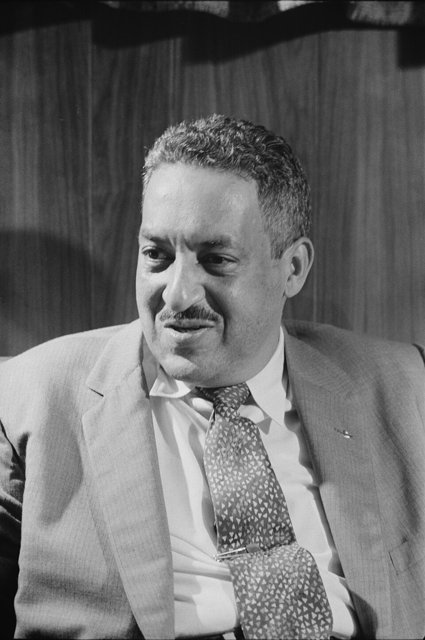
最高法院一致判決，公立學校依種族隔離違反第十四條修正案的平等保護，在公立教育上推翻了「隔離但平等」。主導這場官司的是NAACP的律師瑟古德·馬歇爾，他在1967年成為第一位非裔最高法院大法官。1955年5月31日的第二次判決只要求各地以「審慎的速度」推動整合，沒有定下期限，南方許多州便以拖延與「大規模抵抗」阻撓執行。

## 1955-08-28 | 埃米特·提爾遇害
14歲的芝加哥少年提爾到密西西比州探親，被指控對白人婦女不敬，遭兩名白人男子綁架殺害。全白人陪審團判兩人無罪，兩人事後還接受雜誌訪問承認犯案。提爾的母親堅持開棺舉行葬禮，讓雜誌刊出兒子受虐的遺體照片，全國為之震驚。

## 1955-12-01 | 羅莎·帕克斯拒絕讓座
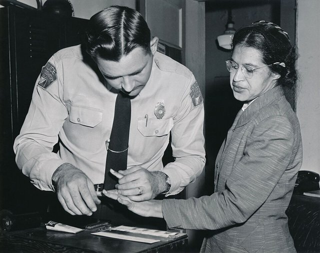
帕克斯是NAACP蒙哥馬利分會的幹部，她在阿拉巴馬州蒙哥馬利的公車上拒絕依規定讓座給白人乘客，遭到逮捕。12月5日她受審當天，黑人居民開始集體拒搭公車；同日成立蒙哥馬利改進協會，推選26歲的牧師馬丁·路德·金恩為主席，他從此成為民權運動最具代表性的領袖。

## 1956-12-20 | 蒙哥馬利公車抵制結束
黑人居民步行、共乘堅持了381天，市府與公車公司損失慘重，金恩的住家還遭到炸彈攻擊。1956年6月5日，聯邦地方法院判決公車隔離違憲，11月13日最高法院維持原判；12月20日判決送達，抵制結束，公車開始不分種族。這場運動證明非暴力的集體抗爭可以對地方政府與商家形成實質壓力。

## 1957-01-10 | 南方基督教領袖會議成立
金恩等黑人牧師結合南方各地的黑人教會與地方組織，成立南方基督教領袖會議（SCLC），以非暴力抗爭推動種族平等，金恩擔任主席。

## 1957-09-24 | 小石城九人事件
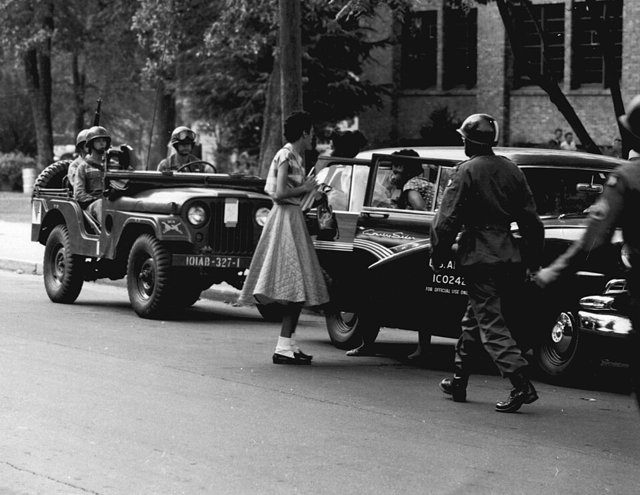
9月初，九名黑人學生要進入阿肯色州小石城中央高中就讀，州長福布斯派國民兵阻擋，白人群眾包圍學校。艾森豪總統派出第101空降師，並把州國民兵收歸聯邦指揮，護送學生入校。9月9日，艾森豪已簽署《1957年民權法》，設立民權委員會，並授權司法部介入投票權案件，這是重建結束以來第一部聯邦民權法。1958年，福布斯乾脆關閉小石城的公立高中一整年，顯示地方的抵抗仍十分強烈。

## 1960-02-01 | 格林斯伯勒靜坐
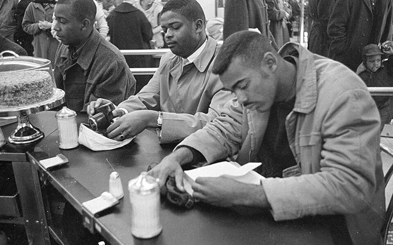
北卡羅來納州四名黑人大學生坐上伍爾沃斯百貨只供白人的午餐櫃檯，遭拒絕後天天回來靜坐。1950年代末在大學校園累積的學生力量就此爆發，靜坐在幾個月內擴散到南方數十個城市的餐廳、百貨公司與公共場所。4月，在艾拉·貝克的協助下，學生非暴力協調委員會（SNCC）成立；5月6日，《1960年民權法》加強選民登記紀錄的保存，但實際效果有限。

## 1961-05-04 | 自由乘車運動
最高法院已判決州際巴士與車站的隔離違憲，種族平等大會的詹姆斯·法默組織黑人與白人活動人士同搭巴士南下，測試判決是否落實。5月14日，一輛巴士在阿拉巴馬州安尼斯頓被暴徒擲汽油彈焚燒，另一車在伯明罕遭毆打；5月20日，乘車者在蒙哥馬利又遭暴徒襲擊。SNCC的學生接力上路，整個夏天數百人前往南方，許多人在密西西比被捕。9月，州際商業委員會頒布規定，11月起終止州際交通設施的隔離。

## 1962-09-30 | 密西西比大學入學危機
空軍退伍的黑人學生詹姆斯·梅瑞迪斯依法院判決要進入密西西比大學，州長巴奈特親自阻擋。甘迺迪政府派聯邦法警護送他入校，當晚白人群眾暴動，兩人死亡、數百人受傷，10月1日聯邦軍隊進駐平息，梅瑞迪斯才得以註冊上課。

## 1963-04-03 | 伯明罕運動
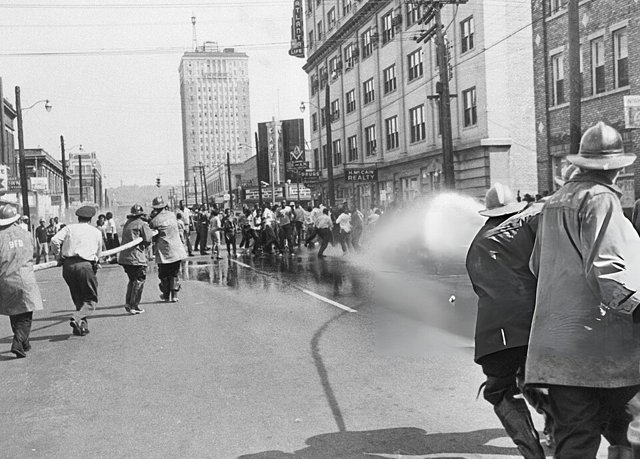
伯明罕被稱為美國種族隔離最嚴重的城市，金恩與SCLC在這裡發動靜坐、遊行與抵制。4月12日金恩被捕，在獄中寫下《伯明罕監獄書簡》，回應白人牧師要他「等待」的批評，闡述人有反抗不公正法律的道德責任。5月初，上千名兒童與青少年走上街頭，警察局長康納以警犬與高壓水柱驅散，畫面震撼全國。5月10日，當地商界同意逐步廢除商店與公共場所的隔離。

## 1963-06-11 | 甘迺迪民權演說
阿拉巴馬州長華勒斯親自站在阿拉巴馬大學門口阻擋兩名黑人學生註冊，最後在聯邦化的國民兵面前讓步。當晚甘迺迪發表電視演說，稱民權是「道德問題」，要求國會制定全面的民權法。隔天凌晨，NAACP密西西比州負責人梅德加·埃弗斯在自家門前遭槍殺。

## 1963-08-28 | 華盛頓大遊行
「為工作與自由向華盛頓進軍」由藍道夫發起、貝亞德·魯斯汀籌劃，約25萬人聚集在林肯紀念堂前，要求通過民權法、改善就業。金恩在這裡發表〈我有一個夢想〉的演說，描繪一個人們不再以膚色、而以品格被評斷的國家。9月15日，伯明罕一座黑人教會遭三K黨炸毀，四名女孩罹難。

## 1963-11-22 | 甘迺迪遇刺
甘迺迪在達拉斯遇刺，副總統詹森繼任。詹森出身南方，卻把通過民權法案當作紀念甘迺迪的首要任務，以他在國會多年的經驗全力推動。

## 1964-06-21 | 自由之夏與三名民權工作者遇害
6月起，上千名多為北方白人大學生的志工前往密西西比州，協助黑人登記投票、開辦自由學校。6月21日，詹姆斯·錢尼、安德魯·古德曼與麥可·施沃納失蹤，8月在一處土壩下被發現遭三K黨與當地警員合謀殺害，震撼全國。8月，密西西比自由民主黨在民主黨全國代表大會上要求取代全白人的州代表團，雖然只得到兩個象徵性席次，卻讓黨內的種族代表權問題攤在全國眼前。

## 1964-07-02 | 《1964年民權法》
南方參議員以冗長發言杖阻法案，直到6月10日參議院表決終止辯論，法案才得以表決。詹森簽署的這部法律禁止旅館、餐廳、劇院等公共場所的種族隔離與歧視，禁止雇主基於種族、膚色、宗教、性別或原國籍歧視員工，設立平等就業機會委員會，並讓聯邦可以停止資助有歧視行為的計畫，是重建以來最重要的民權立法。1964年金恩也獲得諾貝爾和平獎。

## 1965-02-21 | 麥爾坎·X遇刺
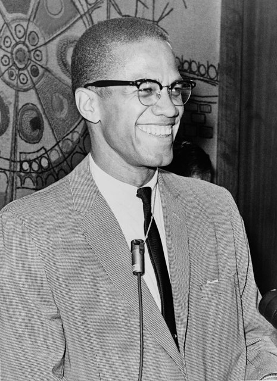
這位曾是「伊斯蘭國度」發言人的黑人民族主義者，主張黑人擺脫白人社會的支配、自我決定與自我防衛，與金恩的非暴力路線形成對比。1964年他脫離伊斯蘭國度、前往麥加朝聖後，觀點趨於緩和，隔年在紐約演講時遭槍殺。

## 1965-03-07 | 塞爾瑪「血腥星期日」
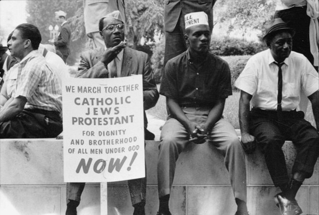
1月起，金恩與SNCC在阿拉巴馬州塞爾瑪推動黑人登記投票；2月，吉米·李·傑克遜在鄰近的馬里昂參加和平示威時遭州警槍擊，數日後死亡。3月7日，約600名示威者從塞爾瑪出發，要步行到州首府蒙哥馬利，在埃德蒙·佩特斯橋上遭州警以警棍與催淚瓦斯暴力驅散，SNCC的約翰·路易斯頭骨碎裂。3月9日金恩帶隊再到橋頭，祈禱後折返；3月21日，在聯邦保護下第三次出發，25日抵達蒙哥馬利時已有約2萬5千人。

## 1965-08-06 | 《1965年投票權法》
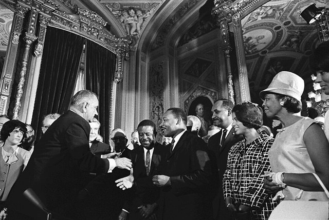
3月15日，詹森在國會發表演說支持投票權立法，並引用民權運動的口號「我們終將得勝」。8月簽署的投票權法禁止識字測驗等歧視性手段，授權聯邦人員直接到特定地區辦理選民登記，這些地區修改選舉規則也要先經聯邦審查。南方黑人的登記率在幾年內大幅上升。但5天後的8月11日，洛杉磯瓦茨區爆發大規模暴動，顯示警察暴力、貧窮與居住隔離等北方與西部城市的問題，並非法律平等就能解決。

## 1966-06-16 | 「黑色力量」
6月初，梅瑞迪斯發起「反恐懼遊行」，從田納西州孟菲斯走向密西西比州傑克遜，鼓勵黑人登記投票，出發第二天就遭槍擊受傷，各民權組織接手續走。16日，SNCC的斯托克利·卡邁克爾在密西西比州格林伍德的集會上喊出「黑色力量」，主張黑人自主、建立自己的政治力量與社區控制，運動內部的路線分歧從此公開化。同年，金恩把運動帶到芝加哥，挑戰北方的住宅隔離，遭遇的敵意不下於南方。

## 1966-10-15 | 黑豹黨成立
休伊·牛頓與鮑比·西爾在加州奧克蘭創立黑豹黨，最初以持槍巡邏、監督警察執法為號召，也開辦兒童免費早餐等社區服務，主張黑人社區自衛、政治自主與社會經濟改革，後來成為聯邦調查局監控與打擊的主要對象。

## 1967-04-04 | 金恩〈超越越南〉演說
金恩在紐約河濱教堂公開反對越戰，指出戰爭耗費了本該用於反貧窮的資源，而前線的黑人士兵比例偏高。演說讓他失去詹森政府與部分支持者的好感。6月12日，最高法院在洛文訴維吉尼亞州案中判決禁止跨種族婚姻的州法違憲；7月，底特律爆發大規模暴動，反映城市黑人社區在警察執法、住房與就業上長期累積的不滿。10月起，金恩開始籌備「貧民進軍」，要號召各族裔的窮人到華盛頓要求經濟正義。

## 1968-04-04 | 金恩遇刺
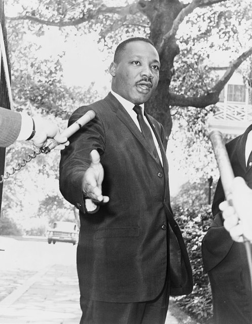
金恩到田納西州孟菲斯支持罷工的黑人清潔工，4月3日晚發表〈我已到達山頂〉演說，隔天傍晚在洛林汽車旅館陽台遭槍殺，年僅39歲。消息傳出，全國上百個城市爆發抗議與騷亂。

## 1968-04-11 | 《1968年民權法》
金恩遇刺一週後，詹森簽署法案，其中的《公平住宅法》禁止在住宅的銷售、出租與貸款上基於種族、膚色、宗教或原國籍歧視，是1960年代最後一部重要民權法。金恩的貧民進軍由拉爾夫·阿伯納西接手，5月在華盛頓搭起帳篷城，但成效有限。6月6日，支持民權改革的羅伯特·甘迺迪也遭暗殺。民權運動並未就此結束：1971年最高法院支持以校車接送推動學校整合，1990年《美國身心障礙者法》把平等保障擴大到身心障礙者，2008年歐巴馬當選第一位非裔總統，2013年起「黑人的命也是命」運動又把警察暴力與制度性歧視帶回全國討論。
