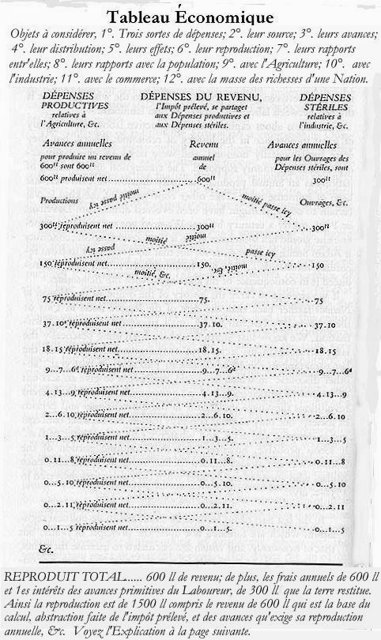
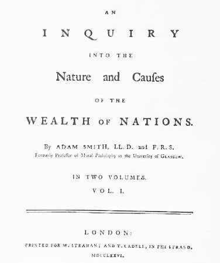
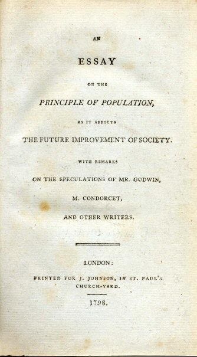

<!--
內容整理自本機筆記〈古典經濟學派（Classical School of Economics）大事記〉（D:\Books\md\歷史\術語\經濟學\古典經濟學派.md；html 版在 D:\Books\html\4-1-1.經濟學派），並參考中文維基百科〈古典經濟學〉條目（篇幅很短，只用來核對學派的範圍），以自己的話改寫。
時期依筆記的篇章：思想淵源、斯密時代（1776－1810）、李嘉圖時代（1810－1840）、彌爾時代（1840－1870）、轉型與邊際革命。
處理方式：
- 重商主義、配第的《政治算術》、洛克與休謨的貨幣思想寫進第一則事件，不另立事件，避免橫向檢視前面空出一百多年。
- 筆記的「重要年份總整理」列了許多人物的出生年，這裡不列為事件，生平寫進相關著作的事件內文。
- 1848年《共產黨宣言》、1867年《資本論》屬於對古典學派的批判，詳見「社會主義經濟學」時間軸，這裡只在內文提及。
- 1871年邊際革命作為學派的終點；筆記另列1873年彌爾逝世，寫進最後一則事件。
- 人名依 Books 原稿與台灣慣用譯名：亞當·斯密、李嘉圖、馬爾薩斯、薩伊、約翰·斯圖亞特·彌爾；人名用·分隔（原稿作・）。
圖片來源（皆為 Wikimedia Commons 公有領域／CC0 作品，縮成最長邊 640px）：
- ce-smith.jpg：Adam Smith The Muir portrait.jpg（亞當·斯密像（「繆爾肖像」，約1800））
- ce-tableau.jpg：Quesnay Tableau.jpg（魁奈《經濟表》）
- ce-wealth.jpg：Wealth of Nations.jpg（《國富論》1776年初版第一卷書名頁）
- ce-essay.jpg：An Essay on the Principle of Population.jpg（《人口論》1798年初版書名頁）
-->

# Periods
- 1758 ~ 1775 | 思想淵源 | #868e96
  重商主義把財富等同金銀、主張保護貿易；重農學派反過來認為財富來自生產，提出「自由放任」。啟蒙運動的自然法與財產權思想，為自由市場經濟學鋪路。
- 1776 ~ 1809 | 斯密時代 | #2b8a3e
  《國富論》以分工、市場與「看不見的手」說明國家財富的來源，古典經濟學正式成立；馬爾薩斯的人口論、薩伊的市場法則接著登場。
- 1810 ~ 1840 | 李嘉圖時代 | #1971c2
  李嘉圖以地租、勞動價值與比較利益建立嚴密的理論體系，反對保護地主的穀物法；李嘉圖學派與馬爾薩斯展開論戰。
- 1841 ~ 1870 | 彌爾時代 | #e67700
  英國廢除穀物法，自由貿易取得勝利；彌爾的《政治經濟學原理》集古典經濟學之大成，也開始關注分配與社會改革，馬克思則從內部批判古典理論。
- 1871 ~ 1873 | 邊際革命 | #5f3dc4
  傑文斯、門格爾、瓦爾拉斯幾乎同時提出邊際效用理論，價值的解釋從勞動轉向主觀效用，經濟學進入新古典時代。

# Events

## 1758 | 魁奈《經濟表》

15、16世紀的商業革命之後，歐洲各國奉行重商主義：認為金銀就是財富，要多出口、少進口，以關稅與殖民地累積貴金屬。17世紀，威廉·配第以《政治算術》開啟用數字分析經濟的方法，洛克討論財產權與貨幣，1752年休謨指出貨幣增加只會推高物價、貿易順差無法長久維持，動搖了重商主義。1758年，法國宮廷醫生魁奈發表《經濟表》，以圖表描繪財富在農民、地主與工商業者之間的循環，主張只有農業能產生「純產品」，政府應減少干預。他與杜爾哥等人被稱為「重農學派」，「自由放任」（laissez-faire）的口號即來自這一派。

## 1759 | 斯密《道德情操論》
格拉斯哥大學道德哲學教授亞當·斯密出版《道德情操論》，以「同情心」與「公正的旁觀者」說明人如何形成道德判斷。他的經濟學並非只講自利：市場秩序建立在人們的道德、互信與法律制度之上。1764年至1766年他陪同年輕公爵遊歷法國，結識魁奈、杜爾哥等重農學派人物，開始寫作《國富論》。

## 1776-03-09 | 《國富論》出版

斯密花了約十年寫成《國民財富的性質和原因的研究》，簡稱《國富論》，同年美國發表《獨立宣言》。他以製針工廠說明分工能大幅提高生產力；人們追求自身利益，在競爭的市場中卻像被一隻「看不見的手」引導，促進了社會的整體利益；國家的財富不是金銀，而是勞動生產的商品與服務。他批評重商主義的保護與壟斷，主張自由貿易，但也認為政府應負責國防、司法、公共工程與教育。《國富論》的出版通常被視為古典經濟學的誕生。

## 1790-07-17 | 斯密逝世
斯密晚年任蘇格蘭海關專員，在愛丁堡去世。同一時期，英國首相小皮特受《國富論》影響，與法國簽訂降低關稅的商約；邊沁的功利主義也在這時發展，日後成為古典經濟學的哲學基礎之一。1789年爆發的法國大革命，則把自由、財產與平等的爭論推向全歐洲。

## 1798 | 馬爾薩斯《人口論》

英國牧師馬爾薩斯匿名出版《人口論》，指出人口若不受限制會以幾何級數成長，糧食只能以算術級數增加，因此貧窮與饑荒難以避免，人口只能靠戰爭、疾病、饑荒等「積極抑制」或晚婚節育等「預防抑制」來平衡。這個悲觀的論點使經濟學被稱為「憂鬱的科學」，也影響了日後的濟貧法改革與達爾文的天擇思想。1805年他成為英國第一位政治經濟學教授。

## 1803 | 薩伊《政治經濟學概論》
法國經濟學家薩伊出版《政治經濟學概論》，把斯密的理論系統化並傳播到歐洲大陸。他提出後來稱為「薩伊法則」的觀點：生產本身創造需求，賣出產品得到的收入會用來購買其他產品，因此整體經濟不會長期出現普遍的生產過剩。這個觀點主導經濟學一百多年，直到凱因斯在1936年提出挑戰。他也強調企業家在組織生產上的角色。

## 1810 | 李嘉圖《金銀價格高昂論》
拿破崙戰爭期間，英格蘭銀行停止紙幣兌換黃金，物價上漲。靠證券交易致富的李嘉圖發表〈金銀價格高昂論〉，指出物價上漲是銀行發行過多紙幣所致，主張恢復兌換。這是他第一部重要的經濟學著作，也是日後貨幣數量論與「金塊主義」爭論的源頭。

## 1815 | 穀物法與地租理論
拿破崙戰爭結束，英國國會通過穀物法，在國內麥價低於一定水準時禁止進口外國穀物，保護地主的利益。李嘉圖與馬爾薩斯同年各自發表地租理論：人口增加迫使人們耕種較貧瘠的土地，較肥沃土地的地主因此得到愈來愈多的「差額地租」。李嘉圖據此指出穀物法抬高糧價與工資，壓縮利潤與資本累積，是地主犧牲全國的利益。

## 1817-04-19 | 李嘉圖《政治經濟學及賦稅原理》
李嘉圖出版代表作，以抽象演繹的方法建立古典經濟學最嚴密的體系：商品的價值取決於生產所需的勞動量，收入在地主、資本家與勞工之間分配，長期利潤率會趨於下降。他提出「比較利益」：即使一國生產所有商品都比另一國有效率，只要各自專門生產相對最擅長的商品再互相貿易，雙方都能得利，以英國的布與葡萄牙的酒為例。比較利益至今仍是國際貿易理論的基石。

## 1820 | 馬爾薩斯與李嘉圖的論戰
馬爾薩斯出版《政治經濟學原理》，質疑薩伊法則，認為社會可能出現「有效需求不足」的普遍過剩，地主的消費有助於維持需求。他與李嘉圖長年通信辯論，兩人是論敵也是摯友。李嘉圖的觀點在當時占了上風，一百多年後凱因斯卻稱讚馬爾薩斯，說如果經濟學是從馬爾薩斯而非李嘉圖出發，世界會更明智、更富裕。

## 1823-09-11 | 李嘉圖逝世
李嘉圖在1819年當選國會議員，在國會中倡導自由貿易與貨幣改革，1823年突然病逝，年僅五十一歲。他的學說由詹姆斯·穆勒、麥卡洛克等人繼承，形成李嘉圖學派，主導英國經濟學數十年；英國也在1821年正式恢復金本位。

## 1834 | 新濟貧法
受馬爾薩斯人口論與功利主義的影響，英國通過新濟貧法，取消對院外貧民的救濟，有勞動能力的貧民必須進入條件刻意苛刻的濟貧院，以免救濟助長懶惰與人口增加。同年馬爾薩斯去世。1832年英國議會改革擴大了中產階級的選舉權，工商業者的政治影響力上升，為自由貿易運動創造了條件。

## 1836 | 西尼爾的節欲論與方法論
牛津大學的納索·西尼爾出版《政治經濟學概要》，把經濟學整理為從少數基本命題推演的抽象科學，並提出「節欲論」：利潤是資本家節制當前消費、從事儲蓄投資的報酬。古典經濟學在這時逐漸成為大學課程與專業學科。

## 1846-06-25 | 英國廢除穀物法
理查·科布登與約翰·布萊特領導的反穀物法同盟，以群眾集會與宣傳爭取自由貿易；1845年愛爾蘭大饑荒爆發，首相皮爾不顧保守黨的分裂，推動國會廢除穀物法。這是古典經濟學自由貿易主張最重大的政策勝利，英國此後數十年走向全面的自由貿易。

## 1848 | 彌爾《政治經濟學原理》
約翰·斯圖亞特·彌爾自幼由父親詹姆斯·穆勒以李嘉圖學說嚴格教育，1848年出版《政治經濟學原理》，集古典經濟學之大成，成為此後半個世紀英語世界最主要的教科書。他指出生產法則像自然法則，分配卻是人類制度的選擇，可以透過改革改善，並支持合作社、遺產稅與女性權利。同年馬克思與恩格斯發表《共產黨宣言》，歐洲爆發革命，對古典學派的批判從此展開。

## 1859 | 彌爾《論自由》
彌爾出版《論自由》，提出「傷害原則」：只有在防止傷害他人時，社會才能干涉個人的自由。1861年他發表《功利主義》，1865年當選國會議員，提倡婦女選舉權。他把經濟自由與個人自由、社會改革結合，代表古典自由主義的成熟形態。

## 1867 | 馬克思《資本論》第一卷
馬克思大量吸收李嘉圖的勞動價值論，卻推導出相反的結論：資本家的利潤來自剝削工人勞動所創造的剩餘價值，資本主義會因利潤率下降與危機而走向崩潰。古典經濟學以勞動解釋價值的路線，由此分出批判資本主義的馬克思主義經濟學。詳見「社會主義經濟學」時間軸。

## 1871 | 邊際革命
英國的傑文斯出版《政治經濟學理論》、奧地利的門格爾出版《國民經濟學原理》，1874年法國的瓦爾拉斯又出版《純粹經濟學要義》，三人各自提出邊際效用理論：商品的價值取決於最後一單位帶給人的效用，而不是生產所耗費的勞動。經濟學的重心從長期的成長與分配，轉向市場的價格與資源配置，進入新古典經濟學時代。1873年彌爾去世，古典經濟學的時代大致結束，但它的自由市場、分工與比較利益思想，至今仍是經濟學的基礎。
