<!--
內容整理自 D:\Books\html\1-5.世界史\哥倫布大交換大事記.html（沒有對應的 md 筆記），並整合中文維基百科〈哥倫布大交換〉條目，以自己的話改寫。
時期依頁面的五個階段歸納：跨大西洋接觸的開始、殖民征服與生態劇變、全球商品網絡形成、新作物改變人口與飲食、奴隸制度的廢除與長期影響。頁面的「作物與動物清單」「疾病交換」「人口交換」「對全球經濟的影響」寫進時期說明與相關事件，不另立事件。
兩份資料出入與處理方式：
- 命名：頁面與維基百科都說這個詞由艾爾弗雷德·克羅斯比（Alfred W. Crosby）1972年的書《哥倫布大交換》推廣，維基百科補充書名是《哥倫布大交換：1492年以後的生物影響和文化衝擊》，照此。
- 原住民人口損失：維基百科寫「至少50–90%的人口喪生，估計死亡1500–1650萬人」；頁面強調原住民人口下降不能全部歸因於疾病，戰爭、強迫勞動、飢荒與社會瓦解都是原因，且各地時間不同。這裡不寫確切數字，只寫「維基百科引用的估計是50–90%」並照頁面說明多重原因。
- 愛爾蘭大飢荒：維基百科把1840年代愛爾蘭大飢荒歸因於單一馬鈴薯品種的晚疫病，並說愛爾蘭是歷史上人口多於現在的少數國家；頁面沒有，這裡依維基百科補充一則事件（1845–1852年）。
- 白銀與明朝：維基百科說美洲白銀輸往東亞造成明朝空前的通貨膨脹，並「在一定層面上導致明朝滅亡」；頁面只說白銀連結美洲、歐洲與亞洲。這個因果在學界有不同看法，這裡只寫白銀大量流入中國、對明朝經濟產生影響，不寫成明朝滅亡的原因。
- 人口增長：維基百科說新作物導致歐洲人口激增、帶動工業革命；頁面提醒新作物只是人口變化的因素之一，氣候、戰爭、醫療與公共衛生同樣重要，照頁面的審慎寫法。
- 印加征服：頁面寫1532–1533年；維基百科沒有細節，照頁面。波托西銀礦：頁面寫1545年大規模開採，維基百科說波托西銀礦的發現使銀產量空前增長，照此。
- 甘蔗：頁面說1509年西班牙殖民地開始發展甘蔗種植，一般記載是1493年哥倫布第二次航行就把甘蔗帶到伊斯帕尼奧拉島，這裡寫在1493年的事件內文，1509年另寫種植園經濟。
- 1519–1522年：頁面寫麥哲倫船隊環球航行，由埃爾卡諾率領部分船員完成（麥哲倫死於1521年），照此。
- 日期補充：1492年10月12日（抵達巴哈馬瓜納哈尼島）、1521年8月13日（特諾奇蒂特蘭陷落）、1494年6月7日（《托爾德西里亞斯條約》）、1498年5月20日（達伽馬抵達卡利卡特）、1804年1月1日（海地宣布獨立）依一般記載補充。
- 天花：頁面說1510年代天花開始在美洲造成嚴重衝擊；《佛羅倫斯手抄本》第12卷（1577年）描繪1520年的天花患者，寫進1520年代的事件。
- 人名與地名與其他時間軸一致：哥倫布、麥哲倫、達伽馬、科爾特斯。
圖片來源（皆為 Wikimedia Commons 公有領域／CC0 作品；繪畫、版畫與插圖多為後世作品，不代表事件當時的樣貌）：
- cex-cover.jpg：John Vanderlyn - Columbus Landing at Guanahani, 1492 - WGA24269.jpg（范德林〈哥倫布登陸瓜納哈尼島〉，1847）
- cex-horse.jpg：Buffalo hunt on the Southwestern plains.jpg（北美大平原原住民騎馬獵野牛（後世畫作））
- cex-tordesillas.jpg：Map of Meridian Line set under the Treaty of Tordesillas.jpg（《托爾德西里亞斯條約》劃定的子午線（地圖））
- cex-vasco.jpg：Gregório Lopes - Vasco da Gama (ca 1524).jpg（格雷戈里奧·洛佩斯所繪達伽馬，約1524）
- cex-slave.jpg：Brookes slave ship, British Library (cropped).jpg（布魯克斯號奴隸船的艙位圖）
- cex-cortes.jpg：Conquista-de-México-por-Cortés-Tenochtitlan-Painting.png（〈征服墨西哥〉（描繪科爾特斯進攻特諾奇蒂特蘭的畫作））
- cex-magellan.jpg：Retrato de Hernando de Magallanes.jpg（麥哲倫肖像）
- cex-smallpox.jpg：Healer (ticitl) tending to people suffering from smallpox in 1520 in Book 12 of the Florentine Codex, 1577.jpg（《佛羅倫斯手抄本》第12卷：照顧天花患者的情景，1577）
- cex-potosi.jpg：Indigenous workers in a mine in Potosí, New Spain.jpg（波托西銀礦中的原住民礦工（版畫））
- cex-galleon.jpg：Reception of the Manila Galleon by the Chamorro in the Ladrones Islands, ca. 1590.jpg（查莫羅人迎接馬尼拉大帆船，約1590）
- cex-sweetpotato.jpg：Franz Joseph Märter Sweet potato 1797.jpg（甘薯（馬爾特繪，1797））
- cex-potato.jpg：Naturalis Biodiversity Center - L.0939623 - Vreugdenhil, J. - Solanum tuberosum Linnaeus - Artwork.jpeg（馬鈴薯植物圖（荷蘭自然生物多樣性中心藏））
- cex-louverture.jpg：Général Toussaint Louverture.jpg（杜桑·盧維杜爾（海地革命領袖））
- cex-famine.jpg：The Famine in Ireland, Funeral at Skibbereen - ILN 1847.jpg（愛爾蘭大飢荒：斯基伯林的葬禮，1847年《倫敦新聞畫報》）
-->

# Periods
- 1453 ~ 1500 | 跨大西洋接觸的開始 | #868e96
  鄂圖曼帝國攻陷君士坦丁堡後，葡萄牙與西班牙在大西洋尋找通往亞洲的新航路；哥倫布抵達加勒比海，歐洲與美洲之間開始持續、廣泛的交流。
- 1500 ~ 1550 | 殖民征服與生態劇變 | #c92a2a
  歐洲人征服阿茲特克與印加，天花等舊大陸疾病、戰爭、強迫勞動共同重創原住民社會，非洲奴隸被運往美洲，白銀開始成為連結世界市場的新力量。
- 1550 ~ 1700 | 全球商品網絡形成 | #e8590c
  美洲白銀經馬尼拉大帆船輸往亞洲，換取中國絲綢與瓷器；玉米、馬鈴薯、甘薯等作物開始改變亞洲、非洲與歐洲的農業，甘蔗種植園與奴隸貿易擴張。
- 1700 ~ 1850 | 新作物改變人口與飲食 | #2f9e44
  馬鈴薯與玉米在歐洲、非洲與亞洲廣泛種植，成為部分地區人口成長的因素之一；殖民地商品需求增加，海地革命與廢奴運動挑戰奴隸制度。
- 1850 ~ 2026 | 廢奴與長期影響 | #1971c2
  美國廢除奴隸制，歷史學者在1970年代提出「哥倫布大交換」這個概念，全球史、環境史與殖民史研究重新檢討這場交流的得失。

# Events

## 1453 | 君士坦丁堡陷落
鄂圖曼帝國攻陷君士坦丁堡，歐亞貿易格局受到影響，但這並不是歐洲人探索大西洋的唯一原因。葡萄牙等國逐步沿著非洲海岸向南探索，尋找通往亞洲的新航路。

## 1488 | 迪亞士抵達非洲南端
葡萄牙航海家迪亞士抵達非洲南端附近，證明歐洲船隊可以繞過非洲南端，為前往印度洋的航線開路。

## 1492-10-12 | 哥倫布抵達加勒比海
哥倫布受西班牙王室資助橫渡大西洋，抵達加勒比海的巴哈馬群島，歐洲與美洲之間持續而廣泛的跨洋交流由此展開。這次航行不只是世紀性航海的開端，也是舊大陸與新大陸之間聯繫的開始，引發了各種生態上的巨大轉變。

## 1493 | 第二次航行：帶去作物、牲畜與疾病
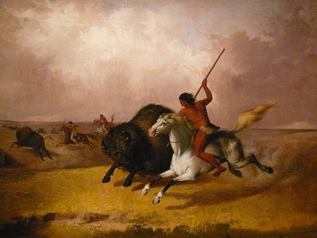
哥倫布率領更大的船隊再度前往美洲，西班牙開始在加勒比海建立持久的殖民據點，船上載著小麥等歐洲作物、馬、牛、豬、羊等牲畜與甘蔗，也不知不覺帶去了病原體。其中馬後來改變了部分美洲原住民社群的交通、狩獵與戰爭方式，尤其是後來的北美大平原文化。

## 1494-06-07 | 《托爾德西里亞斯條約》
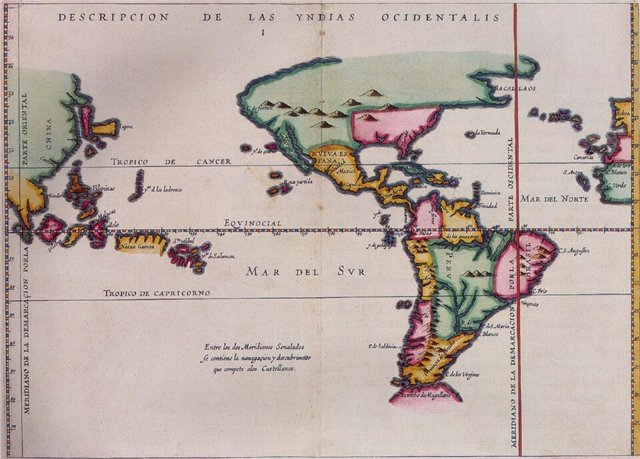
西班牙與葡萄牙簽訂條約，試圖劃分海外擴張的範圍，反映歐洲殖民競爭的加劇。

## 1498 | 哥倫布第三次航行與達伽馬抵達印度

哥倫布第三次航行抵達南美洲北部附近，歐洲人對美洲地理的認識進一步擴大。同年5月，達伽馬抵達印度西岸的卡利卡特，葡萄牙建立起繞過非洲前往印度洋的航線，連結了歐亞海上貿易與大西洋的交流。

## 1500 | 卡布拉爾抵達巴西
葡萄牙航海家卡布拉爾抵達巴西海岸，葡萄牙逐漸在南美洲建立殖民據點。

## 1502 | 非洲奴隸被運往美洲 {label="1502年左右"}
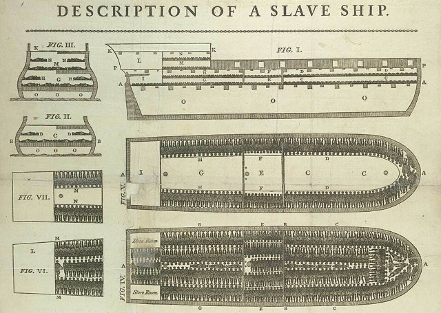
西班牙殖民地開始輸入被奴役的非洲人。殖民地的勞動需求加上原住民人口減少，促使跨大西洋奴隸貿易逐步擴大。1509年西班牙殖民地的甘蔗種植與生產逐漸發展，種植園經濟成為加勒比海殖民體系的重要部分，糖後來成為跨大西洋貿易的重要商品，也加深了對被奴役勞動力的依賴。

## 1510 | 天花等疾病襲擊美洲 {label="1510年代"}
天花等舊大陸疾病在美洲造成嚴重衝擊。原住民缺乏相同的歷史暴露與免疫經驗，疫情蔓延很快，原住民社群面臨重大的人口損失，部分地區的社會與政治結構受到破壞。不過，人口下降不能全部歸因於疾病：殖民戰爭、強迫勞動、飢荒、社會秩序瓦解與人口遷徙也共同造成嚴重後果，不同地區的疫情與人口損失時間並不相同。

## 1513 | 巴爾波亞看到太平洋
西班牙人巴爾波亞越過巴拿馬地峽，看到太平洋，歐洲人對美洲地理的認識進一步擴展，跨洋聯繫的可能性增加。

## 1519 | 科爾特斯進入墨西哥
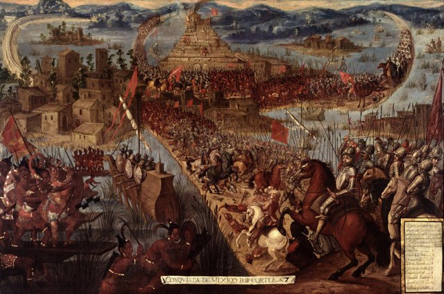
科爾特斯率軍進入墨西哥中部，西班牙開始征服阿茲特克帝國控制的區域，並利用部分原住民盟友的支持。

## 1519 ~ 1522 | 麥哲倫船隊環球航行

麥哲倫船隊展開環球航行，麥哲倫本人在1521年死於菲律賓，最後由埃爾卡諾率領部分船員完成。這證明全球海洋航線可以連結起來，也推動世界地理與貿易觀念的轉變。

## 1520 | 天花在中美洲蔓延 {label="1520年代"}
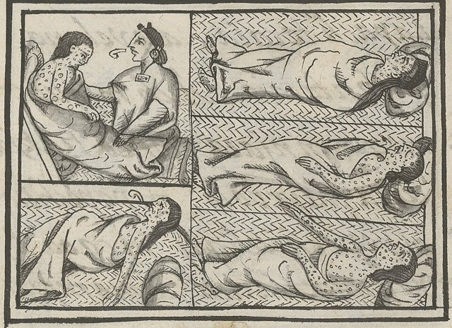
天花等疾病在中美洲持續傳播，與戰爭、強迫勞動與社會動盪共同造成嚴重的人口災難。《佛羅倫斯手抄本》第12卷（1577年）描繪了醫者照顧1520年天花患者的情景，是原住民親自記錄這場疫病的珍貴史料。

## 1521-08-13 | 特諾奇蒂特蘭陷落
西班牙人與他們的原住民盟友攻陷阿茲特克首都特諾奇蒂特蘭，中美洲的政治秩序發生重大變化，西班牙殖民統治逐步建立。

## 1532 ~ 1533 | 西班牙征服印加帝國
西班牙勢力征服印加帝國的核心地區，安地斯地區的政治與經濟結構受到重大改變。

## 1545 | 波托西銀礦大規模開採
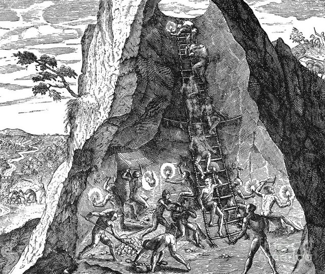
波托西銀礦進入大規模開採階段，美洲白銀產量空前增長，逐漸成為跨洋貿易與全球貨幣流通的重要力量。1550年代美洲白銀產量增加，白銀成為連結美洲、歐洲與亞洲市場的重要媒介，大量輸往東亞的白銀也對明朝的經濟產生深刻的影響。

## 1565 | 馬尼拉大帆船貿易
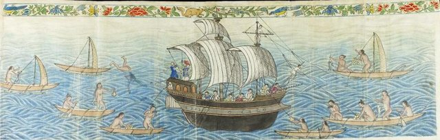
西班牙建立連接菲律賓與美洲的馬尼拉大帆船貿易體系，1571年馬尼拉成為西班牙在亞洲的重要貿易中心。美洲白銀可經太平洋輸往亞洲，換取中國絲綢、瓷器與其他商品，全球貿易網絡更加緊密。

## 1550 | 美洲作物傳入亞洲與非洲 {label="16世紀後半"}
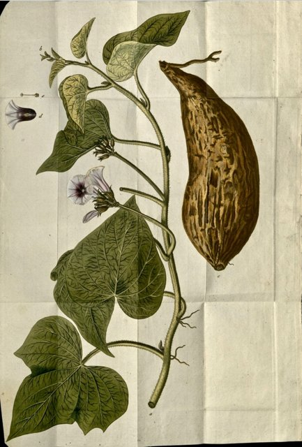
玉米、馬鈴薯、甘薯與木薯等作物逐漸傳入亞洲與非洲部分地區：葡萄牙商人在16世紀把玉米與木薯引進非洲，取代了原有的作物，成為非洲最主要的主食作物；西班牙殖民者把甘薯與玉米引入亞洲，刺激人口成長。辣椒與馬鈴薯傳到印度後，也成為印度菜的主要材料。新作物開始改變不同地區的農業與飲食結構。

## 1600 | 英國東印度公司成立
英國東印度公司成立，歐洲海外商業組織持續擴張，全球貿易競爭更加激烈。16至17世紀歐洲殖民地的甘蔗種植園不斷擴張，17世紀後半咖啡、可可、糖與菸草等商品在國際市場上的重要性增加，殖民地生產與歐洲市場更緊密地結合。

## 1700 | 馬鈴薯與玉米普及 {label="18世紀初"}
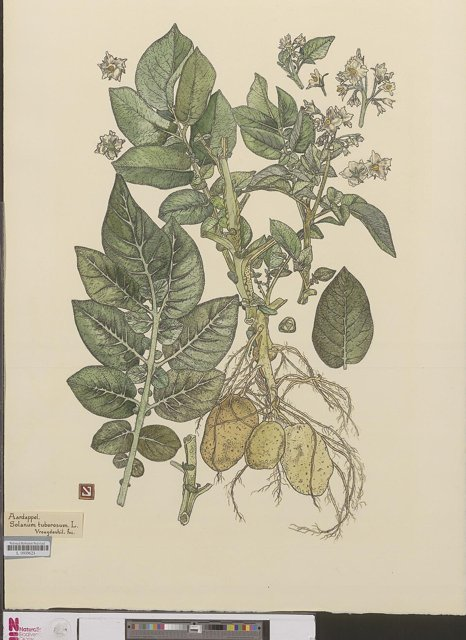
馬鈴薯在歐洲部分地區的種植逐漸普及，高熱量的作物有助於改善糧食供應，但也帶來對特定作物的依賴；玉米則在歐洲、非洲與亞洲多個地區廣泛種植。18世紀後半歐洲人口逐漸增加，新作物是部分地區人口與農業變化的因素之一，但不是唯一的原因。

## 1804-01-01 | 海地獨立
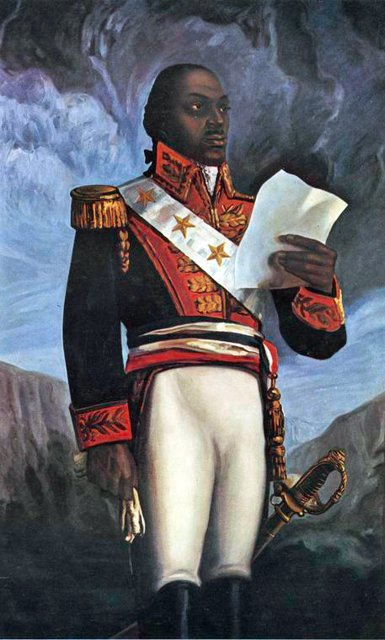
被奴役者與自由有色人種的革命，使海地宣布獨立，挑戰殖民統治與奴隸制度。19世紀前半，大西洋奴隸貿易逐步受到多國法律禁止或限制，但非法販運與奴隸制度仍在部分地區延續。

## 1845 ~ 1852 | 愛爾蘭大飢荒
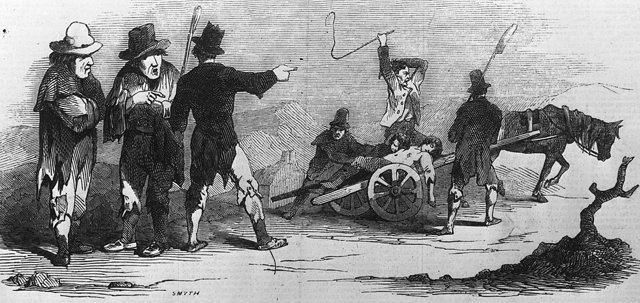
愛爾蘭的馬鈴薯因晚疫病歉收，造成大飢荒，大量人口死亡或移居海外。單一品種的馬鈴薯依賴，加上當時對農業病害缺乏認識，使這場新大陸作物帶來的人口增長最後以悲劇收場；愛爾蘭至今仍是少數歷史上人口多於現在的國家之一。

## 1865 | 美國廢除奴隸制
美國內戰後，憲法第十三修正案廢除奴隸制度，但種族歧視與社會不平等仍持續存在。19世紀後半，玉米、馬鈴薯、甘蔗、棉花與其他作物進一步融入世界經濟。

## 1972 | 克羅斯比出版《哥倫布大交換》
美國歷史學家艾爾弗雷德·克羅斯比出版《哥倫布大交換》，系統地闡述1492年以後生物與文化跨洲交流的歷史影響，「哥倫布大交換」成為重要的歷史研究概念。
20世紀末至21世紀，全球史與環境史研究持續發展，學者更重視美洲原住民的歷史經驗、非洲奴隸貿易、生態變遷與疾病傳播，食品、農業、生物多樣性與殖民遺產成為相關研究的重要議題。哥倫布大交換不再只被視為航海發現的結果，而是理解現代世界形成的重要歷史框架。
