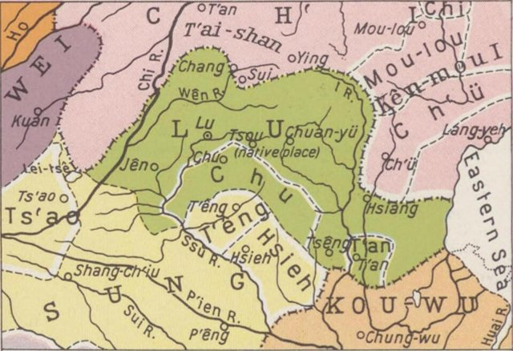
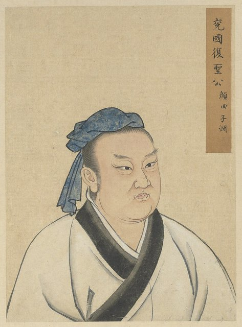
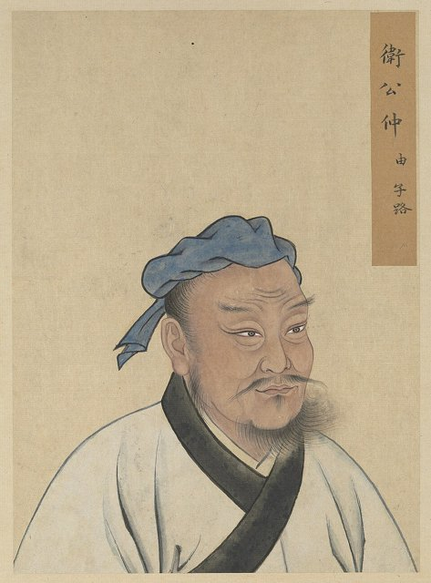
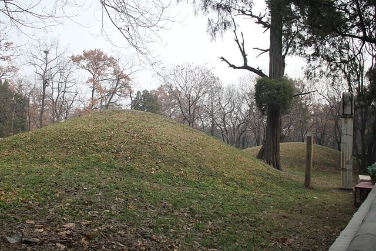
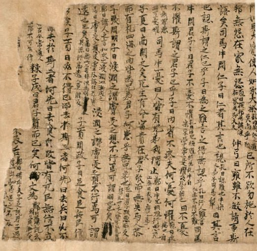

<!--
內容整理自 D:\Books\md\歷史\人物\中國\孔子（前551－前479年）生平大事記.md（網頁版為 D:\Books\html\1-2-1.中國歷史人物\孔子(前551~前479).html），並整合中文維基百科〈孔子〉條目，以自己的話改寫。
時期依筆記的五個階段歸納：少年求學、講學與教育思想形成、從政、周遊列國、晚年講學。筆記的「核心思想」（仁、禮、義、忠恕、中庸、正名、教育）、「重要弟子」「與儒家經典」「對後世的影響」「重要名言」寫進時期說明與相關事件，不另立事件。「孔子學院」「孔廟」放入 notNames，避免人名索引把機構名稱算成提到孔子本人。
兩份資料出入與處理方式（孔子生平許多年份出自《史記．孔子世家》與傳統年表，並不確定，筆記與維基百科都有說明）：
- 生卒：筆記寫前551年出生、前479年逝世，享年約73歲；維基百科進一步寫前551年9月28日—前479年3月9日（這是後世推算的日期），這裡 born、died 採維基百科的完整日期，事件的年齡因此是推算值。
- 出生地：筆記寫魯國陬邑（今山東曲阜一帶），維基百科寫曲阜附近的陬邑，指同一地。孔氏出身宋國貴族，三代前移居魯國（維基百科）。
- 父親去世：筆記寫約前549年（三歲）去世；維基百科寫孔子三歲喪父、家境貧窮，並說母親顏徵在在他十多歲時也過世，他探問後把雙親合葬於防山，為母親守喪三年，照維基百科補充，筆記沒有。
- 早年職務：筆記寫約前532年任委吏（管倉庫）、約前531年任乘田（管畜牧）；維基百科作「年輕時做過委吏、乘田，還替別人辦喪事賺錢」，沒有年份，這裡照筆記，並標「傳統記載」。
- 婚姻與孔鯉：筆記寫約前533年娶妻、育有一子孔鯉；筆記寫孔鯉前483年去世，維基百科沒有提孔鯉，照筆記。
- 學習與收徒：筆記寫約前536年十五歲「志於學」、前522年三十歲「而立」開始收徒；維基百科寫約前522年三十歲時開始收門徒，不久後成為魯國最負盛名的禮學專家，且前525年郯子朝魯，孔子向他請教古官制，感嘆「天子失官，學在四夷」（維基百科），前518年孟僖子臨終囑咐兩個兒子拜孔子為師，照此補充。
- 問禮老子：筆記寫約前518年傳統記載向老子問禮，但細節有史料爭議，這裡照筆記寫「傳統記載」。
- 去齊：筆記寫前517年魯國內亂，孔子赴齊，聽《韶》樂「三月不知肉味」，約前516年返魯；維基百科寫前517年魯昭公發動政變失敗逃往齊國，孔子亦赴齊，做了高昭子的家臣，齊景公原有意錄用他，後來因官位與俸給的問題猶豫，又被晏子阻止，景公說「我已經老了，無法重用你」，前515年（魯昭公二十七年）孔子由齊返魯，筆記的返魯年份（約前516年）與維基百科的前515年相差一年，這裡寫前516–前515年。
- 陽虎與公山弗擾：維基百科補充約前504年陽虎擅權欲見孔子、前502年公山弗擾據費邑叛季氏而召孔子，孔子雖有心，最終沒有加入，照此。前501年陽虎兵敗逃到晉國。
- 從政：筆記寫前501年任中都宰、前500年升司空後任大司寇、前500年夾谷之會、前498年左右墮三都；維基百科同寫前501年任中都宰、後出任司空、前500年任司寇，並詳寫夾谷之會（孔子以「夷不亂華，俘不干盟」要求齊國撤走萊人、歸還三座城邑；據《穀梁傳》與《史記》，孔子並下令處決齊國的歌手舞者）、前498年墮三都因公山弗擾襲擊魯定公而失敗，照此。
- 離魯：筆記寫前497年離開魯國周遊列國（約十四年）；維基百科寫前497年（魯定公十三年）魯定公沉迷齊國所贈的80個舞女，三日不上朝，郊祭時季桓子沒有分祭肉給孔子，孔子辭去司寇之職、啟程；白川靜則推斷他因墮三都的計謀被驅逐出國，兩說並列。
- 周遊：筆記寫前497–前484年周遊衛、曹、宋、鄭、陳、蔡、楚等國；維基百科寫主要去的是衛國與陳國，包括：前497年到衛，居十個月，經匡地被圍困五天（因被誤認為陽虎）；前496年返衛，拜見南子；前493年衛靈公去世，衛出公繼位，孔子經宋國，司馬桓魋要加害他，伐下身旁的大樹；前492年到陳；前491年季桓子卒，季康子欲召他返魯，同年到蔡；前490年到楚國葉邑，葉公問政，楚昭王有意封地七百里，被令尹子西勸阻；前489年陳蔡之厄（筆記寫「約前489年」）；前488年返衛，被嘲為「喪家之狗」，遇長沮、桀溺等隱士，照此。陳蔡之厄的原因，《史記》寫陳、蔡人怕孔子被楚國重用而圍困他，金安平則認為是迷路，兩說並列。
- 歸魯：筆記寫前484年六十八歲返魯；維基百科寫前484年（魯哀公十一年）弟子冉求（季孫氏家宰）在對齊戰爭中立功，加上子貢的宣傳，季康子召回孔子，並附上豐厚的賞賜，孔子成為魯國的「國老」，季康子成為孔門的主要保護人，照此。晚年整理典籍、教授弟子（筆記），維基百科寫「編訂經書」「作《春秋》」，但筆記強調孔子不是所有經典的作者，《論語》是後人編纂的語錄，五經的形成涉及長期的歷史過程，這裡照筆記，寫「傳統上認為」。
- 顏淵與西狩獲麟：維基百科寫前482年顏淵去世（筆記沒有）、前481年齊國陳恒弒君，孔子齋戒三日請求討伐，魯哀公無法有所作為；同年魯國捕獲麒麟，孔子嘆「吾道窮矣」，《春秋》記事到此為止，筆記寫「傳統說法認為孔子修《春秋》至此年，以西狩獲麟為象徵」，照兩者併寫。
- 子路與逝世：筆記與維基百科同寫前480年子路死於衛國內亂（維基百科補充他被剁成肉醬，孔子命人把家中的肉醬全部丟掉）；前479年孔子逝世（維基百科：四月預知將死，夢見自己死後被殮於兩楹之間，七日後過世，子貢從楚國趕到，孔子唱「泰山壞乎」；葬禮由公西赤負責；筆記：葬於魯國泗水之畔，弟子服喪），照此。
- 弟子：維基百科寫弟子據云有三千人，通六藝者七十二人；重要弟子有顏淵、子路、子貢、子夏等，筆記另列曾子、子張，照此。
- 人名與其他時間軸一致：司馬遷（《史記．孔子世家》的作者）。晏子、管仲、老子沒有獨立時間軸。
- 年齡：網站會依 born／died 自動算出「周歲」，因此事件旁顯示的年齡會比傳統的「虛歲」（享年73）少一至兩歲，例如逝世時顯示約71歲；內文照傳統寫法用虛歲。
圖片來源（皆為 Wikimedia Commons 公有領域／CC0 作品；畫像、拓片與地圖多為後世作品，不代表事件當時的樣貌）：
- kz-cover.jpg：Confucius Tang Dynasty.jpg（唐代吳道子所繪孔子像的石刻拓本）
- kz-home.jpg：The Home of Confucius (annotated).jpg（孔子的家鄉魯國及鄰近諸國的地圖）
- kz-yanhui.jpg：Half Portraits of the Great Sage and Virtuous Men of Old - Yan Hui Ziyuan (顏回 子淵).jpg（顏回像）
- kz-zilu.jpg：Half Portraits of the Great Sage and Virtuous Men of Old - Zhong You Zilu (仲由 子路).jpg（子路像）
- kz-tomb.jpg：Kong Family Cemetery, Qufu, Confucius' Tomb (13045675003).jpg（曲阜孔林中的孔子墓）
- kz-analects.jpg：Analects from Dunhuang.jpg（敦煌出土的《論語》寫本殘卷）
-->

# Periods
- -551-09-28 ~ -523 | 少年求學 | #868e96
  出身沒落的貴族家庭，三歲喪父、早年喪母，做過委吏與乘田，自述「十有五而志於學」，廣泛學習禮、樂、射、御、書、數。
- -522 ~ -502 | 講學與教育思想形成 | #2f9e44
  三十歲前後開始收徒，成為魯國的禮學專家，主張「有教無類」，因材施教，一度赴齊又返魯。
- -501 ~ -498 | 從政魯國 | #1971c2
  任中都宰、司空與大司寇，夾谷之會維護魯國利益，推動「墮三都」而失敗。
- -497 ~ -485 | 周遊列國 | #e8590c
  離開魯國，帶弟子遊歷衛、陳、蔡、楚等國十四年，經歷匡地被圍與陳蔡之厄，始終未獲重用。
- -484 ~ -479-03-09 | 晚年講學與傳承 | #7048e8
  返回魯國，教育弟子、整理古代典籍，喪子、失去顏淵與子路，七十三歲逝世。

# Events

## -551-09-28 | 出生於陬邑

孔子名丘，字仲尼，生於魯國曲阜附近的陬邑（今山東曲阜一帶），父親叔梁紇，母親顏徵在。據說他出生時前額突起如小山丘，所以取名為丘。孔氏本是宋國貴族，三代前移居魯國，到孔子時已經沒落。

## -549 | 父親去世 {label="約前549年（三歲）"}
孔子三歲時父親叔梁紇去世，家境清寒，母子相依為命。他小時候喜歡玩「俎豆」的遊戲，模仿大人拜祭天地，後來又參與各地的喪禮，對禮儀有淵博的知識。他十多歲時母親也過世，他不知道父親葬在何處，向人探問後才得知在防山，於是把雙親合葬，並為母親服喪三年。服喪期間他曾參加季氏的宴會，卻被季氏的家臣陽虎質疑沒有資格，趕了出去。

## -536 | 志於學 {label="約前536年（十五歲）"}
孔子後來自述「吾十有五而志於學」，在這個時期確立求學的志向，廣泛研究禮、樂、射、御、書、數等知識，逐漸形成自己的思想。

## -533 | 娶妻與任委吏、乘田 {label="約前533–前531年"}
傳統記載約十九歲時孔子娶妻，育有一子孔鯉；二十歲前後任過委吏，管理倉庫，二十一歲前後任乘田，管理畜牧，把牛羊養得肥壯，他還替別人辦喪事賺錢。這些早年職務的細節，史料的可信度不一。

## -525 | 向郯子請教 {label="前525年"}
魯國有郯國國君郯子來朝，孔子向他請教郯國的古代官制與習俗，感嘆「天子失官，學在四夷」，說明古代的學問已經散落到四方。

## -522 | 三十而立
孔子約三十歲，自述「三十而立」，開始以學問與禮樂教導弟子，不久後成為魯國最負盛名的禮學專家。他逐漸以教育為志業，主張「有教無類」，不以出身貴賤限制求學的資格，強調因材施教、溫故知新與學思並重，首開平民教育的先河。弟子據說有三千人，其中通六藝的有七十二人，重要的有顏回（字子淵，安貧樂道、好學）、子路（仲由，勇敢直率）、子貢（端木賜，擅長言辭、外交與經商）、曾子（曾參，重視孝道與反省）、子夏（卜商，重視經典研讀）與子張（顓孫師）。

## -518 | 問禮於老子與孟僖子遺命 {label="約前518年"}
傳統記載孔子曾到周都向老子問禮，反映他對古代禮制的探索，此事的細節仍有史料爭議。同年魯國貴族孟僖子臨終囑咐兩個兒子拜孔子為師。

## -517 | 赴齊 {label="前517–前515年"}
魯昭公為了從三桓手中奪回君權發動政變，失敗後逃往齊國，魯國內亂，孔子也前往齊國，做了高昭子的家臣。齊景公有意任用孔子，卻在官位與俸給的問題上猶豫，又被晏子批評儒者堅持繁瑣的禮制、特別是鋪張的葬禮而阻止，最後對孔子說：我已經老了，無法重用你。孔子在齊國聽到《韶》樂，傳說三個月都不知道肉的味道。前516至前515年間他返回魯國，繼續講學與研究禮樂。

## -504 | 陽虎與公山弗擾 {label="約前504–前502年"}
魯國季氏的家臣陽虎擅權，想見孔子，孔子盡量避開，趁陽虎外出時回禮，卻在路上遇到，陽虎勸他出仕，說「日月逝矣，時不我與」，孔子口頭上答應。前502年公山弗擾據費邑反叛季氏，召孔子前往，孔子一度動心，說「如有用我者，吾其為東周乎」，子路反對，他最後沒有前去。前501年陽虎想殺三桓失敗，逃往晉國。

## -501 | 任中都宰
魯定公任命孔子為中都宰，開始從事地方行政，政績卓越，四方都向他學習施政的方法。後來他升任司空，在昭公墓與先君陵墓之間挖溝，使他們連在一起。

## -500 | 大司寇與夾谷之會
孔子升任大司寇，掌管司法，治理有功，據說國家井然有序，「路不拾遺」。同年他以「相」（典禮儀式主持人）的身分，陪魯定公到夾谷與齊景公會盟：齊國想用萊人劫持定公，孔子命侍衛保護，並向景公說「夷不亂華，俘不干盟」，使齊國撤走萊人，還要求齊國歸還不久前佔據的三座城邑。據《穀梁傳》與《史記》，他還下令處死齊國的歌舞藝人。

## -498 | 墮三都
孔子想「強公室，弱私家」，建議三桓拆除自己封邑的城堡，免得家臣坐大，叔孫氏接受了建議，季孫氏準備拆費邑時，公山弗擾率費邑人襲擊魯定公，孔子命兩位大夫反擊，擊退叛軍；孟孫氏卻不願拆除成邑，年底魯定公派軍強拆也失敗。這場改革未能鞏固君權，也沒有削弱三桓，孔子反而招來三桓的猜忌。

## -497 | 離開魯國
魯定公沉迷於齊國所贈的80個舞女，三天不上朝，郊祭時季桓子又沒有把祭肉分給孔子，孔子認為無法再待下去，辭去司寇，帶著弟子離開魯國，走得很慢，在邊境過了一夜，希望國君與季桓子挽留，但沒有如願（白川靜則推斷他是因墮三都的計謀被驅逐）。此後十四年，他周遊衛、曹、宋、鄭、陳、蔡、楚等國，主要待在衛國與陳國，宣揚仁政與禮治，卻一直沒有被任用。他先到衛國，居住十個月，衛靈公供給他粟六萬石，又聽信讒言派人監視；離開衛國往陳國時，經過匡地，因被誤認為陽虎，被圍困五天，孔子說「天之未喪斯文也，匡人其如予何」。

## -496 | 拜見南子
孔子返回衛國，拜見名聲不好的衛靈公夫人南子，子路不悅，孔子發誓「予所否者，天厭之」；經過儀邑時，當地官員對弟子說「天將以夫子為木鐸」。他在衛國住在蘧伯玉家，蘧伯玉是他在衛國最尊敬的人。

## -493 | 離開衛國、宋國遇險
衛靈公讓孔子跟隨夫人南子的車後招搖過市，又問他軍隊布陣之事，孔子婉辭，有意離開；同年靈公去世，孔子不贊成孫子衛出公繼位，因為靈公的嫡長子蒯聵才合法。他前往宋國，司馬桓魋要加害他，砍下他身旁的大樹，弟子勸他快走，孔子說「天生德於予，桓魋其如予何」。前492年他到了陳國，前491年季桓子去世，季康子想召他返魯，同年孔子從陳到蔡。

## -490 | 到楚國葉邑
孔子到楚國葉邑，葉公向他問政，並提出「其父攘羊」的案例請教，楚昭王有意封給孔子七百里的土地，聽了令尹子西的勸阻而作罷；孔子在葉邑時，楚狂接輿唱歌譏諷「鳳兮鳳兮，何德之衰」，孔子想與他說話，他已不見蹤影。同年晉國趙氏的家宰佛肸在中牟謀反，召孔子，孔子一度考慮，子路反對，孔子嘆道「吾豈匏瓜也哉，焉能繫而不食」。

## -489 | 陳蔡之厄 {label="約前489年"}
孔子在陳、蔡兩國之間的荒野絕糧，與弟子餓得幾乎站不起來，仍然堅持理想。《史記》記載，陳、蔡的人怕孔子被楚國重用，對自己不利，於是把他圍困在荒野，楚昭王派兵護送他離開；也有學者認為孔子等人只是在荒野迷路。前488年他返回衛國，曾被人嘲笑為「喪家之狗」，也遇到長沮、桀溺、荷蓧丈人等隱士，譏諷他何不歸隱，孔子說自己不能與鳥獸同群，即使知道「道之不行」，仍要追求。

## -484 | 返回魯國
弟子冉求（季孫氏的家宰）在對齊的戰爭中立下戰功，子貢也在魯國以禮制與外交著稱，他們向季康子宣傳，魯國還附上豐厚的賞賜，孔子在六十八歲時從衛國返回魯國，結束約十四年的周遊生活。當年逼他離開的魯定公與季桓子都已不在人世，魯哀公與大臣把他視為「國老」，季康子成為孔門的主要保護人，魯國許多年輕人都想跟他學習，包括樊遲。他回國後專心教育弟子、整理古代典籍，傳統上認為與《詩》《書》《禮》《樂》《易》《春秋》等典籍的整理傳承有關，但孔子並不是這些經典的作者，《論語》是弟子與再傳弟子記錄他言行的語錄，五經的形成則是長期的歷史過程。

## -483 | 兒子孔鯉去世
孔子的獨子孔鯉去世，孔子晚年遭逢家庭的悲傷。他回魯後，季孫氏想按田畝增收賦稅，派冉求來問他，孔子說「丘不識也」，拒絕回答，冉求卻仍替季孫氏聚斂，孔子很生氣，說「非吾徒也，小子鳴鼓而攻之可也」。

## -482 | 顏淵去世

孔子最欣賞的弟子顏淵（顏回）去世，孔子深感悲痛。

## -481 | 西狩獲麟
齊國發生陳恒弒君，孔子齋戒三日，請魯哀公出兵討伐，哀公無法有所作為，要他去向季孫氏請求，三桓都無意出兵。同年魯國捕獲麒麟，被視為不祥，孔子嘆息「吾道窮矣」，《春秋》的記事就在此結束；傳統上認為孔子修《春秋》到此年，以「西狩獲麟」作為重要的歷史象徵。他也批評季氏用八佾之舞於庭，「是可忍也，孰不可忍也」，季康子卻欽佩他的勇氣，並任用他的弟子為官。

## -480 | 子路遇難

衛國發生政變，弟子子路在衛國被殺，被剁成肉醬；孔子得知後，命僕人把家中的肉醬全部丟掉，深受打擊。

## -479-03-09 | 逝世

前479年（魯哀公十六年）四月，孔子預知自己將死，夢見自己死後被殮於兩楹之間，這是殷商人的殯殮儀式；他責備從楚國趕到魯國的子貢來遲，唱道「泰山壞乎！樑柱摧乎！哲人萎乎」，七日後逝世，享年七十三。葬禮由精通禮儀的弟子公西赤負責，葬於魯國泗水之畔，弟子為他服喪。

## -300 | 《論語》與儒家的傳承 {label="戰國至漢代"}

孔子去世後，弟子與再傳弟子把他的言行輯成《論語》，成為孔子思想最重要的核心文獻；他的思想以仁、禮、義、忠恕、中庸、正名與教育為核心（「仁者愛人」「克己復禮為仁」「己所不欲，勿施於人」），逐漸形成儒家傳統，後來成為中國帝制時代政治倫理與官僚教育的重要依據，司馬遷在《史記》中為他寫下〈孔子世家〉，並傳入朝鮮半島、日本與越南，影響東亞兩千多年；歷代尊他為「至聖先師」「萬世師表」。
