<!--
內容整理自本機筆記《舞蹈史》（D:\Books\md\歷史\文化史\舞蹈史，網頁版在知識圖譜的「9-5.舞蹈史」），做法比照「音樂史」。
- 每個年份檔各成一則事件，說明採用該檔的「案件摘要」，並附上 README 年表中的「關鍵推動力」；結尾以「→ 對外連結」連到知識圖譜上的完整案件卷宗（在新分頁開啟）。
- 時期依 README「案件總覽」的七段，以下一段第一個事件的年代為界；二十世紀後半到2000年為止。
- -1661-法國皇家舞蹈學院是「開篇探案」，和同年的1661-皇家舞蹈學院是同一事件，只在該事件附上它的連結。
- README 年表列有 1603 年的事件，但資料夾中沒有對應的檔案，未收錄（1603 出雲阿國的歌舞伎見「戲劇史」時間軸）。
圖片來源（皆為 Wikimedia Commons 公有領域／CC0 作品；註明「共用」者沿用其他時間軸已有的圖片）：
- da-cover.jpg：Edgar Degas - The Ballet Class - Google Art Project.jpg（竇加〈芭蕾舞課〉）
- da-maenad.jpg：Maenad Sosibios vase Louvre Ma442.jpg（索西比奧斯陶瓶上起舞的酒神女信徒，羅浮宮）
- da-nataraja.jpg：Shiva as the Lord of Dance LACMA edit.jpg（朱羅王朝的〈舞王濕婆〉青銅像，洛杉磯郡立美術館）
- da-tang.jpg：Tang Dynasty Dancer.jpg（唐代舞俑）
- da-macabre.jpg：Bernt Notke Danse Macabre.jpg（諾特克〈死亡之舞〉，塔林聖尼古拉教堂）
- da-reine.jpg：Balet comique de la Royne 1582 p4r, illustration by Jacques Patin - Gallica 2010 (adjusted).jpg（《王后喜劇芭蕾》1582年刊本的插圖）
- da-soleil.jpg：Louis XIV habillé en soleil.jpg（路易十四在《夜之芭蕾》中扮演太陽的服裝）
- da-beauchamp.jpg：Pierre Beauchamp - Guest 2006 plate2.jpg（皇家舞蹈學院的舞蹈大師博尚）
- da-subligny.jpg：Mademoiselle de Subligny danseuse.jpg（早期的職業女舞者蘇布莉妮小姐）
- da-feuillet.jpg：Feuillet 1700.jpg（Feuillet《編舞術》中的舞譜，1700）
- da-camargo.jpg：Nicolas Lancret - Mademoiselle de Camargo Dancing - WGA12419.jpg（朗克雷〈卡瑪戈小姐起舞〉）
- da-noverre.jpg：Jean Georges Noverre (BM 1901,1022.686).jpg（諾維爾像）
- da-taglioni.jpg：Marie Taglioni als Sylphide Litho.jpg（瑪麗·塔里奧尼飾演仙女的石版畫）
- da-grisi.jpg：Carlotta Grisi Giselle Colored.jpg（卡洛塔·格里西飾演吉賽兒）
- tchaikovsky-1877-swan-lake.jpg（《天鵝湖》（與柴可夫斯基時間軸共用））
- da-legnani.jpg：Swanlakelegnani.jpg（1895年版《天鵝湖》中飾演奧黛特的萊尼亞妮）
- da-duncan.jpg：Isadora Duncan, 1878-1927 LCCN2002715687.jpg（伊莎朵拉·鄧肯）
- da-saison.jpg：Saison Russe 1909 by L. Bakst.jpg（巴克斯特為1909年巴黎「俄羅斯演出季」繪製的海報）
- stravinsky-1913-rite.jpg（《春之祭》（與史特拉汶斯基時間軸共用））
- da-graham.jpg：Martha Graham in 'Strike'.jpg（瑪莎·葛蘭姆）
- da-laban.jpg：Labanotation1.jpg（拉班與他的舞譜符號）
- da-balanchine.jpg：G. Balanchine (young).jpg（年輕時的巴蘭欽）
-->

# Periods
- -300 ~ 1300 | 上古：儀式與劇場的起源 | #b08900
  舞蹈起於祭儀：希臘悲劇的合唱之舞、印度的《舞劇論》、唐玄宗的梨園樂舞；中世紀教會禁舞，民間舞轉入地下。
- 1300 ~ 1653 | 中世紀末與文藝復興：舞蹈走進宮廷 | #2f9e44
  騎士文化的圓舞、黑死病時代的「死亡之舞」，到義大利城邦的宴會劇與法國宮廷的《王后喜劇芭蕾》——第一部芭蕾。
- 1653 ~ 1832 | 巴洛克與啟蒙：舞蹈的制度化 | #1971c2
  路易十四親自登台扮演太陽，並設立皇家舞蹈學院；女性職業舞者登上歌劇院舞台，Feuillet 發明舞譜，Noverre 的《舞劇書信》開啟情節芭蕾。
- 1832 ~ 1900 | 浪漫主義與帝俄：芭蕾的巔峰 | #862e9c
  《仙女》與《吉賽兒》以足尖技術完成浪漫芭蕾；《天鵝湖》在莫斯科首演失敗，由 Petipa 與 Ivanov 在馬林斯基劇院重排成經典。
- 1900 ~ 1957 | 二十世紀前半：革命的年代 | #c92a2a
  鄧肯赤足跳自由舞，佳吉列夫的俄羅斯芭蕾舞團震撼巴黎，《春之祭》首演暴動；葛蘭姆奠定現代舞，拉班發明舞譜，婆羅多舞復興，巴蘭欽把芭蕾帶到美國。
- 1957 ~ 2000 | 二十世紀後半：百花齊放 | #e67700
  《西城故事》讓舞蹈進入百老匯，日本誕生舞踏，Judson 舞蹈劇場開啟後現代舞；布朗克斯的派對孕育 Hip-Hop 與霹靂舞，電影與 MTV 讓街舞傳遍全球。
- 2000 ~ 2026 | 當代：身體的全球化 | #0c8599
  《江南 Style》讓 K-Pop 舞蹈病毒式傳播，疫情期間 TikTok 舞蹈成為全民參與的線上舞蹈。

# Events

## -300 | 希臘悲劇Orchesis
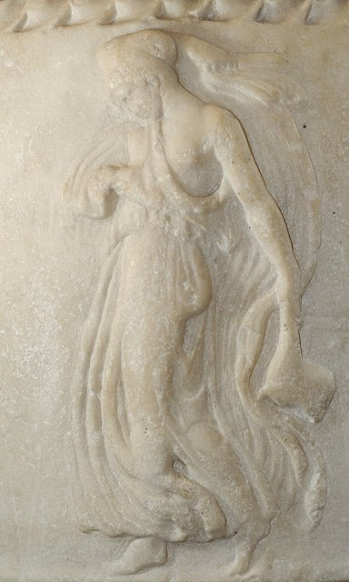
約西元前 300 年，希臘語的「舞蹈」還只有一個總稱：**orchesis**（ὄρχησις）——歌、舞、樂三位一體的表演藝術。此時雅典悲劇已盛極兩百年：悲劇的核心不是演員，而是**十二至十五人的合唱隊**（chorus），在圓形歌隊場（orchestra）中以整齊的舞步唱出人間的恐懼與憐憫。本案追查的重點是：**誰出錢讓一百多個城邦每年演戲？舞蹈如何從宗教儀式變成國家制度？它又為何在戲劇成熟後被邊緣化？**

關鍵推動力：酒神祭、雅典民主劇場

[→ 對外連結：前 300 - 希臘悲劇 Orchesis：合唱隊的圓形偵查](https://chad-liu.github.io/books/html/9-5.舞蹈史/-0300-希臘悲劇Orchesis.html)

## -200 | NatyaShastra舞劇論
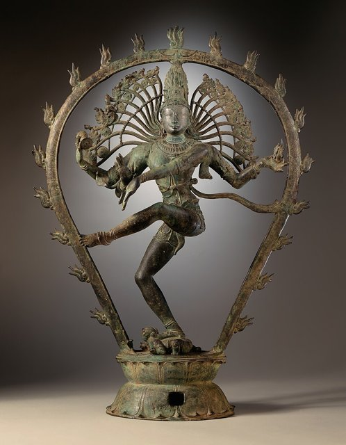
約西元前 200 年至後 200 年之間（學界通說逐層累積成書），傳說中的聖者**婆羅多牟尼**（Bharata Muni）輯成《**舞劇論**》（Natya Shastra，又譯《戲劇論》《樂舞論》）——全書 **36 或 37 章、約 6000 頌**，涵蓋劇場建築、音樂、舞蹈、表演、化妝與美學。它把「戲劇」（natya）定義為**第五吠陀**——不只是娛樂，而是對所有人（不分種姓）開放的教育與救贖工具。**這是人類最早、最完整的表演藝術體系，印度所有古典舞的總源頭。**

關鍵推動力：婆羅門祭儀、梨俱吠陀傳統

[→ 對外連結：前 200 - 婆羅多牟尼《舞劇論》：身體的《吠陀》](https://chad-liu.github.io/books/html/9-5.舞蹈史/-0200-NatyaShastra舞劇論.html)

## 500 | 中世紀教會禁舞
約西元 500 年起，西歐進入中世紀——這是舞蹈史上最漫長的一樁「禁令案件」。教會把戲劇與舞蹈判為**異教遺毒與罪的容器**：一系列教會會議明文禁止舞蹈與觀看表演。然而偵查顯示，禁令從未真正成功——**民間舞轉入婚禮、節慶與田野地下運行**，專業舞者消失，身體表演被切成兩半：**貴族舞與民間舞分流**。這條裂縫，決定了此後一千年歐洲舞蹈的整體格局。

關鍵推動力：基督教會、農民節慶

[→ 對外連結：500 - 中世紀教會禁舞：身體被判為罪](https://chad-liu.github.io/books/html/9-5.舞蹈史/0500-中世紀教會禁舞.html)

## 713 | 唐代梨園樂舞
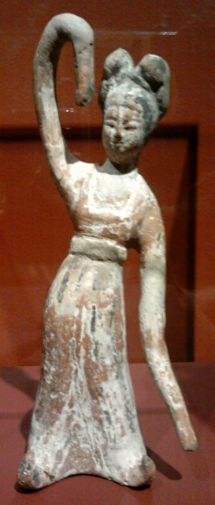
713 年（開元元年），唐玄宗李隆基選定長安禁苑中的**梨園**，親自教習法曲，選**坐部伎子弟三百人**為「梨園弟子」，另有宮女數百人居宜春院——這是世界上最早的**皇家綜合表演藝術學院**之一。皇帝本人兼任院長與教師（司鼓、教樂），樂舞在盛唐達到頂峰：十部樂、健舞軟舞、《霓裳羽衣舞》。而 755 年安史之亂一夕摧毀這座黃金城——**這是一樁「帝國把藝術養到極致、又被帝國崩塌連坐處決」的案件。**

關鍵推動力：唐玄宗、絲路樂舞交流

[→ 對外連結：713 - 唐玄宗設梨園：宮廷樂舞的黃金時代](https://chad-liu.github.io/books/html/9-5.舞蹈史/0713-唐代梨園樂舞.html)

## 1300 | Carole圓舞
約 1300 年前後，歐洲宮廷與民間的社交舞的主流形態是 **Carole**（卡羅爾）——**手牽手的鏈形或圓形舞，邊舞邊唱**，由領唱者起歌、眾人應和。它是騎士文學裡反覆出現的場景：春天、花園、貴婦與騎士攜手環舞。這是歐洲自羅馬職業舞者消失（見 `0500-中世紀教會禁舞.md`）之後，**第一種有文獻、有階級地位、成體系的身體表演**——社交舞傳統的誕生現場。

關鍵推動力：騎士文化、吟遊詩人

[→ 對外連結：1300 - Carole 圓舞：手牽手的社交舞誕生](https://chad-liu.github.io/books/html/9-5.舞蹈史/1300-Carole圓舞.html)

## 1424 | 死亡之舞

約 1424 年，巴黎**聖無辜者墓地**（Les Innocents）的回廊牆上繪製了一幅震撼全城的壁畫：**骷髏牽著教宗、皇帝、樞機、騎士、商人、農民的手，一個接一個，共跳一支沒有終點的舞**——《死亡之舞》（Danse Macabre）。牆下正是巴黎最大的墓地，活人天天經過看死人跳舞。這不是藝術奇想，而是一樁集體心理案件的檔案：**黑死病殺死三分之一歐洲人之後，「死亡面前人人平等」成為時代最深的執念。**

關鍵推動力：黑死病、百年戰爭

[→ 對外連結：1424 - 死亡之舞：骷髏牽著教宗與農民共舞](https://chad-liu.github.io/books/html/9-5.舞蹈史/1424-死亡之舞.html)

## 1489 | 宴會劇
1489 年，意大利北部小城**托爾托納**（Tortona）：宮廷侍臣**貝爾岡喬·迪·博塔**（Bergonzio di Botta）為米蘭公爵夫人**伊莎貝拉·阿拉貢**（Isabella d'Aragona）的到訪設計了一場史無前例的盛大宴會娛樂——後世稱「**博塔的凱旋**」（Trionfo di Botta）。宴會的每道菜上桌，都伴隨舞蹈、音樂、佈景與機關：主題是「阿爾戈號遠征」（金羊毛神話），舞者扮成伊阿宋與同伴，從一幕「航行」演到另一幕。**這被視為芭蕾的史前案件現場：第一次把舞蹈、音樂、佈景、機關與敘事統合成一場總體劇場。**

關鍵推動力：意大利城邦貴族宴會

[→ 對外連結：1489 - 宴會劇：芭蕾的史前案件的現場](https://chad-liu.github.io/books/html/9-5.舞蹈史/1489-宴會劇.html)

## 1581 | 王后喜劇芭蕾
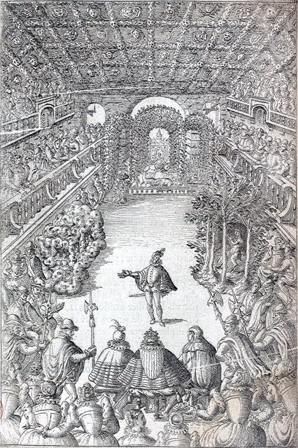
1581 年 10 月 15 日，巴黎**羅浮宮**大廳：一場長達**五小時**、耗資**上萬法郎**的演出首演——《**王后喜劇芭蕾**》（Ballet Comique de la Reine）。義大利編導**Balthasar de Beaujoyeulx** 統合舞蹈、歌曲、器樂、朗誦、佈景與機關，以希臘女巫 Circe 的神話為敘事主軸，**王太后凱瑟琳·德·美第奇**親自策劃、**王后路易絲**領銜主演（坐於舞台中央的寶座內）。**這是史上第一部被稱為「芭蕾」（ballet）且統一敘事、幾何隊形、佈景機關與音樂的作品——芭蕾作為藝術形式的生日，也是一樁國家級政治宣傳工程。**

關鍵推動力：凱瑟琳·德·美第奇、法國宮廷

[→ 對外連結：1581 - 王后喜劇芭蕾：第一部「芭蕾」的誕生](https://chad-liu.github.io/books/html/9-5.舞蹈史/1581-王后喜劇芭蕾.html)

## 1653 | 夜之芭蕾
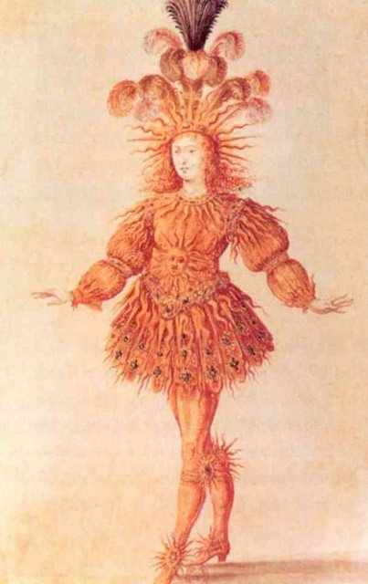
1653 年 2 月 23 日夜裡，巴黎小波旁宮（Petit-Bourbon）上演《皇家夜之芭蕾》（Ballet Royal de la Nuit）：一場長達 **12 小時**的通宵演出，從日落演到日出。凌晨時分，**15 歲的路易十四**身穿金色太陽戲服登場，扮演「升起的太陽」（Le Soleil levant）——這是「太陽王」（le Roi Soleil）神話的誕生現場。**這不是一場表演，而是一樁政治工程：用身體宣告——王權如旭日，無人可擋。**

關鍵推動力：路易十四、王權宣傳

[→ 對外連結：1653 - 夜之芭蕾：太陽從小波旁宮升起](https://chad-liu.github.io/books/html/9-5.舞蹈史/1653-夜之芭蕾.html)

## 1661 | 皇家舞蹈學院
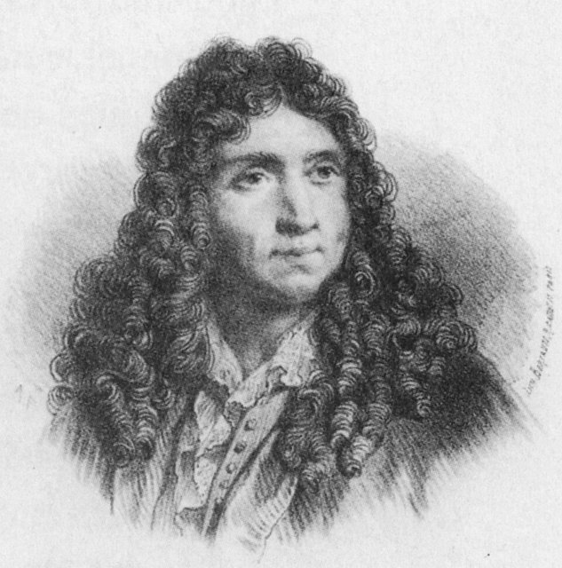
1661 年 3 月，路易十四頒布敕令，創設**法國皇家舞蹈學院**（Académie Royale de Danse），任命 **13 位院士**——由宮廷最資深的舞蹈教師與編舞家組成。敕令開宗明義：要「**恢復舞蹈的完美與規範**」（remettre la danse en sa perfection）。這是史上第一個由國家設立的舞蹈機構：**舞蹈從貴族的個人教養，變成國家監管的職業。**

關鍵推動力：路易十四、Colbert

[→ 對外連結：1661 - 皇家舞蹈學院：舞蹈成為國家的事業](https://chad-liu.github.io/books/html/9-5.舞蹈史/1661-皇家舞蹈學院.html)
[→ 對外連結（開篇探案）：-1661-法國皇家舞蹈學院](https://chad-liu.github.io/books/html/9-5.舞蹈史/-1661-法國皇家舞蹈學院.html)

## 1681 | 女舞者登台
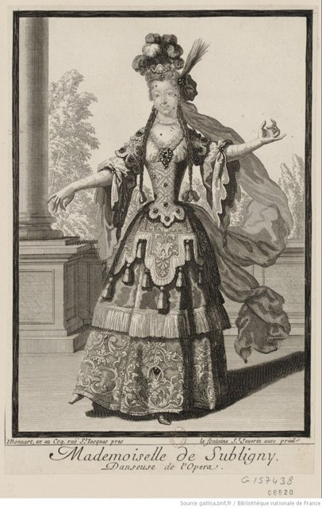
1681 年 1 月，巴黎歌劇院（皇家歌劇學院）上演呂利的《愛情的勝利》（Le Triomphe de l'amour）：**四位女性職業舞者首次登上職業舞台**——Mlle La Fontaine、Mlle Hilaire、Mlle Pesan、Mlle Picot。此前，職業舞台上的女性角色一律由**男舞者反串**。戲劇早已對女性開門，舞蹈卻遲到了半個世紀——**這樁遲到案的偵探重點，是找出「為什麼是這時開門」。**

關鍵推動力：巴黎歌劇院

[→ 對外連結：1681 - 女舞者登台：半個世紀的遲到](https://chad-liu.github.io/books/html/9-5.舞蹈史/1681-女舞者登台.html)

## 1700 | Feuillet舞譜
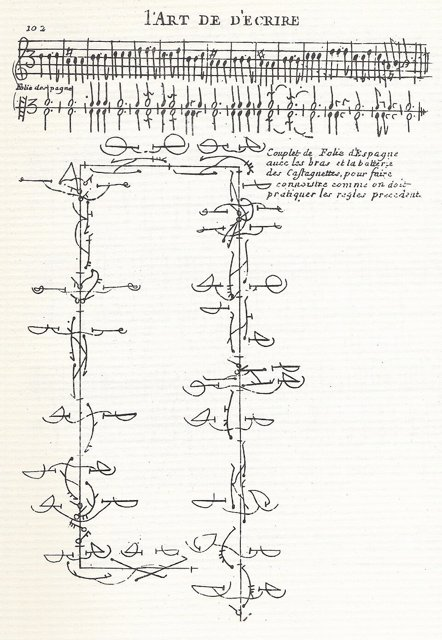
1700 年，**Raoul-Auger Feuillet** 在巴黎出版《編舞術，或描述舞蹈的藝術》（Chorégraphie, ou l'art de décrire la danse）——史上第一部公開發行的**舞蹈記譜法**教科書。方法出自 **Pierre Beauchamp**（路易十四御用編舞家、皇家舞蹈學院首席院士，見 `1661-皇家舞蹈學院`）1688 年前後發明的「五線記譜法」，後世稱 **Beauchamp-Feuillet 記譜法**。1701 年路易十四頒布敕令，命令全國採用。**「Chorégraphie」（編舞）一詞由此誕生——舞蹈第一次擁有自己的文字。**

關鍵推動力：路易十四宮廷、出版業

[→ 對外連結：1700 - Feuillet《編舞術》：把舞蹈寫下來](https://chad-liu.github.io/books/html/9-5.舞蹈史/1700-Feuillet舞譜.html)

## 1730 | Camargo與Sallé
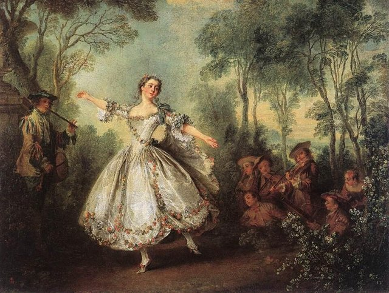
1730 年代的巴黎歌劇院，兩位女舞者展開一場世紀對決：**Marie-Anne de Cupis de Camargo**（1710–1770）以驚人的速度與彈跳征服觀眾；**Marie Sallé**（1707–1756）以素服與戲劇啞劇開創表演藝術。觀眾分成兩派，劇作家 Rameau 時代的巴黎為之瘋狂。**這不是八卦——這是芭蕾兩條路線（技巧／戲劇）的第一次分岔，後世 300 年的張力在此埋線。**

關鍵推動力：巴黎歌劇院

[→ 對外連結：1730 - Camargo 與 Sallé：技術流與表演流的雙星案](https://chad-liu.github.io/books/html/9-5.舞蹈史/1730-Camargo與Sallé.html)

## 1760 | Noverre舞劇書信
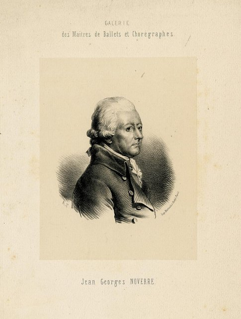
1760 年，編舞家 **Jean-Georges Noverre**（1727–1810）在里昂出版《舞蹈與舞劇書信》（Lettres sur la danse et sur les ballets）——15 封書信構成的改革宣言。核心主張：丟掉面具、扔掉笨重戲服、以**啞劇與動作敘事**——讓芭蕾成為**無言的戲劇**（ballet d'action）。**這是芭蕾史上第一次有人把改革寫成理論：先立論，再上舞台。**

關鍵推動力：啟蒙思想、歌劇院改革

[→ 對外連結：1760 - Noverre《舞劇書信》：摘下面具的宣言](https://chad-liu.github.io/books/html/9-5.舞蹈史/1760-Noverre舞劇書信.html)

## 1832 | 仙女LaSylphide
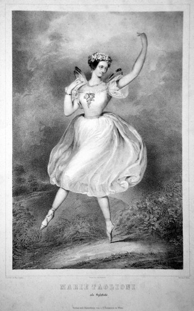
1832 年 3 月 12 日，巴黎歌劇院首演《仙女》（La Sylphide）：**Marie Taglioni**（1804–1884）主演不可觸摸的空中精靈，父親 **Filippo Taglioni** 編舞，**Pierre Ciceri** 設計佈景。這是**足尖（sur les pointes）第一次成為整支舞的核心語言**，搭配白色薄紗長裙（romantic tutu 的原型）。**浪漫芭蕾在此夜誕生：身體變成風，慾望毀滅精靈。**

關鍵推動力：浪漫主義、瑪麗·塔里奧尼

[→ 對外連結：1832 - 《仙女》La Sylphide：足尖上的浪漫主義](https://chad-liu.github.io/books/html/9-5.舞蹈史/1832-仙女LaSylphide.html)

## 1841 | Giselle
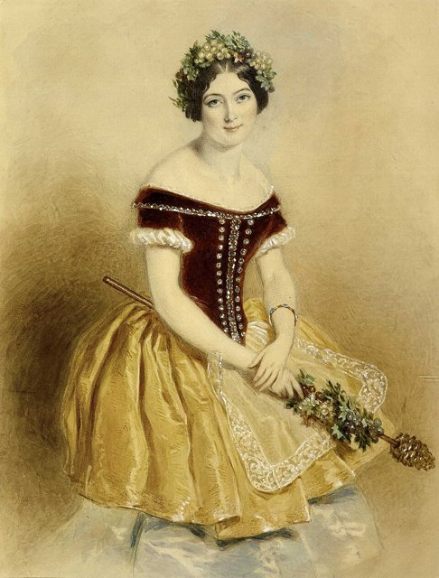
1841 年 6 月 28 日，巴黎歌劇院首演《吉賽兒，或維麗們》（Giselle, ou les Wilis）：**Carlotta Grisi**（1819–1899）主演，**Théophile Gautier** 與 Vernoy de Saint-Georges 編劇，**Jean Coralli** 與 **Jules Perrot** 編舞。兩幕結構——第一幕人間的愛與背叛，第二幕異界的群靈夜舞。**《仙女》開創的浪漫範式在此完成並成為典範：浪漫芭蕾的巔峰之作，至今上演不輟。**

關鍵推動力：巴黎歌劇院

[→ 對外連結：1841 - 《吉賽兒》Giselle：浪漫芭蕾的完成](https://chad-liu.github.io/books/html/9-5.舞蹈史/1841-Giselle.html)

## 1877 | 天鵝湖首演

1877 年 3 月 4 日，莫斯科大劇院（Bolshoi Theatre）首演柴可夫斯基的第一部芭蕾舞劇《天鵝湖》（Le Lac des cygnes），編舞是劇院芭蕾大師 **Julius Reisinger**，女主角由 **Pelageya Karpakova** 出任。結果：票房與評論雙重失敗，只演了零星場次便被移出保留劇目。**這是舞蹈史上最著名的「錯案」——音樂後來成為全球上演率最高的芭蕾（見 `1895-天鵝湖經典版`），而 1877 年的現場，卻沒有一個觀眾察覺自己正在見證經典的難產。**

關鍵推動力：莫斯科大劇院

[→ 對外連結：1877 - 天鵝湖首演：一樁被所有人看走的冤案](https://chad-liu.github.io/books/html/9-5.舞蹈史/1877-天鵝湖首演.html)

## 1895 | 天鵝湖經典版
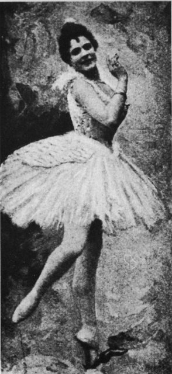
1895 年 1 月 27 日，聖彼得堡馬林斯基劇院上演復排版《天鵝湖》：**Marius Petipa 與 Lev Ivanov 聯合編舞**，義大利明星 **Pierina Legnani** 主演奧傑塔與奧狄爾。這一次，成功——轟動、保留、傳世。**同一部總譜，1877 年慘敗（見 `1877-天鵝湖首演`），1895 年封神。偵查的問題只有一個：這十八年間，證據鏈缺了哪些環節、又由誰補齊？**

關鍵推動力：馬林斯基劇院、帝俄宮廷

[→ 對外連結：1895 - 天鵝湖經典版：一場復活案的偵查報告](https://chad-liu.github.io/books/html/9-5.舞蹈史/1895-天鵝湖經典版.html)

## 1900 | Duncan自由舞

約 1900 年前後，**Isadora Duncan** 在倫敦與巴黎展開赤足自由舞的職業生涯：身披希臘式長袍、赤腳、以自然動作即興到古典音樂之上。她拒絕芭蕾的全部裝備——高跟鞋、束腰、人造的姿態——宣稱**舞蹈應回到自然與古希臘**。這不是一場演出，而是一樁宣言案：現代舞的第一聲槍響。

關鍵推動力：反叛芭蕾、歐洲前衛

[→ 對外連結：1900 - Duncan 自由舞：赤足者的革命](https://chad-liu.github.io/books/html/9-5.舞蹈史/1900-Duncan自由舞.html)

## 1909 | Diaghilev俄羅斯芭蕾
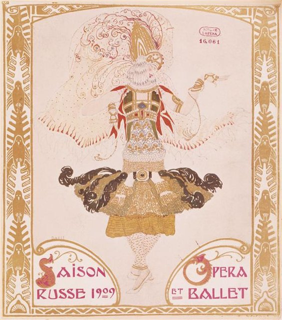
1909 年 5 月 19 日，巴黎夏特雷劇院（Théâtre du Châtelet），**Sergei Diaghilev** 的俄羅斯芭蕾舞團（Ballets Russes）舉行首個巴黎演出季：Fokine 的《埃及豔后》《伊戈爾王波洛維茨舞曲》、Nijinsky 與 Pavlova 領銜、Bakst 的佈景轟動全城。**這不是巡演，而是一樁出口案：把帝俄體制培養的身體，走私進法國前衛市場——二十年間重定義了西方的舞蹈、音樂與美術。**

關鍵推動力：Diaghilev、帝俄流亡者

[→ 對外連結：1909 - Diaghilev 俄羅斯芭蕾：一場出口貿易的偵查](https://chad-liu.github.io/books/html/9-5.舞蹈史/1909-Diaghilev俄羅斯芭蕾.html)

## 1913 | 春之祭

1913 年 5 月 29 日，巴黎香榭麗舍劇院（Théâtre des Champs-Élysées）首演《春之祭》（Le Sacre du printemps）：**Stravinsky** 作曲、**Nijinsky** 編舞、**Roerich** 佈景。開演數分鐘後，觀眾席爆發史上最著名的劇場暴動——噓聲、鬥毆、吹口哨的聲浪蓋過樂團，據傳連鄰座的老伯爵夫人都動手打了人。**這是一樁蓄意引爆的案件：所有爆炸物都是 Diaghilev 與他的團隊親手放置的。**

關鍵推動力：Stravinsky、Nijinsky、前衛

[→ 對外連結：1913 - 春之祭：劇場暴動的偵查檔案](https://chad-liu.github.io/books/html/9-5.舞蹈史/1913-春之祭.html)

## 1926 | Graham現代舞
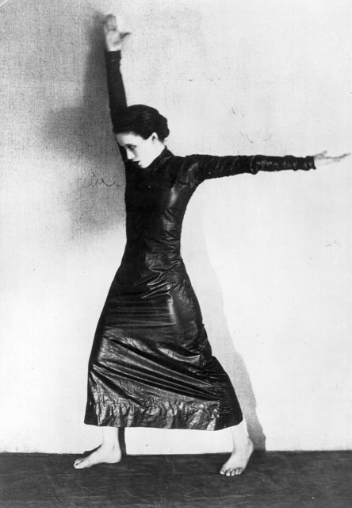
1926 年 4 月 18 日，紐約 48 街劇院（48th Street Theatre），**瑪莎·葛蘭姆**（Martha Graham）舉辦首次自辦演出：一場獨舞晚會，她自己編、自己跳。評價兩極——有人驚為天人，有人譏為「蛇一般的痙攣」。**這是現代舞史上最重要的創業日：一位 32 歲的失業舞者，開始獨立建造一套完整的技術、美學與機構——並在半世紀後與芭蕾並立為兩大舞蹈體系。**

關鍵推動力：美國現代主義、Denishawn

[→ 對外連結：1926 - Graham 現代舞：一套技術體系的誕生](https://chad-liu.github.io/books/html/9-5.舞蹈史/1926-Graham現代舞.html)

## 1928 | Laban舞譜
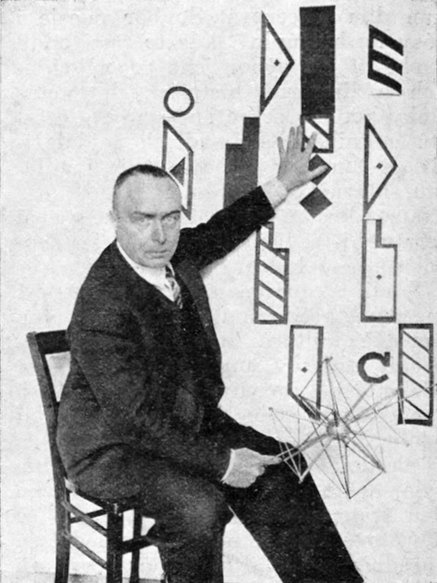
1928 年，**Rudolf Laban** 在德國埃森的舞蹈家大會上發表 **Kinetographie Laban**（後世稱 Labanotation，拉邦舞譜）：一種用符號在三線譜上記錄人體運動的系統。**這是一樁幾百年懸案的結案報告：舞蹈——最转瞬即逝的藝術——終於有了像樂譜一樣精確的書寫法。**

關鍵推動力：Rudolf Laban、魏瑪德國

[→ 對外連結：1928 - Laban 舞譜：把運動寫進紙裡的偵查](https://chad-liu.github.io/books/html/9-5.舞蹈史/1928-Laban舞譜.html)

## 1930 | 婆羅多舞復興
1930 年代起，**Rukmini Devi Arundale** 與 **E. Krishna Iyer** 等人在南印度馬德拉斯推動婆羅多舞（Bharatanatyam）復興；1936 年 Rukmini Devi 創立 **Kalakshetra** 藝術學院。**這是一樁搶救案，也是一樁改造案：一種被殖民政府與 reformer 聯手判處死刑的神廟舞，被搬上劇場舞台、重新經典化為國族象徵——但代價是原本的傳承階層被邊緣化。**

關鍵推動力：印度民族主義、神智學會

[→ 對外連結：1930 - 婆羅多舞復興：一樁文化搶救案的雙面報告](https://chad-liu.github.io/books/html/9-5.舞蹈史/1930-婆羅多舞復興.html)

## 1934 | Balanchine美國芭蕾

1934 年 1 月 2 日，喬治·巴蘭欽（George Balanchine）與林肯·柯爾斯坦（Lincoln Kirstein）在紐約創立**美國芭蕾學校**（School of American Ballet），第一批學生約 25 人；1935 年成立 American Ballet 舞團，1948 年定基於紐約市立芭蕾舞團（New York City Ballet）。這樁案子的謎題是：**一個沒有宮廷、沒有歌劇院、沒有芭蕾傳統的國家，憑什麼在三十年內成為世界芭蕾三強之一？** 答案不在巴黎或聖彼得堡，而在兩個「移民與理想主義者」的合夥契約裡。

關鍵推動力：Balanchine、Lincoln Kirstein

[→ 對外連結：1934 - Balanchine 美國芭蕾](https://chad-liu.github.io/books/html/9-5.舞蹈史/1934-Balanchine美國芭蕾.html)

## 1957 | 西城故事
1957 年 9 月 26 日，《西城故事》（West Side Story）在百老匯首演：Jerome Robbins 編舞兼導演、Leonard Bernstein 作曲、Stephen Sondheim 作詞、Arthur Laurents 劇本。羅密歐與茱麗葉的故事被搬到紐約的幫派街頭——猶太裔的 Jets 對波多黎各裔的 Sharks。這樁案子的謎題是：**舞蹈從來只是音樂劇的陪襯，為什麼在這一夜，舞蹈成了敘事的真正主角？** 破案線索藏在開場七分鐘沒有一句歌詞的序舞（Prologue）裡。

關鍵推動力：Jerome Robbins、百老匯

[→ 對外連結：1957 - 西城故事](https://chad-liu.github.io/books/html/9-5.舞蹈史/1957-西城故事.html)

## 1959 | 舞踏誕生
1959 年 5 月，東京，土方巽（Tatsumi Hijikata）首演《禁色》（Kinjiki），改編三島由紀夫的同名小說：半裸的年輕舞者、同性情慾的暗示、雞的慘叫聲——觀眾席騷動，三島由紀夫本人就在場。這一夜被視為日本**舞踏（Butoh）**的誕生。這樁案子的謎題是：**一種「既反芭蕾、也反現代舞」的身體，為什麼會在戰後的東京誕生，又為什麼在三十年後反過來征服歐美的劇場？** 答案藏在廢墟、佔領與一具「死體」的慢動作裡。

關鍵推動力：戰後日本、前衛反叛

[→ 對外連結：1959 - 舞踏誕生](https://chad-liu.github.io/books/html/9-5.舞蹈史/1959-舞踏誕生.html)

## 1962 | Judson後現代舞
1962 年 7 月，紐約格林威治村的 **Judson Memorial Church**，一群年輕的舞者與視覺藝術家開始了為期兩年的 **Judson Dance Theater**（共 14 場演出）。他們在教堂裡走路人、搬紙箱、做體操、擲骰子決定舞步——舞蹈史上最激進的一場「去舞蹈化」運動。這樁案子的謎題是：**為什麼現代舞最激進的革命，不是發生在劇場，而是發生在一座教堂？** 破案線索是一個牧師的邀請與一門編舞課的作業。

關鍵推動力：紐約前衛、Cunningham

[→ 對外連結：1962 - Judson 後現代舞](https://chad-liu.github.io/books/html/9-5.舞蹈史/1962-Judson後現代舞.html)

## 1973 | HipHop誕生
1973 年 8 月 11 日，紐約布朗克斯，1520 Sedgwick 大樓的娛樂室，18 歲的牙買加移民**Kool Herc**（Clive Campbell）辦了一場「返校派對」——他妹妹 Cindy 以低廉門票籌措購衣費。這場派對被追認為 **Hip-Hop 文化的官方生日**。這樁案子的謎題是：**一座被城市遺棄的貧民區，如何在十年的時間裡，產出二十一世紀全球化程度最高的舞蹈文化？** 破案線索是兩台唱盤之間的一個循環。

關鍵推動力：街頭文化、牙買加移民

[→ 對外連結：1973 - HipHop 誕生](https://chad-liu.github.io/books/html/9-5.舞蹈史/1973-HipHop誕生.html)

## 1984 | 街舞全球化
1984 年，好萊塢在數月內連發《Beat Street》《Breakin'》《Breakin' 2: Electric Boogaloo》三部街舞電影，加上 MTV 的推波助瀾與洛杉磯奧運閉幕式的 breakdancing 表演——街舞在一年之內從布朗克斯的地下文化變成**全球青年文化**。這樁案子的謎題是：**一種高度在地、反商業的街頭技術，如何被媒體工業打包出口，又在世界各地長出什麼樣的變種？** 破案線索是「電影 + MTV + 奧運」的複合傳播機器。

關鍵推動力：好萊塢、MTV

[→ 對外連結：1984 - 街舞全球化](https://chad-liu.github.io/books/html/9-5.舞蹈史/1984-街舞全球化.html)

## 2012 | 江南Style
2012 年 7 月 15 日，韓國歌手 PSY 的《江南 Style》MV 上架 YouTube；四個月後成為該平台**史上第一支破 10 億播放**的影片。一支沒有走英語市場、由「大叔」歌手演出的韓語歌，怎麼會成為全球現象？這樁案子的謎題是：**病毒式傳播的機制是什麼——是歌、是舞，還是演算法？** 破案線索是一段人人可模仿的騎馬舞。

關鍵推動力：YouTube、韓國文化產業

[→ 對外連結：2012 - 江南 Style](https://chad-liu.github.io/books/html/9-5.舞蹈史/2012-江南Style.html)

## 2020 | TikTok舞蹈
2020 年，新冠疫情關閉了全世界的劇場，舞蹈卻在**手機的直式鏡頭**裡找到新大陸：TikTok 上的 Blinding Lights challenge、Savage challenge 等舞蹈挑戰成為全球數億人的日常動作。這樁案子的謎題是：**當劇場死亡時，舞蹈為什麼不但沒有死，反而以史上最大的規模被跳？** 破案線索是 15 秒的循環與一場關於署名的爭議。

關鍵推動力：TikTok、隔離經濟

[→ 對外連結：2020 - TikTok 舞蹈](https://chad-liu.github.io/books/html/9-5.舞蹈史/2020-TikTok舞蹈.html)
