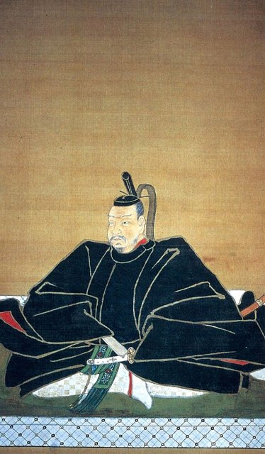
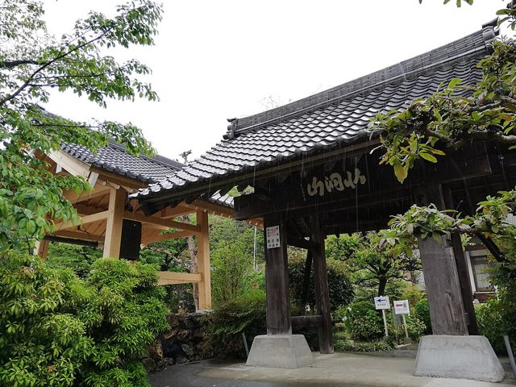
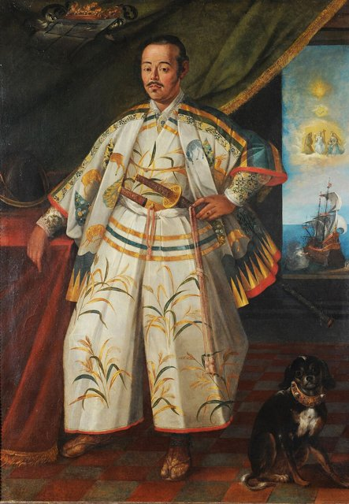
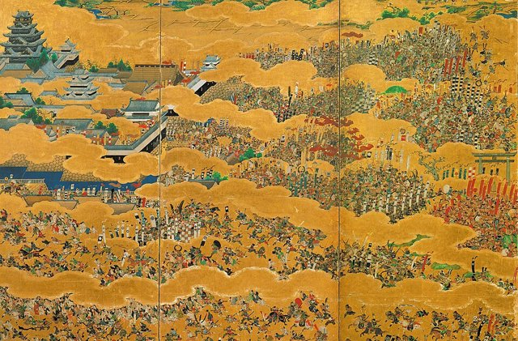

<!--
內容整理自 D:\Books\html\1-3-1.日本歷史人物\伊達政宗(1567~1636).html（沒有對應的 md 筆記），並整合中文維基百科〈伊達政宗〉條目，以自己的話改寫。
時期依頁面的六個階段：出生與少年、奧羽統一戰爭、臣服豐臣與岩出山時期、仙台藩建立、慶長遣歐使節與大坂之役、晚年藩政。
兩份資料出入與處理方式：
- 出生：頁面寫「8月3日」，那是和曆永祿十年八月三日；西曆為1567年9月5日，born 採西曆。出生地頁面作米澤城，維基百科說通說是米澤的館山城（信息框列米澤城），這裡寫米澤城。去世：寬永十三年五月二十四日（西曆1636年6月27日）於江戶櫻田屋敷，實歲68歲（虛歲70）。
- 繼承家督：頁面寫1584年，維基百科作1584年10月，日期有爭議，只寫年份。
- 父親輝宗之死：頁面寫1585年10月，那是和曆十月八日；維基百科換算為西曆1585年11月29日，採西曆。人取橋之戰：頁面寫11月，維基百科列「1585年11月17日」，若換算西曆應在父親死後（約1586年1月），兩者順序矛盾，這裡寫成同一則事件，不給日期。
- 摺上原之戰：頁面寫1589年6月擊敗蘆名義廣；維基百科作「折上原」，6月11日（和曆）進入黑川城，蘆名氏滅亡，照年份寫。
- 小田原參陣：頁面寫1590年；維基百科補充5月自會津出發、身著白色死裝束謝罪，取兩份合併。
- 移封岩出山：頁面寫1591年轉封；維基百科補充是平定葛西大崎一揆後，因被懷疑煽動一揆而失去六郡、減為58萬石，9月遷居岩出山城，取兩份合併。
- 關原之戰：頁面寫政宗在白石城等地與上杉景勝對抗；維基百科補充1600年7月奪回白石城、8月家康發出「百萬石御墨付」、10月松川之戰，併入同一則事件（頁面沒有提到長谷堂之戰）。
- 宇和島藩：維基百科補充1614年政宗獲伊予宇和郡，由庶長子秀宗建立宇和島藩，併入大坂之役的事件。
- 頁面寫1616年家康「4月17日」去世，那是和曆；德川家康時間軸採西曆1616年6月1日，這裡不另立事件。
- 頁面的「重要歷史功績」「人物關係」「歷史定位」寫進時期說明與相關事件，不另立事件。
- 人名與其他時間軸一致：豐臣秀吉、德川家康、德川秀忠、德川家光、石田三成、上杉景勝、最上義光、支倉常長、路易斯·索特洛（頁面作・）。
圖片來源（皆為 Wikimedia Commons 公有領域／CC0 作品；註明「共用」者沿用其他時間軸已有的圖片）：
- dm-cover.jpg：Portrait of DATE Masamune.jpg（伊達政宗像）
- dm-masamune02.jpg：Date Masamune02.jpg（伊達政宗像）
- dm-zuiganji.jpg：Hokutōsan Zuigan-ji Temple 20210417 04.jpg（松島瑞巖寺）
- dm-hasekura.jpg：Hasekura in Rome.JPG（支倉常長在羅馬的肖像，1615）
- ie-osaka.jpg：The Siege of Osaka Castle 1615 cropped.jpg（〈大坂夏之陣圖屏風〉局部（與德川家康生平時間軸共用））
-->

# Periods
- 1567-09-05 ~ 1584 | 出生與少年 | #868e96
  生於出羽國米澤城的伊達家，幼年因天花失去右眼，師事禪僧虎哉宗乙，元服、娶愛姬、初陣。
- 1584 ~ 1590 | 奧羽統一戰爭 | #c92a2a
  十八歲繼承家督，父親輝宗被畠山義繼挾持身亡，人取橋之戰險遭包圍；摺上原之戰滅蘆名氏，稱霸南奧羽。
- 1590 ~ 1601 | 臣服豐臣與岩出山時期 | #e8590c
  白衣赴小田原臣服秀吉，失去會津，移封岩出山；出征朝鮮，捲入秀次事件；關原之戰支持家康，在東北與上杉景勝交戰。
- 1601 ~ 1615 | 仙台藩與遣歐使節 | #1971c2
  興建仙台城與城下町，重建瑞巖寺、大崎八幡宮；派支倉常長出使西班牙與羅馬，大坂之役站在德川方。
- 1615 ~ 1636-06-27 | 晚年藩政 | #2f9e44
  整治北上川水系、開發農業與水運，重視茶道、和歌與書法，以資深外樣大名的身分在江戶去世。

# Events

## 1567-09-05 | 出生於米澤城
伊達政宗生於出羽國米澤城（今山形縣米澤市），幼名梵天丸，是伊達輝宗的嫡長子，母親義姬是最上義光之妹。當時日本仍處於戰國時代。

## 1571 | 天花失去右眼 {label="約1571年"}
政宗幼年感染天花，右眼失明，後世因此稱他「獨眼龍」。他是否曾自行剜除病眼等戲劇化的故事，後世傳說與史料並不一致。1572年起，他師事臨濟宗禪僧虎哉宗乙，接觸佛教、漢學與文學。

## 1577 | 元服
十一歲的政宗元服，取名藤次郎政宗，「政宗」承襲伊達氏中興之祖的名諱，象徵他正式成為家族的繼承人。

## 1579 | 迎娶愛姬
政宗娶三春城主田村清顯之女愛姬，鞏固伊達與田村兩家的同盟。1581年，他隨父親出征相馬氏，首次上陣。

## 1584 | 繼承家督
父親輝宗隱居，十八歲的政宗繼承家督，成為伊達氏第十七代當主。當時東北還有蘆名、最上、相馬、佐竹、大崎等勢力並立。

## 1585-11-29 | 父親遇害與人取橋之戰
二本松城主畠山義繼向伊達家求和，會面後卻挾持輝宗逃走；政宗下令追擊，伊達軍朝挾持者開火，輝宗與義繼雙雙死亡（粟之巢之變）。這是政宗生涯的重要轉折，也使他與周邊大名的衝突激化。
隨後佐竹義重聯合蘆名、岩城、二階堂等勢力組成聯軍，在人取橋與伊達軍交戰，伊達軍兵力居劣勢、險遭包圍，政宗成功撤退，保住主力。他由此體認到單靠軍事擴張難以迅速消滅所有對手。

## 1586 | 攻下二本松城
政宗持續施壓，二本松城在和議後交出，伊達氏在陸奧的勢力擴大。1588年他攻打大崎氏受挫，又在佐竹、蘆名等勢力的聯合壓力下陷入危局，靠外交停戰暫時緩和。

## 1589 | 摺上原之戰

政宗在摺上原擊敗蘆名義廣，6月進入會津黑川城（今福島縣會津若松市），蘆名氏滅亡；他也陸續壓制白河、二階堂、石川、岩城等勢力，成為東北最有影響力的大名，勢力達到高峰。

## 1590 | 白衣赴小田原，臣服秀吉
豐臣秀吉討伐北條氏，要求東北大名到小田原參陣表示服從。政宗一度猶豫，最後在5月出發，傳說他身穿白色死裝束謝罪。秀吉接受他臣服，但以擅自擴張為由，收回會津等新占領地，保留伊達家的原有領地。

## 1591 | 移封岩出山
政宗平定葛西、大崎一揆，卻被懷疑暗中煽動，被迫交出米澤等地，轉封陸奧國玉造郡的岩出山（今宮城縣大崎市），領地減為58萬石，9月遷居岩出山城，正式成為豐臣政權下的大名。

## 1593 | 出征朝鮮
政宗率部隊渡海參加文祿之役，沒有取得改變戰局的成果，海外出兵加重了伊達領地的人力與經濟負擔。1595年豐臣秀次被迫切腹，政宗因與秀次有往來而受到懷疑，經解釋後才保全家門。

## 1600 | 關原之戰與白石城
秀吉死後，政宗透過聯姻與德川家康拉近關係。關原之戰時他站在家康一方，在東北對抗上杉景勝，7月奪回白石城，並派兵支援受上杉軍攻擊的最上義光；家康曾發出承諾增封的「百萬石御墨付」。東軍獲勝，但政宗並未取回會津等大片領土。

## 1601 | 建設仙台城
政宗把根據地從岩出山遷到仙台，在青葉山興建仙台城，規劃城下町的武士住宅、商業區、寺社與道路，仙台藩由此成立，仙台逐漸成為東北的政治與經濟中心。1603年江戶幕府成立，他成為幕府體制下的重要外樣大名。

## 1607 | 大崎八幡宮與瑞巖寺

政宗重建松島五大堂（1604）、完成大崎八幡宮（1607，今為日本國寶）、整修鹽竈神社，1609年完成松島瑞巖寺的重建，這些桃山風格的建築展現了當時的工藝水準。1610年，仙台城的大廣間完成。

## 1613 | 慶長遣歐使節

政宗與西班牙方濟各會傳教士路易斯·索特洛接觸後，對海外貿易與西方技術產生興趣，派家臣支倉常長率使節團，乘聖胡安·包蒂斯塔號從月浦出航，經新西班牙（今墨西哥）前往西班牙與羅馬，希望與西班牙建立外交與貿易關係。1614年使節團抵達西班牙，支倉常長在當地受洗。
當時幕府正加強基督教禁令，這次外交未能達成正式的貿易協定，卻留下日本早期與歐洲直接交流的珍貴史料。

## 1614 | 大坂之役

大坂冬之陣，政宗率仙台軍站在德川方參戰，同年獲得伊予國宇和郡的領地，後由庶長子秀宗建立宇和島藩。1615年大坂夏之陣，他參加道明寺之戰，大坂城陷落，豐臣氏滅亡；同年他任參議。

## 1620 | 支倉常長返國
支倉常長結束漫長的旅程回到日本，此時幕府已嚴禁基督教並逐步管制海外貿易，政宗的海外構想受到國際與國內環境的限制。1623年，政宗的母親義姬去世；伊達與最上兩家長期不和，母子關係常成為後世文學的題材。

## 1626 | 整治北上川
政宗推動北上川、迫川、江合川等水系的整治，使北上川改道流向石卷，改善了水運與農業灌溉，內陸的農產品得以運到石卷港，奠定仙台藩的經濟基礎。1628年，他遷居晚年的居所若林城。

## 1636-06-27 | 病逝於江戶
1634年，政宗隨第三代將軍德川家光上洛，是經歷過戰國時代的資深大名。寬永十三年五月二十四日，他在江戶櫻田屋敷去世，享年68歲（虛歲70），嫡子伊達忠宗繼承仙台藩，部分家臣依當時的習俗殉死。他的墓所後來建為仙台的瑞鳳殿。
政宗從東北的征戰型大名，轉型為幕府體制下經營仙台藩的藩主，在軍事、城市建設、水利、宗教建築與海外外交上都留下了遺產。
