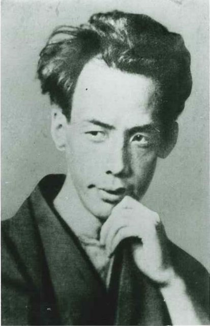
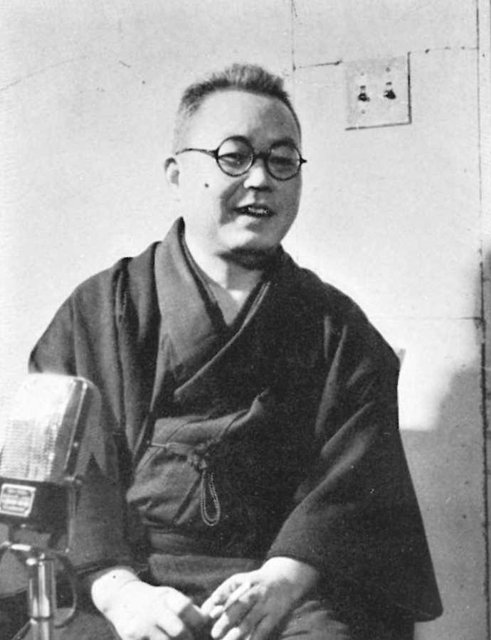
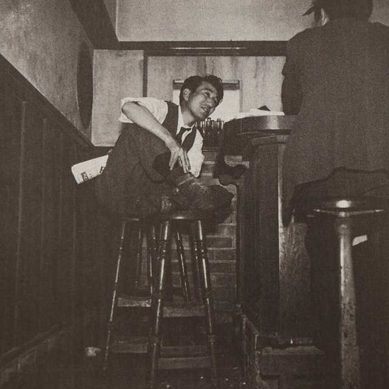
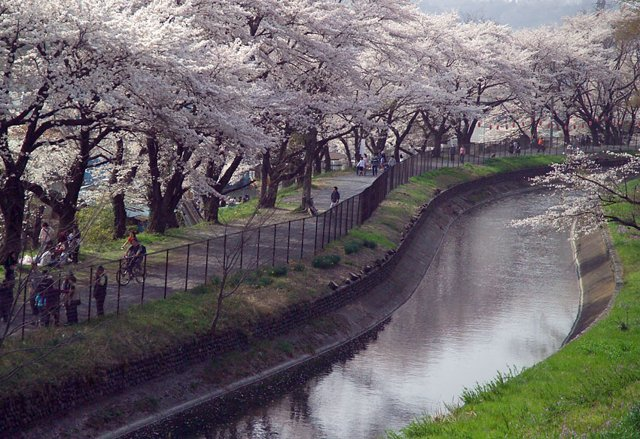

<!--
內容整理自 D:\Books\html\6-4.日本文學家\太宰治.html（沒有對應的 md 筆記），並整合中文維基百科〈太宰治〉條目，以自己的話改寫。
時期依生平歸納：津輕的大地主之家、左翼運動與殉情、藥物成癮與低潮、婚後的安定期、戰後的無賴派。
兩份資料出入與處理方式：
- 生卒：1909年6月19日生於青森縣北津輕郡金木村；1948年6月13日深夜與山崎富榮在玉川上水投水，遺體在6月19日（他的生日）被發現，兩份一致，得年38歲。
- 父親：頁面說父親曾任眾議院與貴族院議員；維基百科寫他是津島源右衛門的六男，1923年父親去世，兩者合併。
- 自殺未遂次數：頁面說「五度自殺」（含最後一次），各家記載不一，這裡依維基百科列出1929年服藥、1930年11月與田部目津子在鎌倉殉情（女方死亡）、1935年在鎌倉上吊、1937年與小山初代殉情未遂四次，最後一次在1948年，照頁面審慎寫法。
- 《逆行》：維基百科說1935年入圍第一屆芥川賞，照此；落選後他寫信向評審川端康成抗議，依一般記載補充。
- 藥物：頁面說1930年代中期因藥物依賴住院，維基百科寫1936年進入武藏野醫院，照維基百科。
- 結婚：維基百科一處寫1938年訂婚、1939年婚禮，照此。
- 「生而為人，我很抱歉」：頁面說這句話常被誤當成《人間失格》的原文，照此寫進1948年事件。
- 櫻桃忌：頁面說至今每年舉行，維基百科補充故鄉金木從1999年起改稱「太宰治誕生祭」，照兩者。
- 人名與其他時間軸一致：芥川龍之介、川端康成、井伏鱒二、坂口安吾、魯迅（《惜別》以魯迅留學仙台為題材，與〈魯迅生平〉時間軸互相呼應）。
圖片來源（皆為 Wikimedia Commons 公有領域／CC0 作品；註明「共用」者沿用其他時間軸已有的圖片）：
- dz-cover.jpg：Osamu Dazai.jpg（太宰治，1948年2月田村茂攝）
- ak-1927.jpg：Akutagawa Ryunosuke photo2.jpg（晚年的芥川龍之介（與芥川龍之介生平時間軸共用））
- da-ibuse.jpg：Masuji Ibuse 01.jpg（井伏鱒二，1952）
- da-lupin.jpg：Osamu Dazai and Ango Sakaguchi at Lupin, the bar in Ginza, Tokyo - 1946.jpg（林忠彥攝：銀座酒吧「Lupin」中的太宰治，右為坂口安吾的背影，1946年11月）
- da-tamagawa.jpg：TamagawaJosui3810.jpg（玉川上水）
-->

# Periods
- 1909-06-19 ~ 1930 | 津輕的大地主之家 | #868e96
  生於青森縣津輕的大地主家庭，在中學、高中崇拜芥川龍之介，開始寫作，接觸左翼思想。
- 1930 ~ 1936 | 左翼運動與殉情 | #c92a2a
  進入東京帝國大學法文科，參與非法的左翼運動，在鎌倉殉情獨活，以「太宰治」為筆名發表作品，入圍第一屆芥川賞。
- 1936 ~ 1939 | 藥物成癮與低潮 | #e8590c
  止痛藥成癮被送入醫院，與小山初代殉情未遂後分手，停筆一年。
- 1939 ~ 1945 | 婚後的安定期 | #2f9e44
  與石原美知子結婚，移居三鷹，寫出《女生徒》《跑吧！美樂斯》《津輕》等明朗的作品。
- 1945 ~ 1948-06-13 | 戰後的無賴派 | #495057
  《斜陽》引起轟動，與坂口安吾等人被稱為無賴派；寫完《人間失格》後與山崎富榮投水自盡。

# Events

## 1909-06-19 | 出生於青森縣金木村
太宰治生於青森縣北津輕郡金木村（今五所川原市），本名津島修治，是大地主津島源右衛門的第六個兒子。津島家是縣內屈指可數的富豪，父親當過眾議院議員與貴族院議員；他由保母與姑母帶大，很少與父母親近。

## 1923 | 青森中學，父親去世
津島修治進入青森縣立青森中學，同年父親去世，由長兄繼承家業。他在中學開始寫作，1925年在校友會雜誌上發表習作。

## 1927 | 弘前高等學校與芥川之死

修治進入弘前高等學校文科，喜愛泉鏡花與芥川龍之介的作品。這年7月芥川自盡，對崇拜芥川的他打擊很大。他也開始接觸左翼思想，對自己出身剝削佃農的地主家庭感到愧疚。

## 1929-12 | 第一次自殺未遂
修治在期末考前吞下大量安眠藥，被救了回來。這是他一生多次自殺未遂的開始。

## 1930 | 東京帝國大學與鎌倉殉情

修治進入東京帝國大學法文科，雖然不懂法語，只是憧憬法國文學；他拜井伏鱒二為師，又參與非法的左翼運動，很少上課。這年他與青森的藝妓小山初代私訂終身，遭家族反對，被津島家除籍。11月，他與銀座的咖啡館女侍田部目津子在鎌倉海邊服藥投海殉情，女方死亡，他獨自獲救，被以協助自殺罪調查，最後不起訴。

## 1932 | 脫離左翼運動
修治向青森的警察自首，經過拘留後脫離左翼運動。1933年，他第一次以「太宰治」為筆名發表短篇小說《列車》。

## 1935 | 《逆行》入圍芥川賞
報考報社記者失敗後，太宰在鎌倉山上吊自殺未遂。同年他在《文藝》發表《逆行》，入圍第一屆芥川賞但落選，他寫文章公開抗議評審川端康成的評語。盲腸炎手術後，他開始依賴止痛藥。

## 1936 | 《晚年》與住院
太宰出版第一本作品集《晚年》。他對止痛藥的依賴越來越嚴重，在井伏鱒二等人的勸說下被送進東京武藏野醫院治療。

## 1937 | 與小山初代殉情未遂
太宰得知小山初代在他住院期間與別人有染，兩人到群馬縣的水上溫泉服藥殉情，雙雙獲救，之後分手。他停筆約一年。

## 1939 | 結婚與《女生徒》
由井伏鱒二作媒，太宰與教師石原美知子結婚，秋天移居東京三鷹。婚後他的生活與創作進入安定期，發表以少女獨白寫成的《女生徒》，獲北村透谷文學賞；1940年又發表歌頌友情與信義的《跑吧！美樂斯》。

## 1944 | 《津輕》
太宰回到故鄉津輕旅行，寫成紀行小說《津輕》，記錄故鄉的風土與重逢兒時保母阿竹的情景，是他作品中少見的溫暖篇章。1945年他出版以魯迅留學仙台為題材的《惜別》。

## 1947 | 《斜陽》

太宰在戰後發表《維榮之妻》與《斜陽》。《斜陽》寫戰後沒落的貴族一家，取材自他的情人太田靜子的日記，大受歡迎，「斜陽族」成為描述沒落上流階層的流行語。他與坂口安吾、織田作之助等人被稱為「無賴派」，以頹廢與自嘲反抗戰後虛偽的秩序。同年他與美容師山崎富榮交往。

## 1948-06-13 | 投水自盡

太宰寫完自傳性的《人間失格》，寫一名從小只能扮演小丑討好別人、最後自認「失去做人資格」的男人。6月13日深夜，他與山崎富榮在東京三鷹的玉川上水投水自盡，遺體在6天後、他39歲生日當天被發現，得年38歲。他的連載小說《Good-bye》因此未完。
常被當成《人間失格》名句的「生而為人，我很抱歉」，其實出自他早年的另一篇作品。

## 1949-06-19 | 櫻桃忌
太宰的忌日以他晚年的短篇《櫻桃》命名為「櫻桃忌」，每年6月19日在他長眠的三鷹禪林寺聚集眾多讀者。故鄉金木從1999年他冥誕九十週年起，把這一天改稱「太宰治誕生祭」。
