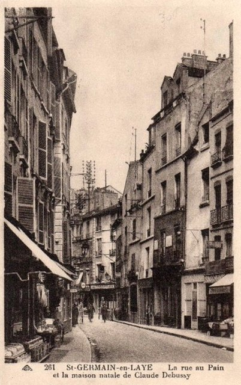
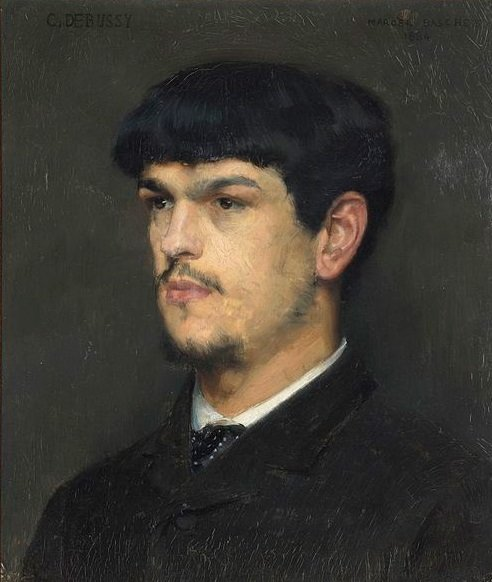
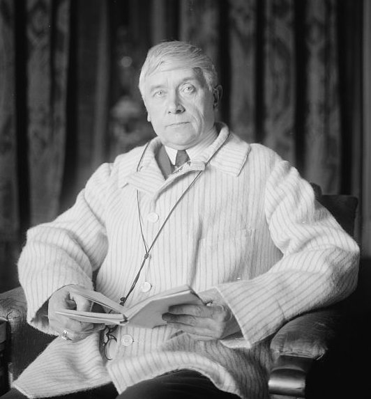
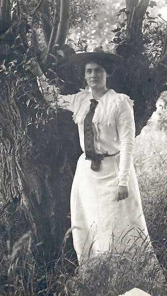
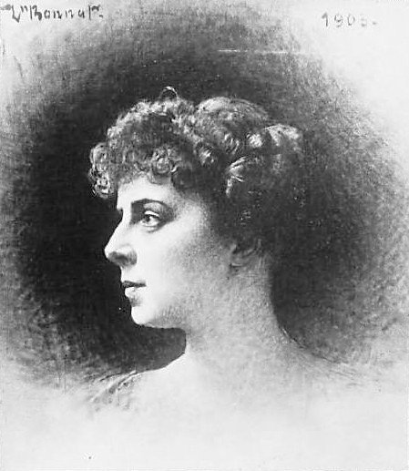
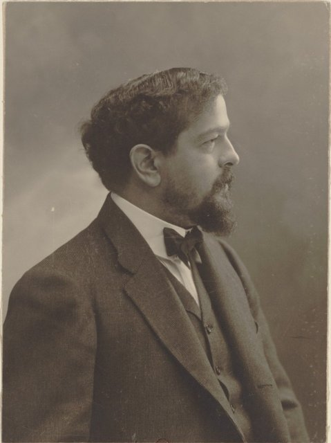
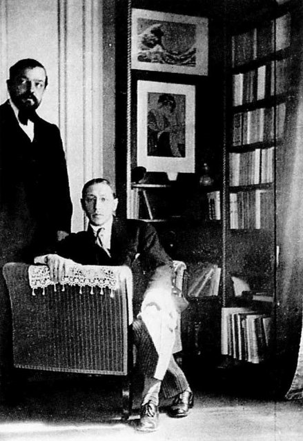
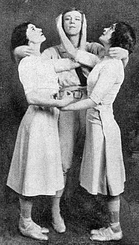
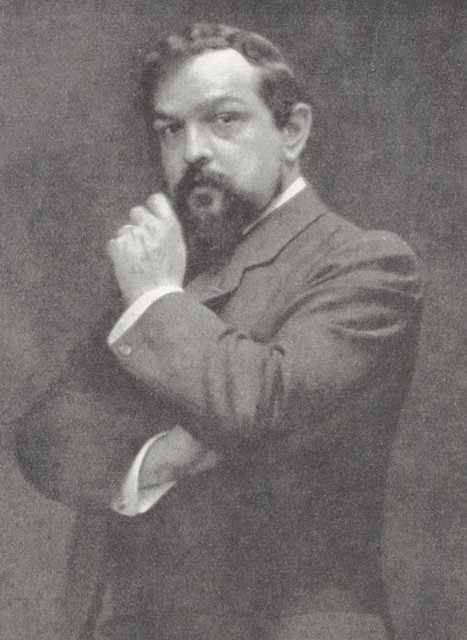

<!--
內容整理自中文維基百科「克洛德·德布西」與英文維基百科「Claude Debussy」條目（CC BY-SA 4.0），並以台灣用語改寫摘要。
https://zh.wikipedia.org/zh-tw/克洛德·德彪西
https://en.wikipedia.org/wiki/Claude_Debussy
中文條目較簡略，生平細節主要參考英文條目。英文條目寫《遊戲》於1913年3月首演，實際應為5月（《春之祭》首演前兩週），此處依後者。
圖片皆為 Wikimedia Commons 上的公有領域（含PD-US）作品（封面：納達爾工作室所攝）。
-->

# Periods
- 1862 ~ 1872 | 童年@聖日耳曼昂萊、巴黎
  父親經營瓷器店失敗後到巴黎印刷廠工作，家中沒什麼文化氣息。普法戰爭時避難到坎城的姑姑家，開始學鋼琴；父親因參加巴黎公社入獄，獄友的母親成了他的鋼琴老師。
- 1872 ~ 1884 | 巴黎音樂學院
  10歲考進巴黎音樂學院，一讀就是十一、二年。他鋼琴彈得好、視譜能力一流，卻常翹課、不守作曲規矩，讓保守的教授們頭痛。暑假到梅克夫人家當鋼琴師，遊歷歐洲與俄國。
- 1885 ~ 1887 | 羅馬大獎@Rome
  以康塔塔《浪子》贏得羅馬大獎，到羅馬梅迪奇別墅進修。他討厭那裡的環境與學院派的要求，常偷跑回巴黎見情人，最後提前結束學業。
- 1887 ~ 1894 | 尋找自己的聲音@Paris
  迷上華格納又很快走出他的影子，在萬國博覽會聽到爪哇甘美朗音樂，結識薩提，過著波希米亞式的窮困生活。看了梅特林克的戲劇《佩利亞與梅莉桑》後，決定把它寫成歌劇。
- 1894 ~ 1902 | 《牧神》到《佩利亞》
  《牧神的午後前奏曲》首演打響名號，花了將近十年寫成唯一的歌劇《佩利亞與梅莉桑》。私生活風波不斷，失去不少朋友，卻成為拉威爾等年輕藝術家「阿帕契」團體的精神領袖。
- 1902 ~ 1909 | 國際聲望與醜聞
  《佩利亞》讓他名揚國際，《大海》、《版畫》、《兒童天地》等名作接連問世。他拋下妻子莉莉與銀行家夫人艾瑪私奔，莉莉舉槍自殺未遂，醜聞讓他再度眾叛親離。獨生女秀秀出生，成為他最疼愛的人。
- 1909 ~ 1918 | 病痛與戰爭中的晚年
  確診直腸癌，仍持續創作《前奏曲》、芭蕾《遊戲》、《練習曲》與晚年的奏鳴曲。第一次世界大戰期間病情惡化，在德軍砲轟巴黎時去世。

# Events

## 1862-08-22 | 出生@聖日耳曼昂萊

生於巴黎西北郊的聖日耳曼昂萊，是五個孩子中的老大。父親經營瓷器店，母親是裁縫。據中文條目，祖先是勃艮第的農民，父親原本希望他將來當水手。

## 1864 | 瓷器店倒閉，搬到巴黎
店舖經營不善關門，全家搬到巴黎，先借住外婆家，1868年起在聖奧諾雷街有了自己的公寓。父親到印刷廠工作。

## 1870 | 避難坎城，開始學鋼琴
為了躲避普法戰爭中的巴黎圍城，懷孕的母親帶著他和妹妹到坎城的姑姑家住了一年。7歲的他在這裡開始上鋼琴課，學費由姑姑支付。

## 1871 | 父親入獄；莫代夫人的鋼琴課
留在巴黎的父親加入巴黎公社，公社失敗後被判刑四年（實際關了一年）。父親的獄友、音樂家希弗里的母親莫代夫人開始教他鋼琴；據中文條目，她曾是蕭邦的學生。

## 1872 | 考進巴黎音樂學院
10歲考進法國最頂尖的音樂學府，跟馬蒙泰爾學鋼琴，後來又隨吉羅學作曲、隨法朗克學管風琴。老師一開始說他「很有藝術氣質，前途可期」，和聲老師卻評他「要是不那麼草率隨便，會是個好學生」，一年後更說他「粗心到無可救藥」。

## 1874-07 | 鋼琴比賽得獎
在學院年度比賽中獨奏蕭邦第二號鋼琴協奏曲第一樂章得獎。他鋼琴彈得出色，視譜能力一流，本可走演奏家之路，但1878、1879年比賽失利後失去了鋼琴班的資格，轉而專攻和聲與作曲。

## 1879 | 雪儂梭城堡的暑期鋼琴師
經老師推薦到雪儂梭城堡當駐館鋼琴師，從此養成一輩子愛好奢華的品味。最早的作品，兩首以繆塞詩作譜成的歌曲，也寫於這個時期。

## 1880 | 梅克夫人的家庭鋼琴師
到柴可夫斯基的贊助人梅克夫人家當鋼琴師，1880到1882年的夏天隨她一家遊歷法國、瑞士、義大利與莫斯科。他為梅克家寫了G大調鋼琴三重奏，還把柴可夫斯基《天鵝湖》的三段舞曲改編成鋼琴四手聯彈。據中文條目，梅克夫人把他的一首小品寄給柴可夫斯基，柴可夫斯基回信說曲子很美，可惜太短了。

## 1880-12 | 結識瑪麗·瓦斯尼耶
在聲樂班擔任伴奏，愛上學生瑪麗·瓦斯尼耶。她是高級官員的年輕妻子，成為他的情人與繆思，七年間他為她寫了27首歌曲。她的丈夫不知是默許還是不知情，一直和他保持良好關係，還鼓勵他的音樂事業。

## 1884 | 以《浪子》贏得羅馬大獎

雖然作曲老師對他不守成規很不滿，他仍以康塔塔《浪子》贏得法國最高的音樂獎項。

## 1885-01 | 抵達羅馬梅迪奇別墅
他覺得這裡氣氛沉悶、同伴粗俗、伙食難吃、房間「糟透了」，也不喜歡董尼采第和威爾第的義大利歌劇，倒是很欣賞帕勒斯特里納的文藝復興教堂音樂。李斯特來訪時為學生們演奏，讓他深受啟發。他寫道：「我太愛我的自由、太喜歡自己的想法了！」他在羅馬期間還好幾次跑回法國見瑪麗·瓦斯尼耶。

## 1887-03 | 提前離開羅馬
學院批評他寄回的作品「怪異、難懂、無法演奏」，連馬斯奈都說「他是個謎」。他提前結束進修回到巴黎。羅馬期間他私下寫的魏爾倫詩歌集《被遺忘的小詠嘆調》，要到1903年他成名後再版時才受到重視。

## 1887-04 | 迷上華格納
回巴黎一週後聽了《崔斯坦與伊索德》第一幕，認為那「無疑是我所知道最美的東西」。1888、1889年他都到拜魯特參加華格納音樂節，但很快認定模仿華格納沒有出路，後來還說華格納是「被誤認為黎明的美麗夕陽」。

## 1889 | 萬國博覽會的爪哇甘美朗
在艾菲爾鐵塔落成的巴黎萬國博覽會上，第一次聽到爪哇甘美朗音樂，它的音階、旋律、節奏與音色都令他著迷，日後在鋼琴曲《版畫》的〈塔〉中留下回響。同年他也聽了林姆斯基－高沙可夫親自指揮的音樂會，俄國音樂自由的和聲與色彩同樣影響了他。

## 1890 | 結識薩提；與嘉比同居
瑪麗·瓦斯尼耶與他分手。他結識了同樣勇於實驗的作曲家薩提，兩人都是窮困的波希米亞藝術家，常混在同一群咖啡館。同年開始與裁縫之女嘉比·杜邦交往，1893年起同居。據中文條目，他這一年因不滿排練，在彩排後直接帶走鋼琴與管弦樂幻想曲的全部樂譜，讓首演就此取消。

## 1893 | 弦樂四重奏首演；決定寫《佩利亞》

作曲家同行選他進入國民音樂協會的委員會，他的弦樂四重奏由伊薩伊四重奏首演。5月他觀賞梅特林克的戲劇《佩利亞與梅莉桑》首演，當下決定把它寫成歌劇，11月還親自到根特拜訪梅特林克取得同意。

## 1894 | 訂婚醜聞
還和嘉比同居的他，又和歌手泰瑞絲·羅傑交往並宣布訂婚。匿名信四處流傳，譴責他對兩個女人的態度以及欠債不還，婚約最後取消，連一直支持他的蕭頌等朋友都和他斷絕往來。

## 1894-12 | 《牧神的午後前奏曲》首演

根據馬拉美的詩作寫成的交響詩，在國民音樂協會首演，是他音樂事業上的重要突破，也常被視為現代音樂的起點。

## 1899-10 | 與莉莉結婚

拋下嘉比，改追她的朋友、模特兒瑪麗－羅莎莉·泰希耶（暱稱莉莉），以自殺威脅逼她答應，10月結婚。莉莉親切實在，朋友們都喜歡她，他卻漸漸嫌她缺乏知識與音樂素養，婚姻只維持了不到五年。

## 1900 | 「阿帕契」團體；《夜曲》
一群前衛的年輕藝術家、詩人與音樂家以他的音樂為精神中心，在巴黎定期聚會，自稱「阿帕契」（意思近似「流氓」），成員包括拉威爾、鋼琴家維涅斯，後來還有史特拉汶斯基和法雅。同年三首管弦樂《夜曲》的前兩首首演，受到杜卡等音樂家好評。

## 1901 | 化名「克羅許先生」寫樂評
在《白色雜誌》擔任樂評，筆鋒辛辣：他說「我討厭濫情，它的名字叫聖桑」，還形容巴黎歌劇院外觀像火車站、進去後又像土耳其浴場。這些文章在他死後集結成《反業餘者克羅許先生》出版。

## 1902-04-30 | 《佩利亞與梅莉桑》首演

他唯一完成的歌劇，在巴黎喜歌劇院首演。排練期間梅特林克堅持要情婦演女主角，落選後勃然大怒，女主角最後由蘇格蘭女高音瑪麗·嘉登擔任。首演當晚觀眾意見分歧，但很快就大獲成功，讓快40歲的他名揚國際。拉威爾一場不漏地看完首輪14場演出，保守的音樂學院教授則試圖禁止學生去看。

## 1903 | 獲頒榮譽軍團騎士勳章
社會正式肯定他的地位。

## 1904 | 與艾瑪·巴達克私奔

學生的母親、銀行家夫人艾瑪·巴達克談吐出眾、歌聲動人，幾年前還是佛瑞的情人與繆思。他把妻子莉莉送回娘家，帶著艾瑪隱姓埋名到澤西島與諾曼第，再寫信告訴莉莉婚姻結束了。10月14日，結婚五週年的前五天，莉莉朝胸口開槍自殺，雖然獲救，子彈卻終身留在脊椎裡。醜聞讓艾瑪被娘家斷絕關係，他也失去杜卡、梅沙傑等許多好友；拉威爾捐款救濟莉莉，兩人關係更加疏遠。

## 1905-10 | 《大海》首演；女兒秀秀出生

躲避巴黎的敵意，他和懷孕的艾瑪到英國伊斯特本的海濱飯店，在那裡校對了「交響素描」《大海》的樣稿。據中文條目，他很喜歡葛飾北齋的《神奈川沖浪裏》，家中掛著這幅浮世繪，《大海》出版時還用它當總譜封面。10月《大海》在巴黎首演，評價兩極，有樂評說：「我聽不到、看不到、也聞不到大海。」同月獨生女克洛德－艾瑪出生，暱稱「秀秀」。

## 1908 | 與艾瑪結婚；《兒童天地》

兩人正式結婚，這段不太平順的婚姻維持到他去世。同年完成獻給女兒秀秀的鋼琴組曲《兒童天地》。無論他對情人與朋友如何，傳記作者都同意他非常疼愛這個女兒。

## 1909 | 倫敦指揮；確診直腸癌
應佛瑞邀請成為巴黎音樂學院理事會成員，4月到倫敦女王廳指揮《牧神》與《夜曲》，5月出席《佩利亞》在柯芬園的倫敦首演。同年被診斷出直腸癌，九年後因此去世。

## 1910 | 《前奏曲》第一冊；馬勒在紐約指揮他的作品

完成鋼琴《前奏曲》第一冊。馬勒在紐約接連指揮了他的《夜曲》與《牧神》；他到布達佩斯時則感嘆，他的作品在那裡比在巴黎還有名。這一年他也和剛以《火鳥》在巴黎成名的史特拉汶斯基合影留念。

## 1913-05 | 芭蕾《遊戲》被《春之祭》搶盡鋒頭

應俄羅斯芭蕾舞團的狄亞基列夫委託寫成，與管弦樂《意象》都是他最後的管弦樂作品。首演才兩週後，狄亞基列夫就推出史特拉汶斯基的《春之祭》，引發轟動，《遊戲》因此乏人問津。

## 1915 | 結腸造口手術；《黑與白》與《練習曲》
接受了史上最早期的結腸造口手術之一，但只能暫時緩解病情。他抱怨：「有些早上，光是穿衣服就像海克力斯的十二項任務一樣艱難。」這一年仍寫出雙鋼琴曲《黑與白》與十二首《練習曲》。死對頭聖桑在信中痛批《黑與白》，說無論如何都不能讓這種人進入法蘭西學會，他終身未能當選院士。

## 1917-09-14 | 最後一場音樂會
晚年專注於室內樂，原本計畫為不同樂器組合寫六首奏鳴曲，只完成了三首。這是他最後一次公開演出，1918年初起便臥病在床。

## 1918-03-25 | 逝世@巴黎

因直腸癌在家中去世，享年55歲。當時一次大戰還在進行，巴黎正遭德軍空襲與砲擊，無法舉行公開葬禮。送葬隊伍在德軍砲聲中穿過空蕩的街道，將他暫葬於拉雪茲神父公墓。

## 1919 | 秀秀病逝；遷葬帕西公墓
女兒秀秀只比父親多活了一年多，死於白喉疫情，年僅13歲。同年他的遺體遷葬至特羅卡德羅後方的帕西公墓，實現他想長眠於「樹木與鳥兒之間」的心願，妻子與女兒後來也和他葬在一起。
