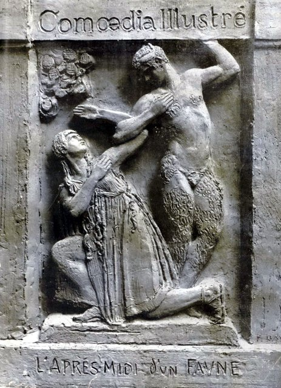
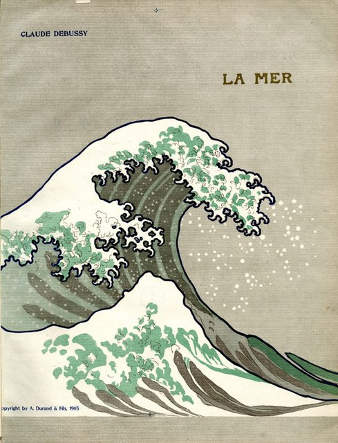
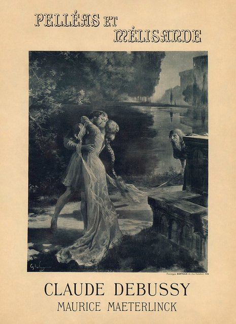

<!--
內容整理自本機筆記〈德布西主要作品〉（D:\Books\md\音樂\德布西主要作品.md，網頁版在知識圖譜的「5-2.音樂家作品」），做法比照「貝多芬主要作品」。
- 每首作品一則事件，日期採「創作時間」（多年創作的作品以區間呈現；「年代」以十年計、「世紀」以百年計，修訂或出版年份只寫在顯示文字裡），事件顏色依筆記的類別段落區分：管弦樂作品、鋼琴獨奏作品、歌劇與舞台音樂、室內樂作品、藝術歌曲與聲樂套曲。
- 「約」、「前後」、修訂、出版等不是單純年份的寫法，以原文作為顯示文字。
- 作品編號是目錄編號，不等於創作順序，時間軸依創作時間排序。
- 時期沿用「德布西生平」時間軸的主要時期（重疊的細分時期不列）。
- 筆記「優先聆聽」清單中的作品另註明順序。「《前奏曲》兩冊完整曲目」一節逐首列出的24首前奏曲未另立事件，以第二節的兩冊《前奏曲》代表。
- 以 follows 排在「德布西生平」之後；生平事件見該時間軸。
圖片（皆沿用「德布西生平」時間軸中的 Wikimedia Commons 公有領域圖片，原始檔名見該時間軸）：
- debussy-1905-nadar.jpg（納達爾拍攝的德布西）
- debussy-1894-faune.jpg（《喜劇畫報》以牧神浮雕為封面介紹《牧神午後前奏曲》）
- debussy-1902-pelleas.jpg（羅什格羅斯為1902年《佩利亞斯與梅麗桑德》首演繪製的海報）
- debussy-1905-la-mer.jpg（《海》初版樂譜封面，採用葛飾北齋〈神奈川沖浪裏〉）
-->

# Periods
- 1862 ~ 1872 | 童年@聖日耳曼昂萊、巴黎
  父親經營瓷器店失敗後到巴黎印刷廠工作，家中沒什麼文化氣息。普法戰爭時避難到坎城的姑姑家，開始學鋼琴；父親因參加巴黎公社入獄，獄友的母親成了他的鋼琴老師。
- 1872 ~ 1884 | 巴黎音樂學院
  10歲考進巴黎音樂學院，一讀就是十一、二年。他鋼琴彈得好、視譜能力一流，卻常翹課、不守作曲規矩，讓保守的教授們頭痛。暑假到梅克夫人家當鋼琴師，遊歷歐洲與俄國。
- 1885 ~ 1887 | 羅馬大獎@Rome
  以康塔塔《浪子》贏得羅馬大獎，到羅馬梅迪奇別墅進修。他討厭那裡的環境與學院派的要求，常偷跑回巴黎見情人，最後提前結束學業。
- 1887 ~ 1894 | 尋找自己的聲音@Paris
  迷上華格納又很快走出他的影子，在萬國博覽會聽到爪哇甘美朗音樂，結識薩提，過著波希米亞式的窮困生活。看了梅特林克的戲劇《佩利亞與梅莉桑》後，決定把它寫成歌劇。
- 1894 ~ 1902 | 《牧神》到《佩利亞》
  《牧神的午後前奏曲》首演打響名號，花了將近十年寫成唯一的歌劇《佩利亞與梅莉桑》。私生活風波不斷，失去不少朋友，卻成為拉威爾等年輕藝術家「阿帕契」團體的精神領袖。
- 1902 ~ 1909 | 國際聲望與醜聞
  《佩利亞》讓他名揚國際，《大海》、《版畫》、《兒童天地》等名作接連問世。他拋下妻子莉莉與銀行家夫人艾瑪私奔，莉莉舉槍自殺未遂，醜聞讓他再度眾叛親離。獨生女秀秀出生，成為他最疼愛的人。
- 1909 ~ 1918 | 病痛與戰爭中的晚年
  確診直腸癌，仍持續創作《前奏曲》、芭蕾《遊戲》、《練習曲》與晚年的奏鳴曲。第一次世界大戰期間病情惡化，在德軍砲轟巴黎時去世。

# Events

## 1891 ~ 1894 | L.86 《牧神午後前奏曲》（Prélude à l’après-midi d’un faune） {color=#c92a2a}

類別：管弦樂前奏曲（管弦樂作品）。入門推薦聆聽第 2 首。

## 1897 ~ 1899 | L.91 《夜曲》（Nocturnes） {color=#c92a2a}
類別：管弦樂組曲（管弦樂作品）。入門推薦聆聽第 8 首。

## 1903 ~ 1905 | L.109 《海》（La Mer） {color=#c92a2a}

類別：三首管弦樂交響素描（管弦樂作品）。入門推薦聆聽第 3 首。

## 1905 ~ 1912 | L.122 《意象》（Images pour orchestre） {color=#c92a2a}
類別：管弦樂組曲（管弦樂作品）。入門推薦聆聽第 6 首。

## 1883 | L.50 《管弦樂組曲》早期作品（Suite for Orchestra） {color=#c92a2a}
類別：管弦樂組曲（管弦樂作品）。

## 1889 ~ 1890 | L.73 鋼琴與管弦樂幻想曲（Fantaisie pour piano et orchestre） {color=#c92a2a}
類別：鋼琴與管弦樂協奏性作品（管弦樂作品）。

## 1904 | L.107 《李爾王》相關音樂（Le Roi Lear） {color=#c92a2a}
類別：管弦樂作品／戲劇音樂草稿（管弦樂作品）。

## 1911 ~ 1912 | L.125 《卡瑪》（Khamma） {color=#c92a2a}
類別：芭蕾舞劇音樂（管弦樂作品）。

## 1911 | L.124 《聖塞巴斯蒂安的殉難》管弦樂選段（Le Martyre de saint Sébastien） {color=#c92a2a}
類別：戲劇配樂／管弦樂組曲（管弦樂作品）。

## 1904 | L.104 《神聖之舞與世俗之舞》（Danse sacrée et danse profane） {color=#c92a2a}
類別：豎琴與弦樂合奏（管弦樂作品）。

## 1904 | L.103 《神聖之舞與世俗之舞》 {color=#c92a2a}
類別：豎琴與弦樂作品（同上，常作一組演出）（管弦樂作品）。

## 1897 ~ 1899 | L.91 Nuages（雲） {color=#c92a2a}
類別：管弦樂夜曲（管弦樂作品）。

## 1897 ~ 1899 | L.91 Fêtes（節慶） {color=#c92a2a}
類別：管弦樂夜曲（管弦樂作品）。

## 1897 ~ 1899 | L.91 Sirènes（海妖） {color=#c92a2a}
類別：管弦樂與女聲合唱（管弦樂作品）。

## 1903 ~ 1905 | L.109 De l’aube à midi sur la mer（從黎明到中午的海上） {color=#c92a2a}
類別：管弦樂交響素描（管弦樂作品）。

## 1903 ~ 1905 | L.109 Jeux de vagues（浪花嬉戲） {color=#c92a2a}
類別：管弦樂交響素描（管弦樂作品）。

## 1903 ~ 1905 | L.109 Dialogue du vent et de la mer（風與海的對話） {color=#c92a2a}
類別：管弦樂交響素描（管弦樂作品）。

## 1880 | L.9 《波希米亞舞曲》（Danse bohémienne） {color=#1971c2}
類別：鋼琴獨奏（鋼琴獨奏作品）。

## 1890 | L.68 《夢幻曲》（Rêverie） {color=#1971c2 label="約1890"}
類別：鋼琴獨奏（鋼琴獨奏作品）。

## 1888 ~ 1891 | L.66 《兩首阿拉貝斯克》（Deux Arabesques） {color=#1971c2}
類別：鋼琴小品（鋼琴獨奏作品）。入門推薦聆聽第 4 首。

## 1890 | L.75 《貝加馬斯克組曲》（Suite bergamasque） {color=#1971c2 label="約1890，1905修訂出版"}
類別：鋼琴組曲（鋼琴獨奏作品）。

## 1890 | L.69 《塔朗泰拉舞曲》（Danse, dite tarantelle styrienne） {color=#1971c2}
類別：鋼琴舞曲（鋼琴獨奏作品）。

## 1890 | L.70 《斯拉夫敘事曲》（Ballade slave） {color=#1971c2}
類別：鋼琴獨奏（鋼琴獨奏作品）。

## 1890 | L.71 《浪漫華爾滋》（Valse romantique） {color=#1971c2}
類別：鋼琴華爾滋（鋼琴獨奏作品）。

## 1890 | L.77 《蘇格蘭民謠主題進行曲》（Marche écossaise sur un thème populaire） {color=#1971c2}
類別：鋼琴四手聯彈版本（鋼琴獨奏作品）。

## 1894 ~ 1901 | L.95 《為鋼琴而作》（Pour le piano） {color=#1971c2}
類別：鋼琴組曲（鋼琴獨奏作品）。

## 1903 | L.100 《版畫》（Estampes） {color=#1971c2}
類別：鋼琴組曲（鋼琴獨奏作品）。入門推薦聆聽第 5 首。

## 1903 ~ 1904 | L.106 《歡樂島》（L’Isle joyeuse） {color=#1971c2}
類別：鋼琴獨奏（鋼琴獨奏作品）。

## 1903 ~ 1904 | L.105 《面具》（Masques） {color=#1971c2}
類別：鋼琴獨奏（鋼琴獨奏作品）。

## 1904 | L.99 《素描本中的一頁》（D’un cahier d’esquisses） {color=#1971c2}
類別：鋼琴小品（鋼琴獨奏作品）。

## 1901 ~ 1905 | L.110 《意象》第一集（Images, 1re série） {color=#1971c2}
類別：鋼琴組曲（鋼琴獨奏作品）。

## 1907 | L.111 《意象》第二集（Images, 2e série） {color=#1971c2}
類別：鋼琴組曲（鋼琴獨奏作品）。

## 1906 ~ 1908 | L.113 《兒童天地》（Children’s Corner） {color=#1971c2}
類別：鋼琴組曲（鋼琴獨奏作品）。入門推薦聆聽第 9 首。

## 1909 | L.114 《小黑人》（Le petit nègre） {color=#1971c2}
類別：鋼琴小品（鋼琴獨奏作品）。

## 1909 | L.115 《向海頓致敬》（Hommage à Haydn） {color=#1971c2}
類別：鋼琴小品（鋼琴獨奏作品）。

## 1910 | L.121 《緩慢的華爾滋》（La plus que lente） {color=#1971c2}
類別：鋼琴華爾滋（鋼琴獨奏作品）。

## 1909 ~ 1910 | L.117 《前奏曲》第一冊（Préludes, Livre I） {color=#1971c2}
類別：鋼琴組曲（鋼琴獨奏作品）。

## 1911 ~ 1913 | L.123 《前奏曲》第二冊（Préludes, Livre II） {color=#1971c2}
類別：鋼琴組曲（鋼琴獨奏作品）。

## 1915 | L.136 《練習曲》（Études） {color=#1971c2}
類別：鋼琴練習曲集（鋼琴獨奏作品）。

## 1915 | L.138 《輓歌》（Élégie） {color=#1971c2}
類別：鋼琴獨奏（鋼琴獨奏作品）。

## 1917 | L.150 《被煤火熱情照亮的夜晚》（Les soirs illuminés par l’ardeur du charbon） {color=#1971c2}
類別：晚期鋼琴小品（鋼琴獨奏作品）。

## 1890 | L.75 《前奏曲》（Prélude） {color=#1971c2 label="約1890，後修訂"}
類別：《貝加馬斯克組曲》第一曲（鋼琴獨奏作品）。

## 1890 | L.75 《小步舞曲》（Menuet） {color=#1971c2 label="約1890，後修訂"}
類別：《貝加馬斯克組曲》第二曲（鋼琴獨奏作品）。

## 1890 | L.75 《月光》（Clair de lune） {color=#1971c2 label="約1890，後修訂"}
類別：《貝加馬斯克組曲》第三曲（鋼琴獨奏作品）。入門推薦聆聽第 1 首。

## 1890 | L.75 《帕斯皮耶舞曲》（Passepied） {color=#1971c2 label="約1890，後修訂"}
類別：《貝加馬斯克組曲》第四曲（鋼琴獨奏作品）。

## 1903 | L.100 《塔》（Pagodes） {color=#1971c2}
類別：《版畫》第一曲（鋼琴獨奏作品）。

## 1903 | L.100 《格拉納達之夜》（La soirée dans Grenade） {color=#1971c2}
類別：《版畫》第二曲（鋼琴獨奏作品）。

## 1903 | L.100 《雨中花園》（Jardins sous la pluie） {color=#1971c2}
類別：《版畫》第三曲（鋼琴獨奏作品）。

## 1901 ~ 1905 | L.110 《映像》（Reflets dans l’eau） {color=#1971c2}
類別：《意象》第一集第一曲（鋼琴獨奏作品）。

## 1901 ~ 1905 | L.110 《向拉摩致敬》（Hommage à Rameau） {color=#1971c2}
類別：《意象》第一集第二曲（鋼琴獨奏作品）。

## 1901 ~ 1905 | L.110 《運動》（Mouvement） {color=#1971c2}
類別：《意象》第一集第三曲（鋼琴獨奏作品）。

## 1907 | L.111 《鐘聲穿過樹葉》（Cloches à travers les feuilles） {color=#1971c2}
類別：《意象》第二集第一曲（鋼琴獨奏作品）。

## 1907 | L.111 《月落荒廟》（Et la lune descend sur le temple qui fut） {color=#1971c2}
類別：《意象》第二集第二曲（鋼琴獨奏作品）。

## 1907 | L.111 《金魚》（Poissons d’or） {color=#1971c2}
類別：《意象》第二集第三曲（鋼琴獨奏作品）。

## 1906 ~ 1908 | L.113 《格拉杜斯博士的練習曲》（Doctor Gradus ad Parnassum） {color=#1971c2}
類別：鋼琴組曲（鋼琴獨奏作品）。

## 1906 ~ 1908 | L.113 《吉姆博的搖籃曲》（Jimbo’s Lullaby） {color=#1971c2}
類別：鋼琴組曲（鋼琴獨奏作品）。

## 1906 ~ 1908 | L.113 《洋娃娃的小夜曲》（Serenade for the Doll） {color=#1971c2}
類別：鋼琴組曲（鋼琴獨奏作品）。

## 1906 ~ 1908 | L.113 《雪在跳舞》（The Snow Is Dancing） {color=#1971c2}
類別：鋼琴組曲（鋼琴獨奏作品）。

## 1906 ~ 1908 | L.113 《小牧羊人》（The Little Shepherd） {color=#1971c2}
類別：鋼琴組曲（鋼琴獨奏作品）。

## 1906 ~ 1908 | L.113 《黑娃娃的步態舞》（Golliwogg’s Cakewalk） {color=#1971c2}
類別：鋼琴組曲（鋼琴獨奏作品）。

## 1909 ~ 1910 | L.117 《沉沒的教堂》（La Cathédrale engloutie） {color=#1971c2}
類別：第一冊前奏曲（鋼琴獨奏作品）。入門推薦聆聽第 10 首。

## 1909 ~ 1910 | L.117 《亞麻色頭髮的少女》（La Fille aux cheveux de lin） {color=#1971c2}
類別：第一冊前奏曲（鋼琴獨奏作品）。

## 1909 ~ 1910 | L.117 《帆》（Voiles） {color=#1971c2}
類別：第一冊前奏曲（鋼琴獨奏作品）。

## 1909 ~ 1910 | L.117 《西風所見》（Ce qu’a vu le vent d’ouest） {color=#1971c2}
類別：第一冊前奏曲（鋼琴獨奏作品）。

## 1909 ~ 1910 | L.117 《阿拉貝斯克式的煙火》（La danse de Puck） {color=#1971c2}
類別：第一冊前奏曲（鋼琴獨奏作品）。

## 1911 ~ 1913 | L.123 《霧》（Brouillards） {color=#1971c2}
類別：第二冊前奏曲（鋼琴獨奏作品）。

## 1911 ~ 1913 | L.123 《枯葉》（Les sons et les parfums tournent dans l’air du soir 等相關標題作品） {color=#1971c2}
類別：第二冊前奏曲（鋼琴獨奏作品）。

## 1911 ~ 1913 | L.123 《煙火》（Feux d’artifice） {color=#1971c2}
類別：第二冊前奏曲（鋼琴獨奏作品）。

## 1911 ~ 1913 | L.123 《小丑》（Général Lavine – eccentric） {color=#1971c2}
類別：第二冊前奏曲（鋼琴獨奏作品）。

## 1911 ~ 1913 | L.123 《海神》（Ondine） {color=#1971c2}
類別：第二冊前奏曲（鋼琴獨奏作品）。

## 1890 ~ 1893 | L.72 《羅德里格與希梅娜》（Rodrigue et Chimène） {color=#e67700}
類別：未完成歌劇（歌劇與舞台音樂）。

## 1893 ~ 1902 | L.88 《佩利亞斯與梅麗桑德》（Pelléas et Mélisande） {color=#e67700}

類別：五幕歌劇（歌劇與舞台音樂）。入門推薦聆聽第 7 首。

## 1902 ~ 1911 | L.101 《鐘樓中的魔鬼》（Le Diable dans le beffroi） {color=#e67700}
類別：未完成歌劇（歌劇與舞台音樂）。

## 1908 ~ 1917 | L.112 《厄舍古宅的倒塌》（La Chute de la maison Usher） {color=#e67700}
類別：未完成歌劇（歌劇與舞台音樂）。

## 1911 | L.124 《聖塞巴斯蒂安的殉難》（Le Martyre de saint Sébastien） {color=#e67700}
類別：神秘劇配樂（歌劇與舞台音樂）。

## 1913 | L.126 《玩具盒》（La Boîte à joujoux） {color=#e67700}
類別：兒童芭蕾舞劇（歌劇與舞台音樂）。

## 1880 | L.3 G 大調鋼琴三重奏（Trio en sol majeur） {color=#2f9e44}
類別：小提琴、大提琴與鋼琴（室內樂作品）。

## 1892 ~ 1893 | Op.10／L.85 G 小調弦樂四重奏（Quatuor à cordes en sol mineur） {color=#2f9e44}
類別：弦樂四重奏（室內樂作品）。

## 1904 | L.103 《神聖之舞與世俗之舞》（Danse sacrée et danse profane） {color=#2f9e44}
類別：豎琴與弦樂合奏（室內樂作品）。

## 1910 | L.120 《小品》（Petite pièce） {color=#2f9e44}
類別：單簧管與鋼琴（室內樂作品）。

## 1909 ~ 1910 | L.127 《第一狂想曲》（Première Rhapsodie） {color=#2f9e44}
類別：單簧管與鋼琴；另有管弦樂版本（室內樂作品）。

## 1916 ~ 1917 | L.140 小提琴奏鳴曲（Sonate pour violon et piano） {color=#2f9e44}
類別：小提琴與鋼琴（室內樂作品）。

## 1915 | L.144 大提琴奏鳴曲（Sonate pour violoncelle et piano） {color=#2f9e44}
類別：大提琴與鋼琴（室內樂作品）。

## 1915 | L.137 長笛、中提琴與豎琴奏鳴曲（Sonate pour flûte, alto et harpe） {color=#2f9e44}
類別：室內樂三重奏（室內樂作品）。

## 1880 | L.4 《星夜》（Nuit d’étoiles） {color=#862e9c}
類別：藝術歌曲（藝術歌曲與聲樂套曲）。

## 1890 | L.6 《美麗的黃昏》（Beau soir） {color=#862e9c label="約1890"}
類別：藝術歌曲（藝術歌曲與聲樂套曲）。

## 1885 ~ 1887 | L.60 《被遺忘的歌謠》（Ariettes oubliées） {color=#862e9c}
類別：六首歌曲套曲（藝術歌曲與聲樂套曲）。

## 1887 ~ 1889 | L.64 《波特萊爾五首詩》（Cinq poèmes de Charles Baudelaire） {color=#862e9c}
類別：藝術歌曲套曲（藝術歌曲與聲樂套曲）。

## 1891 ~ 1892 | L.80 《華宴》第一集（Fêtes galantes, 1er recueil） {color=#862e9c}
類別：藝術歌曲套曲（藝術歌曲與聲樂套曲）。

## 1891 | L.81 《魏爾倫三首歌曲》（Trois mélodies de Verlaine） {color=#862e9c}
類別：藝術歌曲套曲（藝術歌曲與聲樂套曲）。

## 1892 | L.82 《夜曲》（Nocturne） {color=#862e9c}
類別：鋼琴獨奏；與聲樂類同名作品需區分（藝術歌曲與聲樂套曲）。

## 1896 ~ 1900 | L.89 《柳林》（La saulaie） {color=#862e9c}
類別：男中音與管弦樂（藝術歌曲與聲樂套曲）。

## 1897 ~ 1898 | L.90 《比利蒂斯之歌》（Chansons de Bilitis） {color=#862e9c}
類別：三首藝術歌曲（藝術歌曲與聲樂套曲）。

## 1898 ~ 1908 | L.93 《奧爾良公爵查理三首歌曲》（Trois chansons de Charles d’Orléans） {color=#862e9c}
類別：無伴奏合唱（藝術歌曲與聲樂套曲）。

## 1904 | L.102 《法國三首歌曲》（Trois chansons de France） {color=#862e9c}
類別：藝術歌曲（藝術歌曲與聲樂套曲）。

## 1904 | L.104 《華宴》第二集（Fêtes galantes, 2e recueil） {color=#862e9c}
類別：藝術歌曲套曲（藝術歌曲與聲樂套曲）。

## 1904 ~ 1910 | L.118 《兩位戀人漫步的地方》（Le Promenoir des deux amants） {color=#862e9c}
類別：三首藝術歌曲（藝術歌曲與聲樂套曲）。

## 1910 | L.119 《維庸三首敘事曲》（Trois Ballades de François Villon） {color=#862e9c}
類別：藝術歌曲套曲（藝術歌曲與聲樂套曲）。

## 1915 | L.139 《沒有家的孩子之聖誕歌》（Noël des enfants qui n’ont plus de maisons） {color=#862e9c}
類別：聲樂與鋼琴（藝術歌曲與聲樂套曲）。
