<!--
內容整理自中文維基百科「勒內·笛卡兒」條目（CC BY-SA 4.0），以台灣用語改寫摘要。
https://zh.wikipedia.org/zh-tw/勒内·笛卡儿
本機的〈笛卡兒生平.md〉內容與笛卡兒無關（是一段時間軸專案的近況筆記），因此未採用。
1619年11月10日的三個夢、拉弗萊什學院的入學年份與晚起的習慣、1635年女兒弗朗辛出生、1643年起與伊莉莎白公主通信、1650年在斯德哥爾摩的去世情形、1667年遺骨遷回巴黎、1819年改葬聖日耳曼德佩教堂等細節，係依一般公認的史實補充。
圖片皆為 Wikimedia Commons 上的公有領域作品（封面：法蘭斯·哈爾斯所繪笛卡兒像）。出生事件配今日的笛卡兒故居（2008年攝）、拉弗萊什學院配18世紀的版畫鳥瞰圖、普瓦捷大學配1616年的學位登記簿、移居荷蘭配1647年尼森所繪肖像、前往瑞典配杜梅斯尼1884年所繪〈笛卡兒在克莉絲蒂娜女王宮廷〉、逝世事件配貝克所繪的克莉絲蒂娜女王像。
-->

# Periods
- 1596-03-31 ~ 1618 | 童年與求學 | #8d6e63
  生於法國圖賴訥的小貴族家庭，由外祖母帶大，在耶穌會的拉弗萊什學院接受完整的古典教育，後於普瓦捷大學取得法律學位。
- 1618 ~ 1628 | 從軍與遊歷：「世界這本大書」 | #2b8a3e
  決心從「世界這本大書」中尋求智慧，加入荷蘭軍隊，結識以撒·貝克曼而投入數學與物理，在德國的冬夜立志建立一套確定的知識體系，之後遊歷歐洲、定居巴黎。
- 1628 ~ 1649 | 荷蘭隱居與主要著作 | #1864ab
  為了自由地思考與寫作移居荷蘭二十多年，完成《談談方法》、《幾何學》、《第一哲學沉思集》與《哲學原理》，成為歐洲最有影響力的哲學家之一。
- 1649 ~ 1650-02-11 | 瑞典與逝世 | #495057
  應瑞典克莉絲蒂娜女王之邀前往斯德哥爾摩，在「熊、冰雪與岩石的土地」上清晨講學，不久感染肺炎去世。

# Events

## 1596-03-31 | 出生@圖賴訥拉海
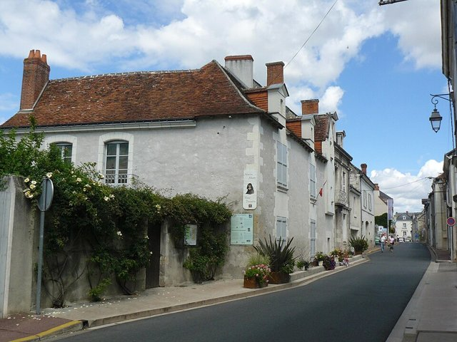
生於法國圖賴訥的拉海（今已更名為「笛卡兒」以紀念他），父親是布列塔尼高等法院的議員，屬於地位不高的貴族。他一歲多時母親去世，他也體弱多病，父親再婚後把他交給外祖母撫養，但一直供應他生活與教育所需，讓他日後能專心追求學問而不必為生計煩惱。

## 1607 | 拉弗萊什耶穌會學院
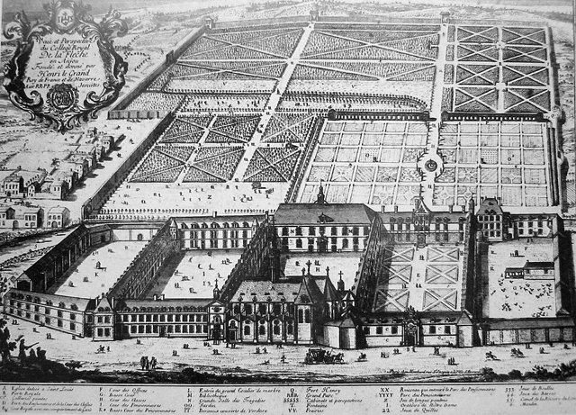
進入耶穌會創辦的拉弗萊什皇家亨利大帝學院（維基百科作1604年，一般多記為1606或1607年），學習古典文學、哲學、數學與物理，也接觸到伽利略的新發現。因為身體虛弱，校方允許他早上躺在床上讀書思考，據說這個習慣保持了一輩子。

## 1616 | 普瓦捷大學法律學位
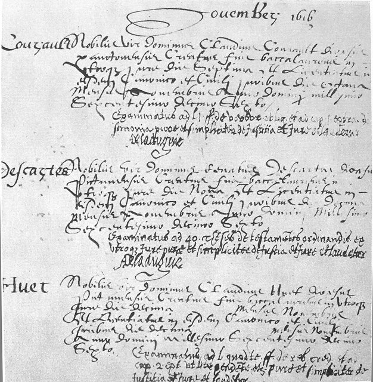
依父親的期望進入普瓦捷大學學習法律，12月取得業士學位與執業資格。但他對經院哲學與書本知識感到失望，決定「不再在書本中尋求學問，而是到世界這本大書中去尋找」。

## 1618 | 從軍荷蘭；結識貝克曼
加入荷蘭拿騷的毛里茨的軍隊。正值停戰期間，他有充分的時間研究數學。11月10日，他在布雷達街頭看到用佛萊芒語寫的數學難題徵答，請身旁的人翻譯成拉丁文，這人正是大他八歲的學者以撒·貝克曼。貝克曼成為他的導師，他後來寫信說：「你是將我從冷漠中喚醒的人。」同年他為貝克曼寫了音樂理論著作《音樂綱要》。

## 1619-11-10 | 烏爾姆的冬夜與三個夢
他轉往德國從軍，冬天在烏爾姆附近一間有暖爐的小屋裡沉思，聲稱找到一種可以解決任何算術或幾何問題的方法。這天夜裡他做了三個夢，深信這是要他以理性統一所有學問的啟示。但他認為所有學問的基礎都是哲學，而哲學缺乏確定性，必須先建立確定的基礎；他說：「那時我只有二十三歲，我想只有等到更成熟的年紀，在長時間的準備之後才可以嘗試。」

## 1621 | 退伍
離開軍隊，開始遊歷歐洲各地。

## 1622 | 遊歷歐洲，定居巴黎
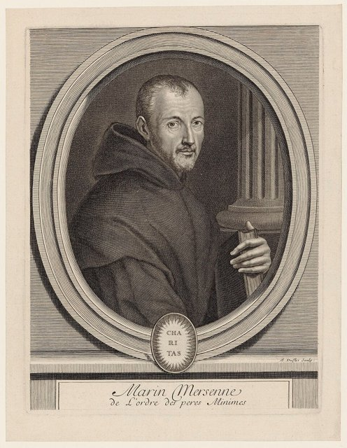
26歲時賣掉父親留給他的產業，用四年時間遊歷歐洲，其中有兩年住在義大利，之後在巴黎定居。他結識了神父兼學者馬蘭·梅森，梅森的修道院成為當時歐洲學者交流的中心，此後一直是他和學界溝通的橋樑。

## 1626 | 《指導心靈的規則》
開始寫作《指導心靈的規則》，嘗試以數學的方法建立普遍的推理規則，但沒有完成，直到他死後才出版。

## 1628 | 移居荷蘭
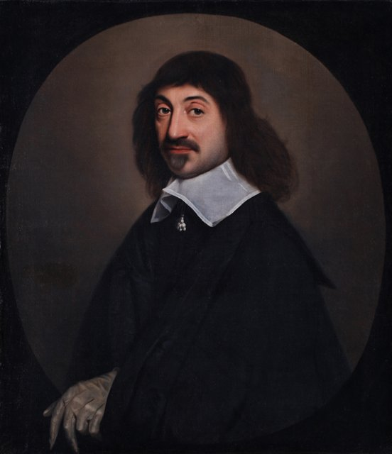
當時法國教會勢力龐大，不能自由討論學術與宗教問題，他移居較為開放的荷蘭，在那裡住了二十多年，前後換了十多個住處，以保持清靜不受打擾。

## 1633 | 伽利略受審，《世界》擱置
他寫了一部想以統一學說解釋所有自然現象的著作，分為《世界》（論光）與《論人》兩部分，其中主張地球繞日運行。正準備出版時，聽到伽利略因宣揚地動說被羅馬宗教法庭定罪，他擔心遭受同樣的命運，決定不出版。這部作品直到他死後才問世。

## 1635 | 女兒弗朗辛出生
他與在阿姆斯特丹寄住處的女僕海倫生下女兒弗朗辛。他十分疼愛這個女兒，計畫帶她到法國接受教育。

## 1637 | 《談談方法》與《幾何學》
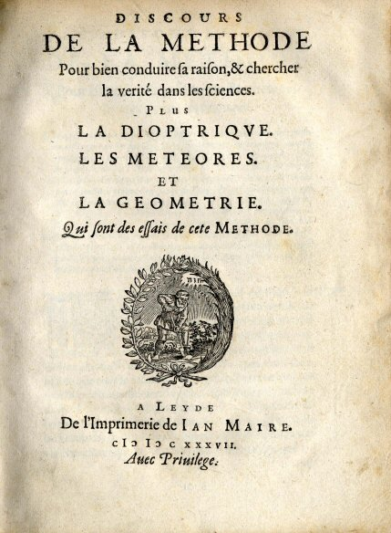
以法文而非學術界通用的拉丁文出版《談談方法》，讓一般讀者也能閱讀，並附上《屈光學》、《氣象學》、《幾何學》三篇論文。書中提出四條方法規則：只接受清楚明白為真的事物、把難題分解、由簡至繁依序思考、全面檢查不遺漏；也首次提出「我思故我在」。附錄《幾何學》以座標把幾何問題轉為代數方程式，開創了解析幾何，「笛卡兒座標系」即以他的拉丁名 Cartesius 命名；今天用 x、y、z 代表未知數、a、b、c 代表已知數的習慣也始於此書。他在《屈光學》中論證光的折射定律，在《氣象學》中以折射解釋彩虹。

## 1640 | 女兒去世
他正在寫作《沉思集》時，五歲的女兒弗朗辛因熱病去世，他稱這是一生中最大的悲痛。

## 1641 | 《第一哲學沉思集》
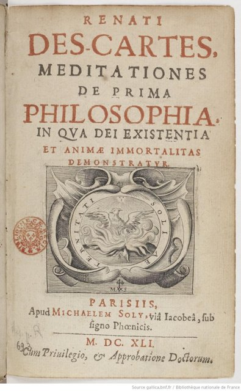
以拉丁文出版《第一哲學沉思集》。他從普遍懷疑出發：感官可能欺騙我們，我們甚至無法確定自己不是在作夢，或者有一個「惡魔」在欺騙我們；但唯一不能懷疑的，是「我正在懷疑」這件事本身——「我思故我在」。由此他論證上帝的存在，並提出心靈與身體是兩種截然不同實體的「身心二元論」。出版前梅森把手稿寄給多位哲學家與神學家，收到六組反駁意見，連同他的答辯一起附在書中出版，被視為最早的同儕審查。這本書至今仍是大多數哲學系的指定教材。

## 1643 | 與伊莉莎白公主通信
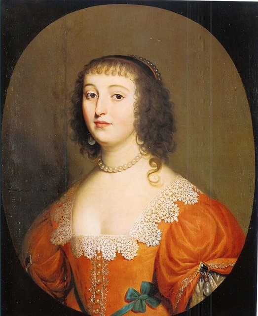
流亡荷蘭的波希米亞伊莉莎白公主寫信質疑：非物質的心靈怎麼能推動物質的身體？兩人從此通信多年，討論身心關係、情感與道德，這些書信是哲學史上的重要文獻。同年他與烏特勒支大學的神學家爭論，他的哲學一度在該校被禁止講授。

## 1644 | 《哲學原理》
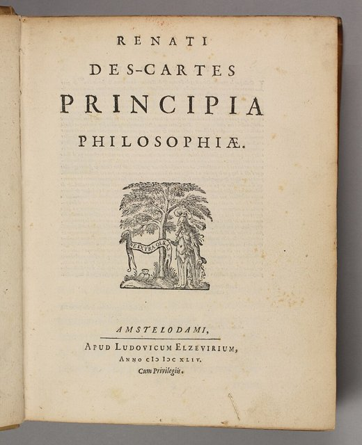
出版《哲學原理》，原本希望用它取代學校裡的亞里斯多德經院哲學教科書，並把這本書獻給伊莉莎白公主。書中以「漩渦說」解釋天體運動，也提出慣性運動是直線運動等力學原理。

## 1649 | 《靈魂的激情》；前往瑞典
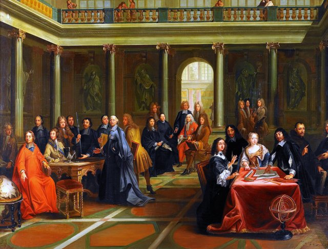
出版《靈魂的激情》，提出驚奇、愛、恨、欲望、喜悅與悲傷六種原始情緒，其他情緒都是它們的組合。同年應瑞典克莉絲蒂娜女王之邀，前往斯德哥爾摩擔任她的哲學老師。

## 1650-02-11 | 逝世@斯德哥爾摩
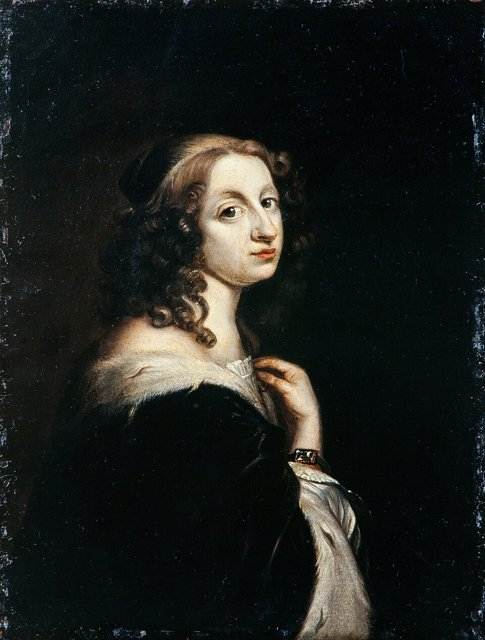
女王要求他在清晨五點講課，向來晚起的他在嚴寒中來回奔波，不久感染肺炎，在斯德哥爾摩去世，享年53歲。他死後，克莉絲蒂娜女王放棄王位、改信天主教，而他是女王身邊唯一往來的天主教徒。他的遺骨在1667年遷回法國，1819年改葬於巴黎的聖日耳曼德佩教堂；據說他的頭骨幾經轉手，如今保存在巴黎的人類博物館。

## 1663 | 著作列入禁書
他的著作被羅馬教廷列入禁書目錄，法國也一度禁止在大學講授他的學說。然而他開創的理性主義經由斯賓諾莎、萊布尼茲等人發揚光大，與洛克、休謨的經驗主義並列為近代哲學的兩大主流，他也因此被稱為「近代哲學之父」。
