<!--
內容整理自本機筆記〈狄更斯生平大事記〉（圖表\狄更斯生平大事記.md）與中文維基百科「查爾斯·狄更斯」條目（CC BY-SA 4.0），以台灣用語改寫摘要。
https://zh.wikipedia.org/zh-tw/查尔斯·狄更斯
史料與日期說明：
- 書名：採台灣通行譯名《孤雛淚》《小氣財神》《塊肉餘生記》《孤星血淚》，並註明筆記的譯名《聖誕頌歌》《遠大前程》。
- 維基百科稱《家常話》為月刊，實際上是週刊（每週三便士），此處依筆記寫作週刊，刊名依筆記作《家庭之聲》。
- 維基百科寫他「自威靈頓學院畢業」，指的是倫敦的威靈頓學院（Wellington House Academy），是一所私立小學，與今天的威靈頓公學不同；他在那裡只讀了約兩年，並未「畢業」。
- 公開朗讀：維基百科寫始於1853年12月，那是為慈善舉辦的免費朗讀；售票的公開朗讀巡演始於1858年4月，此處分別說明。
- 1837年小姨子瑪麗·霍加斯去世、1840年《老古玩店》、1844年旅居義大利、1857年認識愛倫·特南、1865年斯台普赫斯特火車事故恰好發生在他去世前五年的同一天、1869年朗讀巡演中途病倒、1870年3月最後一場告別朗讀等細節，係依維基百科與一般公認的史實補充。
- 火車事故只交代經過與影響，不描寫傷亡細節。
圖片來源（皆為 Wikimedia Commons 公有領域／CC0 作品）：
- dic-cover.jpg：Charles Dickens E Edwards 1864.jpg
- dic-blacking.jpg：Dickens-at-the-Blacking-Warehouse.jpg
- dic-boz.jpg：Sketches by Boz illustrated by George Cruikshank 1837.jpg
- dic-oliver.jpg：Olivertwist front.jpg
- dic-maclise.jpg：Charles Dickens by Daniel Maclise.jpg
- dic-1842.jpg：Francis Alexander - Charles Dickens 1842.jpeg
- dic-carol.jpg：Charles Dickens-A Christmas Carol-Title page-First edition 1843.jpg
- dic-copperfield.jpg：David Copperfield, We are disturbed in our cookery.jpg
- dic-marshalsea.jpg：Courtyard of the former Marshalsea prison, 1897 (2).png
- dic-study.jpg：Charles Dickens in his study at Gadshill - S. Hollyer. LCCN97506807.jpg
- dic-1858.jpg：Dickens by Watkins 1858.png
- dic-tickets.jpg：Buying tickets for a Charles Dickens reading at Steinway Hall, New York, New York, 1867.jpg
- dic-poster.jpg：Dickensposter nottingham1869.jpg
- dic-chair.jpg：Samuel Luke Fildes - The Empty Chair.jpg
-->

# Periods
- 1812 ~ 1824 | 從海軍船塢到倫敦 | #f08c00
  生於樸茨茅斯，在肯特郡的查塔姆度過快樂的童年，十歲搬到倫敦後，家境因父親負債一落千丈。
- 1824 ~ 1836 | 童工、職員與記者 | #495057
  父親入獄，十二歲的他到鞋油工廠當童工；之後當過律師事務所職員、法院與國會記者，開始以「博茲」為筆名發表街頭素描。
- 1836 ~ 1850 | 從博茲到國民作家 | #1c7ed6
  《匹克威克外傳》一炮而紅，接連寫出《孤雛淚》《小氣財神》《塊肉餘生記》，成為英國最受歡迎的作家。
- 1850 ~ 1865 | 編輯、改革者與社會小說 | #c92a2a
  創辦週刊，寫出批判司法、工業與官僚的《荒涼山莊》《艱難時世》《小杜麗》，以及《雙城記》《孤星血淚》；婚姻破裂，開始公開朗讀。
- 1865 ~ 1870 | 朗讀巡演與最後的歲月 | #5f3dc4
  火車事故後健康走下坡，仍赴美巡演、舉行告別朗讀，最後一部小說未完成就病逝。

# Events

## 1812-02-07 | 出生@樸茨茅斯
生於英格蘭南部的軍港樸茨茅斯，在八個孩子中排行第二。父親約翰在皇家海軍的財務部門當職員，為人樂觀大方卻不善理財，後來成為《塊肉餘生記》中那位總說「好運就要來了」的米考伯先生的原型。

## 1817 | 查塔姆的快樂童年
父親調職到肯特郡的查塔姆，他在這裡度過一生中最快樂的童年。他嗜讀家中的《唐吉訶德》《魯賓遜漂流記》與《天方夜譚》，常跟父親散步經過附近一座叫做蓋茨山莊的宅邸，父親對他說，只要努力工作，有一天也能住進這樣的房子。

## 1822 | 搬到倫敦
全家搬到倫敦的康登鎮。父親的債務越積越多，家裡付不起學費，他只好待在家裡做家事、照顧弟妹，眼看著自己上學的夢想破滅。他在倫敦的街頭漫遊，熟悉了這座城市擁擠、骯髒卻充滿生命力的角落。

## 1824-02 | 鞋油工廠的童工
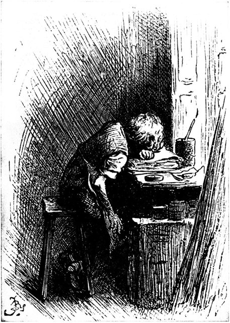
12歲生日後兩天，他被送到泰晤士河邊一家老鼠橫行的鞋油工廠，每天工作十小時，替鞋油罐貼標籤，週薪六先令。兩週後父親因欠債被關進馬夏爾西債務人監獄，母親帶著弟妹也搬進監獄同住，他則獨自寄宿在外。幾個月後父親靠一筆遺產出獄，母親卻還想讓他留在工廠，這件事讓他終生難以釋懷。這段屈辱的經歷他一生只告訴過好友福斯特，直到他死後才公開。

## 1827-05 | 律師事務所職員
在威靈頓學院讀了約兩年書後，15歲的他到律師事務所當見習職員。他對法律的繁瑣與冷漠留下深刻印象，日後在《荒涼山莊》中大加諷刺。他自學困難的速記法，為成為記者做準備，也常到大英博物館的閱覽室讀書。

## 1832 | 國會記者
成為報導國會辯論的記者，以速記又快又準聞名，後來進入《晨報》，奔走全國採訪選舉。這段期間他熱戀銀行家之女瑪麗亞·比德奈爾，因家世懸殊被女方家長拆散。

## 1833-12 | 第一篇作品發表
他把一篇描寫倫敦生活的短文悄悄投進雜誌社的信箱，刊出時他激動得「眼淚模糊了雙眼」，走到西敏廳躲起來平復心情。之後他以「博茲」為筆名，在報刊上陸續發表觀察倫敦街頭與人物的素描。

## 1836-02 | 《博茲札記》
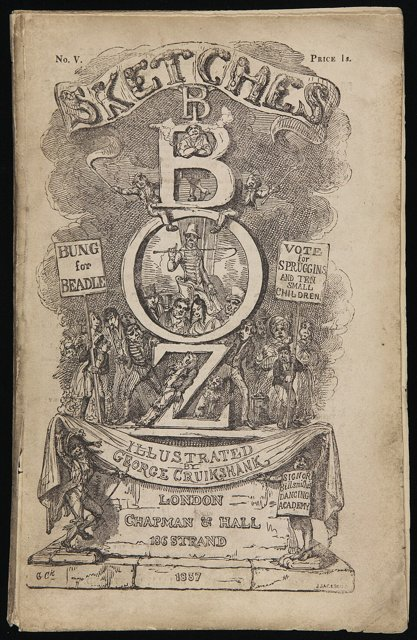
把報刊上的街頭素描集結成《博茲札記》出版，由插畫家克魯克香克繪製插圖，以生動幽默的筆觸描寫倫敦各階層的日常生活，受到好評。

## 1836-04 | 《匹克威克外傳》與結婚
3月底，《匹克威克外傳》開始以每月一冊的分冊形式出版，起初銷量平平，直到他加入了機靈的倫敦僕人山姆·威勒這個角色，銷量暴增到每期四萬冊，掀起一股「匹克威克熱」，24歲的他一夕成名。4月2日，他與報社同事的女兒凱瑟琳·霍加斯結婚，兩人後來生了十個孩子。

## 1837 | 《孤雛淚》與瑪麗之死
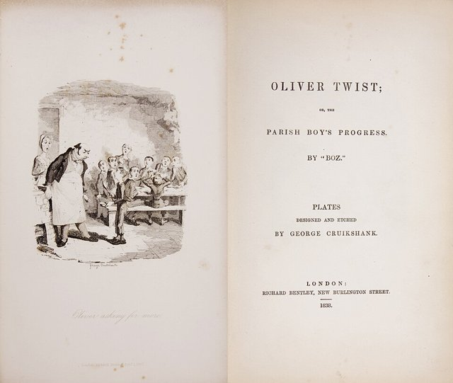
開始連載《孤雛淚》，描寫在濟貧院出生的孤兒奧利佛，因為說了一句「我還要」而被趕出去，流落倫敦街頭，被扒手集團收容。小說揭露了新濟貧法下濟貧院的殘酷。同年他搬進倫敦道提街的房子（今天的狄更斯博物館）。5月，17歲的小姨子瑪麗突然在他家中去世，死在他的懷裡，他悲痛欲絕，終生戴著她的戒指，日後筆下許多純真早逝的少女都有她的影子。

## 1838 | 《尼古拉斯·尼克爾貝》
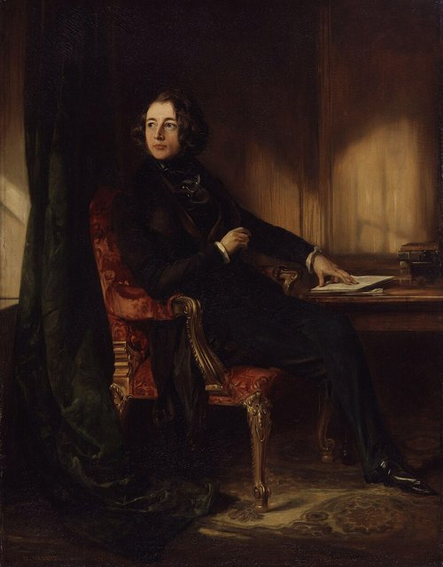
連載《尼古拉斯·尼克爾貝》，他親自喬裝到約克郡調查，揭發當地專收私生子與棄兒、虐待學生的寄宿學校，小說出版後，這類學校紛紛關門。

## 1840 | 《老古玩店》
連載《老古玩店》，描寫少女小奈兒與祖父流浪的故事。據說連載到最後一期時，紐約碼頭擠滿了等待英國郵輪的讀者，對著船上大喊：「小奈兒死了嗎？」

## 1842-01 | 第一次訪美
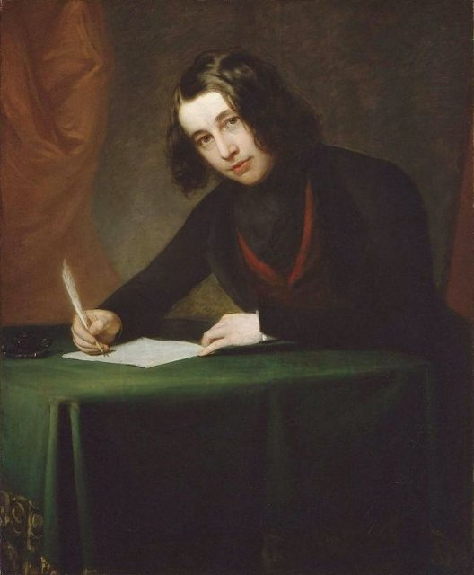
與妻子乘船訪問美國，所到之處萬人空巷。但他在演講中公開呼籲美國保護外國作家的版權，因為美國出版商大量盜印他的作品卻不付版稅，引來美國報紙圍攻；他也對美國的奴隸制度、隨地吐痰與粗魯的報業深感失望。返國後出版《美國札記》，又在小說《馬丁·朱述爾維特》中諷刺美國，惹惱了許多美國讀者。

## 1843-12 | 《小氣財神》
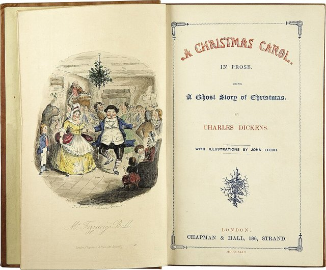
有感於工業城市中窮苦兒童的處境，只花了六週寫成中篇小說《小氣財神》（又譯《聖誕頌歌》），12月19日出版，到聖誕夜就賣光了初版六千冊。吝嗇的商人史古基在聖誕夜被過去、現在與未來的聖誕幽靈帶著回顧自己的一生，最後變成慷慨仁慈的人。這部作品讓家人團聚、慈善施捨與「聖誕快樂」的祝福，成為英美聖誕節的核心，有人說他「發明了聖誕節」。

## 1844 | 旅居義大利
為了節省開支、尋找靈感，舉家旅居義大利的熱那亞一年，遊歷羅馬、威尼斯等地，寫成《教堂鐘聲》與遊記《義大利風光》。

## 1846 | 《董貝父子》
旅居瑞士洛桑期間開始連載《董貝父子》，描寫一位只在乎事業與繼承人的冷酷富商，在兒子早逝、女兒被冷落中走向破產與悔悟，也反映了鐵路時代給英國帶來的劇烈變化。

## 1849-05 | 《塊肉餘生記》
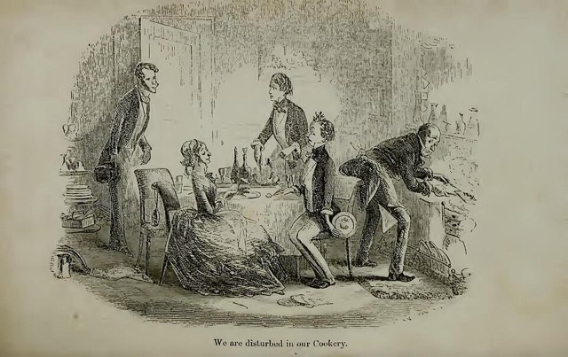
開始連載半自傳體小說《塊肉餘生記》，寫大衛·科波菲爾從童年喪父、被繼父虐待、在倉庫當童工，到成為作家的成長歷程，其中許多情節取材自他自己的經歷。他後來說：「我就像所有慈愛的父母一樣，心中有一個最偏愛的孩子，他的名字叫大衛·科波菲爾。」

## 1850-03 | 創辦週刊《家庭之聲》
創辦並主編每週三便士的週刊《家庭之聲》，刊登小說、詩歌與社會調查，關注貧民窟、公共衛生、教育與工廠安全，也培養了許多年輕作家。他同時投入慈善事業，協助富豪安潔拉·伯德特－庫茨開辦收容失足婦女的「烏拉尼亞之家」。

## 1852-03 | 《荒涼山莊》
連載《荒涼山莊》，以一樁拖了好幾代、訴訟費用吞光遺產的遺囑官司為主線，痛批英國高等法院的拖延與腐敗。小說開頭倫敦的濃霧，象徵整個司法體系的混沌不明。

## 1854-04 | 《艱難時世》
在《家庭之聲》連載《艱難時世》，以虛構的工業城市「焦煤鎮」為背景，諷刺只講「事實」與數字、扼殺想像力的功利主義教育，以及工廠主對勞工的冷漠。他事前特地到普雷斯頓觀察紡織工人的罷工。

## 1855-12 | 《小杜麗》
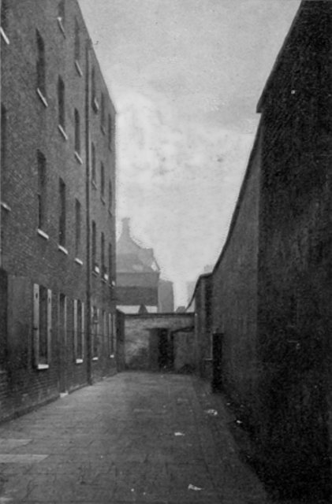
連載《小杜麗》，主角在債務人監獄中出生長大，故事以他父親當年坐牢的馬夏爾西監獄為背景，並以「繞圈子辦公室」諷刺只會推諉拖延的政府官僚。

## 1856-03 | 買下蓋茨山莊
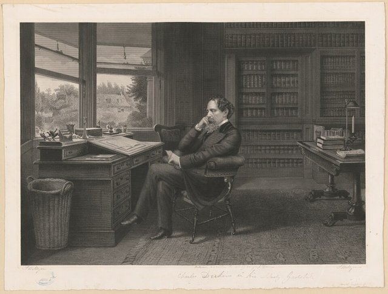
買下童年時與父親散步看到的蓋茨山莊，實現了兒時的夢想，晚年大部分時間都住在這裡。

## 1857 | 認識愛倫·特南
參與演出好友柯林斯的劇作《冰淵》，結識了18歲的女演員愛倫·特南，45歲的他深深愛上了她。此後兩人維持了十多年的秘密關係，他在倫敦郊外為她安排住處，這段關係直到二十世紀才完全為人所知。

## 1858-04 | 分居與售票朗讀
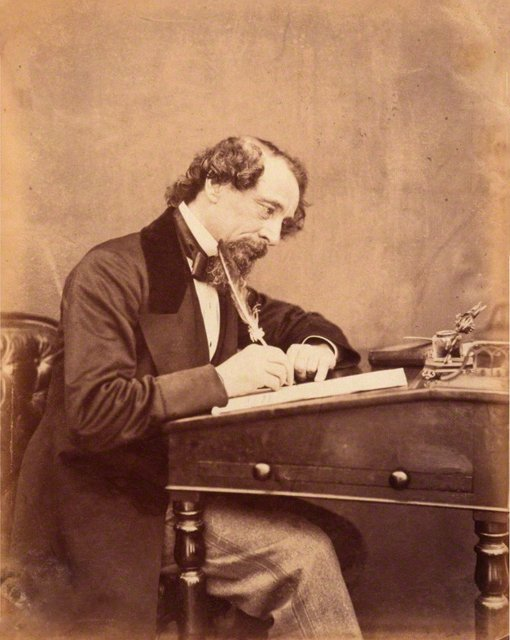
4月開始舉辦售票的公開朗讀會，親自用不同的聲音與表情演出書中人物，大受歡迎（他從1853年起就曾為慈善舉辦免費朗讀）。5月與妻子凱瑟琳分居，他在報上刊登聲明為自己辯護，引起輿論譁然，也因此與老出版商和多位朋友決裂。

## 1859-04-30 | 《雙城記》
創辦新的週刊《一年四季》，創刊號就開始連載《雙城記》。小說以法國大革命前後的倫敦與巴黎為背景，寫律師卡頓為了所愛的女子露西，甘願代替她的丈夫走上斷頭台。開頭「那是最好的時代，也是最壞的時代」與結尾「我現在做的，遠比我做過的任何事都好得多」，都是英語文學中最著名的句子。

## 1860-12 | 《孤星血淚》
連載《孤星血淚》（又譯《遠大前程》），孤兒皮普意外得到一位神秘恩人的資助，到倫敦學做紳士，卻變得勢利、看不起養育他的鐵匠姊夫；直到發現恩人竟是他小時候幫助過的逃犯，才明白真正的紳士在於品格而非財富。書中穿著發黃婚紗、讓所有時鐘都停在被拋棄那一刻的郝薇香小姐，是文學史上最令人難忘的角色之一。

## 1864-05 | 《我們共同的朋友》
連載最後一部完成的長篇小說《我們共同的朋友》，以泰晤士河上撈屍維生的船夫、一座座垃圾山堆成的財富與一筆遺產的繼承為主線，描寫金錢如何扭曲倫敦各階層的人際關係。

## 1865-06-09 | 斯台普赫斯特火車事故
與愛倫·特南母女從法國返英途中，乘坐的火車在肯特郡的斯台普赫斯特因鐵軌施工而出軌，多節車廂墜落橋下。他乘坐的車廂懸在橋邊，他平安脫險後，立刻爬回車廂取出《我們共同的朋友》的手稿，並在現場幫忙救助傷者。這次經歷讓他留下長期的心理創傷，此後坐火車都會感到恐懼。巧的是，他正好在五年後的同一天去世。

## 1867-11 | 第二次訪美巡迴朗讀
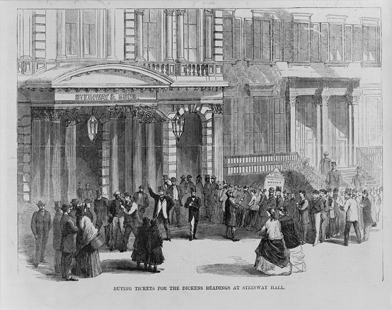
不顧健康與朋友的勸阻，再度赴美舉行巡迴朗讀，在波士頓、紐約等地演出七十多場，場場爆滿，賺進大筆收入。這時他已與美國和解，在告別晚宴上公開表示當年對美國的批評已經過時。

## 1869-04 | 巡演中途病倒
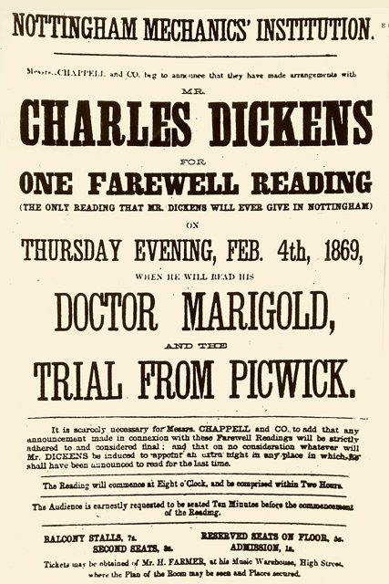
在英國的告別朗讀巡演中，他經常表演《孤雛淚》中比爾·賽克斯殺害南茜的段落，演得聲嘶力竭、觀眾紛紛昏倒，他自己的脈搏也飆升。4月他在蘭開夏郡巡演時出現中風前兆，醫生下令停止巡演。

## 1870-03-15 | 最後一場朗讀
在倫敦舉行最後一場告別朗讀，最後對觀眾說：「從此我將從這燈火通明的舞台上永遠消失。」同年4月，懸疑小說《艾德溫·德魯德之謎》開始連載，預計共出12期。

## 1870-06-09 | 逝世@蓋茨山莊
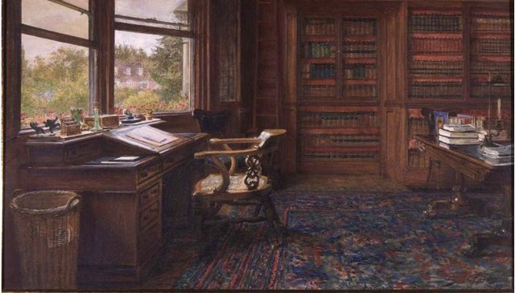
在蓋茨山莊的書房寫作一整天後突發中風，隔天去世，享年58歲。《艾德溫·德魯德之謎》只完成了6期，兇手是誰成為永遠的懸案。他在遺囑中要求簡單低調的葬禮，並希望葬在附近的羅徹斯特座堂，但在全國的呼聲下，他被安葬於倫敦西敏寺的詩人角，墓碑上寫著：「他同情貧窮、受苦與被壓迫的人；他的去世，使世界失去了一位最偉大的英國作家。」
