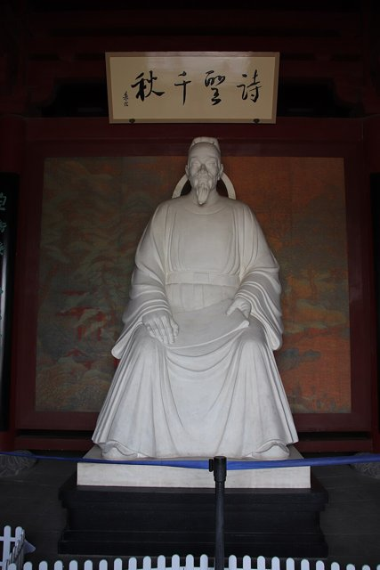
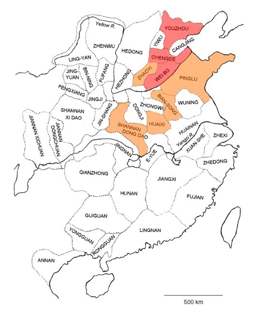
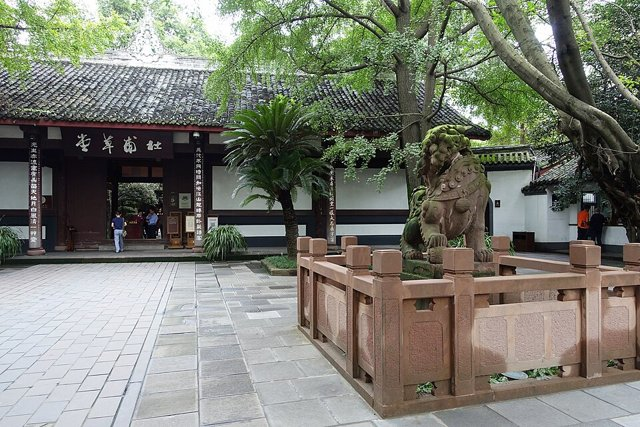

<!--
內容整理自 D:\Books\md\歷史\人物\中國\杜甫生平大事記（712－770年）.md（Books 的人物頁為 D:\Books\html\1-2-1.中國歷史人物\杜甫(712~770).html），並整合中文維基百科〈杜甫〉條目，以自己的話改寫。
時期依筆記的七個階段：少年、青年漫遊、長安困守、安史之亂、西行入蜀、夔州、出峽與病逝。筆記的「代表作品」寫進相關事件。
處理方式：
- 生日：筆記只寫712年；維基百科寫唐睿宗景雲三年正月一日（712年2月12日），born 依維基百科。
- 科舉：筆記寫約735年參加進士考試落第；維基百科寫735年回鞏縣參加鄉貢、736年在洛陽應進士試落第，這裡依維基百科。
- 嚴武：筆記寫762年嚴武離開成都、764年再任劍南節度使、765年去世；維基百科補充杜甫765年正月已退出嚴武幕府，四月嚴武病逝，五月離開成都，照此。
- 死因：筆記寫具體地點與原因仍有不同說法；維基百科提到有學者據詩句推測為消渴（糖尿病），傳統還有在耒陽因飲食過量而死的說法，內文只說明眾說紛紜。
- 筆記767年「《登岳陽樓》相關構思與作品醞釀」一則沒有具體事件，不列；〈登岳陽樓〉依筆記與通行說法放在768年。
- 筆記的〈茅屋為秋風所破歌〉作761年，依此。
- 人名與其他時間軸一致：李白（LiBai）；高適、嚴武、房琯沒有獨立時間軸。
圖片來源（皆為 Wikimedia Commons 公有領域／CC0 作品，縮成最長邊 640px）：
- df-cover.jpg：Dufu.jpg（杜甫像，清宮舊藏）
- df-birthplace.jpg：Birthplace of Dufu, Tang Dynasty Poet Statue of Dufu (Du Fu) (48028078791).jpg（河南鞏義杜甫故里的杜甫像）
- lb-cover.jpg：Liang Kai - Li Bai Strolling.jpg（梁楷〈太白行吟圖〉，南宋（與李白生平時間軸共用））
- lb-rebels.jpg：Rebel provinces post An Lushan.jpg（安史之亂後割據的藩鎮分布圖（與李白生平時間軸共用））
- df-caotang.jpg：Entry - Du Fu Thatched Cottage - Chengdu, Sichuan, China - DSC04875.jpg（成都杜甫草堂入口）
-->

# Periods
- 712 ~ 730 | 書香門第 | #868e96
  出身儒學世家，祖父杜審言是初唐名詩人；自幼讀經史、學詩文，少年已有文名，成長於開元盛世。
- 731 ~ 745 | 漫遊與結識李白 | #1971c2
  二十歲起漫遊吳越、齊趙，應進士試落第；744年在洛陽結識李白，與高適同遊梁宋，是文學史上著名的友誼。
- 746 ~ 755 | 長安十年 | #e67700
  到長安求仕，科舉受阻、獻賦僅得待制，生活困頓；看見權貴奢華與百姓疾苦，詩風轉向寫實與社會批判。
- 756 ~ 759 | 安史之亂 | #c92a2a
  流亡、被俘困守長安，冒險投奔肅宗，任左拾遺又因房琯事件被貶華州；目睹徵兵之苦，寫下〈三吏〉〈三別〉，終於棄官西行。
- 759 ~ 765 | 秦州、同谷與成都草堂 | #2f9e44
  歷經秦州、同谷的飢寒，入蜀在成都浣花溪畔築草堂，在嚴武照顧下過了一段相對安定的生活，得「杜工部」之稱。
- 765 ~ 770 | 夔州與湖湘漂泊 | #5f3dc4
  嚴武死後東下，在夔州寫出〈秋興八首〉〈登高〉等七律巔峰之作；出峽後漂泊湖南，貧病交加，死於湘江舟中。

# Events

## 712-02-12 | 出生 {label="712年（唐睿宗景雲三年）正月初一"}

杜甫字子美，河南府鞏縣（今河南鞏義）人，祖籍京兆杜陵，後來自號「少陵野老」。杜家有悠久的儒學傳統，遠祖是西晉名將杜預；祖父杜審言是初唐重要詩人，對近體詩格律的形成有貢獻；父親杜閑做過地方官。這樣的家庭讓他自幼接受儒家經典與文學的教育，形成重視經世致用的思想。

## 731 | 漫遊吳越 {label="731年（開元十九年）"}
約二十歲時離家漫遊江南吳越（今江蘇、浙江一帶），遊歷數年，接觸各地的山川風土，為日後的創作累積素材。

## 736 | 進士落第與漫遊齊趙 {label="736年（開元二十四年）"}
前一年回鞏縣參加鄉貢，這一年在洛陽應進士試，沒有考取。此後他到山東、河北一帶漫遊，青年時期豪邁開闊的〈望嶽〉約作於此時，「會當凌絕頂，一覽眾山小」寫出遠大的抱負。

## 744 | 洛陽結識李白 {label="744年（天寶三載）"}

剛離開長安的李白已經名滿天下，杜甫的詩藝則正在成熟，兩人在洛陽一見如故，隨後與高適同遊梁宋（今河南開封、商丘一帶），飲酒賦詩、談論理想；隔年又在山東同遊，分別後未再相見。杜甫一生寫了許多懷念李白的詩，對他的才華推崇備至。

## 746 | 到長安求仕 {label="746年（天寶五載）"}
約三十五歲時到長安，希望經由科舉、權貴推薦或文學才華取得官職，此後在長安住了近十年，生活長期困頓。

## 747 | 「野無遺賢」 {label="747年（天寶六載）"}
玄宗下詔選拔天下有一技之長的人，杜甫應試，但把持朝政的宰相李林甫讓應試者全部落選，再向玄宗報告「野無遺賢」（民間沒有被遺漏的人才）。仕途受阻的杜甫只能向權貴獻詩求助，同時看見盛世繁華下的社會矛盾，約750年的〈兵車行〉寫出徵兵造成的家破人亡。

## 751 | 獻《三大禮賦》 {label="751年（天寶十載）"}
杜甫寫了〈朝獻太清宮賦〉〈朝享太廟賦〉〈有事於南郊賦〉進獻玄宗，玄宗讚賞，命他待制集賢院，但仍沒有授予正式官職。約753年的〈麗人行〉諷刺楊貴妃一家的奢華，現實主義的詩風逐漸成形。

## 755 | 〈自京赴奉先縣詠懷五百字〉 {label="755年（天寶十四載）"}

四十四歲才得到右衛率府兵曹參軍這個管理兵甲、門禁的小官。十一月，他到奉先探望家人，途經驪山華清宮，對照權貴的享樂與沿途的饑寒，回家又遇幼子餓死，寫下「朱門酒肉臭，路有凍死骨」。同月，安祿山在范陽起兵，安史之亂爆發。

## 756 | 被俘困守長安 {label="756年（至德元年）"}
六月潼關失守，玄宗逃往四川，杜甫把家人安置在鄜州（今陝西富縣）的羌村，獨自北上投奔在靈武即位的肅宗，途中被叛軍俘獲押回長安；因官位低微，沒有被嚴密看管。困在淪陷的長安，他寫下〈月夜〉〈哀江頭〉，以及〈春望〉：「國破山河在，城春草木深」。

## 757 | 任左拾遺與房琯事件 {label="757年（至德二載）"}
杜甫冒險逃出長安，到鳳翔晉見肅宗，被任命為左拾遺，負責向皇帝進諫，這是他一生中少數真正進入中央的時期。不久，宰相房琯因兵敗被罷，杜甫上疏替他辯護，觸怒肅宗，險些獲罪。秋天回鄜州探親，寫下長詩〈北征〉；年底唐軍在回紇援助下收復長安、洛陽，杜甫隨朝廷回到長安。

## 758 | 貶華州司功參軍 {label="758年（乾元元年）"}
因與房琯的關係，杜甫被貶出朝廷，任華州司功參軍，負責地方文書事務，對政治現實更加失望。

## 759 | 〈三吏〉〈三別〉與棄官西行 {label="759年（乾元二年）"}
九節度使的官軍在相州大敗，朝廷四處抓丁補充兵源。杜甫從洛陽回華州途中，把所見寫成〈新安吏〉〈石壕吏〉〈潼關吏〉與〈新婚別〉〈垂老別〉〈無家別〉，記錄戰亂中百姓被強徵、骨肉離散的苦難，他的詩因此被稱為「詩史」。這年關中又逢饑荒，杜甫辭去官職，帶著家人西行到秦州（今甘肅天水）、同谷（今甘肅成縣），靠採集與友人接濟度日，寫下〈同谷七歌〉；年底翻越劍門入蜀，抵達成都。

## 760 | 營建成都草堂 {label="760年（上元元年）"}

在友人與地方人士的幫助下，杜甫在成都西郊浣花溪畔建了一座草堂，生活終於安定下來。這時期的詩除了憂國憂民，也多了田園與自然，如〈春夜喜雨〉「好雨知時節，當春乃發生」、〈蜀相〉懷念諸葛亮，以及〈江畔獨步尋花〉〈客至〉。草堂在五代時由詩人韋莊尋得遺址重建，今日是成都著名的文化紀念地。

## 761 | 〈茅屋為秋風所破歌〉 {label="761年（上元二年）"}
秋風吹破草堂的屋頂，夜雨又漏濕床鋪，杜甫由自己的困境想到天下的窮人：「安得廣廈千萬間，大庇天下寒士俱歡顏」，表現推己及人的胸懷。

## 762 | 嚴武離蜀與避亂梓州 {label="762年（寶應元年）"}
好友、成都尹嚴武對杜甫多有照顧，這年嚴武奉召入朝，蜀中將領徐知道趁機作亂，杜甫流寓梓州（今四川三台）、閬州（今四川閬中）一帶。同年玄宗、肅宗相繼去世，代宗即位。

## 763 | 〈聞官軍收河南河北〉 {label="763年（廣德元年）"}
史朝義兵敗自殺，安史之亂結束。在梓州聽到官軍收復河南、河北的消息，杜甫寫下一生「快詩」：「劍外忽傳收薊北，初聞涕淚滿衣裳」，急著想順流東下返回故鄉洛陽。但唐朝國力已大為衰退，藩鎮割據與吐蕃入侵接踵而來。

## 764 | 檢校工部員外郎 {label="764年（廣德二年）"}
嚴武再任劍南節度使，杜甫回到成都，入嚴武幕府任參謀，經嚴武推薦獲授檢校工部員外郎，後世因此稱他「杜工部」。〈登樓〉「花近高樓傷客心，萬方多難此登臨」寫於此年。

## 765 | 離開成都 {label="765年（永泰元年）"}
正月杜甫辭去幕府職務，四月嚴武病逝，失去依靠的杜甫在五月帶著家人乘船離開成都，沿長江東下，經嘉州、戎州、渝州、忠州、雲安，重新開始漂泊。

## 766 | 夔州與〈秋興八首〉 {label="766年（大曆元年）"}
杜甫抵達夔州（今重慶奉節），得到夔州都督柏茂琳的照顧，在這裡住了將近兩年，是他創作最多產的時期之一。面對三峽的秋景，他寫下〈秋興八首〉，藉秋色寄託對長安故都與國家命運的思念；又寫〈詠懷古跡五首〉，借庾信、宋玉、王昭君等人的遭遇抒發身世之感，是晚年七律的代表作。

## 767 | 〈登高〉 {label="767年（大曆二年）"}
重陽節登高遠望，年老多病、漂泊無依的杜甫寫下「無邊落木蕭蕭下，不盡長江滾滾來」與「萬里悲秋常作客，百年多病獨登臺」，把自然景象、人生悲慨與歷史感融為一體，被譽為古今七律第一。

## 768 | 出峽與〈登岳陽樓〉 {label="768年（大曆三年）"}
杜甫離開夔州出三峽，原想北返中原，但因身體衰弱與戰亂未能如願，只能經江陵南下。到岳陽登岳陽樓，面對浩瀚的洞庭湖寫下〈登岳陽樓〉：「親朋無一字，老病有孤舟。戎馬關山北，憑軒涕泗流。」此後往來岳州、潭州（今長沙）、衡州（今衡陽）之間，長年住在船上。

## 770 | 病逝湘江舟中 {label="770年（大曆五年）冬"}
在潭州偶遇昔日宮廷樂師李龜年，寫下〈江南逢李龜年〉，以「正是江南好風景，落花時節又逢君」寄寓盛衰之感。這年冬天，杜甫在湘江的船上病逝，享年五十九歲（虛歲）。死因眾說紛紜，有學者據詩句推測是消渴病（糖尿病）。他生前並不顯達，同時代的詩選甚至沒有收他的詩；中唐以後才受推崇，韓愈說「李杜文章在，光焰萬丈長」，宋代以後被尊為「詩聖」。現存詩約一千四百餘首，後人編為《杜工部集》。
