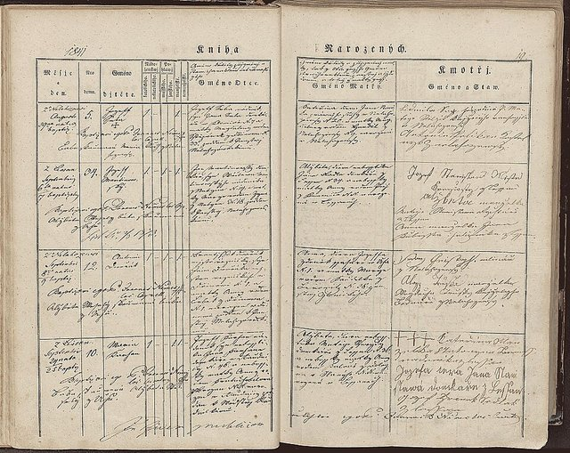
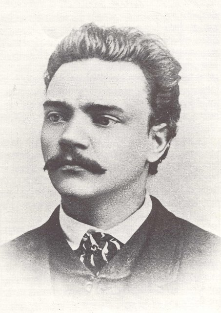
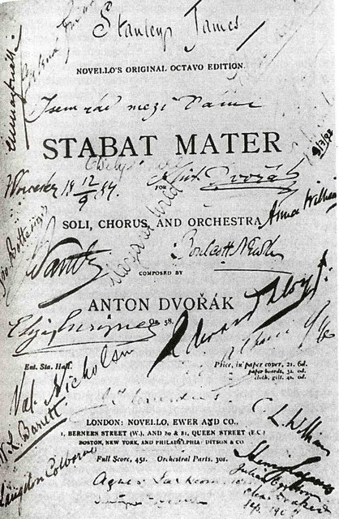
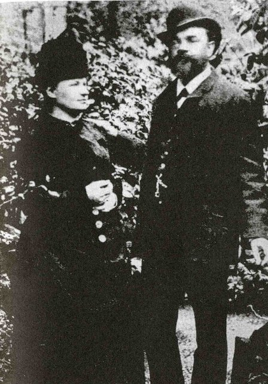
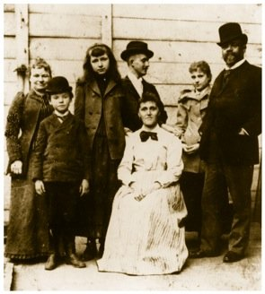
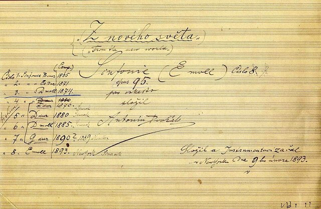
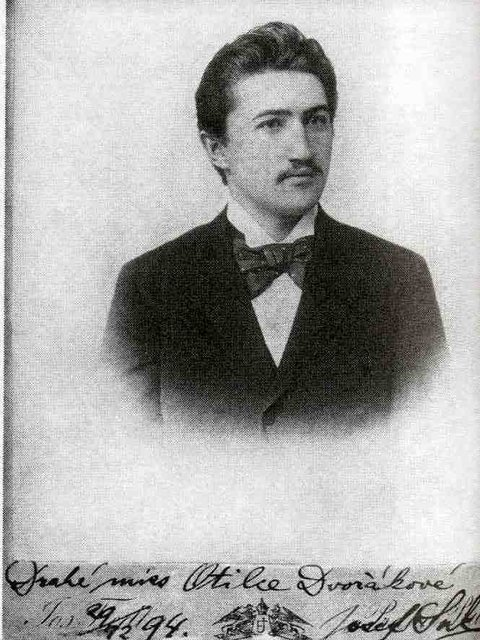
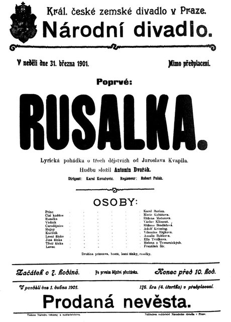
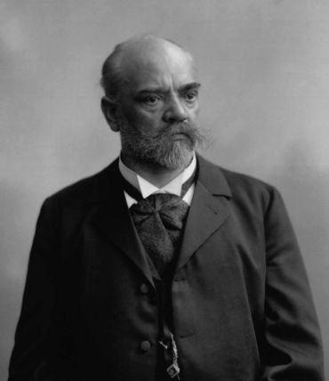
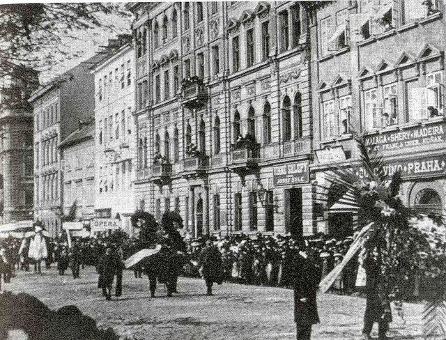

<!--
內容整理自中文維基百科「安東寧·德弗札克」與英文維基百科「Antonín Dvořák」條目（CC BY-SA 4.0），並以台灣用語改寫摘要。
https://zh.wikipedia.org/zh-tw/安东宁·德沃夏克
https://en.wikipedia.org/wiki/Antonín_Dvořák
兩者不一致處以英文條目為準，例如：中文條目說《國王與燒炭工》1874年首演即是原版，英文條目則說原版被退回，1874年上演的是完全重寫的第二版。
圖片皆為 Wikimedia Commons 上的公有領域（含PD-US）作品（封面：1882年左右的肖像照）。
-->

# Periods
- 1841 ~ 1857 | 童年@內拉霍澤維斯、茲洛尼采
  父親是旅店老闆、肉販兼齊特琴手，他從小在村裡的樂隊和教堂拉小提琴。13歲被送到茲洛尼采的舅舅家學德語，跟著脾氣暴躁卻很欣賞他的李曼學管風琴、鋼琴與樂理。
- 1857 ~ 1871 | 布拉格的中提琴手@Prague
  進入布拉格管風琴學校，畢業後在咖啡館、舞會演奏，後來成為臨時劇院樂團的中提琴手，在史麥塔納、華格納的指揮下演奏。十年間默默自學作曲，作品幾乎沒有公開演出過。
- 1871 ~ 1877 | 嶄露頭角
  辭去樂團工作專心作曲，結婚後在聖亞德伯教堂擔任管風琴師。愛國清唱劇讓他在布拉格成名，並連年獲得奧地利國家獎學金，評審之一正是布拉姆斯。
- 1877 ~ 1892 | 名揚國際
  布拉姆斯把他推薦給出版商西姆洛克，《斯拉夫舞曲》一出版就風靡歐美。他九度訪問英國指揮自己的作品，也到俄國演出，結識柴可夫斯基，1891年起任教於布拉格音樂院。
- 1892 ~ 1895 | 新世界@New York
  應邀擔任紐約國家音樂院院長，主張美國音樂應該以黑人與原住民音樂為根基。在紐約與愛荷華州的捷克小鎮寫下《新世界》交響曲、《美國》四重奏與大提琴協奏曲。
- 1895 ~ 1904 | 晚年：交響詩與歌劇
  因思鄉與欠薪回到波希米亞，轉向交響詩與歌劇創作，《水仙女》成為他最受歡迎的歌劇。晚年擔任布拉格音樂院院長、獲封奧地利上議院議員，60歲生日被當成全國性的慶典。

# Events

## 1841-09-08 | 出生@內拉霍澤維斯

生於布拉格北方伏爾塔瓦河畔的內拉霍澤維斯村，是旅店老闆兼肉販、齊特琴手法蘭提謝克的長子。他是14個孩子中的老大，其中8個長大成人。在村裡的聖安德烈教堂受洗，童年的鄉村生活培養了他虔誠的信仰與對波希米亞的熱愛。

## 1847 | 上小學，學小提琴
跟著小學老師學小提琴，很早就展露天分，在村裡的樂隊與教堂演奏。這段期間村裡蓋了火車站，讓他一輩子熱愛火車。

## 1853 | 到茲洛尼采學德語
13歲被父親送到茲洛尼采的舅舅家學德語，這是當時在波希米亞謀生的必備條件。他跟教堂管風琴師李曼學管風琴、鋼琴、小提琴與樂理，李曼脾氣暴躁，他卻非常敬重這位老師。據中文條目，他在這裡還學了屠宰手藝，1856年取得屠夫學徒的證書。

## 1857-09 | 進入布拉格管風琴學校
在舅舅與李曼的勸說下，父親終於答應讓他走音樂之路，條件是以當管風琴師為目標。他在學校學唱歌、樂理與管風琴，另外補習德語，同時在聖則濟利亞協會等樂團兼差拉中提琴。1859年以全班第二名畢業，應徵教堂管風琴師卻沒錄取。

## 1858 | 加入科姆札克樂團
在科姆札克的樂團演奏，常在布拉格的餐廳與舞會表演。這段期間他也開始寫弦樂五重奏與弦樂四重奏，後來分別被他列為作品1、作品2。

## 1862 | 臨時劇院的中提琴手
科姆札克的樂團整團被延攬進新開幕的波希米亞臨時劇院樂團，他擔任中提琴手將近十年。窮得買不起音樂會門票的他，藉此聽遍了各種歌劇。1863年7月華格納親自來指揮，他從1857年起就對華格納「無比崇拜」。

## 1864 | 與五人合租公寓
在布拉格日什科夫區和五個人合租公寓，其中一位室友有一台小鋼琴，他自己則一直沒有鋼琴。據中文條目，這一年他第三度、也是最後一次被軍隊拒絕入伍。

## 1865 | 初戀約瑟芬娜；第一號交響曲
為了補貼微薄的收入開始教鋼琴，愛上了學生、劇院女演員約瑟芬娜·切爾馬科娃，為她寫了歌曲集《絲柏》，但她沒有接受他的感情，後來嫁給一位伯爵。同年寫下C小調第一號交響曲《茲洛尼采之鐘》，手稿保存了下來，但他生前從未演出。

## 1866 | 史麥塔納接任首席指揮

捷克民族樂派的先驅史麥塔納成為臨時劇院的首席指揮，他在史麥塔納的指揮下演奏，月薪只有大約7.5美元。

## 1870 | 第一部歌劇《阿爾弗雷德》
從5月到10月寫成第一部歌劇，講述撒克遜人與丹麥人的戰爭，他生前從未上演，直到1938年才完整演出。

## 1871 | 辭去樂團工作專心作曲
6月，報紙第一次提到「安東寧·德弗札克」這個名字；10月，歌曲〈回憶〉成為他第一首公開演出的作品。他的歌劇《國王與燒炭工》被劇院以「無法演出」為由退回，他意識到自己模仿華格納走得太極端。

## 1873-03 | 《白山的繼承者》一鳴驚人
這首愛國清唱劇由三百人的合唱團演出，觀眾與樂評一致叫好，讓他在布拉格嶄露頭角。

## 1873-11-17 | 與安娜·切爾馬科娃結婚
娶了初戀約瑟芬娜的妹妹安娜，兩人共生了九個孩子，其中幾個不幸夭折。婚後他在聖亞德伯教堂擔任管風琴師，薪水微薄，但對年輕夫妻來說仍是一筆及時的收入。

## 1874 | 《國王與燒炭工》重寫版上演；奧地利國家獎學金
把同一部歌劇劇本以完全不同的手法重新譜曲，在布拉格首演成功。同年他送出十五部作品申請奧地利國家獎學金，包括第三、第四號交響曲，評審團的布拉姆斯被他的「才華與技巧」深深打動。評審報告形容他是「家境清寒的音樂教師」，還提到他連一台鋼琴都沒有。

## 1875 | 豐收的一年；《弦樂小夜曲》
長子出生的這一年，他寫下第五號交響曲、第一號鋼琴三重奏，以及至今仍深受喜愛的E大調弦樂小夜曲。9月出生才兩天的女兒約瑟法夭折，據中文條目，悲痛的他寫下G小調鋼琴三重奏寄託哀思。

## 1876 | 再獲獎學金，辭去管風琴師
又一次贏得國家獎學金，終於能辭去教堂管風琴師的工作，專心作曲。

## 1877 | 痛失兩個孩子；與布拉姆斯結緣
8月，不到一歲的女兒如珍娜誤喝了磷溶液身亡；9月，三歲的長子奧塔卡也死於天花。接連的喪子之痛，也籠罩著他這一年完成的《聖母悼歌》。12月他收到樂評家漢斯立克的來信，得知布拉姆斯一直是評審，兩人並願意幫忙把他的音樂推廣到國外。同月他寫了D小調弦樂四重奏獻給布拉姆斯。

## 1878 | 《斯拉夫舞曲》風靡歐洲
布拉姆斯把他的二重唱集《摩拉維亞二重唱》推薦給出版商西姆洛克，出版後大受歡迎。西姆洛克想起布拉姆斯暢銷的《匈牙利舞曲》，請他寫類似的作品，於是誕生了《斯拉夫舞曲》第一集。柏林樂評家預言這些舞曲將「傳遍全世界」，德國樂譜店一時被搶購一空，隔年就在法國、英國與美國演出。

## 1879 | 弦樂六重奏與小提琴協奏曲
名小提琴家約阿希姆首演了他的弦樂六重奏，從此成為他室內樂的頭號推手。他也為約阿希姆寫了小提琴協奏曲並大幅修改，但約阿希姆始終沒有公開演奏過它。

## 1880 | 《聖母悼歌》首演
他的第一部宗教作品在布拉格首演。

## 1881-03-25 | 第六號交響曲首演
原本是應李希特之邀為維也納愛樂而寫，但樂團成員因為「反捷克情緒」不願連續兩季演出他的作品，最後改在布拉格首演。李希特後來仍在倫敦指揮了這首曲子，一直很支持他。

## 1882 | 母親去世
母親安娜在克拉德諾去世，他寫下F小調鋼琴三重奏紀念她。

## 1883-03-10 | 《聖母悼歌》在倫敦大獲成功
在倫敦皇家亞伯特音樂廳演出後轟動一時，在英美各地掀起一連串演出熱潮，比德國與奧地利還早一年認識他的作品。

## 1884-03 | 第一次訪問英國

應倫敦愛樂協會邀請首度訪英，指揮自己的作品，大受歡迎。他一生至少八次到英國。這年他也在波希米亞鄉間的維索卡買下一棟鄉居，此後常在那裡避暑、作曲。

## 1885-04-22 | 第七號交響曲倫敦首演

為倫敦愛樂協會的委託而寫，在倫敦聖詹姆士音樂廳親自指揮首演。8月他又在伯明罕指揮清唱劇《鬼新娘》，五百人的合唱團與一百五十人的樂團演出，是他到當時為止最大的勝利。

## 1888-02 | 結識柴可夫斯基
據中文條目，2月柴可夫斯基到布拉格時兩人初次見面，相處融洽。同月《聖母悼歌》在維也納演出，卻又遭遇反捷克的樂評攻擊。

## 1889 | 奧地利皇帝授勳
據中文條目，他獲得帝國頒發的鐵十字勳章，並受邀在皇帝法蘭茲·約瑟夫一世面前演奏。同年寫成G大調第八號交響曲。

## 1890-03 | 訪問俄國
在柴可夫斯基的牽線下，到莫斯科與聖彼得堡指揮自己的作品。

## 1891 | 劍橋榮譽博士；布拉格音樂院教授
獲劍橋大學頒授榮譽博士，並接受布拉格音樂院作曲與配器教授的職位。他起初拒絕，後來似乎是因為和西姆洛克為了第八號交響曲的稿酬鬧翻，才改變主意。他的學生蘇克與內德巴爾同年組成了「波希米亞四重奏」。他的《安魂曲》也在伯明罕音樂節首演。

## 1892-09-26 | 抵達紐約

應慈善家瑟伯夫人之邀擔任紐約國家音樂院院長，年薪一萬五千美元，是布拉格音樂院的25倍。這所學院招收女性與黑人學生，在當時相當罕見。他在報上撰文主張，美國音樂應該以黑人與原住民的音樂為基礎，發展出自己的民族風格。他也在這裡認識了學生哈利·伯利，後來成為最早的非裔美國作曲家之一，向他介紹了黑人靈歌。

## 1893-06 | 愛荷華州斯皮爾維爾的夏天
跟著秘書科瓦日克到他的家鄉、愛荷華州的捷克移民小鎮斯皮爾維爾，全家在那裡度過暑假，他稱之為「夏天的維索卡」。在這裡寫下F大調弦樂四重奏《美國》與降E大調弦樂五重奏。同年也到芝加哥世界博覽會指揮第八號交響曲。據中文條目，他在紐約時為了看火車，還特地搭高架鐵路欣賞從各大城市開來的特快車。

## 1893-12-16 | 《新世界》交響曲首演

受紐約愛樂委託而寫，由塞德爾指揮在卡內基音樂廳首演，掌聲如雷。傳記作者認為這很可能是他一生中最大的勝利；樂譜出版後，世界各地的指揮與樂團爭相演出。

## 1894 | 經濟恐慌與減薪
1893年的經濟恐慌重創瑟伯家族與音樂院的贊助者，他的年薪被砍到八千美元，而且還經常拖欠。

## 1895-02 | 完成大提琴協奏曲
B小調大提琴協奏曲在1894到1895年的冬天寫成於紐約的寓所，《新世界》交響曲也誕生在這裡。這棟房子在1991年被拆除，捷克總統哈維爾等人都曾出面抗議，附近的斯泰弗森公園後來立了他的雕像。

## 1895-04-27 | 返回波希米亞
思鄉、欠薪，加上維也納音樂之友協會推舉他為榮譽會員，他決定不等學期結束就回國。同年5月，初戀約瑟芬娜去世，他修改了大提琴協奏曲的尾聲來紀念她。11月重回布拉格音樂院任教。

## 1896 | 交響詩與最後一次訪英
根據詩人艾爾本的民謠詩集《花束》寫下《水妖》、《午時女巫》、《金紡車》、《野鴿》等交響詩。3月最後一次到倫敦，指揮大提琴協奏曲首演。同年布拉姆斯勸他搬到維也納，並說：「你需要什麼，我的財產都可以給你。」他深受感動，妻子也流下眼淚，但身為捷克人，他無法想像離開波希米亞。

## 1897-04-06 | 參加布拉姆斯的葬禮
他在布拉姆斯臨終前前往探望，並參加了葬禮。據中文條目，他在葬禮上擔任持火炬者。11月他接替布拉姆斯成為維也納藝術家獎學金的評審，可以像當年自己受到的幫助一樣，協助年輕作曲家。

## 1898 | 女兒嫁給學生蘇克

女兒奧蒂莉嫁給他的學生、作曲家蘇克，可惜七年後就過世了。據中文條目，愛火車的他曾派蘇克去車站抄特快車的車頭號碼，蘇克卻抄回運煤車的號碼，讓他忍不住挖苦：「我怎麼會把女兒嫁給你！」

## 1899-06 | 皇帝頒贈藝術與科學金質獎章
法蘭茲·約瑟夫一世在覲見儀式上親自頒獎。

## 1900-04-04 | 最後一場音樂會
與捷克愛樂合作，指揮布拉姆斯、舒伯特、貝多芬的作品與自己的交響詩《野鴿》。

## 1901-03-31 | 歌劇《水仙女》首演

改編自水妖愛上人類王子的童話故事，成為他十部歌劇中最受歡迎的一部，劇中的〈月亮頌〉至今仍是女高音的名曲。

## 1901 | 上議院議員、布拉格音樂院院長
4月被皇帝任命為奧地利上議院議員（據中文條目，他宣誓就職後從未出席會議），11月起擔任布拉格音樂院院長直到去世。他的60歲生日被當成全國性的慶典，波希米亞與摩拉維亞各地都為他慶生。

## 1904-03-25 | 因病離開《阿米達》排練

最後一部歌劇《阿米達》排練時，他因身體不適中途離開。4月的第一屆捷克音樂節幾乎全是他的作品，一萬六千名歌手演唱他的神劇，他卻已病倒在床，無法出席。

## 1904-05-01 | 逝世@布拉格

在病了五週之後去世，享年62歲，留下許多未完成的作品。5月5日舉行國葬，安葬在布拉格的高堡公墓。
